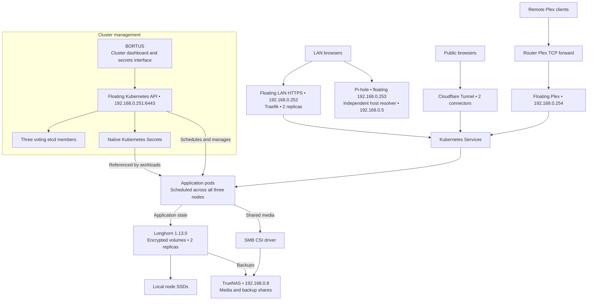

# Branconet cluster architecture

This three-machine Kubernetes homelab runs application workloads and a voting
control-plane member on every node. Two of the three etcd members keep the
datastore available during one node outage.

**Topology updated:** November 8, 2026. Hardware and point-in-time capacity
measurements are from October 30, 2026. Workload placement and free space vary.

## Cluster overview

The stable API endpoint is `https://k8s-api.branconet.lan:6443`. The scheduler
and controllers manage workloads across all three nodes. Each node's kubelet
uses its dedicated containerd runtime. BORTUS uses the Kubernetes API for
cluster management and native Secret integration.

## Node specifications

| Specification | node01 | node02 | node03 |
| --- | --- | --- | --- |
| Address | `192.168.0.4` | `192.168.0.6` | `192.168.0.5` |
| Role | Control plane + workloads | Control plane + workloads | Control plane + workloads |
| CPU | AMD FX-8350 | Intel i5-6500 @ 3.20 GHz | Intel i7-3770 @ 3.40 GHz |
| Logical CPUs | 8 | 4 — 4 cores | 8 — 4 cores / 8 threads |
| OS-visible RAM | 15.51 GiB | 15.50 GiB | 15.49 GiB |
| Physical SSD | Kingston SA400S3, 120 GB | Reported model “SATA SSD”, 256 GB | Kingston SA400S3, 120 GB |
| Root filesystem capacity | 107.8 GiB | 232.2 GiB | 107.8 GiB |
| Usable root space at inspection | 24.8 GiB | 46.1 GiB | 22.4 GiB |
| GPU hardware | NVIDIA GeForce GTX 560 | Intel HD Graphics 530 | Intel HD Graphics 4000 |
| Ethernet interface | `enp10s0` | `enp0s31f6` | `enp3s0` |
| Ethernet link | 1 Gbps, full duplex | 1 Gbps, full duplex | 1 Gbps, full duplex |
| Kubernetes Node Pod CIDR | `10.244.0.0/24` | `10.244.4.0/24` | `10.244.2.0/24` |

All three nodes run:

- Ubuntu **22.04.4 LTS**, amd64.
- Linux **`5.15.0-202-generic`**.
- Kubernetes **`1.37.2`**, provisioned and maintained with kubeadm.
- containerd **`2.4.2`**, using `unix:///run/containerd-k8s/containerd.sock`.
- An ext4 root filesystem on LVM, with Longhorn data at `/var/lib/longhorn/`.

RAM values are Linux `MemTotal`, not verified DIMM capacities; unprivileged DMI
access was unavailable. The FX-8350 reports eight logical CPUs with four Linux
core IDs; this is its reported topology, not a claim of ordinary SMT. GPU
presence does not establish device-plugin allocation or application acceleration.
Physical SSD capacities use decimal GB. Filesystem capacities and free space use
GiB; usable free space is `statvfs.f_bavail`, excluding reserved filesystem blocks.
Virtual Longhorn iSCSI devices and loop devices are excluded from physical SSD
capacity.

Workload placement is dynamic. The measured free space reflects the hardware
inspection date and can change during image pulls and replica recovery.

A November 8 runtime check found all three nodes Ready and approximately
28 GiB free on node01, 48 GiB on node02, and 28 GiB on node03 on the
filesystems backing Longhorn. All 29 attached Longhorn volumes were healthy.
The other 17 volumes were detached.

## Networking and access

| Component | Observed configuration |
| --- | --- |
| Pod network | Calico `3.33.0`; pool `10.244.0.0/16`, IP-in-IP enabled |
| Service networking | kube-proxy `1.37.2` |
| Internal DNS | CoreDNS `1.15.0`, two replicas; DNS Service `10.96.0.10` |
| Ingress | Traefik `2.11.60`, two replicas |
| LAN ingress | Floating `192.168.0.252` on 80/443, with the legacy routes retained during migration |
| LAN DNS | Floating Pi-hole `192.168.0.253` and independent host resolver `192.168.0.5`. DHCP still advertises the XR500 gateway resolver |
| Public web | Cloudflare Tunnel to Kubernetes Services |
| Plex | Dedicated floating address `192.168.0.254` on TCP 32400, used by the router forward |
| Certificates | cert-manager `1.21.3`; configured LAN CA and public certificates |
| Operator access | SSH as `james`, port `2002`, with existing key and strict host-key verification |

Traefik matches the requested hostname and forwards traffic to a Kubernetes
Service, which selects the application's pods. Calico provides pod connectivity
and NetworkPolicy enforcement. Certificates and keys are supplied through native
TLS Secrets.

BORTUS is available at **<https://bortus.branconet.lan>**. Its LAN route uses
`branconet-local-ingress-tls`, with HTTP redirected to HTTPS. Trust in the existing
local CA must be present on the client. The BORTUS application runs one replica.
Its HelmRelease remains suspended for application upgrades while the existing
deployment continues serving.

qBittorrent runs with a kernel WireGuard sidecar through Proton VPN. The
sidecar blocks direct internet egress and publishes confirmed TCP and UDP
port leases on a shared Longhorn claim. qBit Monitor reads that port and
updates qBittorrent through its internal WebUI Service. Radarr and Sonarr
also use the internal Service. The LAN WebUI uses Traefik. Proton may
reassign its forwarded port while the VPN remains connected.

## Storage layout

| Storage layer | Count and state at inspection | Purpose and behavior |
| --- | --- | --- |
| Longhorn `1.13.0` | **44 encrypted volumes**; all configured for **two replicas** | Persistent application databases, configuration and state on node SSDs |
| Active Longhorn volumes | **28 attached and healthy** | Volumes attached to running consumers |
| Retained Longhorn volumes | **16 detached** | Preserved volumes; detached status is not an active workload health result |
| SMB CSI `1.20.4` | **14 volumes** | Shared NAS media and retained NAS-backed recovery mounts |
| Kubernetes claims | **58 PVCs Bound to 58 PVs** | 44 Longhorn-backed and 14 SMB-backed bindings |
| Longhorn backup target | Available at inspection | NAS `192.168.0.8`, CIFS share `container_backups`, directory `k8s-migration-20261009/longhorn` |

Longhorn's primary `longhorn` StorageClass uses the v1 data engine, ext4,
encryption, two replicas and a **Retain** reclaim policy. Replicas are stored
under `/var/lib/longhorn/` on the same root SSD used by the OS and container
runtime. Two replicas provide two copies, not one copy on every node. The separate
`longhorn-static` class has a Delete policy; the Retain policy is not universal.

NAS media remain on TrueNAS and reach pods through the SMB CSI driver. They are
not copied into Longhorn. The observed PV inventory contains no Gluster-backed
volumes. Historical Docker/Gluster sources and migration recovery material remain
protected; their presence must not be treated as authorization to delete data.

Replication, snapshots and backups serve different purposes. Replicas provide
live volume copies; snapshots record volume history; the NAS backup target holds
off-node recovery data. A healthy replica count alone does not prove a usable
backup or restore.

## Application deployment flow

```mermaid
flowchart LR
    Change["Edit chart templates / values"] --> Main["branconet-charts<br>main branch"]
    Main --> CI["Local Windows / WSL publisher<br>Polls every 45 seconds"]
    CI --> Checks["Chart rendering, effective values<br>and credential / configuration checks"]
    Checks -->|"Successful exact commit"| Validated["validated branch<br>+ immutable revision tag"]
    Validated --> Flux["Flux source-controller<br>Polls every minute"]
    Flux --> Kustomize["migration-releases<br>./flux/releases"]
    Kustomize --> Helm["Helm controller"]
    Helm --> Rollout["Kubernetes rollout<br>Pods, Services and PVC references"]
```

### Source ownership

| Source or component | Responsibility |
| --- | --- |
| [branconet-homelab](https://github.com/jtmb/branconet-homelab) | BORTUS application source, Ansible maintenance and operational documentation |
| [branconet-charts](https://github.com/jtmb/branconet-charts) | Separate private repository for live charts, application values and Flux composition |
| `charts/<name>/values.yaml` in the charts repository | Per-application chart defaults |
| `flux/releases/<name>.yaml` in the charts repository | Effective application deployment overrides |
| Local Windows watcher and native WSL publisher | Validate and promote an exact reviewed charts commit |
| Flux in `flux-system` | Pull and reconcile the promoted desired state |
| BORTUS / native Kubernetes Secrets | Runtime secret management; secret values stay outside Git |

### From a push to a running application

1. Change the application's chart templates, values or effective HelmRelease
   overrides and push the reviewed commit to charts `main`.
2. The local watcher polls every **45 seconds**. Its publisher validates the
   exact commit, including rendered charts, effective values, credential guards
   and the existing configuration checks. **GitHub Actions is not used.**
3. A successful check permits publication of that exact commit to **`validated`**
   and an immutable **`validated-<full-sha>`** tag. Failed checks do not promote.
4. Flux's `flux-system/branconet-charts` GitRepository reads the private
   repository's `validated` branch using its repository-specific read-only SSH
   credential. The source polls every **one minute**.
5. The `flux-system/migration-releases` Kustomization reconciles
   **`./flux/releases`** every minute. It uses **`prune: false`** and
   **`force: false`**; removing a manifest from Git is not an instruction for this
   Kustomization to garbage-collect its resource.
6. Helm controller reconciles the application releases. Normal application
   release intervals are **five minutes**. Git chart sources use
   **`reconcileStrategy: Revision`**, so chart content changes are detected
   without relying solely on a chart version bump.
7. Kubernetes rolls out the resulting workloads. Verify the actual image,
   readiness, application behavior and preserved data; publication or a Ready
   controller alone is not complete application acceptance.

Application code pushes do not deploy an application by themselves. A new image
must first be built and made available through its approved registry or node
preload procedure, then referenced by the reviewed chart change. Image availability
and pull policy remain application-specific. BORTUS's suspended release is an
explicit exception to automatic application upgrades, not a missing deployment.

At inspection, the running local watcher had published charts revision
**`43b63fd2ee2e3f1c6d982ef9a891800e179ef976`**, and both the active Flux source
and Kustomization had observed that revision. The cluster had **31 HelmReleases**:
**30 active**, plus the intentionally suspended BORTUS release. The old
`migration-validated` source remains pinned to its historical checkpoint; the
active application Kustomization uses `branconet-charts`.

### Infrastructure, secrets and rollback

Ansible runs outside the cluster and performs repeatable host and infrastructure
maintenance over SSH. Use the [existing-cluster maintenance
playbooks](k8s-rewrite/ansible-playbook/README.md); the retained destructive reset
installer is not a maintenance entry point. Flux remains the application deployer.

Secret values live in native Kubernetes Secrets and are referenced by workloads.
BORTUS provides the management interface under its configured API permissions.
Charts contain references and configuration, not secret values. This architecture
does not claim that every Vault feature is implemented by the deployed BORTUS
application.

Routine application rollback is a reviewed chart revert through the same
validation and Flux pipeline. Stateful schema changes may require a separate
data-compatible recovery procedure; changing an image back does not reverse a
database migration.

## Operational characteristics

- **Control-plane quorum:** the floating API can move when a node is down. Two
  voting etcd members are required to continue committing cluster changes.
- **Shared storage capacity:** the OS, image runtime and Longhorn replicas compete
  for each node's root SSD. The free-space values above are point-in-time usable
  space, not promises of future capacity or new replica admission.
- **Shared 1 Gbps links:** application, replica and NAS traffic use the measured
  node Ethernet links.
- **Publisher dependency:** if the local publisher PC or its watcher is offline,
  new chart promotions pause. Existing workloads continue, and Flux can reconcile
  the last promoted revision independently.
- **Scoped deployment holds:** BORTUS application development and release
  qualification remain separate from cluster maintenance. Its hold must not be
  silently removed to make all releases appear active.

## Related documentation

- [Flux source and application deployment contract](docs/FLUX-GITOPS.md)
- [BORTUS deployment and Secret integration](docs/BORTUS-DEPLOYMENT.md)
- [BORTUS LAN HTTPS](docs/BORTUS-LAN-TLS.md)
- [Cluster hardening and preservation results](docs/CLUSTER-HARDENING-20261028.md)
- [Migration status and remaining acceptance items](MIGRATION_STATUS.md)
- [Current local publication procedure](https://github.com/jtmb/branconet-charts/blob/main/docs/LOCAL-PUBLISHING.md)
- [Local validation watcher](https://github.com/jtmb/branconet-charts/blob/main/docs/LOCAL-CI-SERVICE.md)

The local publication documents supersede historical references to a hosted
Actions publisher. Older inventory counts and image tags in historical runbooks
remain historical observations.
