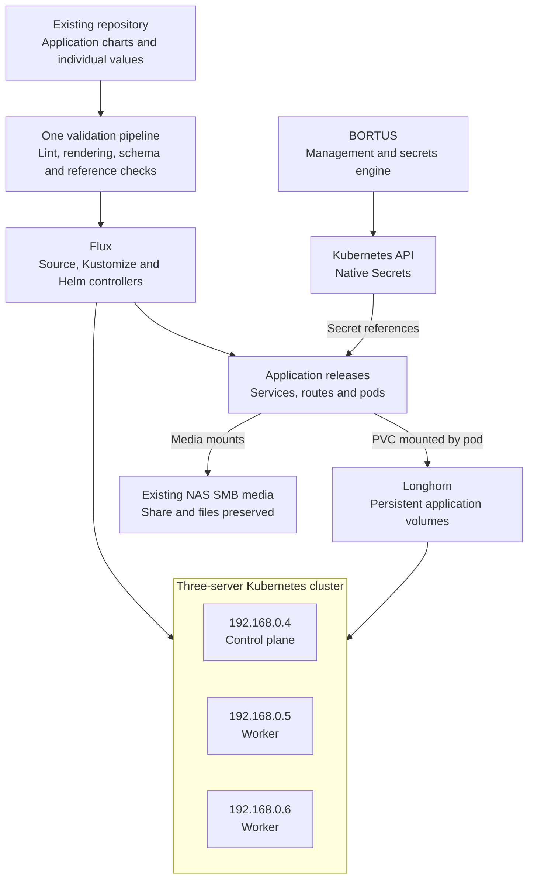
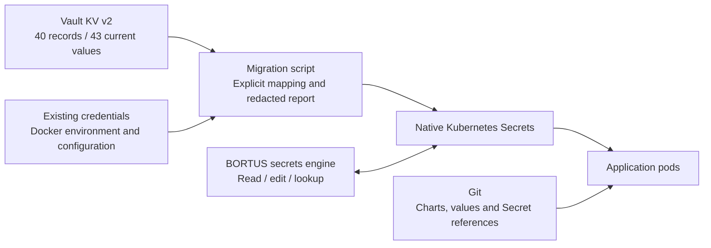
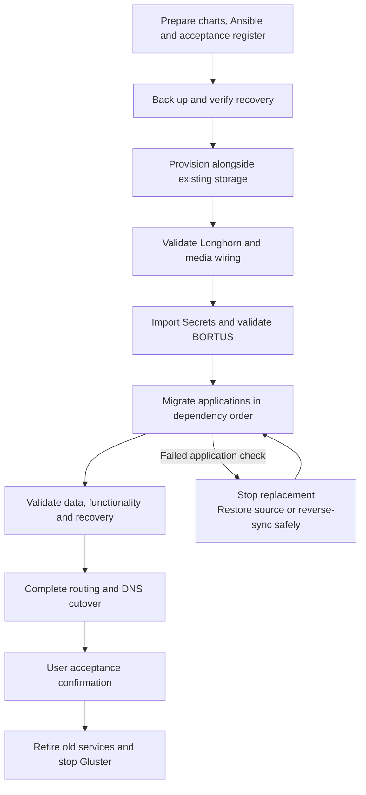

# Kubernetes migration plan and acceptance contract

Approved by the user on 2026-10-09. Execution target: under six hours from execution approval. Data-preservation and acceptance gates remain mandatory.

## Work ownership

- This chat owns cluster migration, server provisioning, chart/values migration, Flux, Longhorn, data preservation, application cutovers, and acceptance evidence.
- As directed by the user on 2026-10-10, execution now uses three agents total: this coordinator plus the BORTUS application and native-transport sub-agents. Application and migration ownership remain separate, with scoped worktrees and reviewed handoffs; the former execution chats are archived. No new execution chats are required.
- After plan approval, create the migration goal with this full acceptance contract and execution target. Gluster/Vault retirement follows the user's final migration confirmation.

Current checkpoint: candidate8cf passes composed local functional and actual compiled fresh-account SQL qualification, but the original three-pair comparison still fails four concurrent warm-Pod fixtures. A separate sync-filesystem prototype passes16 controls and480 loopback requests with a lower median batch cost; production integration and unchanged Next gates remain required. Corrected29 recovery-helper and nine identity-publication controls pass with fresh process/source verification; actual crypto/live TCP/API recovery is still open. Final image/security, latest backups and guarded rollout remain open. Native concurrency stays eight; original Gluster/Vault/Consul data and accepted backups stay retained.

## Verified starting point

Vault was unsealed using the user-supplied key and returned HTTP 200, initialized=true, sealed=false, standby=false. Authenticated inventory found 40 current KV records containing 43 values. Secret values and credentials must not be written into this plan, Git, command arguments, or reports.

| Area | Verified observation |
|---|---|
| Servers | 192.168.0.4 master, 192.168.0.5 worker2, 192.168.0.6 worker1; SSH and sudo work on all three |
| SSH | User james, port 2002, WSL key ~/.ssh/id_ed25519; never copy or print the private key |
| Current cluster | All three are Swarm managers; 32 Swarm services and six standalone containers |
| Destination | Existing Ansible playbook and charts directory in the repository's k8s-rewrite branch |
| Gluster | staging-gfs: three replicated bricks at /gluster/volumes; all connected and online |
| Integrity | No reported split-brain; a small, changing heal backlog references Plex logs |
| Other storage | NAS SMB media/backups, NAS NFS application data, local Plex configurations |
| Secrets | Vault KV v2; BORTUS currently reads its database and pushes secrets to Kubernetes |
| Plex | Three running servers; master has Movies, TV Shows and PVR; workers have Movies and TV Shows |

Repository: https://github.com/jtmb/branconet-homelab/tree/k8s-rewrite/k8s-rewrite

Inspected tree baseline: 25586ef4d5e120b852da1a49b281aa918284c05f.

Approximate state measurements: Gluster 2.1 GB, NFS application data 1.9 GB, master Plex configuration 7 GB. Gluster sizing encountered changing Jackett files and must be repeated after stopping writers. Other Plex configurations must also be backed up and retained.

Data scope clarification during execution, 2026-10-09: the user confirmed FlareSolverr /config and Vault /vault/file and /vault/logs anonymous directories were disposable runtime state. Their original paths were removed by initial Swarm task shutdown before archival; that sequencing error is recorded in MIGRATION_STATUS.md. They are excluded from required dataset recovery on the user's explicit clarification. Vault's authoritative data remains the Consul store on Gluster; all Gluster/NFS/Plex/application datasets retain the original preservation gates. Any other anonymous application data must be protected before task removal.

Each server has approximately 16 GB RAM. Observed root-filesystem free space was approximately 56 GB, 80 GB and 62 GB respectively. These are observations, not approved Longhorn allocations. Worker2 had approximately 3.5 GB available RAM at inspection.

## Acceptance contract

Installation or running pods alone does not satisfy this contract. Every criterion requires recorded evidence.

| ID | Required outcome | Acceptance evidence |
|---|---|---|
| AC1 | Kubernetes operates on the three supplied servers using the adapted Ansible setup | Three Ready nodes; working DNS, networking, scheduling and storage |
| AC2 | One CI/CD pipeline manages deployments | Repository validation -> Flux reconciliation -> releases; successful test change and rollback |
| AC3 | Every repository application and live service is accounted for | Complete source-to-target register; no unexplained omissions |
| AC4 | Each application has its own chart and values | Chart, values, dependencies, image, resources, routes, storage and Secret references validated |
| AC5 | Storage follows the repository's Longhorn approach | Stateful pods mount intended Longhorn PVCs; replica placement, persistence, reattachment and restoration tested |
| AC6 | Existing SMB media and paths are preserved | Appropriate read/write checks, playback, download/import checks and demonstrated requested media integration |
| AC7 | Kubernetes Secrets are authoritative; BORTUS reads and manages them | Import verification, lookup/CRUD, authorization and restart-persistence tests |
| AC8 | Existing application data survives | Consistent backups, verified copies/restores, application checks and retained originals |
| AC9 | Plex becomes one Kubernetes-managed service | One active server; preserved selected library/configuration; playback and relocation between eligible nodes |
| AC10 | Final configuration is reproducible | Ansible, chart values, Flux definitions, recovery instructions and report match the running system |
| AC11 | Gluster/Vault retirement follows acceptance | No remaining consumers; tested recovery; user confirmation before shutdown |

## Target architecture

The existing playbook topology is one control plane and two workers. Longhorn replicates application storage. Document control-plane recovery separately because one control plane does not provide control-plane high availability.

The repository currently uses Longhorn for Plex configuration and SMB CSI for Plex media, both mounted by the application pod. The user's requested Longhorn/media integration is an explicit implementation and acceptance check. Existing files do not establish that connector; demonstrate the wiring before cutover while preserving the share and files. Do not silently change the requested storage architecture or relocate NAS media.

## Repository work before deployment

- Inventory: actual hosts, SSH username/port, interfaces and stable addresses.
- Runtime: avoid the current bootstrap's rewrite/restart of Docker's containerd; use a separate Kubernetes runtime configuration, socket and data directory during coexistence.
- Provisioning: idempotent init/join; remove blanket preflight bypasses and suppressed join failures.
- Charts/values: current directories are Kustomize manifests, with no Chart.yaml or values.yaml. Package existing resources as application charts in the same directory, with individual values, to satisfy AC4.
- Flux: correct mixed installation paths; retain helm-controller, which the current role deletes.
- Coverage: include Homepage and websites in reconciliation; fix the missing nginx-hello reference.
- Storage: resolve every PVC reference, including gluetun-port-pvc; enforce configured replica policy and readiness on all participating nodes.
- Ingress: correct the Deployment readiness check for a DaemonSet; use temporary ports while Swarm owns 80/443.
- TLS: install the cert-manager dependency required by the existing ClusterIssuer.
- Secrets: replace the missing/old database-driven secrets role with native Kubernetes Secrets integration; BORTUS application changes are handled by the scoped application sub-agent.
- Versions: pin a compatible Kubernetes/Calico/Longhorn/Flux/CSI combination. Seed defaults are Kubernetes v1.30.0, Longhorn v1.7.2 and two Longhorn replicas; these are not verified effective settings.
- Application versions: initially preserve running versions/digests; perform application upgrades separately.

Do not use reset-and-deploy.sh as the migration entry point. Preserve Gluster bricks, mounted source data, SSH access and recoverability throughout provisioning.

## Workload register scope

Each individual service receives its own migration-register entry, even when related services share a migration wave.

| Group | Workloads | Requirements |
|---|---|---|
| Media | Plex, qBittorrent/Gluetun, Radarr, Sonarr, Bazarr, Jackett, Overseerr, Tautulli, Unpackerr, FlareSolverr, xTeVe, ytdl, repository qbit-monitor | Preserve configuration, paths, permissions, API relationships and processing |
| Websites | APLB, Homepage, Lucinda, Santos, Minecraft website, repository jtmb-dev | Preserve live content/configuration and verify pages/assets |
| WordPress | WordPress, MySQL, Redis, phpMyAdmin | Consistent DB migration, uploads/plugins/themes, inspect Redis state |
| Applications | Ruckus bot/MySQL, Mealie, Vaultwarden | DB integrity and application-level checks; Vaultwarden remains an application |
| DNS/monitoring | Pi-hole, Pi-hole exporter, Minecraft exporter | DNS settings/resolution and exporter targets |
| Games (excluded by user) | Euro Truck Simulator server and Minecraft exporter | Remove deployments/charts; retain source data, PVCs and backups |
| Management/infrastructure | BORTUS, Traefik, Portainer/agents, Vault/Consul | Explicit retained-function mapping, dependencies and retirement |
| Test applications | Whoami, HTTP echo | Routing, storage and deployment smoke checks |

Live VPN: ProtonVPN WireGuard. Repository: ProtonVPN OpenVPN. Align values with the running configuration; do not silently switch provider because additional credentials were supplied.

Plex: one active replica. Proposed primary source is master's plex-media-srv because it includes PVR. Preserve the other configurations and review history/settings differences before accepting consolidation. Validate transcoding on eligible nodes before enabling hardware-dependent scheduling.

Include anonymous Docker volumes and persistent writable-container data in discovery/backup. Observed anonymous volumes include FlareSolverr /config and Vault /vault/logs and /vault/file. Do not prune Docker volumes or discard unexplained datasets.

## Secrets migration and BORTUS dependency

Migration script requirements:

1. Metadata-only dry run maps Vault path/key to namespace/Secret/key.
2. Preserve all 40 current records and legacy aliases without silent deduplication.
3. Import through the Kubernetes API; no values in Git, process arguments or reports.
4. Detect destination conflicts; do not overwrite unrelated keys.
5. Read back and compare values in memory; report only success/failure.
6. Preserve history via recoverable Consul/Vault backup before retirement.

BORTUS development contract: replace database-backed lookup with Kubernetes-backed lookup; preserve authentication/user permissions and explicit namespace/name/key mappings; remove startup database-to-cluster synchronization; preserve unrelated keys during updates/deletes; fail clearly when Kubernetes is unavailable. Keep nonsecret configuration/metadata separate from secret values. Do not add a secrets Git repository or SOPS workflow.

Restrict access to native Secrets, enable encryption at rest and test recovery. Bootstrap/recovery credentials must remain available independently of the cluster they create.

Reference: https://kubernetes.io/docs/concepts/configuration/secret/

## Migration sequence

1. Prepare and back up: freeze register/configuration baseline. Back up Gluster logical filesystem, NFS application state, all Plex configurations, databases, Consul/Vault, anonymous volumes and persistent writable-container data. Verify representative restores. Bricks remain intact.
2. Provision destination: staged adapted Ansible; keep Gluster mounted. Validate networking/existing services after runtime/CNI changes. Temporary ingress avoids occupied ports.
3. Prove storage: test writes, restarts, cross-node attachment, replication and restore. Demonstrate media wiring. Size PVCs from actual data plus growth/snapshot headroom.
4. Establish Secrets/BORTUS: import before consumers start; test reads, edits, permissions, aliases and restart behavior. Coordinate app code through its scoped application sub-agent.
5. Migrate: test/static apps first; databases and dependents next; media/Plex; DNS. Preserve existing container paths.
6. Cut over traffic: validate replacement routes; release old conflicting listeners; transfer ingress/DNS; verify TLS/external access.
7. Accept/retire: complete evidence report and obtain user confirmation. Retire replaced Swarm/standalone workloads and Vault/Consul after consumers are gone. Stop Gluster after verification; retain brick directories/recovery backups.

Per stateful application: initial copy -> stop source writers -> consistent final copy/dump -> verify -> start replacement -> application tests -> route traffic.

Do not copy live database directories while writing. Use consistent MySQL dump/restore or clean-stop procedures, and consistent backups/clean-stop copies for SQLite-backed applications. Investigate pending Gluster log entries and recheck healing after writers stop.

Rollback after replacement writes must preserve those writes and restore/reverse-migrate consistently. Restarting an outdated source alone is insufficient.

## Execution budget

Working time boxes after execution approval; mandatory data gates apply throughout.

| Elapsed | Deliverable |
|---|---|
| 0:00-1:00 | Repository fixes, chart/value preparation, scripts, backups and restore checks |
| 1:00-2:00 | Kubernetes, networking, Flux, Longhorn and temporary ingress |
| 2:00-2:30 | Storage proof, Secret import and BORTUS verification |
| 2:30-4:30 | Application migration waves |
| 4:30-5:15 | Functional, persistence, relocation and recovery checks |
| 5:15-5:45 | Production routing/DNS and acceptance report |
| 5:45-6:00 | Contingency and retirement preparation |

Run independent preparation, backups and checks concurrently where safe. Stateful cutovers follow dependency order. If acceptance fails, preserve source data and pause that application's cutover rather than forcing retirement for the clock. User confirmation gates final Gluster/Vault retirement.

## Acceptance-report template

| Field | Required content |
|---|---|
| Service | Source service/container and target chart/release |
| Configuration | Chart, values, image digest and dependencies |
| Storage | Source dataset, destination PVC, media mounts and permissions |
| Secrets | Namespace/name/key references only |
| Migration evidence | Backup, final-copy verification and DB checks |
| Functional evidence | Application tests and production endpoint |
| Recovery evidence | Restart, relocation and restore/rollback results |
| Status | Pending / prepared / migrated / accepted / blocked |
| Remaining work | Issue, next action and affected criterion |

Every change updates affected Ansible tasks/templates, chart values, Flux configuration, register and acceptance evidence together. Maintain current evidence and explicit unresolved items; never describe unrun checks as passed.

## Initial execution status

- Planning and read-only inventory completed; Vault unsealed by explicit user request.
- Plan approved; migration execution authorized.
- Migration goal activated at 2026-10-09 14:30 UTC (10:30 a.m. Toronto); execution target before 20:30 UTC (4:30 p.m. Toronto).
- Source checkout initialized on codex/kubernetes-migration at the inspected baseline. BORTUS development requested in a separate worktree/chat.
- Cluster provisioning, data movement, Secret import, repository changes and application tests have not yet been performed.
- At initial approval, BORTUS development was delegated to a separate chat. The 2026-10-10 orchestration directive supersedes that arrangement: this coordinator and two scoped sub-agents now own execution, and the former chats are archived.

## As-built state and outstanding acceptance

At the 21:32 UTC check on 2026-10-09, the three Kubernetes nodes, all 36 HelmReleases (35 application charts plus cert-manager), and all active Deployments were Ready. CI run 37993276601 validated revision 2ddeefd49d92bb63e622a830ec88a8baf3b280ec, which Flux reconciled successfully. Source application containers are stopped; source Vault/Consul and Portainer/agents remain retained. Each application's chart keeps its own configuration and native Secret references. Gluster bricks and source datasets remain intact. Operational cutover reached Ready at 20:17:48 UTC, within 5 hours 48 minutes; full acceptance and source retirement remain open.

Proven checks include cold-copy manifests, encrypted storage persistence/relocation/snapshot restoration, an independent NAS BORTUS database restore, isolated etcd restoration matching 349 Secret ciphertext records, recovery of the exact deployed BORTUS image from its authenticated encrypted NAS archive, native BORTUS auth/CRUD/aliases/dashboard/outage/restart, production HTTPS/DNS routing, a single Plex library/playback/relocation, qBittorrent's retained 203-entry queue and Arr download-client tests, the monitor's real queue/forwarded-port/restart behavior, and controlled ZIP extraction through existing SMB CSI with the deployed Unpackerr image. An actual CI/Flux rollout and rollback preserved the HTTP echo response and claim. The actual evidence and its limits are in MIGRATION_STATUS.md and evidence/*.json.

The original removed Redis writable state remains unrecovered. On 2026-10-09 the user explicitly accepted that cache as disposable. The separately confirmed FlareSolverr/Vault runtime exceptions remain recorded. The original Traefik dashboard route/auth hashes/image are restored; authenticated UI/API proof requires its existing working login. One authorized Discord webhook test delivered; the user subsequently authorized restoring the original automatic notification flags; ETS2 and the Minecraft exporter are excluded by the user; legacy xTeve TCP 1901 has no observed listener. All five Sonarr indexers and two Radarr indexers pass configuration tests; two Radarr failures also have pre-migration failure history in the retained source database (see evidence/media-indexer-proof.json), and no settings were saved. The earlier read-only path audit found matching visibility in the Arr pods, qBittorrent pod and original SMB mount (evidence/media-activity-proof.json), with no imports at that observation. A real publisher-webseed torrent subsequently downloaded through qBittorrent/ProtonVPN and imported automatically by Radarr at 23:07:56 UTC. Three-way SHA/size checks and fixture cleanup passed, restoring the original tracked queue/library fingerprints (evidence/media-download-import-proof.json). This test required eight scoped webseed re-add retries; no indexer search or external BitTorrent peer transfer is claimed. xTeve LAN multicast discovery now passes on all three host interfaces using a stateless responder in its chart; original image, tuner identity, two tuners and claims are preserved (evidence/xteve-ssdp-proof.json). LAN HTTPS uses the default untrusted local certificate. These limits remain explicit rather than being treated as passed checks. Final Gluster/Vault retirement requires user confirmation after reviewing the acceptance record.

At 23:47:08 UTC, production Sonarr automatically imported the licensed Blender Shorts S01E02 fixture after the existing qBittorrent client downloaded its archive and production Unpackerr extracted it. History matches the exact torrent ID. The 64,657,027-byte episode matches the publisher SHA in the download, imported Sonarr file and original host SMB mount. Cleanup at 23:48:29 removed only the owned series, torrent and two test directories; all 153 original series, 5,298 original episode-file metadata records and 203 original torrent IDs retain their baseline fingerprints. The temporary loopback seed was stopped and removed. This proves the actual archive/extraction/automatic-episode-import path, using a private loopback seed; external peers and indexer searches are outside this test. The folder fixture required eight scoped seed retries. The initial single-ZIP layout blocked import and is retained in evidence/sonarr-single-archive-stage.json; only fixture layout/display name changed. Unpackerr refused to overwrite the fixture’s duplicate attribution text while successfully extracting the unchanged episode. Evidence: evidence/sonarr-archive-import-proof.json.

## User scope update — 2026-10-09

The user directed removal of game servers and their charts, and accepted the original Redis cache as disposable. Remove ETS2 and the Minecraft exporter through CI/Flux; preserve their original datasets, protected claims and backups. The Minecraft website remains in scope. BORTUS bootstrap and operator access belong to migration; application code changes are owned by the scoped BORTUS application sub-agent. Native Secrets remain authoritative. No source retirement is authorized by this scope change. See evidence/user-scope-update.json and evidence/bortus-operator-bootstrap.json.

## Original monitor alerts — user authorization

Restore the original repository settings for qBittorrent monitor: QBITTORRENT_STATUS_NOTIFICATION, PORT_UPDATED_NOTIFICATION, NEW_DOWNLOAD_NOTIFICATION and METADATA_STUCK_NOTIFICATION on; DOWNLOAD_COMPLETE_NOTIFICATION off. Preserve the immutable image, native webhook/credentials and existing Longhorn bookkeeping claim. Deploy through the existing successful CI/Flux path and verify the running process flags, readiness and unchanged claim/volume identities. This authorization does not confirm final Gluster/Vault retirement.

## Authorized BORTUS follow-up and final release contract

The subsequent user request adds the complete A01–A22 audit remediation and the selected Vault-style native KV engine to the migration goal. It includes performance, UI, correctness, permissions and documentation; paths and grouped keys, immutable versions, CAS and rollback, scoped policies and revocable automation identities, redacted audit, import/export, static rotation and retention/recovery controls. Application implementation remains owned by the BORTUS app sub-agent, native transport and scoped recovery libraries by the native sub-agent, and chart delivery/data migration/live acceptance by this coordinator. The current evidence is [MIGRATION_STATUS.md](MIGRATION_STATUS.md); historical migration acceptance does not qualify the later engine release.

| Final requirement | Acceptance evidence |
|---|---|
| Complete A01–A22 and KV behavior | One coherent immutable source and current docs; full local tests and actual browser workflows; unchanged controlled performance comparison; every audit item and selected engine workflow accounted for with its actual result |
| Separate chart delivery | Private `jtmb/branconet-charts`, individual chart values and one successful current-main CI → validated revision → Flux pipeline; actual final BORTUS release convergence |
| Immutable compatible images | Verified release/recovery OCI digests, exact source/schema/lock/migration identities, clean Linux qualification and identical three-node preloads |
| Fresh source and independent recovery | New consistent encrypted SQLite/PVC/native/etcd checkpoints, authenticated independent restores and full-row comparison; existing users, password hashes, sessions, aliases, workload/storage identities and every accepted write preserved |
| Guarded cutover and complete live engine | Validated chart revision with protected-reference admission and scoped principals; actual allow/deny/revocation evidence before adoption; initial forward schema with adoption disabled, subsequent validated adoption and full live API/UI/persistence/recovery acceptance |
| Retained originals | Gluster bricks, Vault/Consul and recovery artifacts remain intact until explicit final retirement approval |

The precise ordered cutover and recovery requirements are in [MIGRATION-OPERATIONS.md](docs/MIGRATION-OPERATIONS.md). Its new restore preflight and exclusive ownership journal are preparatory libraries with scoped local qualification. A future executor must bind actual controller completion to the exact new Volume UID and backup source, retain durable no-replay ownership through interrupted operations, and prove the restored data with authenticated archives and complete-row equality. Reset in-memory Longhorn history after detach cannot be used as proof by itself. Source/image, actual completion observations, independent restore and the final live gates remain open; helper tests do not satisfy them.

### Accepted performance evaluation update, 2026-10-12

The user approved evaluating an eight-request Secret-list cap after actual
traces showed the old baseline starts18 requests together and the current
four-request path incurs repeated12ms response waves. The32MiB aggregate byte
limit,10,000-item limit, per-page limits,15s aggregate/8s request deadlines,
namespace permissions, fresh authorization and value-redaction contracts remain
unchanged. The original six-profile driver/datasets/oracles and2CPU/1GiB runtime
caps remain the comparison. Evaluation does not grant a performance pass or
production adoption; every profile and tail retains its actual result.

The original three-pair eight-request evaluation completed with all native inventories, but regressed large-value and some warm/concurrent paths. [Root evidence](evidence/bortus-performance-eight-root-20261012.json) preserves all six observations and unchanged limits. A07/A21 remain open; no performance acceptance or live adoption follows the evaluation.

### Approved eighteen-request evaluation, 2026-10-12

Following the failed eight-request comparison, the user approved evaluating eighteen concurrent native Secret-list requests. This changes the evaluated concurrency bound only. Keep the 4 MiB page ceiling, 32 MiB aggregate ceiling, 10,000-item ceiling, existing request/aggregate deadlines, namespace permissions, fresh authorization and value redaction unchanged. Preserve the original six-profile driver, datasets and complete-inventory oracles. Run controls followed by one bounded observation before considering a full paired comparison. Pause heavy root image/cache work during timing. Production remains at eight; this approval grants neither source adoption nor deployment. A07/A21 remain open until the actual acceptance comparison passes.

### 2026-10-12: eighteen-request evaluation completed without adoption

The [independent root review](evidence/bortus-eighteen-request-evaluation-root-20261012.json) verifies all 61 retained originals, 1,640 current source/compiled hashes, the sole compiled 8-to-18 anchor, eight passing control sections and six actual native ELF loads. All six original inventory oracles pass, and the original driver is unchanged. Root confirms observed process absence and a fresh successful query proving the owned container absent.

The single native-list observation measures 123.791 ms (334 small records), 77.500 ms (200), 105.643 ms (1,000), 142.666 ms (10,000), 337.225 ms (25 large) and 253.744 ms (three largest). API calls remain 18/18/18/54/21/20. This is one unpaired observation; prior eight-request paired medians are reference values, not matched causal comparisons. It does not demonstrate broad improvement or satisfy A07/A21. The candidate source cap stays eight and no live deployment changes. Missing dependency chunks and then wrong native-loader cwd caused two retained control setup failures; corrected controls retain the mandatory actual native-load assertion. Root metadata path/oracle-field read errors were corrected without replaying measurement.

The user approved evaluating a16 MiB ceiling for Secret metadata lists on2026-10-12. The experiment retains the32 MiB aggregate,10,000-item, deadline, namespace, authorization, redaction and runtime limits; generic/non-flat responses stay at4 MiB and candidate concurrency stays eight. Both matching transport/native-selector input guards may change only in an isolated prototype. This authorizes evaluation only; production source remains4 MiB and no adoption or deployment is approved by this evaluation.

The [root16 MiB observation review](evidence/bortus-metadata16-evaluation-root-20261012.json) independently verifies74 retained originals,4616 unchanged current source/compiled hashes, six actual native-load records among15 module records, all six exact inventories,28 absent process identities and three absent owned containers. Large-profile phase wall observations were149.4 ms and123.5 ms (literal HTTP146.5 ms and120.6 ms); peak memory477.3 MiB with zero recorded memory events. The retained control composition is seven sections before the v1 fixture failure plus the corrected remainder/corpus/generic v2, rather than one uninterrupted pass. This completes the single evaluation observation only. The root authorized a source candidate with distinct portable-flat16 parity and unchanged generic4 MiB rules for qualification; full functional proof and unchanged three alternating pairs remain required before performance acceptance. Candidate/source concurrency eight is not a measured live setting. No production adoption or deployment.

The [root partial-package metadata review](evidence/bortus-chisel-scanner-metadata-root-20261012.json) compares all17 scanner blocks to the exact signed package control bytes with explicit partial-package/slice markers. An isolated scanner report detects Ubuntu24.04 and all17 exact versions after independently recombining epoch/upstream/revision, and reports five MEDIUM findings with zero HIGH/CRITICAL/secret findings in this rootfs-only input. All original regular file bytes and the input rootfs remain unchanged; six absolute links were mapped only in a confined scanner snapshot. The retained postscan checker failed on its version-field assumption before durably recording the scanner returncode, so this is report visibility evidence, not a passed scanner gate. No Node/app/kubectl runtime or complete application image is tested. The final image requires its own full default scan and compatibility proof; no scanner replay, exception acceptance or deployment follows from this report.

The [root current utility cache read](evidence/bortus-utility-cache-current-root-20261012.json) completes authenticated fixed CTR discovery with actual exit0 and proves the frozen `docker.io/library/bortus@sha256:068254f38c47f99fd35604185a806a92147d934010329638b32adb5c19802c90` reference absent on the master. This BORTUS image is used solely as the inert Node utility; it is not an official Node image. The earlier unprivileged permission refusal does not establish absence. Root independently verifies two local identities and the remote CTR identity absent. No pull/export/tag/import, Pod, policy, ephemeral container or version probe is dispatched. Original-image compatibility therefore remains open until an exact verified resident reference is established; tracing existing artifact/alias provenance is preparation only. The private no-echo credential bridge is unchanged, and the retained staging/validator failures grant no cache claim.

The [root flat16 source review](evidence/bortus-flat16-source-focused-root-20261012.json) independently verifies the evaluation commit2216fa62acf642862517dbda884c345197e540ed:363 raw Git byte/mode/blob bindings (355 frontend files),78 retained originals and all355 exact/explicit CRLF-to-LF working-source relations. Four production files add only flat16 client/native bounds and a distinct portable-flat16 entry sharing the unchanged generic4 grammar. Seventeen focused controls, fresh types and zero-warning lint pass; the exact native ELF matches the approved prototype. Retained V2 type failure and V3 repeated focused stage remain visible. Root independently scans all14 changed raw files with defaults and records0 findings. Fresh full raw-source functional and unchanged alternating pairs remain pending; this commits evaluation evidence without production adoption or deployment.

The [root canonical flat16 functional review](evidence/bortus-flat16-functional-root-20261012.json) independently verifies381 originals,355 exact source/mode/current-hash bindings,4263 current compiled hashes,11 absent owned process identities and five absent owned containers for2216fa62acf642862517dbda884c345197e540ed. All five stages exit0: fresh install/standalone build, actual native load, lint/fresh nonincremental types,271 units and eight original strict HTTP/process/compiled-native integrations with no skips. The native ELF matches the approved16 MiB prototype. A transient status-read timeout is retained as observation failure, without restart or replacement. This closes local functional qualification only. Root refused the first paired preparation before dispatch because it still names unavailable `/mnt/c` paths; a protected exact-object Linux repository/exporter composition and lifecycle must be reviewed before the original three alternating pairs. A07/A21, final image/security/hosted CI, schema/RBAC/live and rollback remain open. No production adoption or deployment.

The [root cache refusal review](evidence/bortus-utility-cache-refusal-root-20261012.json) retains the single actual cache-name attempt with exit1 and its independent read-only journal observation with exit0. The durable journal records a refusal after one successful read-only CTR job, with no alias intent or alias job; that remote identity and all four local actor/observer identities are freshly absent. The actor is not replayed. This establishes no new cache-name state or original-image execution acceptance. A separate bounded read-only discriminator must distinguish image-list parsing from the exact resident source-name prerequisite before further cache work; no Pod, policy, ephemeral container or image version execution follows from this refusal.

The [root paired preflight review](evidence/bortus-flat16-paired-preflight-root-20261012.json) verifies511 lifecycle-control originals and61 exact frozen preparation inputs, followed by13 actual failed-owner originals. The corrected wrapper passed all14 POSIX controls, including stale-leader signal refusal; the retained first control run passed11/13 with two failures. The actual original comparison stops after image inspection because the unchanged source exporter requires a checksum-verified Linux Gitleaks executable at its fixed charts path, which was not staged. Actual runner/supervisor exit1, zero source builds/observations and fresh absence of three process identities are preserved. A distinct preparation must add the exact scanner and its provenance; the failed owner is never replayed. No performance, image or rollout acceptance follows.

The [root fixed cache discriminator](evidence/bortus-utility-cache-discriminator-root-20261012.json) completes one read-only images-list command with actual controller/SSH/CTR exit0 and owned-child reaping. The45,570-byte table is parsed by the unchanged actor parser as104 images; both exact c29 source tags and the frozen068 utility digest reference are absent in this current sample. Only bounded fixed-name flags and public hashes are retained, and both local process identities are independently absent. This distinct read cannot retrospectively prove the earlier unretained table or original refusal cause. No import, alias, pull or image/resource execution occurs. Exact retained artifact provenance and a separately reviewed once-only preload are required before original-image compatibility testing; no profile or utility substitution is approved.

The [root flat16 paired comparison](evidence/bortus-flat16-paired-root-20261012.json) independently verifies 101 retained originals, 429 raw Git blob/mode/actual-tar bindings and all 1,386 reported distributions. Both builds and all six original alternating observations exit 0; all native inventories are complete, and 11 process identities are freshly absent. The same frozen driver, exporter, datasets, runtime limits and oracles are retained. Native cold HTTP medians (baseline to candidate, milliseconds) are 100.94 to 82.82 for 334 records, 71.08 to 73.53 for 200, 77.63 to 77.71 for 1,000, 289.58 to 181.56 for 10,000, 194.19 to 162.76 for 25 large records and 136.89 to 122.33 forthree maximum-size records. Large cases now require 18 calls for both sources, eliminating extra page retries. Whole-fixture median CPU falls 39.13 to 33.62 seconds while peak memory rises 358.54 to 421.11 MiB; these include fixture production and do not isolate application costs. Warm/concurrent Pod, configuration, alias and readiness outcomes remain mixed; no trimming, tolerance or significance claim is introduced. Baseline incomplete 10,000-Pod results and differing Services-after-Pods cache/envelope semantics are noncomparative. A07/A21 remain failed/open, with no source adoption, final image or deployment acceptance. The prior export-prerequisite failure and corrected preparation are preserved.

On 2026-10-12 the user approved the [reviewed combined eighteen-request/flat16 prototype](evidence/bortus-combined18-flat16-proposal-root-20261012.json). Root verifies 16 exact raw source bindings and three current compiled/native bindings. The isolated wrapper changes exactly one compiled `let e=8;class f` anchor to18, covering global native request admission, namespace workers and operation-owned Agent limits together; original source and compiled files stay unchanged. Flat metadata16 MiB, generic4 MiB, aggregate32 MiB,10,000 items, queue64, request/list deadlines, namespace/fresh-credential/permission checks, redaction and original runtime/oracles remain fixed. Complete boundary/ownership/refusal/native-load controls precede one original six-profile observation under a reserved quiet window. This authorizes no source adoption, full paired comparison, image or deployment. Native concurrency cannot fix repeated warm Pod phases, which make zero native calls; those regressions remain separate work.

The [root runtime tool selection](evidence/bortus-runtime-tool-license-selection-root-20261012.json) binds the exact 61,960,354-byte patched kubectl ELF to its completed build/injection receipts and provides a separate executable named context. The cached Node image is identified by its actual OCI manifest descriptor and resident repository digest. A read-only filesystem copy from a unique container that was never started verifies `/usr/local/LICENSE`, 145,485 bytes, SHA256 `c738ae413cf561f174e34f6961f8ca458aae2369a73640dda6234c629b98bcc4`. All seven owned CLI identities are freshly absent, and removal plus a fresh successful query proves the inspector container absent. No image execution, pull, prototype build or source adoption occurs. These inputs resolve preparation prerequisites only; the complete assembled image still requires dependency/runtime/data-preservation qualification and its own durable full default security scan.

Root independently verifies the [combined eighteen-request/flat16 controls](evidence/bortus-combined18-flat16-controls-root-20261012.json): all ten admission, cancellation, fresh-credential, namespace, redaction, size, aggregate, item and deadline sections pass on actual loopback HTTPS, alongside 3,674 native grammar cases and eight generic tests. The exact native ELF is loaded; all owner queues drain to zero. Actual runner/container/supervisor/dispatcher exits are zero within the original 60-second bound (24.59 seconds); 1,723 current source/compiled hashes are unchanged, and independent fresh checks prove four process identities and the exact container absent. This qualifies the isolated evaluation controls, not performance, source adoption or deployment. The separately approved single six-profile timing observation uses no control getter.

The [root combined single observation](evidence/bortus-combined18-flat16-observation-root-20261012.json) retains all 28 observed originals; root also verifies the closed 41-file immutable package and matches those 28 captured files exactly. The original driver, runner and container exit 0 with six complete native inventories; supervisor and dispatcher exit 1 because their postcheck wrongly expects paired-run-only `runtime_harness_sha256` in direct driver output. That failure is preserved and no benchmark is replayed. Independent metadata-only review binds the pre-dispatch driver hash, verifies all 15 core-only module records and six actual native loads, recomputes 25 latency fields, checks 1,723 current source/compiled hashes and freshly proves four process identities plus the exact container absent. Secret HTTP times are 140.56/90.77/94.97/171.01/206.90/189.03 ms for 334/200/1,000/10,000/25 large/three maximum-size records; all expected inventories are complete. Whole-fixture CPU is 35.55 seconds and peak memory 566.69 MiB, without throttle or OOM. This single observation has no contemporary paired baseline or significance claim; five cases are descriptively slower and memory higher than the prior eight-request/flat16 candidate medians. Eighteen requests is not adopted, canonical source remains at eight, and A07/A21 remain open. Warm Pod and alias hot paths require separate source work; native concurrency does not change their calls.

The [root retained-master preload controls](evidence/bortus-retained-master-preload-controls-root-20261012.json) verify26 selected raw artifacts,58 closed archive members (57 originals plus exact manifest) and14 current executed source hashes. All11 public POSIX controls pass once in0.393 seconds; the gated supervisor exits0 in0.589 seconds under its original30-second bound. Default17-file scan exits0 with no findings, and fresh root checks prove all five test/supervisor/shim/scanner identities absent. V3 changes the fixture socket binding only; production helper/composer stay exactV2. The setup bootstrap and packaging failures and syntax warning remain visible. These controls exercise validators and actual public Python child/file primitives, not full privileged root_entry or image postconditions. The current retained server archive remains unobserved; a separate fixed-master caller and independent journal reader must qualify before server-side inspection/import. No image/import/Pod/policy operation is accepted here.

## 2026-10-12: source 9fd comparison and master alias verified

The [unchanged three-pair comparison](evidence/bortus-jwt-alias-paired-root-20261012.json) completes both builds and six observations with runner and supervisor exits of zero. Root verifies 107 originals, 430 exported Git/blob/mode/tar bindings, 520 current Git proof bindings and all 1,386 distributions. Current compiled snapshots contain 3,894 baseline and 4,263 candidate regular files. Ten PID/start identities, a separate dispatcher PID-only absence check and eight exact container absences are independently verified. Native Secret HTTP medians (baseline/candidate milliseconds) are 77.24/75.01, 65.82/71.74, 73.59/72.33, 267.55/174.35, 201.31/144.47 and 123.31/108.71. Whole-fixture CPU median falls from 35.94 to 30.61 seconds while peak memory rises from 356.98 to 413.11 MiB. All 69 comparable latency/workflow/CPU median increases remain recorded; A07/A21 stay failed/open. Alias listing takes one baseline request versus seven bounded 100-row candidate pages; this is source-backed context, not an exemption. No trimming, tolerance change, benchmark replay or source adoption.

The [alias-only public controls](evidence/bortus-current-master-alias-controls-root-20261012.json) pass eight tests with 21 unchanged inputs under the original 30-second supervisor. The default scan exits with code 1 for one exact public dependency-hash declaration, transparently triaged without suppression. The [actual master alias](evidence/bortus-current-master-alias-root-20261012.json) then completes once in 20.04 seconds within the original 75-second local/60-second remote bounds. All 13 image commands exit successfully and are reaped, fixed digest/config metadata matches before and after, and root independently observes 17 remote and four local identities absent. Current source and authority bytes stay unchanged. This adds the already imported c29 image's digest reference without an import, transfer, pull, application writer or data change.

Original-image version/isolation/API recovery, final image/security, latest-data backups and guarded live cutover remain open. Gluster/Vault/Consul originals and accepted backups remain preserved; the goal stays active.

## 2026-10-12: authoritative account-read mechanism diagnostic

The [isolated public diagnostic](evidence/bortus-public-account-read-root-20261012.json) completes with outer/supervisor exits of zero, ten controls and all 24 untrimmed observations. Root verifies 78 originals and independently observes 20 PID/start identities and both exact container references absent. On selected Node 22.23.3/SQLite 3.51.3, median two fresh reads cost 0.637 ms through Prisma and 0.059 ms through prepared readonly SQLite, including native file identity checks. Both refuse locking, schema and permission faults; independent writes, revocation, demotion and deletion remain visible. The native reader refuses file replacement while the existing Prisma fixture connection returns its old snapshot. This is diagnostic behavior, not an existing production fence. Experimental warnings and all tails are retained.

No HTTP or asynchronous-worker performance acceptance follows these timings. A reviewable candidate may replace only the two current session/account reads with an asynchronous worker, preserving independent boundaries, projections, all extra permission and mutation checks, status mapping and the 100-row alias bound. Proposed auxiliary reader bounds are one active read, 64 queued and a 5,000 ms end-to-end deadline; native Secret limits stay unchanged. No rows, roles or sessions may be cached. Actual worker ownership, path/URL/schema parity, blocking/failure behavior, compiled packaging and original functional/performance gates remain required. A07/A21 remain failed/open; no live deployment or data change.

## 2026-10-12: held original-image version launcher controls

The [root receipt](evidence/bortus-version-launcher-controls-root-20261012.json) retain the first fixture-copy setup failure and a distinct corrected input-only run: all 13 public controls pass in 0.567 seconds, with actual outer exit zero. Production launcher and assertions are unchanged. Root verifies all 310 files and 311 unique ZIP members by bytes, hashes and CRC, reads the complete launcher/original runner, and independently observes all 14 preflight/control/scanner PID-start identities absent. The selected ten-file default scan exits zero with no findings. These controls import the original default source graph and validate receipt drift, expiry and refusal; they do not construct a Transport or make a cluster request.

The actual version probe is still held at this checkpoint. Its scope is an inert temporary utility Pod plus the original API image's version command under the original 120-second deadline, without snapshot material or server startup. Historical TCP-denial evidence and current exact Calico correspondence do not establish new or continuous enforcement. Actual outer success, source stability, child closure and complete typed Pod/policy absence are still required; plaintext API recovery and overall acceptance remain open.

## 2026-10-12: async account-reader candidate rejected

The [root verdict](evidence/bortus-async-account-reader-verdict-root-20261012.json) preserves both actual terminal failures. V3 passes 20/22 tests: the resolver incorrectly decodes a percent-containing filename that Prisma treats literally, and the cost guard correctly refuses timing after that failed prerequisite. V4 fixes only that resolver and passes all 22 focused checks, including the 13 original authorization outcomes and 24 untrimmed cost observations; types then fail on two test-only TS7022 annotations and lint does not run. Root verifies all 810 and 896 archived originals against their retained locations and independently confirms 23 and 44 local PID/start identities absent plus every exact owned container ID/name absent. Source, existing compiled artifacts, dependencies and inputs remain unchanged during each run.

The asynchronous worker removes the useful direct-SQLite timing gain: median two fresh reads cost 0.712 ms through Prisma versus 0.709 ms through the worker. Fresh-connection startup after controls costs 3.906 ms versus 86.919 ms. Those fixture results provide no HTTP or compiled-isolate acceptance. Root rejects this mechanism as the current performance remedy and preserves its experimental branch and failed packages. No full build, original pair, integration or deployment follows. The next source-only diagnosis concerns the unchanged seven-request, 100-row-page alias workflow; catalog loading occurs per refresh, not necessarily per page, and actual compiled owner/query counts remain unproved. A07/A21 stay failed/open.

## 2026-10-12: original version probe refused; separate cleanup verified

The [root receipt](evidence/bortus-version-refusal-cleanup-root-20261012.json) records the once-only 4c version probe as an actual failure. Its 111 kubectl jobs exit zero and are reaped, but the semantic probe refuses after only the policy and inert Pod creates are confirmed; API-add never occurs. A later read-only observation finds the same Pod RunningReady with the correct original utility image and full spec. That does not reveal which original predicate failed. No API container, server or snapshot material was used, and no version success is accepted.

A separately reviewed d829 cleanup then completes with actual outer/caller/supervisor exits zero and 48 reaped successful CLI jobs. Fresh UID/resourceVersion delete intents remove only that owned Pod, prove complete typed name/UID absence, then remove its policy. Root independently verifies named404 and complete typed lists (six other Pods, zero policies), 50 cleanup process identities absent, and a further 171 distinct local PID/start identities absent across failure, cleanup and readers. The original refused journal stays byte-for-byte unchanged. Root verifies the 40-file/41-member immutable package by bytes/hashes/CRC, including 38 reread retained originals and two derived documents. Cleanup grants no version or API recovery acceptance. A source-only predicate trace is the next investigation; the original matcher, 120-second deadline and once-only dispatch remain fixed. Gluster/Vault/Consul originals and backups remain preserved.

## 2026-10-12: late read-only Flux metadata refresh

The [root metadata receipt](evidence/bortus-flux-readonly-refresh-root-20261012.json) records three fixed status-only GETs with actual outer exit zero. The charts source and migration-releases owner are Ready at validated commit7828f5b5d219770077b72bd53d81fe745c61b621; all33 active releases report Ready with matching top-level observed generations. The34th release, BORTUS, stays suspended at generation10. Its retained Ready condition is not new application or active reconciliation acceptance; this read does not query that condition's observed generation. Root separately verifies all four reader/CLI PID-start identities absent. No specs, Secret values or condition messages are requested, and no deployment changes. This refresh does not retest node health, application data, performance, security or recovery.

## 2026-10-13: public numeric observer qualified; compiled attribution held

The [root observer receipt](evidence/bortus-alias-observer-controls-root-20261013.json) verifies71 successful-control originals,63 initial failed-run originals and19 refused-clone originals against their retained bytes and ZIP hashes/CRC. The initial UID1001 fixture could not read the private UID1000 source; a proposed traversal-preserving clone also refused. A distinct fixture uses original runtime UID1000 without changing or copying retained files. All15 public HTTP/actual Prisma/HMAC/privacy/restoration/forwarding controls pass; root independently verifies15 recorded PID-start identities and the exact container ID/name absent. The selected16-file default scan exits0 without findings. These controls do not prove actual Next attachment.

Review refuses the unused asynchronous output launcher because a final failed write could leave an older complete report. Seven separate synchronous-output fault controls pass without replaying the15 interface controls; their exact owned resources are independently absent. The new publisher writes/fsyncs/closes an exclusive no-follow temporary file before rename and refuses failures without retry. Root independently verifies all72 archived originals against their retained bytes and hashes/CRC. One separately held original-driver compiled observation remains pending. Synchronous instrumentation adds I/O overhead, with no hard kernel-I/O bound or performance acceptance. A07/A21 stay failed/open; source, live deployment, original data and accepted backups are unchanged.

## 2026-10-13: compiled alias attribution verified

The [root compiled observation](evidence/bortus-alias-compiled-observation-root-20261013.json) completes once with actual driver/container/supervisor/outer exits zero and all six original profiles complete. Independent root recomputation verifies 42 alias GETs, 84 fresh projected User reads and 84 HMAC operations. Each profile has two Prisma owners, one visible catalog owner and one CryptoKey owner. Only the first page performs a SecretReference query and alias-file stream creation; the remaining six reuse the catalog. Repeated catalog loading and JWT key import are therefore not demonstrated bottlenecks in this workflow. Both independent account boundaries remain fresh.

Instrumented median HTTP finish, Prisma-facade and HMAC spans are 5,336.5, 838 and 269 microseconds. These overlapping spans include observer overhead; Prisma timing includes queue/IPC/SQL and is not isolated SQL. Synchronous publication adds client-visible cost after the recorded finish. This observation establishes actual Next/Prisma request correlation, without private catalog-method or universal-isolate claims, and grants no latency acceptance. Root freshly verifies 37 PID/start identities and both exact container references absent; source, compiled files, dependencies and inputs are unchanged. A07/A21, final image/security, recovery and guarded live acceptance remain open.

## 2026-10-13: modeled version trace qualification

The [root trace receipt](evidence/bortus-version-trace-controls-root-20261013.json) records 24 passing modeled controls, followed by a default scanner exit 1 for a verified public source-hash declaration. Original outer exit 1 is retained; separate source adjudication and fresh four-process absence do not upgrade it. The corrected binding follows the original loader's AST recipe with strict typed code fields. The detailed [API proof](docs/BORTUS-ETCD-API-PROOF.md) preserves failed prerequisites, the 46-function diagnostic and exact scope. The traced original caller is reviewed source only; no new version/resource dispatch, material or server start is accepted. Actual version/API recovery, final image/security and guarded live gates remain open.

## 2026-10-13: traced refusal, current dry-run default and owned cleanup

The [root receipt](evidence/bortus-version-dryrun-cleanup-root-20261013.json) preserves the original a726 failure: 87 successful CLI jobs and 47 trace events identify refusal at dryrun_match, before API-add. The full original reply was not retained, so its exact rejecting predicate remains unproved. Root verifies 102 archived files, 103 ZIP members and 99 current originals; the original failure is not upgraded.

A distinct current dryRun-only request succeeds with 23 reaped CLI jobs. The original matcher rejects the response, which contains exactly an extra empty resources object; removing only that field from a disposable in-memory comparison makes the unchanged matcher pass. Same Pod/policy UID and resourceVersion, source and CNI checks pass before and after. No persistent API-add, server or materials are dispatched. This identifies current default normalization only. The metadata reader exits zero, and root freshly verifies all 26 recorded identities absent.

A separate c931 cleanup succeeds with 48 reaped CLI jobs, deleting only the owned Pod with fresh UID/resourceVersion preconditions, proving complete absence, then deleting its policy. Independent typed reads confirm both names and UIDs absent (six other Pods, zero policies); root freshly verifies all 56 cleanup/reader identities absent. The original refused record is unchanged. Version/API recovery remain unaccepted; Gluster, Vault/Consul originals and accepted backups stay preserved. A minimal exact-empty-default correction remains a distinct source proposal.

## 2026-10-13: direct account reader focused controls pass

The [root focused receipt](evidence/bortus-direct-account-focused-root-20261013.json) qualifies frozen candidate 94a0704 for focused evaluation only. Root verifies 377 source ZIP members, 384 preparation members, 383 current Linux inputs and exact raw Git tree/blob identities. The default scan of all 13 changed files exits zero with no findings. All 27 focused tests pass once: 25 distinct subtests plus two parents, including all original authorization outcomes, database lock/event-loop behavior, revocation/deletion, path/schema/type failures, queue expiry and ownership through actual filesystem settlement. Root independently verifies every expected test name exactly once, 23 process identities absent and the exact container name/ID absent. Source, dependencies and inputs remain unchanged.

Two independent session/account boundaries stay fresh; no role, row, session or result is cached. Native admission remains eight, flat metadata pages 16 MiB, generic pages 4 MiB, aggregate 32 MiB and 10,000 items. The proposed account-reader envelope is one active read, 64 queued and 5,000 ms admission-to-result; synchronous SQLite/kernel I/O has no hard wall bound, and directory ownership/modes remain deployment assumptions. Separate cost, types, build, original HTTP performance and live gates are pending. The worker experiment remains rejected; this candidate is not adopted.

## 2026-10-13: direct account reader cost observation verified

The [root cost receipt](evidence/bortus-direct-account-cost-root-20261013.json) completes once with dispatcher, supervisor, container and diagnostic exits zero. Six prerequisites pass before 24 untrimmed observations alternate backend order across 12 pairs, each measuring 100 two-boundary read pairs. Root independently recomputes every row and statistic. Median cost per two fresh reads is 0.609412 ms through Prisma and 0.563993 ms through the direct reader: 0.045419 ms saved, about 7.45%. The reported batch p95 is the maximum of 12 batches (69.387 versus64.782 ms), not an individual HTTP percentile. Fresh connections after controls, including close, cost2.781 versus0.988 ms; this is not process startup.

Median CPU per100pairs rises from68.494 to76.250 ms, about11.3%. Whole-process observed high-water memory reaches119156 KiB; it is not independent backend memory attribution. All owners drain. Root freshly verifies17 process identities and exact container ID/name absent; source, dependencies and inputs stay unchanged. The first post-reader draft names the wrong preparation and remains unrun; a distinct reader corrects only that constant before dispatch. This is a modest diagnostic latency gain with higher CPU, not A07, HTTP, image, live or adoption acceptance. Frozen source94a requires functional/types/build and the unchanged HTTP gates next.

## 2026-10-13: exact-empty ephemeral resource default controls

The [root pure-control receipt](evidence/bortus-empty-ephemeral-resources-controls-root-20261013.json) records a distinct two-line proposal that uses existing strict default normalization only for ephemeralContainers. Absent expected resources may match exactly an observed empty object; nonempty resources, wrong types, command/security/unknown-field drift, ordinary containers and explicit expected resources retain their original checks. All16 pure controls pass, including original request-body/input immutability and UID/resourceVersion fences. The first launcher executes zero tests and exits5 because it uses a detached module namespace; that failure is preserved. A distinct launcher changes execution to the real main module and completes the controls with actual exit0 in0.156s. Both test identities are freshly absent. The default scan of changed source/tests/review exits0 with no findings.

These controls make no Transport construction or API request. Original f080 source and accepted graphs remain immutable; new source5e47 is only a separately pinned proposal for a fresh held version procedure. The current empty-default observation does not reconstruct the original failed reply. Actual version, API recovery, final image/security and live adoption remain unaccepted.

## 2026-10-13: corrected typing passes; full HTTP interrupted

The [root type receipt](evidence/bortus-direct-account-types-root-20261013.json) preserves the original94a type failure (three errors; child2, supervisor/outer1). Candidate8cf changes only two environment type annotations and one invalid-input fixture cast; production code and test assertions remain unchanged. Actual TypeScript5.9.3 emits identical JavaScript for both helpers. Fresh types/lint exit0; root verifies39 identities and four exact container references absent,914 current originals and the nine-file default scan0/0. Focused/cost observations were not replayed. A separate full run builds and loads the native module and passes293 units, then exits1 on a supervisor ProcessLookupError during HTTP testing after three passed cases. Full HTTP, performance, image and live acceptance remain open; the failure is retained.

## 2026-10-13: original-image version branch and independent cleanup verified

The [root version receipt](evidence/bortus-original-image-version-root-20261013.json) binds the separately qualified exact-empty ephemeral resources normalization to a fresh version-only run. Caller/supervisor/actual outer exit0, all five operations are confirmed and155 CLI jobs are reaped. The independent reader adds ten successful read-only jobs, proves named and complete typed Pod/policy absence, and verifies source/CNI correspondence. Root freshly verifies169 PID/start/UID identities absent and118 archived files. Original e190 image spec/status match and its version branch exits0; version stdout was not observed and no server or recovery material started. The eight-source default scan retains exit1/one finding, independently identified as the public spec SHA, without suppression or upgrading its scanner result. The original a726 failure/cause remain unchanged. API plaintext recovery, final image/security and live acceptance remain open.

## 2026-10-13: supervisor race controls pass; retained build bound

The [updated root type receipt](evidence/bortus-direct-account-types-root-20261013.json) independently verifies137 failed-run PID/start identities and eight exact container references absent, plus362 source files and5384 compiled objects at their recorded bytes/modes/links. The original full-run outer1 and incomplete HTTP result remain unchanged; its exact raising callsite was not captured. A separate narrow controller correction retries a proc lookup once after ESRCH and accepts a signal ESRCH only when a fresh owned-session group is empty. Eight controls pass once, including actual stale-proc and vanished-group cases and refusal of live, uncertain or mismatched identities. Root verifies six process identities absent and all13 inputs/six core copies unchanged. Three earlier outer drafts remain unrun. No build,293-unit suite or benchmark was replayed. A fresh HTTP-only qualification against the retained build is next; performance and live acceptance remain open.

## 2026-10-13: fresh eight-case HTTP qualification completes local composition

The [updated root functional receipt](evidence/bortus-direct-account-types-root-20261013.json) records one fresh HTTP-only run against the retained8cf build. Dispatcher/supervisor/container/child all exit0; every unchanged integration case passes (8/8, zero failures/skips/cancellations). Root verifies62 PID/start identities and both exact container references absent, current362 source files/5384 compiled objects/40635 postbuild dependency objects, lock32b and both native8dde copies. All223 new originals are independently verified. The original1215 failed full-run originals and outer1 remain separate: successful build/native/293-unit phases plus this fresh HTTP result compose local functional qualification, not an uninterrupted full-run0. No install, build or293-unit replay occurred. Actual compiled fresh SQL ownership, the original performance gates, final image/security, recovery and live rollout remain pending; no limit adoption follows.

## 2026-10-13: actual compiled fresh SQL boundaries verified

The [root compiled SQL receipt](evidence/bortus-direct-account-compiled-sql-root-20261013.json) passes ten isolated observer controls, including exact result/error forwarding, restoration and numeric-only reporting. A separate actual compiled8cf fixture completes ten HTTP requests with twelve fresh SELECTs: five session projections and seven account projections. Successful vars requests exercise both independent reads; role changes, session-version withdrawal, user deletion and schema outage produce the expected responses. There are zero unscoped known queries and no publication failures. This run observes one connection and two statement owners, without asserting universal process/isolate ownership or caching roles/rows. Root verifies15 control and18 fixture host identities plus exact container absence, and independently verifies81 control/97 fixture originals. The server PID is checked only in its container namespace. No source, build, dependency or authority result is replaced, and no benchmark/rebuild is replayed. Synchronous observer overhead precludes latency acceptance. The unchanged original three-pair comparison against baseline51e8 is next; A07/A21, recovery, final image/security and live adoption remain open.

## 2026-10-13: source scans pass; performance comparison dispatched; recovery controls refuse

The [root checkpoint receipt](evidence/bortus-qualification-checkpoint-root-20261013.json) records separate default scans of seven tested observer/lifecycle sources and eight raw documentation files: both exit0 with zero findings, unchanged selected bytes and freshly absent scanner identities; all44 retained originals are independently verified. The original paired comparison passes its66-input preflight and starts once against baseline51e8 and candidate8cf, using the unchanged five fixtures, exporter, driver, limits and three alternating pairs. Measurement and acceptance are pending.

The first public27 recovery-helper run exits1 with a late-durability/closure/deadline classification under its90-second supervisor. Its exact final refusal cause is unproved. Partial stderr contains material and TCP errors; there is no final test count, stdout or terminal journal, so no suite pass is claimed. Root independently proves the two recorded PID/start/UID identities absent and observes no members of either owned process session in a fresh97-process census. Public fixtures model age output and TCP/API replies; actual cryptography, network enforcement and recovery material are not accepted. Original failed inputs/output remain preserved. No live deployment, limit adoption or source-data retirement occurs.

## 2026-10-13: original comparison completes; warm-cache acceptance remains failed

The [root checkpoint receipt](evidence/bortus-qualification-checkpoint-root-20261013.json) records unchanged original three-pair measurement with driver, supervisor and actual outer exit0. All six observations contain six complete profiles with equivalent expected inventories. Root freshly verifies10 PID/start identities and the separate dispatcher PID absent, eight exact container names absent,66 frozen inputs and431 exported-source hashes unchanged. CPU/memory/network/PID limits match every observation. The original summary is generated without altered fixtures, thresholds, timing windows or trimming.

Concurrent warm Pod p95 median baseline/candidate milliseconds are49.47/60.29 (small),58.57/70.99 (200),77.18/76.25 (1k),48.24/56.32 (25large),51.38/54.86 (three largest). Four comparable fixtures regress, so the required no-warm-cache-regression gate remains failed. Native Secret HTTP medians are88.82/76.30,67.90/68.84,70.83/76.09,259.42/175.48,187.85/152.31 and116.26/113.91. Whole-fixture CPU median falls35.21→30.91 seconds; peak memory rises364.39→419.56 MiB, with no observed OOM or throttling. These include fixture/driver work and do not isolate app CPU or memory. A07 remains failed/open; A21 and final image/recovery/live acceptance remain open. No source adoption, live rollout, benchmark replay or limit change follows.

A separate one-case diagnostic against the unchanged TCP helper/test captures child exit1 and one TypeError at test line232: inherited `self.state` is a PosixPath and hides the TCP fixture’s `state()` method. The diagnostic supervisor/actual outer exit0 means capture and cleanup only. Root freshly verifies13 PID/start/UID identities absent and all204 source bytes/modes/UID/link counts unchanged. This proves the selected assertion’s fixture failure, not the other original errors, a full-suite pass, actual age authentication or live TCP denial. A distinct source-only fixture correction remains pending.

## 2026-10-13: current cluster and charts pipeline read-only verification

The [current root cluster receipt](evidence/bortus-cluster-current-root-20261013.json) verifies all three nodes Ready on Kubernetes1.37.1. The private charts repository has main7828f5b, one active validation/promotion workflow, and successful main-push run38150613416. Flux’s branconet-charts artifact and migration-releases applied revision both match validated7828f5b; their current Ready generations match. All33 active HelmReleases are Ready. BORTUS remains suspended at generation10, whose Ready condition is historical generation9; its one Ready pod still runs old image3b076fb9. No new candidate is deployed.

All54 PVCs are Bound. Observed attached Longhorn volumes report healthy, encryption enabled and two configured replicas; detached retained volumes report unknown robustness. These metadata reads do not establish data integrity, latest backups or plaintext restore acceptance. Retained game/recovery PVCs are preserved; no game release was installed. The observations span separate read-only queries, not an atomic snapshot. Final image/security, performance, recovery and guarded live acceptance remain open.

## 2026-10-13: filesystem scheduling controls and isolated HTTP cost

The [root local-controls receipt](evidence/bortus-sync-fence-recovery-controls-root-20261013.json) qualifies an outside-production prototype that runs every ancestor/leaf lstat and access check synchronously, then yields with setImmediate before either success or refusal. All16 controls pass: fresh projections, revocation/deletion, all checks after a fault, permission/symlink/schema/config/inode failures, queue saturation, abort/close ownership, BUSY retry and deadline expiry. Root verifies130 originals, current362 source files,5384 compiled and40635 dependency objects;20 recorded identities and both exact container references are absent. No authority result or filesystem identity is cached.

A separate once-only public loopback diagnostic passes480 requests in24 untrimmed alternating batches. Both independent identical agents open20 sockets on their first batch and fully drain. Median batch latency is11.151→8.016ms; median CPU is15.296→9.203ms. Batch p95 is the maximum of12 batches,60.153→16.366ms; individual client p95 over240 requests is50.380→10.957ms. First batches and instrumentation remain included. Shared-process setup and aggregate event-loop occupancy prevent isolated syscall/startup claims; timer samples cannot prove absence of blocking. This measures one fresh session projection per request, without JWT or Next. Root confirms all current inputs unchanged,16 recorded identities absent and both exact container references absent. Production integration and the original functional/Next performance gates are still required. One-active/64-queue/5000ms semantics and native eight-request/size/item limits remain unchanged; kernel I/O has no hard wall bound. A07/A21 and deployment stay open.

## 2026-10-13: corrected recovery helper controls and bounded identity evidence

The [root local-controls receipt](evidence/bortus-sync-fence-recovery-controls-root-20261013.json) preserves the original public27 exit1 and absent final count; its whole-run refusal cause remains unproved. The separate one-case diagnostic identifies only the fixture method shadowing by a Path. The corrected fixture renames that accessor, fixes the closed-stdin age-exit assertion, and adds two once-only replay refusals; material production remains unchanged.

Nine identity-publication controls pass, covering boundary counts, exclusive publication, partial writes, changed input/hash and manifest collision. The separate corrected29-case suite exits0 with zero errors/failures in43.260s. After actual child shutdown/reaping/absence checks, it publishes1172 observed identities across five hash-bound shards; root reads every shard and freshly confirms1173 identities including the supervisor absent and207 source files unchanged. Only this fixture's evidence capacity increases512→4096; operation, output and90-second/closure limits stay unchanged. Root verifies240 archived originals plus21 pure-control and21 diagnostic originals by bytes/hashes/CRC. The first partial copy refusal is preserved; its unrecorded Windows stat difference has unknown cause, and Windows stat is not Linux metadata authority.

These controls prove real local FD/child/pin and publication behavior using modeled age output and API/TCP replies. They establish neither actual age cryptography nor live network denial, accepted private-material delivery or Kubernetes API plaintext recovery. Actual public TCP isolation is the next independent gate, before private recovery parts. Final image/security, latest backups, guarded rollout and full recovery remain open; Gluster/Vault/Consul originals remain retained.
