# Cluster maintenance and application migration plan

The active goal is to finish the data-preserving Overseerr-to-Seerr migration,
replace broken MeTube with a working YouTube downloader, audit the entire existing
Kubernetes cluster for published security advisories, apply compatible fixes, and
codify repeatable maintenance in Ansible. BORTUS application development and its
unfinished release belong to a separate owner. This branch is a reviewable source
checkpoint; publication does not mean the goal is complete or authorize a rerun.

## Acceptance contract

- Preserve original account IDs, credentials/Plex identities, permissions,
  settings, request/history relationships and data through Seerr migration.
  Keep verified encrypted cold backup and whole-state rollback sources.
- YTPTube must retrieve real YouTube media, preserve old ytdl PVC/NAS files,
  persist history/media after a new Pod, and work through normal UI/routes.
- Keep native Kubernetes Secrets/BORTUS authoritative, referenced by charts;
  no plaintext credentials, secret Git repository or Vault dependency.
- Application charts/values stay in private `jtmb/branconet-charts`, deployed by
  its existing main -> validation -> validated -> Flux pipeline. Artifact builds
  cannot publish images, alter charts or deploy. Preserve per-app resource limits,
  PVC identities, NAS media/SMB CSI access and original failure evidence.
- Patch available compatible node/application vulnerabilities with actual exact
  artifact scans and live checks. Record unfixed findings and migration gates;
  do not claim absence of unknown zero-days or a clean cluster from partial work.
- Repeatable work uses the 16 included opt-in maintenance playbooks and paired
  controller/qualification helpers. No destructive reset/bootstrap or broad
  filesystem cleanup belongs to this maintenance deliverable.

## Architecture and delivery sequence

```mermaid
flowchart LR
  Inventory[Exact inventory and advisory evidence] --> Backup[Cold state and recovery evidence]
  Backup --> Nodes[Serial node maintenance]
  Backup --> Build[Bounded private OCI artifacts]
  Build --> Scan[Exact scan and residual review]
  Scan --> Cache[Digest-bound cache preload]
  Cache --> Charts[Private charts main]
  Charts --> Validate[CI validation]
  Validate --> Flux[Validated branch and Flux]
  Flux --> Apps[Seerr / YTPTube / patched apps]
  Apps --> Proof[Data + accounts + restart + routes]
  Nodes --> Proof
  Proof --> Browser[Normal UI and user workflows]
  Browser --> Accept[Review remaining gates before completion]
```

1. Preserve all established backup/artifact/evidence identities. The original
   serial node updates have independent recovery evidence; do not rerun them
   just to publish their source. Consult [current status](MIGRATION_STATUS.md).
2. Finish Seerr and YTPTube normal browser acceptance using the actual migrated
   apps: original login/Plex/permissions/history, normal downloader login and
   playable/retrievable output. Backend preservation/restart/routes have passed;
   those checks do not substitute for this final browser gate.
3. Finish compatible security image work. FlareSolverr's additive Python/OS
   derivative built in run 40058492329 and its exact scan completed: four critical,
   193 high, zero available critical/high fixes in the retained database. Preserve
   all original and failed attempts. Actual Flux rollout, nonroot startup, matched
   browser/driver, real browser request and all-node routes passed at03:53UTC.
   Finish Vaultwarden route/client checks; continue Tautulli's compatible update,
   Unpackerr's Go
   rebuild, Pi-hole same-app OS patch, Plex runtime/bootstrap resolution and
   the remaining exact inventory's derivative/major-version evaluations.
4. Every changed artifact needs preserved source/CI identity, an unsuppressed
   exact scan and compatibility review. Quiesce stateful writers through Flux,
   capture/authenticate the cold state, apply the reviewed digest-only chart
   update, then verify data/accounts/integrations/restart/routes before closing it.
5. Reconcile the complete inventory against actual adopted fixes and residuals.
   Distinguish available fixes, unavailable fixes in the recorded database,
   genuine major migrations and BORTUS's separate source ownership. Review
   final cluster/Longhorn/app health and acceptance with no hidden outstanding
   gates before marking the tracked goal complete.

## Failure and rollback

A failed backup, source/hash/resource/identity check, PDB/drain, migration or
qualification stops that operation. Preserve original receipts and incomplete
attempts. Do not lower guards, bypass eviction, delete claims or overwrite
artifacts. Stateful rollback restores the old image **and the complete original
state** together; never start the old app against a forward-migrated database.
NAS media stays on its existing NAS/SMB CSI path. No legacy Gluster/Docker restart,
source retirement or unrelated BORTUS release follows from this branch.

See [maintenance runbook](k8s-rewrite/ansible-playbook/README.md),
[security evidence](docs/CLUSTER-SECURITY.md),
[Seerr acceptance](docs/SEERR-ACCEPTANCE.md),
[YTPTube acceptance](docs/YTPTUBE-ACCEPTANCE.md) and
[public checkpoint evidence](evidence/cluster-maintenance-20261023.json).

The cert-manager1.21.3 in-train patch is now adopted through the existing Flux
owner after all five exact official images were scanned. Three controllers,
all six CRD identities/specs (except the reviewed additive field), certificate,
issuer and webhook identities, admission and unchanged verified TLS passed.
Four unfixed unknown-severity rows remain; the rest of the full goal stays open.

The goal tracker was checked on October24 and remains active for the full
maintenance scope above. Vaultwarden's private1.37.4 rollout and controlled
restart preserved every original SQL table/row/field and non-database file
against its authenticated cold archive. Version/API checks passed twice.
Its public routes were restored through the private charts pipeline and all24
HTTP checks across three nodes passed; personal account login/client-sync and
the remaining whole-cluster work stay
open. Native Secret references, original PVC and resource requests are unchanged.
