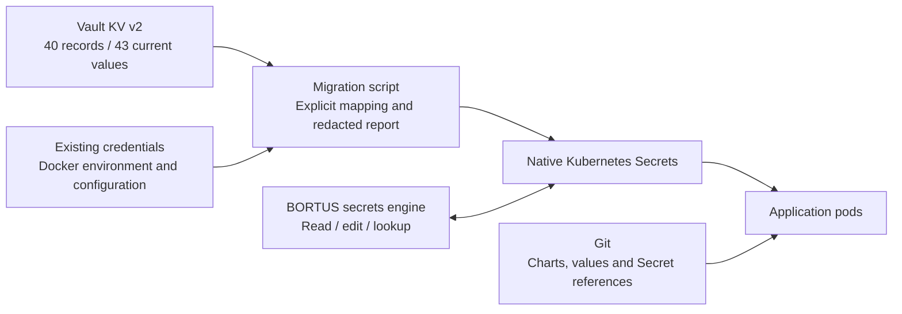
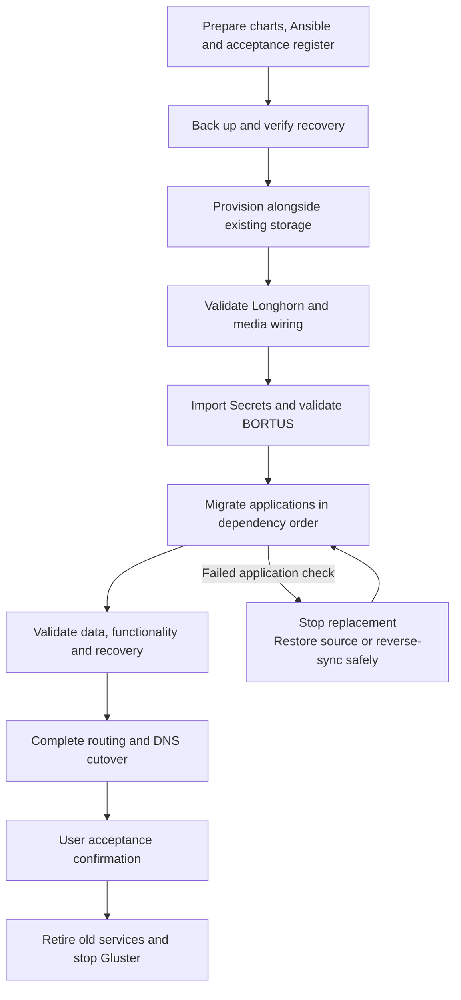
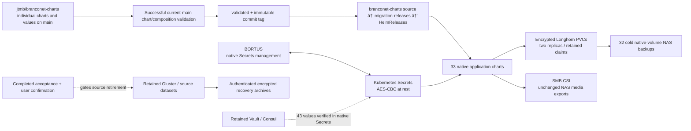

# Kubernetes migration plan and acceptance contract

## Successful-settlement original A07 comparison fails - 2026-10-19 (Toronto)

The single original comparison of changed application `d6867ba1990e3e025c6eb3c9a169db1e75362993` against baseline `51e8cd66379c1f40a95ea02f4da7c8aed848f2a4` completes both fresh builds and all six observations at exit0. **A07 remains failed: five of ten comparable warm p95 cases regress.** Root and acceptance worker independently reconstruct every saved summary field and all1386 distributions, verify145 frozen inputs and453 exported source payloads, and preserve the original profiles, three alternating pairs, bounds, warmups and no-regression clause. [Current performance receipt](evidence/bortus-account-settlement-performance-root-20261019.json) records the five cases and exact original artifact hashes.

Current-source/Git/archive bindings and actual build receipts match; closure verifies26 recorded actor/closure-query births, eight exact container names and seven captured full IDs absent. Baseline1's container ID and the dispatcher's birth identity were not retained. Preparation and root-reader failures remain separate; corrected readers replay no workload. Whole-fixture CPU34.043722 to30.520007s and peak360.609375 to437.2890625MiB do not establish an isolated application cost or general speedup. Candidate remains preserved on its separate development branch and unadopted. No tuning, waiver, new immutable image, source render or production change follows. Image7b03/UI evidence remains bound to d6382450.

The next bounded feature is a source review of warm Pods account delivery/response using retained evidence, with edits only for a concrete semantics-preserving redundancy; absent one, report no supported patch. No new diagnostic campaign or unchanged benchmark is authorized. Security, actual AT, compatible independent recovery and guarded live adoption remain open; charts PR5 remains draft/unmerged/suspended with adoption false. All44 original clauses and data-preservation boundaries remain. [Continuing handoff](docs/operations/handoffs/2026-10-19-bortus-settlement-performance-successor.md).

## Account-worker successful settlement source checkpoint - 2026-10-18 (Toronto)

Application checkpoint `d6867ba1990e3e025c6eb3c9a169db1e75362993` retains the exact frontend tree of qualified source `be5585d3`: successful row/null reads omit the redundant idle await, while every refusal drains before identity/settlement. Both real yields, fresh checks, parent delivery, bounds and native envelopes remain. Root reviewed the ownership proof, actual-worker regressions and three necessary source-provenance digest updates; all other manifest fields, runners, assertions, mutants and acceptance remain unchanged. [Source evidence](evidence/bortus-account-settlement-root-20261019.json) records43 focused passes and hosted CI39196459270/PR39196463144, including clean build, lint/types,355 units,eight integrations, original sensitivities and compiled Pods smoke. Failed initial CI39195995995/39196001212 and preparation/reader errors remain retained.

This is unmeasured source qualification. No new image, source render, benchmark or production change occurred; image7b03 remains tied to d6382450 and old welcome copy. The next bounded feature is one original frozen comparison for this actually changed candidate, with independent complete summary recomputation and unchanged no-warm-regression gate. Prior A07 fails3/10; security, actual AT, compatible recovery and guarded live adoption remain open. Charts PR5 stays draft/unmerged, suspended and unadopted; all44 original clauses and preserved data remain. [Continuing full-goal handoff](docs/operations/handoffs/2026-10-19-bortus-account-settlement-successor.md).

## Truthful welcome source checkpoint - 2026-10-18 (Toronto)

Application source `b0802b9944c94cbca77c2550ed73d46dc8c5f879` corrects unsupported welcome-page claims about encryption, automatic sync, packaged provisioning, Flux ownership, shell availability, usage counts and licensing. The workflow and Secrets docs accompany the copy change. Root independently verifies unchanged layout classes, click handlers, image sources and session/navigation flow. [Source qualification](evidence/bortus-truthful-welcome-root-20261019.json) records exact CI and review evidence. Push CI39194946460 passes the clean build, lint/types,354 unit tests,eight integrations, original sensitivity checks and compiled Pods browser smoke; PR CI39194950418 also passes.

No new image, render, performance measurement or deployment follows this source-only feature. Image7b03/browser evidence still belongs to d6382450 and its old welcome copy. Packaging waits for a justified release boundary. The next bounded source feature reviews successful account-worker settlement while retaining refusal/cancellation draining; no A07 improvement is assumed. Original security/performance/AT/recovery/adoption gates and all44 clauses remain. [Continuing handoff](docs/operations/handoffs/2026-10-19-bortus-truthful-welcome-successor.md).

## Corrected image verified with the integrated browser - 2026-10-19 UTC

Source `d6382450ba9064c79f7bbcac23c1d27c9c179610` fixes the internal-origin redirect using supported Next configuration; CI39192452213 passes. New runtime index `sha256:7b03b4b8d40fc3014822212aa9db4c24dfcc4a5781b9b5e5632cbc33fb9ff276` builds/exports successfully. All12 public startup checks pass/container0; original wrapper cleanup exit1 remains retained with separate exact-container absence proof. [Current evidence](./evidence/bortus-corrected-image-root-20261019.json) records independently checked identities, archive/receipt hashes and two new screenshots.

Actual integrated Codex browser verifies same-origin root/welcome/sign-in, owner login, Secrets/KV navigation, logout, readonly login and absent readonly configuration mutations. The disposable preview is closed; both platform listeners are absent. No native Computer Use skill is needed. [Earlier broader UI evidence](./evidence/bortus-integrated-browser-ui-root-20261019.json) remains bound to the previous image. Welcome still contains stale AES-256-GCM/auto-sync claims, requiring source follow-up.

The [original paired performance gate](./evidence/bortus-page-origin-performance-root-20261019.json) fails three of ten warm comparisons; seven improve. Root recomputes all1386 distributions from retained raw measurements. Fresh default scan exits1 with12 Medium findings and zero secrets, without dispositions or acceptance. Assistive technology, live native value/history/CAS/rotation, independent compatible recovery and guarded adoption remain open. New image is locally exported, not preloaded or deployed. Draft charts PR5 at `835dabebd97a7691311b2c6748fd3cfa4db17f44` joins the release and three allowlists to that index;29 tests,33-chart/34-release/71-resource validation and CI39194242639 pass. It stays unmerged, Helm suspended and adoption false. Policy reconciliation is independent of Helm suspension.

## Legacy Gluster/Swarm retirement and SMB cleanup - 2026-10-19 UTC

The user explicitly directed Gluster/SMB retirement and confirmed **keep NAS media; remove legacy host mounts**. BORTUS/native Kubernetes Secrets are authoritative; Vault is retired legacy infrastructure. [Current retirement evidence](evidence/legacy-storage-retirement-20261019.json) records actual completed operations, fresh verification and limits.

- All three nodes: Gluster clients unmounted, `staging-gfs` stopped (not deleted), `glusterd` inactive/disabled. Original brick directories remain intact.
- Legacy Vault, Consul and Portainer writers scaled to zero. Obsolete Docker service/socket inactive/disabled on every node; independent `containerd-k8s` and kubelet remain active.
- Old host CIFS mounts at the approved `/mnt` paths removed; eleven legacy Gluster/CIFS fstab entries disabled. All fourteen Kubernetes SMB CSI PVs and forty Longhorn PVs remain. NFS mounts were outside the approved SMB cleanup scope and were not altered.
- Fresh encrypted NAS backups preserve all three legacy host/service configurations, cold Portainer/Consul state and all three stopped bricks. Every archive passes authenticated decryption; each brick archive's tar stream is read completely. These are cold backup checks, not a newly exercised full three-node disaster rebuild. Original datasets and prior backups are retained.
- Post-retirement: three Ready nodes,54 Bound claims,91 Running/six Succeeded Pods,34 Ready Helm releases. BORTUS login/readiness HTTP200 through all three nodes (existing untrusted LAN certificate; certificate validation not claimed). Longhorn's CIFS backup target is available with a fresh sync. Direct-argument checks as Plex UID1000 verify all three media directories and read65,536 bytes from an existing movie; the initial shell probe exit21 is retained, and no new playback/write proof is claimed.
- Six superseded image-upload archives removed after exact matches to retained operator copies, reclaiming6,901,948,416bytes total. Current release uploads, imported images, metadata/journals and retained recovery inputs are untouched by that cleanup.

This closes the legacy Gluster/Swarm and host-SMB retirement work. BORTUS's newer audit/KV release, performance/security/accessibility/recovery qualification and guarded adoption remain owned by the successor chat and are not marked complete here. The NAS media remains served by SMB CSI by the user's explicit choice; no media relocation into Longhorn was requested after that clarification.

## Successor verification and remaining release gates — 2026-10-18 (Toronto)

The successor accepted the exact pushed checkpoint and all three protected user-owned file hashes. Fresh metadata still shows three Ready nodes, BORTUS Ready1 on the retained production image, its HelmRelease suspended in `flux-system`, and the charts source/applied revision at `37dd61a`. Application PR28 and charts PR5 remain open drafts at their expected heads. A focused application review found no concrete defect that justifies a performance patch; the two original warm regressions remain failed and no benchmark was replayed.

The supported Windows `@oai/sky` runtime imports and returns application inventory, but its first Chrome state request stops because it cannot determine the current browser URL confidently enough to enforce policy. This supersedes the missing-assets failure only for that runtime path; no browser input or final UI/AT acceptance followed, and the policy stop was not retried or bypassed. Isolated preview preparation separately failed before Python dispatch because Ubuntu could not access the Windows launcher path. Worker closure and independent root checks confirm no owned container/runtime directory or Windows port4401 listener remains; no synthetic credentials/account or production change occurred. [Successor evidence](evidence/bortus-successor-release-gates-root-20261019.json) records the exact scope. The rejected evidence write and private recovery work remain stopped. The full goal remains active with performance, final UI/AT, security, compatible recovery, guarded adoption and final live acceptance unresolved. The predecessor remains open for coordinated cleanup.

## Immediate delivery handoff - 2026-10-18 (Toronto)

At the user's explicit request, the full unfinished BORTUS delivery/remediation goal moves to a fresh successor chat. This predecessor remains open solely for migration artifact and node cleanup; it must not be archived. [The portable handoff](docs/operations/handoffs/2026-10-18-bortus-delivery-successor.md) preserves the complete objective, source/image/chart identities, original acceptance requirements, exact rejection scope and remaining gates. Its correction supersedes earlier blanket descriptions of migration being policy-blocked: the rejected local vulnerability-disposition write and the errored private recovery subagent are distinct from technical UI/performance failures. Rejected actions remain stopped. No production change, data cleanup, retirement or acceptance waiver follows this handoff. Live observations below retain their original timestamps and are not refreshed by this note.

Approved by the user on 2026-10-09. Execution target: under six hours from execution approval. Data-preservation and acceptance gates remain mandatory.

## Work ownership

Current execution instruction (2026-10-18): finish implementation and integration first. Run the existing targeted checks and release CI needed for actual changes; stop standalone diagnostic/benchmark expansion. Defer Computer Use until implementation and integration are complete. Preserve the acceptance contract and report unresolved outcomes honestly.

- This chat owns cluster migration, server provisioning, chart/values migration, Flux, Longhorn, data preservation, application cutovers, and acceptance evidence.
- Execution uses three active agents total: this coordinator plus application and acceptance sub-agents. Application and migration ownership remain separate, with scoped worktrees and reviewed handoffs; the former execution chats are archived.
- After plan approval, create the migration goal with this full acceptance contract and execution target. Gluster/Vault retirement follows the user's final migration confirmation.

## Recovery bootstrap source integration — 2026-10-18

The migration branch now integrates the remote chart-separation commit `f0d3d9d` with the current release tooling. Four Ansible source files target private `branconet-charts`, branch `validated`, path `./flux/releases`, and require the restored native `flux-system/branconet-charts-readonly` credential before activation. Recovery bootstrap leaves activation disabled; pruning and force remain false. Current release/app source, data-preservation contract and archived-publisher removal are preserved. Existing Ansible syntax and bounded YAML/Jinja equivalence checks pass against the exact current four mounted source files; no target requests or apply occurred.

The publication history scan retains exit1 and22 matches: five actual public Git object IDs,14 provenance SHA256 fields,two prose matches and one match spanning three unusable PEM rejection fixtures. Every match is classified from raw committed source; no usable credential was identified and no suppression was used. See [source publication evidence](evidence/bortus-migration-source-publication-root-20261018.json). The initial normal push refused divergent history; the remote commit is integrated without force. This is reproducibility/source-delivery progress; the existing recovery/security, performance and final UI/cutover gates remain open.

## Current implementation and delivery — 2026-10-18, 15:27 UTC

The requested native KV feature implementation is published at application source `5aba82c28d5cad1d571416ea9c06f5d2d61260b3` in [PR28](https://github.com/jtmb/branconet-homelab/pull/28). The current hosted build, lint/types, unit/integration, regression-sensitivity and compiled browser CI passes in [run39139100514](https://github.com/jtmb/branconet-homelab/actions/runs/39139100514). A concrete authentication-denial UI bug is fixed: sensitive drafts/tokens clear before denied-body parsing, and cancellation cannot delay clearing;21 targeted client checks pass. Compact source review found no additional missing requested KV workflow. PR28 remains draft; passing CI does not resolve the retained performance, actual AT, security, recovery or live-adoption outcomes.

The separate charts [PR4](https://github.com/jtmb/branconet-charts/pull/4) is merged at `37dd61a242b488dabbdcec9277cb1ee84580f0e2`. Its current-main [CI39139397916](https://github.com/jtmb/branconet-charts/actions/runs/39139397916) passed, and a fresh live read confirms Ready Flux at that exact validated revision. The opt-in native-KV deployment profile supplies the guarded service account, explicit existing Secret scopes and separate history RBAC; it remains disabled for production. See [current delivery metadata](evidence/bortus-current-delivery-root-20261018.json).

The source-bound release image is built, exported and preloaded successfully on all three servers. Runtime index `bfc78b697373727aebccf50c70ef1944c76691cc435da0ad3bcc4e44670ff211`, selected manifest `4074fda8` and raw config `909abcf9` are distinct verified identities. Each node also has the exact tagless digest alias required by imagePullPolicy Never, with the source tag unchanged. All64 affected packaging checks pass. The first export refusal is retained; its v2-only repeated-layer fix preserves every ordered layer and expansion bound. See [actual release/staging evidence](evidence/bortus-current-release-staging-root-20261018.json).

All12 existing public startup/authentication checks pass on this final image, including forward migrations and fresh permission revocation. The wrapper's original exit1 remains recorded for a case-sensitive cleanup-message assertion; the actual fixture exits0, and separate saved-CID/current-name absence checks confirm cleanup without replay. A fresh unfiltered Trivy scan retains literal1 with12 Medium findings and zero secrets. This is not security acceptance. [Post-staging health](evidence/bortus-post-staging-health-root-20261018.json) confirms3 Ready nodes,54 Bound PVCs,34 Ready releases and BORTUS1/1 on its unchanged original image. Final application rollout/native-KV adoption and Computer Use validation remain pending; the repeated platform blocks on private recovery/security work prevent completing final cutover. Failed performance acceptance is unchanged. Existing production data and original recovery sources are retained.

The exact forward-schema cutover payload is prepared in [draft charts PR5](https://github.com/jtmb/branconet-charts/pull/5) at `1d78f7b`: final digest, native KV enabled, guarded adoption false, HelmRelease suspended and all three admission image allowlists restricted to the compatible new image. Existing validation passes33 charts/34 releases/71 composed resources; hosted [CI39141489304](https://github.com/jtmb/branconet-charts/actions/runs/39141489304) also passes. It is intentionally unmerged: policy reconciliation remains active while Helm is suspended, so fresh checkpoints, independent compatible recovery and legacy-writer quiescence must precede withdrawing the legacy/inert images.

Goal status: **blocked after the resumed audit**. Required private recovery/security operations remain platform-rejected across resumed goal turns `01a14fef`, `01a14ff2` and `01a15000`. The missing bootstrap-source integration has been fixed and published at `f5836db`, with passing [CI39148443030](https://github.com/jtmb/branconet-homelab/actions/runs/39148443030). Current metadata confirms the original BORTUS image Ready, Helm suspended, Flux Ready at37dd61 and both application/cutover PRs still drafts. The browser tool's missing kernel assets/path failure remains unresolved; its one reset/retry was exhausted. No private/security operation, unchanged benchmark or UI attempt was replayed. Final native-KV production adoption, guarded cutover, compatible independent recovery, security, performance and final UI/AT acceptance remain unproven. [Resumed blocking audit](evidence/bortus-resumed-cutover-block-root-20261018.json). Further safe cutover work requires external resolution of these blocks; original data and recovery sources remain retained.

Resumed final-UI attempt: the official browser tool fails before inventory with `failed to write kernel assets: The system cannot find the path specified. (os error 3)`. One session reset and same-entrypoint retry fail identically. Only a read-only local port check ran; no preview container/network/account or browser input was created. [Observed result](evidence/bortus-final-browser-initialization-block-root-20261018.json). No final UI/AT acceptance is claimed, and rejected private/security operations remain stopped. This is the first check of the resumed blocking audit.

Earlier October18 checkpoint (read-only observations at14:30–14:31 UTC; superseded by the delivery checkpoint above):

- **Cluster:** [current health](evidence/bortus-live-health-root-20261018.json) shows three Ready nodes,54 Bound PVCs,34 Ready Helm releases and both Flux sources Ready. The separate chart source remains `validated@sha1:7828f5b5d219770077b72bd53d81fe745c61b621`; migration source remains `codex/kubernetes-validated@sha1:373a1e513e1bfb8b13ed5212ccc1b0f57a5ff301`. [Workload/storage status](evidence/bortus-live-storage-workload-root-20261018.json) shows91 Running/6 Succeeded Pods with no unhealthy entries,30 attached healthy Longhorn volumes and10 detached/unknown volumes. BORTUS is1/1 on retained image `3b076fb9`; candidate `4a84c0b5` is unadopted. WSL has a new boot identity; prior process-closure observations remain historical. These metadata snapshots prove neither restore/data integrity nor candidate adoption. The [initial query refusal](evidence/bortus-live-health-first-query-refusal-root-20261018.json) is retained: generated JSONPath escapes were corrected without changing queries or timeout bounds; it is not evidence of a cluster outage. No Secret values were requested or emitted and no production changes occurred.
- **Application:** product sourced901ccdd has a [qualified full build](evidence/bortus-a15-node-text-contrast-full-functional-root-20261016.json), passing352 unit tests and eight HTTP checks, plus the [six-element rendered contrast review](evidence/bortus-a15-six-text-render-root-20261016.json). Actual assistive-technology announcements remain unproved. Source9cb81363 changes only two CI sensitivity manifests fromd901; product/build/package inputs remain exact. Its [current hosted CI](evidence/bortus-current-hosted-ci-qualified-root-20261016.json), run38862871467 on validation commitfc17e40d, now passes the clean build,352 units,eight HTTP checks,all eight pristine/mutant sensitivity pairs and compiled Pods smoke. The earlier manifest-preflight failure38861922778 remains recorded. All44 original validation clauses and historical failures remain preserved. The separate [compiled account proof](evidence/bortus-parent-stat-a15-compiled-account-root-20261016.json) remains bound to its original6b/bc10 artifacts; current full-build loading does not repeat its SQL oracles. Source CI is qualified; performance,actual AT,private recovery,coherent image/security and live adoption remain open.
- **Latest isolated candidate:** `169107f` passes 359 unit/eight integration checks, but its [original three-pair comparison](evidence/bortus-account-snapshot-paired-root-20261016.json) fails the warm gate: eight comparisons improve; sequential 200/1000-record cases regress. It remains isolated and unadopted.
- **Command, deployment-state and stream checks:** original source clauses A05/A08/A09/A16/A18 are qualified by current source continuity and retained actual tests: [A05/A08](evidence/bortus-a05-a08-source-composite-root-20261015.json), [A09](evidence/bortus-a09-source-composite-root-20261015.json), [A16](evidence/bortus-a16-source-composite-root-20261015.json) and [A18](evidence/bortus-a18-source-composite-root-20261015.json). Delivery, actual assistive technology and performance remain separate.
- **Real CLI validation:** the [finite real-API fixture](evidence/bortus-a04-real-api-finite-root-20261015.json) passes44 checks against Kubernetes v1.37.1 and actual patched kubectl. Independent checks verify285 actor records, current source/build/dependencies,57 absent original host identities and all five container IDs/names absent; final reader closure passes. Two checks are unsupported PUT methods returning405, not handler-validation proof. Earlier harness and observer failures remain recorded. The original A04 command boundary is now qualified for reviewed source by the [composite receipt](evidence/bortus-a04-composite-boundary-root-20261015.json): all43 cluster/Flux route files and50 exports are reconciled with shared instrumentation, the original44 cases and the additional45-case real-API fixture. Positive kubelet service, performance and live acceptance are separate. The [separate remainder attempt](evidence/bortus-a04-flux-order-probes-root-20261015.json) completes eight cases before hierarchy502; two fixed real-CLI calls isolate an argument-order difference. Independent cleanup/current-input checks pass. The three corrected Flux calls pass the additional45 cases/44 exact argv; independent current-file, process and container cleanup checks pass.
- **Release preparation:** the [current source/context receipt](evidence/bortus-current-source-release-context-root-20261016.json) qualifies the9cb source archive,explicit composition with retainedd901 compiled artifacts,offline lock-respecting prune and production context. Exactly390 selected source rows remain identical;two CI-only rows have complete inverse comparisons. Independent copy checks preserve the earlier outer wrapper1 rather than relabeling it. Prune0 retains package/lock bytes and derives29,814 production dependency entries. Context creation/post/fresh/final pass;the final42-pin/three-birth check adds no graph walk or Docker query. The earlier `cec6dc57` image runtime/public TLS checks pass independently; the new `4a84c0b5` image has separate runtime evidence, with its public TLS4 now separately qualified and security/live adoption still pending.
- **Runtime:** the [patched Node continuation](evidence/bortus-node22-patched-original-suite-root-20261016.json) completes all seven phases with actual0: compilation,locked279-package preparation,all4,706 upstream tests,bundled-zlib canary compilation/ELF inspection/regression,and version/ABI reporting. The new125,362,584-byte executable has SHA256`8da744a4f73fb8a267b629d306b646748b54823019b3cfd49953c22e2e65a22c`. Independent checks verify128 finite records,13 artifacts,20 source files and exact container absence;fresh/final checks verify183 pins and20 absent host identities without a new graph walk or Docker query. Already-patched partial objects are explicitly reused. The earlier build1/compile-15 and first postcheck mode-binding refusal remain recorded. The [new Node component](evidence/bortus-node22-patched-component-root-20261016.json) now passes copier,independent post and57-pin/three-birth final closure for12 Node/five runtime-directory roles. The [new static ABI qualification](evidence/bortus-node22-patched-static-abi-root-20261016.json) verifies six actual ELF subjects,zero missing strong symbols/versions/RPATH entries,and27 explicitly unresolved weak symbols. The [earlier image runtime](evidence/bortus-current-image-runtime-root-20261016.json) and [public SDK/Node TLS4](evidence/bortus-current-public-tls4-root-20261016.json) now pass their original isolated cases and independent/final closure. Production SecretTransport,security residual decisions and live adoption remain open.
- **Recovery:** the [listener-corrected a02 attempt](evidence/bortus-privatea02-failure-cleanup-root-20261015.json) fails under the original600-second limit; outer terminal remains absent and caller1 stops at stage8/type2 without a recovered result. Exact-UID cleanup0 and a separate eight-GET observer confirm all five test names/recorded UIDs absent. Final checks pass328 current pins and8530 recorded births absent. An [additive source correction](evidence/bortus-privatea02-source-cost-correction-root-20261015.json) identifies frame282 as `_snapshot`, calling the source fence, rather than `_connect`; the exact failure cause remains unresolved. Private recovery remains unproved; no new attempt is scheduled.
- **Performance:** the [new unchanged three-pair comparison](evidence/bortus-parent-stat-a15-paired-root-20261016.json) finishes all six observations with independent original-summary recomputation and closure. Eight of ten warm p95 comparisons improve; two regress:25-large sequential7.260446 to8.204972ms and three-largest concurrent52.339899 to52.860837ms. The original no-warm-regression clause still fails. Whole-fixture CPU median falls39.291919 to32.651419s while peak memory rises361.746094 to435.238281MiB; these are not isolated application or parent-stat costs. No tolerance, trimming, replay, source adoption or deployment follows.
- **Earlier image qualification:** the [current combined image assembly](evidence/bortus-current-copy-image-assembly-root-20261016.json) now joins source9cb/retainedd901 product,new8da Node,maintainedPCRE and patched system zlib with explicit provenance. Build,independent post and80-pin/eight-birth final closure pass. The [saved OCI qualification](evidence/bortus-current-saved-oci-root-20261016.json) verifies actual config74503640/selectedmanifest88461db5 and17 ordered layers. The [observed full-filesystem qualification](evidence/bortus-current-full-filesystem-root-20261016.json) matches31,799 entries,including the original root plus31,798 composed paths,with zero path/metadata mismatches. NewNode/five canonical providers/all26 aliases match;125-pin/eighteen-birth final closure passes. The [fresh default scan](evidence/bortus-current-default-image-scan-root-20261016.json) retains literal1,12 Medium findings and zero secrets,with independent report/cache checks and150-pin/23-birth final closure. The [authenticated dash source review](evidence/bortus-dash-noble-source-applicability-root-20261016.json) confirms the recursive matcher build condition and finds the described Unicode path absent;hostile-input reachability and exact remediation/residual decisions remain open. No findings are suppressed or waived. The old system8 image's ten Medium findings/zero secrets remain historical. Seven PCRE source mappings and the isolated system-zlib regression remain qualified;libc consumers and precise residual decisions remain open. The [npm audit receipt](evidence/bortus-npm-audit-build-residual-root-20261015.json) retains full1/nine development rows and production0/zero;its trusted-build-only residual expires2026-10-22 and does not waive final image checks.
- **New isolated image:** `4a84c0b5` now has [saved-chain](evidence/bortus-dash-copy-image-export-root-20261016.json), [31,800-entry filesystem](evidence/bortus-dash-copy-image-fullfs-root-20261016.json) and [12-check public runtime](evidence/bortus-dash-copy-image-runtime-root-20261016.json) qualification. Its [default scan](evidence/bortus-dash-copy-image-default-scan-root-20261016.json) retains literal1/12 Medium/zero secrets; [public TLS4](evidence/bortus-dash-copy-image-public-tls4-root-20261016.json) also passes; security and deployment remain open.
- **Preservation:** original Gluster, Vault/Consul data and accepted backups remain intact. No retirement or production image/guard change follows these local qualifications.

The original [A14 responsive UI source clause](evidence/bortus-a14-source-composite-root-20261015.json) remains qualified. The [A15 keyboard composition](evidence/bortus-a15-keyboard-composition-root-20261016.json) now retains all25 full dialog cases, one scoped history keyboard-entry subset and the ancillary menu observation. The four actor exits remain[1,1,1,0]; the [first](evidence/bortus-a15-partial-keyboard-root-20261016.json), [second](evidence/bortus-a15-resource-partial-root-20261016.json) and [third](evidence/bortus-a15-seven-resource-partial-root-20261016.json) failures remain retained. Final success checks bind573 current records,159 absent Linux births,58 Windows births and eight retained container ID/name queries. The later [d901 six-element review](evidence/bortus-a15-six-text-render-root-20261016.json) qualifies the focused manual contrast/axe findings;actual assistive technology remains open,so whole A15 remains unqualified. Retained keyboard observations remain bound to3d559850;the rendered followup has its own d901 authority.

The [four rendered Edit Node labels](evidence/bortus-a15-four-label-rendered-partial-root-20261016.json) each measure6.912758604:1 contrast against the actual opaque modal surface, above4.5:1. This narrowly qualifies the label contrast change on30f866. The whole server/browser run remains exit1 with zero completed cases: its label-only axe scan is inapplicable, and the launcher reports PermissionError during cleanup. Independent checks verify13 captured Windows births no longer live,172 current records,44 Linux births absent and two retained container queries; the original Job completion record remains unknown. That historical partial receipt is superseded only for focused contrast/Cancel by the later d901 six-element qualification. Actual assistive technology remains open;no zero-axe or whole-A15 claim follows.

The [queued-origin observer controls](evidence/bortus-queued-origin-observer-controls-root-20261016.json) pass three cases with the actual compiled queue class, three real transport Workers, six public reads and12 real yields. They reproduce the post-time context-association fault and verify admission-time numeric mapping while preserving original dispatch and refusal behavior. Independent final checks bind92 records,19 process births absent and two retained container queries. This qualifies observer behavior only; actual Next/SQL and performance remain separate.

The [finite warm diagnostic](evidence/bortus-finite-warm-diagnostic-partial-root-20261016.json) completes all72 functional body checks but remains inconclusive: three lanes have50 complete stage joins, while the final22-request candidate lane publishes its worker operations without the required main-thread record. Actor exit1 is retained. Source review identifies a possible observer association gap between queue admission and later Worker dispatch; exact historical cause is unproved. Matched independent checks pass182 current records,36 recorded births absent and two retained container ID/name queries. Complete sequential traces narrow response construction to tens of microseconds, but do not establish a production bottleneck or change the original failed benchmark. No accepted50 requests or original benchmark is replayed by this receipt.

The [finite diagnostic observer controls](evidence/bortus-finite-warm-observer-controls-root-20261016.json) pass five groups:28 actual HTTP requests, three file Workers,50 operations and100 real yields. The narrow correction preserves inherited HTTP method descriptors during restoration; both earlier actor failures remain recorded. Independent final checks verify246 current records,51 recorded process births absent and six retained container ID/name queries. These controls qualify the observer only; they do not establish actual Next/Edge/account joins or performance acceptance. The original benchmark failures remain unchanged.

The [A21 finite composition](evidence/bortus-a21-nineteen-finite-root-20261016.json) now qualifies all19 original finite observations on reviewed source3d559850. The [prior18-observation receipt](evidence/bortus-a21-eighteen-partial-root-20261016.json) remains unchanged, including both actor exits1 and the unaccepted original deadline report after image-query error31. A single fresh deadline case now completes server/browser/stage0: HTTP503 at8015.9835ms, both dependency calls closed and active count0, with the original native8s/dependency9s bounds. The qualified narrow observer helper changes only exited-process image-metadata handling; it does not establish the historical error31 cause. Exact/fresh/final checks bind202 current records,46 absent Linux births including the failed post reader,15 Windows births and two retained ID/name queries. The post reader's first wrong-key refusal cbdd84/1 is preserved; the correction replays no business case. No new final queries, graph walk or recursive reader-absence chain occurs. The later [A21 memory composition](evidence/bortus-a21-peak-memory-composition-root-20261016.json) adds three200/1000/10000-entry Job-memory windows and qualifies the original A21 source clause. Node lifetime HWM,sampled renderer heap and Job peaks retain distinct scopes;the original A07 warm-regression failure is unchanged.

The [original A22 source clause](evidence/bortus-a22-current-encoding-root-20261016.json) is qualified for reviewed source3d559850 by all36 current-source samples: gzip/Brotli, Provisioning modal/Pods YAML/terminal, each with three cold and three warm observations at390×844,4× CPU slowdown and150ms latency/200000-byte/s down/93750-byte/s up. The170 actual compiled assets total1,812,512 raw bytes; fixture precompression produces572,103 gzip and495,470 Brotli payload bytes, with340 decoded-SHA round trips. These inventory totals are distinct from actual per-request wire bytes, encoded Content-Length and warm-cache reuse; unchanged HTML/API traffic is not labeled Brotli. Initial JS, LCP, first interactions and overlapping compile/execute counters remain separate observations, with no CPU-share or source-before/after claim. Deferred terminal failure/focus checks pass and mutations remain zero. Exact/fresh/final checks bind642 current records,182 absent Linux births,70 Windows births and two retained ID/name queries, without a final graph walk or new query. The V5 fixture fails before READY with zero measurements; its duplicate-binding correction and the816128 phantom-handoff post refusal remain retained. Actual encoding measurements belong to3d559850;the later d901 contrast rendering has a separate receipt. This satisfies the original A22 source measurement/loading/error/focus clause without a source-before/after gate. A07 performance, image/security, live adoption and actual assistive technology remain separate open gates; the frozen producers/proofs retain their original false scope flags.

The goal remains active. There is no pending user decision. The [October18 actual AT attempt](evidence/bortus-a15-current-at-owner-blocked-root-20261018.json) reaches BORTUS in a fresh controlled ChromeTesting profile, then the updated official helper again rejects its own returned window. One documented recovery also fails. Both controllers exit1; the original lifecycle records65 native CLI children closed and17 Windows births non-live, empty Job and closed handles. Two signaled Chrome process objects remain queryable; they are not described as absent. No START-READER, NVDA or fixture input occurs. The [generic Chrome probe](evidence/bortus-a15-supported-helper-probe-root-20261018.json) proves supported state capture/keyboard close only, not controlled ChromeTesting access or actual AT. Earlier failures remain retained; no unchanged AT retry is scheduled. Private SecretTransport/recovery and the security-disposition write remain stopped after platform policy rejection. Detailed dated outcomes follow below and in the linked evidence.

Historical checkpoint (2026-10-15,19:52 UTC; superseded by current source qualifications above): the [first resource browser attempt](evidence/bortus-resource-browser-failure-root-20261015.json) fails an assertion before the28 API negatives run. Its retained frame identifies the helper await, not the exact assertion or HTTP status. Independent checks verify138 actor records, current build/dependencies, container ID/name absence,211 final pins,45 absent Linux births and11 Windows births no longer live, followed by final reader closure. A fresh diagnostic fixture preserves all9/28 assertions and records bounded public progress; its result is pending. A09 zero-to-one remains unproved.

Historical recovery checkpoint (superseded by the current-boot cache receipt and later retained attempts): the [separate2b private-recovery attempt](evidence/bortus-private2b-failure-cleanup-root-20261015.json) refuses at public setup stage2/type2, before a sudo prompt or material projection. Actual tool exit1 and source unchanged are retained. An independent eight-GET observer confirms all five named test resources absent; later/final checks verify269 current pins,11 absent recorded births and final reader absence. A definite source blocker is the cache receipt's required previous boot7f versus current boot19d; the cache freshness guard will be preserved and its receipt refreshed through the existing procedure. Actual private recovery remains unproved.

## Verified starting point

Vault was unsealed using the user-supplied key and returned HTTP 200, initialized=true, sealed=false, standby=false. Authenticated inventory found 40 current KV records containing 43 values. Secret values and credentials must not be written into this plan, Git, command arguments, or reports.

| Area | Verified observation |
|---|---|
| Servers | 192.168.0.4 master, 192.168.0.5 worker2, 192.168.0.6 worker1; SSH and sudo work on all three |
| SSH | User james, port 2002, WSL key ~/.ssh/id_ed25519; never copy or print the private key |
| Current cluster | All three are Swarm managers; 32 Swarm services and six standalone containers |
| Destination | Existing Ansible playbook and charts directory in the repository's k8s-rewrite branch |
| Gluster | staging-gfs: three replicated bricks at /gluster/volumes; all connected and online |
| Integrity | No reported split-brain; a small, changing heal backlog references Plex logs |
| Other storage | NAS SMB media/backups, NAS NFS application data, local Plex configurations |
| Secrets | Vault KV v2; BORTUS currently reads its database and pushes secrets to Kubernetes |
| Plex | Three running servers; master has Movies, TV Shows and PVR; workers have Movies and TV Shows |

Repository: https://github.com/jtmb/branconet-homelab/tree/k8s-rewrite/k8s-rewrite

Inspected tree baseline: 25586ef4d5e120b852da1a49b281aa918284c05f.

Approximate state measurements: Gluster 2.1 GB, NFS application data 1.9 GB, master Plex configuration 7 GB. Gluster sizing encountered changing Jackett files and must be repeated after stopping writers. Other Plex configurations must also be backed up and retained.

Data scope clarification during execution, 2026-10-09: the user confirmed FlareSolverr /config and Vault /vault/file and /vault/logs anonymous directories were disposable runtime state. Their original paths were removed by initial Swarm task shutdown before archival; that sequencing error is recorded in MIGRATION_STATUS.md. They are excluded from required dataset recovery on the user's explicit clarification. Vault's authoritative data remains the Consul store on Gluster; all Gluster/NFS/Plex/application datasets retain the original preservation gates. Any other anonymous application data must be protected before task removal.

Each server has approximately 16 GB RAM. Observed root-filesystem free space was approximately 56 GB, 80 GB and 62 GB respectively. These are observations, not approved Longhorn allocations. Worker2 had approximately 3.5 GB available RAM at inspection.

## Acceptance contract

Installation or running pods alone does not satisfy this contract. Every criterion requires recorded evidence.

| ID | Required outcome | Acceptance evidence |
|---|---|---|
| AC1 | Kubernetes operates on the three supplied servers using the adapted Ansible setup | Three Ready nodes; working DNS, networking, scheduling and storage |
| AC2 | One CI/CD pipeline manages deployments | Repository validation -> Flux reconciliation -> releases; successful test change and rollback |
| AC3 | Every repository application and live service is accounted for | Complete source-to-target register; no unexplained omissions |
| AC4 | Each application has its own chart and values | Chart, values, dependencies, image, resources, routes, storage and Secret references validated |
| AC5 | Storage follows the repository's Longhorn approach | Stateful pods mount intended Longhorn PVCs; replica placement, persistence, reattachment and restoration tested |
| AC6 | Existing SMB media and paths are preserved | Appropriate read/write checks, playback, download/import checks and demonstrated requested media integration |
| AC7 | Kubernetes Secrets are authoritative; BORTUS reads and manages them | Import verification, lookup/CRUD, authorization and restart-persistence tests |
| AC8 | Existing application data survives | Consistent backups, verified copies/restores, application checks and retained originals |
| AC9 | Plex becomes one Kubernetes-managed service | One active server; preserved selected library/configuration; playback and relocation between eligible nodes |
| AC10 | Final configuration is reproducible | Ansible, chart values, Flux definitions, recovery instructions and report match the running system |
| AC11 | Gluster/Vault retirement follows acceptance | No remaining consumers; tested recovery; user confirmation before shutdown |

## Target architecture

Charts are delivered from the separate private `jtmb/branconet-charts` repository. BORTUS application source remains separate; chart changes pass the single chart validation pipeline before Flux reconciles releases.

The existing playbook topology is one control plane and two workers. Longhorn replicates application storage. Document control-plane recovery separately because one control plane does not provide control-plane high availability.

The user clarified the final storage scope on 2026-10-19 UTC: keep NAS media and remove legacy host mounts. Application configuration/state uses Longhorn PVCs; existing NAS media uses Kubernetes SMB CSI PVCs mounted by application pods. The current cluster has forty Longhorn and fourteen SMB CSI PVs. Legacy host CIFS mounts are retired, while media files, paths and native SMB credentials remain intact. Longhorn also uses its native CIFS backup target. This supersedes the earlier unresolved Longhorn/media connector question; no bulk media relocation into Longhorn is required.

## Repository work before deployment

- Inventory: actual hosts, SSH username/port, interfaces and stable addresses.
- Runtime: avoid the current bootstrap's rewrite/restart of Docker's containerd; use a separate Kubernetes runtime configuration, socket and data directory during coexistence.
- Provisioning: idempotent init/join; remove blanket preflight bypasses and suppressed join failures.
- Charts/values: current directories are Kustomize manifests, with no Chart.yaml or values.yaml. Package existing resources as application charts in the same directory, with individual values, to satisfy AC4.
- Flux: correct mixed installation paths; retain helm-controller, which the current role deletes.
- Coverage: include Homepage and websites in reconciliation; fix the missing nginx-hello reference.
- Storage: resolve every PVC reference, including gluetun-port-pvc; enforce configured replica policy and readiness on all participating nodes.
- Ingress: correct the Deployment readiness check for a DaemonSet; use temporary ports while Swarm owns 80/443.
- TLS: install the cert-manager dependency required by the existing ClusterIssuer.
- Secrets: replace the missing/old database-driven secrets role with native Kubernetes Secrets integration; BORTUS application changes are handled by the scoped application sub-agent.
- Versions: pin a compatible Kubernetes/Calico/Longhorn/Flux/CSI combination. Seed defaults are Kubernetes v1.30.0, Longhorn v1.7.2 and two Longhorn replicas; these are not verified effective settings.
- Application versions: initially preserve running versions/digests; perform application upgrades separately.

Do not use reset-and-deploy.sh as the migration entry point. Preserve Gluster bricks, mounted source data, SSH access and recoverability throughout provisioning.

## Workload register scope

Each individual service receives its own migration-register entry, even when related services share a migration wave.

| Group | Workloads | Requirements |
|---|---|---|
| Media | Plex, qBittorrent/Gluetun, Radarr, Sonarr, Bazarr, Jackett, Overseerr, Tautulli, Unpackerr, FlareSolverr, xTeVe, ytdl, repository qbit-monitor | Preserve configuration, paths, permissions, API relationships and processing |
| Websites | APLB, Homepage, Lucinda, Santos, Minecraft website, repository jtmb-dev | Preserve live content/configuration and verify pages/assets |
| WordPress | WordPress, MySQL, Redis, phpMyAdmin | Consistent DB migration, uploads/plugins/themes, inspect Redis state |
| Applications | Ruckus bot/MySQL, Mealie, Vaultwarden | DB integrity and application-level checks; Vaultwarden remains an application |
| DNS/monitoring | Pi-hole, Pi-hole exporter, Minecraft exporter | DNS settings/resolution and exporter targets |
| Games (excluded by user) | Euro Truck Simulator server and Minecraft exporter | Remove deployments/charts; retain source data, PVCs and backups |
| Management/infrastructure | BORTUS, Traefik, Portainer/agents, Vault/Consul | Explicit retained-function mapping, dependencies and retirement |
| Test applications | Whoami, HTTP echo | Routing, storage and deployment smoke checks |

Live VPN: ProtonVPN WireGuard. Repository: ProtonVPN OpenVPN. Align values with the running configuration; do not silently switch provider because additional credentials were supplied.

Plex: one active replica. Proposed primary source is master's plex-media-srv because it includes PVR. Preserve the other configurations and review history/settings differences before accepting consolidation. Validate transcoding on eligible nodes before enabling hardware-dependent scheduling.

Include anonymous Docker volumes and persistent writable-container data in discovery/backup. Observed anonymous volumes include FlareSolverr /config and Vault /vault/logs and /vault/file. Do not prune Docker volumes or discard unexplained datasets.

## Secrets migration and BORTUS dependency

Migration script requirements:

1. Metadata-only dry run maps Vault path/key to namespace/Secret/key.
2. Preserve all 40 current records and legacy aliases without silent deduplication.
3. Import through the Kubernetes API; no values in Git, process arguments or reports.
4. Detect destination conflicts; do not overwrite unrelated keys.
5. Read back and compare values in memory; report only success/failure.
6. Preserve history via recoverable Consul/Vault backup before retirement.

BORTUS development contract: replace database-backed lookup with Kubernetes-backed lookup; preserve authentication/user permissions and explicit namespace/name/key mappings; remove startup database-to-cluster synchronization; preserve unrelated keys during updates/deletes; fail clearly when Kubernetes is unavailable. Keep nonsecret configuration/metadata separate from secret values. Do not add a secrets Git repository or SOPS workflow.

Restrict access to native Secrets, enable encryption at rest and test recovery. Bootstrap/recovery credentials must remain available independently of the cluster they create.

Reference: https://kubernetes.io/docs/concepts/configuration/secret/

## Migration sequence

1. Prepare and back up: freeze register/configuration baseline. Back up Gluster logical filesystem, NFS application state, all Plex configurations, databases, Consul/Vault, anonymous volumes and persistent writable-container data. Verify representative restores. Bricks remain intact.
2. Provision destination: staged adapted Ansible; keep Gluster mounted. Validate networking/existing services after runtime/CNI changes. Temporary ingress avoids occupied ports.
3. Prove storage: test writes, restarts, cross-node attachment, replication and restore. Demonstrate media wiring. Size PVCs from actual data plus growth/snapshot headroom.
4. Establish Secrets/BORTUS: import before consumers start; test reads, edits, permissions, aliases and restart behavior. Coordinate app code through its scoped application sub-agent.
5. Migrate: test/static apps first; databases and dependents next; media/Plex; DNS. Preserve existing container paths.
6. Cut over traffic: validate replacement routes; release old conflicting listeners; transfer ingress/DNS; verify TLS/external access.
7. Accept/retire: complete evidence report and obtain user confirmation. Retire replaced Swarm/standalone workloads and Vault/Consul after consumers are gone. Stop Gluster after verification; retain brick directories/recovery backups.

Per stateful application: initial copy -> stop source writers -> consistent final copy/dump -> verify -> start replacement -> application tests -> route traffic.

Do not copy live database directories while writing. Use consistent MySQL dump/restore or clean-stop procedures, and consistent backups/clean-stop copies for SQLite-backed applications. Investigate pending Gluster log entries and recheck healing after writers stop.

Rollback after replacement writes must preserve those writes and restore/reverse-migrate consistently. Restarting an outdated source alone is insufficient.

## Execution budget

Working time boxes after execution approval; mandatory data gates apply throughout.

| Elapsed | Deliverable |
|---|---|
| 0:00-1:00 | Repository fixes, chart/value preparation, scripts, backups and restore checks |
| 1:00-2:00 | Kubernetes, networking, Flux, Longhorn and temporary ingress |
| 2:00-2:30 | Storage proof, Secret import and BORTUS verification |
| 2:30-4:30 | Application migration waves |
| 4:30-5:15 | Functional, persistence, relocation and recovery checks |
| 5:15-5:45 | Production routing/DNS and acceptance report |
| 5:45-6:00 | Contingency and retirement preparation |

Run independent preparation, backups and checks concurrently where safe. Stateful cutovers follow dependency order. If acceptance fails, preserve source data and pause that application's cutover rather than forcing retirement for the clock. User confirmation gates final Gluster/Vault retirement.

## Acceptance-report template

| Field | Required content |
|---|---|
| Service | Source service/container and target chart/release |
| Configuration | Chart, values, image digest and dependencies |
| Storage | Source dataset, destination PVC, media mounts and permissions |
| Secrets | Namespace/name/key references only |
| Migration evidence | Backup, final-copy verification and DB checks |
| Functional evidence | Application tests and production endpoint |
| Recovery evidence | Restart, relocation and restore/rollback results |
| Status | Pending / prepared / migrated / accepted / blocked |
| Remaining work | Issue, next action and affected criterion |

Every change updates affected Ansible tasks/templates, chart values, Flux configuration, register and acceptance evidence together. Maintain current evidence and explicit unresolved items; never describe unrun checks as passed.

## Initial execution status

- Planning and read-only inventory completed; Vault unsealed by explicit user request.
- Plan approved; migration execution authorized.
- Migration goal activated at 2026-10-09 14:30 UTC (10:30 a.m. Toronto); execution target before 20:30 UTC (4:30 p.m. Toronto).
- Source checkout initialized on codex/kubernetes-migration at the inspected baseline. BORTUS development requested in a separate worktree/chat.
- Cluster provisioning, data movement, Secret import, repository changes and application tests have not yet been performed.
- At initial approval, BORTUS development was delegated to a separate chat. The 2026-10-10 orchestration directive supersedes that arrangement: this coordinator and two scoped sub-agents now own execution, and the former chats are archived.

## As-built state and outstanding acceptance

At the 21:32 UTC check on 2026-10-09, the three Kubernetes nodes, all 36 HelmReleases (35 application charts plus cert-manager), and all active Deployments were Ready. CI run 37993276601 validated revision 2ddeefd49d92bb63e622a830ec88a8baf3b280ec, which Flux reconciled successfully. Source application containers are stopped; source Vault/Consul and Portainer/agents remain retained. Each application's chart keeps its own configuration and native Secret references. Gluster bricks and source datasets remain intact. Operational cutover reached Ready at 20:17:48 UTC, within 5 hours 48 minutes; full acceptance and source retirement remain open.

Proven checks include cold-copy manifests, encrypted storage persistence/relocation/snapshot restoration, an independent NAS BORTUS database restore, isolated etcd restoration matching 349 Secret ciphertext records, recovery of the exact deployed BORTUS image from its authenticated encrypted NAS archive, native BORTUS auth/CRUD/aliases/dashboard/outage/restart, production HTTPS/DNS routing, a single Plex library/playback/relocation, qBittorrent's retained 203-entry queue and Arr download-client tests, the monitor's real queue/forwarded-port/restart behavior, and controlled ZIP extraction through existing SMB CSI with the deployed Unpackerr image. An actual CI/Flux rollout and rollback preserved the HTTP echo response and claim. The actual evidence and its limits are in MIGRATION_STATUS.md and evidence/*.json.

The original removed Redis writable state remains unrecovered. On 2026-10-09 the user explicitly accepted that cache as disposable. The separately confirmed FlareSolverr/Vault runtime exceptions remain recorded. The original Traefik dashboard route/auth hashes/image are restored; authenticated UI/API proof requires its existing working login. One authorized Discord webhook test delivered; the user subsequently authorized restoring the original automatic notification flags; ETS2 and the Minecraft exporter are excluded by the user; legacy xTeve TCP 1901 has no observed listener. All five Sonarr indexers and two Radarr indexers pass configuration tests; two Radarr failures also have pre-migration failure history in the retained source database (see evidence/media-indexer-proof.json), and no settings were saved. The earlier read-only path audit found matching visibility in the Arr pods, qBittorrent pod and original SMB mount (evidence/media-activity-proof.json), with no imports at that observation. A real publisher-webseed torrent subsequently downloaded through qBittorrent/ProtonVPN and imported automatically by Radarr at 23:07:56 UTC. Three-way SHA/size checks and fixture cleanup passed, restoring the original tracked queue/library fingerprints (evidence/media-download-import-proof.json). This test required eight scoped webseed re-add retries; no indexer search or external BitTorrent peer transfer is claimed. xTeve LAN multicast discovery now passes on all three host interfaces using a stateless responder in its chart; original image, tuner identity, two tuners and claims are preserved (evidence/xteve-ssdp-proof.json). LAN HTTPS uses the default untrusted local certificate. These limits remain explicit rather than being treated as passed checks. Final Gluster/Vault retirement requires user confirmation after reviewing the acceptance record.

At 23:47:08 UTC, production Sonarr automatically imported the licensed Blender Shorts S01E02 fixture after the existing qBittorrent client downloaded its archive and production Unpackerr extracted it. History matches the exact torrent ID. The 64,657,027-byte episode matches the publisher SHA in the download, imported Sonarr file and original host SMB mount. Cleanup at 23:48:29 removed only the owned series, torrent and two test directories; all 153 original series, 5,298 original episode-file metadata records and 203 original torrent IDs retain their baseline fingerprints. The temporary loopback seed was stopped and removed. This proves the actual archive/extraction/automatic-episode-import path, using a private loopback seed; external peers and indexer searches are outside this test. The folder fixture required eight scoped seed retries. The initial single-ZIP layout blocked import and is retained in evidence/sonarr-single-archive-stage.json; only fixture layout/display name changed. Unpackerr refused to overwrite the fixture’s duplicate attribution text while successfully extracting the unchanged episode. Evidence: evidence/sonarr-archive-import-proof.json.

## User scope update — 2026-10-09

The user directed removal of game servers and their charts, and accepted the original Redis cache as disposable. Remove ETS2 and the Minecraft exporter through CI/Flux; preserve their original datasets, protected claims and backups. The Minecraft website remains in scope. BORTUS bootstrap and operator access belong to migration; application code changes are owned by the scoped BORTUS application sub-agent. Native Secrets remain authoritative. No source retirement is authorized by this scope change. See evidence/user-scope-update.json and evidence/bortus-operator-bootstrap.json.

## Original monitor alerts — user authorization

Restore the original repository settings for qBittorrent monitor: QBITTORRENT_STATUS_NOTIFICATION, PORT_UPDATED_NOTIFICATION, NEW_DOWNLOAD_NOTIFICATION and METADATA_STUCK_NOTIFICATION on; DOWNLOAD_COMPLETE_NOTIFICATION off. Preserve the immutable image, native webhook/credentials and existing Longhorn bookkeeping claim. Deploy through the existing successful CI/Flux path and verify the running process flags, readiness and unchanged claim/volume identities. This authorization does not confirm final Gluster/Vault retirement.

## Authorized BORTUS follow-up and final release contract

The subsequent user request adds the complete A01–A22 audit remediation and the selected Vault-style native KV engine to the migration goal. It includes performance, UI, correctness, permissions and documentation; paths and grouped keys, immutable versions, CAS and rollback, scoped policies and revocable automation identities, redacted audit, import/export, static rotation and retention/recovery controls. Application implementation remains owned by the BORTUS app sub-agent, native transport and scoped recovery libraries by the native sub-agent, and chart delivery/data migration/live acceptance by this coordinator. The current evidence is [MIGRATION_STATUS.md](MIGRATION_STATUS.md); historical migration acceptance does not qualify the later engine release.

| Final requirement | Acceptance evidence |
|---|---|
| Complete A01–A22 and KV behavior | One coherent immutable source and current docs; full local tests and actual browser workflows; unchanged controlled performance comparison; every audit item and selected engine workflow accounted for with its actual result |
| Separate chart delivery | Private `jtmb/branconet-charts`, individual chart values and one successful current-main CI → validated revision → Flux pipeline; actual final BORTUS release convergence |
| Immutable compatible images | Verified release/recovery OCI digests, exact source/schema/lock/migration identities, clean Linux qualification and identical three-node preloads |
| Fresh source and independent recovery | New consistent encrypted SQLite/PVC/native/etcd checkpoints, authenticated independent restores and full-row comparison; existing users, password hashes, sessions, aliases, workload/storage identities and every accepted write preserved |
| Guarded cutover and complete live engine | Validated chart revision with protected-reference admission and scoped principals; actual allow/deny/revocation evidence before adoption; initial forward schema with adoption disabled, subsequent validated adoption and full live API/UI/persistence/recovery acceptance |
| Retained originals | Gluster bricks, Vault/Consul and recovery artifacts remain intact until explicit final retirement approval |

The precise ordered cutover and recovery requirements are in [MIGRATION-OPERATIONS.md](docs/MIGRATION-OPERATIONS.md). Its new restore preflight and exclusive ownership journal are preparatory libraries with scoped local qualification. A future executor must bind actual controller completion to the exact new Volume UID and backup source, retain durable no-replay ownership through interrupted operations, and prove the restored data with authenticated archives and complete-row equality. Reset in-memory Longhorn history after detach cannot be used as proof by itself. Source/image, actual completion observations, independent restore and the final live gates remain open; helper tests do not satisfy them.

### Accepted performance evaluation update, 2026-10-12

The user approved evaluating an eight-request Secret-list cap after actual
traces showed the old baseline starts18 requests together and the current
four-request path incurs repeated12ms response waves. The32MiB aggregate byte
limit,10,000-item limit, per-page limits,15s aggregate/8s request deadlines,
namespace permissions, fresh authorization and value-redaction contracts remain
unchanged. The original six-profile driver/datasets/oracles and2CPU/1GiB runtime
caps remain the comparison. Evaluation does not grant a performance pass or
production adoption; every profile and tail retains its actual result.

The original three-pair eight-request evaluation completed with all native inventories, but regressed large-value and some warm/concurrent paths. [Root evidence](evidence/bortus-performance-eight-root-20261012.json) preserves all six observations and unchanged limits. A07/A21 remain open; no performance acceptance or live adoption follows the evaluation.

### Approved eighteen-request evaluation, 2026-10-12

Following the failed eight-request comparison, the user approved evaluating eighteen concurrent native Secret-list requests. This changes the evaluated concurrency bound only. Keep the 4 MiB page ceiling, 32 MiB aggregate ceiling, 10,000-item ceiling, existing request/aggregate deadlines, namespace permissions, fresh authorization and value redaction unchanged. Preserve the original six-profile driver, datasets and complete-inventory oracles. Run controls followed by one bounded observation before considering a full paired comparison. Pause heavy root image/cache work during timing. Production remains at eight; this approval grants neither source adoption nor deployment. A07/A21 remain open until the actual acceptance comparison passes.

### 2026-10-12: eighteen-request evaluation completed without adoption

The [independent root review](evidence/bortus-eighteen-request-evaluation-root-20261012.json) verifies all 61 retained originals, 1,640 current source/compiled hashes, the sole compiled 8-to-18 anchor, eight passing control sections and six actual native ELF loads. All six original inventory oracles pass, and the original driver is unchanged. Root confirms observed process absence and a fresh successful query proving the owned container absent.

The single native-list observation measures 123.791 ms (334 small records), 77.500 ms (200), 105.643 ms (1,000), 142.666 ms (10,000), 337.225 ms (25 large) and 253.744 ms (three largest). API calls remain 18/18/18/54/21/20. This is one unpaired observation; prior eight-request paired medians are reference values, not matched causal comparisons. It does not demonstrate broad improvement or satisfy A07/A21. The candidate source cap stays eight and no live deployment changes. Missing dependency chunks and then wrong native-loader cwd caused two retained control setup failures; corrected controls retain the mandatory actual native-load assertion. Root metadata path/oracle-field read errors were corrected without replaying measurement.

The user approved evaluating a16 MiB ceiling for Secret metadata lists on2026-10-12. The experiment retains the32 MiB aggregate,10,000-item, deadline, namespace, authorization, redaction and runtime limits; generic/non-flat responses stay at4 MiB and candidate concurrency stays eight. Both matching transport/native-selector input guards may change only in an isolated prototype. This authorizes evaluation only; production source remains4 MiB and no adoption or deployment is approved by this evaluation.

The [root16 MiB observation review](evidence/bortus-metadata16-evaluation-root-20261012.json) independently verifies74 retained originals,4616 unchanged current source/compiled hashes, six actual native-load records among15 module records, all six exact inventories,28 absent process identities and three absent owned containers. Large-profile phase wall observations were149.4 ms and123.5 ms (literal HTTP146.5 ms and120.6 ms); peak memory477.3 MiB with zero recorded memory events. The retained control composition is seven sections before the v1 fixture failure plus the corrected remainder/corpus/generic v2, rather than one uninterrupted pass. This completes the single evaluation observation only. The root authorized a source candidate with distinct portable-flat16 parity and unchanged generic4 MiB rules for qualification; full functional proof and unchanged three alternating pairs remain required before performance acceptance. Candidate/source concurrency eight is not a measured live setting. No production adoption or deployment.

The [root partial-package metadata review](evidence/bortus-chisel-scanner-metadata-root-20261012.json) compares all17 scanner blocks to the exact signed package control bytes with explicit partial-package/slice markers. An isolated scanner report detects Ubuntu24.04 and all17 exact versions after independently recombining epoch/upstream/revision, and reports five MEDIUM findings with zero HIGH/CRITICAL/secret findings in this rootfs-only input. All original regular file bytes and the input rootfs remain unchanged; six absolute links were mapped only in a confined scanner snapshot. The retained postscan checker failed on its version-field assumption before durably recording the scanner returncode, so this is report visibility evidence, not a passed scanner gate. No Node/app/kubectl runtime or complete application image is tested. The final image requires its own full default scan and compatibility proof; no scanner replay, exception acceptance or deployment follows from this report.

The [root current utility cache read](evidence/bortus-utility-cache-current-root-20261012.json) completes authenticated fixed CTR discovery with actual exit0 and proves the frozen `docker.io/library/bortus@sha256:068254f38c47f99fd35604185a806a92147d934010329638b32adb5c19802c90` reference absent on the master. This BORTUS image is used solely as the inert Node utility; it is not an official Node image. The earlier unprivileged permission refusal does not establish absence. Root independently verifies two local identities and the remote CTR identity absent. No pull/export/tag/import, Pod, policy, ephemeral container or version probe is dispatched. Original-image compatibility therefore remains open until an exact verified resident reference is established; tracing existing artifact/alias provenance is preparation only. The private no-echo credential bridge is unchanged, and the retained staging/validator failures grant no cache claim.

The [root flat16 source review](evidence/bortus-flat16-source-focused-root-20261012.json) independently verifies the evaluation commit2216fa62acf642862517dbda884c345197e540ed:363 raw Git byte/mode/blob bindings (355 frontend files),78 retained originals and all355 exact/explicit CRLF-to-LF working-source relations. Four production files add only flat16 client/native bounds and a distinct portable-flat16 entry sharing the unchanged generic4 grammar. Seventeen focused controls, fresh types and zero-warning lint pass; the exact native ELF matches the approved prototype. Retained V2 type failure and V3 repeated focused stage remain visible. Root independently scans all14 changed raw files with defaults and records0 findings. Fresh full raw-source functional and unchanged alternating pairs remain pending; this commits evaluation evidence without production adoption or deployment.

The [root canonical flat16 functional review](evidence/bortus-flat16-functional-root-20261012.json) independently verifies381 originals,355 exact source/mode/current-hash bindings,4263 current compiled hashes,11 absent owned process identities and five absent owned containers for2216fa62acf642862517dbda884c345197e540ed. All five stages exit0: fresh install/standalone build, actual native load, lint/fresh nonincremental types,271 units and eight original strict HTTP/process/compiled-native integrations with no skips. The native ELF matches the approved16 MiB prototype. A transient status-read timeout is retained as observation failure, without restart or replacement. This closes local functional qualification only. Root refused the first paired preparation before dispatch because it still names unavailable `/mnt/c` paths; a protected exact-object Linux repository/exporter composition and lifecycle must be reviewed before the original three alternating pairs. A07/A21, final image/security/hosted CI, schema/RBAC/live and rollback remain open. No production adoption or deployment.

The [root cache refusal review](evidence/bortus-utility-cache-refusal-root-20261012.json) retains the single actual cache-name attempt with exit1 and its independent read-only journal observation with exit0. The durable journal records a refusal after one successful read-only CTR job, with no alias intent or alias job; that remote identity and all four local actor/observer identities are freshly absent. The actor is not replayed. This establishes no new cache-name state or original-image execution acceptance. A separate bounded read-only discriminator must distinguish image-list parsing from the exact resident source-name prerequisite before further cache work; no Pod, policy, ephemeral container or image version execution follows from this refusal.

The [root paired preflight review](evidence/bortus-flat16-paired-preflight-root-20261012.json) verifies511 lifecycle-control originals and61 exact frozen preparation inputs, followed by13 actual failed-owner originals. The corrected wrapper passed all14 POSIX controls, including stale-leader signal refusal; the retained first control run passed11/13 with two failures. The actual original comparison stops after image inspection because the unchanged source exporter requires a checksum-verified Linux Gitleaks executable at its fixed charts path, which was not staged. Actual runner/supervisor exit1, zero source builds/observations and fresh absence of three process identities are preserved. A distinct preparation must add the exact scanner and its provenance; the failed owner is never replayed. No performance, image or rollout acceptance follows.

The [root fixed cache discriminator](evidence/bortus-utility-cache-discriminator-root-20261012.json) completes one read-only images-list command with actual controller/SSH/CTR exit0 and owned-child reaping. The45,570-byte table is parsed by the unchanged actor parser as104 images; both exact c29 source tags and the frozen068 utility digest reference are absent in this current sample. Only bounded fixed-name flags and public hashes are retained, and both local process identities are independently absent. This distinct read cannot retrospectively prove the earlier unretained table or original refusal cause. No import, alias, pull or image/resource execution occurs. Exact retained artifact provenance and a separately reviewed once-only preload are required before original-image compatibility testing; no profile or utility substitution is approved.

The [root flat16 paired comparison](evidence/bortus-flat16-paired-root-20261012.json) independently verifies 101 retained originals, 429 raw Git blob/mode/actual-tar bindings and all 1,386 reported distributions. Both builds and all six original alternating observations exit 0; all native inventories are complete, and 11 process identities are freshly absent. The same frozen driver, exporter, datasets, runtime limits and oracles are retained. Native cold HTTP medians (baseline to candidate, milliseconds) are 100.94 to 82.82 for 334 records, 71.08 to 73.53 for 200, 77.63 to 77.71 for 1,000, 289.58 to 181.56 for 10,000, 194.19 to 162.76 for 25 large records and 136.89 to 122.33 forthree maximum-size records. Large cases now require 18 calls for both sources, eliminating extra page retries. Whole-fixture median CPU falls 39.13 to 33.62 seconds while peak memory rises 358.54 to 421.11 MiB; these include fixture production and do not isolate application costs. Warm/concurrent Pod, configuration, alias and readiness outcomes remain mixed; no trimming, tolerance or significance claim is introduced. Baseline incomplete 10,000-Pod results and differing Services-after-Pods cache/envelope semantics are noncomparative. A07/A21 remain failed/open, with no source adoption, final image or deployment acceptance. The prior export-prerequisite failure and corrected preparation are preserved.

On 2026-10-12 the user approved the [reviewed combined eighteen-request/flat16 prototype](evidence/bortus-combined18-flat16-proposal-root-20261012.json). Root verifies 16 exact raw source bindings and three current compiled/native bindings. The isolated wrapper changes exactly one compiled `let e=8;class f` anchor to18, covering global native request admission, namespace workers and operation-owned Agent limits together; original source and compiled files stay unchanged. Flat metadata16 MiB, generic4 MiB, aggregate32 MiB,10,000 items, queue64, request/list deadlines, namespace/fresh-credential/permission checks, redaction and original runtime/oracles remain fixed. Complete boundary/ownership/refusal/native-load controls precede one original six-profile observation under a reserved quiet window. This authorizes no source adoption, full paired comparison, image or deployment. Native concurrency cannot fix repeated warm Pod phases, which make zero native calls; those regressions remain separate work.

The [root runtime tool selection](evidence/bortus-runtime-tool-license-selection-root-20261012.json) binds the exact 61,960,354-byte patched kubectl ELF to its completed build/injection receipts and provides a separate executable named context. The cached Node image is identified by its actual OCI manifest descriptor and resident repository digest. A read-only filesystem copy from a unique container that was never started verifies `/usr/local/LICENSE`, 145,485 bytes, SHA256 `c738ae413cf561f174e34f6961f8ca458aae2369a73640dda6234c629b98bcc4`. All seven owned CLI identities are freshly absent, and removal plus a fresh successful query proves the inspector container absent. No image execution, pull, prototype build or source adoption occurs. These inputs resolve preparation prerequisites only; the complete assembled image still requires dependency/runtime/data-preservation qualification and its own durable full default security scan.

Root independently verifies the [combined eighteen-request/flat16 controls](evidence/bortus-combined18-flat16-controls-root-20261012.json): all ten admission, cancellation, fresh-credential, namespace, redaction, size, aggregate, item and deadline sections pass on actual loopback HTTPS, alongside 3,674 native grammar cases and eight generic tests. The exact native ELF is loaded; all owner queues drain to zero. Actual runner/container/supervisor/dispatcher exits are zero within the original 60-second bound (24.59 seconds); 1,723 current source/compiled hashes are unchanged, and independent fresh checks prove four process identities and the exact container absent. This qualifies the isolated evaluation controls, not performance, source adoption or deployment. The separately approved single six-profile timing observation uses no control getter.

The [root combined single observation](evidence/bortus-combined18-flat16-observation-root-20261012.json) retains all 28 observed originals; root also verifies the closed 41-file immutable package and matches those 28 captured files exactly. The original driver, runner and container exit 0 with six complete native inventories; supervisor and dispatcher exit 1 because their postcheck wrongly expects paired-run-only `runtime_harness_sha256` in direct driver output. That failure is preserved and no benchmark is replayed. Independent metadata-only review binds the pre-dispatch driver hash, verifies all 15 core-only module records and six actual native loads, recomputes 25 latency fields, checks 1,723 current source/compiled hashes and freshly proves four process identities plus the exact container absent. Secret HTTP times are 140.56/90.77/94.97/171.01/206.90/189.03 ms for 334/200/1,000/10,000/25 large/three maximum-size records; all expected inventories are complete. Whole-fixture CPU is 35.55 seconds and peak memory 566.69 MiB, without throttle or OOM. This single observation has no contemporary paired baseline or significance claim; five cases are descriptively slower and memory higher than the prior eight-request/flat16 candidate medians. Eighteen requests is not adopted, canonical source remains at eight, and A07/A21 remain open. Warm Pod and alias hot paths require separate source work; native concurrency does not change their calls.

The [root retained-master preload controls](evidence/bortus-retained-master-preload-controls-root-20261012.json) verify26 selected raw artifacts,58 closed archive members (57 originals plus exact manifest) and14 current executed source hashes. All11 public POSIX controls pass once in0.393 seconds; the gated supervisor exits0 in0.589 seconds under its original30-second bound. Default17-file scan exits0 with no findings, and fresh root checks prove all five test/supervisor/shim/scanner identities absent. V3 changes the fixture socket binding only; production helper/composer stay exactV2. The setup bootstrap and packaging failures and syntax warning remain visible. These controls exercise validators and actual public Python child/file primitives, not full privileged root_entry or image postconditions. The current retained server archive remains unobserved; a separate fixed-master caller and independent journal reader must qualify before server-side inspection/import. No image/import/Pod/policy operation is accepted here.

## 2026-10-12: source 9fd comparison and master alias verified

The [unchanged three-pair comparison](evidence/bortus-jwt-alias-paired-root-20261012.json) completes both builds and six observations with runner and supervisor exits of zero. Root verifies 107 originals, 430 exported Git/blob/mode/tar bindings, 520 current Git proof bindings and all 1,386 distributions. Current compiled snapshots contain 3,894 baseline and 4,263 candidate regular files. Ten PID/start identities, a separate dispatcher PID-only absence check and eight exact container absences are independently verified. Native Secret HTTP medians (baseline/candidate milliseconds) are 77.24/75.01, 65.82/71.74, 73.59/72.33, 267.55/174.35, 201.31/144.47 and 123.31/108.71. Whole-fixture CPU median falls from 35.94 to 30.61 seconds while peak memory rises from 356.98 to 413.11 MiB. All 69 comparable latency/workflow/CPU median increases remain recorded; A07/A21 stay failed/open. Alias listing takes one baseline request versus seven bounded 100-row candidate pages; this is source-backed context, not an exemption. No trimming, tolerance change, benchmark replay or source adoption.

The [alias-only public controls](evidence/bortus-current-master-alias-controls-root-20261012.json) pass eight tests with 21 unchanged inputs under the original 30-second supervisor. The default scan exits with code 1 for one exact public dependency-hash declaration, transparently triaged without suppression. The [actual master alias](evidence/bortus-current-master-alias-root-20261012.json) then completes once in 20.04 seconds within the original 75-second local/60-second remote bounds. All 13 image commands exit successfully and are reaped, fixed digest/config metadata matches before and after, and root independently observes 17 remote and four local identities absent. Current source and authority bytes stay unchanged. This adds the already imported c29 image's digest reference without an import, transfer, pull, application writer or data change.

Original-image version/isolation/API recovery, final image/security, latest-data backups and guarded live cutover remain open. Gluster/Vault/Consul originals and accepted backups remain preserved; the goal stays active.

## 2026-10-12: authoritative account-read mechanism diagnostic

The [isolated public diagnostic](evidence/bortus-public-account-read-root-20261012.json) completes with outer/supervisor exits of zero, ten controls and all 24 untrimmed observations. Root verifies 78 originals and independently observes 20 PID/start identities and both exact container references absent. On selected Node 22.23.3/SQLite 3.51.3, median two fresh reads cost 0.637 ms through Prisma and 0.059 ms through prepared readonly SQLite, including native file identity checks. Both refuse locking, schema and permission faults; independent writes, revocation, demotion and deletion remain visible. The native reader refuses file replacement while the existing Prisma fixture connection returns its old snapshot. This is diagnostic behavior, not an existing production fence. Experimental warnings and all tails are retained.

No HTTP or asynchronous-worker performance acceptance follows these timings. A reviewable candidate may replace only the two current session/account reads with an asynchronous worker, preserving independent boundaries, projections, all extra permission and mutation checks, status mapping and the 100-row alias bound. Proposed auxiliary reader bounds are one active read, 64 queued and a 5,000 ms end-to-end deadline; native Secret limits stay unchanged. No rows, roles or sessions may be cached. Actual worker ownership, path/URL/schema parity, blocking/failure behavior, compiled packaging and original functional/performance gates remain required. A07/A21 remain failed/open; no live deployment or data change.

## 2026-10-12: held original-image version launcher controls

The [root receipt](evidence/bortus-version-launcher-controls-root-20261012.json) retain the first fixture-copy setup failure and a distinct corrected input-only run: all 13 public controls pass in 0.567 seconds, with actual outer exit zero. Production launcher and assertions are unchanged. Root verifies all 310 files and 311 unique ZIP members by bytes, hashes and CRC, reads the complete launcher/original runner, and independently observes all 14 preflight/control/scanner PID-start identities absent. The selected ten-file default scan exits zero with no findings. These controls import the original default source graph and validate receipt drift, expiry and refusal; they do not construct a Transport or make a cluster request.

The actual version probe is still held at this checkpoint. Its scope is an inert temporary utility Pod plus the original API image's version command under the original 120-second deadline, without snapshot material or server startup. Historical TCP-denial evidence and current exact Calico correspondence do not establish new or continuous enforcement. Actual outer success, source stability, child closure and complete typed Pod/policy absence are still required; plaintext API recovery and overall acceptance remain open.

## 2026-10-12: async account-reader candidate rejected

The [root verdict](evidence/bortus-async-account-reader-verdict-root-20261012.json) preserves both actual terminal failures. V3 passes 20/22 tests: the resolver incorrectly decodes a percent-containing filename that Prisma treats literally, and the cost guard correctly refuses timing after that failed prerequisite. V4 fixes only that resolver and passes all 22 focused checks, including the 13 original authorization outcomes and 24 untrimmed cost observations; types then fail on two test-only TS7022 annotations and lint does not run. Root verifies all 810 and 896 archived originals against their retained locations and independently confirms 23 and 44 local PID/start identities absent plus every exact owned container ID/name absent. Source, existing compiled artifacts, dependencies and inputs remain unchanged during each run.

The asynchronous worker removes the useful direct-SQLite timing gain: median two fresh reads cost 0.712 ms through Prisma versus 0.709 ms through the worker. Fresh-connection startup after controls costs 3.906 ms versus 86.919 ms. Those fixture results provide no HTTP or compiled-isolate acceptance. Root rejects this mechanism as the current performance remedy and preserves its experimental branch and failed packages. No full build, original pair, integration or deployment follows. The next source-only diagnosis concerns the unchanged seven-request, 100-row-page alias workflow; catalog loading occurs per refresh, not necessarily per page, and actual compiled owner/query counts remain unproved. A07/A21 stay failed/open.

## 2026-10-12: original version probe refused; separate cleanup verified

The [root receipt](evidence/bortus-version-refusal-cleanup-root-20261012.json) records the once-only 4c version probe as an actual failure. Its 111 kubectl jobs exit zero and are reaped, but the semantic probe refuses after only the policy and inert Pod creates are confirmed; API-add never occurs. A later read-only observation finds the same Pod RunningReady with the correct original utility image and full spec. That does not reveal which original predicate failed. No API container, server or snapshot material was used, and no version success is accepted.

A separately reviewed d829 cleanup then completes with actual outer/caller/supervisor exits zero and 48 reaped successful CLI jobs. Fresh UID/resourceVersion delete intents remove only that owned Pod, prove complete typed name/UID absence, then remove its policy. Root independently verifies named404 and complete typed lists (six other Pods, zero policies), 50 cleanup process identities absent, and a further 171 distinct local PID/start identities absent across failure, cleanup and readers. The original refused journal stays byte-for-byte unchanged. Root verifies the 40-file/41-member immutable package by bytes/hashes/CRC, including 38 reread retained originals and two derived documents. Cleanup grants no version or API recovery acceptance. A source-only predicate trace is the next investigation; the original matcher, 120-second deadline and once-only dispatch remain fixed. Gluster/Vault/Consul originals and backups remain preserved.

## 2026-10-12: late read-only Flux metadata refresh

The [root metadata receipt](evidence/bortus-flux-readonly-refresh-root-20261012.json) records three fixed status-only GETs with actual outer exit zero. The charts source and migration-releases owner are Ready at validated commit7828f5b5d219770077b72bd53d81fe745c61b621; all33 active releases report Ready with matching top-level observed generations. The34th release, BORTUS, stays suspended at generation10. Its retained Ready condition is not new application or active reconciliation acceptance; this read does not query that condition's observed generation. Root separately verifies all four reader/CLI PID-start identities absent. No specs, Secret values or condition messages are requested, and no deployment changes. This refresh does not retest node health, application data, performance, security or recovery.

## 2026-10-13: public numeric observer qualified; compiled attribution held

The [root observer receipt](evidence/bortus-alias-observer-controls-root-20261013.json) verifies71 successful-control originals,63 initial failed-run originals and19 refused-clone originals against their retained bytes and ZIP hashes/CRC. The initial UID1001 fixture could not read the private UID1000 source; a proposed traversal-preserving clone also refused. A distinct fixture uses original runtime UID1000 without changing or copying retained files. All15 public HTTP/actual Prisma/HMAC/privacy/restoration/forwarding controls pass; root independently verifies15 recorded PID-start identities and the exact container ID/name absent. The selected16-file default scan exits0 without findings. These controls do not prove actual Next attachment.

Review refuses the unused asynchronous output launcher because a final failed write could leave an older complete report. Seven separate synchronous-output fault controls pass without replaying the15 interface controls; their exact owned resources are independently absent. The new publisher writes/fsyncs/closes an exclusive no-follow temporary file before rename and refuses failures without retry. Root independently verifies all72 archived originals against their retained bytes and hashes/CRC. One separately held original-driver compiled observation remains pending. Synchronous instrumentation adds I/O overhead, with no hard kernel-I/O bound or performance acceptance. A07/A21 stay failed/open; source, live deployment, original data and accepted backups are unchanged.

## 2026-10-13: compiled alias attribution verified

The [root compiled observation](evidence/bortus-alias-compiled-observation-root-20261013.json) completes once with actual driver/container/supervisor/outer exits zero and all six original profiles complete. Independent root recomputation verifies 42 alias GETs, 84 fresh projected User reads and 84 HMAC operations. Each profile has two Prisma owners, one visible catalog owner and one CryptoKey owner. Only the first page performs a SecretReference query and alias-file stream creation; the remaining six reuse the catalog. Repeated catalog loading and JWT key import are therefore not demonstrated bottlenecks in this workflow. Both independent account boundaries remain fresh.

Instrumented median HTTP finish, Prisma-facade and HMAC spans are 5,336.5, 838 and 269 microseconds. These overlapping spans include observer overhead; Prisma timing includes queue/IPC/SQL and is not isolated SQL. Synchronous publication adds client-visible cost after the recorded finish. This observation establishes actual Next/Prisma request correlation, without private catalog-method or universal-isolate claims, and grants no latency acceptance. Root freshly verifies 37 PID/start identities and both exact container references absent; source, compiled files, dependencies and inputs are unchanged. A07/A21, final image/security, recovery and guarded live acceptance remain open.

## 2026-10-13: modeled version trace qualification

The [root trace receipt](evidence/bortus-version-trace-controls-root-20261013.json) records 24 passing modeled controls, followed by a default scanner exit 1 for a verified public source-hash declaration. Original outer exit 1 is retained; separate source adjudication and fresh four-process absence do not upgrade it. The corrected binding follows the original loader's AST recipe with strict typed code fields. The detailed [API proof](docs/BORTUS-ETCD-API-PROOF.md) preserves failed prerequisites, the 46-function diagnostic and exact scope. The traced original caller is reviewed source only; no new version/resource dispatch, material or server start is accepted. Actual version/API recovery, final image/security and guarded live gates remain open.

## 2026-10-13: traced refusal, current dry-run default and owned cleanup

The [root receipt](evidence/bortus-version-dryrun-cleanup-root-20261013.json) preserves the original a726 failure: 87 successful CLI jobs and 47 trace events identify refusal at dryrun_match, before API-add. The full original reply was not retained, so its exact rejecting predicate remains unproved. Root verifies 102 archived files, 103 ZIP members and 99 current originals; the original failure is not upgraded.

A distinct current dryRun-only request succeeds with 23 reaped CLI jobs. The original matcher rejects the response, which contains exactly an extra empty resources object; removing only that field from a disposable in-memory comparison makes the unchanged matcher pass. Same Pod/policy UID and resourceVersion, source and CNI checks pass before and after. No persistent API-add, server or materials are dispatched. This identifies current default normalization only. The metadata reader exits zero, and root freshly verifies all 26 recorded identities absent.

A separate c931 cleanup succeeds with 48 reaped CLI jobs, deleting only the owned Pod with fresh UID/resourceVersion preconditions, proving complete absence, then deleting its policy. Independent typed reads confirm both names and UIDs absent (six other Pods, zero policies); root freshly verifies all 56 cleanup/reader identities absent. The original refused record is unchanged. Version/API recovery remain unaccepted; Gluster, Vault/Consul originals and accepted backups stay preserved. A minimal exact-empty-default correction remains a distinct source proposal.

## 2026-10-13: direct account reader focused controls pass

The [root focused receipt](evidence/bortus-direct-account-focused-root-20261013.json) qualifies frozen candidate 94a0704 for focused evaluation only. Root verifies 377 source ZIP members, 384 preparation members, 383 current Linux inputs and exact raw Git tree/blob identities. The default scan of all 13 changed files exits zero with no findings. All 27 focused tests pass once: 25 distinct subtests plus two parents, including all original authorization outcomes, database lock/event-loop behavior, revocation/deletion, path/schema/type failures, queue expiry and ownership through actual filesystem settlement. Root independently verifies every expected test name exactly once, 23 process identities absent and the exact container name/ID absent. Source, dependencies and inputs remain unchanged.

Two independent session/account boundaries stay fresh; no role, row, session or result is cached. Native admission remains eight, flat metadata pages 16 MiB, generic pages 4 MiB, aggregate 32 MiB and 10,000 items. The proposed account-reader envelope is one active read, 64 queued and 5,000 ms admission-to-result; synchronous SQLite/kernel I/O has no hard wall bound, and directory ownership/modes remain deployment assumptions. Separate cost, types, build, original HTTP performance and live gates are pending. The worker experiment remains rejected; this candidate is not adopted.

## 2026-10-13: direct account reader cost observation verified

The [root cost receipt](evidence/bortus-direct-account-cost-root-20261013.json) completes once with dispatcher, supervisor, container and diagnostic exits zero. Six prerequisites pass before 24 untrimmed observations alternate backend order across 12 pairs, each measuring 100 two-boundary read pairs. Root independently recomputes every row and statistic. Median cost per two fresh reads is 0.609412 ms through Prisma and 0.563993 ms through the direct reader: 0.045419 ms saved, about 7.45%. The reported batch p95 is the maximum of 12 batches (69.387 versus64.782 ms), not an individual HTTP percentile. Fresh connections after controls, including close, cost2.781 versus0.988 ms; this is not process startup.

Median CPU per100pairs rises from68.494 to76.250 ms, about11.3%. Whole-process observed high-water memory reaches119156 KiB; it is not independent backend memory attribution. All owners drain. Root freshly verifies17 process identities and exact container ID/name absent; source, dependencies and inputs stay unchanged. The first post-reader draft names the wrong preparation and remains unrun; a distinct reader corrects only that constant before dispatch. This is a modest diagnostic latency gain with higher CPU, not A07, HTTP, image, live or adoption acceptance. Frozen source94a requires functional/types/build and the unchanged HTTP gates next.

## 2026-10-13: exact-empty ephemeral resource default controls

The [root pure-control receipt](evidence/bortus-empty-ephemeral-resources-controls-root-20261013.json) records a distinct two-line proposal that uses existing strict default normalization only for ephemeralContainers. Absent expected resources may match exactly an observed empty object; nonempty resources, wrong types, command/security/unknown-field drift, ordinary containers and explicit expected resources retain their original checks. All16 pure controls pass, including original request-body/input immutability and UID/resourceVersion fences. The first launcher executes zero tests and exits5 because it uses a detached module namespace; that failure is preserved. A distinct launcher changes execution to the real main module and completes the controls with actual exit0 in0.156s. Both test identities are freshly absent. The default scan of changed source/tests/review exits0 with no findings.

These controls make no Transport construction or API request. Original f080 source and accepted graphs remain immutable; new source5e47 is only a separately pinned proposal for a fresh held version procedure. The current empty-default observation does not reconstruct the original failed reply. Actual version, API recovery, final image/security and live adoption remain unaccepted.

## 2026-10-13: corrected typing passes; full HTTP interrupted

The [root type receipt](evidence/bortus-direct-account-types-root-20261013.json) preserves the original94a type failure (three errors; child2, supervisor/outer1). Candidate8cf changes only two environment type annotations and one invalid-input fixture cast; production code and test assertions remain unchanged. Actual TypeScript5.9.3 emits identical JavaScript for both helpers. Fresh types/lint exit0; root verifies39 identities and four exact container references absent,914 current originals and the nine-file default scan0/0. Focused/cost observations were not replayed. A separate full run builds and loads the native module and passes293 units, then exits1 on a supervisor ProcessLookupError during HTTP testing after three passed cases. Full HTTP, performance, image and live acceptance remain open; the failure is retained.

## 2026-10-13: original-image version branch and independent cleanup verified

The [root version receipt](evidence/bortus-original-image-version-root-20261013.json) binds the separately qualified exact-empty ephemeral resources normalization to a fresh version-only run. Caller/supervisor/actual outer exit0, all five operations are confirmed and155 CLI jobs are reaped. The independent reader adds ten successful read-only jobs, proves named and complete typed Pod/policy absence, and verifies source/CNI correspondence. Root freshly verifies169 PID/start/UID identities absent and118 archived files. Original e190 image spec/status match and its version branch exits0; version stdout was not observed and no server or recovery material started. The eight-source default scan retains exit1/one finding, independently identified as the public spec SHA, without suppression or upgrading its scanner result. The original a726 failure/cause remain unchanged. API plaintext recovery, final image/security and live acceptance remain open.

## 2026-10-13: supervisor race controls pass; retained build bound

The [updated root type receipt](evidence/bortus-direct-account-types-root-20261013.json) independently verifies137 failed-run PID/start identities and eight exact container references absent, plus362 source files and5384 compiled objects at their recorded bytes/modes/links. The original full-run outer1 and incomplete HTTP result remain unchanged; its exact raising callsite was not captured. A separate narrow controller correction retries a proc lookup once after ESRCH and accepts a signal ESRCH only when a fresh owned-session group is empty. Eight controls pass once, including actual stale-proc and vanished-group cases and refusal of live, uncertain or mismatched identities. Root verifies six process identities absent and all13 inputs/six core copies unchanged. Three earlier outer drafts remain unrun. No build,293-unit suite or benchmark was replayed. A fresh HTTP-only qualification against the retained build is next; performance and live acceptance remain open.

## 2026-10-13: fresh eight-case HTTP qualification completes local composition

The [updated root functional receipt](evidence/bortus-direct-account-types-root-20261013.json) records one fresh HTTP-only run against the retained8cf build. Dispatcher/supervisor/container/child all exit0; every unchanged integration case passes (8/8, zero failures/skips/cancellations). Root verifies62 PID/start identities and both exact container references absent, current362 source files/5384 compiled objects/40635 postbuild dependency objects, lock32b and both native8dde copies. All223 new originals are independently verified. The original1215 failed full-run originals and outer1 remain separate: successful build/native/293-unit phases plus this fresh HTTP result compose local functional qualification, not an uninterrupted full-run0. No install, build or293-unit replay occurred. Actual compiled fresh SQL ownership, the original performance gates, final image/security, recovery and live rollout remain pending; no limit adoption follows.

## 2026-10-13: actual compiled fresh SQL boundaries verified

The [root compiled SQL receipt](evidence/bortus-direct-account-compiled-sql-root-20261013.json) passes ten isolated observer controls, including exact result/error forwarding, restoration and numeric-only reporting. A separate actual compiled8cf fixture completes ten HTTP requests with twelve fresh SELECTs: five session projections and seven account projections. Successful vars requests exercise both independent reads; role changes, session-version withdrawal, user deletion and schema outage produce the expected responses. There are zero unscoped known queries and no publication failures. This run observes one connection and two statement owners, without asserting universal process/isolate ownership or caching roles/rows. Root verifies15 control and18 fixture host identities plus exact container absence, and independently verifies81 control/97 fixture originals. The server PID is checked only in its container namespace. No source, build, dependency or authority result is replaced, and no benchmark/rebuild is replayed. Synchronous observer overhead precludes latency acceptance. The unchanged original three-pair comparison against baseline51e8 is next; A07/A21, recovery, final image/security and live adoption remain open.

## 2026-10-13: source scans pass; performance comparison dispatched; recovery controls refuse

The [root checkpoint receipt](evidence/bortus-qualification-checkpoint-root-20261013.json) records separate default scans of seven tested observer/lifecycle sources and eight raw documentation files: both exit0 with zero findings, unchanged selected bytes and freshly absent scanner identities; all44 retained originals are independently verified. The original paired comparison passes its66-input preflight and starts once against baseline51e8 and candidate8cf, using the unchanged five fixtures, exporter, driver, limits and three alternating pairs. Measurement and acceptance are pending.

The first public27 recovery-helper run exits1 with a late-durability/closure/deadline classification under its90-second supervisor. Its exact final refusal cause is unproved. Partial stderr contains material and TCP errors; there is no final test count, stdout or terminal journal, so no suite pass is claimed. Root independently proves the two recorded PID/start/UID identities absent and observes no members of either owned process session in a fresh97-process census. Public fixtures model age output and TCP/API replies; actual cryptography, network enforcement and recovery material are not accepted. Original failed inputs/output remain preserved. No live deployment, limit adoption or source-data retirement occurs.

## 2026-10-13: original comparison completes; warm-cache acceptance remains failed

The [root checkpoint receipt](evidence/bortus-qualification-checkpoint-root-20261013.json) records unchanged original three-pair measurement with driver, supervisor and actual outer exit0. All six observations contain six complete profiles with equivalent expected inventories. Root freshly verifies10 PID/start identities and the separate dispatcher PID absent, eight exact container names absent,66 frozen inputs and431 exported-source hashes unchanged. CPU/memory/network/PID limits match every observation. The original summary is generated without altered fixtures, thresholds, timing windows or trimming.

Concurrent warm Pod p95 median baseline/candidate milliseconds are49.47/60.29 (small),58.57/70.99 (200),77.18/76.25 (1k),48.24/56.32 (25large),51.38/54.86 (three largest). Four comparable fixtures regress, so the required no-warm-cache-regression gate remains failed. Native Secret HTTP medians are88.82/76.30,67.90/68.84,70.83/76.09,259.42/175.48,187.85/152.31 and116.26/113.91. Whole-fixture CPU median falls35.21→30.91 seconds; peak memory rises364.39→419.56 MiB, with no observed OOM or throttling. These include fixture/driver work and do not isolate app CPU or memory. A07 remains failed/open; A21 and final image/recovery/live acceptance remain open. No source adoption, live rollout, benchmark replay or limit change follows.

A separate one-case diagnostic against the unchanged TCP helper/test captures child exit1 and one TypeError at test line232: inherited `self.state` is a PosixPath and hides the TCP fixture’s `state()` method. The diagnostic supervisor/actual outer exit0 means capture and cleanup only. Root freshly verifies13 PID/start/UID identities absent and all204 source bytes/modes/UID/link counts unchanged. This proves the selected assertion’s fixture failure, not the other original errors, a full-suite pass, actual age authentication or live TCP denial. A distinct source-only fixture correction remains pending.

## 2026-10-13: current cluster and charts pipeline read-only verification

The [current root cluster receipt](evidence/bortus-cluster-current-root-20261013.json) verifies all three nodes Ready on Kubernetes1.37.1. The private charts repository has main7828f5b, one active validation/promotion workflow, and successful main-push run38150613416. Flux’s branconet-charts artifact and migration-releases applied revision both match validated7828f5b; their current Ready generations match. All33 active HelmReleases are Ready. BORTUS remains suspended at generation10, whose Ready condition is historical generation9; its one Ready pod still runs old image3b076fb9. No new candidate is deployed.

All54 PVCs are Bound. Observed attached Longhorn volumes report healthy, encryption enabled and two configured replicas; detached retained volumes report unknown robustness. These metadata reads do not establish data integrity, latest backups or plaintext restore acceptance. Retained game/recovery PVCs are preserved; no game release was installed. The observations span separate read-only queries, not an atomic snapshot. Final image/security, performance, recovery and guarded live acceptance remain open.

## 2026-10-13: filesystem scheduling controls and isolated HTTP cost

The [root local-controls receipt](evidence/bortus-sync-fence-recovery-controls-root-20261013.json) qualifies an outside-production prototype that runs every ancestor/leaf lstat and access check synchronously, then yields with setImmediate before either success or refusal. All16 controls pass: fresh projections, revocation/deletion, all checks after a fault, permission/symlink/schema/config/inode failures, queue saturation, abort/close ownership, BUSY retry and deadline expiry. Root verifies130 originals, current362 source files,5384 compiled and40635 dependency objects;20 recorded identities and both exact container references are absent. No authority result or filesystem identity is cached.

A separate once-only public loopback diagnostic passes480 requests in24 untrimmed alternating batches. Both independent identical agents open20 sockets on their first batch and fully drain. Median batch latency is11.151→8.016ms; median CPU is15.296→9.203ms. Batch p95 is the maximum of12 batches,60.153→16.366ms; individual client p95 over240 requests is50.380→10.957ms. First batches and instrumentation remain included. Shared-process setup and aggregate event-loop occupancy prevent isolated syscall/startup claims; timer samples cannot prove absence of blocking. This measures one fresh session projection per request, without JWT or Next. Root confirms all current inputs unchanged,16 recorded identities absent and both exact container references absent. Production integration and the original functional/Next performance gates are still required. One-active/64-queue/5000ms semantics and native eight-request/size/item limits remain unchanged; kernel I/O has no hard wall bound. A07/A21 and deployment stay open.

## 2026-10-13: corrected recovery helper controls and bounded identity evidence

The [root local-controls receipt](evidence/bortus-sync-fence-recovery-controls-root-20261013.json) preserves the original public27 exit1 and absent final count; its whole-run refusal cause remains unproved. The separate one-case diagnostic identifies only the fixture method shadowing by a Path. The corrected fixture renames that accessor, fixes the closed-stdin age-exit assertion, and adds two once-only replay refusals; material production remains unchanged.

Nine identity-publication controls pass, covering boundary counts, exclusive publication, partial writes, changed input/hash and manifest collision. The separate corrected29-case suite exits0 with zero errors/failures in43.260s. After actual child shutdown/reaping/absence checks, it publishes1172 observed identities across five hash-bound shards; root reads every shard and freshly confirms1173 identities including the supervisor absent and207 source files unchanged. Only this fixture's evidence capacity increases512→4096; operation, output and90-second/closure limits stay unchanged. Root verifies240 archived originals plus21 pure-control and21 diagnostic originals by bytes/hashes/CRC. The first partial copy refusal is preserved; its unrecorded Windows stat difference has unknown cause, and Windows stat is not Linux metadata authority.

These controls prove real local FD/child/pin and publication behavior using modeled age output and API/TCP replies. They establish neither actual age cryptography nor live network denial, accepted private-material delivery or Kubernetes API plaintext recovery. Actual public TCP isolation is the next independent gate, before private recovery parts. Final image/security, latest backups, guarded rollout and full recovery remain open; Gluster/Vault/Consul originals remain retained.

## 2026-10-13: fresh read-only utility cache attestation

The [root current-cache receipt](evidence/bortus-current-utility-cache-root-20261013.json) completes a new once-only inspection with actual caller/outer exit0 in25.012s. The literal c29 utility digest reference already exists, with exact linux/amd64 manifest/config hashes, five source labels and16 ordered layer descriptors/content names. Exactly four read-only CTR jobs exit0 and are reaped; no alias, import, pull, export or image/server operation occurs. Layer bodies are not rehashed. Root verifies17 source/authority files unchanged after execution, independently confirms eight remote and four local process identities absent, and verifies87 archived originals plus85 current-original byte matches. The credential used only the qualified private stdin/controlling TTY route; foreground identity and disabled echo were independently checked before input. No credential file, argv value or input log is created.

The four-source default scan retains literal exit1/one generic-api-key finding. Root binds that finding to the exact public inspector source checksum without suppressing, altering or replaying the scan. This accepts sampled current utility-cache metadata and closure only. It proves neither continuous cache residency, layer-body integrity, original API-server recovery, live network enforcement nor private-material delivery. Actual bidirectional TCP denial remains required before nine private recovery parts. Original Gluster/Vault/Consul data and accepted backups stay retained.

## 2026-10-13: canonical build succeeds; test-only type correction pending checks

The [root failed-run receipt](evidence/bortus-sync-full-type-failure-root-20261013.json) preserves canonical16adaea actual outer1: build/native loading pass, lint passes, then fresh type checking exits2 with two TS2540 errors in the filesystem mock. Unit/HTTP tests never run. The source/compiled/dependency inventories remain verified, with native8dde and5384 compiled objects. Root independently confirms89 recorded host identities and seven exact container ID/name queries absent, and verifies all705 archived originals against current bytes. No failed run is relabeled successful.

Followup a720 changes only three test type casts to writable mapped facades; production, assertions and runtime inputs remain unchanged. Its nine-file default scan exits0/zero findings with fresh scanner absence. A separate continuation is dispatched to verify actual TypeScript emitted-JavaScript parity, fresh lint/types/295 units and eight HTTP checks against the retained build and dependencies mounted read-only. Those results are still pending here. No build/native replay, original performance pass, final image, live deployment or data retirement follows.

## 2026-10-13: composed sync-reader functional qualification and separate probe refusal

The [root composite receipt](evidence/bortus-sync-functional-composite-root-20261013.json) verifies the retained16adaea build/native pass plus fresh a720 lint/types/295 units/eight HTTP checks, with no failures/skips/cancellations. Actual TypeScript5.9.3 emits identical JavaScript before/after the three test annotation changes; production bytes and assertions are unchanged. Root verifies734 archived/current originals,362 source files,377 preparation inputs and the current compiled/dependency inventories, then freshly confirms104 host identities and four exact container queries absent. This composes local functional qualification; original full-run exit1 remains preserved and is not an uninterrupted pass. Build/native phases are not replayed.

A separate actual compiled SQL probe exits1 before its final report. Its retained trace eventually contains ten expected HTTP statuses and12 fresh SQL projections (five session/seven account), one connection/two statement owners, zero unscoped known queries and zero publication failures. All12 terminal numeric guards pass against that closed report; the first nine sequential parent body/status assertions preceded request10, but the last parent JSON read and final report assignment were not recorded. The original failed assertion is unknown; a publication timing race is only a source-supported hypothesis. Root freshly confirms17 host identities and both exact container references absent; server PID closure is a container-namespace observation only. The read-only validator's archive verification completed after invocation, an ordering mistake retained without workload replay. This does not upgrade the original probe to success. Deterministic publication observation and a fresh complete probe remain required before the unchanged original paired performance gates. Final image/security, live TCP/crypto recovery, latest backups and guarded rollout remain open; no data retirement occurs.

## 2026-10-13: fresh compiled SQL qualification after publication controls

The [root compiled qualification receipt](evidence/bortus-sync-publication-compiled-root-20261013.json) preserves the original compiled fixture exit1 as unaccepted; its failure cause remains unproved. A fixture-only publication waiter passes ten controls, refusing stale nine-request traces, unknown files, corrupt JSON, wrong statuses, publication faults and expired deadlines. The new waiter uses the existing child deadline and requires a stable complete trace with no temporary files; it changes no production or frozen performance code. Root verifies92 control originals and106 failed-probe originals against archive CRC/hashes and current bytes.

One fresh compiled observation exits0, completing all ten original HTTP status/body assertions and twelve fresh SQL reads: five session and seven account projections. Role changes, session revocation, deletion and schema outage checks pass. The selected observation has one database and two statement owners, zero unscoped known queries/publication faults and no numeric refusal. Root verifies108 archived/current originals and current362 source files,5384 compiled objects and40,635 dependency objects. Fresh closure verifies18 host identities and both exact container references absent; server closure retains container-namespace scope. Control closure separately verifies14 host identities and both container references absent. Earlier failures are retained separately.

This qualifies the new local compiled observation alongside the composed functional pass. The unchanged original three-pair comparison is dispatched against baseline51e8 and candidatea720 only after fresh cleanup, current input verification and a quiet-window release. Its result remains pending. A07/A21 performance, final image/security, live TCP/crypto recovery, latest backups and guarded rollout remain open. Native concurrency stays eight; no source/runtime/live adoption or data retirement follows.

## 2026-10-13: synchronous-fence original paired comparison remains failed

The [root paired receipt](evidence/bortus-sync-paired-root-20261013.json) records unchanged original three alternating pairs against baseline51e8 and candidatea720, with all six observations/six profiles complete and driver/supervisor/actual outer exit0. Current66 frozen inputs and431 exported source files match. The original pure summary is recomputed identically; no fixture, oracle, limit, timing window, warmup or tolerance changes. Fresh verification confirms ten birth-bound identities, the separately PID-only dispatcher and eight exact owned container names absent. No container IDs were retained for these eight names, so ID-based absence is not claimed.

Concurrent warm-Pod p95 medians baseline/candidate milliseconds are46.479/46.008 (small),54.455/49.267 (200),63.240/74.664 (1,000),47.157/45.968 (25large),43.743/45.603 (three largest). Two comparable concurrent cases regress. Serial warm p95 also rises in the small,1,000 and three-largest cases. The original no-warm-regression gate remains failed/open; functional and compiled-query success does not override it. Native metadata medians are94.129/71.003,62.476/80.857,66.610/68.644,240.327/163.624,177.490/140.893 and117.045/96.868. Whole-fixture CPU median falls33.104→28.180 seconds, while peak memory rises364.063→418.770 MiB. No OOM is observed; baseline throttling has median0 and one1.642ms observation, candidate0. These include fixture/driver costs, not isolated app measurements.

The result is retained without replay, adoption or deployment. A bounded causal investigation is required before another candidate. A07 remains failed/open and A21/final image/security/live TCP/crypto recovery/latest backups/guarded rollout remain open. Native concurrency stays eight and all original Gluster/Vault/Consul data and backups remain retained.

### Complete-read response experiment — 2026-10-13

The [root component review](evidence/bortus-blob-component-root-20261013.json) verifies16 controls,144 untrimmed observations/3168 complete reads, all18 independently recomputed conditions,114/126 immutable originals, current362/5384/40635 objects and27 inputs each. Recorded15/17 process births and exact container IDs/names are freshly absent.

For20 complete ASCII reads, twelve-sample nearest-rank medians (reference→Blob, milliseconds) are0.628→2.193 at3 rows,1.452→1.564 at200 and9.583→2.709 at1000. Unicode/long-label medians are0.533→1.387,11.947→2.465 and67.187→20.575. Cold/one-warm/concurrent, CPU and sampled memory distributions are all retained. The shared196.875MiB HWM is not an independent backend peak; these are component measurements, not HTTP/auth acceptance.

Blanket Blob adoption is rejected for small-case regressions. No fitted threshold, production edit or original benchmark replay follows. The earlier rejected bytes path already used private redacted-row Buffer reuse plus fresh Buffer.concat; the substantially repeated BufferSource option is withdrawn unimplemented/unrun. Original immutable qualification stays preserved. A07 concurrent-warm failure2/5 remains open. Both real yields, one active reader held through settlement,64 queued/5000ms deadline, every fresh path/schema/account check and native8/16MiB/32MiB/10000-item bounds stay fixed. Changing a bound requires a concrete reviewed proposal and explicit evaluation approval.

### TCP acknowledgement and interrupted proof — 2026-10-13

The [root acknowledgement review](evidence/bortus-tcp-delete-ack-root-20261013.json) preserves dda81 actor outer/caller1 separately from readonly0, guarded cleanup0 and typed absence0. The original target DELETE was not repeated; peer/policy used fresh UID/RV preconditions. The281 immutable originals distinguish executed Linux bytes from Windows CRLF copies and preserve the earlier packaging refusal.

Kubernetes [Pod storage](https://github.com/kubernetes/kubernetes/blob/v1.37.1/pkg/registry/core/pod/storage/storage.go#L72-L83) permits a returned Pod on deletion. Twelve pure acknowledgement controls pass: exact original Status or Pod-role v1/Pod/full original spec/name/namespace/UID/valid RV, with only a bounded deletion timestamp removed on a copy. Body, grace, deadline, wait, typed absence and confirmation remain unchanged. Historical reply/exception is unretained.

The new6de44 actor remains failed: outer1/caller-15, no caller terminal or registered-job terminal evidence, all three creates confirmed and no deletion intent. The incomplete `source_unchanged:false` flag does not prove drift: root freshly verifies200 staged files unchanged and281 recorded births absent. An uncaught `/proc` ProcessLookupError is a possible source boundary, not a proven exception. Five readonly full-spec/UID checks precede three separate guarded deletions;26 cleanup births and six independent reader births are freshly absent. Named and complete typed lists confirm all three owned identities gone. No success-only reader replay, public TCP acceptance, private holder authority/private recovery execution or original-data retirement follows. Supervisor qualification, final image/security/latest backups/guarded rollout remain open.

### Authorized account-read evaluation and initial controls

The reviewed source-only V3 proposal (handoff SHA256 `5081cd59012bef7f5eadee67a9885c7d54c1a1670240306ae32cc79e6d05fcae`, proposed reader SHA256 `ac2f761d69db7f20e6f245487ee5e2b95518f33da9baa6642a20aab7c1fea08e`) changes one retained active read to two overlapping envelopes on one synchronous readonly SQLite connection. Total admitted ownership would change from 65 to 66; the 64 waiting slots remain fixed. It includes cold-import rechecks and captured-connection fences at SQL completion and final public settlement, with 19 mandatory controls before a bounded comparison. SQL calls remain synchronous on one isolate. Both real yields, fresh checks, the 5-second result fence and all native limits stay fixed. No performance benefit is claimed.

The user instruction to continue autonomously authorizes the isolated two-read V3 evaluation, as scoped in the immediate root notice. Production source remains at one pending qualification/adoption. The initial isolated controls exit zero: contract cases01–17/19 and preliminary module-owner18a pass; original case18 actual Next compiled ownership remains open. Root verifies362 source,5384 compiled,40635 dependency objects and22 preparation inputs unchanged,23 process births absent and both exact container name/ID absent. This is control qualification only; full functional/build, actual compiled ownership and unchanged performance acceptance remain required before adoption. The changed bound applies only to the isolated evaluation. Original case18 actual Next compiled ownership remains mandatory; preliminary module-owner controls cannot replace it. Earlier V1/V2 proposals stay unrun and retained. This authorizes controls and one bounded comparison only, followed by fresh functional and original performance qualification for any later candidate. Original driver/oracles and acceptance remain unchanged.

The interrupted6de44 proof is now preserved in284 independently hash/CRC-verified immutable files (handoff SHA256 `4e5dcba6055b2a244d9cc5c98e26f9f64b782159e8776b05920d68656de4618a`). Actual caller-15 and absent caller/job terminals remain literal; separate readonly/guarded cleanup/independent absence0 do not turn it into success. No actor replay or private execution follows.

### 2026-10-13: local supervisor qualification and failed build checkpoint

The [root controls receipt](evidence/bortus-proc20-controls-root-20261013.json) verifies all20 local supervisor controls (12 modeled predicates/eight actual local process and pipe checks), actual suite/outer0, unchanged ten sources, nine wrapper/suite/fixture births absent and the independent reader birth separately absent. The original30-second budget includes its two-second closure reserve. All78 immutable files/79 ZIP members and76 current originals verify; the selected four-file default scan exits0 with zero findings. This qualifies the isolated supervisor source only. The actual historical kernel exception, live TCP, private holder authority and recovery acceptance remain unproved.

The separate two-reader full build exits1 at direct-account-reader.ts152:53 because TypeScript narrows the post-import connection to never. Native-load, units and HTTP do not run. Root preserves the failure and confirms362 sources/379 inputs and retained dependencies unchanged,34 captured births absent and all five exact container queries absent. Partial compiled artifacts remain unqualified. Four erased type assertions are prepared; a fresh full build and actual Next case18 remain required before cost or original performance comparison. Production remains unchanged.

The image command closure is prepared from pinned definitions:72 slices/21 packages, retaining the prior62 definitions and restoring sed/Perl dependencies. All1085 tool/release objects and26 content-addressed seed cache files are copied separately. The new cut, signed-package verification, runtime ABI and full image scan remain pending. No original data or backups are retired.

### 2026-10-13: explicit two-reader evaluation and completed controls

The user explicitly approved 19 controls followed by one bounded comparison, for evaluation only. The [root qualification receipt](evidence/bortus-two-reader-qualified-root-20261013.json) records a fresh four-phase build/native/lint-types-units/HTTP run with every phase exiting zero, 295 unit tests and eight integration tests passing without skips. Erased type assertions fix compilation while emitted runtime code remains identical to the original two-reader proposal. The two earlier failed builds remain preserved separately. Root verifies 987 immutable originals against current bytes, plus the 528 and 537 originals from those failures; 172 recorded process identities and eight exact container queries are absent.

Actual compiled Next case18 passes ten HTTP requests and twelve fresh SQL calls, with one connection and two statement owners. Together with initial cases01-17/19, all19 mandatory controls pass; preliminary module-owner18a is excluded from that union. Current source, compiled files, dependencies and preparation inputs match. Eighteen captured host births and both exact container ID/name are freshly absent. An early fresh reader refused a missing exact-review file before issuing queries; the later ordered exact and fresh checks both exit zero.

The next step is the single authorized bounded comparison. Production remains at one active reader; the evaluation admits two with64 queued reads, both real yields and the5-second result deadline unchanged. All native Secret limits and the original performance benchmark/oracles remain fixed. These functional controls establish no performance acceptance, adoption or deployment. Original data and backups remain preserved.

### 2026-10-13: expanded rootfs signed provenance

The [root signed-package receipt](evidence/bortus-command-image-signed-root-20261013.json) verifies the expanded72-slice/21-package filesystem, including sed and Perl. The original cut command exits zero but its outer verifier exits one; that failure remains literal and its exact cause is unproved. A distinct signed verifier initially exits one after five successful signature checks. A read-only diagnostic identifies four newly downloaded cache files with mode0666; root verifies their bytes/content addresses and tightens only those four to0600. Existing seed cache files and source inputs remain unchanged.

The fresh signed verifier and independent reader both exit zero: five release signatures, ten signed indexes and21 selected package controls bind the exact package archives. Root verifies904 filesystem objects,1085 source objects,26 seed files and all36 current cache entries;38 recorded process identities and the reader's own birth are freshly absent. All186 immutable files/187 archive members and184 current originals match. No cut, GPG or package-control command was replayed by the independent reader.

The selected source scan retains exit1 with one finding on a verified public archive-key checksum; no suppression or overall source-scan pass is claimed. This proves provenance and current filesystem bytes only. Coherent canonicala720 application compilation/pruned dependencies, runtime ABI/startup/migration qualification and a durable full default image scan remain required before deployment. The isolated two-reader evaluation is excluded from image source selection until separately adopted. Original data and backups remain preserved.

### 2026-10-13: single two-reader cost sample complete; no adoption

The [root cost receipt](evidence/bortus-two-reader-cost-root-20261013.json) preserves all24 alternating batches/480 successful requests and480 real returned session SQL reads. Exact postchecks and fresh cleanup both exit zero; current source, compiled artifacts, dependencies and20 inputs match,16 captured host births and both exact container ID/name are absent. The116 compiled-case18 originals are independently hash/CRC/current verified. Selected source6-file and preparation3-file default scans exit zero without findings or suppressions.

Timing is mixed: independent batch medians are10.097064ms for one reader and9.960943ms for two, but the two-reader version is slower in7/12 matched pairs and the median paired ratio is1.013742 (1.37% slower). All twelve pairs remain included. First pair60.244226ms versus22.922091ms contains first connections and preceding setup effects; it cannot establish startup causality. Shared process/CPU/memory, forwarding SQL counters and timers are disclosed; this sample does not measure Next/JWT or establish A07 acceptance.

The canonical application source remains at one active reader; the live deployment is unchanged. All101 cost originals and the complete paired analysis are independently hash/CRC/current verified. The user was immediately asked whether to extend evaluation to the unchanged original three-pair benchmark on an isolated candidate; the original evaluation authorization is exhausted and no dependent benchmark or adoption proceeds without that answer. Image preparation continues against canonicala720 independently. Original data/backups and all earlier failures remain preserved; the overall goal remains active.

### 2026-10-13: original benchmark authorized; canonical build/prune checkpoint

The user approved the unchanged original three-pair benchmark on a distinct isolated candidate, with no adoption/deployment. Candidate3be78557da928a3da01b73b771bf342d6baa71bd on codex/bortus-two-reader-evaluation contains the qualified two-reader source/test bytes and five checked docs; the original canonical checkout remains clean and unchanged. Its selected seven-file default scan exits zero without findings, with fresh scanner absence and current-byte verification. The subsequently completed benchmark is recorded below; baseline51e8, original driver/exporter/oracles, limits and alternation remain unchanged. There is no pending user question.

The [canonical artifact receipt](evidence/bortus-canonical-build-prune-root-20261013.json) binds274 raw Git source bodies/modes and286 scanned source/metadata files. Initial preparation exits one because the root wrapper's umask made a newly requested0755 directory0700. A separate correction changes only three owned new directory modes; independent full source and original/copied40635-dependency checks exit zero. The original failure remains literal; no preparation replay occurs.

Fresh canonical build exits zero and binds the native8dde artifact. The separate prune child times out at150 seconds with null status/SIGTERM/ETIMEDOUT, and the actor exits one; the cause is unproved and no complete pruned manifest is produced. A separate failed-owner reader exits zero, verifies source/full dependency authority and completed compiled/native manifests, and freshly confirms174 captured identities plus two exact container-ID queries absent; its own birth is independently absent. Success-only context copying stays unrun. Partial21 signed metadata is rendered outside the original rootfs, with explicit72-slice markers. A distinct new-copy pruning proposal was held during the benchmark timing window; that window is now released for review. No new image is qualified or deployed, and original data/backups remain preserved.

### 2026-10-13: isolated two-reader original benchmark complete; not adopted

The [root original benchmark receipt](evidence/bortus-two-reader-paired-root-20261013.json) records baseline51e8 and isolated candidate3be7855, with both builds and all six observations/six profiles complete and actual outer/runner/supervisor exit zero. Independent verification checks66 unchanged frozen inputs,431 exported source files and recomputes the original pure summary identically. Ten captured process births, the separately PID-only dispatcher and eight exact container names are freshly absent. No container IDs were retained for these eight names, so ID-based absence is not claimed.

Concurrent warm-Pod p95 medians baseline/candidate milliseconds are48.539/49.441 (small),57.668/52.342 (200),71.366/70.398 (1,000),49.033651/49.052621 (25large) and55.111/47.385 (three largest). The small and25large cases regress; serial warm small also rises14.869/16.368. All three pairs and distributions remain retained without trimming or tolerance changes. Whole-fixture CPU median falls34.854/29.224 seconds, while peak memory rises363.004/427.383 MiB; no OOM or throttling is observed. These are fixture/driver measurements, not isolated app costs, and comparison with the earlier a720 run cannot establish a matched two-reader gain.

The original no-warm-regression acceptance gate remains failed/open. The two-reader candidate is not adopted or deployed; canonical source remains one-reader and live deployment remains unchanged. The benchmark quiet window is released for independent canonical image work. No evaluation permission is pending. A07/A21, coherent image/security, current recovery and guarded live acceptance remain open; original Gluster/Vault/Consul data and backups remain preserved and the overall goal is active.

### 2026-10-13: canonical offline prune fails explicitly; closure verified

The [root offline-prune receipt](evidence/bortus-offline-prune-root-20261013.json) records a distinct fresh-copy preparation with actual exit zero, followed by independent verification of274 current source files/modes, original and copied40635 dependency objects and identical retained/copied compiled/native artifacts. The selected283-file default source scan exits zero without findings; scanner birth and current bytes are freshly verified. The successful build is copied from its retained original build0, without replaying it or reusing the earlier partially pruned dependency directory.

The new network-disabled prune exits one with child status1, null signal and null child errorCode. Original stderr identifies npm ENOTCACHED for @eslint/eslintrc registry metadata in only-if-cached mode. This establishes this new failure, not the cause of the earlier150-second timeout. A separate failure reader exits zero, verifies current source/full dependency authority and unchanged completed compiled/native artifacts, confirms14 recorded process identities and the exact container ID absent, and keeps all11 CLI jobs and the literal actor failure. The reader and its new query child are independently freshly absent. No complete pruned manifest, success context, accepted image or live deployment follows.

Root verifies all560 earlier failed-build/prune archive files/561 members and557 current originals. All178 isolated original-benchmark originals also pass current hash and archive CRC verification; the failed loose-copy assumption in the first root archive reader remains recorded separately before its corrected ZIP-only metadata pass. Lock-respecting pruning is being investigated on a fresh copy with the original source/lock and resource limits preserved. A07/A21, coherent image/security and recovery/live acceptance remain open. Production and all original migration data/backups remain unchanged; the goal remains active with no pending user decision.

### 2026-10-13: canonical pruned context passes; small-fixture trace qualified

The [root canonical context receipt](evidence/bortus-canonical-pruned-context-root-20261013.json) records a fresh lock-respecting offline prune with actual actor/container/child exits zero. It reads the existing lock with package-lock=true/no-save/ignore-scripts, preserves both package and lock hashes, and records actual npm10.9.9/Arborist8.0.5 plus five public tool-source hashes. The unchanged original150/180/900-second bounds, network isolation and resource limits remain. Initial preparation and independent full source/dependency/compiled/native checks exit zero; the original successful build is reused without replay. The selected284-file source scan and6-file context-post scan exit zero without findings, with fresh current-byte and scanner-birth checks.

Independent context checks verify the actual29814-object pruned dependency tree, unchanged completed compiled/native artifacts and retained full40635-object dependency authority. Eighteen captured actor process identities and the exact prune container ID are absent; the context reader and its query child are independently freshly absent. A new durable context retains715 standalone objects, excludes exactly3332 objects in standalone/node_modules, and uses only the verified pruned tree for dependencies. Original source/compiled files remain unchanged. This qualifies future image inputs only: no runtime/native/HTTP/full-image security or deployment acceptance follows. Earlier timeout and ENOTCACHED failures remain preserved; all70 offline-failure archive files/71 members and67 current originals are verified.

A separate quiet three-Pod diagnostic preserves the qualified observer and original21-request/65-SQL protocol, all20 warm results and one cold seed. Actual actor and exact/fresh posts exit zero;362 sources,5384 compiled objects,40635 dependency objects and32 preparation bindings remain current,19 host births and exact container ID/name are absent. Observed warm held intervals total94.690ms, including89.768ms in real scheduled-yield windows,1.680ms in identity/setup checks and1.715ms in SQL; response construction totals1.397ms. The spans include instrumentation and shared fixture/framework/client scheduling; nested spans cannot be added as independent CPU costs. This is causal evidence only. Both real yields, one active reader, all fresh checks and existing bounds remain unchanged. The isolated two-reader original benchmark still fails its warm criterion and remains unadopted.

Current image assembly and a distinct performance remedy remain open. No user decision is pending. A07/A21, full coherent image/security, latest recovery and guarded live acceptance remain open; production and all original Gluster/Vault/Consul data and backups remain unchanged, and the overall goal remains active.

### 2026-10-13: current live baseline and public image components verified

The [root live/component receipt](evidence/bortus-live-components-root-20261013.json) records read-only inspection at17:17 UTC: three Ready nodes,97 Pods with no non-completed unready Pod,54 Bound PVCs and33 active Helm releases Ready at their observed current generations. BORTUS remains suspended, generation10/observed10, on existing image3b076. The40 encrypted two-replica Longhorn volumes include30 attached/healthy and10 detached/unknown; this metadata does not prove restoration. No Secret objects or environment values are reported. The charts repository is private with one active Charts validation and Flux promotion workflow. Its latest successful main run38150613416 and live Flux validated revision both bind7828f5b; chart pushes remain CI-promoted to validated before reconciliation. No new deployment is claimed.

The public component copy completes once with actual exit0 and ten recorded CLI jobs; its Node ELF and licence match the fixed public hashes. The container never starts and is removed without force. Independent checks verify all12 Node objects and five empty runtime directories,11 captured component identities absent, exact container ID/name absence, and later the post-reader plus two query identities absent. The six-file default source scan passes with zero findings and fresh current-byte/birth checks. A Windows command-length staging refusal and a final-print metadata error after successful staging remain recorded; neither replays the workload. All93 canonical-context archive files/94 ZIP members and90 current readable source leaves are verified, preserving the root-owned receipt access boundary. This qualifies image inputs only. COPY-only assembly, runtime/ABI/Prisma/HTTP, full default image/security scans, A07/A21, latest recovery and guarded live acceptance remain open. No candidate adoption or original data retirement.

### 2026-10-13: actual canonical COPY-only image build completes

The [root image-build receipt](evidence/bortus-copy-image-build-root-20261013.json) records a distinct corrected build with actor/build/four CLI exits0, all five source labels, UID/GID1000, expected entrypoint/workdir and Docker image ID1f842e41. Its size is275889397bytes; later retained-archive inspection identifies this Docker .Id as an OCI index digest, not a config digest. Raw historical receipt field names are preserved; no registry publication is qualified. The actual image Config.Env includes the original public PATH and six intended public app settings, so no PATH inheritance/default assumption or second build is needed. Five recorded CLI/actor birth identities are freshly absent. The raw release producer passes under a gated180-second inherited Windows job; all274 tar/Git blob/mode bindings and exclusive staged archive/manifest bytes are independently verified. The ten-file dispatcher default scan passes without findings and has fresh current-byte/scanner checks. No container/application starts.

The prior actual V2 attempt remains exit1 before owner creation/build dispatch; its generic finalization label does not prove deadline expiry or reconstruct the original exception. A separate current read-only discriminator identifies the rootfs check rejecting signed empty tmp and var/tmp directories01777. V3 preserves those exact modes only on protected source/new-copy rootfs contexts, with no original mutation or relaxed app/component checks, and retains primary numeric refusal metadata. All173 three-Pod originals and the application’s21-original docs-only publication are verified. A separate held worker source candidate now has a source correction for its unacknowledged-close gap; complete source and runtime/performance qualification remain pending. The actual independent image-input post exits0 and verifies all30902 application objects,904 original/copied rootfs objects,12 Node objects, five runtime directories, ten source files, current pins and exact image metadata/five labels/13 layers/public PATH. It freshly confirms five actor births absent; a further root check confirms the post reader and its metadata-query birth absent. Its three-file default source scan passes without findings. Export/layer-content digest, actual native/Prisma/HTTP, full default security scans, A07/A21, latest recovery and guarded live rollout remain open. Production and original data/backups remain preserved.

## 2026-10-13: worker focused controls pass; saved image identity corrected

The [worker receipt](evidence/bortus-worker-focused-root-20261013.json) records all four actual phases at exit0: emitted-worker preparation, semantic types,83 focused tests and lint. All25 worker controls pass with the original seven test files unchanged. The candidate preserves one active read,64 queued reads, the original five-second envelope and both actual yields. Root verifies410 prepared files,370 current source files,409 inputs and the full40635 dependency/5384 retained compiled graphs. It freshly verifies82 runtime birth identities, eight exact container ID/name absence queries and then nine post/query identities absent. The retained compiled graph is compiler context only. Candidate full production build, standalone/compiled ownership, full functional/HTTP and unchanged performance qualification remain open; focused controls grant no adoption.

The [export receipt](evidence/bortus-image-export-refusal-root-20261013.json) retains literal actor exit1, save exit0 and the275913728-byte archive, SHA25665126d42e222fc86b70d072fc54125afa0b4d6d8b528fec080b5d4374d5dd86c. Default source scan and14 pure descriptor controls pass. An initial test wrapper left the filename in unittest argv and refused before those controls; its receipt is retained, and the corrected wrapper passes. Export refuses at stage6 because the unchanged legacy helper expects the config blob SHA to equal Docker .Id. Read-only archive metadata instead demonstrates Docker .Id1f842 is the856-byte OCI index, selecting the2767-byte linux/amd64 image manifest bb225 and6651-byte config24c8. The canonical image build remains valid, but historical config_image_id fields are not config proof. Root verifies all three export and four test birth identities absent and seven source files unchanged. A separate retained-archive post must qualify the complete chain and layers without another save or modifying the legacy ABI. Full filesystem/runtime/default-security and live acceptance remain open. No production change or original-data retirement.

The [independent retained-chain receipt](evidence/bortus-image-retained-chain-root-20261013.json) records this result. The retained archive now passes a distinct read-only chain verifier with actual exit0. Its independently verified DockerId/OCI index is1f842, selected linux/amd64 manifest bb225, and actual config24c8; every raw referenced size/hash/media type, attestation reference, public config setting and13 ordered layer blob/diff hashes match. The unchanged legacy archive helper receives the actual config digest, preserving its ABI. Root freshly verifies the reader and three export birth identities absent, unchanged full application/rootfs/components/pins and archive SHA65126. Original export actor1/save0 remain retained. The saved-image chain is qualified; registry publication, full filesystem reconstruction, native/Prisma/HTTP execution, default security and live acceptance remain open. No second save, deployment or data retirement.

## 2026-10-13: worker full qualification passes; canonical filesystem and scan complete

The [worker full-functional receipt](evidence/bortus-worker-full-functional-root-20261013.json) records four distinct phases at actual exit0: production build, native addon load, unchanged lint/types plus322 units, and all eight unchanged integrations. Preparation uses370 raw/V3 source files and a fresh40635-object dependency copy, with no install, pruning or retained compiled artifact reuse. Independent checks verify412 inputs, the unchanged dependency authority, all5382 current compiled objects and exact standalone worker/core/receipt/schema bytes. All179 runtime birth identities and four exact container ID/name pairs are absent; the later reader and eight query births are also absent. The original command arrays and900-second budget/60-second cleanup reserve remain fixed. Tests may rewrite only the two generated worker assets on the new source copy; their final hashes/modes and every selected source file remain guarded. This is full local functional qualification; compiled middleware/handler-to-worker SQL ownership and the original performance benchmark remain open. No adoption.

The [canonical filesystem/security receipt](evidence/bortus-canonical-fs-security-root-20261013.json) records exact equality of31792 filesystem objects across13 layers, including bytes, ownership, modes and links. All12 pure parser controls pass. V1’s parser did not independently pin three expected manifests; the separate root gate pins all three approved SHA values plus the chain result/terminal before and after current source-tree and stored-inventory comparison. This completes the missing manifest-binding scope without replaying extraction or rewriting the original receipt. No host filesystem extraction occurs.

The default Trivy0.75 image/secret/config scan refreshes a new exclusive database cache and returns literal exit1: five MEDIUM findings across libc6,libpcre2-8-0 and zlib1g, zero HIGH/CRITICAL/secrets and no reported fixes. Ubuntu24.04/21 explicitly partial package records,202 npm packages and90 kubectl Go packages are analyzed. The Node.js target has no node package entry; no Node ELF vulnerability pass is inferred. Root independently verifies current tool, archive, complete report and all cache hashes, including the refreshed1614467072-byte database, plus both scanner/owner births absent. No filters or suppressions are used. All five findings remain retained; package triage, Node core security coverage, residual exception decisions, actual image native/Prisma/HTTP execution and live acceptance remain open. Original data and production remain unchanged.

## 2026-10-13: actual canonical image runtime passes; isolated worker source committed

The [image runtime receipt](evidence/bortus-canonical-image-runtime-root-20261013.json) records actual actor0 and independent post0. The exact image runs asUID1000 with2CPU/1GiB/no swap/PID256/networknone/read-only root and an empty memory database. There is no application or dependency overlay, operator credential or existing production data. The actual Node/native addon loads; the original entrypoint performs Prisma migrations and starts the standalone app. Live health, registration/login/session, readonly403, operator200 and fresh database permission withdrawal403 pass. All21 recorded runtime birth identities and the exact container ID/name are independently absent; later the post reader and its two query births are absent. Eight source objects,81 original runtime files, current application/rootfs/components and full archive descriptor/diff-ID chain remain exact. Native Kubernetes TLS client, private recovery, performance, residual security review and live adoption remain open.

V3’s default source scan retains one generic-key finding for its explicitly public synthetic fixture key; it never stages or runs. V4 uses an obvious public all-zero32-byte fixture key and passes the unchanged default eight-file scan. Cryptographic algorithms, permission/status oracles and private/production key material are unchanged. No scan suppression or filter is introduced. The independent three-file post scan also passes.

The [committed worker receipt](evidence/bortus-worker-committed-source-root-20261013.json) independently verifies clean isolated commit8299384 and371 raw frontend Git blobs/modes. Its370 qualified payloads match369 raw blobs literally; only runtime/.gitignore has a documented working-CRLF/raw-LF relation. Every behavior/compiler/worker/test source matches the qualified V3 bytes. The excluded.env.example is metadata-only. All1107 immutable full-functional originals, ZIP CRC/hashes and current original bytes verify. The selected15 source/docs default scan passes with zero findings and fresh scanner absence. This source commit remains unadopted; compiled middleware/handler-to-worker SQL and original performance qualification remain open. No source rebuild or workload replay is inferred from metadata normalization.

## 2026-10-13: worker observer controls qualified

The [observer control receipt](./evidence/bortus-worker-compiled-observer-controls-root-20261013.json) records all twelve public controls at actual exit0. Real HTTP requests join to actual worker operations, SQLite connections and prepared statements; both real yields preserve ownership. Fresh mutations, listener/prototype restoration, original errors, unscoped/missing/duplicate/late joins and final-write/rename refusal checks pass. Root review corrected registration ownership to record a listener only after the original registration succeeds; the new original-error/no-ghost-registration assertion is included in the unchanged twelve-control suite. Earlier V1/V2 source packets remain preserved and unrun.

Independent root checks verify370 current source files,14 current inputs,40635 retained dependency objects and5382 compiled objects, with15 recorded runtime births and exact container ID/name absent; the later reader and two query births are also absent. The original300-second whole budget/60-second closure reserve,2CPU/1GiB/no swap/PID256/UID1000/read-only/network-none settings remain. This qualifies the observer's public controls only. Actual compiled middleware/handler-to-worker ownership and the original performance benchmark remain open. No adoption, deployment, original-data retirement or acceptance relaxation.

## 2026-10-13: Node core advisory coverage remains open

The [root primary review](./evidence/bortus-node-core-primary-review-root-20261013.json) verifies21 packet files/22 CRC-valid members, current original bindings, the inspection process birth absent and six current ELF-header/needed-name comparisons totaling15520 bytes. Node22.23.3 bundles OpenSSL3.5.8; its ELF has no direct libssl/libcrypto dependency, while Prisma's query engine needs both shared libraries. These bounded linkage observations do not prove every dynamic-load/caller path or replace the existing full-byte image authority.

The [September OpenSSL advisory](https://openssl-library.org/news/secadv/20260929.txt) includes HIGH CVE-2026-84782 in the3.5.8 range. The exact Node built-in TLS selector cannot select its required DTLS operation; that source rationale does not waive the whole ELF/addon boundary. LOW CVE-2026-35189 concerns ordinary peer-certificate processing and remains unresolved for the native HTTPS client. The original default Trivy exit1/five MEDIUM/zero reported HIGH remains unchanged; its npm target did not assess Node core. No exception or security pass is accepted. Source-only remedies compare a custom Node22/full OpenSSL3.5.9 update with official Node26.11.1 and a fresh coherent qualification profile. Neither changes runtime, benchmark acceptance, source image or deployment.

The [actual compiled-fixture V1 refusal](./evidence/bortus-worker-compiled-fixture-refusal-root-20261013.json) preserves actor/container exit1 and the150-second child timeout. All ten parent HTTP statuses and thirteen dispatch/settlement frames were observed, but no worker-side SQL report exists. Exact Node startup source explains that default Workers inherit initial native launch flags; mutating process.execArgv after launch did not preload the worker observer. Independent checks verify117 runtime births and exact container ID/name absent, followed by three post/query births absent and current source/dependency/compiled authority. The first metadata reader's missing success-only removedVerified field remains recorded; its corrected reader checks closureVerified and fresh exact absence. The new fixture uses initial --require with a main/worker-aware ownership gate, preserving application code, original assertions and limits. Compiled worker SQL and performance remain unqualified until that distinct actor passes.

## 2026-10-13: compiled worker SQL ownership qualified

The [compiled SQL receipt](./evidence/bortus-worker-compiled-sql-root-20261013.json) records corrected fixture actor/container exit0 using the supported initial --require preload and separate main/worker ownership-gate branches. All ten unchanged HTTP status/body assertions pass, including fresh role withdrawal, session revocation, user deletion and schema outage. Thirteen actual dispatch/settlement frames join to one real worker, one SQLite connection, two prepared statements and twelve selected SQL reads (five session/seven account); the schema-refusal attempt selects no row. Complete numeric reports remain stable through actual server exit. The earlier V1 timeout is preserved.

Root independently recomputes all cross-thread joins and request projections, verifies370 source files/24 inputs and the current40635 dependency/5382 compiled authority, and freshly confirms19 runtime births plus exact container ID/name absent. The later reader and two query births are also absent. All25 selected source files pass the default scan with zero findings and fresh byte/birth checks. Application Worker construction, SQL, permissions, original ten assertions and300/60/150/180-second bounds remain unchanged. The candidate retains one active read/64 queued/five-second deadline/both real yields. Full local322+8 tests and actual compiled ownership now pass; the unchanged original three-pair performance comparison is next. A07/A21, security, latest recovery and guarded live adoption remain open. Production and original migration data/backups remain preserved.

## 2026-10-13: worker original benchmark complete; serial warm gate remains open

The [worker benchmark receipt](evidence/bortus-worker-paired-root-20261013.json) records fresh baseline51e8/candidate829 builds and all six alternating observations/six profiles at actual outer/runner/supervisor exit0, with every expected inventory returned. All five original benchmark files, exporter, runtime/image/limits, fixtures, warm-up and criteria remain unchanged. The unchanged summary and independent root arithmetic reproduce1386 distributions/4158 numeric values;437 actual tar/Git blob/mode bindings (280 candidate/157 baseline),66 frozen inputs and current exported sources verify. Ten runtime birth identities, the separately PID-only dispatcher and eight exact container names are absent; eight later query births are also absent. No container IDs are invented.

Concurrent warm-Pod p95 medians baseline/candidate milliseconds improve in all five cases:80.698/70.514 small,114.966/90.395 at200,146.039/119.617 at1000,87.347/85.877 at25large and79.169/78.957 atthree-largest. Serial warm200 regresses11.096/11.455,25large10.328/11.793 andthree-largest11.054/12.785. All three pairs/min/median/max and95 comparable latency/workflow/CPU median increases remain retained. Whole-fixture CPU median falls52.421/46.208seconds while peak memory rises365.637/426.590MiB, with no OOM; these include the driver/fixtures and do not isolate worker cost. Earlier candidate runs are distinct observations, not matched worker mechanism controls.

The original no-warm-regression gate therefore fails. The candidate remains isolated, with one active read/64 queued/five-second deadline/both real yields and all fresh checks preserved; no adoption, deployment or acceptance relaxation follows. Source-only serial-path review continues. Two raw-source metadata reader API/type refusals remain preserved; the corrected reader verifies the437 bindings without rerunning export/build/timing. A07/A21, security, latest recovery and guarded live acceptance remain open; goal active, no pending user decision, original Gluster/Vault/Consul data and backups preserved.

## 2026-10-13: upstream source signatures authenticated

The [root signature receipt](evidence/bortus-node-source-signatures-root-20261013.json) records the bounded source-authentication result. Root authenticated the signed Node22.23.3 checksum list and Node/OpenSSL3.5.9 tag signatures using the published primary keys. All three actual GPG checks exit0. The original wrapper exits1 on non-ASCII public signer display text; a distinct read-only post exits0 after parsing only machine status fields. Independent root checks verify all22 current input rows and all five original/post process births absent. The wrapper failure is retained, and no cryptographic check is replayed. This authenticates the existing small public signatures only; source archive bytes, OpenSSL archive signature, exact Node22 regeneration/build, ABI/Prisma/TLS and final image security/performance remain unqualified. No runtime or deployment changes.

## 2026-10-13: source archives authenticated and cached builder inspected

The [archive receipt](evidence/bortus-node-source-archives-root-20261013.json) records two successful fixed acquisitions: Node22.23.3 source50,447,060 bytes and OpenSSL3.5.9 source53,279,637 bytes. The Node archive matches the authenticated signed checksum list; the OpenSSL detached archive signature passes once against the expected primary key. Independent read-only checks verify archive/source/keyring/tool bytes and four original process births absent, followed by the reader itself. No download or crypto check is replayed. The original source scan retains two public-receipt-digest findings; clearer checksum naming passes the unchanged default scan without suppressions. Archives remain unextracted/unpatched/uncompiled.

The [builder receipt](evidence/bortus-node-builder-inspection-root-20261013.json) records corrected inspection0 and independent post0 against the fixed cached image. It retains the prior pre-create missing-Labels refusal and started inspection refusal. The actual corrected reader observes Perl with two legitimate hard links, GCC/G++12.2, binutils2.40, make4.3 and Python3.11.2. NASM is absent; the exact OpenSSL regeneration helper invokes it even on Linux. The18657-byte default config is retained separately from process.config. Root verifies8 source files/228 records,43 original host births absent, four exact container ID/name queries and five later reader/query births absent. Container tool coordinates are never treated as host PIDs. Isolated authenticated tooling, safe source projection, generation/build, ABI/Prisma/TLS, final image/security and recovery/live qualification remain open.

## 2026-10-13: finite serial diagnostic passes; original warm gate remains open

The [serial diagnostic receipt](evidence/bortus-worker-serial-diagnostic-root-20261013.json) records twelve new instrumentation controls0, actual compiled diagnostic0 and independent exact/fresh posts0. Thirteen complete three-Pod body checks join to13 fresh session reads,26 schema-version queries and two initial schema queries on one connection/selected-row statement. There is one cold CLI seed and no warm CLI calls. Root independently reconstructs all13 joins and verifies270 immutable originals/current bytes/ZIP CRC,370 source files,25 inputs and the40635 dependency/5382 compiled authority. Nineteen runtime births and exact container ID/name are absent, followed by three reader/query births. The earlier dependent post started before its prerequisite completed refuses before querying; it passes only after the prerequisite finishes, with no control replay.

Across all12 untrimmed warm requests, ordinary medians are75.5 microseconds for core read-entry to execute-entry,2.2105 milliseconds before dispatch,3.6705 milliseconds after parent receive-return to HTTP finish and9.454 milliseconds to complete body bytes. These nested wall-time windows are not summed as CPU and do not attribute JWT/Next/serialization costs. The cold outlier and final-publication overlap remain retained. The worker report proves the settled13-operation prefix, not all later worker state through termination. This evidence does not support tiny duplicate-core bookkeeping removal as the main remedy. Source review continues on larger framework/request/response windows; fresh authorization remains mandatory. Original benchmark files, fixtures, limits and criteria remain unchanged; its three serial warm regressions still fail A07/A21. No adoption or deployment.

## 2026-10-13: authenticated signed-release source projection completes

The [updated source receipt](evidence/bortus-node-source-projection-root-20261013.json) records three passing scoped SSL distribution controls and six exact release-mapping controls. The retained V4 attempt refuses before tree creation. A complete current comparison checks all 145 paths: all 138 present Node preimages match old blobs/modes, all 112 SSL postimages match new blobs/modes, and all 33 removals are absent from SSL. Only `deps/openssl/openssl/doc/build.info` is absent from the signed Node release. V5 maps that exact path, old/new blobs and modes from Git-modified to release-added, preserving every other byte/mode/removal guard. Git counts remain 106 modified/six added/33 removed; measured release counts are 105 modified/seven added/33 removed. No export-policy intention is claimed.

The once-only V5 actor exits zero. Independent read-only verification binds all six manifests and all three current physical source trees, all three source files/four authority records, the original actor birth absence and both unchanged archive hashes/fingerprints. Finalizers are empty. Newly copied SSL files clear group/other write bits while preserving content/execute modes; original files remain unchanged. The six-control supervisor has disclosed LF/CRLF byte differences with equal normalized text/AST; archive/source content is never normalized. No generated main-branch files, Git context, generator, compiler, custom runtime or production deployment follows this source-preparation result. NASM/tool compatibility, Node build/security, original performance and private recovery/live gates remain open.

## 2026-10-13: actual compiled Next span diagnostic completes

The [framework diagnostic receipt](evidence/bortus-worker-next-span-diagnostic-root-20261013.json) records seven passing public API controls and a separate once-only compiled trace. Thirteen complete three-Pod responses join to 13 ended/nonfailed middleware spans, 13 route-module spans and 41 SQL queries on one connection: 13 fresh session projections, 26 schema-version queries and two initial queries. The public Next API realm and HTTP asynchronous context associate in the actual compiled app. Both observers seal and restore before publication; no context-manager replacement or prior provider-object identity restoration is claimed. Two unscoped watched spans and 70 other spans remain transparently counted.

Root independently recomputes all 91 signed framework interval fields and verifies all current 370 source files, 24 inputs, 5,382 compiled objects and 40,635 dependencies. Exact/fresh posts verify 19 original process births and exact container ID/name absence; three later reader/query births are independently absent. The initial missing-cache attempt ran no tests/container and stays retained; restoration pulls the same fixed immutable c4 image. Original 300-second/60-second closure and 2CPU/1GiB limits remain unchanged. All 189 archived originals retain their current bytes and ZIP CRC/hashes.

Across all 12 untrimmed warm requests, ordinary medians are 1.0655ms HTTP-to-middleware entry, 0.818ms middleware-entry-to-worker dispatch, 2.316ms middleware occupancy, 0.1495ms worker receive-return-to-middleware end, 2.1365ms middleware end-to-route entry, 0.3635ms route-module occupancy, 0.842ms route end-to-HTTP finish and 10.387ms complete client body. These nested instrumented wall intervals are not additive CPU or a new performance gate. The finite worker settled-prefix limitation and cold outlier remain retained. Actual route body occupancy is small relative to the middleware/route transition in this sample; source review continues without assigning that transition to one mechanism. Original warm benchmark regressions still fail A07/A21; no source adoption, deployment or original data retirement follows.

## 2026-10-13: NASM parser controls pass; signed-index acquisition refuses

The [NASM prerequisite receipt](evidence/bortus-nasm-prerequisite-root-20261013.json) records eight passing public parser controls and an independent current-source/process check. Public packet/protocol/index/tar fixtures do not establish actual GPG or Debian provenance; the sparse case models the parsed TarInfo boundary. Original source scanning retains two public primary-fingerprint findings. The corrected runtime files pass their three-file default scan, while the complete eight-file packet still exits one for the historical removed line in its diff. Both findings remain reported, with no suppression/filter or overall eight-file pass. The standalone five-file acquisition packet passes its default scan.

The actual once-only acquisition exits one at stage four. All seven completed commands exit zero, including the original Release signature command; six public downloads remain retained, with no NASM download/tool tree. A separate read-only witness confirms all eight original births absent, current source/artifact hashes and both complete compressed/plain index hashes. The exact current parser rejects an index line over its 16KiB field bound. The longest signed-index line is 75,649 bytes and stanza 76,338 bytes; the NASM stanza still matches the fixed 2.16.01-1/amd64/405,156-byte package digest. This is a current parser witness, not a retrospective original exception assertion. A secondary generic diagnostic also refused before publication and remains retained. No network, crypto or download is replayed for the successful witness. A narrowly scoped package-index correction is being prepared; real package projection, compatibility, generation/build and security remain open. Production and original data/backups remain protected.

## 2026-10-13: scoped index correction qualifies; continuation refuses before download

The [updated NASM receipt](evidence/bortus-nasm-prerequisite-root-20261013.json) records two passing focused controls. Only package-index lines/stanzas use 128KiB; Release/deb-control fields keep 16KiB, with full size/hash/uniqueness/package checks unchanged. Seven source files pass the default scan; independent verification confirms all three runtime files and two original births absent. The earlier eight controls are not replayed.

The separate continuation exits one at stage one before downloading NASM. Its two source files and all 24 original public records remain current, with the actor birth absent and empty finalizers. A new typed read-only witness finds all seven original terminal identities equal to their started identity fields but with the sole added `same_identity_absent: true` cleanup annotation. The new exact whole-dictionary comparison is therefore false; every original job is zero/reaped/no-refusal and currently absent. This is a current predicate witness, not retrospective exception reconstruction. The correction will admit only that affirmative annotation while preserving every recorded identity field and fresh absence check. No crypto, prior download, package execution or build is replayed. Actual tool compatibility and build/security/performance/live gates remain open.

## 2026-10-14: authenticated NASM projection and builder compatibility verified

[The updated NASM receipt](evidence/bortus-nasm-prerequisite-root-20261013.json) records two passing identity-annotation controls. The corrected guard preserves all six recorded identity fields and admits only the affirmative cleanup annotation. The new continuation exits zero, downloads only the fixed 405,156-byte NASM 2.16.01-1/amd64 package, verifies its digest against the retained signed complete index, and projects only the executable and copyright. Root independently verifies 24 original records, six artifacts, full index selection, tool hashes/modes/fingerprints, and all ten original/new host births absent. Prior crypto and downloads are not replayed; prior refused actors remain recorded. The signed Release has date 2026-07-11 and no Valid-Until field. The three disclosed NASM advisories remain recorded with no security exception; this is build-only tooling, with no host installation or final runtime inclusion.

The separate fixed-c4 builder compatibility actor exits zero. Readelf dynamic/symbol inspections and the actual version command all exit zero; NASM reports 2.16.01 and requires libc.so.6 through GLIBC_2.34. Independent verification binds four runtime source files, six acquisition records and both unchanged tools, confirms 18 recorded host births and fresh exact container ID/name absence, then separately confirms five later reader/query births absent. The initial independent post refused because absent formatted Docker inspect emits one LF; a new exact-LF post passes without replaying the compatibility workload. Three tool coordinates belong to the container namespace and are not host PIDs.

This qualifies loader/startup/version only. Node regeneration, compilation, default upstream tests, runtime ABI/Prisma/TLS, final-image security, original performance, private recovery and guarded live acceptance remain open. The first long-build proposal is source-only and unrun; review requested explicit private PID namespace identity, compiler temporary files on the new private output filesystem, and durable closure records under the original deadline. No production adoption, deployment or retirement follows.

## 2026-10-13 23:47 UTC: read-only cluster metadata refresh

[The current metadata receipt](evidence/bortus-live-metadata-refresh-root-20261013.json) records three Ready nodes, 54 Bound PVCs, 97 Pods and all 33 active Helm releases Ready. The BORTUS HelmRelease in flux-system remains suspended; BORTUS runs the existing digest 3b076fb9 with one Ready container and zero restarts. Both Flux sources and migration-releases are Ready at the recorded revisions. All 40 Longhorn volumes are encrypted with two replicas: 30 attached/healthy and ten detached/unknown. No Secret values or environment values were requested or reported. These observations do not establish recovery, chart-push delivery, new-image rollout, or full application acceptance. No production mutation or data retirement occurred.

## 2026-10-14: isolated Node generator refuses; independent cleanup verified

[The literal build receipt](evidence/bortus-node22-build-root-20261014.json) records actual exit one with empty finalizers and the exact container removed. New-copy Git initialization, add and commit exit zero. The unchanged all-target OpenSSL generator exits two on its first aix64-gcc-as Configure: embedded test/build.info is absent and no Makefile is produced. Configure, compilation, upstream tests and the new-Node probe never start. The fixed three-hour lease, 60-second closure reserve, 2CPU/8GiB/no-swap/PID512, no network and new private compiler temporary directory remain unchanged. Actual resource checks pass; distinct PID and IPC namespace identities are recorded before worker release. The eleven-file source default scan and scanner absence pass. Earlier source-only V1/V2/V3 drafts remain unrun.

The separate outcome-honest post exits zero while preserving the original actor failure. It verifies 83 current records, five runtime sources/authority records, the original working tree, tool fingerprints and both unchanged archive hashes/fingerprints; all 14 recorded host births, fresh exact container ID/name absence and three later post/query births are absent. Four phase coordinates are container identities, never host PIDs; unsampled descendants close through the verified private namespace and removed exact container. No source-generation, build, runtime or security pass follows. Source review now checks the full authenticated OpenSSL distribution for required auxiliary inputs while preserving embedded projected bytes and the exact generator/test recipe. No production mutation or data retirement occurred.

## 2026-10-14: synchronous HS256 primitive controls qualify; integration held

[The isolated authentication receipt](evidence/bortus-sync-hs256-controls-root-20261014.json) records ten passing control sections and 175 untrimmed comparisons against unchanged public JOSE6.2.12 verification, including accepted/refused outcomes and exact payload/header equality. Actual nonextractable-key HMAC, an independent RFC4231 vector and real key-slot cold/warm/rotation/no-overlap/zeroing controls pass. The candidate authenticates original HS256 compact bytes before using public JOSE claims validation; external unsigned tokens remain rejected. This is finite corpus evidence, not universal verifier equivalence or whole-operation constant-time proof.

Root exact and fresh posts verify all 370 source files, 18 inputs, 5,382 compiled objects and 40,635 dependency objects unchanged, all 16 original process births and fresh exact container ID/name absence, then three later reader/query births absent. Nineteen control-source files and six post-source files pass default scans and fresh scanner absence. The original 300-second/60-second closure, 150-second child/180-second attach, 2CPU/1GiB/no-swap limits remain unchanged; actual private PID namespace, UID1000, read-only/network-none/cap-drop/no-new-privileges checks pass. Original thirteen authorization outcomes, compiled application, typed integration, performance and adoption remain explicitly unproven. Application source and production remain unchanged. A typed isolated integration proposal is being reviewed; the frozen original warm-performance gate remains failed/open.

## 2026-10-14: function profile closes; performance gate stays open

The [function-profile receipt](evidence/bortus-sync-hs256-function-profile-root-20261014.json) records one actual profile exit zero and unchanged 13 complete 1,000-Pod responses, 41 SQL queries and 26 Next spans. All three new profile-parser controls pass. Two private profiles total 709,585 bytes; the main thread has 91 warm samples (51 within HTTP), the database worker 92 (53 within HTTP). Idle self samples are 42 and 85 respectively. These are sampled counts with profiling overhead, not CPU milliseconds or latency shares. There is no dominant application, SQL or JWT hotspot supporting a distinct source correction; earlier equivalent response-body variants remain rejected. No further timing/profile variant is selected, no original benchmark is replayed, and A07/A21 remain failed/open.

The first independent profile reader fails because its new window calculation uses framework HTTP endpoints instead of the original parent request endpoints. A separate reader corrects only that collection and independently reconstructs both raw profile trees, sample arithmetic and file mappings. Exact/fresh/later checks exit zero: source371+4, input46, compiled5382 and dependency40635 authorities remain current; 19 runtime identities and exact container/name are absent, followed by three reader/query births absent and both raw hashes current. Neither actor nor workload is repeated. Raw names/URLs stay private; output byte limits remain post-exit acceptance bounds, not a native profiler disk-write cap.

The 13:18:18 UTC read-only cluster snapshot still shows three Ready nodes, 54 Bound PVCs, 33/33 active Ready Helm releases and the existing BORTUS image Ready with zero restarts. BORTUS's HelmRelease in flux-system remains suspended. All 40 Longhorn volumes retain encryption/two replicas: 30 attached/healthy and ten detached/unknown. Metadata acquisition exits zero; an initial saved-result formatter assumes the wrong HelmRelease namespace, then a corrected local reader summarizes the same retained response without another remote acquisition. This is health metadata, not rollout or recovery acceptance.

The exact application commit is recovered into a new clean managed checkout after the old checkout directory is found absent; retained verified build authorities continue to back the diagnostic. A fresh Node V9 owner starts after profiling closes, retaining the original 10,800-second/60-second closure and 2CPU/8GiB limits, default tests and authenticated inputs. It reuses no interrupted V8 output; build, new ELF and security qualification remain pending. The two-case Windows Job control attempt refuses its exact-two-process assumption after observing four owned members; the helper reports every member closed. Browser/app runtime has not started. The correction must retain full bounded job census/closure and require the expected parent and descendant, with actual image metadata. Original migration data/backups and production remain preserved; the goal remains active.

## 2026-10-14: current cache custody and source guards; browser closure remains open

The [current-cache receipt](evidence/bortus-current-cache-d917-root-20261014.json) records a fresh current-boot read-only attestation: actual original caller/TTY exit zero in 22.558 seconds under the unchanged 75-second local/60-second remote limits. All 17 original/new observer source bytes remain current, eight recorded remote and four local identities are absent, and the last SSH identity is freshly absent. Thirty-six current raw records are frozen in a 38-member CRC/SHA-verified archive. Sixteen ordered layer names and manifest/config bytes are verified; layer bodies, continuous cache validity and same-holder isolation are not claimed. The foreground closure command exits zero; no unrecorded closure PID tuple is invented. Credential values are not written by this workflow. Historical previous-boot receipts remain separate.

The [same-holder source-control receipt](evidence/bortus-same-holder-source-controls-root-20261014.json) records twelve passing finite public source guards, including refusal when only the CNI receipt changes. This is source/control qualification, not a live holder or private recovery run. The default source scanner returns one finding: an exact public source-code checksum at source-bindings.json:18, independently reproduced from the original Git blob. The literal finding stays recorded without suppression or a green relabel. Concrete source composition now binds the real source graph and accepted encrypted32/snapshot paths; an executable original private600 caller, real same-holder gate and independent restore/oracle closure remain pending. Fresh Node V9 generation and configuration exit zero; compilation/default-suite/runtime/security acceptance remain pending.

Two normal/timeout Windows Job controls and a scoped optional-image metadata control pass. Browser assertions repeatedly reach both requested A16 checks with the exact five GET200/one PUT502 sequence, but the completed workflow remains unaccepted. Preserved failures distinguish the first optional-image query denial, the one-shot gate pipe deadline, and later process-object absence checks despite a normally exited driver and empty owned job. Their independent failure readers preserve actual exits one; no partial report is promoted to acceptance. The latest attempt records a still-queryable Chrome birth after the existing five-second check, without recording its historical live/signaled state. That state cannot be guessed from a later absent PID. A Windows kernel liveness control and correctly named liveness metadata are required before any further acceptance. Original assertions, data fields, benchmark, resource budgets and production remain unchanged. A07/A21 and full migration/recovery/live acceptance stay open; original data and backups remain preserved.

The separate real Windows process-state control exits zero: an exited process remains queryable with the same creation time while its held handle is open, yet the kernel wait is signaled and exit code is zero; a running process returns WAIT_TIMEOUT/STILL_ACTIVE. This matches [Microsoft process termination semantics](https://learn.microsoft.com/en-us/windows/win32/procthread/terminating-a-process). It does not infer the historical state of the failed Chrome birth. The correction will report retained signaled objects separately from absent objects and require no live recorded births, exact identity, empty owned job, reaping and closed owned handles. Live, failed or uncertain kernel state must refuse; prior failed workflows remain failed.

## 2026-10-14: two missing A16 browser cases verified

The [A16 root receipt](evidence/bortus-a16-two-cases-root-20261014.json) records actual server/browser exits zero and independent exact, Linux, Windows and later checks zero. The unchanged two cases verify that a failed save retains the draft/error, discard and reopen clear them, and View/Edit fetch the actual changed resource version. The exact five GET200/one PUT502 sequence passes against the retained compiled application. All 371 source files plus four generated files, 5,382 compiled objects, 40,635 dependencies and 481 browser dependency files retain their qualified bytes. No product source changes or original performance benchmark replay occur.

The corrected Windows observer distinguishes kernel liveness from process-object queryability. One original Chrome object is still queryable but signaled with exit zero; it is explicitly reported as retained, never absent. The owned job is empty, its child reaped and owned handles closed; twelve recorded Windows births have no live process, 39 Linux births and exact container/name are absent. Three later Linux reader/query births and the Windows reader also close. Existing 480/60/420-second server/closure/attach and 300/330-second browser limits remain unchanged. All four earlier failed workflows remain failed. This qualifies the two finite A16 cases, not mobile, actual screen-reader, delivered-image or performance acceptance. A07/A21, private recovery, final image/security and guarded live acceptance remain open; production and original data/backups remain preserved.

## 2026-10-14: numeric/count browser checks and recovery startup controls pass

The [A13 browser receipt](evidence/bortus-a13-count-browser-root-20261014.json) records complete server/browser exits zero and sixteen exact direction observations across eight columns: Pods Restarts/Ready, deployment Ready/Up to date/Available, node CPU/memory and storage capacity. It checks zero, positive values, count ties and reachable missing values through the actual routes, preserving each complete name/link/cell tuple. Omitted Pod restart counts normalize to zero; node nulls and storage unknown values sort last in both directions. No API response interception or product source change occurs. Independent exact/Linux/Windows/later checks pass: current371+4 source,5382 compiled,40635 dependencies,30 inputs and481 browser dependencies;62 Linux births and exact container/name absent,10 Windows births with no live process, then three Linux readers/queries and the Windows reader closed. The proposed readiness change is not executed because the frozen first run succeeds. Original budgets remain unchanged. This covers the numeric/count subset, not every table/date column, physical DOM identity, actual screen-reader, performance or delivered-image acceptance.

The separate [private600 startup-control receipt](evidence/bortus-private600-state-controls-root-20261014.json) records four passing public state/journal controls under the original30/2+1-second bounds,249 unchanged source files and both original supervisor/suite births absent. It permits only an actual admitted, journal-bound API startup-status progression with fixed Pod UID/spec/security and fixed policy/ConfigMap UID/RV. The original admitted journal remains immutable; readiness gets a separate receipt. No Transport, live API or private backup data is used by these controls. The default six-source scan exits one for two embedded public source checksums, independently reproduced from their original qualified files; the literal findings, initial zero-findings wrapper refusal and failed Git-HEAD assumption remain preserved without suppression or pass relabeling. Actual same-holder private recovery remains unproven.

The A16 archive is independently verified:1,756 original members/current paths match the26,762,180-byte CRC/SHA-checked archive, retaining four failed workflows and the final successful two-case workflow. No tests are replayed for archiving. Node V9 compilation remains in progress; performance, final image/security, private recovery and guarded live acceptance remain open. Production and original data/backups remain preserved.

## 2026-10-14: corrected sorting, public admission and literal Node continuation outcome

The [6718193 qualification receipt](evidence/bortus-legacy-node-identity-qualified-root-20261014.json) records fresh build, native load, lint/types,331 unit tests and eight HTTP integrations, followed by all ten legacy sorting columns/twenty directions. Independent checks bind373 source files,401 functional inputs,5382 compiled and40635 installed objects;177 functional births and later nine reader/query births are absent. Browser checks bind35 inputs,77 Linux births absent and11 Windows births with no live recorded process, followed by separate later closure. The initial shared-IP lookup failure and subsequent four incorrectly encoded expected em dashes remain failed; the final attempt changes only those four expected codepoints with nine runtime files unchanged. Its frozen prose says330 tests, while actual executable gates/TAP require331+8. Root independently verifies all4849 originals against their69737176-byte CRC/SHA archive. This qualifies finite local functional/browser behavior only; actual assistive technology, performance, delivered image and adoption remain open.

The [public admission receipt](evidence/bortus-public-admission-qualified-root-20261014.json) records one direct-TLS ephemeral-container PUT with dryRun=All returningHTTP200 against a fresh owned holder and immutable UID/resourceVersion intent. The whole proof volume is mounted read-only; all six API file flags point beneath its proof directory. Before/after persistent payloads and UID/RVs match. Independent reads verify244 current source files and415 original births absent. UID/fresh-RV cleanup naturally deletes Pod,ConfigMap,policy in order; a separate six-GET observer confirms every name/recorded UID absent, other6 Pods/1 ConfigMap/0 policies preserved, and88 cleanup/reader/query births absent. The source scanner literally exits1 with seven independently reviewed public findings: six checksums and one invalid public test PEM fixture; no suppression or green relabel occurs. No private password/backup material is released. This is current public admission proof, not private restore/API recovery acceptance; prior failed attempts remain failed.

The [Node continuation outcome](evidence/bortus-node22-continuation-outcome-root-20261014.json) records offline documentation installation exit0 with279 exact-lock packages, then unchanged make -j2 test-only JOBS=2 exit2: two original cluster scripts time out after120seconds and the pending-DNS setServers test misses its expected exception. The version phase is not run. A live read-only sample binds114 zombies to the exact owned Python PID1; this establishes deficient orphan reaping, without retrospectively identifying the failed worker PIDs or proving the DNS cause. Independent outcome/custody checks exit0 with78 records, original51008-object workspace/physical fingerprint and810-object cache current,14 original births and exact CID/name absent; three later reader/query births are absent. The generic terminal SHA equals an older failure because its JSON bytes match; distinct started/phase/post records establish this execution. Runtime/security/image acceptance remains unproven. A separate bounded unchanged-script baseline/init and DNS observation is prepared; no suite skip, weakened oracle, performance replay or adoption is authorized by these results.

## 2026-10-14: qualified recovery spec integrated

The migration source now integrates the exact API spec used by the [successful public admission dry-run](evidence/bortus-public-admission-qualified-root-20261014.json). Only the ephemeral API mounts the complete proof volume read-only at `/memory-proof`; its six certificate/key/encryption file flags use `/memory-proof/proof/`. The ordinary init, utility and etcd mounts retain their existing writable subdirectory paths. Kubernetes forbids ephemeral-container `subPath`/`subPathExpr`; neither field is proposed. The matcher also permits only the literal empty `resources: {}` default on ephemeral containers; nonempty, null or mistyped resource objects remain rejected. This two-line matcher normalization was already present in the frozen diagnostic source, but absent from the migration repo. The integrated spec is byte-identical to that qualified diagnostic. Fifteen pure regression tests pass, including unsupported mounts, old file paths, writable access and resource-default drift. The added tests first fail against the old repo spec. See the [integration receipt](evidence/bortus-api-volume-integration-root-20261014.json). No frozen old actor is repinned or rerun; a fresh private-recovery actor still needs current authorities and separate complete execution.

## 2026-10-14: Node init and DNS diagnosis

The [finite init/DNS diagnostic](evidence/bortus-node22-init-dns-diagnostic-root-20261014.json) exits zero, followed by an independent zero-exit source/workspace/closure check. Both unchanged cluster scripts time out after 120 seconds with Python as PID 1, then both pass with the exact verified Docker init executable. In both cells the existing one-server DNS configuration yields ECONNREFUSED without the expected pending-query exception; a real reachable loopback sink receives one DNS datagram and preserves ERR_DNS_SET_SERVERS_FAILED until cancellation. Actual Node 22.23.3, OpenSSL 3.5.9 and module ABI 127 assertions pass. This supports a runner reaping and resolver-environment correction; it does not turn the failed original full suite into a pass. The selected direct-test environment differs from full-suite PATH/unused Git variables and uses new owned HOME/TMPDIR/NODE_TEST_DIR/TEST_SERIAL_ID scratch. Source, test bodies, original frozen 51008-object workspace/physical fingerprint, network-none and fixed 2CPU/8GiB/no-swap/512-PID limits stay intact. Independent checks verify 29 original host births absent and both exact created CIDs/names absent; five reader/query births and the saved later checker birth are also absent on the same boot. V1 stays unrun; the executed V1.1 adds directory fsync, held/revalidated actual-init executable/namespace FDs and independent deadline-protected socket cleanup. No original performance benchmark, private recovery, production rollout or data retirement occurs.

## 2026-10-14: current6e raw source independently qualified

The [raw-source qualification](evidence/bortus-current6e-raw-source-qualified-root-20261014.json) records the distinct V3 exporter and child at exit zero. Independent verification reconstructs the full 375-entry Git tree and checks every selected blob, mode, size and SHA-256, complete gzip/tar boundaries and no extra members: 282 included files, 93 excluded entries and eleven migrations. All 472 recorded process births are freshly confirmed no longer live; the independent reader is also closed. Seven optional image queries returned error 5 and one returned 31 under the qualified stable-birth/membership predicate. The default production-source scan passes with zero findings across all 282 selected files, unchanged bytes and scanner birth no longer live. The earlier V1/V2 partial archives remain failed and unaccepted. Current6e COPY context and newNode component are qualified separately; COPY-only image assembly, full-filesystem/default image scan, runtime/native/TLS, performance and guarded live acceptance remain pending. No production image or recovery guard changes.

## 2026-10-14: finite resource-accounting controls pass locally

The [pure validator controls](evidence/bortus-resource-accounting-controls-root-20261014.json) pass eight focused groups using the actual pinned public Pod producer. Independent checks verify the six current inputs, actual eight-test/no-skip/reaped result and both original process births absent; a later check confirms the reader absent. The candidate checks exact finite resource quantities, unchanged identity/spec/non-accounting status and restricted managedFields structure, rejecting unsupported maps, callbacks, malformed quantities and unrelated changes. Its possible 130m/150m CPU reports are a source-derived finite model, not observed values or proof of the failed 804 diagnostic cause. Every candidate result explicitly requires the original final security/source/runtime fences and grants no private authority. The original strict resourceVersion gate and 27 test oracles remain unchanged; no live calls, gate integration, checkpoint replacement, replay of those oracles or recovery acceptance occurs. The default source scan retains two public c9b562 source-hash references with zero unresolved findings and no suppression or replay; the one-file independent-reader scan passes. Observation-only collection of actual accounting and managedFields structure remains separate.

## 2026-10-14: current6e/newa7 image built and independently checked

The [new image assembly](evidence/bortus-current6e-image-assembly-root-20261014.json) completes at actor/build exit zero with no finalizer or deadline failure. The COPY-only recipe uses the qualified current6e 30904-object context, newa7 Node12/runtime-directory5 inputs, 904-object base rootfs and raw282 source labels. Independent post zero verifies all original inputs, labels, modes and five original process births absent; the later check verifies 52 current pins and both reader/query births absent. The default eleven-file actor and four-file observer source scans pass. No application container starts. Docker reports a 277093634-byte image with local inspect ID 270b1b49; this is an index identity and is not independently qualified as an OCI config digest. Saved index-to-platform-manifest-to-config validation, recomputed full-image filesystem inventory, fresh unsuppressed security scan and actual application/native/TLS checks remain pending. The earlier existing canonical Ubuntu security report cannot qualify this new image. Production and recovery guards remain unchanged, and no performance or deployment acceptance follows.

## 2026-10-14: accounting observations qualify without changing the recovery guard

The [observation-only controls](evidence/bortus-accounting-observation-controls-root-20261014.json) pass all eighteen selected cases: fourteen unchanged helper/writer methods and four new actual checkpoint/failed-frame cases. Independent checks verify the 195 current inputs, literal no-skip/reaped result and original births absent; the reader is subsequently confirmed absent. The helper can project six bounded rational resource rows and thirteen managedFields structural path classes from the immutable baseline and already-failed frame. It returns no raw strings, field names, writer identities or private values and makes no extra API or guard calls. The single failure receipt remains capped at 4KiB. The exact strict57d0 resourceVersion gate, original setup/deadline/network/security checks and checkpoint remain unchanged; nineteen prior gate/baseline methods are preserved and not replayed. No transition acceptance, live recovery or production change follows. The 204-file default scan retains the exact unchanged malformed AAAA fixture with zero unresolved findings and no suppression/replay; the independent-reader source passes its combined scan. The subsequent precheckpoint readiness qualification is documented below; this observation-only result grants no readiness authority.

## 2026-10-14: saved current6e/newa7 image independently resolved

The [saved-image qualification](evidence/bortus-current6e-image-export-qualified-root-20261014.json) records one export/save at exit zero and an independent zero recomputation of the complete archive and descriptor chain. The 277117952-byte archive has SHA-256 2737b45f; local index 270b1b49 resolves to Linux/amd64 manifest 04d53895 and config 41bb5099, with thirteen ordered layers checked against their blob hashes and expanded diff IDs. Exact source labels, seven public config environment entries and attestation reference bytes are checked; attestation semantics and registry publication are not qualified. Nineteen original metadata files and two exporter sources remain current, four original process births and the independent reader are absent, and the later archive hash matches. Default seven-file exporter and combined five-file independent-source scans pass. No image is resaved, imported, pushed or run. Full filesystem comparison, fresh image security scan, application/native/TLS behavior, performance and guarded live acceptance remain pending.

## 2026-10-14: New image filesystem matches; public recovery diagnostic dispatched

The [full-filesystem qualification](evidence/bortus-current6e-full-filesystem-qualified-root-20261014.json) reconstructs all thirteen ordered saved layers in memory and matches all 31794 expected objects, with zero path or content/ownership/mode/type mismatches. The deterministic 6808223-byte inventory has SHA-256 2433f781. An independent check freshly derives the intended union from the current input trees and exact three manifests, verifies every inventory row and unchanged archive hash, and confirms the original actor absent; the independent reader is subsequently confirmed absent. No host extraction, xattr application, Node, loader or app execution occurs. The six-file actor source scan passes; its independent source has no findings in a combined scan retaining four unchanged public/fixture findings with zero unresolved and no suppression/replay. Fresh image security, application/native/TLS, performance and guarded live acceptance remain pending.

## 2026-10-14: Public recovery outcome pending

The [855 dispatch](evidence/bortus-public-855-dispatch-root-20261014.json) starts one public-only diagnostic after eighteen qualified observation controls and independent closure. Closed source review verifies 258 packet rows, 246 runtime sources, 244 unchanged rows and the exact strict57d0 gate; the original 600-second budget, seven real TCP oracles, one immutable checkpoint and physical stop before private material remain unchanged. The bounded helper adds actual numeric accounting and managedFields path observations only. No readiness condition or RV-transition acceptance is introduced. The source scan retains four byte-identical previously classified 804 fixture/public hashes with zero unresolved and no suppression/replay. Actual outcome and exact-UID cleanup verification are pending; temporary diagnostic resources are not yet claimed absent. Original data and production image are unchanged.

## 2026-10-14: 855 diagnostic cleaned up; strict guard retained

The [855 outcome and cleanup](evidence/bortus-public-855-outcome-cleanup-root-20261014.json) retain the failed public diagnostic as exit1. Its failed-frame sample observes Pod requested CPU150m→130m while allocated CPU150m, memory and limits remain unchanged; only the managedFields timestamp class changes. This is an observation, not authenticated writer evidence, a cause claim for804, or permission to accept an RV change. Exact-UID cleanup succeeds, the independent eight-GET observer confirms all five names and UIDs absent, and a later no-child check verifies246 original sources, two cleanup sources and nine observer/query births absent. Its own reader is subsequently confirmed absent. The actor’s incomplete registry is retained honestly; private recovery remains unproved.

## 2026-10-14: Current image runtime passes; security findings remain open

The [new image runtime qualification](evidence/bortus-current6e-runtime-qualified-root-20261014.json) passes using the exact new Node22.23.3 ELF: native public checks, Prisma migrations/generated-client query, original entrypoint, loopback health, registration/login/session, fresh database permission denial, readonly denial and write success. The independent reader binds three sources and81 original outputs, confirms22 original HOST births and the exact container ID/name absent, and rechecks current filesystem inputs and archive descriptor/diffID chain. A later check confirms the reader and two query births absent and all112 combined runtime/security pins current; its own reader is subsequently absent. This isolated synthetic-data result does not qualify the native TLS HTTP client, performance, production schema migration or live deployment.

The [fresh default security scan](evidence/bortus-current6e-security-findings-root-20261014.json) exits1 with ten MEDIUM vulnerabilities, zero secret findings and zero reported fixes. No severity/unfixed filter, ignore file, exclusion or suppression is applied. An independent reader reconstructs report arithmetic, hashes all three cache files, the tool and saved image archive, and preserves literal scanner1/securityAccepted:false. Later reader/process closure passes. Findings remain open for A20 triage; the earlier five-finding scan remains retained, with a different database snapshot. Neither scanner target counts nor a count comparison prove the new Node ELF vulnerability-free or establish causation.

## 2026-10-14: precheckpoint readiness qualifies locally

The [precheckpoint readiness controls](evidence/bortus-precheckpoint-readback-controls-root-20261014.json) pass all41 tests, retaining all33 original test methods byte-for-byte and adding eight actual-gate groups. Before the single checkpoint, the candidate waits within the existing deadline for the exact observed accounting state: allocated150m/requested130m CPU,256Mi memory,2CPU/1536Mi limits. The final guarded commit snapshot must still satisfy it before the exclusive receipt is written. Each snapshot captures only the bounded fixed accounting maps and binds them to that same UID/RV/IP; oversized unrelated status may still omit the optional full observation. After checkpoint, any RV difference continues to refuse at the unchanged line274 predicate. No cursor, baseline refresh, second commit, new lease, cgroup/writer inference or private authority is added. Fixture changes only add the exact ready maps and update source-hash bindings; original assertions remain unchanged. Independent proof verifies195 current inputs, literal41/no-skip/reaped results and both original births absent; the reader is subsequently absent. Default source scanning retains one unchanged malformed rejection fixture with zero unresolved findings and no suppression/replay. This is local qualification of an isolated candidate, not live recovery or a production guard change.

## 2026-10-14: original SDK TLS cases pass on current image

The [current-image SDK TLS qualification](evidence/bortus-current6e-sdk-tls4-qualified-root-20261014.json) passes the byte-identical four-case fixture on the exact new Node ELF: valid mutual TLS200, wrong CA refusal, wrong SAN refusal and missing-client refusal. The image’s actual KubeConfig/Node HTTPS implementation is exercised with synthetic two-day certificates; no operator credentials or certificate bodies enter Git. Material generation and independent current-byte/1246-dependency/three-birth checks pass. The matching image post verifies eight sources,76 original outputs,15 HOST births absent, exact CID/name absence and current app/rootfs/Node/archive-chain fences. A later check confirms its reader and two queries absent, with its own reader subsequently absent. Original300-second lifecycle and2CPU/1GiB/no-swap/PID256/network-none/read-only constraints remain. This qualifies SDK/Node compatibility; the packaged application SecretTransport, performance, security exceptions and live rollout remain open.

## 2026-10-14: public readiness diagnostic dispatched

The [851 public-only dispatch](evidence/bortus-public-851-dispatch-root-20261014.json) starts one fresh diagnostic after the actual41 readiness controls and separate18 accounting-observation controls qualify independently. Closed review verifies261 packet rows,246 runtime sources,242 unchanged versus855 and the same183-source graph. Only the qualified readiness gate, composition binding, explicit qualification records/caller and coordinates change. The original600-second budget, seven real TCP assertions, one checkpoint, strict postcommit RV check and physical stop before private material remain. The source scan retains four exact old malformed-fixture/public-hash lines with zero unresolved and no suppression/replay. Outcome and exact-UID cleanup verification are pending; this dispatch grants no private recovery or production acceptance.

## 2026-10-14: Public851 fails final comparison; cleanup verified

The [851 diagnostic outcome and cleanup](evidence/bortus-public-851-outcome-cleanup-root-20261014.json) retain actor exit1 after179.738seconds. The checkpoint is written and the seven real TCP network checks validate; the final compound snapshot/control identity comparison at gate line424 refuses. The failed-frame receipt contains no nested failed snapshot and does not establish which operand differs. No cause, postcommit RV exception, full live-holder proof or private recovery is inferred. Separate exact-UID cleanup exits0; the eight-GET independent observer confirms all five names/UIDs absent and2747 original/cleanup principal births absent. A no-child later check verifies246 original and two cleanup sources plus nine observer/query births absent; its own reader is subsequently absent. The first later reader1 is retained: two inherited855 counts were corrected to the actual8512747/179 in a distinct reader, with no actor, API or cleanup replay. Original data and production image remain unchanged.

## 2026-10-14: Security consumer boundaries recorded

The [security normalization and static-consumer review](evidence/bortus-current6e-security-triage-root-20261014.json) verify eight retained report/DB inputs. All old five exact findings persist; five new PCRE2 detections concern the same installed version. All21 reported OS package rows and the scanner match; both database and image changed, so Node or database causation is not isolated. Static inspection hashes89 unique ELF contents at92 image paths against the qualified inventory, without executing them. Grep imports PCRE2 JIT/growable-stack APIs; no image nscd path exists. No inspected ELF directly needs the system zlib, but Node exports the relevant gz functions and its retained header says1.3.1; bundled exposure remains open. This is scoped triage, not complete dynamic/static reachability or security acceptance. Follow the [PCRE2 maintainer advisory](https://github.com/PCRE2Project/pcre2/security/advisories/GHSA-r9hj-j2rw-4q3m) and [Ubuntu zlib notes](https://ubuntu.com/security/CVE-2026-85091) for required input/API conditions. All ten scanner findings remain; no exception or unsupported package change is adopted.

## 2026-10-14: packaged SecretTransport finite cases qualify

The [packaged SecretTransport qualification](evidence/bortus-current6e-packaged-secret-transport-qualified-root-20261014.json) passes through the REAL image entrypoint, server, middleware, database roles and compiled `/api/secrets` route. It returns all334 synthetic Secret metadata objects across18 namespaces with exact row/key/type/RV and redaction checks; unauthenticated requests401, readonly value/mutation403 and out-of-scope namespace403 occur before upstream access. Operator selected-value access succeeds. Actual application mTLS succeeds; wrong CA, wrong SAN and missing client each produce sanitized503 with zero successful upstream HTTP requests. Upstream RBAC403 is sanitized to503 and valid configuration recovers to200. The original native-load probe confirms the actual application loads the exact8dde addon; no application/dependency overlay, source import or upstream mutation occurs. SDK error-category proof remains separate. Independent checks bind15 sources,81 outputs,22 HOST births absent, current filesystem/archive authorities and exact CID/name absence; later proof checks110 pins and three reader/query births absent, followed by its own reader absence. The first reader1 is retained: the unchanged probe writes a99-byte public loaded/digest record as0644. A distinct reader accepts only that exact known record/mode while all other80 remain0600, preserving UID/link/no-writable/hash/physical-identity checks; no original chmod or runtime replay occurs. This qualifies the listed image compatibility cases, not every CRUD/CAS contract, SQL thread ownership, live production behavior, performance or security acceptance.

## 2026-10-14: failed-sample diagnostics qualify locally

The [failed-sample observation controls](evidence/bortus-sample-equality-controls-root-20261014.json) pass47 groups with all41 original test methods byte-identical. The gate’s only change binds the three existing return values inside the same final line424 comparison; removing those bindings restores the exact previous gate bytes. Call order, short-circuit behavior, seven TCP checks, strict line274 predicate, deadline, checkpoint and private stop remain unchanged. Failure-only diagnostics derive three operand equality results and13/5/5 numeric field bits from those already returned builtin tuples; skipped operands are explicit null, and no raw names, identities, RVs or addresses are emitted. Top-level key subclasses are rejected before lookup; malformed/oversized data is omitted within the existing single4KiB receipt. There are no extra API or guard calls. Independent proof checks196 current sources, the literal47/no-skip/reaped result and both original process births absent; its reader is subsequently absent. The source scan retains one exact malformed rejection fixture with zero unresolved and no suppression/replay. Earlier V1.1/V1.2 source-only variants remain unrun. This local qualification does not explain the historical851 operand failure or grant live recovery acceptance.

## 2026-10-14: public final-comparison diagnostic dispatched

The [836 public-only dispatch](evidence/bortus-public-836-dispatch-root-20261014.json) starts one fresh diagnostic after all47 integral controls pass, including the41 preserved controls. Closed review verifies260 packet rows,246 runtime sources,242 unchanged versus851 and the same183-source graph. The final comparison only captures the same returned operands for failure-only numeric observations; its call order, short circuit and acceptance predicate remain unchanged. The original600-second budget, seven real TCP assertions, readiness wait, one checkpoint, strict postcommit RV check and physical stop before private material remain. The default scan retains four accounted unchanged malformed-fixture/public-hash lines, with zero unresolved and no suppression/replay. Outcome and exact-UID cleanup verification are pending; this dispatch grants no private recovery, performance, security or production acceptance.

## 2026-10-14: Public836 identifies controlRV difference; cleanup verified

The [836 diagnostic outcome and cleanup](evidence/bortus-public-836-outcome-cleanup-root-20261014.json) retain actor exit1 after181.087seconds. Its checkpoint and seven real TCP assertions complete, then the final comparison refuses: all13 holder fields match; control0 retains its name/namespace/UID/address but its RV differs; control1 is skipped by the original short circuit. The bounded999-byte failure receipt establishes that comparison only, not allocation changes, a writer/cause or the historical851 cause. Strict RV acceptance is unchanged. Separate exact-UID cleanup exits0; eight independent GETs confirm all five names/UIDs absent and2690 original/cleanup principal births absent. The later no-child check verifies246 original sources, two cleanup sources and nine observer/query births absent; its own reader is subsequently absent. The original2506-job incomplete registry remains honest. No private recovery, production image change or original-data retirement follows.

## 2026-10-14: Security source boundaries and preparation

The [security source follow-up](evidence/bortus-current6e-security-source-followup-root-20261014.json) independently verifies16 small-file bindings. Inspected Node public zlib JavaScript/native bindings operate on memory buffers and expose no inspected gzFile/error-clear/formatted-write sequence. Bundled gz exports still exist; hidden/static libvips or future native addons are not excluded, and this is not a security exception. The PCRE2 proposal follows the maintained10.42 backport path and requires authenticated exact Noble source before patching. Official pool discovery lists an orig tar plus.diff.gz; source Format and existing patch mechanism must come from authenticated.dsc/source metadata, rather than an assumed Debian tar/quilt layout. No source acquisition, patch/build or replacement image has run. All ten scanner findings and A20 remain open.

## 2026-10-14: live metadata refreshed at23:54 UTC

Read-only metadata confirms3/3 Ready nodes,54/54 Bound PVCs,33/33 Ready active Helm releases and the same Ready Flux chart revision. BORTUS remains on its previous image,1/1 Ready with zero restarts, and its HelmRelease in `flux-system` stays suspended. Longhorn retains40 encrypted two-replica volumes:30 attached/healthy,10 detached/unknown. Acquisition exits0; the combined formatter then exits1 because it incorrectly expected the HelmRelease in the application namespace. A saved-data-only formatter exits0 using the actual `flux-system/bortus` row; no acquisition or deployment is replayed. The raw and summary hashes are retained in the current checkpoint.

## 2026-10-14: Control accounting qualifies locally

The [control accounting diagnostics](evidence/bortus-control-accounting-controls-root-20261014.json) pass55 local controls: all47 existing methods/assertions remain byte-identical, with eight new groups. The same already-guarded control GETs supply bounded immutable allocation/request/limit samples. Their checkpoint baseline becomes available only after the original successful commit; failure-only output distinguishes baseline, sample entry and evaluated end, with skipped controls explicit. No extra GET, guard execution, status readiness policy, guessed resource target, acceptance waiver or raw identity/value output is added. Both physical strict274 and424 comparison lines, all seven TCP checks, one checkpoint and original600-second lease remain exact. The single4KiB failure receipt drops new optional observations first when full. Independent qualification verifies197 current sources, literal55/no-skip/reaped results and the original two process births absent; its reader is subsequently absent. The208-file default scan retains one unchanged malformed rejection fixture with zero unresolved findings and no suppression/replay. This does not establish the allocation/writer cause of836 or grant live recovery acceptance.

## 2026-10-14: PCRE2 control warning retained

The [retained PCRE2 control warning](evidence/bortus-pcre2-control-warning-root-20261014.json) records wrapper exit1 although all13 pure synthetic cases returned0 and were reaped. Python3.14 emitted203bytes warning about return inside finally; the unchanged empty-stderr check refused. Independent and later readers verify five actual runtime inputs plus seven actual output records and actor/suite/reader closure without upgrading the wrapper result. A source-only post preflight corrected an assumption that two external review files had been staged, using distinct V1.1 paths and no retroactive files. The original outputs and unrun variants remain. A fresh acquisition source moves preowner return after finally; it and fresh controls remain unrun. No warnings are suppressed and no source download/unpack, package build, product edit or replacement image has run. A20 and all ten image findings remain open.

## 2026-10-14: fresh parser controls and first source acquisition

The [fresh parser controls and retained acquisition attempt](evidence/bortus-pcre2-source-acquisition-attempt-root-20261014.json) qualify all13 unchanged pure cases against the corrected source: control/post/later all exit0, stderr is empty, five runtime inputs/seven outputs and interpreter/process closure are verified; the later reader is subsequently absent. The six-file acquisition-source scan has zero findings. The once-only300/60-second acquisition then exits1 after one255850-byte Noble InRelease download and its actual0 signature verification. The unchanged parser rejects the checksum field’s leading empty continuation line, before any index or source archive download. Saved-byte diagnosis reproduces that refusal without replaying network or signature checks. The independent post exits0 while retaining literal acquisition1, verifies13 closed files and the actor/two child births absent; its own reader is subsequently absent. Source authority remains unqualified. A distinct source correction and additional real-continuation cases are required before another candidate runs. No source unpack, patch/build, app/image change or security/performance acceptance follows; the original warning failure remains.

## 2026-10-14: public final-comparison diagnostic dispatched

The [a729 public-only dispatch](evidence/bortus-public-a729-dispatch-root-20261014.json) starts one fresh diagnostic after all55 integral controls pass, including the47 preserved controls. Closed review verifies261 packet rows,246 runtime sources,242 unchanged versus836 and the same183-source graph. The existing guarded control samples now provide failure-only finite allocation/request/limit observations across checkpoint, sample entry and evaluated end. No extra GET, control readiness policy, guessed accounting target or guard change is added. Call order, short circuit and acceptance predicates remain unchanged. The original600-second budget, seven real TCP assertions, readiness wait, one checkpoint, strict postcommit RV check and physical stop before private material remain. The default scan retains four accounted unchanged malformed-fixture/public-hash lines, with zero unresolved and no suppression/replay. Outcome and exact-UID cleanup verification are pending; this dispatch grants no private recovery, performance, security or production acceptance.

## 2026-10-14: a729 field observation and verified cleanup

The [a729 outcome and cleanup](evidence/bortus-public-a729-outcome-cleanup-root-20261014.json) retain actor exit1 after178.748seconds. The checkpoint and seven TCP assertions complete. All13 holder fields still match; control0 RV differs and control1 final comparison is skipped. Already-guarded control0 samples report requested CPU10m at checkpoint/entry, then that status field is absent; allocated10m CPU,32Mi memory and1000m/128Mi limits stay unchanged. This establishes the reported field difference, not a writer, cgroup explanation, historical836 cause or RV exception. Exact-UID cleanup exits0. Eight independent GETs confirm all five names/UIDs absent;2666 original/cleanup principal births are absent. The later no-child check verifies246 original sources, two cleanup sources,24 record pins and nine observer/query births; its own reader is subsequently absent. The original2475-job incomplete registry remains honest. Original data and production image are unchanged; private recovery remains unproved.

## 2026-10-14: Checksum continuation controls pass

The [checksum-continuation controls](evidence/bortus-pcre2-continuation-controls-root-20261014.json) pass15 cases: all13 original function/assertion bodies are raw-identical and two groups add the retained signed Noble metadata plus explicit synthetic Source/DSC continuations. The only parser change skips whitespace-only checksum lines; all nonblank hash/size/path/duplicate checks remain. Control, independent and later readers exit0, six runtime inputs/seven outputs and the pinned interpreter/births are current; stderr is empty and the later reader is subsequently absent. The complete six-file acquisition-source scan has zero findings. The new acquisition candidate remains unrun at this checkpoint, with the original300/60-second budget,12 requests,15 children and128MiB total bound. Earlier failures remain. No source archive/unpack/build, image change or security acceptance is claimed.

## 2026-10-14: authenticated source index reaches empty XZ trailer

The [second source-acquisition attempt](evidence/bortus-pcre2-empty-xz-failure-root-20261014.json) retains actor1 after two downloads and three closed child commands. The Noble InRelease signature check succeeds; the signed compressed source index is acquired, but the unchanged single-stream parser rejects its32-byte trailing empty XZ stream. Saved-byte inspection confirms the5753247-byte primary decoded content matches the signed descriptor and the trailer is exactly one complete zero-output stream. This diagnosis replays no network or signature check. Independent post0 retains literal actor1, verifies19 closed files and actor/three-child absence; its own reader is subsequently absent. No source archive has been acquired or unpacked, and no patch/build, image change or security acceptance follows. A distinct narrow parser correction and fresh controls are being prepared; earlier failures remain.

## 2026-10-14: exact Noble PCRE2 source authenticated

The [empty-trailer controls](evidence/bortus-pcre2-empty-xz-controls-root-20261014.json) pass16 cases with the prior15 bodies/assertions unchanged. The narrow correction permits one complete zero-output XZ trailer and rejects nonempty, repeated, truncated or garbage trailers. Independent/later checks pass, with reader absence verified. A separate bounded no-network check decodes the actual retained1383940-byte index into5753247 bytes matching the signed descriptor; the original1MiB control-source cap is unchanged.

The [opaque source acquisition](evidence/bortus-pcre2-source-qualified-root-20261014.json) then exits0 within its original300/60-second budget,12 requests and15 child commands. The signed Ubuntu archive SHA256 chain authenticates the exact10.42-4ubuntu2.1.dsc, orig tar and.diff.gz; actual source Format is1.0. This is archive authentication, not a verified uploader signature. Independent post0 verifies88 current closed files and actor/15-child absence, followed by its own reader absence. Nothing is unpacked, patched or built; image/security acceptance remains open. Prior failures stay recorded.

## 2026-10-14: stronger control-readiness qualification fails one new test

The [failed63-control receipt](evidence/bortus-control-readiness-failed63-root-20261014.json) retains wrapper/test1 with62 passes and one new test failure. The candidate waits before the once-only checkpoint for the exact accounting shape observed after the prior live transition; missing requested-CPU status remains distinct from numeric0. The47 original core methods and entire strict sample remain raw-identical; the previously observation-only test36 explicitly changes two baseline expected rows, with fixture maps disclosed. New test49 incorrectly changes a control RV before a new sample and expects refusal; the existing guard compares control versions within each seven-TCP sample. This establishes an incorrect new-test setup, not a gate regression. A distinct correction will inject the change during that sample without altering the gate. Independent and later readers verify198 current sources, actual63/one failed and both original process births absent; the later reader is subsequently absent. No live candidate or private recovery follows this failed qualification. Production and original data remain unchanged.

## 2026-10-14: stronger control readiness passes63 local cases

The [corrected63-control qualification](evidence/bortus-control-readiness-qualified63-root-20261014.json) passes all63/no skips under the original30/2/+1-second control lifecycle. Only new test49 changes relative to the failed candidate: its simulated RV change now occurs during the seven-TCP sample; its assertions remain identical, as do the other62 methods and the entire gate/helper bytes. The47 original core controls remain raw-identical; the stronger readiness fixture and test36 two baseline expectation changes remain explicitly disclosed. The gate waits before its one checkpoint for the exact observed control resource-status shape, with absent requested CPU distinct from numeric0; it adds no GET per existing readiness iteration. Strict holder274, the entire network sample424, all seven assertions, source/security fences and600-second live lease remain unchanged. Independent/later checks verify198 current sources and original actor/suite/post-reader absence; the later reader is subsequently absent. This qualifies local controls only. A fresh public-only functional test is being prepared; private recovery and production acceptance remain open.

## 2026-10-14: public control-readiness qualification dispatched

The [d7ae public-only dispatch](evidence/bortus-public-d7ae-dispatch-root-20261014.json) starts one fresh qualification after63 integral local controls and independent/later closure pass. Closed review verifies264 packet rows,246 runtime sources,242 unchanged versus a729 and the same183-source graph. The exact qualified gate waits before its once-only checkpoint for the observed control accounting shape. The47 original core methods remain exact; the stronger fixture/test36 two expected-row changes and new test49 timing correction remain disclosed. The entire strict sample, seven real TCP assertions, full source/security fences,600-second lease and physical stop before private material remain unchanged. The default scan retains four accounted unchanged malformed-fixture/public-hash lines, with zero unresolved and no suppression/replay. Actual outcome and exact-UID cleanup are pending. This dispatch grants no private recovery, performance, security or production acceptance.

## 2026-10-14: authenticated original source extracted and fully checked

The [archive-safety qualification](evidence/bortus-pcre2-stage-b-controls12-root-20261014.json) passes12 finite cases covering unsafe paths, links/devices/PAX/GNU/sparse members, duplicate or undeclared ancestry, damaged headers/terminators, size/count/mode limits, exclusive no-follow output and malicious direct rows rejected before writes. Actual signed-authority/diff identities and retained header are checked. Independent/later checks pass, with reader absence verified. The default nine-file scan remains literal1: one exact public authority SHA256 assignment is independently classified, with zero unresolved and no suppression/replay.

The [original-source extraction](evidence/bortus-pcre2-orig-extraction-qualified-root-20261014.json) then exits0 under its300/60-second lease. All423 files and eight directories,11038267 regular bytes, match authenticated orig contents, modes and complete431-entry path set. Independent/later readers rederive the expected archive, hold and recheck file fingerprints, then re-enumerate names and verify directory/work/tree root physical fingerprints; both exit0 and the final reader is subsequently absent. Four sources and authenticated inputs remain current. The first post draft stays unrun; V1.1 adds only final tree/directory checks and fresh coordinates within60seconds. No extracted source or packaging code executes, and no Ubuntu diff, maintained backport, compile or replacement image is applied. Actual format1.0 reconstruction and security remediation remain next steps.

## 2026-10-14: public control-readiness qualification passes; cleanup verified

The [d7ae public qualification and cleanup](evidence/bortus-public-d7ae-outcome-cleanup-root-20261014.json) complete with actor/caller0 after230.785seconds under the unchanged600-second lease. All seven real TCP assertions pass against the same already-denied holder and separately reachable controls, with one immutable checkpoint and the strict version/sample guards intact. The exact63-control-qualified gate waits for the observed control accounting shape before committing. The3470 original registered jobs across14 shards are all0/reaped/absent with a complete registry; expected job UID remains execution context, not a recorded UID claim. Matched outcome0 confirms the finite public proof and explicit no-private scoped result. Separate exact-UID cleanup0 deletes three Pods before ConfigMap/policy without force or repeated DELETE; its180 jobs are complete. Eight independent GETs confirm all five names/UIDs absent and3652 original/cleanup principal births absent. Later no-child validation0 verifies246 original sources, two cleanup sources,24 record pins and nine observer/query births, followed by its own reader absence. The source scan retains four exact previously classified public findings with zero unresolved; cleanup11-file and later5-file scans are zero. This passes the public isolation qualification only: continuous enforcement, private Secret-map recovery, performance, security and production rollout remain unaccepted. Original data and backups remain intact.

## 2026-10-14: exact Format1 verifier and pinned GNU tool qualify

The [Format1 verifier qualification](evidence/bortus-pcre2-format1-controls10-root-20261014.json) passes10 pure cases for all23 authenticated diff sections, exact context/count/position handling, unsafe targets, truncation, strict command output and explicit new-file mode policy. The actual retained config and independently expected replacement are checked; the other422 unchanged file payloads are explicitly synthetic. This tests the445-file projection, not an actual whole-tree reconstruction. Independent/later checks pass with eight current inputs/seven outputs, empty stderr and final reader absence. Source10-file and post7-file default scans are zero.

The [pinned GNU patch smoke qualification](evidence/bortus-pcre2-gnu-patch-smoke-qualified-root-20261014.json) then passes three owned commands: actual GNU patch2.8 version, strict synthetic dry run and strict synthetic apply. Tool bytes/physical identity, fixed flags and same-child held tool/tree/diff descriptors are verified. Dry run preserves the fixture; apply produces exact expected bytes. Fuzz, offsets, warnings and extra patch diagnostics refuse. Independent/later checks verify three sources,18 files/six directories, original host births, final path/directory/work-root fingerprints and reader absence. Both source5-file and post3-file scans are zero. The tool is existing root-owned host software pinned by bytes, not an authenticated Noble build-toolchain claim. No real original tree, packaging code, maintained backport or image is modified or built. Real Format1 reconstruction remains next; all ten image findings and performance/private-recovery/live acceptance remain open.

## 2026-10-14: authenticated Noble Format1 source reconstructed

The [isolated Format1 reconstruction](evidence/bortus-pcre2-format1-reconstruction-qualified-root-20261014.json) passes its two strict GNU patch commands: dry run and apply of the authenticated Ubuntu diff. The original431-entry source tree remains unchanged. Independent and later readers rederive that original from the authenticated archive and verify every reconstructed byte, hash, mode and path across445 files and10 directories, including422 unchanged original files, one modified config and22 new Debian files. New-file modes0644 and debian/rules0755 are explicit reconstruction policy, not archive facts. All23 diff sections match exactly; fuzz, offsets, warnings and extra diagnostics refuse.

The wrapper retains300/60-second operation/closure bounds and30 seconds per command, using the already qualified host GNU patch2.8 without a version replay. Source5-file and post3-file default scans are zero. Both independent checks pass; original actor/two host births and the final reader are absent, with current source/tool/prerequisites and final directory/path fingerprints verified. This reconstructs existing Noble10.42-4ubuntu2.1 only. No maintained security backport, packaging script, configure/build, image replacement or production change has run. All ten image findings, performance, private recovery and live acceptance remain open.

## 2026-10-14: private caller seam qualification exposes missing imports

The [first eight-group local seam evaluation](evidence/bortus-private63-seam-failure-root-20261014.json) retains wrapper/test exit1. Two groups fail before their selected prompt checks, producing five AttributeError subcase errors: the prepared caller restores the original private phase but retains the public base imports, omitting getpass and warnings. This is a candidate composition defect; it must be fixed in the actual module, without injecting missing globals into tests or relaxing the gate. The other assertions and historical packets remain retained. No live recovery actor, private prompt, credential, backup read or production operation occurs.

Independent and later checks pass while preserving controlsQualified:false, tests_run8 and tests_passed:null; subcase errors are not subtracted to invent a passed-group count. They verify205 declared source leaves plus the CONTROL manifest, all seven actual records and the actor/suite births absent, followed by reader absence. The default212-file source scan stays literal1 for one exact unchanged malformed public rejection fixture, independently classified with zero unresolved and no suppression/replay. Both two-file post scans are zero. A fresh import-corrected candidate and focused evaluation remain necessary; the successful public d7ae qualification does not grant private recovery acceptance.

## 2026-10-14: corrected private caller passes eight focused seams

The [corrected eight-group local qualification](evidence/bortus-private63-seam-qualified8-root-20261014.json) passes8/no skips after restoring the actual caller getpass/warnings imports from the original private source and correcting its misleading public-only docstring. Every caller function and the restored private phase remain byte-identical. Test01 now checks those actual module dependencies; its old assertions and the other seven methods remain unchanged, with no injected missing globals. The failed predecessor remains failed.

The finite cases exercise selected exact caller AST and actual gate, API admission/readiness and reader functions with public fixtures. They cover pre-prompt refusal, post-input gate checks, deferred private Pin boundary, API status/journal preservation, reconstructed checkpoint/admission hashes, closed oracle schema and honest partial outcomes. They do not execute the complete actor, real credential input, cryptography, network or restore, and do not rerun the unchanged63 suite. Independent and later checks pass for205 declared source leaves plus CONTROL, all seven actual records and both actor/suite births absent, followed by reader absence. The214-file source scan remains literal1 for the exact unchanged malformed rejection fixture, zero unresolved and no suppression/replay; both two-file reader scans are zero. Actual private retained-snapshot recovery and production acceptance remain open.

## 2026-10-14: upstream metadata parser passes six local cases

The [six parser-control groups](evidence/bortus-pcre2-upstream-controls6-root-20261014.json) pass under30/5-second bounds with empty stderr. They exercise the exact bounded parser using synthetic public commit/tree/blob/policy metadata, including duplicate JSON, object/URL identity, unsafe or duplicate tree paths, truncated/missing selection, blob size/encoding/Git-object hash mismatch, policy selection and aggregate-byte limits. Independent and later checks verify four current runtime sources, seven actual output records and actor/suite/post-reader absence, followed by final reader absence. Source6-file and post3-file default scans are zero.

Actual upstream policy-layout compatibility remains unknown: no retained official fulltext was found, and the positive synthetic fixture assumes a PCRE2 10.42 heading. These cases do not establish current official refs, trusted project signing, patch applicability or CVE coverage. The separately held13-request acquisition must resolve real immutable Git objects and refuse an actual policy/file mismatch; no request, patch acquisition/application, build, image change or production change has run in this qualification. All ten image findings remain open.

## 2026-10-14: upstream fetch retains an unselected-gitlink refusal

The [first upstream acquisition](evidence/bortus-pcre2-upstream-gitlink-failure-root-20261014.json) exits1 after two HTTP200 responses, both curl children0 with empty stderr. The saved main commit and nontruncated786-entry tree correspond, and all ten required policy/patch paths exist as regular blobs. The tree also contains one unselected gitlink160000/commit entry, which the current mode/type predicate excludes. The actor records ValueError at line258, not an exact inner predicate trace; this unsupported shape is retained without inventing a more specific recorded exception. No policy or patch body is fetched, and no patch/build/image or production change occurs.

Independent and later checks pass while preserving literal acquisition1/unqualified. They verify three current sources,15 partial files, three directories, actor/two curl births absent, and then reader absence. Both source3-file and post2-file default scans are zero. The failure is retained without a retry. A separate source correction will allow only unselected gitlink metadata without following it; selected artifacts must remain regular blobs. Existing assertions and the original failed artifacts remain preserved. Actual policy compatibility, nine patch payloads, applicability and all ten image findings remain open.

## 2026-10-14: gitlink metadata correction passes six groups and actual retained responses

The [corrected six-group parser qualification](evidence/bortus-pcre2-upstream-gitlink-controls6-root-20261014.json) passes with all18 original assertion/refusal AST nodes retained and the same six case groups. The only core change accepts gitlink160000/commit entries as unselected metadata; selected files still require regular blob modes. New positive and negative cases verify that distinction and reject unknown modes. The actual retained main/tree responses,5811 and186513 bytes, now yield all ten required selected paths. No submodule is followed or fetched. The failed predecessor remains failed.

Independent and later checks pass for six current sources, seven output records, both actor/suite births and post-reader absence, followed by final reader absence. Source10-file and post3-file default scans are zero. This validates data parsing of two retained observations and synthetic refusals; it makes no new network request, latest-main, actual policy-layout, signing, patch-applicability or security claim. A distinct bounded continuation must preserve those two observations separately from eleven new HTTPS requests. No policy or patch payload, patch application, build, image or production change occurs here.

## 2026-10-14: retained policy refusal and private source packet prepared

The [policy acquisition](evidence/bortus-pcre2-policy-failure-root-20261014.json) exits1 after one new HTTP200 policy blob, retaining two earlier metadata observations as separate provenance. The actual20359-byte policy lists all nine10.42backports. Its heading already matches the parser; the failure is the parser’s unsupported demand for a literal10.42branch in text that explains per-release branches using10.47as an example. The earlier heading diagnosis is corrected. No patch body is acquired. Matched post/later checks0 retain acquisition1, verify three sources/12partialfiles/twodirectories and actor/curl birth absence; final reader is absent. A missing verifier variable was caught and fixed before any verifier execution, preserving unrun draft. Source5-file and post5-file default scans are zero. The failed actor is not retried or adopted. A narrow policy parser correction must pass saved-document and refusal controls before any distinct remaining fetch.

The [private source preparation](evidence/bortus-private63-live-prepared-root-20261014.json) fixes the Windows UNC fstat limitation using one fixed233-public-file native held-FD snapshot. Native actual0/stderr0, sealed closure and subsequent recorded-birth absence are verified; those FDs do not remain held during later generation. Source-only review caught and corrected cleanup exception handling before execution. The resulting270-file/271-member packet changes only four scalar/dependent-pin roles, leaving243runtime roles and every private phase/function unchanged. Qualified63 and8proof records are cross-bound. All247runtime sources plus manifest are staged and checked with Linux UID/mode/nlink/hash/boot/owner guards. Default bound-packet scan remains literal1/four findings, all exact unchanged public hash assignments or malformed rejection fixture, zero unresolved and no suppression/replay. A retained source AST SyntaxWarning is recorded; binder stderr is not claimed empty.

Private recovery has not run. Its original600+1lease, fresh same-holder gates, original controllingTTY and independent noecho/foreground observation remain mandatory. The original approved credential contract forbids transcript recovery; fresh direct human terminal entry is needed. Availability was requested immediately while other checks continue, with no password requested in chat. No private input was opened, no production deployment occurred, and performance/security/private/live acceptance remain open.

## 2026-10-14: actual upstream policy passes corrected six-group parser qualification

The [policy parser qualification](evidence/bortus-pcre2-policy-controls6-root-20261014.json) passes all six groups, retaining all25 V2 assertion/refusal AST nodes and20 lifecycle helpers. Only policy() changes: the exact10.42heading/section and nine-file equality remain; the generic preamble must explicitly describe a branch for each release and bind its example to the matching release tag. This follows the actual saved20359-byte official document, rather than demanding an absent literal10.42branch. New controls reject missing or wrongly scoped generic authority, an example/tag mismatch and a patch moved across the next version heading. Both actual saved main/tree responses and selected-regular-blob/gitlink restrictions remain checked. The earlier acquisitions stay literal failures.

Actual control0/test0 has empty stderr. Independent and later checks0 verify seven current sources, seven outputs, pinned interpreter and actor/suite/post-reader closure; a final fresh check confirms reader absence. Source11-file and post3-file default scans are zero. A root helper-count preflight assumption was corrected before verifier execution, with unchanged source. This is local parser qualification with zero new requests, patch application or build. A distinct bounded continuation may now request only the maintained release ref and nine immutable patch blobs, keeping three retained HTTP observations separate. Private recovery still awaits fresh direct human terminal input; production/data and performance/security/live acceptance remain unchanged.

## 2026-10-14: nine upstream patch bodies acquired; private attempt remains failed

The [bounded upstream acquisition](evidence/bortus-pcre2-upstream-qualified-root-20261014.json) passes ten new HTTPS requests and ten child commands. Three earlier HTTP observations remain separate, and both earlier actor failures remain literal failures. The release ref and nine selected main-tree blobs match their Git object identities and SHA256 digests. No main, tree or policy request is replayed. Independent and later checks pass for three sources, 78 output files, 11 directories, both retained failed-owner trees, tools, CA, boot and process closure; final reader absence is checked. Source five-file and post four-file default scans are zero. The original 300/60-second bounds and 22 actor helpers remain.

This is official HTTPS provenance, without trusted project-signature or latest-main claims. The flat patches are not automatically the maintained 10.42 adaptations: several target files are absent from the actual Noble source. No patch is applied or built. Adapted commit-chain, base-source and runner correspondence must be established before a separate blob selection or build. Security acceptance stays open.

The private attempt now has actual tool/outer/caller exit 1 after 476.10 seconds, with its original 600-second limit unchanged. Fresh same-holder public proof, pending receipt, independent prompt observer and fresh foreground/echo-off check pass. The previously supplied, explicitly authorized credential was entered through that live prompt without echo; the earlier availability question was withdrawn as unnecessary. No transcript/log search or credential file loader was used. Material validation stops at stage 8 before restore/API startup/oracle acceptance. All 6,697 registered jobs are reaped and absent; exactly one exits 1. The existing matched outcome reader returns 0 while retaining the failed outcome, verifies all recorded births absent, and finds five test resources still matching their exact recorded UIDs and base specs. UID-bound cleanup is being prepared. Production and original data remain unchanged.

## 2026-10-14: failed private attempt fully cleaned up

The [private attempt and cleanup receipt](evidence/bortus-private-b7-failure-cleanup-root-20261014.json) preserves actual tool, outer and caller exit 1 at 476.10 seconds under the original 600-second limit. Fresh same-holder proof and independent foreground/echo-off observation passed before authorized input. Material validation stopped at stage 8; restore, API startup and oracle recovery were not accepted. All 6,697 registered jobs are typed, reaped and absent: 6,696 exit 0 and exactly one exits 1. The ordinal does not identify its command. The original catch discarded inner diagnostic context, so authentication, decryption and guard causes remain unproved. Private inputs may have been read; no claim of unopened private inputs is made.

The separate, reviewed exact-UID cleanup returns 0, deletes only the three Pods, ConfigMap and policy in that order, and verifies natural absence. All 176 cleanup jobs exit 0 and are reaped/absent. Independent eight-GET verification returns 0, retains actor failure and confirms all five names and recorded UIDs absent, with 6,875 actor/cleanup birth identities absent. A no-child later check returns 0 with all 52 public records current, original 247 sources plus manifest, cleanup sources and observer source unchanged, and fresh absence of the observer and eight query births. Its own reader is subsequently absent. Default cleanup/observer 11-file and final-later three-file scans are zero. An unrun draft field-shape mistake was corrected before handoff. No failed actor is replayed, no production data is changed and no original store is retired. Private recovery remains open.

The [six new adapted-metadata control groups](evidence/bortus-pcre2-adapted-metadata-controls6-root-20261014.json) also pass, preserving eight prior core functions and 20 lifecycle helpers. They check chain completeness, independent changed-file sets, base byte/mode identity and malformed metadata using an actual retained head plus explicitly synthetic compare/tree/base data. Independent, later and own-absence checks pass for five sources and seven outputs; source eight-file and post three-file scans are zero. Actual maintained-source correspondence remains unproved. Independent source review caught a chained exceptional-cleanup issue in the held four-request actor before any dispatch. A narrow correction and focused failure controls are being prepared; no adapted files, patches or builds run here.

## 2026-10-15: fetch finalization passes focused child and FD controls

The [six finalization control groups](evidence/bortus-pcre2-fetch-finalization-controls6-root-20261015.json) pass with five real disposable children and no network calls. They verify gate EOF and reaping before ownership is established, normal owned closure, preservation of the primary refusal, independent close attempts after multiple injected failures, shutdown failure followed by a wait, and partial allocation cleanup. Finalizer-only failures remain refusals. All 25 prior adapted-actor helpers and 20 wrapper helpers remain unchanged. Independent, later and final reader-absence checks pass for four runtime sources and seven outputs. Source six-file and combined post six-file default scans are zero. The original 30/5-second control bounds remain. No metadata fetch, patch, build, image change or production adoption occurs in this qualification.

## 2026-10-15: maintained source correspondence verified; browser failure closed

The [four-request metadata acquisition](evidence/bortus-pcre2-adapted-metadata-qualified-root-20261015.json) passes with four HTTP200/curl0 observations and no cleanup failures. Complete base/head trees and compare metadata establish a nine-commit linear chain with 23 changed paths. All 23 selected original and Noble preimages match bytes, Git blob identity and modes; packaging differences remain intact. Complete tree names and directory fingerprints are checked, without claiming every unselected byte was rehashed. Independent, later and final reader-absence checks pass for three runtime sources, 29 output files and five directories. The nine-file source scan is zero. This qualifies metadata and preimages only: adapted blobs, patch applicability, builds and security acceptance remain open.

The [three-case browser attempt](evidence/bortus-a13-settings-pvc-failure-root-20261015.json) remains actual server1/browser1. Settings PV Capacity and Created pass four directions; the PVC transition times out without a recorded PVC request. Hydration is an unproved possible cause. Exact, fresh Linux/Windows and later checks pass, verifying unchanged 374 sources, 39 inputs, 5,383 compiled objects and 40,635 dependencies; 48 Linux births and exact container ID/name are absent, 13 Windows births have no live process, and later readers/queries are closed. No success reader or whole-matrix acceptance is used. A metadata-only success-post preparer failure is retained. A distinct readiness-only continuation will await the initial PV response and rendered rows before the single PVC selection, preserving all business oracles and original limits. Production remains unchanged.

## 2026-10-15: numeric failure controls and maintained source bodies qualify

The [numeric diagnostic evaluation](evidence/bortus-private-material-diagnostic-qualified6-root-20261015.json) passes six local public groups after a [retained fixture failure](evidence/bortus-private-material-diagnostic-failed6-root-20261015.json) in test06: the selected reader fixture omitted its actual outcome variable. The correction adds that public fixture only; every assertion and the other five methods remain unchanged. The original material projection, gate, private phase, cleanup and 600-second live lease remain exact. Failure-only capture retains at most 32 code nodes/eight numeric frames in one optional 4KiB record, without exception text, arguments, locals, operator paths or value digests. Controls exercise freshness, subtype/canary exclusion, bounds, exclusive writes, cleanup and the original gate/reader seams. Both failed and passing evaluations have independent, later and final reader-absence checks. Their 207 sources plus CONTROL remain current. Default scans remain literal1 for the exact unchanged malformed public rejection fixture, zero unresolved and no suppression/replay. No private input, network or actual recovery executes here.

The [23-file acquisition](evidence/bortus-pcre2-adapted-blobs-qualified-root-20261015.json) passes 23 new HTTPS/curl commands and independently verifies all 2,137,268 decoded bytes against the fixed maintained Git blob IDs and SHA256 values. It reuses the qualified parser and finalization functions, rederives the prior metadata/preimages, and fetches no refs or trees. Independent, later and final reader-absence checks pass for three runtime sources, 165 outputs and 24 directories. The combined ten-file source scan is zero; original 300/60-second bounds remain. These are authenticated-by-HTTPS source/test bodies, without trusted project-signing, application, build or security acceptance claims.

The [second three-case browser attempt](evidence/bortus-a13-settings-pvc-v2-failure-root-20261015.json) remains server1/browser1 with two partial Settings columns/four directions. Initial-PV readiness fails before the PVC request. The launcher separately refuses Windows image-query error31; its job is terminated, empty, reaped and closed. Exact and fresh Linux checks pass for unchanged 374 sources, 39 inputs, 5,383 compiled objects and 40,635 dependencies, with 54 births and exact container ID/name absent. The Windows fresh reader itself fails on access-denied5 and remains failed. A separate bounded query proves 11 recorded births have no live process; CIM reports the twelfth PID has a creation time 358.124 seconds later than the original. Supplemental verification records this distinct birth without inventing a direct-API success. Later checks close the Linux reader/two queries and failed Windows reader. Whole-browser acceptance remains false. Actual component and installed Playwright source support a Resource-label matching defect in the test; a role-selector correction with bounded failure diagnostics is held for review. No production change occurs.

## 2026-10-15: finite sorting and fresh source composition; recovery binding refusal

The [three-case A13 qualification](evidence/bortus-a13-settings-pvc-qualified-root-20261015.json) passes Settings PV Capacity/Created and Storage PVC Capacity in all six directions after correcting the test selector and initial readiness checks. The 374 product sources remain unchanged. Exact, fresh Linux/Windows and later checks pass for 40 inputs, 5,383 compiled objects and 40,635 dependencies; 58 Linux births and the exact container/name are absent, 11 Windows births have no live process, and all later readers/queries are closed. Both failed predecessors remain failed. This is finite sorting evidence, with no universal physical-DOM, assistive-technology, performance or delivered-image acceptance.

The [new private attempt](evidence/bortus-private76-stage1-refusal-root-20261015.json) stops at stage1 with actual tool/outer/caller1 after 0.301 seconds, before same-holder proof or credential input. The unchanged all-183-old-source correspondence check currently rejects the diagnostic material row even though that row matches the qualified six-control source; 182 other rows and the gate match. This current witness does not identify the historical first exception. No guard is waived. Eight independent read-only GETs confirm all five names absent; the principal birth and nine later observer/query births are absent, followed by the later reader. All 247 sources plus manifest remain current. Actual private recovery remains open.

The [fresh PCRE2 source composition](evidence/bortus-pcre2-maintained-composition-root-20261015.json) passes actual, independent, later and final reader-absence checks. It preserves the original 431-object and Noble 455-object trees, and creates a separate 445-file/10-directory tree containing exactly 23 maintained existing-file replacements and 422 unchanged Noble files. All 11,076,845 bytes match the independently reconstructed projection. It executes no source code, patch command, build or network request, and changes no file-descriptor limit. All ten image findings and A20 remain open until supported build, consumer and security validation.

## 2026-10-15: single-reader bookkeeping candidate passes focused controls

The [isolated bookkeeping candidate](evidence/bortus-account-bookkeeping-focused83-root-20261015.json) passes all 83 original focused tests, 25 exact worker cases, semantic type checking and lint across four original phases. It replaces temporary result wrappers with direct synchronous file-stat storage, while preserving every syscall after a fault, both real scheduling yields, fresh file/schema/role checks, one active read, 64 queued reads and the five-second deadline. This is a one-file raw-source overlay; 373 other sources remain unchanged. Independent checks verify 374 sources, 386 inputs, 40,635 dependencies and 5,383 retained compiled objects used only as type context. All 83 recorded births and eight exact container-ID/name queries show absence, followed by nine observer/query births and final reader absence. A root-only preflight atime-equality refusal remains retained and is corrected before target execution using the established stable fingerprint. This qualifies focused functionality only: a fresh canonical application build, compiled fixture and unchanged performance benchmark remain required. No production adoption occurs.

## 2026-10-15: exact two-authority source correspondence qualifies

The [six source-correspondence controls](evidence/bortus-checkpoint-material-correspondence6-root-20261015.json) pass actual, independent, later and final reader-absence checks. The caller now requires the exact 182 unchanged original63 rows and gate, plus the one exact diagnostic material row through its completed six-control proof and 207-source manifest. All other 24 caller functions, private phase, cleanup and original 600-second lease remain unchanged. The new finite tests execute the actual qualification functions with public fixtures: the old whole-graph check refuses the diagnostic row; exact two-authority correspondence passes; unrelated graph/gate/material/proof changes and original deadline/pin faults refuse. The public unit FD adapter does not replace runtime Pins. No old63/eight/material6 suite is replayed. Current 236 sources plus CONTROL and original actor/suite/post-reader absence are verified. The default492-file scan retains five exact unchanged public checksum/malformed-fixture findings with zero unresolved; post12-file and later1-file scans are zero. This qualifies the correction locally; a new private attempt remains unrun.

## 2026-10-15: fresh candidate build verified; corrected private source prepared

The [fresh bookkeeping application build](evidence/bortus-account-bookkeeping-build-root-20261015.json) and corrected independent, fresh, later and final reader-absence checks pass. It uses a new writable 40,635-object dependency copy and no old .next output. All 374 source files, 398 inputs and 5,383 new compiled objects are verified, with exact worker/schema bindings, the original 8dde native binary and full output/source provenance. The first verifier remains exit1 because it wrongly required an unshipped standalone provenance JSON; actual packaging and both historical/current manifests confirm only the binary is shipped. The correction retains provenance/binary checks and adds the exact two-row standalone native oracle. All 59 recorded births, two exact container-ID/name queries, three later reader/query births and final reader are absent. Original 900/60 and build540/child510 limits remain. This is build-only evidence; the unchanged compiled SQL fixture and original performance comparison remain required. No production adoption occurs.

The [corrected private source preparation](evidence/bortus-private-dfe-source-prepared-root-20261015.json) passes source-only generation and closed-packet review with 247 runtime leaves plus manifest. The two actual-function-qualified correspondence functions remain raw-identical; only three public run coordinates change inside run_once. The native snapshot verifies 500 fixed public files under the unchanged 512-file, 16MiB raw, 32MiB envelope and 30-second limits, preserving all original455 paths and adding 14 proof records plus31 source/control rows. Its native process is reaped and subsequently absent. Full new236-path currentness remains the prior root post/later proof, distinct from the fresh selected-path native snapshot. The original AST warning is retained. The new runtime source is not staged and no private actor, credential or restore has run. A separate Linux prelaunch review remains required; no recovery acceptance is granted.

## 2026-10-15: compiled bookkeeping checks and isolated evaluation snapshot

The [compiled fixture](evidence/bortus-account-bookkeeping-compiled-root-20261015.json) passes all ten HTTP checks, twelve fresh SQL reads and thirteen recomputed numeric joins with the original five/seven-column expectations. Independent, fresh, later and final reader-absence checks pass for 374 sources, four extras, 35 inputs, 5,383 compiled objects and 40,635 dependency objects. Nineteen actor/post births and three later reader/query births are absent. Original 300/60-second lifecycle, 180/150-second stage/child bounds and 2CPU/1GiB/no-network limits remain unchanged. This qualifies the compiled fixture only.

The [separate Git snapshot](evidence/bortus-account-bookkeeping-snapshot-root-20261015.json) has the exact qualified base as parent and changes only the bookkeeping core. Root independently rechecks all 374 raw Git blobs, sizes and modes against the candidate manifest. The separate index and commit-tree operation updates no ref, owning index, branch or worktree; job closure is verified. The original helper proof remains unchanged, with root review recorded separately. This is an evaluation commit, not product adoption. The original three-pair performance comparison remains required; its prior failure is unchanged.

## 2026-10-15: recovery prompt input failure; exact cleanup complete

The [DFE recovery attempt and cleanup](evidence/bortus-private-dfe-failure-cleanup-root-20261015.json) preserves actual tool1, caller stage7/type1 and the absent durable outer terminal at the original 600-second deadline. Same-holder proof, the matched independent prompt observer and a fresh foreground/echo-off check pass. The launch did not keep tool stdin open, so credential delivery is rejected before input is delivered. Two earlier supplemental tcgetpgrp checks return ENOTTY; the matched observer remains independently successful. No credential delivery, private recovery, restore or API oracle acceptance is claimed. No deadline is extended and the failed actor is not restarted.

All 4,542 registered jobs are typed, reaped and absent: 4,541 exit0 and one exit1. Its ordinal does not identify a command or cause. Separate exact-UID/fresh-resourceVersion cleanup passes, deleting three Pods before ConfigMap/policy without force, grace override or repeated DELETE. All187 cleanup jobs exit0 and are reaped/absent. An independent eight-GET observer confirms all five names/UIDs absent. The no-child later check verifies47 public records,247 runtime sources plus manifest,11 staged cleanup/observer files,4,731 actor/cleanup births and both nine-birth observer/query groups absent; its own reader is subsequently absent. Default source scans pass11 cleanup/observer and five later files. A root owner-discovery StopIteration is retained and corrected from the actual source before the final read, without replay. Original stores, backups and production remain unchanged.

## 2026-10-15: bookkeeping comparison completes; warm performance gate remains failed

The [unchanged three-pair comparison](evidence/bortus-account-bookkeeping-paired-root-20261015.json) completes both builds and six observations with runner, supervisor and root exit0. All six original profiles, fixture/oracle checks, alternating order, delays, resource limits and samples remain unchanged. The original pure summary is recomputed independently. Exact/fresh checks verify66 frozen inputs and439 exported sources (282 candidate/157 baseline),11 recorded births absent and all eight exact container names absent. No container IDs were retained, and dispatcher absence remains PID-only because its original start ticks were not captured. The no-child later check verifies81 current pins and nine post-reader/query births absent; its own reader is subsequently absent. All source, staged-source and observer default scans pass without findings. An unrun postcheck draft shadows its added self-identity variable with the original query variable; only the added name is corrected before staging/execution. No workload is replayed.

Two of ten warm HTTP p95 median comparisons regress: small serial10.937845 to14.668675ms, and1,000-Pod concurrent67.699072 to71.921427ms. The other eight improve. These are medians of three per-run nearest-rank p95 values; no observation is trimmed and no tolerance changes. All105 comparable latency/workflow/CPU median increases across the full summary remain in the receipt, including non-warm phases. Whole-fixture CPU median falls32.412640 to28.173989seconds, while peak memory rises363.066406 to424.125000MiB; no OOM or throttling is observed. These include fixture/driver work and do not isolate application CPU or memory. Baseline incomplete10,000-Pod results and differing Services-after-Pods semantics remain noncomparative.

The original no-warm-regression gate remains failed. The evaluation snapshot is not adopted or deployed; original production/data/Flux guards remain unchanged. Small serial workflow and whole-phase cgroup CPU are higher in all three candidate runs, with zero CLI/native calls. These do not establish higher server CPU or repeated setup; the later CPU attribution section corrects that interpretation. A07/A21, image/security, current recovery and guarded live acceptance remain open. The overall goal is active with no user action pending. Separately, one harmless public getpass probe with tool tty=true succeeds; it fixes the input-channel configuration, but supplies no future same-holder, credential-delivery or recovery proof. The distinct recovery profile remains source-only and unrun.

## 2026-10-15: fresh interactive recovery dispatch

The [fresh831 dispatch](evidence/bortus-private831-interactive-dispatch-root-20261015.json) starts once with the corrected interactive tool channel after a successful harmless public probe. All247 runtime leaves plus manifest are independently normalized to the prior qualified source: only new run/control coordinates and dependent pins differ. Existing500-file native metadata capture, closed299-file/300-member packet, original guards, source modes/ownership/current boot and original600-second lease remain. The default301-file scan retains the same four exact public checksum/malformed rejection-fixture findings, all independently matched to unchanged qualified bytes, with no suppression or replay. This historical dispatch receipt precedes the completed failed attempt; the later recovery831 outcome and cleanup section records actual credential delivery, failure and resource absence. Previous failed attempts and their cleanup evidence remain preserved. Production and original stores/backups are unchanged.

## 2026-10-15: interactive recovery831 fails; exact cleanup verified

The [recovery outcome and cleanup](evidence/bortus-private831-failure-cleanup-root-20261015.json) retain tool/outer/caller exit1 after491.318 seconds under the original600-second limit. Same-holder and independent prompt checks pass, and authorized input is actually delivered through the verified foreground, echo-off channel. Private inputs may have been read. Material validation stops at stage8/type2, with no optional material note; no exact inner cause, restore, API startup or recovered Secret-map acceptance is claimed. All6,854 registered jobs are typed/reaped/absent:6,853 exit0 and one exit1; its ordinal does not identify the command.

Separate exact-UID cleanup0 removes only the three Pods, ConfigMap and policy, with186 jobs all0/reaped/absent. Eight independent GETs verify all five names/UIDs absent. The first final verifier remains exit1 due to three stale checksum constants; a separate corrected verifier keeps all14 function bodies and guards unchanged and returns0. Final closure verifies57 public records,247 original runtime leaves plus manifest,11 staged sources,7,042 actor/cleanup births and both nine-birth observer/query groups absent, followed by its own reader absence. Original data/backups remain preserved. A failure-only caller diagnostic is being qualified locally before another private attempt; recovery remains open.

## 2026-10-15: CPU attribution corrected before further profiling

The [retained timing and source review](evidence/bortus-account-smallserial-attribution-root-20261015.json) distinguishes whole-phase cgroup CPU from server CPU. At the actual100Hz process clock, server phase CPU medians are60ms for both baseline and candidate; the higher whole-phase CPU cannot establish a persistent server CPU regression. The phase includes client oracle/sampling work. Projection/serialization are already cached, all prior authorization/cold requests are awaited, and repeated startup is not established as the cause. The original two warm benchmark regressions remain failed. New diagnostic/helper checks and bounded causal profiling are separate from performance acceptance; no candidate is adopted.

## 2026-10-15: build-tool prerequisites verified

The [PCRE2 builder inventory](evidence/bortus-pcre2-build-tools-root-20261015.json) verifies eight tool commands and fourteen prerequisite files in the fixed compiler image. Actual, independent, later and final reader-absence checks pass; the container and26 capture plus three observer/query host identities are absent. The original capture did not record boot identity, which remains explicit. The image supplies Debian build flags and OpenSSL3.5.8; this inventory proves neither Noble-supported binary equivalence nor a replacement application runtime. No compilation or installation has run. The maintained source tree remains separate and unchanged; all ten image findings and A20 remain open.

## 2026-10-15: focused diagnostic controls qualify

The [two new local suites](evidence/bortus-focused-diagnostic-controls-root-20261015.json) pass six caller-boundary cases and five profiling-helper cases, followed by independent, later and final reader-absence checks. Caller capture runs only after a failed material operation lacking an existing producer note; it preserves the original refusal/cleanup and emits at most one optional4KiB numeric record. No normal-path instrumentation or private recovery acceptance is introduced. The five helper cases exercise actual thread-CPU counters, forwarding, bounds and sample partitions in a separate restricted container. Its application/compiled/dependency inventories are explicitly empty; no compiled app or performance qualification is claimed. All16 recorded test births and the exact container ID/name are absent. Eighty-seven source/output pins and three observer/query births remain current/absent, followed by the final reader. Old test suites and the original benchmark are not replayed. Actual forwarding adapters and measured application graphs remain unqualified.

## 2026-10-15: PCRE2 evaluation commands pass; final validation refuses

The [isolated build attempt](evidence/bortus-pcre2-evaluation-build-failure-root-20261015.json) returns wrapper1 despite successful regeneration, configure, compilation, original upstream check and DESTDIR installation. The upstream summary reports4pass/0skip/0fail/0error; POSIX macro warnings are retained. Final worker validation refuses at stage6 after publishing the staged manifest, without a build result or first-exception context. The exact cause remains unproved. The original900-second limit and resource/ownership guards remain. Independent, later and final reader-absence checks pass, preserving actor1. All five original sources, two post sources,98actor records,11post records, the unchanged445-file/10-directory source and staged manifest are current. Fifteen original host identities plus the observer/two query identities are absent; the exact container ID/name are absent, followed by the final reader. Five phase identities belong to the removed container namespace and are not compared against host PIDs. No Noble binary equivalence, consumer compatibility, image or security acceptance follows from these phase successes.

## 2026-10-15: forwarding adapters and measured graphs verified

The [profiling preconditions](evidence/bortus-smallserial-profile-preconditions-root-20261015.json) qualify two new adapter groups: the actual retained OpenTelemetry API with HTTP forwarding, and a real Node Worker with14 read/settled forwards and28 real Immediate callbacks. Independent/fresh/later/final reader checks pass, all16 recorded births and the exact container ID/name are absent, and91 pins remain current. These are diagnostic forwarding checks, not app authorization or SQL acceptance.

A separate read-only capture hashes78,949 actual baseline/candidate files (2,149,448,901 bytes) across eight measured graphs. Root independently verifies the capture SHA under a held descriptor, exact graph name sets, every physical fingerprint, the absent baseline runtime/native directories and capture birth absence. This preserves the original byte bindings through stable physical identity; it does not claim another full content rehash. No app module, profiler workload or new benchmark executes. One bounded diagnostic observation per lane remains next, after final source review; the original performance gate remains failed.

A separate read-only [current-predicate witness](evidence/bortus-pcre2-evaluation-build-failure-root-20261015.json) returns0 with final reader absence. The unchanged inventory rejects build/src/pcre2_chartables.c because it is an absolute symlink to the fresh copy at /output/pcre2-source/pcre2-10.42/src/pcre2_chartables.c.dist. It refuses before resolving the target, so no external target-content read or outside-root result is claimed. This explains the current predicate refusal, not the original unrecorded exception. The failed build result is retained; qualification of the already-staged libraries and their consumers remains next, with no unchanged build replay.

## 2026-10-15: retained static ABI passes; diagnostic profile refuses

The [retained-stage static ABI inspection](evidence/bortus-pcre2-retained-stage-static-abi-root-20261015.json) passes actor, independent, later and final reader checks. Nine ELF subjects have no missing selected versions, strong symbols or direct PCRE imports, no removed baseline exports and no RPATH; 18 unresolved weak symbols remain explicit. The unchanged source455/stage239 objects and source/record bindings verify, and recorded host births and the exact container ID/name are absent. The original build wrapper remains exit1 despite its five successful phase commands. This is static evidence only: canonical-loader consumer execution, Noble binary equivalence, replacement image and A20 security acceptance remain open.

The [diagnostic profile](evidence/bortus-smallserial-profile-failure-root-20261015.json) returns actual1. The baseline completes14 requests, but the candidate fails its first session request with HTTP500 before warm phases; no complete comparison is claimed. The controller reports final container removal, all CLI identities absent and current measured graphs. Three observer refusals remain retained: a success-only cleanup field, a historical reader record with mode0644 and an argument-dispatch error before query creation. The corrected exact reader and fresh reader pass, verifying125 pins, all eight measured graphs,27 absent host births and the absent exact container ID/name. The later reader and final root check also pass, with148 current pins and31 host births freshly absent, including the later reader. No actor or workload is replayed. Exact Node startup source shows inherited preload runs before the Worker script path is inserted into argv; the earlier eval-Worker adapter never covered that boundary. A new real file-Worker control must qualify before changed instrumentation runs. Private raw profiles stay outside Git. A07/A21 remain failed/open; no candidate is adopted.

## 2026-10-15: finite consumer dependency predicate refuses

The [finite consumer evaluation](evidence/bortus-pcre2-consumer-runtime-failure-root-20261015.json) returns actual1 at stage4/type5 after three literal-zero jobs: tiny public harness compilation, harness ELF inspection and the baseline grep loader listing. Worker finalizers are empty and the controller reports container removal; independent, later and final root checks pass, with25 host births freshly absent and the generated harness/current455+239 objects verified. The retained grep listing contains only PCRE2-8, libc and the canonical loader, while the shared checker incorrectly also requires libselinux. This is a current source/output mismatch, not a recorded original internal assertion. Correct each consumer dependency set without admitting extra or host-fallback modules. No complete corpus, replacement-image or security acceptance follows; the original PCRE build1 and18 explicit weak symbols remain.

## 2026-10-15: affected CI checks pass; preload composition controls pass

The [affected read-only CI phase](evidence/bortus-a19-readonly-ci-checks-root-20261015.json) passes lint, semantic type checking and all342 unchanged unit tests, with zero failures/skips/cancellations. The source fix replaces `npm test` in that read-only phase with `node --import tsx --test tests/*.test.ts`; unconditional worker generation remains in the prior writable build. This run uses a fresh374-file source copy and four qualified generated artifacts with existing dependencies/compiled output mounted read-only, under the original4CPU/4GiB limits. It proves the revised check command, not a fresh install/build, eight integrations, per-regression negative controls, hosted CI or deployment. Exact/fresh/later/final checks pass, with965 current pins and59 host births freshly absent. The owning commit is `9fbd85f` (workflow plus11 docs); root independently verifies all12 committed raw blobs and unchanged frontend tree. Hosted CI remains unproved. Four default scanner findings are exact pinned public Node header checksums; the literal scanner1 is retained with zero unresolved findings and no suppression/replay.

The [new preload composition controls](evidence/bortus-worker-preload-composition-controls-root-20261015.json) pass all six finite groups: four actual file Workers with default inherited require arguments, forwarding/error identity checks, and actual MessagePort listener restoration with precise wrong-tuple refusal. The helper validates the script path/hash at the first public message-listener registration; the adapter declares its exact later restoration tuple separately. This proves diagnostic composition only, not prevention of earlier script execution, application/SQLite behavior or performance. Exact/fresh/later/final checks pass, with93 current pins and20 host births freshly absent. The separately qualified corrected profile now completes; the old profile failure and original benchmark regressions remain.

## 2026-10-15: corrected consumer runtime corpus passes

The [corrected retained-harness consumer run](evidence/bortus-pcre2-retained-harness-consumer-root-20261015.json) passes all14 bounded jobs and matches baseline/candidate outputs for10 public corpus cases. Exact loaded-component sets verify separately for grep and libselinux; missing, extra and host-fallback modules still refuse. It reuses the qualified compiled harness without any compiler/readelf replay. The original runtime1 and PCRE build1 remain retained, with18 unresolved weak symbols explicit. The corrected independent, later and final checks pass, verifying149 actor records, the retained harness/current455+239 objects and27 host births freshly absent. The first independent reader1 retains a stale container-name literal and starts no query; its distinct correction preserves the original checks. This proves the selected runtime compatibility cases, not serialized SELinux databases, kernel policy, application/image or A20 security acceptance; all ten existing scanner findings remain until a separately assessed replacement image and precise residual evidence.

## 2026-10-15: corrected diagnostic observation completes

The [dual-lane observation](evidence/bortus-smallserial-profile-v2-root-20261015.json) completes14 HTTP200 requests per lane and14 actual candidate account reads with28 real yields. Independent numeric reparse matches every published projection, verifies the exact listener-restoration proof,133 current pins,26 absent host births and the absent exact container ID/name; later/final checks also pass, with153 current pins and30 host births freshly absent, including the later reader. Raw profiles, names and URLs stay private. Warm samples are sparse (largest active leaf only2 samples), and the baseline lacks middleware association, so this does not establish a dominant source cause or equivalent middleware comparison. Instrumented thread counters and nested intervals are diagnostic only; they are not additive CPU shares or an original benchmark pass. The two warm regressions remain open; application and production are unchanged.

## 2026-10-15: system8 image preparation stops before build

The [COPY-only image attempt](evidence/bortus-pcre2-system8-image-prebuild-refusal-root-20261015.json) refuses at stage20/type5: its added baseline image inspect returns1 because that exact saved raw-config digest is not found as a daemon-local image ID. This does not establish that the earlier Docker image identity or saved export is absent. No build or container starts. The retained raw components and exported31794-object filesystem remain the authority; a fresh source correction will remove only that unnecessary daemon-lookup requirement because this producer reconstructs FROM scratch. The planned output changes one PCRE8 payload and adds explicit provenance while requiring all31793 other existing objects unchanged. Full output/runtime/default scan and precise residual assessment remain pending; all ten original scanner findings remain visible.

## 2026-10-15: corrected system8 image assembles locally

The [fresh COPY-only producer](evidence/bortus-pcre2-system8-image-assembly-root-20261015.json) completes all four Docker jobs with actual0 under the original300-second bound. It reconstructs the qualified current6e application/Node components and adds only the selected system PCRE8 payload and explicit public provenance. The inspected local Docker identity is681de2d3; its OCI index/leaf/raw-config relationship is not yet qualified. Independent actor closure, saved export/descriptor chain, exact31795-object filesystem comparison, fresh runtime and default security scan remain pending. No container or production workload starts in this assembly. All ten previous scanner findings and the failed first lookup remain retained; no security exception or deployment follows.

## 2026-10-15: current cluster and boot-aware image closure

The [read-only live snapshot](evidence/bortus-live-cluster-metadata-root-20261015.json) verifies3 Ready nodes,54 Bound PVCs,91 Running/Ready Pods and6 completed Pods, with no other phases. All33 active Helm releases and chart/Flux reconciliation are Ready. BORTUS remains suspended and serves the previous3b076fb9 image. Longhorn has40 encrypted two-replica volumes:30 attached/healthy and10 detached/unknown; detached status is retained, not promoted to healthy. These metadata checks do not prove application recovery or upgrade acceptance.

The [image assembly closure](evidence/bortus-pcre2-system8-image-assembly-root-20261015.json) now passes independent and final root checks for9 source files,26 actor records and3 owned payload files. WSL restarted between assembly and observation; the first observer1 created no owner. The corrected reader binds current boot19d54e89 and original boot7fbd3ead explicitly, records five original births in the different boot, and never compares their PID/start tuples with current processes. The current reader is freshly absent. The first export source refuses before owner/CLI/save because one input row incorrectly expects0600 for the original qualified0644 status file. That file is unchanged; only a fresh binding correction is allowed. Saved export/fullFS/runtime/security qualification remains pending.

## 2026-10-15: deleted-account cookie breadth prepared from source

The [A02 source review](evidence/bortus-a02-deleted-cookie-source-review-root-20261015.json) verifies every declared protected route:88 API templates/124 methods and32 pages, with all156 source hashes matching current6e. The planned160-call isolated test uses an actual issued cookie, preserves its unexpired token/signing key/role/sessionVersion until exact synthetic account deletion, then requires all124 APIs to401 and all32 pages to307. It preserves the separate writer and other rows and admits no CLI/native work after withdrawal. Executable preparation is authorized; no fixture has run and A02 remains open. This does not claim the A05 authorized-mutation success matrix. Existing-event arithmetic also matches all14 joins/seven relations and warm summaries without new sampling; overlapping signed intervals do not establish additive costs or a performance fix.

## 2026-10-15: fresh image export completes

The [corrected export](evidence/bortus-pcre2-system8-export-root-20261015.json) returns actual0 for all three inspect/save/inspect jobs. Its278025216-byte archive hashes to f9f5c926 and binds15 ordered layer digests to the actual saved Linux/amd64 manifest4f8cfddc and raw configf67ca934. The local Docker identity681de2d3 is recorded separately. Registry publication, attestation semantics, complete filesystem reconstruction, fresh runtime and security acceptance remain unproved. The first matched post draft is held unrun after source review finds it must also pin the staged manifest; its fresh correction preserves the archive/parser guards. No application or production workload changes.

## 2026-10-15: complete system8 filesystem equation passes

The [new ordered-layer reconstruction](evidence/bortus-pcre2-system8-fullfs-root-20261015.json) returns actual0 and compares all31795 entries with the expected inventory. Root separately compares the entire saved baseline plus declared delta: one PCRE8 payload replacement, one public provenance addition,31793 unchanged old entries and no removed paths. Alias, parent metadata, package-origin status and Chisel visibility remain exact. Inventory3530793c binds15 layers and937737229 expanded regular bytes without extracting files onto the host. The independent export chain and final current-boot reader absence pass; native held-descriptor/fullFS closure also passes, with all3 source files/5 actor records current, the archive hash/fingerprint current and both the original fullFS process and independent reader freshly absent. This proves the filesystem equation, not fresh runtime, default security scan, residual acceptance, performance or live delivery.

## 2026-10-15: system8 runtime passes; default image findings remain

The [exact-image runtime receipt](evidence/bortus-pcre2-system8-runtime-root-20261015.json) records actual0 for the unchanged native selector, Prisma migrations/query, real entrypoint and loopback HTTP/login/session/fresh-role checks under the original2CPU/1GiB/no-swap/PID256 limits. Independent closure verifies all5 actor sources including the manifest,81 records,21 absent host births and exact container ID/name absence; root then verifies current held-file hashes/fingerprints and the absent reader/two query births. This finite fixture does not qualify the Kubernetes TLS Secret transport, performance or live upgrade.

The [fresh default scan](evidence/bortus-pcre2-system8-security-scan-root-20261015.json) retains literal scanner1:10 Medium findings, no secrets and no reported fixed versions. Its new DB was updated2026-10-15T07:10Z. Independent and final root checks preserve the actual report/cache/source hashes and absent scanner/reader births without rerunning the scan. The unchanged package-origin records still identify seven PCRE, two libc and one zlib finding. The PCRE payload has changed with explicit provenance; each CVE still needs its precise source-to-payload/residual mapping. The overlay supplies no libc/zlib fix. No exception, scanner-zero, security acceptance or deployment is claimed.

The [first A02 executable attempt](evidence/bortus-a02-deleted-cookie-source-review-root-20261015.json) retains actual1 after124 protected API401 assertions. The first protected page returns307, then its exact Location assertion refuses, so zero pages and no complete160-call matrix are accepted. Installed Next code canonicalizes loopback127 URLs to localhost before middleware; a narrow fixture-origin correction is being prepared, retaining exact307/same-origin/welcome and all other oracles. The historical Location was not retained and cannot be reconstructed as an observed value. No production source or data changes.

## 2026-10-15: seven PCRE source rows mapped to the actual image

The [row mapping](evidence/bortus-pcre2-system8-seven-row-coverage-root-20261015.json) joins each of the seven actual PCRE findings to its official fix/maintained commit and the combined23 replacement blobs. Root rereads all23 current bodies, verifies SHA256/Git blob identities and their original qualified composition records, and reviews the12-code-file diff. Consolidated10.42 JIT files are included where mainline path names differ; a filename intersection alone is insufficient. The selected a731 payload, f9f5 archive, full filesystem and finite runtime/closure are bound explicitly. This preserves the original build-wrapper1,18 unresolved weak symbols, and the absence of per-CVE exploit/sanitizer/32-bit proof. The proposed review expiry has not been accepted; the default scanner still exits1 and libc/zlib remain separate open rows.

## 2026-10-15: second A02 redirect-format refusal retained

The localhost-only fixture correction also returns1 after the same124 API401 checks and first page307; it does not resolve the exact Location assertion and accepts no pages. The first failure is independently closed, including858 current pins/22 absent host births. Its later reader1 is retained as a Windows/native name-order mismatch with exactly the same19 names; root's combined native final check verifies the unchanged names, bytes and births. The second attempt's independent closure is pending.

Installed Next router code (`resolve-routes.js:450–465`, `relativize-url.js:27–37`) converts same-origin middleware redirect destinations to relative URLs for ordinary HTTP requests. A fresh fixture correction will allow only exact `/welcome` or exact absolute base-origin `/welcome`, with explicit resolved-origin/path/empty-query/empty-fragment checks and bounded Boolean diagnostics. This matches the original same-origin destination requirement; arbitrary relative paths and external redirects remain rejected. The historical unretained headers remain unknown. Both failed attempts and all other160-call oracles remain preserved in the [A02 receipt](evidence/bortus-a02-deleted-cookie-source-review-root-20261015.json).

## 2026-10-15: remaining libc/zlib inputs reviewed without a blanket waiver

The [bounded consumer table](evidence/bortus-system8-libc-zlib-input-boundaries-root-20261015.json) binds33 selected current source files. YAML file writes reach numeric `open(2)` flags, and Next response compression reaches buffer-based zlib streams; these particular paths do not supply attacker-controlled C stdio MODE or gzFile formatted-write sequences. Image parsing enters opaque libvips/codec code, and Prisma/SWC/OpenSSL/utility internals and privileged operator execution remain untraced. Node retains its gzFile exports. Disabling provisioning does not disable the separate privileged operator shell. The shipped image has no nscd paths, but alternate entrypoints/extensions/host socket mounts invalidate a narrowly configured-image rationale. No universal unreachability, compatible replacement, accepted residual, security pass or deployment follows.

## 2026-10-15: compiled issued-cookie deletion matrix completes

The [corrected160-call fixture](evidence/bortus-a02-issued-deleted-compiled-root-20261015.json) returns actual0: four real login/session/setup calls,124 protected API401 assertions and32 protected page307 assertions. The first-page Boolean diagnostic observes exact relative `/welcome`, which resolves to the required same origin and path with no query/fragment; redirects are never followed. Both earlier absolute-only fixture failures remain retained and closed. The same actual unexpired cookie, signing key, role and sessionVersion are preserved until exact victim deletion. All other table rows/schema and the writer anchor remain unchanged; postwithdrawal main-thread CLI/native HTTPS admission counters are zero and final observer publication succeeds. Original resources,160 requests and remaining assertions stay fixed. Independent completion/current-file/process closure is pending. This is local compiled route evidence, not A05 authorized mutations, a performance pass or production/live adoption.

## 2026-10-15: deletion matrix independently closed; next UI boundary identified

Independent and final root checks now qualify the [current compiled160-call deletion matrix](evidence/bortus-a02-issued-deleted-compiled-root-20261015.json):856 current original pins,19 completed-post files,23 absent host births and exact container ID/name absence. File hashes and full fingerprints match before/after; original resources and historical failures remain retained. This closes the finite issued-cookie/deleted-account breadth gate; the other original A02 retests and delivered/live acceptance are not inferred.

The [A05 source follow-up](evidence/bortus-a05-current6e-source-followup-root-20261015.json) verifies11 current files/Git blobs. Shared child-error controls already cover nonzero output/timeout/missing/redaction and need no replay. The remaining focused UI seam is one actual successful and one failed harmless terminal command through the current route. Separately, overview Clear inventory sets an error but omits the existing confirmation dialog error prop; a narrow application fix is delegated to the owning checkout. That source defect has not been runtime reproduced, and no new application source, build or live acceptance is claimed in this checkpoint.

## 2026-10-15: terminal harness failure retained and retry qualified

The [terminal failure/retry receipt](evidence/bortus-terminal-failure-retry-root-20261015.json) records browser1/server1 with zero completed business checks: a Windows atomic process-record rename returned WinError5. The failure cause is unknown. Exact/fresh independent checks verify source/dependency/compiled stability,32 Linux births absent,10 Windows recorded births not live and exact container name/ID absent; final reader closure passes. A normal fixture child exit0 is not a browser pass.

Five focused actual-function controls qualify a fixture-only atomic rename retry: WinError5 only, five attempts maximum,500ms scheduling window within the existing lease, unchanged fsync/temp/atomic replacement and all ownership predicates. Nonmatching errors, expiry and exhaustion still fail. No hard500ms syscall duration is claimed. The first control wrapper failed on a faulty chained-comparison assertion and did not persist the child exit; its5OK output and separate absence check are retained. A distinct corrected wrapper persists actual0 before acceptance, passes5/no skips and verifies child reaping/absence. The later four-case terminal/dialog run passes against the fresh application build, as recorded below; the original failure stays unchanged and production is unchanged.

## 2026-10-15: four current browser cases and npm audit independently close

The [current four-case browser receipt](evidence/bortus-overview-terminal-four-browser-root-20261015.json) verifies real terminal200/502, failed-output redaction/input recovery, real inventory DELETE500 with complete six-table rollback and one visible in-dialog error, then one explicit retry200 preserving all keeper rows. Server/browser/exact/Linuxfresh/Windowsfresh return0. Current374+4 sources,44 inputs,5383 compiled objects and40635 installed objects verify;39 Linux births and12 Windows recorded births are absent/not live, with exact container ID/name absent. Final combined verification covers168 current FD/path fingerprints and58 Linux births plus reader closure. The preceding premature ROOT launch1/1 completed no business case or browser job and remains retained with independent closure.

The [two actual npm audits](evidence/bortus-npm-audit-build-residual-root-20261015.json) retain full1/9 development-package rows versus production-only0/0, all71 actor records and13 original host births. A coordinator-reviewed trusted-build-only residual expires2026-10-22; no major framework/parser override is adopted and final image/bundle inspection remains required. Hosted clean CI and these finite checks do not establish fullA19 deliberate-regression sensitivity, wholeA05, screen-reader, performance or live acceptance. The next work adds focused CI regression controls and actual CLI coverage. Main, production images, existing data and storage remain unchanged; no user decision is pending.

## 2026-10-15: finite real-API route checks independently pass

The [finite actual-API receipt](evidence/bortus-a04-real-api-finite-root-20261015.json) records actor0 and44 completed checks against Kubernetes v1.37.1, etcd3.7.0 and the patched real kubectl, using only generated public fixture credentials. The permitted Namespace YAML read uses the exact fixed kubeconfig argv; crafted queries cause no alternate-server hits. Seven readonly YAML families deny child admission. Two Services/volumes PUT outcomes are405 method rejection and do not qualify handler validation. All52 Docker jobs exit0 and all five containers are removed.

Corrected independent post0 verifies285 public actor records, four source files,374 raw sources,5383 compiled objects and40635 dependency objects before/after. Root current/fresh checks verify57 original and11 post/query host identities absent,54 post records current, three Windows dispatchers not live and the final reader absent. The earlier V1-5 inspect-spelling refusal remains1 with independent cleanup; the first success observer remains1 for a flat-versus-envelope version comparison, with no owner or Docker query created. Neither failure is rewritten or replayed.

This fixture adds NET_BIND_SERVICE only to its disposable API roles and changes no production capability policy. It is API-only, with no workers or controllers; the observed etcd version is not a claim of the complete upstream support matrix. Full A04 remains open for Flux create/stored-name validation, real Flux list/status and remaining successful write-handler cases. Successful kubelet-backed logs/exec require separate evidence. Performance, private recovery, final image/security and live rollout remain open; original data is preserved.

## 2026-10-15: source acceptance and current-boot recovery prerequisite

The [resource browser checks](evidence/bortus-a05-a08-resource-browser-root-20261015.json) pass nine actual UI cases and28 API mutation-failure rows, including zero-to-one scale requests, error retention and redaction. Independent/final checks close their processes and container. These results complete the [original A09 source clause](evidence/bortus-a09-source-composite-root-20261015.json) alongside the existing342 unit/eight HTTP tests and three focused rolling-state tests. The [original A16 source clause](evidence/bortus-a16-source-composite-root-20261015.json) is also qualified: its five current production files match the source of the already completed edit/error/reopen/version browser checks. No extra controller or browser campaign is required for those clauses. Whole A05/A08, performance, final image/security and live rollout remain open.

The [current-boot cache refresh](evidence/bortus-cache-currentboot-refresh-root-20261015.json) returns actual0 under the original75/60-second bounds, after three boot-safety controls and verified foreground echo-off input. The unchanged read-only operation and exact eight-remote/four-local cleanup pass;19 initial source files and35 output/source records remain current under native FD/path checks. The new38-row custody packet includes three root records and preserves the strict current-boot guard. The old receipt and failed2b result remain unchanged. This removes the stale-cache prerequisite; it does not prove private recovery.

## 2026-10-15: original command, capability and stream clauses qualified

The [KV failure check](evidence/bortus-kv-consumer-failure-http-root-20261015.json) passes actual compiled HTTP with fixed503, one UID/RV-guarded patch, preserved reload intent and no automatic retry. Independent/final checks verify315 current objects,70 absent Linux births and Windows reader closure. Together with retained actual route/UI controls, it completes the [original A05/A08 source clauses](evidence/bortus-a05-a08-source-composite-root-20261015.json). The [original A18 source clause](evidence/bortus-a18-source-composite-root-20261015.json) is qualified by existing seven timer/SQLite tests and bounded-output measurements. Real provisioning remains a separate integration concern. No old test campaign is replayed or historical false delivery flag rewritten.

Historical touch checkpoint: the [first fixture failure](evidence/bortus-a14-touch-fixture-failure-root-20261015.json) remains literal1 with zero accepted cases and complete cleanup. Four failed fixture attempts are retained in the [attempt receipt](evidence/bortus-a14-touch-fixture-attempts-root-20261015.json). The later successful case and original A14 source qualification are recorded below; main/production remain unchanged.

## 2026-10-15: original responsive UI source clause qualified

The [A14 source composition](evidence/bortus-a14-source-composite-root-20261015.json) combines retained 320/390/768/1280-width and actual 200% zoom checks with one successful touch-browser case: four taps, five reachable hitboxes, horizontal table scrolling, fitted dialog, focus return and zero mutation requests. Independent checks verify current sources, process/container cleanup and the final readers. All 242 current production files match the qualified build; ten shared geometry files also match the retained geometry evidence after documented line-ending normalization. Four earlier fixture failures remain unchanged. This qualifies the original finite A14 source clause; actual assistive technology, performance, delivered image and live acceptance remain open.

## 2026-10-15: a57 failure identified and owned resources removed

The [a57 failure and cleanup](evidence/bortus-privatea57-failure-cleanup-root-20261015.json) preserve actual exit1 after453.2249 seconds, with the exact public listener-liveness refusal identified before the material projector. Credentials were delivered after the independent foreground/no-echo check; earlier private Pins may have opened, so no claim of untouched private inputs is made. The first cleanup count-check refusal issued no deletion. The corrected guarded cleanup and independent eight-GET observer pass; all five names/recorded UIDs are absent. Final verification passes332 current pins and5985 absent recorded births. Original data/backups remain preserved; no private recovery pass or new production deployment follows. A focused listener lifetime fix is being prepared within the unchanged600-second overall deadline.

## 2026-10-15: listener lifetime correction locally qualified

The [two focused public suites](evidence/bortus-listener-budget-public-controls-root-20261015.json) each pass three control groups with no skips. Construction checks preserve timers up to300 seconds, use the original remaining time for longer private leases, and reject expiry. Integration checks require exact inversion of the single300000→600000 cap change to the entire old qualified gate; altered source/proof records and expired deadlines refuse. The original63-test authority,198 expected rows,183-file graph and600-second private deadline remain unchanged. Current-file/process checks pass12 and28 pins and two recorded actor births each. These are public source controls, not a600-second wall-clock run or successful private recovery. No new private runtime was frozen or retried at this checkpoint; the earlier failure and verified cleanup remain retained.

## 2026-10-15: enabled provisioning fixture failure retained

The [one enabled synthetic Run attempt](evidence/bortus-a12-enabled-run-fixture-failure-root-20261015.json) returns server1/browser1 with zero accepted cases. It times out waiting for both fixed terminal output tokens; the captured report does not identify the missing token, job result or stream state. The separate fixture child0 is not a browser pass. Independent checks verify current sources,46 Linux births,15 Windows births and exact container absence; final/own checks cover226 pins and50 previous/final-reader births. The own reader returned0 without a separate fresh self-absence claim. A later metadata-only reader preparation refusal is retained and no additional closure layer is required. A12 remains open; bounded fixture diagnostics are being prepared without product changes or test replay.

## 2026-10-15: listener-corrected source prepared and guarded attempt started

The [fresh source receipt](evidence/bortus-listenera02-source-preparation-root-20261015.json) binds303 payload files,249 runtime leaves plus manifest, the exact timer inverse and unchanged183-file graph/old63 authority/cache custody. Its native500-file snapshot is independently closed/current. The default313-file source scan retains literal1 for four reviewed public checksum/malformed-fixture findings, with zero unresolved and no suppression or replay. Separate ROOT staging and preflight pass250 current files, permissions, tools, socket and current boot. ROOT starts one a02 controlling-TTY attempt under the unchanged600-second deadline; no credential or outcome is inferred by this source receipt. Private recovery remains open pending its actual outcome and cleanup.

## 2026-10-15: listener-corrected attempt fails; exact cleanup and finite closure complete

The [actual a02 failure and cleanup](evidence/bortus-privatea02-failure-cleanup-root-20261015.json) retain actor1, absent outer terminal, caller stage8/type2 and finalizers1–4. The numeric trace reaches the pre-material Pin loop and local-connect sampling after the listener-liveness predicate passed. It retains unknown_source:true, so the exact exception source is unresolved; no material projector or recovered oracle result is accepted. Authorized input was supplied only after the independent same-process/foreground/echo-off check. Earlier private Pins may have opened files.

Separate natural cleanup0 deletes only the five recorded UIDs with fresh resourceVersion preconditions, without force or repeated deletion. All180 cleanup jobs are complete, and the independent eight-GET observer confirms all five names/UIDs absent. The original8329 jobs retain one exit-15. Final read-only verification and one bounded own check pass328 current file pins and8530 recorded births absent; no recursive self-absence layer is added. Original data and backups remain preserved. Private recovery remains failed/pending, with no further private attempt scheduled.

## 2026-10-15: provisioning persistence correction passes focused regressions

Owning commit fccc7c06e9063aa16967631b2fda2b397147d2b0 preserves the initial preparation prefix in completion/start-failure output and corrects the SQLite table name for progress appends. The [focused qualification](evidence/bortus-provisioning-output-focused-root-20261015.json) runs the actual route, producer and cursor reader with real SQLite under Node22: both tests pass. Reintroducing the wrong table breaks its flush assertion; reintroducing prefix replacement breaks both continuity assertions. The initial module-resolution failure ran zero tests and remains retained. ROOT verifies all nine current Git inputs and21 proof records; source/docs commit and checkout are verified. A fresh full functional build and enabled browser case remain pending; no A12, performance, image or live acceptance is inferred.

## 2026-10-15: fresh provisioning-output build passes functional checks

The [fresh fccc7c06 functional qualification](evidence/bortus-provisioning-output-full-functional-root-20261015.json) completes the original four phases in222.437 seconds: production build, native load, lint/types/347 tests and eight HTTP checks. All pass with zero skips/cancellations. Separate current checks verify390 raw source files,424 inputs,5,383 compiled objects and40,635 installed objects; all four container IDs/names and193 recorded process births are absent. The single enabled browser case remains pending. This adds no performance, image/security or live acceptance.

## 2026-10-15: enabled provisioning browser case passes; deleted-account browser check remains

The [one-case browser receipt](evidence/bortus-a12-enabled-run-qualified-root-20261015.json) binds the fresh fccc7c06 build. One confirmed synthetic Run sends one exact accepted request, starts one child, preserves selected role and redaction, displays both withheld-output and completion text, reaches success and resets busy state. No host provisioning occurs. Independent exact/current checks verify390 source files and59 inputs; the test container ID/name are absent,52 Linux births and15 Windows births are closed. One final current check verifies247 pins,55 previous Linux births and the original Windows reader no longer live; no further own-absence claim is made.

The original A12 clause remains open for an actual deleted-account browser flow. Existing HTTP deletion and browser session-revocation proofs remain separate; they do not replace this explicit browser case. A held whole-clause composite was refused before publication because it overstated this coverage and included an empty legacy stream route binding. The published finite receipt instead binds the actual stream route/helper, retains the two earlier browser failures and the initial readiness503 check, and claims only the one successful enabled Run. Performance, actual assistive technology, image/security and live acceptance remain open.

## 2026-10-15: fresh hosted CI dispatched for exact tested frontend

[Hosted run38819528566](https://github.com/jtmb/branconet-homelab/actions/runs/38819528566) validates lean commit76e4bfba on `codex/bortus-ci-provisioning-output`, with the exact4658deef frontend and unchanged f8b7ec07 workflow from owning docs commit e73879ca. The [dispatch receipt](evidence/bortus-provisioning-hosted-ci-dispatched-root-20261015.json) verifies all392 raw selected files, default scan0/zero findings, exactly three changed frontend paths from prior validated parent, main unchanged outside frontend/workflow, and owning HEAD/index unchanged. The workflow includes its existing eight sensitivity pairs; no separate performance comparison is dispatched. Hosted acceptance remains pending its actual result and logs. No merge or deployment occurred.

## 2026-10-15: fresh hosted CI passes and logs are verified

The [qualified hosted receipt](evidence/bortus-provisioning-hosted-ci-qualified-root-20261015.json) verifies [run38819528566](https://github.com/jtmb/branconet-homelab/actions/runs/38819528566), exact lean commit76e4bfba/frontend4658deef and unchanged workflowf8b7ec07. All12 workflow steps pass: locked native/standalone build, lint/types/347 units, all eight existing pristine0/mutant1 sensitivity pairs with source restoration, eight HTTP checks and the actual compiled Pods smoke (208 wire rows,100 initial rows,three filtered rows,eight non-age columns,three exact links). Browser cleanup confirms two container IDs and three names absent. All17 saved metadata/log files pass the default scan with zero findings and scanner closure verified. Original A19 source CI is qualified for this frontend; whole A12 still needs its explicit deleted-account browser case. No merge, image/security, performance or live acceptance follows.

## 2026-10-15: deleted-account browser acceptance and isolated zlib source fix

The [deleted-account browser case](evidence/bortus-a12-deleted-browser-qualified-root-20261015.json) passes on reviewed source fccc7c06. An independent keeper deletes the synthetic writer through the actual API while its browser has an unsaved password draft. Fresh session handling removes the draft, dialog and mutation controls and redirects to login; old-cookie GET and POST both return401. Keeper and other rows remain unchanged. Independent checks verify219 current pins,45 previous Linux births absent,15 Windows births no longer live and exact fixture container absence. The final foreground reader returns0 without a separate self-absence claim. The prior READY-schema preparation remains unrun, and the inherited raw nine-case label does not change this actual one-case result.

The [original A12 source composite](evidence/bortus-a12-source-composite-root-20261015.json) joins this actual deletion case with retained readonly/write/demotion/disabled/unauthorized browser and HTTP evidence, the enabled synthetic Run and current347/8 functional/hosted checks. Thirteen nonempty raw Git source bindings preserve relevant behavior. All44 original validation strings and historical false fields remain unchanged. This qualifies the original source clause; human assistive technology, performance and delivered/live acceptance remain separate.

The [one isolated zlib qualification](evidence/bortus-zlib-noble-local-source-qualification-root-20261015.json) applies all eight authenticated Noble distribution patches before comparing two identical trees with only the selected writer reset added to one. Both configure/build/upstream check/test64 sequences pass. The unchanged regression detects the original stage4/exit79 canary failure; the patched library reaches stage6/exit0 with input/canary preservation and recovery/normal-clear checks passing. Independent checks verify10 source files,156 actor records,10 selected artifacts,13 actor host births absent and exact container ID/name absence through two read-only queries. Container process coordinates are retained within their namespace and are not queried as host PIDs. This is source compatibility/regression evidence, not Noble binary equivalence. No system image or Node bundled zlib changed; the original scan1/ten Medium findings, unresolved libc/bundled consumers and security gate remain open.

Main and production remain unchanged. The two failed warm performance cases and private recovery failure remain retained. No user action is pending; the goal remains active and original data/backups stay preserved.

## 2026-10-15: original sorting clause reconciled to retained browser evidence

The [A13 source composite](evidence/bortus-a13-source-composite-root-20261015.json) qualifies the unchanged original sorting clause. The canonical Pods report actually records0,2,7,12 in both directions, stable equal-value ordering and unchanged per-name links/data cells. An omitted restart count is normalized to0 by the actual API before rendering; genuine missing Node CPU/RAM and unknown volume capacity remain last in both directions. Four retained browser qualifications cover18 finite column cases/36 directions, with13 relevant raw Git sources unchanged through reviewed fccc7c06. No test is replayed. This does not claim physical DOM-object identity or every application table; those cross-product requirements were not in the original clause. Historical failures, all44 original validation strings, performance, actual assistive technology and delivered/live gates remain unchanged.

## 2026-10-15: bundled Node build refused before start; exact cleanup passes

The [bundled Node attempt](evidence/bortus-node-zlib-prestart-failure-cleanup-root-20261015.json) exits1 at pre-start stage4/type5 with finalizer1. Docker returns the requested `no-new-privileges:true` value; the derived inspection incorrectly requires `no-new-privileges`. This is a concrete false predicate; the original caught exception line was not recorded. The container remains created/PID0 with zero start timestamp and empty output: no compilation or tests ran. A separate four-command cleanup verifies the exact ID/name/image/config/mounts and never-started state, removes only that ID without force, and confirms exact ID/name absence. Cleanup exits0 and verifies15 staged source files,37 actor records and recorded actor births. The original failure remains1. A corrected operational source packet is being prepared; no second attempt or patched Node result is claimed here. Production and original migration data remain unchanged.

## 2026-10-15: configuration response fix passes focused HTTP checks

Isolated owning commit f4cef8a1 fixes malformed successful JSON and validates configuration list, save and delete replies before showing success or closing a draft. The [focused qualification](evidence/bortus-configuration-json-focused-root-20261015.json) passes all five real-HTTP tests. Restoring the old parser causes its expected rejection assertion to fail; disabling save/delete validation causes the exact intended failures. All four controllers exit0, copied source is restored, four exact container ID/name pairs are absent, and ROOT verifies16 current inputs against canonical Git with only recorded CRLF normalization and51 retained records. The default source/docs/result scan reports0/zero findings. The initial missing Windows-to-WSL path prevented execution and is retained separately. This qualifies the focused fix only; the fresh full build and actual compiled-browser checks remain pending, and A21 stays open.

The corrected bundled-zlib Node actor is now running from fresh source under the original limits. Dependency generation and configuration both exit0; compilation is in progress. This supersedes the previous preparation-only progress note without changing the preserved pre-start failure. No patched-Node suite, final image/security, performance, main merge or production adoption is claimed. No user action is pending; original data and backups remain preserved.

## 2026-10-15: JSON response fix passes the fresh full functional run

The [fresh f4cef8a1 qualification](evidence/bortus-configuration-json-full-functional-root-20261015.json) completes production build, native load, lint/types,352 unit tests and eight HTTP checks; all four phases exit0 with no skips/cancellations. Exact checks verify392 raw sources,430 inputs,5,385 compiled objects and40,635 dependencies. The finite final check verifies1,081 current records and200 previous process births absent, retaining eight exact container ID/name queries. Complete dependency/compiled graphs are checked once; the final reader references that proof without another graph walk or self-absence chain. Current browser, fresh hosted CI, performance, final image/security and live acceptance remain separate.

The [current A12 source composite](evidence/bortus-a12-json-current-source-composite-root-20261015.json) preserves the historical actual browser results. Twelve of13 relevant Git sources are identical; changed use-query preserves401/403 withdrawal and the session/subscription tail, with its refusal behavior covered by the new real-HTTP tests and full run. No browser replay or13-of13 raw equality is claimed. Original A12 source qualification carries forward; A21/A22 and actual assistive-technology checks remain open. The Node security actor is still compiling. Main, production and original migration data remain unchanged; no user action is pending.

The index-publication default scan retains literal exit1/two `sourcegraph-access-token` findings at the full receipt's Git commit/tree fields. Both IDs are independently verified Git objects, not credentials; no suppression, field hiding or default-zero claim is added. The earlier432-file product-source scan remains0/zero.

## 2026-10-15: fresh JSON-fix hosted CI passes

[Run38829551936](https://github.com/jtmb/branconet-homelab/actions/runs/38829551936) passes on lean validation commit97b4138f, with exact tested frontend47f85279 and unchanged workflowf8b7ec07. The [qualified receipt](evidence/bortus-json-response-hosted-ci-qualified-root-20261015.json) verifies all12 steps: locked native/standalone build, lint/types/352 units, eight unchanged pristine0/mutant1 sensitivity pairs with source restoration, eight HTTP checks and actual compiled Pods smoke (208 wire rows,100 initial rows,three filtered rows,eight non-age columns,three exact links). All17 saved metadata/log files pass the default scan with zero findings. The source snapshot contains394 verified frontend/workflow blobs; main outside those subtrees is exact. This qualifies current source CI under A19. Main remains8eba7def; no merge, image/security, performance or live acceptance follows. The Node security build is still compiling.

## 2026-10-15: public recovery controls and current UI preparation

The [bounded preparation receipt](evidence/bortus-public-controls-ui-preparation-root-20261015.json) records three passing local public controls for optional recovery phase timing. They check exception identity, diagnostic-failure isolation and a seven-row numeric cap. Five original gate calls remain; no private recovery, material consumption or runtime integration occurred. These controls do not close A17.

The A22 packet now binds the qualified frontend47f852 and its actual full build. Source review passes, all73 selected files pass the default scan with zero findings, and65 files are staged privately. The36 planned browser observations have not run. A21 corrected source review/preparation continues. UI timing and performance runs remain held while the Node security build compiles; original limits and failed benchmark results are preserved. Goal active, no user action pending; production and original data remain unchanged.

## 2026-10-15: parent-stat focused controls qualified

The [isolated parent-stat controls](evidence/bortus-parent-stat-focused-controls-root-20261015.json) pass all83 original tests,25 worker cases, type checking and linting. Four phases return0 under unchanged bounds. Independent checks verify392 sources,408 inputs,40635 dependencies,5385 readonly compiler-context objects and the newly generated worker bindings. All83 recorded births and four exact container ID/name pairs are absent; the final post reader is also absent. Source411-file and post4-file default scans report0/zero. This qualifies focused controls only: no candidate compiled Next, full352+8 or performance result is claimed. The owning candidate is isolated; canonical/main/production remain unchanged and the original warm-regression gate remains failed.

A21 source review passed; its original default scan had0/zero findings but its postcheck used a wrong dated helper path. The corrected postcheck verifies the saved scanner result and original birth/current inputs without rerunning gitleaks. Its27 files are staged and preparation passed. Both A21 and A22 browser execution remain held for the Node build to close. Separately, the actual system-zlib static ABI actor returns0 across four ELF subjects, preserving all baseline exports/defaults/version definitions, with no missing strong/version/RPATH entries and three explicitly unresolved weak symbols. Independent current/closure qualification is still pending; no image/runtime/security adoption follows. Goal active, no user decision pending.

## 2026-10-15: system-zlib static compatibility and public recovery controls

The [system-zlib ABI qualification](evidence/bortus-system-zlib-retained-static-abi-root-20261015.json) passes the actual actor and independent current-file/closure reader. Four retained ELF subjects preserve all baseline exports/defaults/version definitions and have no missing strong symbols, required versions or RPATH entries; three unresolved weak symbols remain explicit. All10 runtime source files,98 actor records and selected candidate/canonical ELF contents remain current;19 recorded host births and exact container ID/name are absent. The post reader and its two queries are also absent. Default17-file/4-file source scans report0/zero. This qualifies static compatibility, not a new image, runtime consumer, Node bundled-zlib or security adoption.

Six [public ToolPin controls](evidence/bortus-privatea02-toolpin-public-controls-root-20261015.json) pass using real temporary files and extracted original/candidate methods. They observe8→2 metadata calls per successful anchor while retaining fresh drift/error refusals. There is no elapsed performance measurement, private recovery attempt or claim of resolving the600-second failure. The initial AST/reference trailing-newline metadata refusal stopped before staging/tests and remains recorded. The parent-stat full352+8 build is active; UI/performance timing remains held while the separate Node build compiles.

## 2026-10-15: isolated parent-stat full qualification and refreshed live health

The [isolated full qualification](evidence/bortus-parent-stat-full-functional-root-20261015.json) passes build/native/lint/types and352unit+8HTTP checks with no skips/cancellations. Root verifies392sources,437inputs,5385compiled and40635installed objects plus the actual83-test worker bindings. All189 recorded births and four exact container ID/name pairs are absent; the final post reader is also absent. The initial missing-argument metadata refusal stopped before reader/query creation and did not replay the workload. Actual compiled worker/SQL and the original performance comparison remain pending; candidate987020c is not adopted or deployed.

The [fresh read-only live snapshot](evidence/bortus-live-health-root-20261016-0110utc.json) records3Ready nodes,54Bound PVCs,34Ready Helm releases and97Pods (91Running/6Succeeded). BORTUS is1/1 at observed generation8 on its retained immutable legacy image. Longhorn reports separate state30attached/10detached and robustness30healthy/10unknown histograms; these are health observations, not restored-data or replica-integrity proof. Flux source revisions and the matching HelmRelease/deployment image are recorded. The older33-release snapshots remain historical. No candidate, storage migration, data retirement or production write occurred in this read.

## 2026-10-16: public recovery control timeout and screen-reader preparation

The [separate public-control receipt](evidence/bortus-public63-timeout-nvda-preparation-root-20261016.json) records an incomplete63-test run:54 case lines pass before the unchanged30-second control budget stops the suite. It is not qualified; no timing cause or private recovery success is established. All198 inputs remain current and both actor/suite births are absent, followed by a fresh reader-absence check. The default scan retains literal1/one finding in an unchanged public mTLS negative-test fixture. No suppression or private retry follows.

Official NVDA2026.2 was downloaded at its published digest, checked with valid NV Access Limited Authenticode, and used only to create an isolated portable copy. Creation exits0 and its owned job is empty. NVDA is not installed system-wide, no screen-reader observation has run, and A15 actual announcements remain open. The combined application build separately revealed two outdated modal-model test selectors; the owning agent is correcting those selectors while retaining all behavioral assertions. Production and original data are unchanged.

## 2026-10-16: current compiled account and original Secret-intent source clauses

The [compiled account receipt](evidence/bortus-parent-stat-a15-compiled-account-root-20261016.json) qualifies the actual combined source with ten original HTTP requests,twelve fresh SQL reads and thirteen numeric joins. The exact reader checks392 sources,37 inputs,5,388 compiled objects and40,635 dependencies; final checks verify132 current records and23 absent recorded births, retaining two exact container ID/name queries. Fresh/final readers do not repeat the complete graph walk or create another self-absence chain. This is compiled source qualification; performance, current hosted CI and production adoption remain open.

The [original A17 source composition](evidence/bortus-a17-source-composite-root-20261016.json) reconciles all five unchanged Secret-intent clauses: metadata selection cannot overwrite, deliberate empty create/update succeeds, Clear changes only the display, cancelled deletion sends no request and stale versions fail. It binds24 retained current file pins and the qualified6b254 functional composition. The original browser receipt predates its commit and lacks a per-file initial manifest; this limitation remains explicit. Changed shared mutation/query/transport dependencies were reviewed, rather than asserted identical. No new browser execution or expanded private-recovery gate is credited. Delivered image, engine recovery breadth, actual assistive technology and live adoption remain open.

## 2026-10-16: original performance gate remains failed; two more keyboard modes qualified

The [combined-source original benchmark](evidence/bortus-parent-stat-a15-paired-root-20261016.json) uses the unchanged baseline51e8,three alternating pairs,six profiles,66 frozen inputs and original resource/fixture/oracle limits. All six observations finish0; the exact reader recomputes the original summary, and the final check binds57 current records and20 absent recorded births, retaining eight exact name queries. Original container IDs and dispatcher start were not captured; their limited scope remains explicit. A brief prior-fixture final check finished during compilation before the first timed observation. The new two warm regressions keep A07 open. Metadata10k has no warm phase in the original summary; none is invented. Historical Services-after-Pods/incomplete-baseline envelopes remain noncomparative and are not new acceptance gates.

The [second A15 partial result](evidence/bortus-a15-resource-partial-root-20261016.json) adds passing Logs/container-selection and YAML-view modes, with real keyboard traversal, forward/reverse rings and focus return. The Container lookup correction works. Edit YAML then fails because the ring helper anchors the dialog container after Edit removes its button;64 recorded Tabs stay inside between Close and textarea. No focus escape or completed Edit case is claimed. Independent closure verifies259 current records,72 absent Linux births,14 absent Windows births and two exact CID/name queries. The original first10 dialogs and history entry remain separate passing evidence; both actors retain exit1. The13-case observer proposal reaches the YAML textarea by keyboard before the unchanged ring and excludes completed cases.

Source review also finds missing explicit focus-return wiring in Flux progress/completed dialogs. Local owning commit3d559850 forwards the existing search-field callback through those components; shared modal policy, APIs and performance limits are unchanged. Its fresh original four-phase build/test fixture started at03:09 UTC; results were pending at this checkpoint. No current-build,13-case browser, hosted-CI, image or live qualification is inferred from source preparation.

## 2026-10-16: fresh Flux focus build qualified; thirteen keyboard cases remain

The [fresh full qualification](evidence/bortus-a15-flux-focus-full-functional-root-20261016.json) completes all four original phases with literal0 and352/352 unit plus8/8 HTTP checks, without skips or cancellations. ROOT exact5fb3b1, fresh930127 and final5b5b23 verify the actual source3d559850/frontend4d3fd544, current source/build/dependencies and recorded process/container closure. The final reader checks1054 current records and187 absent births while retaining eight exact ID/name queries; it adds no new queries, graph walk or own-reader chain. Browser, assistive technology, performance, current hosted CI, image security and production adoption remain false. The separately frozen authority binds only these actual exact/fresh/final proofs; the remaining13 keyboard cases cannot reuse the older compiled graph.

## 2026-10-16: keyboard composition retained; A21 eighteen of nineteen observations qualified

The [A15 composition](evidence/bortus-a15-keyboard-composition-root-20261016.json) closes the finite keyboard evidence set with25 full dialog variants, one narrowly scoped history-entry subset and the menu focus sample. Native2/KV1/Flux3 and the menu-only last phase complete0; Secret value requests remain zero, and the sole product mutation is one disposable Flux fixture DELETE. All three earlier actor failures remain1. Source continuity composes earlier administration/resource modes with the current3d Flux callback wiring. Manual contrast/axe review and actual AT remain open; no whole-A15 pass follows. The four-label contrast follow-up30f866 is source-only and unrendered, separate from the actual3d full/UI receipts.

The [A21 receipt](evidence/bortus-a21-eighteen-partial-root-20261016.json) composes saved list200 two observations with16 completed observations from the subsequent actor. The expected source-ID literal was corrected before pure validation of the saved200 report; no fixture, browser or timing measurement was repeated. The next five phases complete with browser/stage0; the final deadline phase remains1 after observer image metadata error31, despite recorded Job closure. Its report contains a check and observation but no actualExit or terminal, so that case is not accepted. The [qualified helper controls](evidence/bortus-windows-image31-observer-root-20261016.json) cover11 actual self-handle/model cases; they establish neither the historical failure cause nor a completed deadline/whole-Job observation. Final current/recorded-birth checks pass without new container queries, graph rewalk or recursive reader chains. Measured Node RSS/lifetime HWM and sampled renderer heap remain separate; browser-Job and whole-fixture peaks are unobserved. Original clauses, limits, failures and the failed A07 comparison remain unchanged. Whole A21, performance, actual AT, current-source hosted CI, final image/security and live adoption remain open.

## 2026-10-16: remaining node text contrasts captured and corrected in isolated source

The [saved style capture](evidence/bortus-a15-remaining-styles-root-20261016.json) reaches the active Nodes page after Cancel and retains both actual axe contrast findings: node count and Age. It records only GET/HEAD gateway requests, zero observed browser write requests and zero Secret value requests. The administration fixture has no productMutations counter; a harness assertion incorrectly expects one and ends the original actor/browser with exit1 and zero completed whole cases. The separate saved-data validator qualifies those captured facts without replaying or changing the failed report. Exact/fresh/final checks verify146 current records,33 absent Linux births,13 Windows recorded births not live and two retained exact container queries; the current Job closure is verified. The earlier four-label Job unknown remains unchanged.

Owning application commitd901ccdd changes exactly the node-count and Age classes from zinc500 to zinc400 and updates affected docs after checking all22 application docs. Its fresh build/render verification is pending. The Age glass/backdrop prevents a precise manual ratio from this capture; no blanket axe or actual assistive-technology pass is claimed. Original performance failures, production and original migration data remain unchanged. Goal active; no user action is pending.

## 2026-10-16: finite timing diagnostic complete; original benchmark still fails

The [qualified diagnostic composition](evidence/bortus-finite-warm-diagnostic-composition-root-20261016.json) retains50 complete joins from the original failed actor and adds22 fully joined responses from one isolated candidate-only run; the original50 were not replayed. Both earlier failures remain exit1. The added observer covers both actual middleware and chunk account-reader definitions and includes a bounded failure recorder. Independent checks reconstruct every saved join, verify28 inputs/eight retained graphs and finish with135 current records,24 absent Linux births and two retained exact container queries. The final check adds no graph walk, new query or recursive reader chain.

The new20 warm observations include observer overhead and are not pooled into the original benchmark. Median worker operation is359microseconds; the broad middleware span is66.239milliseconds and includes queue/framework scheduling. These intervals overlap and do not establish exclusive CPU shares. Source review finds the next queued read is already pumped synchronously; no safe optimization is established by this trace. The frozen one-active/64-queued, fresh account/path/schema checks, two real yields and five-second deadline remain. Original performance acceptance stays failed. The separate two-CSS-class application revision is now building; production and original data remain unchanged.

## 2026-10-16: unchanged public recovery controls pass quiet retry

The [public63 retry](evidence/bortus-public63-quiet-retry-root-20261016.json) passes all63 actual tests in21.362seconds under the unchanged30-second supervisor budget (work ends28,closure reserve2,OS-only margin1). All eight test files and supervisor functions are identical; only exclusive source/output constants change. Independent checks verify all198 inputs and original actor/suite births, then one finite final binds nine records and three absent births without graph walks, Docker queries or recursive reader checks. The default201-file scan retains literal1/one finding in the exact previously reviewed public mTLS negative-test fixture; the independent-post source scan is0/zero. No suppression or rescan is used.

The earlier54-case timeout remains failed; its cause is unknown. This qualifies public controls only: no private recovery, stored Secret consumption, release-image adoption or live changes occurred. The source-only preparation field originally called the total budget businessSeconds; this receipt states the actual unchanged30/28/2/+1 timing precisely. The application build separately passed all four phases; its independent qualification and focused rendering remain pending.

## 2026-10-16: two node-text fixes pass fresh full qualification

The [fresh d901ccdd qualification](evidence/bortus-a15-node-text-contrast-full-functional-root-20261016.json) passes build,native load,lint/types,352 unit tests and eight HTTP integrations with no failures,skips or cancellations. Exactly two Nodes page color classes change from the prior30f source;391 other selected files,tests,package,lock and workflow remain identical. Exact checks verify392 sources,447 inputs,5388 compiled objects and40635 dependencies. The final bounded check verifies1043 current records,182 absent recorded births and eight retained exact container queries,without another graph walk,new query or recursive reader chain.

The default449-file source scan remains literal1/two exact verified public Git identifiers; no suppression or rescan is used. Source-linked83-test worker receipt/four standalone bindings and native loading are verified; no new compiled SQL oracle is claimed. Focused rendered six-element validation is next. Actual AT,current hosted CI,original performance acceptance,release-image security and production adoption remain open. No user action is pending.

## 2026-10-16: six rendered text elements qualify on the fresh build

The [actual d901 six-element followup](evidence/bortus-a15-six-text-render-root-20261016.json) passes browser0/server0 and independent exact,fresh and final checks. Four Edit Node labels measure6.9128:1;the active node-count text measures7.7628:1. Active-page axe reports selected passes7.76 and7.29 for node count/Age,with no active violations or incomplete findings. ROOT viewed both screenshots. The separate manual glass-composition collector remains inconclusive for Age;the original A15 clause requires manual review of scan findings and does not add an exact glass-ratio gate. Scoped-label axe inapplicability and the three open-dialog aria-hidden-focus incomplete targets remain recorded. Actual screen-reader announcements remain unproved.

The read-only flow opens and cancels one dialog,with no typing or submission:zero observed mutation requests,GET/HEAD-only fixture gateway methods and zero Secret value requests. The administration productMutations counter is absent and is not normalized tozero. Final checks bind172 current records,43 absent Linux births,13 Windows births not live and two retained exact container queries;original Job closure is verified. No new queries,graph walk,25-case keyboard replay or recursive reader chain occurs. Earlier failed actors remain unchanged. Full352+8 qualification is separate;no original performance,hostedCI,release-image or production-adoption claim follows.

## 2026-10-16: original A21 source clause qualifies with scoped memory evidence

The [A21 composition](evidence/bortus-a21-peak-memory-composition-root-20261016.json) combines the19 retained behavior/error/readiness observations with three fresh200/1000/10000-entry memory windows and six reobserved list checks. All three phases/browser Jobs complete0;the13 non-list cases are not replayed or counted again. Actual Windows Job peaks are632057856/681431040/896004096bytes;separate Linux Node lifetime VmHWM checkpoints are223207424/225959936/242110464bytes. Sampled renderer heap remains a third accounting scope. The literal original peak-memory clause adds neither a universal whole-fixture/cross-OS aggregate nor a new ceiling or A07 requirement.

Independent exact/fresh/final checks verify392 source files,23 inputs,5388 compiled objects,40635 dependencies,525 current records,148 absent Linux births,42 Windows births not live and six retained exact container queries. No final graph walk,new query or recursive reader chain occurs. The initial missing-prior-proof preparation refusal58f2cd remains1 and stopped before work creation;the corrected exclusive packet includes the exact actual prior proof. The default source scan remains literal1/two verified public Git IDs with no suppression/rescan. Historical nineteen-receipt false flags remain untouched;the new composition qualifies only the original A21 source-validation clause. Latestd901 differs only in Nodes CSS,with A21/shared code exact.

The [fresh read-only live snapshot](evidence/bortus-live-health-root-20261016-0611utc.json) at06:11:50UTC records3/3Ready nodes,54/54Bound PVCs and34/34Ready Helm releases. This is current health,not restored-data or new-release acceptance. Original performance acceptance,actual AT,private recovery,release-image security/currentCI and production adoption remain open. Goal active;no user action is pending.

## 2026-10-16: authenticated Noble dash applicability

The [exact Noble dash source review](evidence/bortus-dash-noble-source-applicability-root-20261016.json) authenticates the signed source/archive and installed129,784-byte dash binary, checks all13 patches and joins the official amd64 build records. The build disables libc fnmatch and includes the recursive fallback matcher described by CVE-2026-102473; hostile-input reachability remains unproved. The Unicode escape/reservation path described by CVE-2026-102474 is absent from the exact selected function and patch set; this does not reclassify the Ubuntu advisory. Independent signature/binary and source-metadata readers pass; the bounded57-file public packet scan returns0/zero findings. Two initial XZ-format assumptions refused before publication; the final reader verifies two valid streams with an empty second stream. No dash execution, package change, suppression, waiver or deployment follows. The original image scanner remains1 with12 Medium findings and zero secrets; security acceptance remains false.

The [bounded consumer follow-up](evidence/bortus-dash-consumer-followup-20261016.json) verifies the exact entrypoint,three direct process-call sources and four spans of the retained Prisma CLI. The reviewed entrypoint uses quoted checks and fixed commands;the inspected platform probes use fixed shell text. Transitive dependency and operator/volume-controlled pattern inputs remain untraced. No maintained fix was identified in the consulted primary references;upstream observations retain an explicit missing raw-byte digest. No whole-image unreachability or residual acceptance follows.

## 2026-10-16: bounded queue and thread-CPU diagnostic

The [one-case queue/CPU diagnostic](evidence/bortus-queue-cpu-concurrent-diagnostic-root-20261016.json) passes its controls and all22 complete-body request joins on the retained3d/V2 compiled lineage. Median warm queue residence is47.551–47.558ms;dequeue-to-post preparation is5µs. The main HTTP warm window records69.338ms thread CPU;the separate worker-operation window records8.558ms thread CPU. These windows differ and include instrumentation;ELU is not CPU,overlapping waits cannot be summed,and neither blocking nor observer cost is isolated. Original300/60/180/150-second and2CPU/1GiB/no-swap/PID256/netnone/readonly controls remain. Exact/fresh/one-final checks pass with129 current pins,24 prior births absent and two retained CID/name absence queries. The source scanner remains literal1/two precisely classified public code hashes;the first selection-basename staging refusal is retained. This is no original benchmark replay or performance acceptance. A separate allocation-only source evaluation must preserve fresh checks,yields and all original gates before any adoption.

## 2026-10-16: custom dash component verification

The [isolated custom dash component](evidence/bortus-dash-fnmatch-component-root-20261016.json) passes all seven build phases, independent verification and one finite final check. Switching the authenticated Noble source to `--enable-fnmatch` compiles out its recursive fallback; all 13 original patches and inverse checks remain intact. Static target-libc symbol/version checks and 15 ordinary shell groups pass with zero mismatches. UTF-8 group 10 remains unsupported. The 534704-byte candidate has SHA `02ca0e8a…`; its C4 compiler differs from Noble's, so no distro-binary equivalence or fixed-package claim follows.

The first independent reader remains exit 1: Windows UNC supplied synthesized 0666 modes for all 788 files, incompatible with its exact/nonwritable checks. The historical refusing line was not recorded. Only native expected modes and fresh reader coordinates/hashes changed; original functions, checks and limits remain exact. Corrected exact/fresh/final checks pass with 810 finite records, 20 prior process births absent and two retained CID/name queries, without a component rebuild, new graph walk or final query. Entrypoint/Prisma runtime compatibility, image/security acceptance and adoption remain open. Production and original migration data are unchanged.

## 2026-10-16: allocation candidate full functional result

The [isolated account-snapshot candidate](evidence/bortus-account-snapshot-full-functional-root-20261016.json), source `169107f` / frontend `79433a2c`, passes a fresh build, native loading, all 359 unit tests and eight integration tests. Independent checks verify 393 source files, 456 inputs, 5388 compiled entries and 40635 dependencies. One finite final check passes with 1067 current records, 187 prior process births absent and eight retained container ID/name queries; it adds no graph traversal or queries. The initial missing-DOCKER_HOST preparation refusal and literal source-scan exit 1 for two exact public Git identifiers remain recorded.

This candidate caches only an exact-file lexical path plan and reduces per-check allocations. Every filesystem/account/schema check remains fresh, with one active read, 64 queued reads, the five-second deadline and both real yields. It changes no original benchmark fixture or acceptance clause. Controls pass 90 tests; a separate internal ABBA observation does not establish application performance. Original three-pair benchmark, hosted CI, browser, image and live adoption remain unqualified for this new candidate. Production and original migration data are unchanged.

## 2026-10-16: custom dash runtime compatibility

The [custom dash runtime compatibility check](evidence/bortus-dash-fnmatch-runtime-root-20261016.json) passes the unchanged public fixture against the qualified current base image. An owned 0755 copy is mounted read-only at `/usr/bin/dash`; the original artifact and image remain unchanged. All 12 checks pass, including the original entrypoint, Prisma migration/client queries, native loading, registration/login/session, readonly/write permissions and fresh permission revocation. No production credentials or Kubernetes client traffic are used.

Independent exact/fresh/one-final checks pass with 120 finite records, 26 prior process births absent and two retained CID/name queries. The base image's earlier runtime, filesystem and OCI proofs are retained; their artifact graphs and archive are not requalified. This qualifies component compatibility only. New image, fixed-package, UTF-8, security, performance and production adoption claims remain false. The earlier component reader failure remains preserved.

## 2026-10-16: allocation candidate original comparison fails warm gate

The [new allocation candidate comparison](evidence/bortus-account-snapshot-paired-root-20261016.json) completes all six observations in the original B1/C1/C2/B2/B3/C3 order, each with all six profiles. Actor/runner/supervisor exit 0 establishes completed business checks; the original performance gate still fails. Eight of ten warm median p95 comparisons improve. Two **sequential twelve-request Pod** comparisons regress:

| Profile | Baseline p95 median | Candidate p95 median | Change |
|---|---:|---:|---:|
| 200 records | 6.267322 ms | 6.368112 ms | +1.608% |
| 1000 records | 8.427829 ms | 24.133183 ms | +186.351% |

All three 1000-record candidate samples are slower. Whole-fixture CPU median falls from 34.292826 to 28.936958 seconds; peak-memory median rises from 357.777344 to 432.144531 MiB, with no observed OOM. These are separate accounting scopes, not allocation-only causal results or a performance pass. No samples, tolerances, warmups, fixtures or original bounds change, and no unchanged comparison is replayed.

Independent original-summary recomputation, exact/fresh checks and one finite final check pass: 452 exported source files, 66 inputs, 57 final records and 20 prior process births absent. Eight exact-name queries are retained; the historical dispatcher retained no CIDs, so no CID-query claim is added. The final adds no graph walk or query. The literal final source scan 1 for two exact public Git identifiers and both preparation refusals remain preserved. Source `169107f` remains isolated; A07, image/security, actual assistive technology, private recovery and production adoption remain open.

## 2026-10-16: bounded libc applicability and source gap

The [bounded libc review](evidence/bortus-libc-bounded-applicability-root-20261016.json) preserves both `libc6 2.39-0ubuntu8.9` findings as affected/Medium with no reported fixed version. [CVE-2026-18374](https://security-tracker.debian.org/tracker/CVE-2026-18374) requires attacker control of the character-set mode suffix passed to C `fopen`; selected Node paths use numeric flags or fixed modes, while opaque/transitive native consumers remain untraced. [CVE-2026-89092](https://security-tracker.debian.org/tracker/CVE-2026-89092) requires an enabled nscd service processing malicious oversized DNS answers. The qualified filesystem has no nscd paths and the fixed public fixture starts Prisma/Node without nscd socket mounts. This supports only that configured fixture's missing precondition.

Debian lists maintained unstable fixes in glibc 2.43-5 and 2.43-7 respectively; neither is a qualified Noble replacement. Exact authenticated Noble source/patch correspondence and maintained fix-body applicability remain open. No build, exploit, package change, source patch, suppression or waiver follows. The scanner remains literal 1 with 12 Medium findings and security acceptance remains false.

## 2026-10-16: exact Noble glibc source authenticated

The [independent source review](evidence/bortus-glibc-authenticated-source-root-20261016.json) authenticates glibc `2.39-0ubuntu8.9` through two successful Ubuntu archive-signature checks, the signed Sources index and all four archive digests. All 13 selected source/packaging files match those archives. All 116 declared distro patches are present; none touches the three affected files. The maintained official HTTPS fixes match one exact ordered context in `libio/fileops.c` and 19 in the two nscd daemon files. This supersedes the preceding source-authentication/context gap only.

The first checker refusal (ambiguous `configure.ac` suffix) and corrected mirror-provenance wording remain retained. No patch application, compilation, replacement ABI/runtime result, fixed-package claim or security acceptance follows from this review. The image scan still reports literal 1 and 12 Medium findings. Opaque native consumers and final image qualification remain open; production and original migration data remain unchanged.

## 2026-10-16: patched libc source held; no runtime replacement

The [held source review](evidence/bortus-glibc-held-source-root-20261016.json) verifies all 30 packet files, the 20,771-entry candidate TAR's content/metadata, byte-identical before/inverse inventories and header-coordinate-only differences in the maintained fixes. Delegated preparation applied all 116 distro patches plus two fixes; ROOT did not independently replay all 116 transformations. Earlier preparation refusals remain retained. No compiler, target, package install or new image ran.

A custom libc build is deferred while the actual native consumers' mode-input boundaries are reviewed. Original A20 permits precise exceptions with expiry and does not require scanner zero. The proposed 2026-10-22 expiry is not accepted, no residual is waived, and all 12 Medium findings/literal scan 1 remain visible. Any later replacement must qualify prerequisites, matched loader/provider ABI, the fixed regression and actual consumers. Production and original migration data remain unchanged.

## 2026-10-16: finite sequential diagnostic does not reproduce pauses

The [one-case diagnostic](evidence/bortus-metadata1000-serial12-diagnostic-root-20261016.json) completes 14 body checks and stage joins on isolated source `169107f`, including 12 sequential warm requests. Their maximum complete-body time is 13.758ms; the original 23–34ms pauses are not reproduced. Separate main/worker windows record 51.737/5.454ms thread CPU, include observation cost and have different endpoints. The only observed warm main-GC overlap is 1.034905ms at request 12; incomplete coverage prevents ruling GC in or out. No compression is observed.

Independent checks and one finite final check pass: 147 current records, 26 prior births absent and two retained CID/name queries, with no final graph walk or new query. Source scan literal 1 for three precisely classified public Next checksums and all preparation refusals remain retained. Original benchmark results, all 44 clauses and all four ledgers remain unchanged. The diagnostic establishes no cause, optimization or performance acceptance. Secret lists follow warm Pods in each fresh server; unchanged Pods already reuse projection/JSON. No further timing replay is proposed; candidate169 remains isolated and unadopted, and A07 remains open.

## 2026-10-16: bounded native mode review and scoped nscd residual

The [native input review](evidence/bortus-glibc-mode-boundary-root-20261016.json) checks 32 actual source files, 38 line excerpts and seven byte spans against the qualified image/context or original source. Seven native binary metadata rows remain bound to the earlier full-filesystem proof; no native binary is executed or newly rehashed. Reviewed Node file-open flags become POSIX integers. Prisma inputs are query fields/operator database configuration; Next image optimization passes permitted internal image bytes as a Buffer to sharp. No exposed C `fopen` mode option is identified, but opaque Prisma/SWC/libvips/codec/transitive mode construction remains unresolved. This is no whole-image unreachability claim.

ROOT accepts only an expiring nscd residual for exact isolated image `cec6dc57` and its qualified public fixture: affected daemon modules are distinct from libc clients, no daemon path exists in the qualified filesystem, and the fixed entrypoint/mounts do not start or connect a mounted daemon. It expires 2026-10-22T23:59:59Z, sooner on a fixed-package/advisory change or changed image, provider, entrypoint, daemon/socket/mount/DNS boundary. It does not transfer to another image or authorize production. The `fopen` finding remains unresolved; all 12 Medium rows and literal scan 1 stay visible, with no suppression or whole-security acceptance. The initial excerpt checker LF-presentation refusal is retained. No source, image, live workload or original data changes.

## 2026-10-16: custom dash COPY-only image candidate qualified

The [new local assembly](evidence/bortus-dash-copy-image-assembly-root-20261016.json) completes build, independent exact review and one fresh/final sequence with literal 0. It retains current9cb source/qualifiedd901 product, patched Node, PCRE and system zlib; only dash is replaced and one truthful provenance file added. Package status, aliases, libc and loader remain intact. The local Docker ID is `4a84c0b5`; raw OCI config/manifest, observed full filesystem, new-image runtime and default scan are still pending. The prospective inventory has 31,799 named paths; it is not an observed whole-filesystem count.

Independent review verifies 24 source files, 27 actor records and nine owned files. The finite final checks 91 current records and seven prior process births absent, without a new graph walk, Docker query or reader-absence chain. Both source scans report zero findings. The current image remains unchanged; no container is started or image pushed/deployed by assembly. No fixed-package, UTF-8, security or performance acceptance follows. The nscd exception is not carried to this new image; fopen remains unresolved. Original acceptance clauses and data-preservation gates remain unchanged.

## 2026-10-16: custom dash saved-image chain verified

The [saved-image review](evidence/bortus-dash-copy-image-export-root-20261016.json) verifies the 278449664-byte archive, 30 members and all 19 ordered layers. Local Docker ID `4a84c0b5`, raw config `79e6f768` and selected manifest `fa401b02` are distinct recorded identities. Export, independent parser and fresh/one-final checks exit 0; the final binds 120 current records and 13 prior process births absent, with no added graph traversal, Docker query or reader chain. The first ROOT checker's incorrect basis-path assumption remains retained; the corrected source review preserves all 20 helpers and changes only result semantics in the finite native program. Default source scan reports zero findings.

This supersedes only the preceding raw OCI identity gap. Observed full filesystem, new-image startup/default scan and security acceptance remain pending. The scoped old-image nscd exception does not transfer. No image push, production change, benchmark replay or data retirement occurs.

## 2026-10-16: actual AT startup fails before reader gate

The [failed startup receipt](evidence/bortus-a15-current-at-startup-failure-root-20261016.json) retains native/Windows exit 1, headed TimeoutError, the observed Chrome profile-error title and an unlocated native-stage SyntaxError. No BORTUS window binding, reader start or native UI input occurs. Original Windows cleanup reports an AssertionError and incomplete process absence; a later unchanged strict identity check confirms all 12 captured births absent. Native retained cleanup confirms all 80 CLI children reaped/absent, the exact container removed and supervisor closed. These later facts do not turn the original attempt into a pass. ROOT independently checks 19 retained record pins.

The headed profile was under UNC output, unlike the earlier local NTFS placement. A reviewed one-line source proposal gives Chrome a fresh exclusive local NTFS profile and retains all cases, gates and time limits. This is a concrete repair proposal, not proof of the sole TimeoutError cause or a fix for the unlocated SyntaxError. No relaunch or actual AT acceptance follows this checkpoint. Production and original migration data remain unchanged.

## 2026-10-16: custom dash image full filesystem verified

The [ordered full-filesystem review](evidence/bortus-dash-copy-image-fullfs-root-20261016.json) verifies all 19 saved layers against the complete current composition: 31,799 named paths plus the separately required structural root, 31,800 whole objects. Path and metadata mismatches are zero; the 6809476-byte inventory has SHA `e4ca8f67`. Original path, whiteout, hardlink, mode and ownership rules remain intact. No filesystem is extracted or target executed. Independent and fresh/one-final checks exit 0; the final binds 135 current records and 17 prior process births absent, with no added graph, query or reader chain. The initial ROOT metadata-key checker refusal remains recorded.

This qualifies the exact saved image filesystem, including the custom dash/provenance rows and unchanged libc/loader. New-image runtime, default scan and security acceptance remain pending. No fixed-package or UTF-8 claim, transferred nscd exception, benchmark replay, deployment or data retirement follows.

## 2026-10-16: actual AT blocked by supported window-state access

The [local-profile attempt](evidence/bortus-a15-current-at-owner-blocked-root-20261016.json) reaches BORTUS/configuration. Official Windows automation returns one Chrome window; id-only get_window returns the exact same app/id/title. Its get_window_state then rejects ownership with “no longer belongs to Chrome; current owner is Chrome.” One permitted fresh-window/explicit-app recovery fails with the same message. ROOT records the exact calls, aborts and sends no native input or START-READER. The internal helper cause is unresolved; no bypass or further unchanged retry is scheduled. Actual AT remains blocked.

Both original controllers exit 1. The original Windows Job confirms all 18 captured births absent and all handles closed; native cleanup confirms 53 recorded children reaped/absent, exact container removed and supervisor closed. The missing headed terminal is not treated as browser success. ROOT checks all 15 retained record pins. Earlier profile-timeout, stage SyntaxError and owner-abort failures remain preserved. No reader, production or original migration data change occurs.

## 2026-10-16: new dash image runtime and default scan completed

The [exact-image runtime](evidence/bortus-dash-copy-image-runtime-root-20261016.json) passes the original 12 public checks on local image `4a84c0b5`: original entrypoint, Prisma migration/client, native loading, login/session, readonly/write gates and fresh permission revocation. The first independent reader fails before queries because preparation replaced the wrong authority list. Its incorrect guard-retention claim is corrected: all six original authority rows are restored, and only the later five fullFS metadata rows rebound. The application tests are not replayed. Corrected exact/fresh/one-final checks pass; the final binds 241 records and 43 prior births absent, retaining only the original two CID/name queries. New-image public TLS/client semantics, performance and adoption remain separate.

The [unchanged default scan](evidence/bortus-dash-copy-image-default-scan-root-20261016.json) returns literal 1 with no orchestration failure: 12 Medium rows, zero secret findings and no reported fixed version. Package rows remain dash2/libc2/PCRE7/zlib1. A fresh default DB, all severities/unfixed findings and empty ignore/secret configurations are preserved. Independent and one finite final checks pass, binding 157 records and 22 prior births absent, without a final graph or query. No suppression, rescan, new-image nscd exception or fixed-package claim follows. Security acceptance, production rollout and original data retirement remain open.

## 2026-10-16: exact new-image public SDK/Node TLS4 qualified

The [public TLS4 review](evidence/bortus-dash-copy-image-public-tls4-root-20261016.json) passes all four original cases on image `4a84c0b5`: trusted server succeeds; wrong CA, wrong SAN and missing client certificate refuse before an HTTP request. Actual GET counts are 1/0/0/0. Original synthetic material, complete-lease validity guard, fixture, limits and all authority loops remain unchanged. Actor and independent checks exit 0; one finite final check binds 241 current records and 37 prior process births absent, retaining only the original two CID/name queries. The exact container is removed.

The default source scan remains literal 1 for four exact private-key spans in the unchanged synthetic fixture. ROOT classifies the exact badca/badsan/client/server positions against the qualified material hash; no values are published, no production/operator material used and no finding suppressed or scan replayed. Earlier preparation/checker refusals remain recorded. This qualifies public SDK authentication and Node TLS compatibility only. Production SecretTransport/private recovery, broad weak-symbol semantics, security, performance, actual AT and adoption remain unqualified. Original data and production are unchanged.
