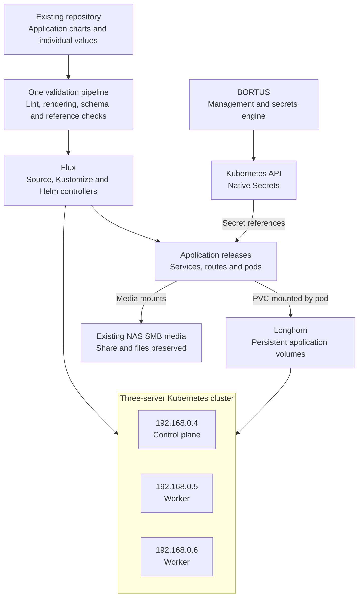
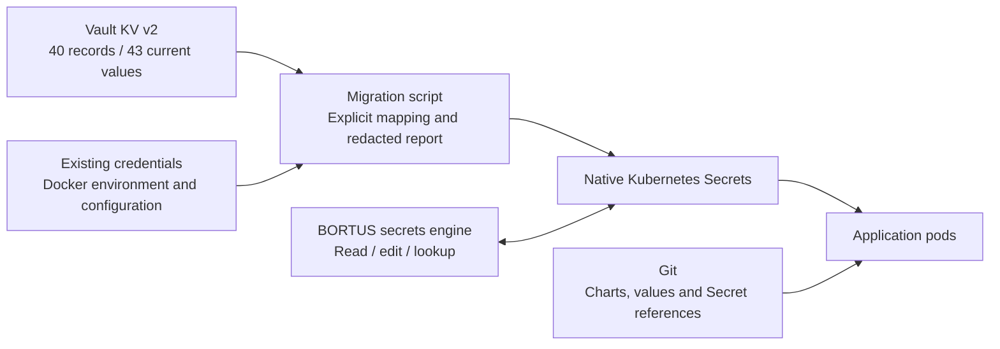
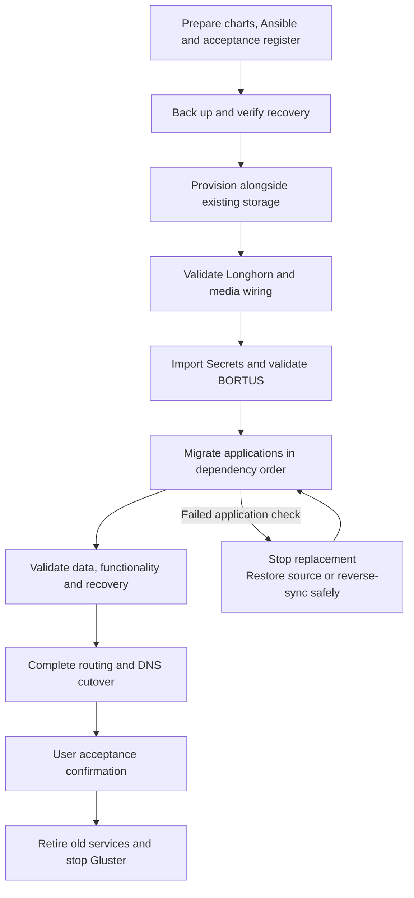

# Kubernetes migration plan and acceptance contract

Approved by the user on 2026-10-09. Execution target: under six hours from execution approval. Data-preservation and acceptance gates remain mandatory.

## Work ownership

- This chat owns cluster migration, server provisioning, chart/values migration, Flux, Longhorn, data preservation, application cutovers, and acceptance evidence.
- As directed by the user on 2026-10-10, execution now uses three agents total: this coordinator plus the BORTUS application and native-transport sub-agents. Application and migration ownership remain separate, with scoped worktrees and reviewed handoffs; the former execution chats are archived. No new execution chats are required.
- After plan approval, create the migration goal with this full acceptance contract and execution target. Gluster/Vault retirement follows the user's final migration confirmation.

Current execution gates (2026-10-12): the isolated API transport has29 passing local transport/TLS controls; live recovery remains open. The patched image's43 HIGH Debian findings are independently triaged and retained, with no accepted exception. A20 requires complete qualification and precise reachability rationale plus expiry for residual exceptions. Eighteen-request performance evaluation is complete without adoption; the sixteen-MiB Secret metadata evaluation is now user-approved, with no source adoption or deployment. Detailed receipts and remaining gates are maintained in [MIGRATION_STATUS.md](MIGRATION_STATUS.md).

## Verified starting point

Vault was unsealed using the user-supplied key and returned HTTP 200, initialized=true, sealed=false, standby=false. Authenticated inventory found 40 current KV records containing 43 values. Secret values and credentials must not be written into this plan, Git, command arguments, or reports.

| Area | Verified observation |
|---|---|
| Servers | 192.168.0.4 master, 192.168.0.5 worker2, 192.168.0.6 worker1; SSH and sudo work on all three |
| SSH | User james, port 2002, WSL key ~/.ssh/id_ed25519; never copy or print the private key |
| Current cluster | All three are Swarm managers; 32 Swarm services and six standalone containers |
| Destination | Existing Ansible playbook and charts directory in the repository's k8s-rewrite branch |
| Gluster | staging-gfs: three replicated bricks at /gluster/volumes; all connected and online |
| Integrity | No reported split-brain; a small, changing heal backlog references Plex logs |
| Other storage | NAS SMB media/backups, NAS NFS application data, local Plex configurations |
| Secrets | Vault KV v2; BORTUS currently reads its database and pushes secrets to Kubernetes |
| Plex | Three running servers; master has Movies, TV Shows and PVR; workers have Movies and TV Shows |

Repository: https://github.com/jtmb/branconet-homelab/tree/k8s-rewrite/k8s-rewrite

Inspected tree baseline: 25586ef4d5e120b852da1a49b281aa918284c05f.

Approximate state measurements: Gluster 2.1 GB, NFS application data 1.9 GB, master Plex configuration 7 GB. Gluster sizing encountered changing Jackett files and must be repeated after stopping writers. Other Plex configurations must also be backed up and retained.

Data scope clarification during execution, 2026-10-09: the user confirmed FlareSolverr /config and Vault /vault/file and /vault/logs anonymous directories were disposable runtime state. Their original paths were removed by initial Swarm task shutdown before archival; that sequencing error is recorded in MIGRATION_STATUS.md. They are excluded from required dataset recovery on the user's explicit clarification. Vault's authoritative data remains the Consul store on Gluster; all Gluster/NFS/Plex/application datasets retain the original preservation gates. Any other anonymous application data must be protected before task removal.

Each server has approximately 16 GB RAM. Observed root-filesystem free space was approximately 56 GB, 80 GB and 62 GB respectively. These are observations, not approved Longhorn allocations. Worker2 had approximately 3.5 GB available RAM at inspection.

## Acceptance contract

Installation or running pods alone does not satisfy this contract. Every criterion requires recorded evidence.

| ID | Required outcome | Acceptance evidence |
|---|---|---|
| AC1 | Kubernetes operates on the three supplied servers using the adapted Ansible setup | Three Ready nodes; working DNS, networking, scheduling and storage |
| AC2 | One CI/CD pipeline manages deployments | Repository validation -> Flux reconciliation -> releases; successful test change and rollback |
| AC3 | Every repository application and live service is accounted for | Complete source-to-target register; no unexplained omissions |
| AC4 | Each application has its own chart and values | Chart, values, dependencies, image, resources, routes, storage and Secret references validated |
| AC5 | Storage follows the repository's Longhorn approach | Stateful pods mount intended Longhorn PVCs; replica placement, persistence, reattachment and restoration tested |
| AC6 | Existing SMB media and paths are preserved | Appropriate read/write checks, playback, download/import checks and demonstrated requested media integration |
| AC7 | Kubernetes Secrets are authoritative; BORTUS reads and manages them | Import verification, lookup/CRUD, authorization and restart-persistence tests |
| AC8 | Existing application data survives | Consistent backups, verified copies/restores, application checks and retained originals |
| AC9 | Plex becomes one Kubernetes-managed service | One active server; preserved selected library/configuration; playback and relocation between eligible nodes |
| AC10 | Final configuration is reproducible | Ansible, chart values, Flux definitions, recovery instructions and report match the running system |
| AC11 | Gluster/Vault retirement follows acceptance | No remaining consumers; tested recovery; user confirmation before shutdown |

## Target architecture

The existing playbook topology is one control plane and two workers. Longhorn replicates application storage. Document control-plane recovery separately because one control plane does not provide control-plane high availability.

The repository currently uses Longhorn for Plex configuration and SMB CSI for Plex media, both mounted by the application pod. The user's requested Longhorn/media integration is an explicit implementation and acceptance check. Existing files do not establish that connector; demonstrate the wiring before cutover while preserving the share and files. Do not silently change the requested storage architecture or relocate NAS media.

## Repository work before deployment

- Inventory: actual hosts, SSH username/port, interfaces and stable addresses.
- Runtime: avoid the current bootstrap's rewrite/restart of Docker's containerd; use a separate Kubernetes runtime configuration, socket and data directory during coexistence.
- Provisioning: idempotent init/join; remove blanket preflight bypasses and suppressed join failures.
- Charts/values: current directories are Kustomize manifests, with no Chart.yaml or values.yaml. Package existing resources as application charts in the same directory, with individual values, to satisfy AC4.
- Flux: correct mixed installation paths; retain helm-controller, which the current role deletes.
- Coverage: include Homepage and websites in reconciliation; fix the missing nginx-hello reference.
- Storage: resolve every PVC reference, including gluetun-port-pvc; enforce configured replica policy and readiness on all participating nodes.
- Ingress: correct the Deployment readiness check for a DaemonSet; use temporary ports while Swarm owns 80/443.
- TLS: install the cert-manager dependency required by the existing ClusterIssuer.
- Secrets: replace the missing/old database-driven secrets role with native Kubernetes Secrets integration; BORTUS application changes are handled by the scoped application sub-agent.
- Versions: pin a compatible Kubernetes/Calico/Longhorn/Flux/CSI combination. Seed defaults are Kubernetes v1.30.0, Longhorn v1.7.2 and two Longhorn replicas; these are not verified effective settings.
- Application versions: initially preserve running versions/digests; perform application upgrades separately.

Do not use reset-and-deploy.sh as the migration entry point. Preserve Gluster bricks, mounted source data, SSH access and recoverability throughout provisioning.

## Workload register scope

Each individual service receives its own migration-register entry, even when related services share a migration wave.

| Group | Workloads | Requirements |
|---|---|---|
| Media | Plex, qBittorrent/Gluetun, Radarr, Sonarr, Bazarr, Jackett, Overseerr, Tautulli, Unpackerr, FlareSolverr, xTeVe, ytdl, repository qbit-monitor | Preserve configuration, paths, permissions, API relationships and processing |
| Websites | APLB, Homepage, Lucinda, Santos, Minecraft website, repository jtmb-dev | Preserve live content/configuration and verify pages/assets |
| WordPress | WordPress, MySQL, Redis, phpMyAdmin | Consistent DB migration, uploads/plugins/themes, inspect Redis state |
| Applications | Ruckus bot/MySQL, Mealie, Vaultwarden | DB integrity and application-level checks; Vaultwarden remains an application |
| DNS/monitoring | Pi-hole, Pi-hole exporter, Minecraft exporter | DNS settings/resolution and exporter targets |
| Games (excluded by user) | Euro Truck Simulator server and Minecraft exporter | Remove deployments/charts; retain source data, PVCs and backups |
| Management/infrastructure | BORTUS, Traefik, Portainer/agents, Vault/Consul | Explicit retained-function mapping, dependencies and retirement |
| Test applications | Whoami, HTTP echo | Routing, storage and deployment smoke checks |

Live VPN: ProtonVPN WireGuard. Repository: ProtonVPN OpenVPN. Align values with the running configuration; do not silently switch provider because additional credentials were supplied.

Plex: one active replica. Proposed primary source is master's plex-media-srv because it includes PVR. Preserve the other configurations and review history/settings differences before accepting consolidation. Validate transcoding on eligible nodes before enabling hardware-dependent scheduling.

Include anonymous Docker volumes and persistent writable-container data in discovery/backup. Observed anonymous volumes include FlareSolverr /config and Vault /vault/logs and /vault/file. Do not prune Docker volumes or discard unexplained datasets.

## Secrets migration and BORTUS dependency

Migration script requirements:

1. Metadata-only dry run maps Vault path/key to namespace/Secret/key.
2. Preserve all 40 current records and legacy aliases without silent deduplication.
3. Import through the Kubernetes API; no values in Git, process arguments or reports.
4. Detect destination conflicts; do not overwrite unrelated keys.
5. Read back and compare values in memory; report only success/failure.
6. Preserve history via recoverable Consul/Vault backup before retirement.

BORTUS development contract: replace database-backed lookup with Kubernetes-backed lookup; preserve authentication/user permissions and explicit namespace/name/key mappings; remove startup database-to-cluster synchronization; preserve unrelated keys during updates/deletes; fail clearly when Kubernetes is unavailable. Keep nonsecret configuration/metadata separate from secret values. Do not add a secrets Git repository or SOPS workflow.

Restrict access to native Secrets, enable encryption at rest and test recovery. Bootstrap/recovery credentials must remain available independently of the cluster they create.

Reference: https://kubernetes.io/docs/concepts/configuration/secret/

## Migration sequence

1. Prepare and back up: freeze register/configuration baseline. Back up Gluster logical filesystem, NFS application state, all Plex configurations, databases, Consul/Vault, anonymous volumes and persistent writable-container data. Verify representative restores. Bricks remain intact.
2. Provision destination: staged adapted Ansible; keep Gluster mounted. Validate networking/existing services after runtime/CNI changes. Temporary ingress avoids occupied ports.
3. Prove storage: test writes, restarts, cross-node attachment, replication and restore. Demonstrate media wiring. Size PVCs from actual data plus growth/snapshot headroom.
4. Establish Secrets/BORTUS: import before consumers start; test reads, edits, permissions, aliases and restart behavior. Coordinate app code through its scoped application sub-agent.
5. Migrate: test/static apps first; databases and dependents next; media/Plex; DNS. Preserve existing container paths.
6. Cut over traffic: validate replacement routes; release old conflicting listeners; transfer ingress/DNS; verify TLS/external access.
7. Accept/retire: complete evidence report and obtain user confirmation. Retire replaced Swarm/standalone workloads and Vault/Consul after consumers are gone. Stop Gluster after verification; retain brick directories/recovery backups.

Per stateful application: initial copy -> stop source writers -> consistent final copy/dump -> verify -> start replacement -> application tests -> route traffic.

Do not copy live database directories while writing. Use consistent MySQL dump/restore or clean-stop procedures, and consistent backups/clean-stop copies for SQLite-backed applications. Investigate pending Gluster log entries and recheck healing after writers stop.

Rollback after replacement writes must preserve those writes and restore/reverse-migrate consistently. Restarting an outdated source alone is insufficient.

## Execution budget

Working time boxes after execution approval; mandatory data gates apply throughout.

| Elapsed | Deliverable |
|---|---|
| 0:00-1:00 | Repository fixes, chart/value preparation, scripts, backups and restore checks |
| 1:00-2:00 | Kubernetes, networking, Flux, Longhorn and temporary ingress |
| 2:00-2:30 | Storage proof, Secret import and BORTUS verification |
| 2:30-4:30 | Application migration waves |
| 4:30-5:15 | Functional, persistence, relocation and recovery checks |
| 5:15-5:45 | Production routing/DNS and acceptance report |
| 5:45-6:00 | Contingency and retirement preparation |

Run independent preparation, backups and checks concurrently where safe. Stateful cutovers follow dependency order. If acceptance fails, preserve source data and pause that application's cutover rather than forcing retirement for the clock. User confirmation gates final Gluster/Vault retirement.

## Acceptance-report template

| Field | Required content |
|---|---|
| Service | Source service/container and target chart/release |
| Configuration | Chart, values, image digest and dependencies |
| Storage | Source dataset, destination PVC, media mounts and permissions |
| Secrets | Namespace/name/key references only |
| Migration evidence | Backup, final-copy verification and DB checks |
| Functional evidence | Application tests and production endpoint |
| Recovery evidence | Restart, relocation and restore/rollback results |
| Status | Pending / prepared / migrated / accepted / blocked |
| Remaining work | Issue, next action and affected criterion |

Every change updates affected Ansible tasks/templates, chart values, Flux configuration, register and acceptance evidence together. Maintain current evidence and explicit unresolved items; never describe unrun checks as passed.

## Initial execution status

- Planning and read-only inventory completed; Vault unsealed by explicit user request.
- Plan approved; migration execution authorized.
- Migration goal activated at 2026-10-09 14:30 UTC (10:30 a.m. Toronto); execution target before 20:30 UTC (4:30 p.m. Toronto).
- Source checkout initialized on codex/kubernetes-migration at the inspected baseline. BORTUS development requested in a separate worktree/chat.
- Cluster provisioning, data movement, Secret import, repository changes and application tests have not yet been performed.
- At initial approval, BORTUS development was delegated to a separate chat. The 2026-10-10 orchestration directive supersedes that arrangement: this coordinator and two scoped sub-agents now own execution, and the former chats are archived.

## As-built state and outstanding acceptance

At the 21:32 UTC check on 2026-10-09, the three Kubernetes nodes, all 36 HelmReleases (35 application charts plus cert-manager), and all active Deployments were Ready. CI run 37993276601 validated revision 2ddeefd49d92bb63e622a830ec88a8baf3b280ec, which Flux reconciled successfully. Source application containers are stopped; source Vault/Consul and Portainer/agents remain retained. Each application's chart keeps its own configuration and native Secret references. Gluster bricks and source datasets remain intact. Operational cutover reached Ready at 20:17:48 UTC, within 5 hours 48 minutes; full acceptance and source retirement remain open.

Proven checks include cold-copy manifests, encrypted storage persistence/relocation/snapshot restoration, an independent NAS BORTUS database restore, isolated etcd restoration matching 349 Secret ciphertext records, recovery of the exact deployed BORTUS image from its authenticated encrypted NAS archive, native BORTUS auth/CRUD/aliases/dashboard/outage/restart, production HTTPS/DNS routing, a single Plex library/playback/relocation, qBittorrent's retained 203-entry queue and Arr download-client tests, the monitor's real queue/forwarded-port/restart behavior, and controlled ZIP extraction through existing SMB CSI with the deployed Unpackerr image. An actual CI/Flux rollout and rollback preserved the HTTP echo response and claim. The actual evidence and its limits are in MIGRATION_STATUS.md and evidence/*.json.

The original removed Redis writable state remains unrecovered. On 2026-10-09 the user explicitly accepted that cache as disposable. The separately confirmed FlareSolverr/Vault runtime exceptions remain recorded. The original Traefik dashboard route/auth hashes/image are restored; authenticated UI/API proof requires its existing working login. One authorized Discord webhook test delivered; the user subsequently authorized restoring the original automatic notification flags; ETS2 and the Minecraft exporter are excluded by the user; legacy xTeve TCP 1901 has no observed listener. All five Sonarr indexers and two Radarr indexers pass configuration tests; two Radarr failures also have pre-migration failure history in the retained source database (see evidence/media-indexer-proof.json), and no settings were saved. The earlier read-only path audit found matching visibility in the Arr pods, qBittorrent pod and original SMB mount (evidence/media-activity-proof.json), with no imports at that observation. A real publisher-webseed torrent subsequently downloaded through qBittorrent/ProtonVPN and imported automatically by Radarr at 23:07:56 UTC. Three-way SHA/size checks and fixture cleanup passed, restoring the original tracked queue/library fingerprints (evidence/media-download-import-proof.json). This test required eight scoped webseed re-add retries; no indexer search or external BitTorrent peer transfer is claimed. xTeve LAN multicast discovery now passes on all three host interfaces using a stateless responder in its chart; original image, tuner identity, two tuners and claims are preserved (evidence/xteve-ssdp-proof.json). LAN HTTPS uses the default untrusted local certificate. These limits remain explicit rather than being treated as passed checks. Final Gluster/Vault retirement requires user confirmation after reviewing the acceptance record.

At 23:47:08 UTC, production Sonarr automatically imported the licensed Blender Shorts S01E02 fixture after the existing qBittorrent client downloaded its archive and production Unpackerr extracted it. History matches the exact torrent ID. The 64,657,027-byte episode matches the publisher SHA in the download, imported Sonarr file and original host SMB mount. Cleanup at 23:48:29 removed only the owned series, torrent and two test directories; all 153 original series, 5,298 original episode-file metadata records and 203 original torrent IDs retain their baseline fingerprints. The temporary loopback seed was stopped and removed. This proves the actual archive/extraction/automatic-episode-import path, using a private loopback seed; external peers and indexer searches are outside this test. The folder fixture required eight scoped seed retries. The initial single-ZIP layout blocked import and is retained in evidence/sonarr-single-archive-stage.json; only fixture layout/display name changed. Unpackerr refused to overwrite the fixture’s duplicate attribution text while successfully extracting the unchanged episode. Evidence: evidence/sonarr-archive-import-proof.json.

## User scope update — 2026-10-09

The user directed removal of game servers and their charts, and accepted the original Redis cache as disposable. Remove ETS2 and the Minecraft exporter through CI/Flux; preserve their original datasets, protected claims and backups. The Minecraft website remains in scope. BORTUS bootstrap and operator access belong to migration; application code changes are owned by the scoped BORTUS application sub-agent. Native Secrets remain authoritative. No source retirement is authorized by this scope change. See evidence/user-scope-update.json and evidence/bortus-operator-bootstrap.json.

## Original monitor alerts — user authorization

Restore the original repository settings for qBittorrent monitor: QBITTORRENT_STATUS_NOTIFICATION, PORT_UPDATED_NOTIFICATION, NEW_DOWNLOAD_NOTIFICATION and METADATA_STUCK_NOTIFICATION on; DOWNLOAD_COMPLETE_NOTIFICATION off. Preserve the immutable image, native webhook/credentials and existing Longhorn bookkeeping claim. Deploy through the existing successful CI/Flux path and verify the running process flags, readiness and unchanged claim/volume identities. This authorization does not confirm final Gluster/Vault retirement.

## Authorized BORTUS follow-up and final release contract

The subsequent user request adds the complete A01–A22 audit remediation and the selected Vault-style native KV engine to the migration goal. It includes performance, UI, correctness, permissions and documentation; paths and grouped keys, immutable versions, CAS and rollback, scoped policies and revocable automation identities, redacted audit, import/export, static rotation and retention/recovery controls. Application implementation remains owned by the BORTUS app sub-agent, native transport and scoped recovery libraries by the native sub-agent, and chart delivery/data migration/live acceptance by this coordinator. The current evidence is [MIGRATION_STATUS.md](MIGRATION_STATUS.md); historical migration acceptance does not qualify the later engine release.

| Final requirement | Acceptance evidence |
|---|---|
| Complete A01–A22 and KV behavior | One coherent immutable source and current docs; full local tests and actual browser workflows; unchanged controlled performance comparison; every audit item and selected engine workflow accounted for with its actual result |
| Separate chart delivery | Private `jtmb/branconet-charts`, individual chart values and one successful current-main CI → validated revision → Flux pipeline; actual final BORTUS release convergence |
| Immutable compatible images | Verified release/recovery OCI digests, exact source/schema/lock/migration identities, clean Linux qualification and identical three-node preloads |
| Fresh source and independent recovery | New consistent encrypted SQLite/PVC/native/etcd checkpoints, authenticated independent restores and full-row comparison; existing users, password hashes, sessions, aliases, workload/storage identities and every accepted write preserved |
| Guarded cutover and complete live engine | Validated chart revision with protected-reference admission and scoped principals; actual allow/deny/revocation evidence before adoption; initial forward schema with adoption disabled, subsequent validated adoption and full live API/UI/persistence/recovery acceptance |
| Retained originals | Gluster bricks, Vault/Consul and recovery artifacts remain intact until explicit final retirement approval |

The precise ordered cutover and recovery requirements are in [MIGRATION-OPERATIONS.md](docs/MIGRATION-OPERATIONS.md). Its new restore preflight and exclusive ownership journal are preparatory libraries with scoped local qualification. A future executor must bind actual controller completion to the exact new Volume UID and backup source, retain durable no-replay ownership through interrupted operations, and prove the restored data with authenticated archives and complete-row equality. Reset in-memory Longhorn history after detach cannot be used as proof by itself. Source/image, actual completion observations, independent restore and the final live gates remain open; helper tests do not satisfy them.

### Accepted performance evaluation update, 2026-10-12

The user approved evaluating an eight-request Secret-list cap after actual
traces showed the old baseline starts18 requests together and the current
four-request path incurs repeated12ms response waves. The32MiB aggregate byte
limit,10,000-item limit, per-page limits,15s aggregate/8s request deadlines,
namespace permissions, fresh authorization and value-redaction contracts remain
unchanged. The original six-profile driver/datasets/oracles and2CPU/1GiB runtime
caps remain the comparison. Evaluation does not grant a performance pass or
production adoption; every profile and tail retains its actual result.

The original three-pair eight-request evaluation completed with all native inventories, but regressed large-value and some warm/concurrent paths. [Root evidence](evidence/bortus-performance-eight-root-20261012.json) preserves all six observations and unchanged limits. A07/A21 remain open; no performance acceptance or live adoption follows the evaluation.

### Approved eighteen-request evaluation, 2026-10-12

Following the failed eight-request comparison, the user approved evaluating eighteen concurrent native Secret-list requests. This changes the evaluated concurrency bound only. Keep the 4 MiB page ceiling, 32 MiB aggregate ceiling, 10,000-item ceiling, existing request/aggregate deadlines, namespace permissions, fresh authorization and value redaction unchanged. Preserve the original six-profile driver, datasets and complete-inventory oracles. Run controls followed by one bounded observation before considering a full paired comparison. Pause heavy root image/cache work during timing. Production remains at eight; this approval grants neither source adoption nor deployment. A07/A21 remain open until the actual acceptance comparison passes.

### 2026-10-12: eighteen-request evaluation completed without adoption

The [independent root review](evidence/bortus-eighteen-request-evaluation-root-20261012.json) verifies all 61 retained originals, 1,640 current source/compiled hashes, the sole compiled 8-to-18 anchor, eight passing control sections and six actual native ELF loads. All six original inventory oracles pass, and the original driver is unchanged. Root confirms observed process absence and a fresh successful query proving the owned container absent.

The single native-list observation measures 123.791 ms (334 small records), 77.500 ms (200), 105.643 ms (1,000), 142.666 ms (10,000), 337.225 ms (25 large) and 253.744 ms (three largest). API calls remain 18/18/18/54/21/20. This is one unpaired observation; prior eight-request paired medians are reference values, not matched causal comparisons. It does not demonstrate broad improvement or satisfy A07/A21. The candidate source cap stays eight and no live deployment changes. Missing dependency chunks and then wrong native-loader cwd caused two retained control setup failures; corrected controls retain the mandatory actual native-load assertion. Root metadata path/oracle-field read errors were corrected without replaying measurement.

The user approved evaluating a16 MiB ceiling for Secret metadata lists on2026-10-12. The experiment retains the32 MiB aggregate,10,000-item, deadline, namespace, authorization, redaction and runtime limits; generic/non-flat responses stay at4 MiB and candidate concurrency stays eight. Both matching transport/native-selector input guards may change only in an isolated prototype. This authorizes evaluation only; production source remains4 MiB and no adoption or deployment is approved by this evaluation.

The [root16 MiB observation review](evidence/bortus-metadata16-evaluation-root-20261012.json) independently verifies74 retained originals,4616 unchanged current source/compiled hashes, six actual native-load records among15 module records, all six exact inventories,28 absent process identities and three absent owned containers. Large-profile phase wall observations were149.4 ms and123.5 ms (literal HTTP146.5 ms and120.6 ms); peak memory477.3 MiB with zero recorded memory events. The retained control composition is seven sections before the v1 fixture failure plus the corrected remainder/corpus/generic v2, rather than one uninterrupted pass. This completes the single evaluation observation only. The root authorized a source candidate with distinct portable-flat16 parity and unchanged generic4 MiB rules for qualification; full functional proof and unchanged three alternating pairs remain required before performance acceptance. Candidate/source concurrency eight is not a measured live setting. No production adoption or deployment.

The [root partial-package metadata review](evidence/bortus-chisel-scanner-metadata-root-20261012.json) compares all17 scanner blocks to the exact signed package control bytes with explicit partial-package/slice markers. An isolated scanner report detects Ubuntu24.04 and all17 exact versions after independently recombining epoch/upstream/revision, and reports five MEDIUM findings with zero HIGH/CRITICAL/secret findings in this rootfs-only input. All original regular file bytes and the input rootfs remain unchanged; six absolute links were mapped only in a confined scanner snapshot. The retained postscan checker failed on its version-field assumption before durably recording the scanner returncode, so this is report visibility evidence, not a passed scanner gate. No Node/app/kubectl runtime or complete application image is tested. The final image requires its own full default scan and compatibility proof; no scanner replay, exception acceptance or deployment follows from this report.

The [root current utility cache read](evidence/bortus-utility-cache-current-root-20261012.json) completes authenticated fixed CTR discovery with actual exit0 and proves the frozen `docker.io/library/bortus@sha256:068254f38c47f99fd35604185a806a92147d934010329638b32adb5c19802c90` reference absent on the master. This BORTUS image is used solely as the inert Node utility; it is not an official Node image. The earlier unprivileged permission refusal does not establish absence. Root independently verifies two local identities and the remote CTR identity absent. No pull/export/tag/import, Pod, policy, ephemeral container or version probe is dispatched. Original-image compatibility therefore remains open until an exact verified resident reference is established; tracing existing artifact/alias provenance is preparation only. The private no-echo credential bridge is unchanged, and the retained staging/validator failures grant no cache claim.

The [root flat16 source review](evidence/bortus-flat16-source-focused-root-20261012.json) independently verifies the evaluation commit2216fa62acf642862517dbda884c345197e540ed:363 raw Git byte/mode/blob bindings (355 frontend files),78 retained originals and all355 exact/explicit CRLF-to-LF working-source relations. Four production files add only flat16 client/native bounds and a distinct portable-flat16 entry sharing the unchanged generic4 grammar. Seventeen focused controls, fresh types and zero-warning lint pass; the exact native ELF matches the approved prototype. Retained V2 type failure and V3 repeated focused stage remain visible. Root independently scans all14 changed raw files with defaults and records0 findings. Fresh full raw-source functional and unchanged alternating pairs remain pending; this commits evaluation evidence without production adoption or deployment.

The [root canonical flat16 functional review](evidence/bortus-flat16-functional-root-20261012.json) independently verifies381 originals,355 exact source/mode/current-hash bindings,4263 current compiled hashes,11 absent owned process identities and five absent owned containers for2216fa62acf642862517dbda884c345197e540ed. All five stages exit0: fresh install/standalone build, actual native load, lint/fresh nonincremental types,271 units and eight original strict HTTP/process/compiled-native integrations with no skips. The native ELF matches the approved16 MiB prototype. A transient status-read timeout is retained as observation failure, without restart or replacement. This closes local functional qualification only. Root refused the first paired preparation before dispatch because it still names unavailable `/mnt/c` paths; a protected exact-object Linux repository/exporter composition and lifecycle must be reviewed before the original three alternating pairs. A07/A21, final image/security/hosted CI, schema/RBAC/live and rollback remain open. No production adoption or deployment.

The [root cache refusal review](evidence/bortus-utility-cache-refusal-root-20261012.json) retains the single actual cache-name attempt with exit1 and its independent read-only journal observation with exit0. The durable journal records a refusal after one successful read-only CTR job, with no alias intent or alias job; that remote identity and all four local actor/observer identities are freshly absent. The actor is not replayed. This establishes no new cache-name state or original-image execution acceptance. A separate bounded read-only discriminator must distinguish image-list parsing from the exact resident source-name prerequisite before further cache work; no Pod, policy, ephemeral container or image version execution follows from this refusal.

The [root paired preflight review](evidence/bortus-flat16-paired-preflight-root-20261012.json) verifies511 lifecycle-control originals and61 exact frozen preparation inputs, followed by13 actual failed-owner originals. The corrected wrapper passed all14 POSIX controls, including stale-leader signal refusal; the retained first control run passed11/13 with two failures. The actual original comparison stops after image inspection because the unchanged source exporter requires a checksum-verified Linux Gitleaks executable at its fixed charts path, which was not staged. Actual runner/supervisor exit1, zero source builds/observations and fresh absence of three process identities are preserved. A distinct preparation must add the exact scanner and its provenance; the failed owner is never replayed. No performance, image or rollout acceptance follows.

The [root fixed cache discriminator](evidence/bortus-utility-cache-discriminator-root-20261012.json) completes one read-only images-list command with actual controller/SSH/CTR exit0 and owned-child reaping. The45,570-byte table is parsed by the unchanged actor parser as104 images; both exact c29 source tags and the frozen068 utility digest reference are absent in this current sample. Only bounded fixed-name flags and public hashes are retained, and both local process identities are independently absent. This distinct read cannot retrospectively prove the earlier unretained table or original refusal cause. No import, alias, pull or image/resource execution occurs. Exact retained artifact provenance and a separately reviewed once-only preload are required before original-image compatibility testing; no profile or utility substitution is approved.

The [root flat16 paired comparison](evidence/bortus-flat16-paired-root-20261012.json) independently verifies 101 retained originals, 429 raw Git blob/mode/actual-tar bindings and all 1,386 reported distributions. Both builds and all six original alternating observations exit 0; all native inventories are complete, and 11 process identities are freshly absent. The same frozen driver, exporter, datasets, runtime limits and oracles are retained. Native cold HTTP medians (baseline to candidate, milliseconds) are 100.94 to 82.82 for 334 records, 71.08 to 73.53 for 200, 77.63 to 77.71 for 1,000, 289.58 to 181.56 for 10,000, 194.19 to 162.76 for 25 large records and 136.89 to 122.33 forthree maximum-size records. Large cases now require 18 calls for both sources, eliminating extra page retries. Whole-fixture median CPU falls 39.13 to 33.62 seconds while peak memory rises 358.54 to 421.11 MiB; these include fixture production and do not isolate application costs. Warm/concurrent Pod, configuration, alias and readiness outcomes remain mixed; no trimming, tolerance or significance claim is introduced. Baseline incomplete 10,000-Pod results and differing Services-after-Pods cache/envelope semantics are noncomparative. A07/A21 remain failed/open, with no source adoption, final image or deployment acceptance. The prior export-prerequisite failure and corrected preparation are preserved.
