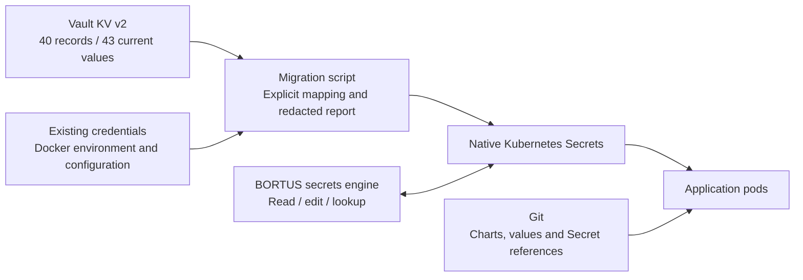
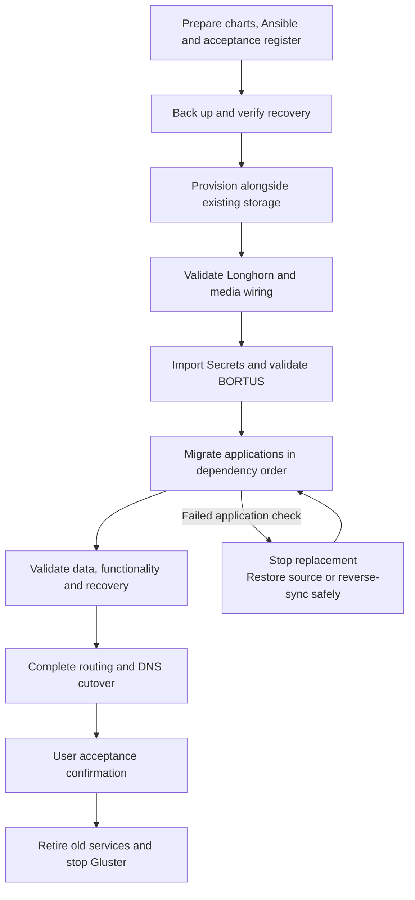

# Kubernetes migration plan and acceptance contract

Approved by the user on 2026-10-09. Execution target: under six hours from execution approval. Data-preservation and acceptance gates remain mandatory.

## Work ownership

- This chat owns cluster migration, server provisioning, chart/values migration, Flux, Longhorn, data preservation, application cutovers, and acceptance evidence.
- As directed by the user on 2026-10-10, execution now uses three agents total: this coordinator plus the BORTUS application and native-transport sub-agents. Application and migration ownership remain separate, with scoped worktrees and reviewed handoffs; the former execution chats are archived. No new execution chats are required.
- After plan approval, create the migration goal with this full acceptance contract and execution target. Gluster/Vault retirement follows the user's final migration confirmation.

Current checkpoint: isolated application6718193 passes fresh build/native load/lint/types,331 unit tests and eight HTTP integrations, plus ten legacy sorting columns in both directions. Independent current-source and Linux/Windows closure checks pass; both earlier legacy browser failures remain preserved. The unchanged original performance benchmark remains failed, including the previously authorized two-reader comparison; no candidate is adopted. One fresh public ephemeral-container PUT with dryRun=All returnsHTTP200 using the whole-volume read-only mount. Its three temporary base resources are removed with UID/current-resourceVersion guards and independent six-GET absence checks; private material was never released and private recovery remains unproven. The Node offline documentation install succeeds, but the unchanged default suite exits2 with two cluster-test timeouts and one DNS assertion failure. Independent source/cache/full-workspace and container closure checks pass;114 zombies under the exact Python PID1 demonstrate a runner reaping problem without proving every test failure cause. The completed finite baseline/init diagnostic reproduces both cluster timeouts and resolves them with init; reachable loopback DNS preserves the expected pending-query exception. Independent source/workspace and exact container/process closure checks pass. A new runner/environment correction is under source review; new runtime/security/final image/live acceptance remain open. The last whole-cluster snapshot is dated2026-10-14 13:18UTC: three Ready nodes,54 Bound PVCs,33 Ready active Helm releases, existing BORTUS image and suspended HelmRelease. No production rollout or original Gluster/Vault/Consul retirement has occurred. Goal active; no user decision pending. A separate legacy Nodes permission/CRUD correction is source-only under application-agent review; the earlier 6718193 evidence remains tied to that older payload.

## Verified starting point

Vault was unsealed using the user-supplied key and returned HTTP 200, initialized=true, sealed=false, standby=false. Authenticated inventory found 40 current KV records containing 43 values. Secret values and credentials must not be written into this plan, Git, command arguments, or reports.

| Area | Verified observation |
|---|---|
| Servers | 192.168.0.4 master, 192.168.0.5 worker2, 192.168.0.6 worker1; SSH and sudo work on all three |
| SSH | User james, port 2002, WSL key ~/.ssh/id_ed25519; never copy or print the private key |
| Current cluster | All three are Swarm managers; 32 Swarm services and six standalone containers |
| Destination | Existing Ansible playbook and charts directory in the repository's k8s-rewrite branch |
| Gluster | staging-gfs: three replicated bricks at /gluster/volumes; all connected and online |
| Integrity | No reported split-brain; a small, changing heal backlog references Plex logs |
| Other storage | NAS SMB media/backups, NAS NFS application data, local Plex configurations |
| Secrets | Vault KV v2; BORTUS currently reads its database and pushes secrets to Kubernetes |
| Plex | Three running servers; master has Movies, TV Shows and PVR; workers have Movies and TV Shows |

Repository: https://github.com/jtmb/branconet-homelab/tree/k8s-rewrite/k8s-rewrite

Inspected tree baseline: 25586ef4d5e120b852da1a49b281aa918284c05f.

Approximate state measurements: Gluster 2.1 GB, NFS application data 1.9 GB, master Plex configuration 7 GB. Gluster sizing encountered changing Jackett files and must be repeated after stopping writers. Other Plex configurations must also be backed up and retained.

Data scope clarification during execution, 2026-10-09: the user confirmed FlareSolverr /config and Vault /vault/file and /vault/logs anonymous directories were disposable runtime state. Their original paths were removed by initial Swarm task shutdown before archival; that sequencing error is recorded in MIGRATION_STATUS.md. They are excluded from required dataset recovery on the user's explicit clarification. Vault's authoritative data remains the Consul store on Gluster; all Gluster/NFS/Plex/application datasets retain the original preservation gates. Any other anonymous application data must be protected before task removal.

Each server has approximately 16 GB RAM. Observed root-filesystem free space was approximately 56 GB, 80 GB and 62 GB respectively. These are observations, not approved Longhorn allocations. Worker2 had approximately 3.5 GB available RAM at inspection.

## Acceptance contract

Installation or running pods alone does not satisfy this contract. Every criterion requires recorded evidence.

| ID | Required outcome | Acceptance evidence |
|---|---|---|
| AC1 | Kubernetes operates on the three supplied servers using the adapted Ansible setup | Three Ready nodes; working DNS, networking, scheduling and storage |
| AC2 | One CI/CD pipeline manages deployments | Repository validation -> Flux reconciliation -> releases; successful test change and rollback |
| AC3 | Every repository application and live service is accounted for | Complete source-to-target register; no unexplained omissions |
| AC4 | Each application has its own chart and values | Chart, values, dependencies, image, resources, routes, storage and Secret references validated |
| AC5 | Storage follows the repository's Longhorn approach | Stateful pods mount intended Longhorn PVCs; replica placement, persistence, reattachment and restoration tested |
| AC6 | Existing SMB media and paths are preserved | Appropriate read/write checks, playback, download/import checks and demonstrated requested media integration |
| AC7 | Kubernetes Secrets are authoritative; BORTUS reads and manages them | Import verification, lookup/CRUD, authorization and restart-persistence tests |
| AC8 | Existing application data survives | Consistent backups, verified copies/restores, application checks and retained originals |
| AC9 | Plex becomes one Kubernetes-managed service | One active server; preserved selected library/configuration; playback and relocation between eligible nodes |
| AC10 | Final configuration is reproducible | Ansible, chart values, Flux definitions, recovery instructions and report match the running system |
| AC11 | Gluster/Vault retirement follows acceptance | No remaining consumers; tested recovery; user confirmation before shutdown |

## Target architecture

Charts are delivered from the separate private `jtmb/branconet-charts` repository. BORTUS application source remains separate; chart changes pass the single chart validation pipeline before Flux reconciles releases.

The existing playbook topology is one control plane and two workers. Longhorn replicates application storage. Document control-plane recovery separately because one control plane does not provide control-plane high availability.

The repository currently uses Longhorn for Plex configuration and SMB CSI for Plex media, both mounted by the application pod. The user's requested Longhorn/media integration is an explicit implementation and acceptance check. Existing files do not establish that connector; demonstrate the wiring before cutover while preserving the share and files. Do not silently change the requested storage architecture or relocate NAS media.

## Repository work before deployment

- Inventory: actual hosts, SSH username/port, interfaces and stable addresses.
- Runtime: avoid the current bootstrap's rewrite/restart of Docker's containerd; use a separate Kubernetes runtime configuration, socket and data directory during coexistence.
- Provisioning: idempotent init/join; remove blanket preflight bypasses and suppressed join failures.
- Charts/values: current directories are Kustomize manifests, with no Chart.yaml or values.yaml. Package existing resources as application charts in the same directory, with individual values, to satisfy AC4.
- Flux: correct mixed installation paths; retain helm-controller, which the current role deletes.
- Coverage: include Homepage and websites in reconciliation; fix the missing nginx-hello reference.
- Storage: resolve every PVC reference, including gluetun-port-pvc; enforce configured replica policy and readiness on all participating nodes.
- Ingress: correct the Deployment readiness check for a DaemonSet; use temporary ports while Swarm owns 80/443.
- TLS: install the cert-manager dependency required by the existing ClusterIssuer.
- Secrets: replace the missing/old database-driven secrets role with native Kubernetes Secrets integration; BORTUS application changes are handled by the scoped application sub-agent.
- Versions: pin a compatible Kubernetes/Calico/Longhorn/Flux/CSI combination. Seed defaults are Kubernetes v1.30.0, Longhorn v1.7.2 and two Longhorn replicas; these are not verified effective settings.
- Application versions: initially preserve running versions/digests; perform application upgrades separately.

Do not use reset-and-deploy.sh as the migration entry point. Preserve Gluster bricks, mounted source data, SSH access and recoverability throughout provisioning.

## Workload register scope

Each individual service receives its own migration-register entry, even when related services share a migration wave.

| Group | Workloads | Requirements |
|---|---|---|
| Media | Plex, qBittorrent/Gluetun, Radarr, Sonarr, Bazarr, Jackett, Overseerr, Tautulli, Unpackerr, FlareSolverr, xTeVe, ytdl, repository qbit-monitor | Preserve configuration, paths, permissions, API relationships and processing |
| Websites | APLB, Homepage, Lucinda, Santos, Minecraft website, repository jtmb-dev | Preserve live content/configuration and verify pages/assets |
| WordPress | WordPress, MySQL, Redis, phpMyAdmin | Consistent DB migration, uploads/plugins/themes, inspect Redis state |
| Applications | Ruckus bot/MySQL, Mealie, Vaultwarden | DB integrity and application-level checks; Vaultwarden remains an application |
| DNS/monitoring | Pi-hole, Pi-hole exporter, Minecraft exporter | DNS settings/resolution and exporter targets |
| Games (excluded by user) | Euro Truck Simulator server and Minecraft exporter | Remove deployments/charts; retain source data, PVCs and backups |
| Management/infrastructure | BORTUS, Traefik, Portainer/agents, Vault/Consul | Explicit retained-function mapping, dependencies and retirement |
| Test applications | Whoami, HTTP echo | Routing, storage and deployment smoke checks |

Live VPN: ProtonVPN WireGuard. Repository: ProtonVPN OpenVPN. Align values with the running configuration; do not silently switch provider because additional credentials were supplied.

Plex: one active replica. Proposed primary source is master's plex-media-srv because it includes PVR. Preserve the other configurations and review history/settings differences before accepting consolidation. Validate transcoding on eligible nodes before enabling hardware-dependent scheduling.

Include anonymous Docker volumes and persistent writable-container data in discovery/backup. Observed anonymous volumes include FlareSolverr /config and Vault /vault/logs and /vault/file. Do not prune Docker volumes or discard unexplained datasets.

## Secrets migration and BORTUS dependency

Migration script requirements:

1. Metadata-only dry run maps Vault path/key to namespace/Secret/key.
2. Preserve all 40 current records and legacy aliases without silent deduplication.
3. Import through the Kubernetes API; no values in Git, process arguments or reports.
4. Detect destination conflicts; do not overwrite unrelated keys.
5. Read back and compare values in memory; report only success/failure.
6. Preserve history via recoverable Consul/Vault backup before retirement.

BORTUS development contract: replace database-backed lookup with Kubernetes-backed lookup; preserve authentication/user permissions and explicit namespace/name/key mappings; remove startup database-to-cluster synchronization; preserve unrelated keys during updates/deletes; fail clearly when Kubernetes is unavailable. Keep nonsecret configuration/metadata separate from secret values. Do not add a secrets Git repository or SOPS workflow.

Restrict access to native Secrets, enable encryption at rest and test recovery. Bootstrap/recovery credentials must remain available independently of the cluster they create.

Reference: https://kubernetes.io/docs/concepts/configuration/secret/

## Migration sequence

1. Prepare and back up: freeze register/configuration baseline. Back up Gluster logical filesystem, NFS application state, all Plex configurations, databases, Consul/Vault, anonymous volumes and persistent writable-container data. Verify representative restores. Bricks remain intact.
2. Provision destination: staged adapted Ansible; keep Gluster mounted. Validate networking/existing services after runtime/CNI changes. Temporary ingress avoids occupied ports.
3. Prove storage: test writes, restarts, cross-node attachment, replication and restore. Demonstrate media wiring. Size PVCs from actual data plus growth/snapshot headroom.
4. Establish Secrets/BORTUS: import before consumers start; test reads, edits, permissions, aliases and restart behavior. Coordinate app code through its scoped application sub-agent.
5. Migrate: test/static apps first; databases and dependents next; media/Plex; DNS. Preserve existing container paths.
6. Cut over traffic: validate replacement routes; release old conflicting listeners; transfer ingress/DNS; verify TLS/external access.
7. Accept/retire: complete evidence report and obtain user confirmation. Retire replaced Swarm/standalone workloads and Vault/Consul after consumers are gone. Stop Gluster after verification; retain brick directories/recovery backups.

Per stateful application: initial copy -> stop source writers -> consistent final copy/dump -> verify -> start replacement -> application tests -> route traffic.

Do not copy live database directories while writing. Use consistent MySQL dump/restore or clean-stop procedures, and consistent backups/clean-stop copies for SQLite-backed applications. Investigate pending Gluster log entries and recheck healing after writers stop.

Rollback after replacement writes must preserve those writes and restore/reverse-migrate consistently. Restarting an outdated source alone is insufficient.

## Execution budget

Working time boxes after execution approval; mandatory data gates apply throughout.

| Elapsed | Deliverable |
|---|---|
| 0:00-1:00 | Repository fixes, chart/value preparation, scripts, backups and restore checks |
| 1:00-2:00 | Kubernetes, networking, Flux, Longhorn and temporary ingress |
| 2:00-2:30 | Storage proof, Secret import and BORTUS verification |
| 2:30-4:30 | Application migration waves |
| 4:30-5:15 | Functional, persistence, relocation and recovery checks |
| 5:15-5:45 | Production routing/DNS and acceptance report |
| 5:45-6:00 | Contingency and retirement preparation |

Run independent preparation, backups and checks concurrently where safe. Stateful cutovers follow dependency order. If acceptance fails, preserve source data and pause that application's cutover rather than forcing retirement for the clock. User confirmation gates final Gluster/Vault retirement.

## Acceptance-report template

| Field | Required content |
|---|---|
| Service | Source service/container and target chart/release |
| Configuration | Chart, values, image digest and dependencies |
| Storage | Source dataset, destination PVC, media mounts and permissions |
| Secrets | Namespace/name/key references only |
| Migration evidence | Backup, final-copy verification and DB checks |
| Functional evidence | Application tests and production endpoint |
| Recovery evidence | Restart, relocation and restore/rollback results |
| Status | Pending / prepared / migrated / accepted / blocked |
| Remaining work | Issue, next action and affected criterion |

Every change updates affected Ansible tasks/templates, chart values, Flux configuration, register and acceptance evidence together. Maintain current evidence and explicit unresolved items; never describe unrun checks as passed.

## Initial execution status

- Planning and read-only inventory completed; Vault unsealed by explicit user request.
- Plan approved; migration execution authorized.
- Migration goal activated at 2026-10-09 14:30 UTC (10:30 a.m. Toronto); execution target before 20:30 UTC (4:30 p.m. Toronto).
- Source checkout initialized on codex/kubernetes-migration at the inspected baseline. BORTUS development requested in a separate worktree/chat.
- Cluster provisioning, data movement, Secret import, repository changes and application tests have not yet been performed.
- At initial approval, BORTUS development was delegated to a separate chat. The 2026-10-10 orchestration directive supersedes that arrangement: this coordinator and two scoped sub-agents now own execution, and the former chats are archived.

## As-built state and outstanding acceptance

At the 21:32 UTC check on 2026-10-09, the three Kubernetes nodes, all 36 HelmReleases (35 application charts plus cert-manager), and all active Deployments were Ready. CI run 37993276601 validated revision 2ddeefd49d92bb63e622a830ec88a8baf3b280ec, which Flux reconciled successfully. Source application containers are stopped; source Vault/Consul and Portainer/agents remain retained. Each application's chart keeps its own configuration and native Secret references. Gluster bricks and source datasets remain intact. Operational cutover reached Ready at 20:17:48 UTC, within 5 hours 48 minutes; full acceptance and source retirement remain open.

Proven checks include cold-copy manifests, encrypted storage persistence/relocation/snapshot restoration, an independent NAS BORTUS database restore, isolated etcd restoration matching 349 Secret ciphertext records, recovery of the exact deployed BORTUS image from its authenticated encrypted NAS archive, native BORTUS auth/CRUD/aliases/dashboard/outage/restart, production HTTPS/DNS routing, a single Plex library/playback/relocation, qBittorrent's retained 203-entry queue and Arr download-client tests, the monitor's real queue/forwarded-port/restart behavior, and controlled ZIP extraction through existing SMB CSI with the deployed Unpackerr image. An actual CI/Flux rollout and rollback preserved the HTTP echo response and claim. The actual evidence and its limits are in MIGRATION_STATUS.md and evidence/*.json.

The original removed Redis writable state remains unrecovered. On 2026-10-09 the user explicitly accepted that cache as disposable. The separately confirmed FlareSolverr/Vault runtime exceptions remain recorded. The original Traefik dashboard route/auth hashes/image are restored; authenticated UI/API proof requires its existing working login. One authorized Discord webhook test delivered; the user subsequently authorized restoring the original automatic notification flags; ETS2 and the Minecraft exporter are excluded by the user; legacy xTeve TCP 1901 has no observed listener. All five Sonarr indexers and two Radarr indexers pass configuration tests; two Radarr failures also have pre-migration failure history in the retained source database (see evidence/media-indexer-proof.json), and no settings were saved. The earlier read-only path audit found matching visibility in the Arr pods, qBittorrent pod and original SMB mount (evidence/media-activity-proof.json), with no imports at that observation. A real publisher-webseed torrent subsequently downloaded through qBittorrent/ProtonVPN and imported automatically by Radarr at 23:07:56 UTC. Three-way SHA/size checks and fixture cleanup passed, restoring the original tracked queue/library fingerprints (evidence/media-download-import-proof.json). This test required eight scoped webseed re-add retries; no indexer search or external BitTorrent peer transfer is claimed. xTeve LAN multicast discovery now passes on all three host interfaces using a stateless responder in its chart; original image, tuner identity, two tuners and claims are preserved (evidence/xteve-ssdp-proof.json). LAN HTTPS uses the default untrusted local certificate. These limits remain explicit rather than being treated as passed checks. Final Gluster/Vault retirement requires user confirmation after reviewing the acceptance record.

At 23:47:08 UTC, production Sonarr automatically imported the licensed Blender Shorts S01E02 fixture after the existing qBittorrent client downloaded its archive and production Unpackerr extracted it. History matches the exact torrent ID. The 64,657,027-byte episode matches the publisher SHA in the download, imported Sonarr file and original host SMB mount. Cleanup at 23:48:29 removed only the owned series, torrent and two test directories; all 153 original series, 5,298 original episode-file metadata records and 203 original torrent IDs retain their baseline fingerprints. The temporary loopback seed was stopped and removed. This proves the actual archive/extraction/automatic-episode-import path, using a private loopback seed; external peers and indexer searches are outside this test. The folder fixture required eight scoped seed retries. The initial single-ZIP layout blocked import and is retained in evidence/sonarr-single-archive-stage.json; only fixture layout/display name changed. Unpackerr refused to overwrite the fixture’s duplicate attribution text while successfully extracting the unchanged episode. Evidence: evidence/sonarr-archive-import-proof.json.

## User scope update — 2026-10-09

The user directed removal of game servers and their charts, and accepted the original Redis cache as disposable. Remove ETS2 and the Minecraft exporter through CI/Flux; preserve their original datasets, protected claims and backups. The Minecraft website remains in scope. BORTUS bootstrap and operator access belong to migration; application code changes are owned by the scoped BORTUS application sub-agent. Native Secrets remain authoritative. No source retirement is authorized by this scope change. See evidence/user-scope-update.json and evidence/bortus-operator-bootstrap.json.

## Original monitor alerts — user authorization

Restore the original repository settings for qBittorrent monitor: QBITTORRENT_STATUS_NOTIFICATION, PORT_UPDATED_NOTIFICATION, NEW_DOWNLOAD_NOTIFICATION and METADATA_STUCK_NOTIFICATION on; DOWNLOAD_COMPLETE_NOTIFICATION off. Preserve the immutable image, native webhook/credentials and existing Longhorn bookkeeping claim. Deploy through the existing successful CI/Flux path and verify the running process flags, readiness and unchanged claim/volume identities. This authorization does not confirm final Gluster/Vault retirement.

## Authorized BORTUS follow-up and final release contract

The subsequent user request adds the complete A01–A22 audit remediation and the selected Vault-style native KV engine to the migration goal. It includes performance, UI, correctness, permissions and documentation; paths and grouped keys, immutable versions, CAS and rollback, scoped policies and revocable automation identities, redacted audit, import/export, static rotation and retention/recovery controls. Application implementation remains owned by the BORTUS app sub-agent, native transport and scoped recovery libraries by the native sub-agent, and chart delivery/data migration/live acceptance by this coordinator. The current evidence is [MIGRATION_STATUS.md](MIGRATION_STATUS.md); historical migration acceptance does not qualify the later engine release.

| Final requirement | Acceptance evidence |
|---|---|
| Complete A01–A22 and KV behavior | One coherent immutable source and current docs; full local tests and actual browser workflows; unchanged controlled performance comparison; every audit item and selected engine workflow accounted for with its actual result |
| Separate chart delivery | Private `jtmb/branconet-charts`, individual chart values and one successful current-main CI → validated revision → Flux pipeline; actual final BORTUS release convergence |
| Immutable compatible images | Verified release/recovery OCI digests, exact source/schema/lock/migration identities, clean Linux qualification and identical three-node preloads |
| Fresh source and independent recovery | New consistent encrypted SQLite/PVC/native/etcd checkpoints, authenticated independent restores and full-row comparison; existing users, password hashes, sessions, aliases, workload/storage identities and every accepted write preserved |
| Guarded cutover and complete live engine | Validated chart revision with protected-reference admission and scoped principals; actual allow/deny/revocation evidence before adoption; initial forward schema with adoption disabled, subsequent validated adoption and full live API/UI/persistence/recovery acceptance |
| Retained originals | Gluster bricks, Vault/Consul and recovery artifacts remain intact until explicit final retirement approval |

The precise ordered cutover and recovery requirements are in [MIGRATION-OPERATIONS.md](docs/MIGRATION-OPERATIONS.md). Its new restore preflight and exclusive ownership journal are preparatory libraries with scoped local qualification. A future executor must bind actual controller completion to the exact new Volume UID and backup source, retain durable no-replay ownership through interrupted operations, and prove the restored data with authenticated archives and complete-row equality. Reset in-memory Longhorn history after detach cannot be used as proof by itself. Source/image, actual completion observations, independent restore and the final live gates remain open; helper tests do not satisfy them.

### Accepted performance evaluation update, 2026-10-12

The user approved evaluating an eight-request Secret-list cap after actual
traces showed the old baseline starts18 requests together and the current
four-request path incurs repeated12ms response waves. The32MiB aggregate byte
limit,10,000-item limit, per-page limits,15s aggregate/8s request deadlines,
namespace permissions, fresh authorization and value-redaction contracts remain
unchanged. The original six-profile driver/datasets/oracles and2CPU/1GiB runtime
caps remain the comparison. Evaluation does not grant a performance pass or
production adoption; every profile and tail retains its actual result.

The original three-pair eight-request evaluation completed with all native inventories, but regressed large-value and some warm/concurrent paths. [Root evidence](evidence/bortus-performance-eight-root-20261012.json) preserves all six observations and unchanged limits. A07/A21 remain open; no performance acceptance or live adoption follows the evaluation.

### Approved eighteen-request evaluation, 2026-10-12

Following the failed eight-request comparison, the user approved evaluating eighteen concurrent native Secret-list requests. This changes the evaluated concurrency bound only. Keep the 4 MiB page ceiling, 32 MiB aggregate ceiling, 10,000-item ceiling, existing request/aggregate deadlines, namespace permissions, fresh authorization and value redaction unchanged. Preserve the original six-profile driver, datasets and complete-inventory oracles. Run controls followed by one bounded observation before considering a full paired comparison. Pause heavy root image/cache work during timing. Production remains at eight; this approval grants neither source adoption nor deployment. A07/A21 remain open until the actual acceptance comparison passes.

### 2026-10-12: eighteen-request evaluation completed without adoption

The [independent root review](evidence/bortus-eighteen-request-evaluation-root-20261012.json) verifies all 61 retained originals, 1,640 current source/compiled hashes, the sole compiled 8-to-18 anchor, eight passing control sections and six actual native ELF loads. All six original inventory oracles pass, and the original driver is unchanged. Root confirms observed process absence and a fresh successful query proving the owned container absent.

The single native-list observation measures 123.791 ms (334 small records), 77.500 ms (200), 105.643 ms (1,000), 142.666 ms (10,000), 337.225 ms (25 large) and 253.744 ms (three largest). API calls remain 18/18/18/54/21/20. This is one unpaired observation; prior eight-request paired medians are reference values, not matched causal comparisons. It does not demonstrate broad improvement or satisfy A07/A21. The candidate source cap stays eight and no live deployment changes. Missing dependency chunks and then wrong native-loader cwd caused two retained control setup failures; corrected controls retain the mandatory actual native-load assertion. Root metadata path/oracle-field read errors were corrected without replaying measurement.

The user approved evaluating a16 MiB ceiling for Secret metadata lists on2026-10-12. The experiment retains the32 MiB aggregate,10,000-item, deadline, namespace, authorization, redaction and runtime limits; generic/non-flat responses stay at4 MiB and candidate concurrency stays eight. Both matching transport/native-selector input guards may change only in an isolated prototype. This authorizes evaluation only; production source remains4 MiB and no adoption or deployment is approved by this evaluation.

The [root16 MiB observation review](evidence/bortus-metadata16-evaluation-root-20261012.json) independently verifies74 retained originals,4616 unchanged current source/compiled hashes, six actual native-load records among15 module records, all six exact inventories,28 absent process identities and three absent owned containers. Large-profile phase wall observations were149.4 ms and123.5 ms (literal HTTP146.5 ms and120.6 ms); peak memory477.3 MiB with zero recorded memory events. The retained control composition is seven sections before the v1 fixture failure plus the corrected remainder/corpus/generic v2, rather than one uninterrupted pass. This completes the single evaluation observation only. The root authorized a source candidate with distinct portable-flat16 parity and unchanged generic4 MiB rules for qualification; full functional proof and unchanged three alternating pairs remain required before performance acceptance. Candidate/source concurrency eight is not a measured live setting. No production adoption or deployment.

The [root partial-package metadata review](evidence/bortus-chisel-scanner-metadata-root-20261012.json) compares all17 scanner blocks to the exact signed package control bytes with explicit partial-package/slice markers. An isolated scanner report detects Ubuntu24.04 and all17 exact versions after independently recombining epoch/upstream/revision, and reports five MEDIUM findings with zero HIGH/CRITICAL/secret findings in this rootfs-only input. All original regular file bytes and the input rootfs remain unchanged; six absolute links were mapped only in a confined scanner snapshot. The retained postscan checker failed on its version-field assumption before durably recording the scanner returncode, so this is report visibility evidence, not a passed scanner gate. No Node/app/kubectl runtime or complete application image is tested. The final image requires its own full default scan and compatibility proof; no scanner replay, exception acceptance or deployment follows from this report.

The [root current utility cache read](evidence/bortus-utility-cache-current-root-20261012.json) completes authenticated fixed CTR discovery with actual exit0 and proves the frozen `docker.io/library/bortus@sha256:068254f38c47f99fd35604185a806a92147d934010329638b32adb5c19802c90` reference absent on the master. This BORTUS image is used solely as the inert Node utility; it is not an official Node image. The earlier unprivileged permission refusal does not establish absence. Root independently verifies two local identities and the remote CTR identity absent. No pull/export/tag/import, Pod, policy, ephemeral container or version probe is dispatched. Original-image compatibility therefore remains open until an exact verified resident reference is established; tracing existing artifact/alias provenance is preparation only. The private no-echo credential bridge is unchanged, and the retained staging/validator failures grant no cache claim.

The [root flat16 source review](evidence/bortus-flat16-source-focused-root-20261012.json) independently verifies the evaluation commit2216fa62acf642862517dbda884c345197e540ed:363 raw Git byte/mode/blob bindings (355 frontend files),78 retained originals and all355 exact/explicit CRLF-to-LF working-source relations. Four production files add only flat16 client/native bounds and a distinct portable-flat16 entry sharing the unchanged generic4 grammar. Seventeen focused controls, fresh types and zero-warning lint pass; the exact native ELF matches the approved prototype. Retained V2 type failure and V3 repeated focused stage remain visible. Root independently scans all14 changed raw files with defaults and records0 findings. Fresh full raw-source functional and unchanged alternating pairs remain pending; this commits evaluation evidence without production adoption or deployment.

The [root canonical flat16 functional review](evidence/bortus-flat16-functional-root-20261012.json) independently verifies381 originals,355 exact source/mode/current-hash bindings,4263 current compiled hashes,11 absent owned process identities and five absent owned containers for2216fa62acf642862517dbda884c345197e540ed. All five stages exit0: fresh install/standalone build, actual native load, lint/fresh nonincremental types,271 units and eight original strict HTTP/process/compiled-native integrations with no skips. The native ELF matches the approved16 MiB prototype. A transient status-read timeout is retained as observation failure, without restart or replacement. This closes local functional qualification only. Root refused the first paired preparation before dispatch because it still names unavailable `/mnt/c` paths; a protected exact-object Linux repository/exporter composition and lifecycle must be reviewed before the original three alternating pairs. A07/A21, final image/security/hosted CI, schema/RBAC/live and rollback remain open. No production adoption or deployment.

The [root cache refusal review](evidence/bortus-utility-cache-refusal-root-20261012.json) retains the single actual cache-name attempt with exit1 and its independent read-only journal observation with exit0. The durable journal records a refusal after one successful read-only CTR job, with no alias intent or alias job; that remote identity and all four local actor/observer identities are freshly absent. The actor is not replayed. This establishes no new cache-name state or original-image execution acceptance. A separate bounded read-only discriminator must distinguish image-list parsing from the exact resident source-name prerequisite before further cache work; no Pod, policy, ephemeral container or image version execution follows from this refusal.

The [root paired preflight review](evidence/bortus-flat16-paired-preflight-root-20261012.json) verifies511 lifecycle-control originals and61 exact frozen preparation inputs, followed by13 actual failed-owner originals. The corrected wrapper passed all14 POSIX controls, including stale-leader signal refusal; the retained first control run passed11/13 with two failures. The actual original comparison stops after image inspection because the unchanged source exporter requires a checksum-verified Linux Gitleaks executable at its fixed charts path, which was not staged. Actual runner/supervisor exit1, zero source builds/observations and fresh absence of three process identities are preserved. A distinct preparation must add the exact scanner and its provenance; the failed owner is never replayed. No performance, image or rollout acceptance follows.

The [root fixed cache discriminator](evidence/bortus-utility-cache-discriminator-root-20261012.json) completes one read-only images-list command with actual controller/SSH/CTR exit0 and owned-child reaping. The45,570-byte table is parsed by the unchanged actor parser as104 images; both exact c29 source tags and the frozen068 utility digest reference are absent in this current sample. Only bounded fixed-name flags and public hashes are retained, and both local process identities are independently absent. This distinct read cannot retrospectively prove the earlier unretained table or original refusal cause. No import, alias, pull or image/resource execution occurs. Exact retained artifact provenance and a separately reviewed once-only preload are required before original-image compatibility testing; no profile or utility substitution is approved.

The [root flat16 paired comparison](evidence/bortus-flat16-paired-root-20261012.json) independently verifies 101 retained originals, 429 raw Git blob/mode/actual-tar bindings and all 1,386 reported distributions. Both builds and all six original alternating observations exit 0; all native inventories are complete, and 11 process identities are freshly absent. The same frozen driver, exporter, datasets, runtime limits and oracles are retained. Native cold HTTP medians (baseline to candidate, milliseconds) are 100.94 to 82.82 for 334 records, 71.08 to 73.53 for 200, 77.63 to 77.71 for 1,000, 289.58 to 181.56 for 10,000, 194.19 to 162.76 for 25 large records and 136.89 to 122.33 forthree maximum-size records. Large cases now require 18 calls for both sources, eliminating extra page retries. Whole-fixture median CPU falls 39.13 to 33.62 seconds while peak memory rises 358.54 to 421.11 MiB; these include fixture production and do not isolate application costs. Warm/concurrent Pod, configuration, alias and readiness outcomes remain mixed; no trimming, tolerance or significance claim is introduced. Baseline incomplete 10,000-Pod results and differing Services-after-Pods cache/envelope semantics are noncomparative. A07/A21 remain failed/open, with no source adoption, final image or deployment acceptance. The prior export-prerequisite failure and corrected preparation are preserved.

On 2026-10-12 the user approved the [reviewed combined eighteen-request/flat16 prototype](evidence/bortus-combined18-flat16-proposal-root-20261012.json). Root verifies 16 exact raw source bindings and three current compiled/native bindings. The isolated wrapper changes exactly one compiled `let e=8;class f` anchor to18, covering global native request admission, namespace workers and operation-owned Agent limits together; original source and compiled files stay unchanged. Flat metadata16 MiB, generic4 MiB, aggregate32 MiB,10,000 items, queue64, request/list deadlines, namespace/fresh-credential/permission checks, redaction and original runtime/oracles remain fixed. Complete boundary/ownership/refusal/native-load controls precede one original six-profile observation under a reserved quiet window. This authorizes no source adoption, full paired comparison, image or deployment. Native concurrency cannot fix repeated warm Pod phases, which make zero native calls; those regressions remain separate work.

The [root runtime tool selection](evidence/bortus-runtime-tool-license-selection-root-20261012.json) binds the exact 61,960,354-byte patched kubectl ELF to its completed build/injection receipts and provides a separate executable named context. The cached Node image is identified by its actual OCI manifest descriptor and resident repository digest. A read-only filesystem copy from a unique container that was never started verifies `/usr/local/LICENSE`, 145,485 bytes, SHA256 `c738ae413cf561f174e34f6961f8ca458aae2369a73640dda6234c629b98bcc4`. All seven owned CLI identities are freshly absent, and removal plus a fresh successful query proves the inspector container absent. No image execution, pull, prototype build or source adoption occurs. These inputs resolve preparation prerequisites only; the complete assembled image still requires dependency/runtime/data-preservation qualification and its own durable full default security scan.

Root independently verifies the [combined eighteen-request/flat16 controls](evidence/bortus-combined18-flat16-controls-root-20261012.json): all ten admission, cancellation, fresh-credential, namespace, redaction, size, aggregate, item and deadline sections pass on actual loopback HTTPS, alongside 3,674 native grammar cases and eight generic tests. The exact native ELF is loaded; all owner queues drain to zero. Actual runner/container/supervisor/dispatcher exits are zero within the original 60-second bound (24.59 seconds); 1,723 current source/compiled hashes are unchanged, and independent fresh checks prove four process identities and the exact container absent. This qualifies the isolated evaluation controls, not performance, source adoption or deployment. The separately approved single six-profile timing observation uses no control getter.

The [root combined single observation](evidence/bortus-combined18-flat16-observation-root-20261012.json) retains all 28 observed originals; root also verifies the closed 41-file immutable package and matches those 28 captured files exactly. The original driver, runner and container exit 0 with six complete native inventories; supervisor and dispatcher exit 1 because their postcheck wrongly expects paired-run-only `runtime_harness_sha256` in direct driver output. That failure is preserved and no benchmark is replayed. Independent metadata-only review binds the pre-dispatch driver hash, verifies all 15 core-only module records and six actual native loads, recomputes 25 latency fields, checks 1,723 current source/compiled hashes and freshly proves four process identities plus the exact container absent. Secret HTTP times are 140.56/90.77/94.97/171.01/206.90/189.03 ms for 334/200/1,000/10,000/25 large/three maximum-size records; all expected inventories are complete. Whole-fixture CPU is 35.55 seconds and peak memory 566.69 MiB, without throttle or OOM. This single observation has no contemporary paired baseline or significance claim; five cases are descriptively slower and memory higher than the prior eight-request/flat16 candidate medians. Eighteen requests is not adopted, canonical source remains at eight, and A07/A21 remain open. Warm Pod and alias hot paths require separate source work; native concurrency does not change their calls.

The [root retained-master preload controls](evidence/bortus-retained-master-preload-controls-root-20261012.json) verify26 selected raw artifacts,58 closed archive members (57 originals plus exact manifest) and14 current executed source hashes. All11 public POSIX controls pass once in0.393 seconds; the gated supervisor exits0 in0.589 seconds under its original30-second bound. Default17-file scan exits0 with no findings, and fresh root checks prove all five test/supervisor/shim/scanner identities absent. V3 changes the fixture socket binding only; production helper/composer stay exactV2. The setup bootstrap and packaging failures and syntax warning remain visible. These controls exercise validators and actual public Python child/file primitives, not full privileged root_entry or image postconditions. The current retained server archive remains unobserved; a separate fixed-master caller and independent journal reader must qualify before server-side inspection/import. No image/import/Pod/policy operation is accepted here.

## 2026-10-12: source 9fd comparison and master alias verified

The [unchanged three-pair comparison](evidence/bortus-jwt-alias-paired-root-20261012.json) completes both builds and six observations with runner and supervisor exits of zero. Root verifies 107 originals, 430 exported Git/blob/mode/tar bindings, 520 current Git proof bindings and all 1,386 distributions. Current compiled snapshots contain 3,894 baseline and 4,263 candidate regular files. Ten PID/start identities, a separate dispatcher PID-only absence check and eight exact container absences are independently verified. Native Secret HTTP medians (baseline/candidate milliseconds) are 77.24/75.01, 65.82/71.74, 73.59/72.33, 267.55/174.35, 201.31/144.47 and 123.31/108.71. Whole-fixture CPU median falls from 35.94 to 30.61 seconds while peak memory rises from 356.98 to 413.11 MiB. All 69 comparable latency/workflow/CPU median increases remain recorded; A07/A21 stay failed/open. Alias listing takes one baseline request versus seven bounded 100-row candidate pages; this is source-backed context, not an exemption. No trimming, tolerance change, benchmark replay or source adoption.

The [alias-only public controls](evidence/bortus-current-master-alias-controls-root-20261012.json) pass eight tests with 21 unchanged inputs under the original 30-second supervisor. The default scan exits with code 1 for one exact public dependency-hash declaration, transparently triaged without suppression. The [actual master alias](evidence/bortus-current-master-alias-root-20261012.json) then completes once in 20.04 seconds within the original 75-second local/60-second remote bounds. All 13 image commands exit successfully and are reaped, fixed digest/config metadata matches before and after, and root independently observes 17 remote and four local identities absent. Current source and authority bytes stay unchanged. This adds the already imported c29 image's digest reference without an import, transfer, pull, application writer or data change.

Original-image version/isolation/API recovery, final image/security, latest-data backups and guarded live cutover remain open. Gluster/Vault/Consul originals and accepted backups remain preserved; the goal stays active.

## 2026-10-12: authoritative account-read mechanism diagnostic

The [isolated public diagnostic](evidence/bortus-public-account-read-root-20261012.json) completes with outer/supervisor exits of zero, ten controls and all 24 untrimmed observations. Root verifies 78 originals and independently observes 20 PID/start identities and both exact container references absent. On selected Node 22.23.3/SQLite 3.51.3, median two fresh reads cost 0.637 ms through Prisma and 0.059 ms through prepared readonly SQLite, including native file identity checks. Both refuse locking, schema and permission faults; independent writes, revocation, demotion and deletion remain visible. The native reader refuses file replacement while the existing Prisma fixture connection returns its old snapshot. This is diagnostic behavior, not an existing production fence. Experimental warnings and all tails are retained.

No HTTP or asynchronous-worker performance acceptance follows these timings. A reviewable candidate may replace only the two current session/account reads with an asynchronous worker, preserving independent boundaries, projections, all extra permission and mutation checks, status mapping and the 100-row alias bound. Proposed auxiliary reader bounds are one active read, 64 queued and a 5,000 ms end-to-end deadline; native Secret limits stay unchanged. No rows, roles or sessions may be cached. Actual worker ownership, path/URL/schema parity, blocking/failure behavior, compiled packaging and original functional/performance gates remain required. A07/A21 remain failed/open; no live deployment or data change.

## 2026-10-12: held original-image version launcher controls

The [root receipt](evidence/bortus-version-launcher-controls-root-20261012.json) retain the first fixture-copy setup failure and a distinct corrected input-only run: all 13 public controls pass in 0.567 seconds, with actual outer exit zero. Production launcher and assertions are unchanged. Root verifies all 310 files and 311 unique ZIP members by bytes, hashes and CRC, reads the complete launcher/original runner, and independently observes all 14 preflight/control/scanner PID-start identities absent. The selected ten-file default scan exits zero with no findings. These controls import the original default source graph and validate receipt drift, expiry and refusal; they do not construct a Transport or make a cluster request.

The actual version probe is still held at this checkpoint. Its scope is an inert temporary utility Pod plus the original API image's version command under the original 120-second deadline, without snapshot material or server startup. Historical TCP-denial evidence and current exact Calico correspondence do not establish new or continuous enforcement. Actual outer success, source stability, child closure and complete typed Pod/policy absence are still required; plaintext API recovery and overall acceptance remain open.

## 2026-10-12: async account-reader candidate rejected

The [root verdict](evidence/bortus-async-account-reader-verdict-root-20261012.json) preserves both actual terminal failures. V3 passes 20/22 tests: the resolver incorrectly decodes a percent-containing filename that Prisma treats literally, and the cost guard correctly refuses timing after that failed prerequisite. V4 fixes only that resolver and passes all 22 focused checks, including the 13 original authorization outcomes and 24 untrimmed cost observations; types then fail on two test-only TS7022 annotations and lint does not run. Root verifies all 810 and 896 archived originals against their retained locations and independently confirms 23 and 44 local PID/start identities absent plus every exact owned container ID/name absent. Source, existing compiled artifacts, dependencies and inputs remain unchanged during each run.

The asynchronous worker removes the useful direct-SQLite timing gain: median two fresh reads cost 0.712 ms through Prisma versus 0.709 ms through the worker. Fresh-connection startup after controls costs 3.906 ms versus 86.919 ms. Those fixture results provide no HTTP or compiled-isolate acceptance. Root rejects this mechanism as the current performance remedy and preserves its experimental branch and failed packages. No full build, original pair, integration or deployment follows. The next source-only diagnosis concerns the unchanged seven-request, 100-row-page alias workflow; catalog loading occurs per refresh, not necessarily per page, and actual compiled owner/query counts remain unproved. A07/A21 stay failed/open.

## 2026-10-12: original version probe refused; separate cleanup verified

The [root receipt](evidence/bortus-version-refusal-cleanup-root-20261012.json) records the once-only 4c version probe as an actual failure. Its 111 kubectl jobs exit zero and are reaped, but the semantic probe refuses after only the policy and inert Pod creates are confirmed; API-add never occurs. A later read-only observation finds the same Pod RunningReady with the correct original utility image and full spec. That does not reveal which original predicate failed. No API container, server or snapshot material was used, and no version success is accepted.

A separately reviewed d829 cleanup then completes with actual outer/caller/supervisor exits zero and 48 reaped successful CLI jobs. Fresh UID/resourceVersion delete intents remove only that owned Pod, prove complete typed name/UID absence, then remove its policy. Root independently verifies named404 and complete typed lists (six other Pods, zero policies), 50 cleanup process identities absent, and a further 171 distinct local PID/start identities absent across failure, cleanup and readers. The original refused journal stays byte-for-byte unchanged. Root verifies the 40-file/41-member immutable package by bytes/hashes/CRC, including 38 reread retained originals and two derived documents. Cleanup grants no version or API recovery acceptance. A source-only predicate trace is the next investigation; the original matcher, 120-second deadline and once-only dispatch remain fixed. Gluster/Vault/Consul originals and backups remain preserved.

## 2026-10-12: late read-only Flux metadata refresh

The [root metadata receipt](evidence/bortus-flux-readonly-refresh-root-20261012.json) records three fixed status-only GETs with actual outer exit zero. The charts source and migration-releases owner are Ready at validated commit7828f5b5d219770077b72bd53d81fe745c61b621; all33 active releases report Ready with matching top-level observed generations. The34th release, BORTUS, stays suspended at generation10. Its retained Ready condition is not new application or active reconciliation acceptance; this read does not query that condition's observed generation. Root separately verifies all four reader/CLI PID-start identities absent. No specs, Secret values or condition messages are requested, and no deployment changes. This refresh does not retest node health, application data, performance, security or recovery.

## 2026-10-13: public numeric observer qualified; compiled attribution held

The [root observer receipt](evidence/bortus-alias-observer-controls-root-20261013.json) verifies71 successful-control originals,63 initial failed-run originals and19 refused-clone originals against their retained bytes and ZIP hashes/CRC. The initial UID1001 fixture could not read the private UID1000 source; a proposed traversal-preserving clone also refused. A distinct fixture uses original runtime UID1000 without changing or copying retained files. All15 public HTTP/actual Prisma/HMAC/privacy/restoration/forwarding controls pass; root independently verifies15 recorded PID-start identities and the exact container ID/name absent. The selected16-file default scan exits0 without findings. These controls do not prove actual Next attachment.

Review refuses the unused asynchronous output launcher because a final failed write could leave an older complete report. Seven separate synchronous-output fault controls pass without replaying the15 interface controls; their exact owned resources are independently absent. The new publisher writes/fsyncs/closes an exclusive no-follow temporary file before rename and refuses failures without retry. Root independently verifies all72 archived originals against their retained bytes and hashes/CRC. One separately held original-driver compiled observation remains pending. Synchronous instrumentation adds I/O overhead, with no hard kernel-I/O bound or performance acceptance. A07/A21 stay failed/open; source, live deployment, original data and accepted backups are unchanged.

## 2026-10-13: compiled alias attribution verified

The [root compiled observation](evidence/bortus-alias-compiled-observation-root-20261013.json) completes once with actual driver/container/supervisor/outer exits zero and all six original profiles complete. Independent root recomputation verifies 42 alias GETs, 84 fresh projected User reads and 84 HMAC operations. Each profile has two Prisma owners, one visible catalog owner and one CryptoKey owner. Only the first page performs a SecretReference query and alias-file stream creation; the remaining six reuse the catalog. Repeated catalog loading and JWT key import are therefore not demonstrated bottlenecks in this workflow. Both independent account boundaries remain fresh.

Instrumented median HTTP finish, Prisma-facade and HMAC spans are 5,336.5, 838 and 269 microseconds. These overlapping spans include observer overhead; Prisma timing includes queue/IPC/SQL and is not isolated SQL. Synchronous publication adds client-visible cost after the recorded finish. This observation establishes actual Next/Prisma request correlation, without private catalog-method or universal-isolate claims, and grants no latency acceptance. Root freshly verifies 37 PID/start identities and both exact container references absent; source, compiled files, dependencies and inputs are unchanged. A07/A21, final image/security, recovery and guarded live acceptance remain open.

## 2026-10-13: modeled version trace qualification

The [root trace receipt](evidence/bortus-version-trace-controls-root-20261013.json) records 24 passing modeled controls, followed by a default scanner exit 1 for a verified public source-hash declaration. Original outer exit 1 is retained; separate source adjudication and fresh four-process absence do not upgrade it. The corrected binding follows the original loader's AST recipe with strict typed code fields. The detailed [API proof](docs/BORTUS-ETCD-API-PROOF.md) preserves failed prerequisites, the 46-function diagnostic and exact scope. The traced original caller is reviewed source only; no new version/resource dispatch, material or server start is accepted. Actual version/API recovery, final image/security and guarded live gates remain open.

## 2026-10-13: traced refusal, current dry-run default and owned cleanup

The [root receipt](evidence/bortus-version-dryrun-cleanup-root-20261013.json) preserves the original a726 failure: 87 successful CLI jobs and 47 trace events identify refusal at dryrun_match, before API-add. The full original reply was not retained, so its exact rejecting predicate remains unproved. Root verifies 102 archived files, 103 ZIP members and 99 current originals; the original failure is not upgraded.

A distinct current dryRun-only request succeeds with 23 reaped CLI jobs. The original matcher rejects the response, which contains exactly an extra empty resources object; removing only that field from a disposable in-memory comparison makes the unchanged matcher pass. Same Pod/policy UID and resourceVersion, source and CNI checks pass before and after. No persistent API-add, server or materials are dispatched. This identifies current default normalization only. The metadata reader exits zero, and root freshly verifies all 26 recorded identities absent.

A separate c931 cleanup succeeds with 48 reaped CLI jobs, deleting only the owned Pod with fresh UID/resourceVersion preconditions, proving complete absence, then deleting its policy. Independent typed reads confirm both names and UIDs absent (six other Pods, zero policies); root freshly verifies all 56 cleanup/reader identities absent. The original refused record is unchanged. Version/API recovery remain unaccepted; Gluster, Vault/Consul originals and accepted backups stay preserved. A minimal exact-empty-default correction remains a distinct source proposal.

## 2026-10-13: direct account reader focused controls pass

The [root focused receipt](evidence/bortus-direct-account-focused-root-20261013.json) qualifies frozen candidate 94a0704 for focused evaluation only. Root verifies 377 source ZIP members, 384 preparation members, 383 current Linux inputs and exact raw Git tree/blob identities. The default scan of all 13 changed files exits zero with no findings. All 27 focused tests pass once: 25 distinct subtests plus two parents, including all original authorization outcomes, database lock/event-loop behavior, revocation/deletion, path/schema/type failures, queue expiry and ownership through actual filesystem settlement. Root independently verifies every expected test name exactly once, 23 process identities absent and the exact container name/ID absent. Source, dependencies and inputs remain unchanged.

Two independent session/account boundaries stay fresh; no role, row, session or result is cached. Native admission remains eight, flat metadata pages 16 MiB, generic pages 4 MiB, aggregate 32 MiB and 10,000 items. The proposed account-reader envelope is one active read, 64 queued and 5,000 ms admission-to-result; synchronous SQLite/kernel I/O has no hard wall bound, and directory ownership/modes remain deployment assumptions. Separate cost, types, build, original HTTP performance and live gates are pending. The worker experiment remains rejected; this candidate is not adopted.

## 2026-10-13: direct account reader cost observation verified

The [root cost receipt](evidence/bortus-direct-account-cost-root-20261013.json) completes once with dispatcher, supervisor, container and diagnostic exits zero. Six prerequisites pass before 24 untrimmed observations alternate backend order across 12 pairs, each measuring 100 two-boundary read pairs. Root independently recomputes every row and statistic. Median cost per two fresh reads is 0.609412 ms through Prisma and 0.563993 ms through the direct reader: 0.045419 ms saved, about 7.45%. The reported batch p95 is the maximum of 12 batches (69.387 versus64.782 ms), not an individual HTTP percentile. Fresh connections after controls, including close, cost2.781 versus0.988 ms; this is not process startup.

Median CPU per100pairs rises from68.494 to76.250 ms, about11.3%. Whole-process observed high-water memory reaches119156 KiB; it is not independent backend memory attribution. All owners drain. Root freshly verifies17 process identities and exact container ID/name absent; source, dependencies and inputs stay unchanged. The first post-reader draft names the wrong preparation and remains unrun; a distinct reader corrects only that constant before dispatch. This is a modest diagnostic latency gain with higher CPU, not A07, HTTP, image, live or adoption acceptance. Frozen source94a requires functional/types/build and the unchanged HTTP gates next.

## 2026-10-13: exact-empty ephemeral resource default controls

The [root pure-control receipt](evidence/bortus-empty-ephemeral-resources-controls-root-20261013.json) records a distinct two-line proposal that uses existing strict default normalization only for ephemeralContainers. Absent expected resources may match exactly an observed empty object; nonempty resources, wrong types, command/security/unknown-field drift, ordinary containers and explicit expected resources retain their original checks. All16 pure controls pass, including original request-body/input immutability and UID/resourceVersion fences. The first launcher executes zero tests and exits5 because it uses a detached module namespace; that failure is preserved. A distinct launcher changes execution to the real main module and completes the controls with actual exit0 in0.156s. Both test identities are freshly absent. The default scan of changed source/tests/review exits0 with no findings.

These controls make no Transport construction or API request. Original f080 source and accepted graphs remain immutable; new source5e47 is only a separately pinned proposal for a fresh held version procedure. The current empty-default observation does not reconstruct the original failed reply. Actual version, API recovery, final image/security and live adoption remain unaccepted.

## 2026-10-13: corrected typing passes; full HTTP interrupted

The [root type receipt](evidence/bortus-direct-account-types-root-20261013.json) preserves the original94a type failure (three errors; child2, supervisor/outer1). Candidate8cf changes only two environment type annotations and one invalid-input fixture cast; production code and test assertions remain unchanged. Actual TypeScript5.9.3 emits identical JavaScript for both helpers. Fresh types/lint exit0; root verifies39 identities and four exact container references absent,914 current originals and the nine-file default scan0/0. Focused/cost observations were not replayed. A separate full run builds and loads the native module and passes293 units, then exits1 on a supervisor ProcessLookupError during HTTP testing after three passed cases. Full HTTP, performance, image and live acceptance remain open; the failure is retained.

## 2026-10-13: original-image version branch and independent cleanup verified

The [root version receipt](evidence/bortus-original-image-version-root-20261013.json) binds the separately qualified exact-empty ephemeral resources normalization to a fresh version-only run. Caller/supervisor/actual outer exit0, all five operations are confirmed and155 CLI jobs are reaped. The independent reader adds ten successful read-only jobs, proves named and complete typed Pod/policy absence, and verifies source/CNI correspondence. Root freshly verifies169 PID/start/UID identities absent and118 archived files. Original e190 image spec/status match and its version branch exits0; version stdout was not observed and no server or recovery material started. The eight-source default scan retains exit1/one finding, independently identified as the public spec SHA, without suppression or upgrading its scanner result. The original a726 failure/cause remain unchanged. API plaintext recovery, final image/security and live acceptance remain open.

## 2026-10-13: supervisor race controls pass; retained build bound

The [updated root type receipt](evidence/bortus-direct-account-types-root-20261013.json) independently verifies137 failed-run PID/start identities and eight exact container references absent, plus362 source files and5384 compiled objects at their recorded bytes/modes/links. The original full-run outer1 and incomplete HTTP result remain unchanged; its exact raising callsite was not captured. A separate narrow controller correction retries a proc lookup once after ESRCH and accepts a signal ESRCH only when a fresh owned-session group is empty. Eight controls pass once, including actual stale-proc and vanished-group cases and refusal of live, uncertain or mismatched identities. Root verifies six process identities absent and all13 inputs/six core copies unchanged. Three earlier outer drafts remain unrun. No build,293-unit suite or benchmark was replayed. A fresh HTTP-only qualification against the retained build is next; performance and live acceptance remain open.

## 2026-10-13: fresh eight-case HTTP qualification completes local composition

The [updated root functional receipt](evidence/bortus-direct-account-types-root-20261013.json) records one fresh HTTP-only run against the retained8cf build. Dispatcher/supervisor/container/child all exit0; every unchanged integration case passes (8/8, zero failures/skips/cancellations). Root verifies62 PID/start identities and both exact container references absent, current362 source files/5384 compiled objects/40635 postbuild dependency objects, lock32b and both native8dde copies. All223 new originals are independently verified. The original1215 failed full-run originals and outer1 remain separate: successful build/native/293-unit phases plus this fresh HTTP result compose local functional qualification, not an uninterrupted full-run0. No install, build or293-unit replay occurred. Actual compiled fresh SQL ownership, the original performance gates, final image/security, recovery and live rollout remain pending; no limit adoption follows.

## 2026-10-13: actual compiled fresh SQL boundaries verified

The [root compiled SQL receipt](evidence/bortus-direct-account-compiled-sql-root-20261013.json) passes ten isolated observer controls, including exact result/error forwarding, restoration and numeric-only reporting. A separate actual compiled8cf fixture completes ten HTTP requests with twelve fresh SELECTs: five session projections and seven account projections. Successful vars requests exercise both independent reads; role changes, session-version withdrawal, user deletion and schema outage produce the expected responses. There are zero unscoped known queries and no publication failures. This run observes one connection and two statement owners, without asserting universal process/isolate ownership or caching roles/rows. Root verifies15 control and18 fixture host identities plus exact container absence, and independently verifies81 control/97 fixture originals. The server PID is checked only in its container namespace. No source, build, dependency or authority result is replaced, and no benchmark/rebuild is replayed. Synchronous observer overhead precludes latency acceptance. The unchanged original three-pair comparison against baseline51e8 is next; A07/A21, recovery, final image/security and live adoption remain open.

## 2026-10-13: source scans pass; performance comparison dispatched; recovery controls refuse

The [root checkpoint receipt](evidence/bortus-qualification-checkpoint-root-20261013.json) records separate default scans of seven tested observer/lifecycle sources and eight raw documentation files: both exit0 with zero findings, unchanged selected bytes and freshly absent scanner identities; all44 retained originals are independently verified. The original paired comparison passes its66-input preflight and starts once against baseline51e8 and candidate8cf, using the unchanged five fixtures, exporter, driver, limits and three alternating pairs. Measurement and acceptance are pending.

The first public27 recovery-helper run exits1 with a late-durability/closure/deadline classification under its90-second supervisor. Its exact final refusal cause is unproved. Partial stderr contains material and TCP errors; there is no final test count, stdout or terminal journal, so no suite pass is claimed. Root independently proves the two recorded PID/start/UID identities absent and observes no members of either owned process session in a fresh97-process census. Public fixtures model age output and TCP/API replies; actual cryptography, network enforcement and recovery material are not accepted. Original failed inputs/output remain preserved. No live deployment, limit adoption or source-data retirement occurs.

## 2026-10-13: original comparison completes; warm-cache acceptance remains failed

The [root checkpoint receipt](evidence/bortus-qualification-checkpoint-root-20261013.json) records unchanged original three-pair measurement with driver, supervisor and actual outer exit0. All six observations contain six complete profiles with equivalent expected inventories. Root freshly verifies10 PID/start identities and the separate dispatcher PID absent, eight exact container names absent,66 frozen inputs and431 exported-source hashes unchanged. CPU/memory/network/PID limits match every observation. The original summary is generated without altered fixtures, thresholds, timing windows or trimming.

Concurrent warm Pod p95 median baseline/candidate milliseconds are49.47/60.29 (small),58.57/70.99 (200),77.18/76.25 (1k),48.24/56.32 (25large),51.38/54.86 (three largest). Four comparable fixtures regress, so the required no-warm-cache-regression gate remains failed. Native Secret HTTP medians are88.82/76.30,67.90/68.84,70.83/76.09,259.42/175.48,187.85/152.31 and116.26/113.91. Whole-fixture CPU median falls35.21→30.91 seconds; peak memory rises364.39→419.56 MiB, with no observed OOM or throttling. These include fixture/driver work and do not isolate app CPU or memory. A07 remains failed/open; A21 and final image/recovery/live acceptance remain open. No source adoption, live rollout, benchmark replay or limit change follows.

A separate one-case diagnostic against the unchanged TCP helper/test captures child exit1 and one TypeError at test line232: inherited `self.state` is a PosixPath and hides the TCP fixture’s `state()` method. The diagnostic supervisor/actual outer exit0 means capture and cleanup only. Root freshly verifies13 PID/start/UID identities absent and all204 source bytes/modes/UID/link counts unchanged. This proves the selected assertion’s fixture failure, not the other original errors, a full-suite pass, actual age authentication or live TCP denial. A distinct source-only fixture correction remains pending.

## 2026-10-13: current cluster and charts pipeline read-only verification

The [current root cluster receipt](evidence/bortus-cluster-current-root-20261013.json) verifies all three nodes Ready on Kubernetes1.37.1. The private charts repository has main7828f5b, one active validation/promotion workflow, and successful main-push run38150613416. Flux’s branconet-charts artifact and migration-releases applied revision both match validated7828f5b; their current Ready generations match. All33 active HelmReleases are Ready. BORTUS remains suspended at generation10, whose Ready condition is historical generation9; its one Ready pod still runs old image3b076fb9. No new candidate is deployed.

All54 PVCs are Bound. Observed attached Longhorn volumes report healthy, encryption enabled and two configured replicas; detached retained volumes report unknown robustness. These metadata reads do not establish data integrity, latest backups or plaintext restore acceptance. Retained game/recovery PVCs are preserved; no game release was installed. The observations span separate read-only queries, not an atomic snapshot. Final image/security, performance, recovery and guarded live acceptance remain open.

## 2026-10-13: filesystem scheduling controls and isolated HTTP cost

The [root local-controls receipt](evidence/bortus-sync-fence-recovery-controls-root-20261013.json) qualifies an outside-production prototype that runs every ancestor/leaf lstat and access check synchronously, then yields with setImmediate before either success or refusal. All16 controls pass: fresh projections, revocation/deletion, all checks after a fault, permission/symlink/schema/config/inode failures, queue saturation, abort/close ownership, BUSY retry and deadline expiry. Root verifies130 originals, current362 source files,5384 compiled and40635 dependency objects;20 recorded identities and both exact container references are absent. No authority result or filesystem identity is cached.

A separate once-only public loopback diagnostic passes480 requests in24 untrimmed alternating batches. Both independent identical agents open20 sockets on their first batch and fully drain. Median batch latency is11.151→8.016ms; median CPU is15.296→9.203ms. Batch p95 is the maximum of12 batches,60.153→16.366ms; individual client p95 over240 requests is50.380→10.957ms. First batches and instrumentation remain included. Shared-process setup and aggregate event-loop occupancy prevent isolated syscall/startup claims; timer samples cannot prove absence of blocking. This measures one fresh session projection per request, without JWT or Next. Root confirms all current inputs unchanged,16 recorded identities absent and both exact container references absent. Production integration and the original functional/Next performance gates are still required. One-active/64-queue/5000ms semantics and native eight-request/size/item limits remain unchanged; kernel I/O has no hard wall bound. A07/A21 and deployment stay open.

## 2026-10-13: corrected recovery helper controls and bounded identity evidence

The [root local-controls receipt](evidence/bortus-sync-fence-recovery-controls-root-20261013.json) preserves the original public27 exit1 and absent final count; its whole-run refusal cause remains unproved. The separate one-case diagnostic identifies only the fixture method shadowing by a Path. The corrected fixture renames that accessor, fixes the closed-stdin age-exit assertion, and adds two once-only replay refusals; material production remains unchanged.

Nine identity-publication controls pass, covering boundary counts, exclusive publication, partial writes, changed input/hash and manifest collision. The separate corrected29-case suite exits0 with zero errors/failures in43.260s. After actual child shutdown/reaping/absence checks, it publishes1172 observed identities across five hash-bound shards; root reads every shard and freshly confirms1173 identities including the supervisor absent and207 source files unchanged. Only this fixture's evidence capacity increases512→4096; operation, output and90-second/closure limits stay unchanged. Root verifies240 archived originals plus21 pure-control and21 diagnostic originals by bytes/hashes/CRC. The first partial copy refusal is preserved; its unrecorded Windows stat difference has unknown cause, and Windows stat is not Linux metadata authority.

These controls prove real local FD/child/pin and publication behavior using modeled age output and API/TCP replies. They establish neither actual age cryptography nor live network denial, accepted private-material delivery or Kubernetes API plaintext recovery. Actual public TCP isolation is the next independent gate, before private recovery parts. Final image/security, latest backups, guarded rollout and full recovery remain open; Gluster/Vault/Consul originals remain retained.

## 2026-10-13: fresh read-only utility cache attestation

The [root current-cache receipt](evidence/bortus-current-utility-cache-root-20261013.json) completes a new once-only inspection with actual caller/outer exit0 in25.012s. The literal c29 utility digest reference already exists, with exact linux/amd64 manifest/config hashes, five source labels and16 ordered layer descriptors/content names. Exactly four read-only CTR jobs exit0 and are reaped; no alias, import, pull, export or image/server operation occurs. Layer bodies are not rehashed. Root verifies17 source/authority files unchanged after execution, independently confirms eight remote and four local process identities absent, and verifies87 archived originals plus85 current-original byte matches. The credential used only the qualified private stdin/controlling TTY route; foreground identity and disabled echo were independently checked before input. No credential file, argv value or input log is created.

The four-source default scan retains literal exit1/one generic-api-key finding. Root binds that finding to the exact public inspector source checksum without suppressing, altering or replaying the scan. This accepts sampled current utility-cache metadata and closure only. It proves neither continuous cache residency, layer-body integrity, original API-server recovery, live network enforcement nor private-material delivery. Actual bidirectional TCP denial remains required before nine private recovery parts. Original Gluster/Vault/Consul data and accepted backups stay retained.

## 2026-10-13: canonical build succeeds; test-only type correction pending checks

The [root failed-run receipt](evidence/bortus-sync-full-type-failure-root-20261013.json) preserves canonical16adaea actual outer1: build/native loading pass, lint passes, then fresh type checking exits2 with two TS2540 errors in the filesystem mock. Unit/HTTP tests never run. The source/compiled/dependency inventories remain verified, with native8dde and5384 compiled objects. Root independently confirms89 recorded host identities and seven exact container ID/name queries absent, and verifies all705 archived originals against current bytes. No failed run is relabeled successful.

Followup a720 changes only three test type casts to writable mapped facades; production, assertions and runtime inputs remain unchanged. Its nine-file default scan exits0/zero findings with fresh scanner absence. A separate continuation is dispatched to verify actual TypeScript emitted-JavaScript parity, fresh lint/types/295 units and eight HTTP checks against the retained build and dependencies mounted read-only. Those results are still pending here. No build/native replay, original performance pass, final image, live deployment or data retirement follows.

## 2026-10-13: composed sync-reader functional qualification and separate probe refusal

The [root composite receipt](evidence/bortus-sync-functional-composite-root-20261013.json) verifies the retained16adaea build/native pass plus fresh a720 lint/types/295 units/eight HTTP checks, with no failures/skips/cancellations. Actual TypeScript5.9.3 emits identical JavaScript before/after the three test annotation changes; production bytes and assertions are unchanged. Root verifies734 archived/current originals,362 source files,377 preparation inputs and the current compiled/dependency inventories, then freshly confirms104 host identities and four exact container queries absent. This composes local functional qualification; original full-run exit1 remains preserved and is not an uninterrupted pass. Build/native phases are not replayed.

A separate actual compiled SQL probe exits1 before its final report. Its retained trace eventually contains ten expected HTTP statuses and12 fresh SQL projections (five session/seven account), one connection/two statement owners, zero unscoped known queries and zero publication failures. All12 terminal numeric guards pass against that closed report; the first nine sequential parent body/status assertions preceded request10, but the last parent JSON read and final report assignment were not recorded. The original failed assertion is unknown; a publication timing race is only a source-supported hypothesis. Root freshly confirms17 host identities and both exact container references absent; server PID closure is a container-namespace observation only. The read-only validator's archive verification completed after invocation, an ordering mistake retained without workload replay. This does not upgrade the original probe to success. Deterministic publication observation and a fresh complete probe remain required before the unchanged original paired performance gates. Final image/security, live TCP/crypto recovery, latest backups and guarded rollout remain open; no data retirement occurs.

## 2026-10-13: fresh compiled SQL qualification after publication controls

The [root compiled qualification receipt](evidence/bortus-sync-publication-compiled-root-20261013.json) preserves the original compiled fixture exit1 as unaccepted; its failure cause remains unproved. A fixture-only publication waiter passes ten controls, refusing stale nine-request traces, unknown files, corrupt JSON, wrong statuses, publication faults and expired deadlines. The new waiter uses the existing child deadline and requires a stable complete trace with no temporary files; it changes no production or frozen performance code. Root verifies92 control originals and106 failed-probe originals against archive CRC/hashes and current bytes.

One fresh compiled observation exits0, completing all ten original HTTP status/body assertions and twelve fresh SQL reads: five session and seven account projections. Role changes, session revocation, deletion and schema outage checks pass. The selected observation has one database and two statement owners, zero unscoped known queries/publication faults and no numeric refusal. Root verifies108 archived/current originals and current362 source files,5384 compiled objects and40,635 dependency objects. Fresh closure verifies18 host identities and both exact container references absent; server closure retains container-namespace scope. Control closure separately verifies14 host identities and both container references absent. Earlier failures are retained separately.

This qualifies the new local compiled observation alongside the composed functional pass. The unchanged original three-pair comparison is dispatched against baseline51e8 and candidatea720 only after fresh cleanup, current input verification and a quiet-window release. Its result remains pending. A07/A21 performance, final image/security, live TCP/crypto recovery, latest backups and guarded rollout remain open. Native concurrency stays eight; no source/runtime/live adoption or data retirement follows.

## 2026-10-13: synchronous-fence original paired comparison remains failed

The [root paired receipt](evidence/bortus-sync-paired-root-20261013.json) records unchanged original three alternating pairs against baseline51e8 and candidatea720, with all six observations/six profiles complete and driver/supervisor/actual outer exit0. Current66 frozen inputs and431 exported source files match. The original pure summary is recomputed identically; no fixture, oracle, limit, timing window, warmup or tolerance changes. Fresh verification confirms ten birth-bound identities, the separately PID-only dispatcher and eight exact owned container names absent. No container IDs were retained for these eight names, so ID-based absence is not claimed.

Concurrent warm-Pod p95 medians baseline/candidate milliseconds are46.479/46.008 (small),54.455/49.267 (200),63.240/74.664 (1,000),47.157/45.968 (25large),43.743/45.603 (three largest). Two comparable concurrent cases regress. Serial warm p95 also rises in the small,1,000 and three-largest cases. The original no-warm-regression gate remains failed/open; functional and compiled-query success does not override it. Native metadata medians are94.129/71.003,62.476/80.857,66.610/68.644,240.327/163.624,177.490/140.893 and117.045/96.868. Whole-fixture CPU median falls33.104→28.180 seconds, while peak memory rises364.063→418.770 MiB. No OOM is observed; baseline throttling has median0 and one1.642ms observation, candidate0. These include fixture/driver costs, not isolated app measurements.

The result is retained without replay, adoption or deployment. A bounded causal investigation is required before another candidate. A07 remains failed/open and A21/final image/security/live TCP/crypto recovery/latest backups/guarded rollout remain open. Native concurrency stays eight and all original Gluster/Vault/Consul data and backups remain retained.

### Complete-read response experiment — 2026-10-13

The [root component review](evidence/bortus-blob-component-root-20261013.json) verifies16 controls,144 untrimmed observations/3168 complete reads, all18 independently recomputed conditions,114/126 immutable originals, current362/5384/40635 objects and27 inputs each. Recorded15/17 process births and exact container IDs/names are freshly absent.

For20 complete ASCII reads, twelve-sample nearest-rank medians (reference→Blob, milliseconds) are0.628→2.193 at3 rows,1.452→1.564 at200 and9.583→2.709 at1000. Unicode/long-label medians are0.533→1.387,11.947→2.465 and67.187→20.575. Cold/one-warm/concurrent, CPU and sampled memory distributions are all retained. The shared196.875MiB HWM is not an independent backend peak; these are component measurements, not HTTP/auth acceptance.

Blanket Blob adoption is rejected for small-case regressions. No fitted threshold, production edit or original benchmark replay follows. The earlier rejected bytes path already used private redacted-row Buffer reuse plus fresh Buffer.concat; the substantially repeated BufferSource option is withdrawn unimplemented/unrun. Original immutable qualification stays preserved. A07 concurrent-warm failure2/5 remains open. Both real yields, one active reader held through settlement,64 queued/5000ms deadline, every fresh path/schema/account check and native8/16MiB/32MiB/10000-item bounds stay fixed. Changing a bound requires a concrete reviewed proposal and explicit evaluation approval.

### TCP acknowledgement and interrupted proof — 2026-10-13

The [root acknowledgement review](evidence/bortus-tcp-delete-ack-root-20261013.json) preserves dda81 actor outer/caller1 separately from readonly0, guarded cleanup0 and typed absence0. The original target DELETE was not repeated; peer/policy used fresh UID/RV preconditions. The281 immutable originals distinguish executed Linux bytes from Windows CRLF copies and preserve the earlier packaging refusal.

Kubernetes [Pod storage](https://github.com/kubernetes/kubernetes/blob/v1.37.1/pkg/registry/core/pod/storage/storage.go#L72-L83) permits a returned Pod on deletion. Twelve pure acknowledgement controls pass: exact original Status or Pod-role v1/Pod/full original spec/name/namespace/UID/valid RV, with only a bounded deletion timestamp removed on a copy. Body, grace, deadline, wait, typed absence and confirmation remain unchanged. Historical reply/exception is unretained.

The new6de44 actor remains failed: outer1/caller-15, no caller terminal or registered-job terminal evidence, all three creates confirmed and no deletion intent. The incomplete `source_unchanged:false` flag does not prove drift: root freshly verifies200 staged files unchanged and281 recorded births absent. An uncaught `/proc` ProcessLookupError is a possible source boundary, not a proven exception. Five readonly full-spec/UID checks precede three separate guarded deletions;26 cleanup births and six independent reader births are freshly absent. Named and complete typed lists confirm all three owned identities gone. No success-only reader replay, public TCP acceptance, private holder authority/private recovery execution or original-data retirement follows. Supervisor qualification, final image/security/latest backups/guarded rollout remain open.

### Authorized account-read evaluation and initial controls

The reviewed source-only V3 proposal (handoff SHA256 `5081cd59012bef7f5eadee67a9885c7d54c1a1670240306ae32cc79e6d05fcae`, proposed reader SHA256 `ac2f761d69db7f20e6f245487ee5e2b95518f33da9baa6642a20aab7c1fea08e`) changes one retained active read to two overlapping envelopes on one synchronous readonly SQLite connection. Total admitted ownership would change from 65 to 66; the 64 waiting slots remain fixed. It includes cold-import rechecks and captured-connection fences at SQL completion and final public settlement, with 19 mandatory controls before a bounded comparison. SQL calls remain synchronous on one isolate. Both real yields, fresh checks, the 5-second result fence and all native limits stay fixed. No performance benefit is claimed.

The user instruction to continue autonomously authorizes the isolated two-read V3 evaluation, as scoped in the immediate root notice. Production source remains at one pending qualification/adoption. The initial isolated controls exit zero: contract cases01–17/19 and preliminary module-owner18a pass; original case18 actual Next compiled ownership remains open. Root verifies362 source,5384 compiled,40635 dependency objects and22 preparation inputs unchanged,23 process births absent and both exact container name/ID absent. This is control qualification only; full functional/build, actual compiled ownership and unchanged performance acceptance remain required before adoption. The changed bound applies only to the isolated evaluation. Original case18 actual Next compiled ownership remains mandatory; preliminary module-owner controls cannot replace it. Earlier V1/V2 proposals stay unrun and retained. This authorizes controls and one bounded comparison only, followed by fresh functional and original performance qualification for any later candidate. Original driver/oracles and acceptance remain unchanged.

The interrupted6de44 proof is now preserved in284 independently hash/CRC-verified immutable files (handoff SHA256 `4e5dcba6055b2a244d9cc5c98e26f9f64b782159e8776b05920d68656de4618a`). Actual caller-15 and absent caller/job terminals remain literal; separate readonly/guarded cleanup/independent absence0 do not turn it into success. No actor replay or private execution follows.

### 2026-10-13: local supervisor qualification and failed build checkpoint

The [root controls receipt](evidence/bortus-proc20-controls-root-20261013.json) verifies all20 local supervisor controls (12 modeled predicates/eight actual local process and pipe checks), actual suite/outer0, unchanged ten sources, nine wrapper/suite/fixture births absent and the independent reader birth separately absent. The original30-second budget includes its two-second closure reserve. All78 immutable files/79 ZIP members and76 current originals verify; the selected four-file default scan exits0 with zero findings. This qualifies the isolated supervisor source only. The actual historical kernel exception, live TCP, private holder authority and recovery acceptance remain unproved.

The separate two-reader full build exits1 at direct-account-reader.ts152:53 because TypeScript narrows the post-import connection to never. Native-load, units and HTTP do not run. Root preserves the failure and confirms362 sources/379 inputs and retained dependencies unchanged,34 captured births absent and all five exact container queries absent. Partial compiled artifacts remain unqualified. Four erased type assertions are prepared; a fresh full build and actual Next case18 remain required before cost or original performance comparison. Production remains unchanged.

The image command closure is prepared from pinned definitions:72 slices/21 packages, retaining the prior62 definitions and restoring sed/Perl dependencies. All1085 tool/release objects and26 content-addressed seed cache files are copied separately. The new cut, signed-package verification, runtime ABI and full image scan remain pending. No original data or backups are retired.

### 2026-10-13: explicit two-reader evaluation and completed controls

The user explicitly approved 19 controls followed by one bounded comparison, for evaluation only. The [root qualification receipt](evidence/bortus-two-reader-qualified-root-20261013.json) records a fresh four-phase build/native/lint-types-units/HTTP run with every phase exiting zero, 295 unit tests and eight integration tests passing without skips. Erased type assertions fix compilation while emitted runtime code remains identical to the original two-reader proposal. The two earlier failed builds remain preserved separately. Root verifies 987 immutable originals against current bytes, plus the 528 and 537 originals from those failures; 172 recorded process identities and eight exact container queries are absent.

Actual compiled Next case18 passes ten HTTP requests and twelve fresh SQL calls, with one connection and two statement owners. Together with initial cases01-17/19, all19 mandatory controls pass; preliminary module-owner18a is excluded from that union. Current source, compiled files, dependencies and preparation inputs match. Eighteen captured host births and both exact container ID/name are freshly absent. An early fresh reader refused a missing exact-review file before issuing queries; the later ordered exact and fresh checks both exit zero.

The next step is the single authorized bounded comparison. Production remains at one active reader; the evaluation admits two with64 queued reads, both real yields and the5-second result deadline unchanged. All native Secret limits and the original performance benchmark/oracles remain fixed. These functional controls establish no performance acceptance, adoption or deployment. Original data and backups remain preserved.

### 2026-10-13: expanded rootfs signed provenance

The [root signed-package receipt](evidence/bortus-command-image-signed-root-20261013.json) verifies the expanded72-slice/21-package filesystem, including sed and Perl. The original cut command exits zero but its outer verifier exits one; that failure remains literal and its exact cause is unproved. A distinct signed verifier initially exits one after five successful signature checks. A read-only diagnostic identifies four newly downloaded cache files with mode0666; root verifies their bytes/content addresses and tightens only those four to0600. Existing seed cache files and source inputs remain unchanged.

The fresh signed verifier and independent reader both exit zero: five release signatures, ten signed indexes and21 selected package controls bind the exact package archives. Root verifies904 filesystem objects,1085 source objects,26 seed files and all36 current cache entries;38 recorded process identities and the reader's own birth are freshly absent. All186 immutable files/187 archive members and184 current originals match. No cut, GPG or package-control command was replayed by the independent reader.

The selected source scan retains exit1 with one finding on a verified public archive-key checksum; no suppression or overall source-scan pass is claimed. This proves provenance and current filesystem bytes only. Coherent canonicala720 application compilation/pruned dependencies, runtime ABI/startup/migration qualification and a durable full default image scan remain required before deployment. The isolated two-reader evaluation is excluded from image source selection until separately adopted. Original data and backups remain preserved.

### 2026-10-13: single two-reader cost sample complete; no adoption

The [root cost receipt](evidence/bortus-two-reader-cost-root-20261013.json) preserves all24 alternating batches/480 successful requests and480 real returned session SQL reads. Exact postchecks and fresh cleanup both exit zero; current source, compiled artifacts, dependencies and20 inputs match,16 captured host births and both exact container ID/name are absent. The116 compiled-case18 originals are independently hash/CRC/current verified. Selected source6-file and preparation3-file default scans exit zero without findings or suppressions.

Timing is mixed: independent batch medians are10.097064ms for one reader and9.960943ms for two, but the two-reader version is slower in7/12 matched pairs and the median paired ratio is1.013742 (1.37% slower). All twelve pairs remain included. First pair60.244226ms versus22.922091ms contains first connections and preceding setup effects; it cannot establish startup causality. Shared process/CPU/memory, forwarding SQL counters and timers are disclosed; this sample does not measure Next/JWT or establish A07 acceptance.

The canonical application source remains at one active reader; the live deployment is unchanged. All101 cost originals and the complete paired analysis are independently hash/CRC/current verified. The user was immediately asked whether to extend evaluation to the unchanged original three-pair benchmark on an isolated candidate; the original evaluation authorization is exhausted and no dependent benchmark or adoption proceeds without that answer. Image preparation continues against canonicala720 independently. Original data/backups and all earlier failures remain preserved; the overall goal remains active.

### 2026-10-13: original benchmark authorized; canonical build/prune checkpoint

The user approved the unchanged original three-pair benchmark on a distinct isolated candidate, with no adoption/deployment. Candidate3be78557da928a3da01b73b771bf342d6baa71bd on codex/bortus-two-reader-evaluation contains the qualified two-reader source/test bytes and five checked docs; the original canonical checkout remains clean and unchanged. Its selected seven-file default scan exits zero without findings, with fresh scanner absence and current-byte verification. The subsequently completed benchmark is recorded below; baseline51e8, original driver/exporter/oracles, limits and alternation remain unchanged. There is no pending user question.

The [canonical artifact receipt](evidence/bortus-canonical-build-prune-root-20261013.json) binds274 raw Git source bodies/modes and286 scanned source/metadata files. Initial preparation exits one because the root wrapper's umask made a newly requested0755 directory0700. A separate correction changes only three owned new directory modes; independent full source and original/copied40635-dependency checks exit zero. The original failure remains literal; no preparation replay occurs.

Fresh canonical build exits zero and binds the native8dde artifact. The separate prune child times out at150 seconds with null status/SIGTERM/ETIMEDOUT, and the actor exits one; the cause is unproved and no complete pruned manifest is produced. A separate failed-owner reader exits zero, verifies source/full dependency authority and completed compiled/native manifests, and freshly confirms174 captured identities plus two exact container-ID queries absent; its own birth is independently absent. Success-only context copying stays unrun. Partial21 signed metadata is rendered outside the original rootfs, with explicit72-slice markers. A distinct new-copy pruning proposal was held during the benchmark timing window; that window is now released for review. No new image is qualified or deployed, and original data/backups remain preserved.

### 2026-10-13: isolated two-reader original benchmark complete; not adopted

The [root original benchmark receipt](evidence/bortus-two-reader-paired-root-20261013.json) records baseline51e8 and isolated candidate3be7855, with both builds and all six observations/six profiles complete and actual outer/runner/supervisor exit zero. Independent verification checks66 unchanged frozen inputs,431 exported source files and recomputes the original pure summary identically. Ten captured process births, the separately PID-only dispatcher and eight exact container names are freshly absent. No container IDs were retained for these eight names, so ID-based absence is not claimed.

Concurrent warm-Pod p95 medians baseline/candidate milliseconds are48.539/49.441 (small),57.668/52.342 (200),71.366/70.398 (1,000),49.033651/49.052621 (25large) and55.111/47.385 (three largest). The small and25large cases regress; serial warm small also rises14.869/16.368. All three pairs and distributions remain retained without trimming or tolerance changes. Whole-fixture CPU median falls34.854/29.224 seconds, while peak memory rises363.004/427.383 MiB; no OOM or throttling is observed. These are fixture/driver measurements, not isolated app costs, and comparison with the earlier a720 run cannot establish a matched two-reader gain.

The original no-warm-regression acceptance gate remains failed/open. The two-reader candidate is not adopted or deployed; canonical source remains one-reader and live deployment remains unchanged. The benchmark quiet window is released for independent canonical image work. No evaluation permission is pending. A07/A21, coherent image/security, current recovery and guarded live acceptance remain open; original Gluster/Vault/Consul data and backups remain preserved and the overall goal is active.

### 2026-10-13: canonical offline prune fails explicitly; closure verified

The [root offline-prune receipt](evidence/bortus-offline-prune-root-20261013.json) records a distinct fresh-copy preparation with actual exit zero, followed by independent verification of274 current source files/modes, original and copied40635 dependency objects and identical retained/copied compiled/native artifacts. The selected283-file default source scan exits zero without findings; scanner birth and current bytes are freshly verified. The successful build is copied from its retained original build0, without replaying it or reusing the earlier partially pruned dependency directory.

The new network-disabled prune exits one with child status1, null signal and null child errorCode. Original stderr identifies npm ENOTCACHED for @eslint/eslintrc registry metadata in only-if-cached mode. This establishes this new failure, not the cause of the earlier150-second timeout. A separate failure reader exits zero, verifies current source/full dependency authority and unchanged completed compiled/native artifacts, confirms14 recorded process identities and the exact container ID absent, and keeps all11 CLI jobs and the literal actor failure. The reader and its new query child are independently freshly absent. No complete pruned manifest, success context, accepted image or live deployment follows.

Root verifies all560 earlier failed-build/prune archive files/561 members and557 current originals. All178 isolated original-benchmark originals also pass current hash and archive CRC verification; the failed loose-copy assumption in the first root archive reader remains recorded separately before its corrected ZIP-only metadata pass. Lock-respecting pruning is being investigated on a fresh copy with the original source/lock and resource limits preserved. A07/A21, coherent image/security and recovery/live acceptance remain open. Production and all original migration data/backups remain unchanged; the goal remains active with no pending user decision.

### 2026-10-13: canonical pruned context passes; small-fixture trace qualified

The [root canonical context receipt](evidence/bortus-canonical-pruned-context-root-20261013.json) records a fresh lock-respecting offline prune with actual actor/container/child exits zero. It reads the existing lock with package-lock=true/no-save/ignore-scripts, preserves both package and lock hashes, and records actual npm10.9.9/Arborist8.0.5 plus five public tool-source hashes. The unchanged original150/180/900-second bounds, network isolation and resource limits remain. Initial preparation and independent full source/dependency/compiled/native checks exit zero; the original successful build is reused without replay. The selected284-file source scan and6-file context-post scan exit zero without findings, with fresh current-byte and scanner-birth checks.

Independent context checks verify the actual29814-object pruned dependency tree, unchanged completed compiled/native artifacts and retained full40635-object dependency authority. Eighteen captured actor process identities and the exact prune container ID are absent; the context reader and its query child are independently freshly absent. A new durable context retains715 standalone objects, excludes exactly3332 objects in standalone/node_modules, and uses only the verified pruned tree for dependencies. Original source/compiled files remain unchanged. This qualifies future image inputs only: no runtime/native/HTTP/full-image security or deployment acceptance follows. Earlier timeout and ENOTCACHED failures remain preserved; all70 offline-failure archive files/71 members and67 current originals are verified.

A separate quiet three-Pod diagnostic preserves the qualified observer and original21-request/65-SQL protocol, all20 warm results and one cold seed. Actual actor and exact/fresh posts exit zero;362 sources,5384 compiled objects,40635 dependency objects and32 preparation bindings remain current,19 host births and exact container ID/name are absent. Observed warm held intervals total94.690ms, including89.768ms in real scheduled-yield windows,1.680ms in identity/setup checks and1.715ms in SQL; response construction totals1.397ms. The spans include instrumentation and shared fixture/framework/client scheduling; nested spans cannot be added as independent CPU costs. This is causal evidence only. Both real yields, one active reader, all fresh checks and existing bounds remain unchanged. The isolated two-reader original benchmark still fails its warm criterion and remains unadopted.

Current image assembly and a distinct performance remedy remain open. No user decision is pending. A07/A21, full coherent image/security, latest recovery and guarded live acceptance remain open; production and all original Gluster/Vault/Consul data and backups remain unchanged, and the overall goal remains active.

### 2026-10-13: current live baseline and public image components verified

The [root live/component receipt](evidence/bortus-live-components-root-20261013.json) records read-only inspection at17:17 UTC: three Ready nodes,97 Pods with no non-completed unready Pod,54 Bound PVCs and33 active Helm releases Ready at their observed current generations. BORTUS remains suspended, generation10/observed10, on existing image3b076. The40 encrypted two-replica Longhorn volumes include30 attached/healthy and10 detached/unknown; this metadata does not prove restoration. No Secret objects or environment values are reported. The charts repository is private with one active Charts validation and Flux promotion workflow. Its latest successful main run38150613416 and live Flux validated revision both bind7828f5b; chart pushes remain CI-promoted to validated before reconciliation. No new deployment is claimed.

The public component copy completes once with actual exit0 and ten recorded CLI jobs; its Node ELF and licence match the fixed public hashes. The container never starts and is removed without force. Independent checks verify all12 Node objects and five empty runtime directories,11 captured component identities absent, exact container ID/name absence, and later the post-reader plus two query identities absent. The six-file default source scan passes with zero findings and fresh current-byte/birth checks. A Windows command-length staging refusal and a final-print metadata error after successful staging remain recorded; neither replays the workload. All93 canonical-context archive files/94 ZIP members and90 current readable source leaves are verified, preserving the root-owned receipt access boundary. This qualifies image inputs only. COPY-only assembly, runtime/ABI/Prisma/HTTP, full default image/security scans, A07/A21, latest recovery and guarded live acceptance remain open. No candidate adoption or original data retirement.

### 2026-10-13: actual canonical COPY-only image build completes

The [root image-build receipt](evidence/bortus-copy-image-build-root-20261013.json) records a distinct corrected build with actor/build/four CLI exits0, all five source labels, UID/GID1000, expected entrypoint/workdir and Docker image ID1f842e41. Its size is275889397bytes; later retained-archive inspection identifies this Docker .Id as an OCI index digest, not a config digest. Raw historical receipt field names are preserved; no registry publication is qualified. The actual image Config.Env includes the original public PATH and six intended public app settings, so no PATH inheritance/default assumption or second build is needed. Five recorded CLI/actor birth identities are freshly absent. The raw release producer passes under a gated180-second inherited Windows job; all274 tar/Git blob/mode bindings and exclusive staged archive/manifest bytes are independently verified. The ten-file dispatcher default scan passes without findings and has fresh current-byte/scanner checks. No container/application starts.

The prior actual V2 attempt remains exit1 before owner creation/build dispatch; its generic finalization label does not prove deadline expiry or reconstruct the original exception. A separate current read-only discriminator identifies the rootfs check rejecting signed empty tmp and var/tmp directories01777. V3 preserves those exact modes only on protected source/new-copy rootfs contexts, with no original mutation or relaxed app/component checks, and retains primary numeric refusal metadata. All173 three-Pod originals and the application’s21-original docs-only publication are verified. A separate held worker source candidate now has a source correction for its unacknowledged-close gap; complete source and runtime/performance qualification remain pending. The actual independent image-input post exits0 and verifies all30902 application objects,904 original/copied rootfs objects,12 Node objects, five runtime directories, ten source files, current pins and exact image metadata/five labels/13 layers/public PATH. It freshly confirms five actor births absent; a further root check confirms the post reader and its metadata-query birth absent. Its three-file default source scan passes without findings. Export/layer-content digest, actual native/Prisma/HTTP, full default security scans, A07/A21, latest recovery and guarded live rollout remain open. Production and original data/backups remain preserved.

## 2026-10-13: worker focused controls pass; saved image identity corrected

The [worker receipt](evidence/bortus-worker-focused-root-20261013.json) records all four actual phases at exit0: emitted-worker preparation, semantic types,83 focused tests and lint. All25 worker controls pass with the original seven test files unchanged. The candidate preserves one active read,64 queued reads, the original five-second envelope and both actual yields. Root verifies410 prepared files,370 current source files,409 inputs and the full40635 dependency/5384 retained compiled graphs. It freshly verifies82 runtime birth identities, eight exact container ID/name absence queries and then nine post/query identities absent. The retained compiled graph is compiler context only. Candidate full production build, standalone/compiled ownership, full functional/HTTP and unchanged performance qualification remain open; focused controls grant no adoption.

The [export receipt](evidence/bortus-image-export-refusal-root-20261013.json) retains literal actor exit1, save exit0 and the275913728-byte archive, SHA25665126d42e222fc86b70d072fc54125afa0b4d6d8b528fec080b5d4374d5dd86c. Default source scan and14 pure descriptor controls pass. An initial test wrapper left the filename in unittest argv and refused before those controls; its receipt is retained, and the corrected wrapper passes. Export refuses at stage6 because the unchanged legacy helper expects the config blob SHA to equal Docker .Id. Read-only archive metadata instead demonstrates Docker .Id1f842 is the856-byte OCI index, selecting the2767-byte linux/amd64 image manifest bb225 and6651-byte config24c8. The canonical image build remains valid, but historical config_image_id fields are not config proof. Root verifies all three export and four test birth identities absent and seven source files unchanged. A separate retained-archive post must qualify the complete chain and layers without another save or modifying the legacy ABI. Full filesystem/runtime/default-security and live acceptance remain open. No production change or original-data retirement.

The [independent retained-chain receipt](evidence/bortus-image-retained-chain-root-20261013.json) records this result. The retained archive now passes a distinct read-only chain verifier with actual exit0. Its independently verified DockerId/OCI index is1f842, selected linux/amd64 manifest bb225, and actual config24c8; every raw referenced size/hash/media type, attestation reference, public config setting and13 ordered layer blob/diff hashes match. The unchanged legacy archive helper receives the actual config digest, preserving its ABI. Root freshly verifies the reader and three export birth identities absent, unchanged full application/rootfs/components/pins and archive SHA65126. Original export actor1/save0 remain retained. The saved-image chain is qualified; registry publication, full filesystem reconstruction, native/Prisma/HTTP execution, default security and live acceptance remain open. No second save, deployment or data retirement.

## 2026-10-13: worker full qualification passes; canonical filesystem and scan complete

The [worker full-functional receipt](evidence/bortus-worker-full-functional-root-20261013.json) records four distinct phases at actual exit0: production build, native addon load, unchanged lint/types plus322 units, and all eight unchanged integrations. Preparation uses370 raw/V3 source files and a fresh40635-object dependency copy, with no install, pruning or retained compiled artifact reuse. Independent checks verify412 inputs, the unchanged dependency authority, all5382 current compiled objects and exact standalone worker/core/receipt/schema bytes. All179 runtime birth identities and four exact container ID/name pairs are absent; the later reader and eight query births are also absent. The original command arrays and900-second budget/60-second cleanup reserve remain fixed. Tests may rewrite only the two generated worker assets on the new source copy; their final hashes/modes and every selected source file remain guarded. This is full local functional qualification; compiled middleware/handler-to-worker SQL ownership and the original performance benchmark remain open. No adoption.

The [canonical filesystem/security receipt](evidence/bortus-canonical-fs-security-root-20261013.json) records exact equality of31792 filesystem objects across13 layers, including bytes, ownership, modes and links. All12 pure parser controls pass. V1’s parser did not independently pin three expected manifests; the separate root gate pins all three approved SHA values plus the chain result/terminal before and after current source-tree and stored-inventory comparison. This completes the missing manifest-binding scope without replaying extraction or rewriting the original receipt. No host filesystem extraction occurs.

The default Trivy0.75 image/secret/config scan refreshes a new exclusive database cache and returns literal exit1: five MEDIUM findings across libc6,libpcre2-8-0 and zlib1g, zero HIGH/CRITICAL/secrets and no reported fixes. Ubuntu24.04/21 explicitly partial package records,202 npm packages and90 kubectl Go packages are analyzed. The Node.js target has no node package entry; no Node ELF vulnerability pass is inferred. Root independently verifies current tool, archive, complete report and all cache hashes, including the refreshed1614467072-byte database, plus both scanner/owner births absent. No filters or suppressions are used. All five findings remain retained; package triage, Node core security coverage, residual exception decisions, actual image native/Prisma/HTTP execution and live acceptance remain open. Original data and production remain unchanged.

## 2026-10-13: actual canonical image runtime passes; isolated worker source committed

The [image runtime receipt](evidence/bortus-canonical-image-runtime-root-20261013.json) records actual actor0 and independent post0. The exact image runs asUID1000 with2CPU/1GiB/no swap/PID256/networknone/read-only root and an empty memory database. There is no application or dependency overlay, operator credential or existing production data. The actual Node/native addon loads; the original entrypoint performs Prisma migrations and starts the standalone app. Live health, registration/login/session, readonly403, operator200 and fresh database permission withdrawal403 pass. All21 recorded runtime birth identities and the exact container ID/name are independently absent; later the post reader and its two query births are absent. Eight source objects,81 original runtime files, current application/rootfs/components and full archive descriptor/diff-ID chain remain exact. Native Kubernetes TLS client, private recovery, performance, residual security review and live adoption remain open.

V3’s default source scan retains one generic-key finding for its explicitly public synthetic fixture key; it never stages or runs. V4 uses an obvious public all-zero32-byte fixture key and passes the unchanged default eight-file scan. Cryptographic algorithms, permission/status oracles and private/production key material are unchanged. No scan suppression or filter is introduced. The independent three-file post scan also passes.

The [committed worker receipt](evidence/bortus-worker-committed-source-root-20261013.json) independently verifies clean isolated commit8299384 and371 raw frontend Git blobs/modes. Its370 qualified payloads match369 raw blobs literally; only runtime/.gitignore has a documented working-CRLF/raw-LF relation. Every behavior/compiler/worker/test source matches the qualified V3 bytes. The excluded.env.example is metadata-only. All1107 immutable full-functional originals, ZIP CRC/hashes and current original bytes verify. The selected15 source/docs default scan passes with zero findings and fresh scanner absence. This source commit remains unadopted; compiled middleware/handler-to-worker SQL and original performance qualification remain open. No source rebuild or workload replay is inferred from metadata normalization.

## 2026-10-13: worker observer controls qualified

The [observer control receipt](./evidence/bortus-worker-compiled-observer-controls-root-20261013.json) records all twelve public controls at actual exit0. Real HTTP requests join to actual worker operations, SQLite connections and prepared statements; both real yields preserve ownership. Fresh mutations, listener/prototype restoration, original errors, unscoped/missing/duplicate/late joins and final-write/rename refusal checks pass. Root review corrected registration ownership to record a listener only after the original registration succeeds; the new original-error/no-ghost-registration assertion is included in the unchanged twelve-control suite. Earlier V1/V2 source packets remain preserved and unrun.

Independent root checks verify370 current source files,14 current inputs,40635 retained dependency objects and5382 compiled objects, with15 recorded runtime births and exact container ID/name absent; the later reader and two query births are also absent. The original300-second whole budget/60-second closure reserve,2CPU/1GiB/no swap/PID256/UID1000/read-only/network-none settings remain. This qualifies the observer's public controls only. Actual compiled middleware/handler-to-worker ownership and the original performance benchmark remain open. No adoption, deployment, original-data retirement or acceptance relaxation.

## 2026-10-13: Node core advisory coverage remains open

The [root primary review](./evidence/bortus-node-core-primary-review-root-20261013.json) verifies21 packet files/22 CRC-valid members, current original bindings, the inspection process birth absent and six current ELF-header/needed-name comparisons totaling15520 bytes. Node22.23.3 bundles OpenSSL3.5.8; its ELF has no direct libssl/libcrypto dependency, while Prisma's query engine needs both shared libraries. These bounded linkage observations do not prove every dynamic-load/caller path or replace the existing full-byte image authority.

The [September OpenSSL advisory](https://openssl-library.org/news/secadv/20260929.txt) includes HIGH CVE-2026-84782 in the3.5.8 range. The exact Node built-in TLS selector cannot select its required DTLS operation; that source rationale does not waive the whole ELF/addon boundary. LOW CVE-2026-35189 concerns ordinary peer-certificate processing and remains unresolved for the native HTTPS client. The original default Trivy exit1/five MEDIUM/zero reported HIGH remains unchanged; its npm target did not assess Node core. No exception or security pass is accepted. Source-only remedies compare a custom Node22/full OpenSSL3.5.9 update with official Node26.11.1 and a fresh coherent qualification profile. Neither changes runtime, benchmark acceptance, source image or deployment.

The [actual compiled-fixture V1 refusal](./evidence/bortus-worker-compiled-fixture-refusal-root-20261013.json) preserves actor/container exit1 and the150-second child timeout. All ten parent HTTP statuses and thirteen dispatch/settlement frames were observed, but no worker-side SQL report exists. Exact Node startup source explains that default Workers inherit initial native launch flags; mutating process.execArgv after launch did not preload the worker observer. Independent checks verify117 runtime births and exact container ID/name absent, followed by three post/query births absent and current source/dependency/compiled authority. The first metadata reader's missing success-only removedVerified field remains recorded; its corrected reader checks closureVerified and fresh exact absence. The new fixture uses initial --require with a main/worker-aware ownership gate, preserving application code, original assertions and limits. Compiled worker SQL and performance remain unqualified until that distinct actor passes.

## 2026-10-13: compiled worker SQL ownership qualified

The [compiled SQL receipt](./evidence/bortus-worker-compiled-sql-root-20261013.json) records corrected fixture actor/container exit0 using the supported initial --require preload and separate main/worker ownership-gate branches. All ten unchanged HTTP status/body assertions pass, including fresh role withdrawal, session revocation, user deletion and schema outage. Thirteen actual dispatch/settlement frames join to one real worker, one SQLite connection, two prepared statements and twelve selected SQL reads (five session/seven account); the schema-refusal attempt selects no row. Complete numeric reports remain stable through actual server exit. The earlier V1 timeout is preserved.

Root independently recomputes all cross-thread joins and request projections, verifies370 source files/24 inputs and the current40635 dependency/5382 compiled authority, and freshly confirms19 runtime births plus exact container ID/name absent. The later reader and two query births are also absent. All25 selected source files pass the default scan with zero findings and fresh byte/birth checks. Application Worker construction, SQL, permissions, original ten assertions and300/60/150/180-second bounds remain unchanged. The candidate retains one active read/64 queued/five-second deadline/both real yields. Full local322+8 tests and actual compiled ownership now pass; the unchanged original three-pair performance comparison is next. A07/A21, security, latest recovery and guarded live adoption remain open. Production and original migration data/backups remain preserved.

## 2026-10-13: worker original benchmark complete; serial warm gate remains open

The [worker benchmark receipt](evidence/bortus-worker-paired-root-20261013.json) records fresh baseline51e8/candidate829 builds and all six alternating observations/six profiles at actual outer/runner/supervisor exit0, with every expected inventory returned. All five original benchmark files, exporter, runtime/image/limits, fixtures, warm-up and criteria remain unchanged. The unchanged summary and independent root arithmetic reproduce1386 distributions/4158 numeric values;437 actual tar/Git blob/mode bindings (280 candidate/157 baseline),66 frozen inputs and current exported sources verify. Ten runtime birth identities, the separately PID-only dispatcher and eight exact container names are absent; eight later query births are also absent. No container IDs are invented.

Concurrent warm-Pod p95 medians baseline/candidate milliseconds improve in all five cases:80.698/70.514 small,114.966/90.395 at200,146.039/119.617 at1000,87.347/85.877 at25large and79.169/78.957 atthree-largest. Serial warm200 regresses11.096/11.455,25large10.328/11.793 andthree-largest11.054/12.785. All three pairs/min/median/max and95 comparable latency/workflow/CPU median increases remain retained. Whole-fixture CPU median falls52.421/46.208seconds while peak memory rises365.637/426.590MiB, with no OOM; these include the driver/fixtures and do not isolate worker cost. Earlier candidate runs are distinct observations, not matched worker mechanism controls.

The original no-warm-regression gate therefore fails. The candidate remains isolated, with one active read/64 queued/five-second deadline/both real yields and all fresh checks preserved; no adoption, deployment or acceptance relaxation follows. Source-only serial-path review continues. Two raw-source metadata reader API/type refusals remain preserved; the corrected reader verifies the437 bindings without rerunning export/build/timing. A07/A21, security, latest recovery and guarded live acceptance remain open; goal active, no pending user decision, original Gluster/Vault/Consul data and backups preserved.

## 2026-10-13: upstream source signatures authenticated

The [root signature receipt](evidence/bortus-node-source-signatures-root-20261013.json) records the bounded source-authentication result. Root authenticated the signed Node22.23.3 checksum list and Node/OpenSSL3.5.9 tag signatures using the published primary keys. All three actual GPG checks exit0. The original wrapper exits1 on non-ASCII public signer display text; a distinct read-only post exits0 after parsing only machine status fields. Independent root checks verify all22 current input rows and all five original/post process births absent. The wrapper failure is retained, and no cryptographic check is replayed. This authenticates the existing small public signatures only; source archive bytes, OpenSSL archive signature, exact Node22 regeneration/build, ABI/Prisma/TLS and final image security/performance remain unqualified. No runtime or deployment changes.

## 2026-10-13: source archives authenticated and cached builder inspected

The [archive receipt](evidence/bortus-node-source-archives-root-20261013.json) records two successful fixed acquisitions: Node22.23.3 source50,447,060 bytes and OpenSSL3.5.9 source53,279,637 bytes. The Node archive matches the authenticated signed checksum list; the OpenSSL detached archive signature passes once against the expected primary key. Independent read-only checks verify archive/source/keyring/tool bytes and four original process births absent, followed by the reader itself. No download or crypto check is replayed. The original source scan retains two public-receipt-digest findings; clearer checksum naming passes the unchanged default scan without suppressions. Archives remain unextracted/unpatched/uncompiled.

The [builder receipt](evidence/bortus-node-builder-inspection-root-20261013.json) records corrected inspection0 and independent post0 against the fixed cached image. It retains the prior pre-create missing-Labels refusal and started inspection refusal. The actual corrected reader observes Perl with two legitimate hard links, GCC/G++12.2, binutils2.40, make4.3 and Python3.11.2. NASM is absent; the exact OpenSSL regeneration helper invokes it even on Linux. The18657-byte default config is retained separately from process.config. Root verifies8 source files/228 records,43 original host births absent, four exact container ID/name queries and five later reader/query births absent. Container tool coordinates are never treated as host PIDs. Isolated authenticated tooling, safe source projection, generation/build, ABI/Prisma/TLS, final image/security and recovery/live qualification remain open.

## 2026-10-13: finite serial diagnostic passes; original warm gate remains open

The [serial diagnostic receipt](evidence/bortus-worker-serial-diagnostic-root-20261013.json) records twelve new instrumentation controls0, actual compiled diagnostic0 and independent exact/fresh posts0. Thirteen complete three-Pod body checks join to13 fresh session reads,26 schema-version queries and two initial schema queries on one connection/selected-row statement. There is one cold CLI seed and no warm CLI calls. Root independently reconstructs all13 joins and verifies270 immutable originals/current bytes/ZIP CRC,370 source files,25 inputs and the40635 dependency/5382 compiled authority. Nineteen runtime births and exact container ID/name are absent, followed by three reader/query births. The earlier dependent post started before its prerequisite completed refuses before querying; it passes only after the prerequisite finishes, with no control replay.

Across all12 untrimmed warm requests, ordinary medians are75.5 microseconds for core read-entry to execute-entry,2.2105 milliseconds before dispatch,3.6705 milliseconds after parent receive-return to HTTP finish and9.454 milliseconds to complete body bytes. These nested wall-time windows are not summed as CPU and do not attribute JWT/Next/serialization costs. The cold outlier and final-publication overlap remain retained. The worker report proves the settled13-operation prefix, not all later worker state through termination. This evidence does not support tiny duplicate-core bookkeeping removal as the main remedy. Source review continues on larger framework/request/response windows; fresh authorization remains mandatory. Original benchmark files, fixtures, limits and criteria remain unchanged; its three serial warm regressions still fail A07/A21. No adoption or deployment.

## 2026-10-13: authenticated signed-release source projection completes

The [updated source receipt](evidence/bortus-node-source-projection-root-20261013.json) records three passing scoped SSL distribution controls and six exact release-mapping controls. The retained V4 attempt refuses before tree creation. A complete current comparison checks all 145 paths: all 138 present Node preimages match old blobs/modes, all 112 SSL postimages match new blobs/modes, and all 33 removals are absent from SSL. Only `deps/openssl/openssl/doc/build.info` is absent from the signed Node release. V5 maps that exact path, old/new blobs and modes from Git-modified to release-added, preserving every other byte/mode/removal guard. Git counts remain 106 modified/six added/33 removed; measured release counts are 105 modified/seven added/33 removed. No export-policy intention is claimed.

The once-only V5 actor exits zero. Independent read-only verification binds all six manifests and all three current physical source trees, all three source files/four authority records, the original actor birth absence and both unchanged archive hashes/fingerprints. Finalizers are empty. Newly copied SSL files clear group/other write bits while preserving content/execute modes; original files remain unchanged. The six-control supervisor has disclosed LF/CRLF byte differences with equal normalized text/AST; archive/source content is never normalized. No generated main-branch files, Git context, generator, compiler, custom runtime or production deployment follows this source-preparation result. NASM/tool compatibility, Node build/security, original performance and private recovery/live gates remain open.

## 2026-10-13: actual compiled Next span diagnostic completes

The [framework diagnostic receipt](evidence/bortus-worker-next-span-diagnostic-root-20261013.json) records seven passing public API controls and a separate once-only compiled trace. Thirteen complete three-Pod responses join to 13 ended/nonfailed middleware spans, 13 route-module spans and 41 SQL queries on one connection: 13 fresh session projections, 26 schema-version queries and two initial queries. The public Next API realm and HTTP asynchronous context associate in the actual compiled app. Both observers seal and restore before publication; no context-manager replacement or prior provider-object identity restoration is claimed. Two unscoped watched spans and 70 other spans remain transparently counted.

Root independently recomputes all 91 signed framework interval fields and verifies all current 370 source files, 24 inputs, 5,382 compiled objects and 40,635 dependencies. Exact/fresh posts verify 19 original process births and exact container ID/name absence; three later reader/query births are independently absent. The initial missing-cache attempt ran no tests/container and stays retained; restoration pulls the same fixed immutable c4 image. Original 300-second/60-second closure and 2CPU/1GiB limits remain unchanged. All 189 archived originals retain their current bytes and ZIP CRC/hashes.

Across all 12 untrimmed warm requests, ordinary medians are 1.0655ms HTTP-to-middleware entry, 0.818ms middleware-entry-to-worker dispatch, 2.316ms middleware occupancy, 0.1495ms worker receive-return-to-middleware end, 2.1365ms middleware end-to-route entry, 0.3635ms route-module occupancy, 0.842ms route end-to-HTTP finish and 10.387ms complete client body. These nested instrumented wall intervals are not additive CPU or a new performance gate. The finite worker settled-prefix limitation and cold outlier remain retained. Actual route body occupancy is small relative to the middleware/route transition in this sample; source review continues without assigning that transition to one mechanism. Original warm benchmark regressions still fail A07/A21; no source adoption, deployment or original data retirement follows.

## 2026-10-13: NASM parser controls pass; signed-index acquisition refuses

The [NASM prerequisite receipt](evidence/bortus-nasm-prerequisite-root-20261013.json) records eight passing public parser controls and an independent current-source/process check. Public packet/protocol/index/tar fixtures do not establish actual GPG or Debian provenance; the sparse case models the parsed TarInfo boundary. Original source scanning retains two public primary-fingerprint findings. The corrected runtime files pass their three-file default scan, while the complete eight-file packet still exits one for the historical removed line in its diff. Both findings remain reported, with no suppression/filter or overall eight-file pass. The standalone five-file acquisition packet passes its default scan.

The actual once-only acquisition exits one at stage four. All seven completed commands exit zero, including the original Release signature command; six public downloads remain retained, with no NASM download/tool tree. A separate read-only witness confirms all eight original births absent, current source/artifact hashes and both complete compressed/plain index hashes. The exact current parser rejects an index line over its 16KiB field bound. The longest signed-index line is 75,649 bytes and stanza 76,338 bytes; the NASM stanza still matches the fixed 2.16.01-1/amd64/405,156-byte package digest. This is a current parser witness, not a retrospective original exception assertion. A secondary generic diagnostic also refused before publication and remains retained. No network, crypto or download is replayed for the successful witness. A narrowly scoped package-index correction is being prepared; real package projection, compatibility, generation/build and security remain open. Production and original data/backups remain protected.

## 2026-10-13: scoped index correction qualifies; continuation refuses before download

The [updated NASM receipt](evidence/bortus-nasm-prerequisite-root-20261013.json) records two passing focused controls. Only package-index lines/stanzas use 128KiB; Release/deb-control fields keep 16KiB, with full size/hash/uniqueness/package checks unchanged. Seven source files pass the default scan; independent verification confirms all three runtime files and two original births absent. The earlier eight controls are not replayed.

The separate continuation exits one at stage one before downloading NASM. Its two source files and all 24 original public records remain current, with the actor birth absent and empty finalizers. A new typed read-only witness finds all seven original terminal identities equal to their started identity fields but with the sole added `same_identity_absent: true` cleanup annotation. The new exact whole-dictionary comparison is therefore false; every original job is zero/reaped/no-refusal and currently absent. This is a current predicate witness, not retrospective exception reconstruction. The correction will admit only that affirmative annotation while preserving every recorded identity field and fresh absence check. No crypto, prior download, package execution or build is replayed. Actual tool compatibility and build/security/performance/live gates remain open.

## 2026-10-14: authenticated NASM projection and builder compatibility verified

[The updated NASM receipt](evidence/bortus-nasm-prerequisite-root-20261013.json) records two passing identity-annotation controls. The corrected guard preserves all six recorded identity fields and admits only the affirmative cleanup annotation. The new continuation exits zero, downloads only the fixed 405,156-byte NASM 2.16.01-1/amd64 package, verifies its digest against the retained signed complete index, and projects only the executable and copyright. Root independently verifies 24 original records, six artifacts, full index selection, tool hashes/modes/fingerprints, and all ten original/new host births absent. Prior crypto and downloads are not replayed; prior refused actors remain recorded. The signed Release has date 2026-07-11 and no Valid-Until field. The three disclosed NASM advisories remain recorded with no security exception; this is build-only tooling, with no host installation or final runtime inclusion.

The separate fixed-c4 builder compatibility actor exits zero. Readelf dynamic/symbol inspections and the actual version command all exit zero; NASM reports 2.16.01 and requires libc.so.6 through GLIBC_2.34. Independent verification binds four runtime source files, six acquisition records and both unchanged tools, confirms 18 recorded host births and fresh exact container ID/name absence, then separately confirms five later reader/query births absent. The initial independent post refused because absent formatted Docker inspect emits one LF; a new exact-LF post passes without replaying the compatibility workload. Three tool coordinates belong to the container namespace and are not host PIDs.

This qualifies loader/startup/version only. Node regeneration, compilation, default upstream tests, runtime ABI/Prisma/TLS, final-image security, original performance, private recovery and guarded live acceptance remain open. The first long-build proposal is source-only and unrun; review requested explicit private PID namespace identity, compiler temporary files on the new private output filesystem, and durable closure records under the original deadline. No production adoption, deployment or retirement follows.

## 2026-10-13 23:47 UTC: read-only cluster metadata refresh

[The current metadata receipt](evidence/bortus-live-metadata-refresh-root-20261013.json) records three Ready nodes, 54 Bound PVCs, 97 Pods and all 33 active Helm releases Ready. The BORTUS HelmRelease in flux-system remains suspended; BORTUS runs the existing digest 3b076fb9 with one Ready container and zero restarts. Both Flux sources and migration-releases are Ready at the recorded revisions. All 40 Longhorn volumes are encrypted with two replicas: 30 attached/healthy and ten detached/unknown. No Secret values or environment values were requested or reported. These observations do not establish recovery, chart-push delivery, new-image rollout, or full application acceptance. No production mutation or data retirement occurred.

## 2026-10-14: isolated Node generator refuses; independent cleanup verified

[The literal build receipt](evidence/bortus-node22-build-root-20261014.json) records actual exit one with empty finalizers and the exact container removed. New-copy Git initialization, add and commit exit zero. The unchanged all-target OpenSSL generator exits two on its first aix64-gcc-as Configure: embedded test/build.info is absent and no Makefile is produced. Configure, compilation, upstream tests and the new-Node probe never start. The fixed three-hour lease, 60-second closure reserve, 2CPU/8GiB/no-swap/PID512, no network and new private compiler temporary directory remain unchanged. Actual resource checks pass; distinct PID and IPC namespace identities are recorded before worker release. The eleven-file source default scan and scanner absence pass. Earlier source-only V1/V2/V3 drafts remain unrun.

The separate outcome-honest post exits zero while preserving the original actor failure. It verifies 83 current records, five runtime sources/authority records, the original working tree, tool fingerprints and both unchanged archive hashes/fingerprints; all 14 recorded host births, fresh exact container ID/name absence and three later post/query births are absent. Four phase coordinates are container identities, never host PIDs; unsampled descendants close through the verified private namespace and removed exact container. No source-generation, build, runtime or security pass follows. Source review now checks the full authenticated OpenSSL distribution for required auxiliary inputs while preserving embedded projected bytes and the exact generator/test recipe. No production mutation or data retirement occurred.

## 2026-10-14: synchronous HS256 primitive controls qualify; integration held

[The isolated authentication receipt](evidence/bortus-sync-hs256-controls-root-20261014.json) records ten passing control sections and 175 untrimmed comparisons against unchanged public JOSE6.2.12 verification, including accepted/refused outcomes and exact payload/header equality. Actual nonextractable-key HMAC, an independent RFC4231 vector and real key-slot cold/warm/rotation/no-overlap/zeroing controls pass. The candidate authenticates original HS256 compact bytes before using public JOSE claims validation; external unsigned tokens remain rejected. This is finite corpus evidence, not universal verifier equivalence or whole-operation constant-time proof.

Root exact and fresh posts verify all 370 source files, 18 inputs, 5,382 compiled objects and 40,635 dependency objects unchanged, all 16 original process births and fresh exact container ID/name absence, then three later reader/query births absent. Nineteen control-source files and six post-source files pass default scans and fresh scanner absence. The original 300-second/60-second closure, 150-second child/180-second attach, 2CPU/1GiB/no-swap limits remain unchanged; actual private PID namespace, UID1000, read-only/network-none/cap-drop/no-new-privileges checks pass. Original thirteen authorization outcomes, compiled application, typed integration, performance and adoption remain explicitly unproven. Application source and production remain unchanged. A typed isolated integration proposal is being reviewed; the frozen original warm-performance gate remains failed/open.

## 2026-10-14: function profile closes; performance gate stays open

The [function-profile receipt](evidence/bortus-sync-hs256-function-profile-root-20261014.json) records one actual profile exit zero and unchanged 13 complete 1,000-Pod responses, 41 SQL queries and 26 Next spans. All three new profile-parser controls pass. Two private profiles total 709,585 bytes; the main thread has 91 warm samples (51 within HTTP), the database worker 92 (53 within HTTP). Idle self samples are 42 and 85 respectively. These are sampled counts with profiling overhead, not CPU milliseconds or latency shares. There is no dominant application, SQL or JWT hotspot supporting a distinct source correction; earlier equivalent response-body variants remain rejected. No further timing/profile variant is selected, no original benchmark is replayed, and A07/A21 remain failed/open.

The first independent profile reader fails because its new window calculation uses framework HTTP endpoints instead of the original parent request endpoints. A separate reader corrects only that collection and independently reconstructs both raw profile trees, sample arithmetic and file mappings. Exact/fresh/later checks exit zero: source371+4, input46, compiled5382 and dependency40635 authorities remain current; 19 runtime identities and exact container/name are absent, followed by three reader/query births absent and both raw hashes current. Neither actor nor workload is repeated. Raw names/URLs stay private; output byte limits remain post-exit acceptance bounds, not a native profiler disk-write cap.

The 13:18:18 UTC read-only cluster snapshot still shows three Ready nodes, 54 Bound PVCs, 33/33 active Ready Helm releases and the existing BORTUS image Ready with zero restarts. BORTUS's HelmRelease in flux-system remains suspended. All 40 Longhorn volumes retain encryption/two replicas: 30 attached/healthy and ten detached/unknown. Metadata acquisition exits zero; an initial saved-result formatter assumes the wrong HelmRelease namespace, then a corrected local reader summarizes the same retained response without another remote acquisition. This is health metadata, not rollout or recovery acceptance.

The exact application commit is recovered into a new clean managed checkout after the old checkout directory is found absent; retained verified build authorities continue to back the diagnostic. A fresh Node V9 owner starts after profiling closes, retaining the original 10,800-second/60-second closure and 2CPU/8GiB limits, default tests and authenticated inputs. It reuses no interrupted V8 output; build, new ELF and security qualification remain pending. The two-case Windows Job control attempt refuses its exact-two-process assumption after observing four owned members; the helper reports every member closed. Browser/app runtime has not started. The correction must retain full bounded job census/closure and require the expected parent and descendant, with actual image metadata. Original migration data/backups and production remain preserved; the goal remains active.

## 2026-10-14: current cache custody and source guards; browser closure remains open

The [current-cache receipt](evidence/bortus-current-cache-d917-root-20261014.json) records a fresh current-boot read-only attestation: actual original caller/TTY exit zero in 22.558 seconds under the unchanged 75-second local/60-second remote limits. All 17 original/new observer source bytes remain current, eight recorded remote and four local identities are absent, and the last SSH identity is freshly absent. Thirty-six current raw records are frozen in a 38-member CRC/SHA-verified archive. Sixteen ordered layer names and manifest/config bytes are verified; layer bodies, continuous cache validity and same-holder isolation are not claimed. The foreground closure command exits zero; no unrecorded closure PID tuple is invented. Credential values are not written by this workflow. Historical previous-boot receipts remain separate.

The [same-holder source-control receipt](evidence/bortus-same-holder-source-controls-root-20261014.json) records twelve passing finite public source guards, including refusal when only the CNI receipt changes. This is source/control qualification, not a live holder or private recovery run. The default source scanner returns one finding: an exact public source-code checksum at source-bindings.json:18, independently reproduced from the original Git blob. The literal finding stays recorded without suppression or a green relabel. Concrete source composition now binds the real source graph and accepted encrypted32/snapshot paths; an executable original private600 caller, real same-holder gate and independent restore/oracle closure remain pending. Fresh Node V9 generation and configuration exit zero; compilation/default-suite/runtime/security acceptance remain pending.

Two normal/timeout Windows Job controls and a scoped optional-image metadata control pass. Browser assertions repeatedly reach both requested A16 checks with the exact five GET200/one PUT502 sequence, but the completed workflow remains unaccepted. Preserved failures distinguish the first optional-image query denial, the one-shot gate pipe deadline, and later process-object absence checks despite a normally exited driver and empty owned job. Their independent failure readers preserve actual exits one; no partial report is promoted to acceptance. The latest attempt records a still-queryable Chrome birth after the existing five-second check, without recording its historical live/signaled state. That state cannot be guessed from a later absent PID. A Windows kernel liveness control and correctly named liveness metadata are required before any further acceptance. Original assertions, data fields, benchmark, resource budgets and production remain unchanged. A07/A21 and full migration/recovery/live acceptance stay open; original data and backups remain preserved.

The separate real Windows process-state control exits zero: an exited process remains queryable with the same creation time while its held handle is open, yet the kernel wait is signaled and exit code is zero; a running process returns WAIT_TIMEOUT/STILL_ACTIVE. This matches [Microsoft process termination semantics](https://learn.microsoft.com/en-us/windows/win32/procthread/terminating-a-process). It does not infer the historical state of the failed Chrome birth. The correction will report retained signaled objects separately from absent objects and require no live recorded births, exact identity, empty owned job, reaping and closed owned handles. Live, failed or uncertain kernel state must refuse; prior failed workflows remain failed.

## 2026-10-14: two missing A16 browser cases verified

The [A16 root receipt](evidence/bortus-a16-two-cases-root-20261014.json) records actual server/browser exits zero and independent exact, Linux, Windows and later checks zero. The unchanged two cases verify that a failed save retains the draft/error, discard and reopen clear them, and View/Edit fetch the actual changed resource version. The exact five GET200/one PUT502 sequence passes against the retained compiled application. All 371 source files plus four generated files, 5,382 compiled objects, 40,635 dependencies and 481 browser dependency files retain their qualified bytes. No product source changes or original performance benchmark replay occur.

The corrected Windows observer distinguishes kernel liveness from process-object queryability. One original Chrome object is still queryable but signaled with exit zero; it is explicitly reported as retained, never absent. The owned job is empty, its child reaped and owned handles closed; twelve recorded Windows births have no live process, 39 Linux births and exact container/name are absent. Three later Linux reader/query births and the Windows reader also close. Existing 480/60/420-second server/closure/attach and 300/330-second browser limits remain unchanged. All four earlier failed workflows remain failed. This qualifies the two finite A16 cases, not mobile, actual screen-reader, delivered-image or performance acceptance. A07/A21, private recovery, final image/security and guarded live acceptance remain open; production and original data/backups remain preserved.

## 2026-10-14: numeric/count browser checks and recovery startup controls pass

The [A13 browser receipt](evidence/bortus-a13-count-browser-root-20261014.json) records complete server/browser exits zero and sixteen exact direction observations across eight columns: Pods Restarts/Ready, deployment Ready/Up to date/Available, node CPU/memory and storage capacity. It checks zero, positive values, count ties and reachable missing values through the actual routes, preserving each complete name/link/cell tuple. Omitted Pod restart counts normalize to zero; node nulls and storage unknown values sort last in both directions. No API response interception or product source change occurs. Independent exact/Linux/Windows/later checks pass: current371+4 source,5382 compiled,40635 dependencies,30 inputs and481 browser dependencies;62 Linux births and exact container/name absent,10 Windows births with no live process, then three Linux readers/queries and the Windows reader closed. The proposed readiness change is not executed because the frozen first run succeeds. Original budgets remain unchanged. This covers the numeric/count subset, not every table/date column, physical DOM identity, actual screen-reader, performance or delivered-image acceptance.

The separate [private600 startup-control receipt](evidence/bortus-private600-state-controls-root-20261014.json) records four passing public state/journal controls under the original30/2+1-second bounds,249 unchanged source files and both original supervisor/suite births absent. It permits only an actual admitted, journal-bound API startup-status progression with fixed Pod UID/spec/security and fixed policy/ConfigMap UID/RV. The original admitted journal remains immutable; readiness gets a separate receipt. No Transport, live API or private backup data is used by these controls. The default six-source scan exits one for two embedded public source checksums, independently reproduced from their original qualified files; the literal findings, initial zero-findings wrapper refusal and failed Git-HEAD assumption remain preserved without suppression or pass relabeling. Actual same-holder private recovery remains unproven.

The A16 archive is independently verified:1,756 original members/current paths match the26,762,180-byte CRC/SHA-checked archive, retaining four failed workflows and the final successful two-case workflow. No tests are replayed for archiving. Node V9 compilation remains in progress; performance, final image/security, private recovery and guarded live acceptance remain open. Production and original data/backups remain preserved.

## 2026-10-14: corrected sorting, public admission and literal Node continuation outcome

The [6718193 qualification receipt](evidence/bortus-legacy-node-identity-qualified-root-20261014.json) records fresh build, native load, lint/types,331 unit tests and eight HTTP integrations, followed by all ten legacy sorting columns/twenty directions. Independent checks bind373 source files,401 functional inputs,5382 compiled and40635 installed objects;177 functional births and later nine reader/query births are absent. Browser checks bind35 inputs,77 Linux births absent and11 Windows births with no live recorded process, followed by separate later closure. The initial shared-IP lookup failure and subsequent four incorrectly encoded expected em dashes remain failed; the final attempt changes only those four expected codepoints with nine runtime files unchanged. Its frozen prose says330 tests, while actual executable gates/TAP require331+8. Root independently verifies all4849 originals against their69737176-byte CRC/SHA archive. This qualifies finite local functional/browser behavior only; actual assistive technology, performance, delivered image and adoption remain open.

The [public admission receipt](evidence/bortus-public-admission-qualified-root-20261014.json) records one direct-TLS ephemeral-container PUT with dryRun=All returningHTTP200 against a fresh owned holder and immutable UID/resourceVersion intent. The whole proof volume is mounted read-only; all six API file flags point beneath its proof directory. Before/after persistent payloads and UID/RVs match. Independent reads verify244 current source files and415 original births absent. UID/fresh-RV cleanup naturally deletes Pod,ConfigMap,policy in order; a separate six-GET observer confirms every name/recorded UID absent, other6 Pods/1 ConfigMap/0 policies preserved, and88 cleanup/reader/query births absent. The source scanner literally exits1 with seven independently reviewed public findings: six checksums and one invalid public test PEM fixture; no suppression or green relabel occurs. No private password/backup material is released. This is current public admission proof, not private restore/API recovery acceptance; prior failed attempts remain failed.

The [Node continuation outcome](evidence/bortus-node22-continuation-outcome-root-20261014.json) records offline documentation installation exit0 with279 exact-lock packages, then unchanged make -j2 test-only JOBS=2 exit2: two original cluster scripts time out after120seconds and the pending-DNS setServers test misses its expected exception. The version phase is not run. A live read-only sample binds114 zombies to the exact owned Python PID1; this establishes deficient orphan reaping, without retrospectively identifying the failed worker PIDs or proving the DNS cause. Independent outcome/custody checks exit0 with78 records, original51008-object workspace/physical fingerprint and810-object cache current,14 original births and exact CID/name absent; three later reader/query births are absent. The generic terminal SHA equals an older failure because its JSON bytes match; distinct started/phase/post records establish this execution. Runtime/security/image acceptance remains unproven. A separate bounded unchanged-script baseline/init and DNS observation is prepared; no suite skip, weakened oracle, performance replay or adoption is authorized by these results.

## 2026-10-14: qualified recovery spec integrated

The migration source now integrates the exact API spec used by the [successful public admission dry-run](evidence/bortus-public-admission-qualified-root-20261014.json). Only the ephemeral API mounts the complete proof volume read-only at `/memory-proof`; its six certificate/key/encryption file flags use `/memory-proof/proof/`. The ordinary init, utility and etcd mounts retain their existing writable subdirectory paths. Kubernetes forbids ephemeral-container `subPath`/`subPathExpr`; neither field is proposed. The matcher also permits only the literal empty `resources: {}` default on ephemeral containers; nonempty, null or mistyped resource objects remain rejected. This two-line matcher normalization was already present in the frozen diagnostic source, but absent from the migration repo. The integrated spec is byte-identical to that qualified diagnostic. Fifteen pure regression tests pass, including unsupported mounts, old file paths, writable access and resource-default drift. The added tests first fail against the old repo spec. See the [integration receipt](evidence/bortus-api-volume-integration-root-20261014.json). No frozen old actor is repinned or rerun; a fresh private-recovery actor still needs current authorities and separate complete execution.

## 2026-10-14: Node init and DNS diagnosis

The [finite init/DNS diagnostic](evidence/bortus-node22-init-dns-diagnostic-root-20261014.json) exits zero, followed by an independent zero-exit source/workspace/closure check. Both unchanged cluster scripts time out after 120 seconds with Python as PID 1, then both pass with the exact verified Docker init executable. In both cells the existing one-server DNS configuration yields ECONNREFUSED without the expected pending-query exception; a real reachable loopback sink receives one DNS datagram and preserves ERR_DNS_SET_SERVERS_FAILED until cancellation. Actual Node 22.23.3, OpenSSL 3.5.9 and module ABI 127 assertions pass. This supports a runner reaping and resolver-environment correction; it does not turn the failed original full suite into a pass. The selected direct-test environment differs from full-suite PATH/unused Git variables and uses new owned HOME/TMPDIR/NODE_TEST_DIR/TEST_SERIAL_ID scratch. Source, test bodies, original frozen 51008-object workspace/physical fingerprint, network-none and fixed 2CPU/8GiB/no-swap/512-PID limits stay intact. Independent checks verify 29 original host births absent and both exact created CIDs/names absent; five reader/query births and the saved later checker birth are also absent on the same boot. V1 stays unrun; the executed V1.1 adds directory fsync, held/revalidated actual-init executable/namespace FDs and independent deadline-protected socket cleanup. No original performance benchmark, private recovery, production rollout or data retirement occurs.
