# Cluster maintenance and application migration plan

**October28 runtime canary accepted:** HTTP Echo completed a Flux-driven detach/
reattach onto the v1.13.0 instance manager, retaining its data identities, image,
template and two healthy RW replicas. Its real mount failure exposed multipath
capture; a targeted persistent Ansible guard is now installed on all three nodes
without service restarts or changes to original configuration. The earlier
14,100-second readiness wait/Helm timeout remain recorded. Chart0.1.1 cleared the
failure through local validation and Flux, now Ready at `b5286ec8bf287ca4c248356ee59e860fccb43749`.
The unused empty destination's future engine metadata is upgraded without data
initialization; Longhorn removed the unreferenced old EngineImage normally.
Removed533,581,824Linux publisher scratch bytes. [Exact execution, cleanup and remaining work](docs/LONGHORN-RUNTIME-RETIREMENT-20261028.md).
Other old instance-manager workload cycles and final fleet/security/IAB remain.

**October 28, 01:56 UTC:** manager and all 43 initialized V1 engines are now
v1.13.0. All 28 attached volumes have two healthy actual RW replicas, all 15
retained initialized datasets stayed detached, and every original claim/volume/
NAS identity survives. Actual app mounted-data reads passed without Pod/image/
restart changes. Original failed probes/patch and their qualified corrections
remain. [Exact final engine acceptance](evidence/longhorn-engine-upgrade-20261028.json).
Three old instance managers still host live upgraded engines; normal controlled
detach/reattach and the unused volume's old metadata reference remain to retire
old runtimes. Final fleet/security/browser acceptance remains. The goal is active.

**October 28 manager upgrade:** production Longhorn now runs v1.13.0. The
reviewed 61-resource apply and manager rollouts passed, retaining all original
data identities and two actual RW replicas on every attached volume. Fresh
encrypted NAS/offline control-plane recovery and native configuration backup
passed; engine upgrades are being performed separately and serially. Removed
213,721,088 Linux scratch bytes; one 12,288-byte root-owned packaging subtree is
preserved after a failed Windows handle check. [Exact execution and limits](docs/LONGHORN-UPGRADE-EXECUTION-20261028.md).
Final engine, fleet/security and normal application/IAB acceptance remain.

**October 28 production staging complete:** all thirteen official pinned images
are fully verified on all three nodes. Final claim/volume/replica/engine/NAS
identity and health checks passed. Two empty scratch directories were removed
(8,192 allocated Linux bytes). Manager/engine upgrade and final acceptance remain.
[Detailed source and acceptance](docs/LONGHORN-PRODUCTION-STAGING-20261028.md).

**October 28, 00:34 UTC:** full thirteen-image native capacity gate passes all
three nodes after exact redundant transfers and inactive analysis-cache cleanup.
The authenticated host copy is included; 512 MiB margin, existing kubelet floors,
Longhorn25% and automatic engine upgrade zero remain unchanged. Original primary
archives, all source/reports and user data survive. Node cleanup cumulative is
27,757,309,952 allocated Linux bytes; controller scratch is reconciled.
[Actual inputs, per-node budgets and guarded next execution](docs/LONGHORN-NATIVE-CAPACITY-GATE-20261028.md).
No production pull or upgrade is claimed. The full goal remains active.

**October 28, 00:08 UTC checkpoint:** both current-writer native backups are
complete. All 43 initialized Longhorn volumes have Completed native backup
coverage; the unused WordPress destination has its separate no-payload proof.
Eleven newly recovered datasets total 5,831 independently verified RAW blocks.
Ingenium's original optional RAW-copy timeout is preserved explicitly, with its
complete native backing verified and partial copy losslessly represented.
All 30,962,319,360 allocated recovery scratch bytes are reconciled.
[Exact current-writer acceptance](docs/CURRENT-WRITER-NATIVE-RECOVERY-20261027.md).
Ansible retired another 749,178,880 node bytes of generated source export copies,
preserving original source/locks/deltas and the unmatched link; node cumulative
cleanup is 26,458,361,856 bytes. [Exact proof](docs/MASTER-SOURCE-EXPORT-RETIREMENT-20261027.md).
The goal stays active. Finish remaining server headroom, guarded Longhorn upgrade,
exact final fleet/security/route evidence and normal Seerr/YTPTube IAB checks.

**October 27, 22:05 UTC lineage:** the unused retired WordPress destination's
original source/spec/UID chain and physical absence of both configured replica
directories prove no initialized payload. No mount, initialization or backup was
manufactured. Its preserved metadata is covered by control-plane recovery.
Two current-writer recovery gates remain (Ruckus and Ingenium); three missing
native Backup CRs include this unused claim. [Exact distinction and proof](docs/UNUSED-WORDPRESS-VOLUME-LINEAGE-20261027.md).
Longhorn production capacity/placement/upgrade and final fleet/security/IAB
acceptance remain; the full goal is active.

**October 27, 22:03 UTC recovery:** the retained Ruckus source passed normal
manager reconstruction of its missing second replica without changing desired
count or losing the original, full native NAS backup, normal detach and an
independent 166-block encrypted restore. Nine retained datasets total 542 blocks;
all recovery scratch removed totals 1,886,146,560 allocated controller Linux bytes.
All claim/volume identities and node/workload/Flux health survive. Three native-
backup gaps remain: two current writers and unused WordPress. New retained HA
data consumes node space; earlier capacity projections are dated and require
refresh before production pulls. [Exact recovery](docs/DETACHED-VOLUME-NATIVE-RECOVERY-20261027.md).
Full goal remains active.

**October 27 native qualification:** all thirteen consumed official Longhorn
candidate images passed actual containerd 2.4.2 unpacking in a separate
controller instance, with every layer hash and committed snapshot chain checked.
No containers started or production runtime changed. Removed all 4,402,479,104
allocated scratch bytes after daemon exit/reference checks; only minimal unique
configuration/source/results/log receipts remain. This does not replace fresh
production cache/placement, recovery or guarded upgrade gates.
[Exact native result and cleanup](docs/LONGHORN-NATIVE-UNPACK-20261027.md).

**October 27, 21:47 UTC cleanup:** removed 27,804,061,696 allocated controller
Linux bytes from 64 qualified terminal publisher stages and six stopped worker
caches. All source/recipe/OCI/failure/primary files remain verified. Exact failed
receipt/ownership/regeneration exceptions are retained. Native available space
is 44,796,420,096 bytes; no Windows recovery is attributed to Linux deletion.
[Removal, regeneration and remaining gates](docs/CONTROLLER-CLEANUP-20261027.md).
Full goal remains active.

**October 27, 21:24 UTC recovery:** the eighth retained dataset,
`pihole/pihole-data-1`, passed native NAS backup, normal detach and independent
stock-engine restore. All eight total 376 verified blocks; recovery scratch
cleanup totals 1,261,604,864 allocated controller Linux bytes. Four native-backup
gaps remain. All claim/volume identities and cluster/workload/Flux health survive.
[Exact recovery scope](docs/DETACHED-VOLUME-NATIVE-RECOVERY-20261027.md).
The full goal remains active; platform upgrade and final fleet/security/IAB
acceptance remain required.

The latest user AGENTS.md adds mandatory global cleanup: continuing this task in
another checkpoint/chat does not restart a 72-hour wait. Retire proven
reproducible inactive outputs after their final consumer, with all ownership,
source/lockfile, reference and regeneration checks. Before requesting more
storage, actually retire every eligible obsolete output and remeasure. Every
large retained artifact needs a concrete remaining consumer and end condition;
generic evidence/rollback labels are insufficient. Preserve exact safety
refusals and user data. This supersedes any broader age-based retention below.

**20:28 UTC cleanup:** Ansible retired exactly four qualified old successful-build
copies on master:233,078,784 allocated node bytes. All77,887 unselected entries
and the complete failed build remain; the original compiled artifact is preserved
and fully read back on F. Cumulative node cleanup is25,709,182,976 bytes.
All58 claim bindings/44 volume UIDs and cluster/workload/Flux health survive.
[Exact removal and current capacity limits](docs/MASTER-DUPLICATE-OUTPUT-RETIREMENT-20261027.md).

Removed20,480 controller scratch bytes and149,778,432 bytes of qualified tools
from the latest terminal Ingenium CI stage; cumulative publisher cleanup is
2,246,676,480 bytes. All source/failure/rollback/data exceptions remain.
The V1-node image projection now clears its floor/margin by12,909,567 bytes;
complete-profile placement, actual cache/unpack/recovery and supported upgrade
remain unproved. Five recovery gaps and final security/fleet/IAB remain. Goal active.

**20:08 UTC recovery:** seven retained encrypted claims now have completed full
native NAS backups and independent stock-engine raw restores. All 303 native
block checksums, complete backend sizes, encrypted headers and unbacked zero
regions passed. All original Volume specs/replica UIDs survived normal detach.
Ansible executed all fourteen prepare/apply invocations successfully.
[Exact recovery and cleanup](docs/DETACHED-VOLUME-NATIVE-RECOVERY-20261027.md).

Removed 988,717,056 controller Linux scratch bytes; original NAS/source/failure
evidence and required native recovery tools remain. Five native-backup gaps
remain, down from twelve. All 58 claim bindings/44 volume UIDs survive; nodes,
workloads and unsuspended Flux are Ready, with two RW replicas on all attached
volumes. No platform upgrade or final application/fleet acceptance is claimed.
Windows' approved public LAN root is confirmed in CurrentUser/Root. Goal active.

**19:02 UTC preparation:** opt-in Ansible rendered digest-pinned upgrade resources
and passed server dry-run for 61 objects under existing field manager `kubectl`,
without forced conflicts. All 51 existing UIDs/configurations are unchanged.
Encrypted/two-replica/`Retain` storage, resource budgets and placement are preserved;
the separately owned namespace is excluded. No production upgrade occurred.
[Exact preparation and remaining execution gates](docs/LONGHORN-UPGRADE-PREPARATION-20261027.md).

The actual manager DaemonSet also pre-pulls share-manager. The resulting V1-node
projection still lacks 196,805,633 master bytes; the earlier five-image profile
alone is insufficient. Actual cache/unpack, recovery and supported upgrade remain.
Prepare scratch is reconciled: 12,288 controller Linux bytes removed. Two current
terminal publisher stages released another 299,556,864 controller bytes; cumulative
publisher cleanup is 2,096,898,048 bytes. Older retained copies remain. Goal active.

**18:47 UTC checkpoint:** independently restored NAS copies qualified five old
master journals for retirement; a separately qualified duplicate public scanner
was retired with all 311 other audit entries preserved. Recovered 561,950,720
allocated node bytes; cumulative qualified node cleanup is 25,476,104,192 bytes.
All nodes, claim/volume identities, workloads and unsuspended Flux remain healthy.
All temporary restore/Ansible scratch is reconciled. [Exact acceptance](docs/MASTER-JOURNAL-AUDIT-CLEANUP-20261027.md).

The dated core-image projection now fits master's observed Longhorn floor by
91,642,879 bytes. The complete candidate still lacks 1,412,084,737 bytes; actual
cache/unpack, component placement, recovery coverage and owner hold remain
separate gates. No driver, image pull, placement or volume change occurred.
The full goal remains active with upgrade and final application/fleet acceptance.

**18:32 UTC read-only recovery mapping:** all 3 nodes Ready; all 58 claim bindings
and 44 volume identities preserved; all 28 attached volumes have two actual RW
replicas. The 12 missing native Backup records are mapped to their exact claims,
current writers, historical sources and fixtures. Independent archives still
require exact dataset bindings; none are assumed from a service name or zero
allocation. [Coverage and next gates](docs/LONGHORN-RECOVERY-COVERAGE-20261027.md).
No volume attachment, backup creation, image pull or production mutation occurred.

**Latest checkpoint — October 27, 18:15 UTC:** fresh encrypted control-plane
backup, full NAS ciphertext readback and actual independent offline etcd restore
passed. All 2,801 keys and revision 10,442,118 retained the logical key-history
hash. Both maintained Ansible roles passed live execution. Removed 213,725,184
allocated controller Linux bytes of raw restore/Ansible scratch; original
ciphertexts, sources and failures remain. One pinned recovery tool remains for
the final pre-upgrade gate. [Evidence and limits](docs/FRESH-CONTROL-PLANE-RECOVERY-20261027.md).

Five more successful publisher stages released 748,892,160 controller Linux
bytes; cumulative publisher cleanup is 1,797,341,184 bytes. Only temporary tools
and empty tool directories were removed. Application/detached-data coverage,
remaining master capacity, supported Longhorn upgrade, security exceptions and
final Seerr/YTPTube IAB/fleet acceptance remain. Full goal active.

**Latest checkpoint — October27,16:51UTC:** original master BuildKit copies are
retired after complete source/hash/age/lock/reference checks through opt-in
Ansible. Recovered258,555,904 allocated node Linux bytes; cumulative qualified
node cleanup is24,914,153,472 bytes. Sources, state and failure evidence remain;
all58 claim bindings and44 volume identities survive with nodes/workloads Ready.
Scratch is reconciled. [Acceptance and exact ledger](docs/MASTER-BUILD-TOOLS-RETIREMENT-20261027.md).
Three more current-release publisher stages released449,335,296 controller Linux
bytes while retaining all source/report/receipt/failure evidence. [Exact scope](docs/PUBLISHER-HEADROOM-20261027.md).

Fresh capacity against the earlier image projection still lacks432,645,121
core-image bytes or1,936,372,737 complete-candidate bytes on master. Continue
qualified recovery/capacity work, preserving the existing floors, replicas,
placement and owner verification hold. Native unpack, actual recovery coverage,
supported platform upgrade, vendor/host exceptions and final Seerr/YTPTube IAB/
fleet acceptance remain required. Full goal active.

**Latest checkpoint — October27,16:05UTC:** the exact old master SDK/module-cache
selection is retired through opt-in Ansible after full archive/reference/identity
qualification: **1,834,442,752 allocated node Linux bytes**,112,961 entries. All
outside sources, archives, executables and failures survive; all58 claim bindings
and44 volume UIDs are unchanged and nodes/workloads remain Ready. Controller
scratch is reconciled; complete module contracts and unique evidence remain.
[Exact acceptance](docs/MASTER-GENERATED-INPUT-CLEANUP-20261027.md).
Total qualified node cleanup is24,655,597,568 allocated bytes. Separately,
599,113,728 controller Linux bytes were recovered from terminal publisher tool
exports while preserving source/receipt/failure evidence; [ledger](docs/PUBLISHER-HEADROOM-20261027.md).

Master still lacks642,360,321 core-image bytes or2,146,087,937 complete-candidate
bytes under the earlier dated projection and fresh capacity. Native unpack,
fresh runtime cache, recovery and placement verification remain distinct gates.
Continue qualified cleanup and recovery coverage; keep the owner's driver/pull/
placement hold and existing floors. Full security/platform and final normal
Seerr/YTPTube IAB/fleet acceptance remain required. Goal active.

**Latest read-only capacity checkpoint — October27:** all 14 reviewed Longhorn
images and 97 distinct layers authenticated in a bounded RAM stream. Exact native
cache/committed snapshot chains were checked on all three nodes. Both workers fit
the full calculated image projection; master still needs 2,529,797,121 additional
bytes for core-node components, or 4,033,524,737 for the complete set. Global floors,
reserves, images, volumes and placements are unchanged. The owner verification
hold remains; no upgrade or node deletion occurred in this checkpoint.
[Exact method and evidence](docs/LONGHORN-CAPACITY-AUDIT-20261027.md).

Next: qualify only the two original master SDK copies and two old Go module-cache
trees, preserving sources, locks, archives and old executables. The read-only
selection measures 1,834,442,752 allocated bytes; no deletion eligibility is
inferred from its names. The full reference/identity/archive/72-hour checks and
Ansible retirement remain to execute under
[the bounded cleanup plan](docs/MASTER-GENERATED-INPUT-CLEANUP-20261027.md).
The full goal remains active with recovery, platform, vendor/host and final IAB/
fleet acceptance gates intact.

**Latest checkpoint — October27,13:04UTC:** the two inactive worker2 Plex trees
are preserved on NAS and retired after independent restoration of every file,
directory and symlink. Recovered **10,936,221,696 allocated node Linux bytes**;
the four previous qualified cleanup operations plus this one total
**22,821,154,816 bytes**. Live data, images, models, volumes, original Gluster/MySQL,
NAS media, sources and failed evidence survive. All restore/Ansible scratch is
reconciled. The 61-member recovery packet passed complete authenticated NAS
readback. [Exact recovery, retirement and cleanup](docs/LEGACY-PLEX-PRESERVATION-20261027.md).

All three nodes are Ready without pressure; all three Longhorn disks are now
schedulable. All 58 claims are Bound and all 44 volume UIDs survive; attached
volumes are healthy with two RW replicas. Deployments, daemonsets and Flux are
Ready. Worker2 Longhorn availability is 35,546,726,400 bytes. This clears its
scheduling floor; it does not qualify per-node upgrade pull/unpack/coexistence
or recovery needs. The matching public Windows root is installed.

Still required: fresh pre-upgrade/application/detached-data recovery mapping,
per-node capacity budget and the supported Longhorn upgrade, honest vendor/host
security exceptions, final Seerr/YTPTube normal IAB acceptance, and final fleet
and delivery reconciliation. Ingenium/BORTUS app development stays with its
owner. No new image pull or driver change was made here. Full goal stays active.

**Latest recovery checkpoint — October27,11:31UTC:** one native Longhorn
configuration-only SystemBackup is Ready on the existing NAS target. Its 79,255-
byte ZIP passed two full readbacks, native checksum, CRC and all 20 YAML parses;
all 44 Longhorn volume UIDs and PV/PVC chains are included. The dated protected
control-plane backup was independently restored offline. Native key-history
hash, revision and all 2,568 keys match; all 46 configuration files and native/
volume encryption keys passed authenticated verification without writing key
files to disk. This is not a whole-cluster or application-volume restoration.
Reconciled 305,160,192 controller Linux scratch bytes; original archives, source
and failure evidence remain. New repeatable operations are in Ansible.
[Exact recovery proof and limits](docs/LONGHORN-RECOVERY-QUALIFICATION-20261027.md).

All 3 nodes are Ready, 58 claims Bound and existing workloads available.
Ingenium's owner transferred its data to worker1/worker2; worker2's Longhorn disk
now reports 4,283,982,849 bytes below its unchanged scheduling minimum, while
Kubernetes has no node pressure and attached volumes remain healthy. Preserve
the separate eviction/scheduling limits. No driver upgrade, pull or volume
change during its initial application cutover. Further proven-unused cleanup,
fresh pre-upgrade/app/detached recovery, Longhorn upgrade, vendor/host exceptions
and final normal IAB/whole-goal acceptance remain. The full goal stays active.

**Current checkpoint — October27,10:21UTC:** delegated node cleanup recovered
**11,884,933,120 allocated Linux bytes**: worker1 duplicate tools 904,888,320;
worker2 generated Plex thumbnails 3,243,261,952; master verified media duplicates
5,639,553,024; worker2 independently restored closed journals 2,097,229,824.
All three Longhorn disks are schedulable; all 57 claims remain bound and the
43 original Longhorn volume identities survive. No images, volumes, models,
active journals, original Gluster/MySQL or unrelated data were pruned. Required
NAS media and authenticated recovery artifacts remain.
[Media proof](docs/LEGACY-MEDIA-RECOVERY-20261027.md),
[journal proof](docs/ARCHIVED-JOURNAL-OFFLOAD-20261027.md),
[earlier tool/cache proof](docs/NODE-TOOL-CLEANUP-20261027.md).

Ingenium application/image/deployment remains with its owner chat. Its exact
image is already cached on worker1; source-tree sizes are not image-pull needs.
The owner's latest payload is 7,519,682,560 allocated bytes. With 512 MiB
filesystem overhead and 1 GiB operating margin, worker1 plus worker2 clear the
current measured 15% kubelet eviction floor for initial staging. Worker2 has
27,218,767,872 bytes available and 733,161,267 bytes left beyond this complete
budget. Master does not qualify for that payload. This is an observed budget,
not an enforced reservation or full-volume growth guarantee; actual placement
and actual consumption must be checked before any source cutover. Preserve this
headroom during staging: no competing image pulls or platform upgrade writes.
No global floors, reservations or replica counts were changed. Native Kubernetes
Secrets remain authoritative and BORTUS's separate application hold remains.

The matching Windows public root is confirmed in CurrentUser/Root after the
user approved its certificate prompt. Longhorn recovery/upgrade, unresolved
vendor/host findings and final normal Seerr/YTPTube IAB acceptance remain open;
the full five-milestone goal stays active.

**10:47UTC verification:** all original 43 volume UIDs survive; Ingenium's owner
added one new empty 11 GiB claim, giving 44 Longhorn volumes and 58 bound claims.
The new detached volume currently has stopped replicas assigned to master and
worker1, with an empty per-volume selector. This is not the qualified worker1/
worker2 pair; do not infer that data copying is safe from Bound status. No new
application pods exist yet. Existing deployments/daemonsets remain available.
All Longhorn node tags are empty and `allow-empty-node-selector-volume=true`.
There is no established tagged-pair convention; a scoped selector must be
prepared by the application owner without changing global defaults. Added tags
alone do not relocate existing replicas.
[Longhorn storage tags](https://longhorn.io/docs/1.13.0/nodes-and-volumes/nodes/storage-tags/).
Cleanup metadata packet (297,236 bytes) passed authenticated NAS readback;
SHA-256 `9fa00f5d92356716be0c9c826f85c7a59d63e198c2c965ce58e321c7d012e77d`.

**10:52UTC Longhorn preflight:** the new read-only Ansible playbook passes live
with zero changes. All 28 attached volumes have two actual RW replicas. Twelve
volumes have no completed Longhorn Backup CR recorded, including ten detached
datasets, and no SystemBackup CR exists. Existing independent cold/NAS recovery
must be mapped rather than assumed absent or complete. No images were pulled,
no data attached by this check, and no upgrade was attempted. See
[dataset ownership and remaining recovery gates](docs/LONGHORN-UPGRADE-DESIGN-20261027.md).

**Latest accepted checkpoint — October27,06:57UTC:** official Unpackerr1.0 and
its controlled restart preserve the original config, native Secret and storage.
Its new web interface stays disabled. The delivery relay fix is maintained in
charts source and existing Ansible configuration; main/validated/live is
`5b894f2491d0ca080d8e63cdb2a73050eb551878`. All33tests/30charts/31releases pass.
Fresh fleet coverage remains63/63digests; raw vendor/host findings remain open.
Cleanup removed579,760,128controller Linux bytes; cold backup and4,220,116-byte
evidence packet passed full authenticated NAS readback. This is not node or
Windows disk recovery. Longhorn capacity/recovery/upgrade and final IAB/whole-
goal acceptance remain open. Goal stays active.
[Exact acceptance and remaining work](docs/UNPACKERR-V1-AND-DELIVERY-20261027.md).

**Latest checkpoint — October27,06:04UTC:** snapshot-controller8.7.0 is deployed
and separately verified: two exact-digest Ready/zero-restart replicas, unchanged
original snapshots/claims/native Secrets/Flux/other workloads. Three official
group-snapshot CRDs were added before rollout; existing owners and UIDs survive.
Its same-feed findings improve1Critical/46High→0Critical/2High.
The fresh BORTUS read-only OCI scan closes coverage:63/63runtime image digests
now have complete same-feed reports; its application hold remains unchanged.

Windows CurrentUser root installation and zero-change rerun pass. All60LAN
checks pass OS-store chain/hostname validation with request-scoped missing-CRL
best effort; strict default Schannel failure and final IAB remain explicit.
Cleanup removed1,679,360Linux bytes; full encrypted NAS evidence authentication
passed. No node data/image prune, Windows policy change or Actions use occurred.

Remaining: Longhorn capacity/recovery/upgrade; Unpackerr1.0 compatibility and any
justified chart update; vendor/host exceptions; final reconciliation and IAB.
The full tracked goal remains active.
[Exact acceptance, limits and remaining work](docs/SNAPSHOT-AND-CLIENT-TRUST-20261027.md).

**Latest checkpoint — October27,04:43UTC:** SMB's existing Helm owner now runs
pinned registrar2.18.0/livenessprobe2.20.0. Four image fields only; all12resource
UIDs,14NAS PV/PVC bindings and credentials survive. Seven live sidecars match
their exact digests and remain Ready/zero-restart; separate verify and mount-root
samples pass. All unrelated global workload/storage/Secret/Flux/node identities
match. Cleanup removed270,336Linux bytes, with source/data/rollback retained.
Fresh fleet scan coverage is62/63runtime digests; BORTUS remains unknown/held.

Next: coordinated snapshot-controller8.7schema/RBAC adoption (scanned, unapplied),
Longhorn capacity/recovery/upgrade, vendor exceptions, client trust and final IAB.
Longhorn's master/worker2 shortfalls are now4,493,698,049/1,452,827,649bytes before
upgrade pulls. Read-only replica relocation inspection cannot cover the deficit;
no eviction/prune/threshold or replica reduction was performed. Goal stays active.
[Exact acceptance and remaining work](docs/SMB-SIDECAR-UPSTREAM-PATCH-20261027.md).

**Latest checkpoint — October27,04:12UTC:** Flux2.10.0 is deployed through the
new opt-in Ansible role. Seven pinned controllers are Ready/zero-restart;
all43installation objects retain ownership and exact reviewed settings, apart
from seven proved generated revision counters.63Flux specifications,57claims/PVs,
50application specifications,184native Secrets and3node/boot identities survived.
Fresh source/Kustomization/Helm reconciliations passed at private validated
revision`3a8de93a4034780519bac191bf4a02b4a4c96f96`; BORTUS stays suspended.
The new encrypted control-plane backup passed complete authenticated NAS readback.
Cleanup removed30,310,400Linux bytes; unique source/recovery/failure evidence stays.

Fresh current fleet coverage is60/61actual image digests; BORTUS registry failure
remains unknown. FlareSolverr's current official image retains a known-exploited
Chromium CVE; both published tags still match that image. Compatible platform/
sidecar updates, vendor exception reconciliation, Longhorn capacity/recovery/
upgrade, client trust and final IAB remain. The full goal stays active.
[Exact rollout, raw security limits and reconciliation](docs/FLUX-UPSTREAM-UPGRADE-20261027.md).

**Platform follow-up — October27,03:06UTC:** the complete official Longhorn1.13.0
candidate is now digest-bound/scanned. All43volumes are V1;27attached remain healthy.
Upgrade is held because master and worker2 fail Longhorn's disk-scheduling floor.
Establish safe eligible artifact capacity recovery before fresh recovery checks
and an owner-preserving Ansible upgrade. No original/source/data deletion, image
prune, competing Helm ownership, lower threshold or replica reduction is approved
by this checkpoint. Current raw candidate CVEs remain explicit. Windows client
trust, final IAB and final fleet acceptance remain open; the goal stays active.

[Exact findings, capacity and reconciliation](docs/LONGHORN-UPSTREAM-REVIEW-20261027.md).

**Latest checkpoint — October27,02:50UTC:** Ruckus's owned-source release is live
and accepted through the local validator → validated → Flux path. Every original
row/account/native Secret/storage identity survived production and a separate
restart;28routes per rollout and59runtime source/configuration hashes passed.
Main/validated/live is `3a8de93a4034780519bac191bf4a02b4a4c96f96`.
All three migration-owned image transitions are accepted. BORTUS remains held
with its separate owner. Raw residual CVEs and Ruckus's existing unauthenticated
API are documented; no clean-security or unknown-zero-days claim is made.
Cleanup removed3,585,335,296allocated Linux bytes; encrypted recovery metadata
passed complete authenticated NAS readback. Original source/data/rollback remain.
Platform security/reconciliation, Windows client trust, final IAB and final fleet
acceptance remain open. The full five-milestone goal stays active.

[Exact acceptance, security limits, cleanup and recovery](docs/OWNED-RUCKUS-RELEASE-20261027.md).

**Latest checkpoint - October27, 01:15 UTC:** the personal site now runs from
its owned repository/existing Docker Hub route, on maintained Nginx1.30.6 and
jQuery4.0.0. Original site content and unrelated runtime/native Secret settings
are preserved. Production and a distinct Flux restart each passed84three-node
HTTP/trusted-TLS checks. Its22-package scan reported no CVEs. Private
main/validated/live is `1b66531bffd2fd7024a46d5e8686505d6ec8f137`.

Three nodes are Ready without pressure;57claims Bound, all30HelmReleases and
all Kustomizations Ready. There are43Longhorn volumes total:27attached healthy,
16detached. Earlier wording calling all43attached is corrected against the
stored snapshots. Four old failed diagnostic Pods remain intentionally preserved.

Cleanup removed418623488 allocated Linux bytes. Source/rollback/failure evidence,
runtime and minimal receipts remain; recovery metadata passed full authenticated
NAS read-back. Ruckus's owned release, remaining platform security, Windows client
trust and final IAB remain open. BORTUS's production hold remains separate.
The full goal stays active; this checkpoint is not full acceptance.

[Exact source, dependency fixes, runtime acceptance, cleanup and recovery](docs/OWNED-PERSONAL-SITE-20261027.md).

**Latest checkpoint - October27, 00:42 UTC:** the qBittorrent monitor now uses
its owned repository and existing Docker Hub publication route. Exact source,
remote digest/labels, all nine accepted script hashes, original native Secrets,
storage,12653notification bytes, real queue/VPN checks and a distinct Flux restart
passed. Its34-package scan reported no CVEs. Private main/validated/live is
`76d06d618bda73384ccb34e76aaf411db9b53192`; Actions was not used.

Worker1's available Brotli security fix is applied through the new finite Ansible
role. Actual rerun changed no installed packages or running services. All three
hosts report five Ubuntu Pro ESM Apps updates pending attachment; those remain
explicit exceptions. The fresh live cluster has three Ready/no-pressure nodes,
57Bound claims, all30HelmReleases/Kustomizations Ready,27healthy attached
Longhorn volumes and16detached volumes (43total). Four old failed diagnostic Pods remain preserved.

Cleanup removed391942144 allocated Linux bytes; original source, runtime,
backups/failure evidence and minimal receipts remain. Recovery metadata passed
full authenticated NAS read-back. Two owned releases (Ruckus and jtmb-dev),
remaining platform security, Windows client trust and final IAB remain open.
BORTUS's production hold remains with its separate owner. The full goal is active.

[Owned monitor, exact acceptance and cleanup](docs/OWNED-QBIT-MONITOR-20261027.md).
[Applied host fix and entitlement exceptions](docs/HOST-BROTLI-SECURITY-PATCH-20261027.md).

**Latest checkpoint - October27, 00:06 UTC:** server TLS now passes for all20
active migration-owned LAN hosts (60node/hostname checks), with18public checks
also passing. The stale Vault CICD/Portainer proxies and their unused generated
leaf certificate were retired by exact UID after verified NAS recovery; all
original definitions remain. Private main/validated/live is
`d79ee5f1b3935f87892bcfe5b4090ed3e31c5bbb`. Actions was not used.

Windows client trust remains unaccepted after an actual timeout; read-only
inspection passes and confirms the root is absent. Final-source Ansible
certificate verification and its zero-change rerun pass, excluding trust.
BORTUS's intentional release suspension remains; its prepared TLS binding was
passed to the separate owner without production authorization or an unsuspend.

Three nodes,57PVCs, all30releases and all Kustomizations are healthy. All attached
Longhorn volumes are healthy. Cleanup removed710791168 allocated Linux bytes /
3154paths; encrypted CA/unused-leaf recovery and metadata passed full NAS
authentication. Owned publication, platform/fleet security, client trust and
final IAB remain open. The full goal stays active.

[Exact server acceptance, exclusions, recovery and pending client work](docs/LAN-TLS-AND-LEGACY-PROXY-RETIREMENT-20261026.md).

**Previous checkpoint - October 26, 22:54 UTC:** Plex now runs the maintained
LinuxServer1.43.5.11079-ls330 image at the same application version. Original
accounts/watch state, all21 checked tables,3libraries, server identity, native
Secrets and storage passed production and distinct restart comparisons. All6
published routes passed. Fresh complete encrypted state and metadata passed
full authenticated NAS read-back. Private main/validated/live is
`929f182b15a7889ea21ae2382ca1caf2a9f28297`; Actions was not used.

Three nodes,57PVCs and all30releases are healthy. Cleanup removed534413312
allocated Linux bytes /2362paths. No third-party application derivative
transition remains;4High vendor Plex findings remain explicitly recorded.
Existing Docker Hub credentials were verified for the owned repositories,
resolving the earlier unverified-route assumption. Actual owned-source/image
publication, remaining platform/fleet security, trusted LAN TLS and final IAB
are still open. The full goal remains active.

[Exact Plex acceptance, recovery and exceptions](docs/UPSTREAM-PLEX-ADOPTION-20261026.md).

**Previous checkpoint - October 26, 22:29 UTC:** WordPress, its database,
Redis and phpMyAdmin are removed from the live stack and active charts at the
user's request. All four claims, eleven native Secrets, original data, backups
and the separately managed public certificate remain. The database/plugin
upgrade is canceled. Private main/validated/live is
`801f6b87cbc755454a5942a351c952fad9478155`; Actions stays disabled.

Three nodes, all 57 PVCs, all 30 releases and all attached Longhorn volumes are
healthy. Cleanup removed 533012480 allocated Linux bytes / 2348 paths. Recovery
metadata passed full authenticated NAS read-back. Plex, remaining platform/fleet
security, owned publication, trusted TLS and final IAB remain open; the full
goal is active. Historical checkpoints below describe their original scope.

[Retirement, preservation and evidence](docs/WORDPRESS-RETIREMENT-20261026.md).

**Cloudflare notice assessment — October 26, 21:42 UTC:** read-only inspection
identified no cloudflared connector in Kubernetes, on the three cluster hosts,
or in inspected Windows/WSL services/processes/Docker containers. Seven declared
public TLS chains use Let's Encrypt/ISRG; all21 public-host/node handshakes
verified. The69 LAN/local-host handshakes failed strict verification against
Traefik's existing self-signed default certificate. No observed chain named
eMudhra/emSign. Account-wide Tunnel versions/replicas, any NAS connector and
actual Tunnel-origin mappings remain unknown; local absence does not close that
assessment. No software, workload, certificate, credential or TLS policy changed.

[Scope, evidence and remaining access gap](docs/CLOUDFLARED-NOTICE-ASSESSMENT-20261026.md).

**Latest checkpoint — October 26, 21:30 UTC:** CoreDNS now runs official
1.15.0 / Go1.27.3. Both replicas passed TCP/UDP queries through the DNS Service
and each Pod, including exact Kubernetes and WordPress database Service answers.
The Corefile, Service, Deployment identity and resource settings are unchanged.
The actual Ansible playbook rerun passed with zero changes. Raw scanner findings
are retained; eleven old-version High matches were attributed using the actual
binary, upstream release tag and commit, explicitly as a version inference.

Three nodes, 56 PVCs, all releases and all attached Longhorn volumes are healthy.
CoreDNS recovery metadata passed full authenticated NAS read-back. Its cleanup
removed **278528 allocated Linux bytes /7 paths**; owned temporary probes were
retired after their complete evidence was preserved. App charts remain at
`4fb19f9ec5620b3605a28c126e07c897004a78a9`; Actions remains disabled.
Plex, WordPress MySQL/plugin updates, remaining platform/fleet and owned-source
publication, trusted TLS and final IAB are still open. The full goal is active.

[CoreDNS evidence, inference and recovery](docs/UPSTREAM-COREDNS-ADOPTION-20261026.md).

**Previous checkpoint — October 26, 21:06 UTC:** WordPress now runs the official
7.1.3 / PHP8.3.36 Apache image. Production and a distinct Flux restart preserved
all 5662 file entries, all 12 database tables, the existing user/permissions,
native Secrets, PVC/PV/Service identities and all 12 site/API routes. All 3338
checked core files match WordPress's published7.1.3 checksums. Fresh complete
file and application-SQL backups and recovery metadata passed full authenticated
NAS read-back. Main/validated/live is
`4fb19f9ec5620b3605a28c126e07c897004a78a9`.

Three nodes, 56 PVCs and all releases are healthy. Cleanup removed **535019520
allocated Linux bytes /2346 paths**, retaining originals, required backups,
unique failures and all prior exceptions. Plex is the remaining application
derivative transition. WordPress's MySQL5.7 database and plugin updates,
CoreDNS/platform/fleet work, owned publication, trusted TLS and final IAB remain
open. The official WordPress image retains2Critical/160High vendor scan rows,
including one fixable High. The full goal remains active; Actions stays off.

[Exact WordPress acceptance, recovery and limitations](docs/UPSTREAM-WORDPRESS-ADOPTION-20261026.md).

**Previous checkpoint — October 26, 20:38 UTC:** Ruckus now uses official
MySQL 8.4.13 on a separately restored Longhorn claim. All 3971 original rows,
original application accounts and native Secrets remain; the bot added one
normal record. A distinct database restart passed the same complete row check,
the bot's deployed MySQL client reconnected, and all 28 API/dashboard routes
passed again. Original and prior recovery claims remain intact. The fresh full
cold backup and final recovery metadata passed complete authenticated NAS
read-back. Private main/validated/live is
`7383784971f0e1a0839631cf0104f8792d62f9f4`.

Three nodes, 56 PVCs and all releases are healthy. There are 42 Longhorn volumes:
30 attached/healthy and 12 detached; earlier prose incorrectly described the
total volume count as attached. New publisher cleanup removed **1065930752
allocated Linux bytes / 4680 paths**, with exact retained exceptions recorded.
Two application derivative transitions remain: Plex and WordPress. WordPress's
database, platform/fleet updates, owned publication, trusted TLS and final IAB
also remain open. The official MySQL image still has two Critical and 33 High
vendor scan rows; the full goal remains active and GitHub Actions stays off.
[Source, proof and production sequence](docs/UPSTREAM-RUCKUSDB-MIGRATION-20261026.md).

**Previous checkpoint — October 26, 18:16 UTC:** maintained Threadfin 3.4.0 replaced
xTeVe through the private local-validation → validated → Flux pipeline. Complete
comparison passed in production and after a distinct restart: 108 original
mappings, 29 active channels, settings, authentication, tuner identity, native
Secret and existing PVC/PV/Service identities remain. All 27 published node
routes passed. Original state, both authenticated NAS cold backups and the
failed first trial remain intact; the corrected state uses a separate directory.
Private main/validated/live is `0de054992e5938543855d099efc1e484feee72be`.
Three nodes, 55 PVCs, all releases and 41 attached Longhorn volumes are healthy.
Cleanup removed **1065947136 allocated Linux bytes** across 4683 paths, preserving
source, unique failures, required backups and all earlier exceptions. Recovery
metadata also passed complete NAS read-back/authentication. Three application
derivative transitions remain: Plex, ruckus-db and WordPress. Eight High vendor
scan rows, platform/fleet security, owned publication, trusted TLS and final IAB
remain open. The full goal is active and GitHub Actions is disabled.

[Delivery, preservation and limits](docs/UPSTREAM-THREADFIN-ADOPTION-20261026.md),
[exact cleanup and retained exceptions](docs/TASK-OUTPUT-INVENTORY.md#threadfin-checkpoint-reconciliation-october-26-1816-utc).

## Mandatory execution and completion rules — user instruction October 25

These rules apply to every remaining milestone of the existing active goal;
they add completion requirements without replacing its migration/security scope.

- Work directly by default. Delegate only bounded asynchronous work while the
  coordinator continues identified useful independent work. Do not spawn,
  resume or delegate to GPT-6.1 Sol subagents at any level.
- Keep all new generated outputs in the existing authorized F:-backed ext4
  root recorded in [the output inventory](docs/TASK-OUTPUT-INVENTORY.md).
  Windows and WSL must resolve to that same physical storage. Record ownership,
  exact paths, regeneration commands and protected source/evidence before a
  stage; preserve existing authorized roots and never silently fall back to
  C:, D: or another drive. D: is the default only for new tasks.
- Set compiler output, caches and TEMP/TMP/TMPDIR inside that root before work.
  Keep Cargo home separate from compiler targets. Before npm starts, set
  process-scoped NPM_CONFIG_CACHE, NPM_CONFIG_LOGS_DIR and build-only
  APPDATA/LOCALAPPDATA there, preserving user runtime settings and existing data.
- Before every local build or large download, measure Windows C: and the
  destination: C: must have at least 15 GiB free and the destination must retain
  15 GiB after the estimated stage. Existing authorized C:/WSL task artifacts
  have a 20 GiB total ceiling. A failed guard does not authorize stopping or
  moving workloads, spreading outputs, or deleting user/runtime data.
- Reuse compatible lockfile-keyed dependencies; do not duplicate node_modules,
  .next, target or build-cache trees into snapshots, evidence or successor roots.
  Preserve required deployable runtime artifacts for their retention period.
- Cleanup is required at every checkpoint and completion, using try/finally
  reconciliation for interrupted or failed stages. Before deletion, verify the
  resolved target is inside the owned root, source/lockfiles survive, no tracked
  files or unique evidence are included, no process/container/mount uses it,
  and an exact regeneration command exists. Names such as cache or temp are
  insufficient. Retain failed safety checks and policy-rejected targets; do not
  retry rejected deletion through another tool or path.
- Older agent-owned copies require an explicit inventory/cleanup plan, at least
  72 hours of inactivity and the same checks. Do not blanket-prune images,
  volumes, models, original chats, quarantines, failed evidence or unique
  artifacts. Remove empty owned scratch directories after reconciliation and
  retain minimal durable receipts without duplicating ancestor records.
- Every checkpoint must report exact removed paths and measured bytes, and
  every retained exception with its concrete failed check or retention reason.
  Report Linux filesystem recovery separately from Windows free space. WSL
  shutdown or VHDX compaction requires separate disruption approval; a Linux
  measurement never proves Windows disk recovery.

**Current tracker:** the revised five-milestone goal is saved and **active** in
this chat. [Exact supported readback](evidence/revised-goal-readback-20261025.json).
This supersedes the historical goal-control limitation below. Cleanup and SMB
verification passed the October 25 20:23 UTC cluster health check; preserved
failed-state/rollback exclusions remain intentional. Subsequent work follows
the revised image-ownership scope, never the earlier derivative-build approach.

**Previous checkpoint — October 26, 16:13 UTC:** maintained qBittorrent 5.3.0 /
libtorrent 2.1.2 passed complete 232-torrent / 455-file, preference, native
identity and authentication comparisons through an independent Flux restart.
The original disk queue default was restored with a guarded native API helper
and opt-in Ansible playbook; the monitor now checks forwarded ports every ten
seconds. All 20 UI/access-control routes passed, the client is connected and
uploading, and both recovery archives passed full NAS read-back/authentication.
Private main/validated/live revision is
`902dae6c51b25ed2f1dd313511ed1841c618c385`. Three nodes, 55 PVCs, all releases
and 41 attached Longhorn volumes remain healthy. Cleanup removed **710959104
allocated Linux bytes**, retaining exact source, original/rollback data and all
unique failures. Four application derivative transitions remain: Plex, ruckus-db,
WordPress and xTeVe. Two High vendor package rows, platform/fleet security,
owned publication, trusted TLS and final IAB remain open. The full goal remains
active and GitHub Actions is disabled.
[Verification, recovery and limits](docs/UPSTREAM-QBITTORRENT-ADOPTION-20261026.md),
[exact cleanup and retained exceptions](docs/TASK-OUTPUT-INVENTORY.md#qbittorrent-checkpoint-reconciliation-october-26-1613-utc).

**Previous checkpoint — October 26, 15:03 UTC:** official Pi-hole 2026.10.0 /
FTL v6.8 passed complete query/configuration/native-resource preservation,
authenticated API, 16 TCP/UDP DNS probes and 27 web routes through a distinct
Flux restart. Private main/validated/live revision is
`78e1d1f902178c0a1e64faa54599610aafd3a671`. All 9069270 original queries and
the first live checkpoint remain; the restarted database has 9069623 queries.
All 166 configuration values and original password/static data remain. One
expired session and one run-scoped RATE_LIMIT warning follow verified native
startup behavior; full originals remain in the authenticated backup. Both
recovery archives passed complete NAS read-back/authentication. Three nodes,
55 PVCs, all releases and 41 attached Longhorn volumes are healthy. Cleanup
removed 1408999424 allocated Linux bytes with exact paths and retained exceptions.
Five application derivative transitions remain. Pi-hole still has 13 High vendor
findings; platform/fleet security, owned publication, trusted TLS and final IAB
remain open. The full goal is active; GitHub Actions remains disabled.
[Acceptance and remaining limitations](docs/UPSTREAM-PIHOLE-ADOPTION-20261026.md),
[exact cleanup and exceptions](docs/TASK-OUTPUT-INVENTORY.md#pi-hole-checkpoint-reconciliation-october-26-1503-utc).

**Previous checkpoint — October 26, 14:00 UTC:** official Vaultwarden 1.37.4
Alpine passed complete same-release data/file/native-resource/route acceptance
and a distinct Flux restart at private main/validated/live revision
`aee71f041ad69e5bf16fb9e2f6f1c55dbebe6f55`. All 29 tables / 86 rows, the
existing account, 24 encrypted items, four devices, original RSA material and
file ownership remain. Both recovery archives passed complete NAS read-back
and authentication. Three nodes are Ready, 55 PVCs are Bound, all releases are
Ready and 41 attached Longhorn volumes are healthy. Cleanup removed 534106112
allocated Linux bytes; exact source, rollback, failures and recovery evidence
remain. Six application derivative transitions remain, alongside platform/fleet
security, owned publication and final IAB. The official artifact still has three
High package findings; personal Vaultwarden login/client sync and trusted TLS
are not credited. The full goal remains active and GitHub Actions stays disabled.
[Acceptance and limitations](docs/UPSTREAM-VAULTWARDEN-ADOPTION-20261026.md),
[exact cleanup paths/exceptions](docs/TASK-OUTPUT-INVENTORY.md#vaultwarden-checkpoint-reconciliation-october-26-1400-utc).

**Previous checkpoint — October 26, 13:16 UTC:** Tautulli runs maintained
LinuxServer 2.18.2-ls249 through private main/validated/live Flux
`be08b5035e5861320a98aea0a420711378baafa5`. A distinct restart Pod passed all
16 accounts, every original history/media/metadata row, complete canonical
configuration, native Secret/storage/resource identities, API/Plex connectivity
and 27 route checks. The session active during migration completed normally,
adding one preserved history record; source-derived avatar, optimizer, cache and
log changes were checked explicitly. Both recovery archives passed NAS read-back
and authentication. Current health: 3 Ready nodes, 55 Bound PVCs, 34 Ready releases
and 41 healthy attached Longhorn volumes. Two earlier failed diagnostic Pods remain
protected. Seven application derivative transitions remain, alongside platform/
fleet security, owned publication and final IAB gates. Tautulli's selected vendor
image still has 7 High / 4 Medium / 45 Low / 2 Unknown finding rows; no security
clearance is claimed. Cleanup removed 534061056 allocated Linux bytes, with one
unresolved managed-command sentinel directory retained under the existing root.
[Exact acceptance and recovery](docs/UPSTREAM-TAUTULLI-ADOPTION-20261026.md),
[exact cleanup and exceptions](docs/TASK-OUTPUT-INVENTORY.md#tautulli-checkpoint-reconciliation-october-26-1313-utc).
The full five-milestone goal stays active and incomplete; Actions remains off.

**Previous checkpoint — October 26, 05:00 UTC:** Mealie now runs official 3.29.0
at private main/validated/live Flux
`271bfc5f40c7c8761f75c730eba3ea0732894185`. Complete original files and ownership,
all three users/credential rows, 33 recipes, 330 ingredients, ratings, cookbook
filters and last-made history passed explicit vendor mappings on a distinct
restart Pod. All 69 tables / 860 rows, native Secrets, storage/resource identities
and nine routes passed. Cold production state and complete distinct recovery
evidence passed NAS read-back/authentication. The corrected direct vendor launch
retains legacy UID 0/GID 999 with only DAC_OVERRIDE and avoids recursive chown;
the initial non-root startup failure and all observer failures remain preserved.
All three nodes, 55 PVCs, 34 releases and 41 attached Longhorn volumes are healthy.
Eight third-party derivative transitions remain. The vendor image still has
8 Critical / 240 High / 336 Medium / 264 Low / 24 Unknown finding rows, including
35 Critical/High rows with fixes absent from the release. Whole-fleet security,
owned publication, TLS limitations and final IAB remain open. The full goal is active.
[Exact Mealie acceptance, recovery and limitations](docs/UPSTREAM-MEALIE-ADOPTION-20261026.md).
Cleanup removed 2738618368 allocated Linux bytes, preserving all required data,
failure and recovery sources. The new production session-signing value also
passed encrypted NAS recovery checks. [Exact paths and retained exceptions](docs/TASK-OUTPUT-INVENTORY.md#mealie-checkpoint-reconciliation-october-26-0530-utc).
Private charts Actions is directly verified disabled; delivery stays local/Flux.

**Previous checkpoint — October 26, 03:47 UTC:** Jackett now runs official
0.24.2910 at private main/validated/live Flux
`fd0b167de8923e46aeeccece5a783522e65fef90`. All 27 protected files, six indexers,
authenticated capabilities, nine routes, native Secrets and original storage/
resource identities passed on the new Pod. Its original 1337x torrent-first /
magnet-fallback choices were restored through a guarded, backed-up migration;
both real failure and observer-schema failure remain preserved. Complete state,
pre-repair state and recovery metadata passed NAS authentication/read-back.
Three nodes, 55 PVCs, 34 HelmReleases and 41 attached Longhorn volumes are healthy.
Nine third-party derivative transitions remain. Current Jackett exceptions are
2 High / 2 Medium / 44 Low; two High rows have fixes absent from the vendor image.
Cleanup removed 290816 allocated Linux bytes, without Windows recovery claims.
[Exact acceptance and limitations](docs/UPSTREAM-JACKETT-ADOPTION-20261026.md),
[exact removed paths and retained exceptions](docs/TASK-OUTPUT-INVENTORY.md#jackett-checkpoint-reconciliation-october-26-0347-utc).
Whole-fleet security, owned publication, trusted TLS and final IAB remain open;
the existing five-milestone goal, including all mandatory rules above, is active.

**Previous checkpoint — October 26, 02:22 UTC:** Homepage now runs maintained
official 2.7.0 through private charts main/validated/live Flux
`fc13b77609f8f21ce63c93e5895c86237d8e04d7`. Native configuration, Secrets,
RBAC, original data/resource identities, services/bookmarks/widgets API results
and all node routes matched before, after and on a different restart Pod.
Its complete cold archive, recovery metadata and distinct audit supplement all
passed NAS read-back/authentication. All three nodes, 55 PVCs, 34 HelmReleases
and desired workloads passed final health checks. Ten third-party derivative
transitions remain. Revalidated current vendor findings remain 6 High, including
five with package fixes absent from the release; generated self-signed TLS,
owned-image publication, whole-fleet review and final IAB remain open.
A protected-input check found a mismatching local advisory DB; the original was
preserved, a new official feed passed two stored-file checks, and the deployed
digest was rescanned with read-only DB mounts and full post-scan hashes.
Checkpoint cleanup removed 1150976 allocated Linux bytes; all failed evidence
and required recovery originals remain. [Exact acceptance and limitations](docs/UPSTREAM-HOMEPAGE-ADOPTION-20261026.md),
[exact cleanup/exclusions](docs/TASK-OUTPUT-INVENTORY.md#homepage-checkpoint-reconciliation-october-26-0222-utc).
The full five-milestone goal remains active and incomplete.

**Previous checkpoint — October 26, 01:41 UTC:** all four static sites now run
official Nginx 1.30.6 Alpine Slim through charts → local validation → validated →
Flux, revision `0ed2ad27ce0a32055c37c3e2d4d22026535a9b15`.
All 480 files / 413835995 content bytes, configurations, native Secrets, original
storage/resource identities and 70 route/asset checks matched before, after and
on distinct restart Pods. Complete cold backups and encrypted recovery metadata
passed NAS read-back and authentication. The selected image's fresh scan found
no vulnerabilities in its 21 detected OS packages; this is not fleet-wide or
unknown-vulnerability assurance. All three nodes, 55 PVCs, 34 HelmReleases and
desired workloads passed the health check; attached Longhorn volumes are healthy.
[Exact rollout, recovery and limitations](docs/UPSTREAM-STATIC-SITES-ADOPTION-20261026.md).
Eleven third-party derivative chart transitions remain. Full security review,
owned-image publication and final IAB acceptance remain open; the goal is active.
Checkpoint cleanup removed 954368 allocated Linux bytes from the exact paths in
[the output inventory](docs/TASK-OUTPUT-INVENTORY.md#static-site-checkpoint-reconciliation-october-26-0143-utc).
All required originals, rollback artifacts, source and failure evidence remain.
The following dated checkpoints are historical.

October 26, 00:20 UTC: phpMyAdmin now runs the official 5.2.3 Apache image.
Native login/logout, all 3 published routes, the configured SQL account/grants
and all 12 WordPress tables matched before, after and on a different restart Pod.
The original MySQL Pod, credentials and data claim were unchanged. Encrypted
recovery metadata passed NAS full read-back and authentication.
[Exact acceptance and unresolved vendor findings](docs/UPSTREAM-PHPMYADMIN-ADOPTION-20261025.md).
Private charts main/validated/live Flux is
`4e792ea690e2cbda21168510051345f865c47421`. All 3 nodes, 55 PVCs, 34 HelmReleases
and desired workloads passed the 00:17 health check; attached Longhorn volumes
are healthy. There are 15 third-party derivative transitions remaining. The exact
phpMyAdmin vendor digest's prior scan reported 8 Critical/131 High finding rows,
including 11 with package fixes; its database is older than 24 hours now. This is
backend/ownership acceptance, not security acceptance. Fresh vendor vulnerability
review and final IAB remain open; no bespoke third-party patch was rebuilt.
Cleanup removed 4096 allocated Linux bytes from one empty scratch directory,
retaining all recovery originals, sources and failure evidence. The goal is active.

## Bounded finish plan — October 25, 20:24 UTC

This section controls the remaining sequence. Earlier chronological proposals
below are history. [Revised objective and actual goal-control readback](docs/REVISED-GOAL-20261025.md).

**Already verified:** Seerr preserves six accounts and existing request/history
relationships; YTPTube downloaded real media and preserved it through restart;
original NAS/PVC data remains; Ruckus fresh SQL/full-state/restart and both
existing replicas passed. Exact evidence: [Seerr](docs/SEERR-ACCEPTANCE.md),
[YTPTube](docs/YTPTUBE-ACCEPTANCE.md), [Ruckus](docs/RUCKUS-HA-RECOVERY.md),
[current status](MIGRATION_STATUS.md). Backend checks do not imply final UI acceptance.

| Order | Remaining work | Objective done check |
| --- | --- | --- |
| 1 — current gate | Finish artifact cleanup, verified SMB recovery copies and post-cleanup health | Exact removed paths/bytes retained; backup checksums/full authenticated read-back pass; source/recovery/runtime data preserved; all three nodes Ready, workloads/PVCs checked; explain retained safety exclusions |
| 2 — migration acceptance prechecks | Preserve Seerr/YTPTube accounts/data and verify native backend/normal ingress routes and current Flux identities; defer browser acceptance to step 5 | Backend requests/history/download persistence and exact deployed-image/revision evidence are verified; final UI/login acceptance stays open until implementation finishes |
| 3 — correct image ownership | Inventory every running image/controller and chart; classify owned versus third-party and find compatible maintained upstream releases | Repository-managed version/digest transition list with exact residual findings and data/rollback requirements; no further third-party derivative builds |
| 4 — bounded remediation | Apply compatible upstream security updates one service at a time through charts → local validation → validated → Flux; retain unsupported/unfixed findings | Exact deployed digest, state/integration/route/restart checks pass for each change; repeatable host fixes in Ansible; no source-only candidate counted as deployed |
| 5 — close delivery | After all implementation, perform final Codex IAB login/requests/history/downloader acceptance, then reconcile final inventory, recovery pointers and exceptions | Actual normal UI behavior and documentation match live state; migration acceptance and security exceptions are explicit; only then assess whether the full goal is complete |

**Concrete delays:** bespoke rebuilds consumed time and are now superseded;
Windows memory-floor failures stopped Traefik compilation; node build state used
space needed for safe operations. No more derivative build retries are planned.
Cleanup has reclaimed 55,587,958,784 allocated node bytes so far. Third-party
upstream compatibility and registry availability are the remaining per-service
dependencies. Owned-image publication is an exact unresolved decision: Actions
is off, local-only saved deployment images are excluded, and no replacement
publication route is approved. Do not block third-party upstream inventory or
migration UI checks on that owned-image decision.

**Effort estimate, not a deadline:** cleanup health/documentation plus migration
UI/revision acceptance should take about 1–2 hours hands-on, 1–3 hours elapsed if
the running apps authenticate normally. Inventory/triage should take another
30–60 minutes. A fleet transition involving roughly two dozen stateful upstream
services is a separate 6–12 hours hands-on / 8–24 hours elapsed estimate, depending
on compatible releases, pulls and storage rollouts; that estimate is provisional
until milestone 3. A six-hour guarantee for the full security transition would
be unsupported. Work in bounded service batches, preserving a working cluster.

**Deferred or outside this chat:** BORTUS application development/release,
unrelated UI features, hypothetical zero-day eradication, unsupported major-version
data migrations, and new publication infrastructure. Existing unsupported/unfixed
security findings remain reported in the overall goal; they are not silently
discarded or treated as migration failures when no compatible fix exists. Extra
benchmarks and bespoke third-party image optimization are not finish prerequisites.
The tracked goal is still paused with its earlier objective because available
goal controls cannot edit or resume it; the supported limitation is recorded,
not bypassed through raw session edits or a false completion.

## Controlling scope correction — October 25, 20:19 UTC

[The revised objective and exact goal-control limitation](docs/REVISED-GOAL-20261025.md)
supersede earlier derivative-rebuild assumptions below. Maintain owned images
and repositories only. Third-party services consume maintained upstream releases
through repository-managed version/digest updates and appropriate state/runtime
validation; do not continue bespoke dependency/runtime image forks. Owned-image
build definitions, changes, provenance and update mechanisms belong in the owned
repository, with an already approved publication path. Local saved OCI archives
are recovery evidence, not the maintained deployment source. GitHub Actions stays
OFF. An approved replacement owned-image build/publication path is not established
here; do not invent a registry or silently substitute local-only deployment builds.

Finish safe artifact cleanup and verified SMB recovery copies first. Then audit
current derivative deployments, select compatible maintained upstream images,
record digests in charts, and migrate one service at a time through the existing
local validation → validated → Flux path. Preserve working services, source,
data, PVCs, resource limits, rollback artifacts and all prior approval boundaries.
Earlier rebuild candidates, recipes and evidence remain historical; their
presence is not authorization to execute them. The actual tracked objective
remains unchanged/paused because the goal tool exposes no objective-edit control.

The delivery goal is to finish the data-preserving Overseerr-to-Seerr migration,
replace broken MeTube with a working YouTube downloader, audit the entire existing
Kubernetes cluster for published security advisories, apply compatible fixes, and
codify repeatable maintenance in Ansible. BORTUS application development and its
unfinished release belong to a separate owner. This branch is a reviewable source
checkpoint; publication does not mean the goal is complete or authorize a rerun.

The October 25 accepted Ruckus HA recovery supersedes earlier candidate-only
entries below: fresh data, after/restart preservation and both original replicas
passed; see [the execution ledger](docs/RUCKUS-HA-RECOVERY.md).

## Acceptance contract

October 25 cleanup interruption: the user explicitly stopped builds and rollouts
to clean task artifacts from the nodes. The goal is paused while that cleanup
runs. Repositories, live workloads, PVCs, rollback images and unique evidence
remain preserved. The user subsequently authorized resuming the existing goal
after cleanup is complete and safe. Recovery backups may be stored in the
dedicated NAS folder. See [image ownership and hardening](docs/IMAGE-PATCHING-AND-HARDENING.md).

- Preserve original account IDs, credentials/Plex identities, permissions,
  settings, request/history relationships and data through Seerr migration.
  Keep verified encrypted cold backup and whole-state rollback sources.
- YTPTube must retrieve real YouTube media, preserve old ytdl PVC/NAS files,
  persist history/media after a new Pod, and work through normal UI/routes.
- Keep native Kubernetes Secrets/BORTUS authoritative, referenced by charts;
  no plaintext credentials, secret Git repository or Vault dependency.
- Application charts/values stay in private `jtmb/branconet-charts`, deployed by
  main -> local validation -> validated -> Flux pipeline. On October24 the user
  explicitly stopped GitHub Actions; repository Actions is disabled. Local builds
  and validation replace its execution while preserving the checks. Artifact builds
  cannot publish images, alter charts or deploy. Preserve per-app resource limits,
  PVC identities, NAS media/SMB CSI access and original failure evidence.
- Patch available compatible node/application vulnerabilities with actual exact
  artifact scans and live checks. Record unfixed findings and migration gates;
  do not claim absence of unknown zero-days or a clean cluster from partial work.
- Repeatable work uses the 20 included opt-in maintenance playbooks and paired
  controller/qualification helpers. No destructive reset/bootstrap or broad
  filesystem cleanup belongs to this maintenance deliverable.

## Architecture and delivery sequence

```mermaid
flowchart LR
  Inventory[Exact inventory and advisory evidence] --> Backup[Cold state and recovery evidence]
  Backup --> Nodes[Serial node maintenance]
  Backup --> Select[Maintained upstream release / owned repository artifact]
  Select --> Scan[Exact scan and residual review]
  Scan --> Charts[Repository-managed version and digest]
  Charts --> Validate[CI validation]
  Validate --> Flux[Validated branch and Flux]
  Flux --> Apps[Seerr / YTPTube / patched apps]
  Apps --> Proof[Data + accounts + restart + routes]
  Nodes --> Proof
  Proof --> Browser[Normal UI and user workflows]
  Browser --> Accept[Review remaining gates before completion]
```

1. Preserve all established backup/artifact/evidence identities. The original
   serial node updates have independent recovery evidence; do not rerun them
   just to publish their source. Consult [current status](MIGRATION_STATUS.md).
2. Finish Seerr and YTPTube normal browser acceptance using the actual migrated
   apps: original login/Plex/permissions/history, normal downloader login and
   playable/retrievable output. Backend preservation/restart/routes have passed;
   those checks do not substitute for this final browser gate.
3. Finish compatible security image work. FlareSolverr's additive Python/OS
   derivative built in run 40058492329 and its exact scan completed: four critical,
   193 high, zero available critical/high fixes in the retained database. Preserve
   all original and failed attempts. Actual Flux rollout, nonroot startup, matched
   browser/driver, real browser request and all-node routes passed at03:53UTC.
   Finish Vaultwarden route/client checks; continue Tautulli's compatible update,
   Unpackerr's Go
   rebuild, Pi-hole same-app OS patch, Plex runtime/bootstrap resolution and
   the remaining exact inventory's derivative/major-version evaluations.
4. Every changed artifact needs preserved source/CI identity, an unsuppressed
   exact scan and compatibility review. Quiesce stateful writers through Flux,
   capture/authenticate the cold state, apply the reviewed digest-only chart
   update, then verify data/accounts/integrations/restart/routes before closing it.
5. Reconcile the complete inventory against actual adopted fixes and residuals.
   Distinguish available fixes, unavailable fixes in the recorded database,
   genuine major migrations and BORTUS's separate source ownership. Review
   final cluster/Longhorn/app health and acceptance with no hidden outstanding
   gates before marking the tracked goal complete.

## Failure and rollback

A failed backup, source/hash/resource/identity check, PDB/drain, migration or
qualification stops that operation. Preserve original receipts and incomplete
attempts. Do not lower guards, bypass eviction, delete claims or overwrite
artifacts. Stateful rollback restores the old image **and the complete original
state** together; never start the old app against a forward-migrated database.
NAS media stays on its existing NAS/SMB CSI path. No legacy Gluster/Docker restart,
source retirement or unrelated BORTUS release follows from this branch.

See [maintenance runbook](k8s-rewrite/ansible-playbook/README.md),
[security evidence](docs/CLUSTER-SECURITY.md),
[Seerr acceptance](docs/SEERR-ACCEPTANCE.md),
[YTPTube acceptance](docs/YTPTUBE-ACCEPTANCE.md) and
[public checkpoint evidence](evidence/cluster-maintenance-20261023.json).

The cert-manager1.21.3 in-train patch is now adopted through the existing Flux
owner after all five exact official images were scanned. Three controllers,
all six CRD identities/specs (except the reviewed additive field), certificate,
issuer and webhook identities, admission and unchanged verified TLS passed.
Four unfixed unknown-severity rows remain; the rest of the full goal stays open.

The goal tracker was checked on October24 and remains active for the full
maintenance scope above. Vaultwarden's private1.37.4 rollout and controlled
restart preserved every original SQL table/row/field and non-database file
against its authenticated cold archive. Version/API checks passed twice.
Its public routes were restored through the private charts pipeline and all24
HTTP checks across three nodes passed; personal account login/client-sync and
the remaining whole-cluster work stay
open. Native Secret references, original PVC and resource requests are unchanged.

Etcd3.7.3 is now adopted with same-member/frozen-revision data proof and a fresh
fully authenticated encrypted post-upgrade backup. See
[exact patch evidence](docs/ETCD-STATIC-PATCH.md). A fresh23:14UTC health check
passed for every node/controller/active volume. GitHub Actions remains disabled;
the remaining cutovers use the local validation publisher and Flux.

October25 execution update: Tautulli and Pi-hole controlled restarts, Redis
persistence, WordPress account/content/complete-file preservation, phpMyAdmin
features/database connectivity and four static-site file comparisons passed.
The web/Redis route receipt contains45 successful checks. Current exact receipts
and remaining gates are in MIGRATION_STATUS.md and the maintenance evidence.
CoreDNS now runs the reviewed same-source1.14.7 security build on both replicas.
Its fresh scan has zero Critical/High/Medium/Low findings and three Unknown rows;
18 real DNS queries and four Pod health checks passed with the original Corefile
and Service preserved. See [CoreDNS evidence](docs/COREDNS-SECURITY-PATCH.md).
The opt-in [F-drive build storage](docs/LOCAL-BUILD-STORAGE.md) is installed and
verified; existing build guards, cluster disks and Strata are unchanged.
No final browser or whole-inventory completion is claimed.

Jackett's complete cold-data comparison, six configured indexers, native API,
controlled restart and six external HTTP checks now pass. Full evidence and the
narrow public anti-bot-cookie refresh rule are in
[Jackett acceptance](docs/JACKETT-ACCEPTANCE.md). Plex's complete 6.6 GB encrypted
config archive is authenticated and its temporary reader is deleted; same-beta
patched-image Flux cutover is in progress, with acceptance still pending.
[Local storage](docs/LOCAL-BUILD-STORAGE.md) now includes the actual F-backed CI
publisher and existing-only startup mount. No GitHub Actions runs are used.

Plex's six external identity/web checks now pass. Unpackerr's complete cold
config backup, real isolated ZIP/mock-import cleanup and live native bindings/
config/startup checks passed. http-echo's unchanged-source rebuild has zero scan
findings and identical Service/ingress replies and retained claim/spec. See
[Unpackerr](docs/UNPACKERR-ACCEPTANCE.md) and [http-echo](docs/HTTP-ECHO-SECURITY-PATCH.md).
Homepage1.13.2 now runs the exact patched runtime with zero scan findings. Its
complete cold archive is authenticated; all nine active configuration files,
Native Secret bindings, original PVC/spec and internal HTTP checks passed.
qBittorrent5.3.0/LT2.0.15 retained all231 Legacy torrents and454 file identities,
original credentials, paths, priorities and progress after full cold backup and
source-proven settings compatibility fixes. Its exact image has zero findings.
The shell monitor's204/cookie repair is now deployed through the same private
local-validation/Flux owner. Six real queue cycles, original notification-state
preservation, authentication and automatic VPN-port reconciliation passed; the
full231-torrent/454-file comparison passed again. All15 Homepage/qBittorrent
external route checks passed. Pi-hole exporter's same-source patch
and three real scrapes passed with zero findings. See
[Homepage](docs/HOMEPAGE-SECURITY-PATCH.md),
[qBittorrent](docs/QBITTORRENT-SECURITY-PATCH.md) and
[exporter](docs/PIHOLE-EXPORTER-SECURITY-PATCH.md). Mealie/xTeVe/Ruckus and the
remaining exact inventory continue; final browser and whole-inventory acceptance
remain open. This checkpoint does not finish the tracked goal.

October25: Mealie, xTeVe and jtmb-dev are deployed through local validation and
Flux, with complete data/site comparisons and controlled restart checks passed.
Mealie retains all3 users/33 recipes/53 tables; xTeVe retains native credentials,
provider identities and108 mappings, with only the explicitly disabled updater
and source-proven normal startup refresh/backup rotation differences. The
configured FFmpeg fixture passed; failed VLC experiments remain visible.
SMB's existing Helm release is patched to1.20.4 with exact preservation checks
passed, retaining all14 NAS PV/PVC bindings and native credentials. See
[SMB](docs/smb-helm-patch.md), [Mealie](docs/MEALIE-COLD-STATE-ACCEPTANCE.md) and
[xTeVe](docs/XTEVE-STATE-ACCEPTANCE.md). Ruckus's full216,491,611-byte encrypted
cold archive is authenticated; its original PVC is preserved while isolated
copy/upgrade qualification proceeds. No final browser/full-goal acceptance yet.

October25: Ruckus now uses the fully qualified5.7.44 copy on a fresh Longhorn
claim, with the original claim retained untouched for rollback. All3,962 original
application rows, schemas/account/native Secret passed normal-auth after and
real restart checks. The single bot is restored through Flux after its native
bcrypt/runtime module checks. See[exact lineage](docs/RUCKUS-DATABASE-SECURITY-PATCH.md).
Both workers also completed the pinned Ubuntu Pro37.2 security update through
Ansible, with original kernel, runtime PID/start/config, boot and node identities
preserved. No node drain/reboot or unrelated package change occurred.
Radarr/Sonarr/Whoami/Bazarr security artifacts are built, sealed and scanned;
application adoption and final route/browser acceptance remain pending. The
tracked goal remains active; unsupported/unfixed rows remain explicit.

October25 18:15 UTC checkpoint: Radarr, Sonarr, Bazarr and Whoami now run the
qualified exact security images through private local validation and Flux.
Fresh full cold backups and after/restart checks passed; Radarr/Sonarr's full
original Users rows and credentials passed again. External media HTTPS/browser
acceptance remains open. See [media receipts](scripts/migration/media-security-acceptance-20261025.md).
The cached live BORTUS image was fully audited:17 reachable blobs verified,
5C/99H/160M/154L/3U. Findings were handed to its separate owner; this chat did not
change its application. See [exact audit](docs/bortus-cached-runtime-audit.md).

Ruckus's current fresh DB claim is degraded with one healthy replica because two
nodes are below Longhorn's disk scheduling floor. SQL acceptance does not prove
storage redundancy. Read-only inspection reattached the retained original claim
with both existing replicas RW/healthy; every original file byte/metadata matches
the cold archive, with only top-level directory mtime drift recorded. A proposed
fresh-current-data sibling-directory recovery is source preparation only: no
original file is overwritten, no current data is replaced by the older archive,
and replica/space thresholds are not weakened. Do not describe HA recovery as done.

The four accepted services'12 redundant node transfer files were removed by
Ansible, recovering1,322,184,704 allocated Linux bytes while retaining complete
controller copies. A stopped successful Ruckus builder's reproducible state alone
was removed after source/artifact/reference checks, recovering2,384,879,616 Linux
bytes on F; its image, logs, recipe and all source/locks remain. Windows/VHDX
recovery is not inferred. Traefik's metadata cache is being completed under the
same bounded attempts; no incomplete build was adopted. Calico and Longhorn
compatible remediation proposals are concrete but remain unimplemented. Full
cluster security, HA recovery, final inventory/routes and final IAB remain open;
the tracked goal is active. This checkpoint is not completion.
