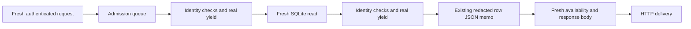

# BORTUS application deployment

## Pod summary source qualification (2026-10-21)

NEW frozen PUBLIC SOURCE controls pass84/84,zero failures/skips/cancellations.
Only exact exported podSummary executes with synthetic Pod metadata/status/spec and
an inert immediate podRestarts binding. Source-derived captured namespace/name,
statuses/containers,ordered id/status/readiness/dependency/image/IP/node/created/labels,
falsey defaults,fresh reads,reference preservation and fault shortcircuits pass.
Malformed/getter/prototype/dependency faults characterize JavaScript only. Actual
podRestarts,neighboring exports,configuration,engine,credentials/native services inert.
No supported production defect/change established. Current feature TESTS/DOCS ONLY.

FIRST source/types/lint pass:2 focused roots/0 diagnostics;2 files/0 errors/warnings.
Fresh9280 compiler inputs/191 snapshot reads/fallback0;37428 DIRECT Linux dependency
hashes match before/after;113 frozen execution bindings unchanged. Source0.937s/
77815808peakbytes;types4.688s/493572096;lint31.218s/279781376. Allmainhandles signalled;
activeBeforeDrain[0,1,1],explicit drain0ALL;TotalProcesses2causeUNESTABLISHED.
Experimental stripTypeScriptTypes and lint React detection notices retained.
Sequential Windows Node24.18.0 Jobs retain60s wall/30s userCPU/1GiB commit/twoCPUs/
oneACTIVE/kill-on-close. No OS network isolation/universal descendant/performance/
independent-person claim. No actual HTTP/auth/native/SQL/ORM/operatorDB/backend/
build/server/recovery/production/grants/CAS or frozen replay. No fixture correction
or source patch after success. Historical helpers/controls stay frozen.

Startup23607proofs/411inputs/88docs/compat5/separate334/raw87/root8/24inverses/
2545otherdocs passed. Parent FIRST24373 matcher plus602 direct checks passed;
receipt unchanged. Parent V1 SyntaxError before anychecks remains frozen;distinct V2
correction passed. Own/parent startup284/284/21,no missing/changedexistingrefs;
newchatcapture separate from exact FINAL283 originals. Allolder ref/failure/read
histories remain separate. Broad/truncated/missing-helper read exceptions retained;
no full/uninterrupted-read claim. GitHub Actions PROHIBITED;historicalCIonly;
overallCIQualified=false. Root docs LOCAL;4+32+1findings unresolved. All44clauses/
21gates/fixtures/failures remain;FULLgoalACTIVE/no budget. FINAL PRDdeployment AND
verification only after ALL original preceding gates.
See implementation-evidence/pod-summary-source-20261021.json.


## Pod summary source preparation (2026-10-21)

NEW finite PUBLIC SOURCE controls select only exact exported podSummary from
src/lib/pod-query.ts. Source order recorded BEFORE controls: captured namespace/name,
statuses/containers, then ordered id/status/readiness, inert podRestarts call, image,
fresh IP/node/creation/labels projections. Synthetic Pod metadata/status/spec and
inert immediate dependency only; neighboring exports, actual configuration, engine,
credentials and native services remain inert. Getter/prototype/malformed shape faults
characterize JavaScript only. No supported production defect/change established.
Current feature TESTS/DOCS ONLY. New controls/helpers UNEXECUTED; freeze before first
execution. All completed/failed/unexecuted historical helpers remain frozen.

Startup FIRST23607 ordered hashes passed:23477 incoming finished before130 current;
411 inputs/88 selected owner docs/compat5/separateOriginal334/protected3 verified.
Qualification then preparation24 inverses restore same raw87/root8 over12pairs;
2545 other docs unchanged. Retained production delta exact1 addition/1 deletion in
kv-http.ts. Immutable receipt before edits; parent FIRST24373 matcher plus602 direct
checks passed. Parent V1 unmatched-parenthesis SyntaxError before any checks remains
frozen; distinct V2 correction passed without source/control/proof mutation or replay.
Own and parent startup284/284/21,zero missing/changedexistingrefs; exact original
FINAL283 retained separately from one additional newchat capture. Older histories,
read/display/absent-helper exceptions and mutable-root preedit pins remain separate.

Fresh direct Linux metadata:37428 dependency files/9280 compiler inputs. New source,
focused types and lint controls retain sequential60s wall/30s userCPU/1GiB commit/
twoCPU/oneACTIVE/kill-on-close Jobs and explicit drain. No OS network isolation,
universal-descendant,performance or independent-person claim. No actual HTTP/auth/
native/SQL/ORM/operatorDB/backend/build/server/recovery/production/grants/CAS/replay.
GitHub Actions PROHIBITED;historicalCIonly;overallCIQualified=false. Root docs LOCAL;
4+32+1findings unresolved;all44clauses/21gates/fixtures/failures retained. FULLgoalACTIVE/
no budget. FINAL PRDdeployment ANDverification only after ALL original preceding gates.


## Pod filter source qualification (2026-10-21)

NEW frozen PUBLIC SOURCE controls pass76/76,zero failures/skips/cancellations.
Only exact exported podFilter executes with synthetic URLSearchParams/Pod metadata
and inert immediate error/namespace-validator/label-predicate/system-set bindings.
Source-derived default/query/refusal/construction order,override classification,
type/namespace/labels shortcircuits,captured queries and fresh metadata reads pass.
Getter/prototype/dependency faults characterize JavaScript only. Actual validators,
label parser,neighbors,configuration,engine,credentials/native services remain inert.
No supported production defect/change established. Current feature TESTS/DOCS ONLY.

FIRST source/types/lint pass:2 focused roots/0 diagnostics;2 files/0 errors/warnings.
Fresh9280 compiler inputs/191 snapshot reads/fallback0;37428 DIRECT Linux dependency
hashes match before/after;112 frozen execution bindings unchanged. Source0.281s/
64315392peakbytes;types4.672s/490434560;lint29.610s/281845760. Allmainhandles signalled;
activeBeforeDrain[1,0,1],explicit drain0ALL;TotalProcesses2causeUNESTABLISHED.
Experimental stripTypeScriptTypes and lint React/pages notices retained separately.
Sequential Windows Node24.18.0 Jobs retain60s wall/30s userCPU/1GiB commit/twoCPUs/
oneACTIVE/kill-on-close. No OS network isolation/universal descendant/performance/
independent-person claim. No actual HTTP/auth/native/SQL/ORM/operatorDB/backend/
build/server/recovery/production/grants/CAS or frozen replay.

Startup23477proofs/410inputs/87docs/compat5/separate334/raw86/root8/24inverses/
2543otherdocs passed. Parent FIRST47212 plus separate576 and59directchecks passed;
receipt unchanged. Own/parent startup283/283/21,no missing/changedexistingrefs;
newchatcapture separate from exact FINAL282 originals. All older ref/failure/read
histories remain separate. One test-fixture correction BEFORE freeze made explicit
undefined labels exercise the falsey branch;no control failure/replay or source patch.
Explicit broad/truncated/absent-dependency read exceptions remain,nofullreadclaim.
GitHub Actions PROHIBITED;both repositories disabled at precheckpoint read;
historicalCIonly;overallCIQualified=false. Root docs LOCAL;4+32+1findings unresolved.
All44clauses/21gates/fixtures/failures remain;FULLgoalACTIVE/no budget. FINAL PRD
deployment AND verification only after ALL original preceding gates.
See implementation-evidence/pod-filter-source-20261021.json.


## Pod filter source preparation (2026-10-21)

NEW finite PUBLIC SOURCE controls select only exported podFilter from src/lib/pod-query.ts.
Source order recorded BEFORE controls: type/namespace reads and default, invalid type
refusal, nonnull namespace validation, label-selector construction, fresh Pod metadata
reads, override-or-namespace classification, then type/namespace/labels shortcircuits.
Synthetic URLSearchParams/Pod metadata and inert immediate error/namespace-validator/
label-predicate/system-set bindings only. Actual validators, neighboring exports,
configuration, engine, credentials and native services remain inert. Getter/prototype
faults characterize JavaScript only. No supported production defect/change established.
Current feature TESTS/DOCS ONLY. New source/types/lint controls are UNEXECUTED and
will be frozen before first execution; all old controls/helpers remain frozen.

Startup FIRST23477 ordered proofs passed:23346 incoming finished before131 current;
410 inputs/87 owner docs/compat5/separateOriginal334/raw86/root8/24 ordered inverses/
2543 other docs verified. Immutable receipt before edits; parent FIRST47212 matcher,
separate576 direct checks and59 supplemental metadata checks passed. Own and parent
startup283/283/21 retain exact original FINAL282 sets, with one new chat capture
separate and no missing/changed existing refs. New root mutable8 snapshots pinned.
Read/display exceptions and absent local TypeScript path read are retained separately;
no full/uninterrupted-read claim. No installs/downloads/limit expansion.

Sequential Windows Node24.18.0 Jobs retain60s wall/30s userCPU/1GiB commit/twoCPUs/
oneACTIVE/kill-on-close and explicit drain. No OS network isolation/universal descendant/
performance/independent-person claim. No actual HTTP/auth/native/SQL/ORM/operatorDB/
backend/build/server/recovery/production/grants/CAS or frozen replay. GitHub Actions
PROHIBITED;historicalCIonly;overallCIQualified=false. Root docs LOCAL;4+32+1findings
unresolved;all44clauses/21gates/fixtures/failures remain. FULLgoalACTIVE/no budget.
FINAL PRD deployment AND verification only after ALL original preceding gates.


## Pod label-predicate source qualification (2026-10-21)

NEW frozen PUBLIC SOURCE controls pass92/92,zero failures/skips/cancellations.
Only exact labelPredicate executes with synthetic selector/label metadata and inert
immediate selectorError/validKey/validValue bindings. Source-derived limits,parsing,
key-before-operator validation,set/value shortcircuits,own-key membership,ordered
conjunction and fresh label reads pass. Prototype/getter/dependency faults characterize
JavaScript only. Actual key/value validators and neighboring exports do not execute;
these checks do not establish Kubernetes validation,authorization or native behavior.
No supported production defect/change established. Current feature TESTS/DOCS ONLY.

FIRST source/types/lint pass:2 focused roots/0 diagnostics;2 files/0 errors/warnings.
Fresh9280 compiler inputs/191 snapshot reads/fallback0;37428 DIRECT Linux dependency
hashes match before/after;110 frozen execution bindings unchanged. Source0.250s/
65966080peakbytes;types4.829s/421150720;lint33.031s/277733376. Main handles signalled;
activeBeforeDrain[1,1,0],explicit drain0 ALL;TotalProcesses2 causeUNESTABLISHED.
Experimental stripTypeScriptTypes and lint React/pages notices retained separately.
Sequential Windows Node24.18.0 Jobs retain60s wall/30s userCPU/1GiB commit/twoCPUs/
oneACTIVE/kill-on-close. No OS network isolation/universal descendant/performance/
independent-person claim. No actual HTTP/auth/native/SQL/ORM/operatorDB/backend/
build/server/recovery/production/grants/CAS or frozen replay.

Startup23346 proofs/409inputs/86docs/compat5/separate334/raw85/root8/24 inverses/
2541 otherdocs passed. Parent FIRST23918 matcher plus581 direct checks passed;
receipt unchanged. Startup282/282/21 zero differences;all frozen ref/failure/read
histories preserved separately. Two own metadata-verifier bookkeeping failures
remain frozen;distinct V3 passed. Explicit broad/truncated read exceptions remain.
GitHub Actions PROHIBITED and disabled on both repositories before checkpoint;
historicalCIonly;overallCIQualified=false. Root docs LOCAL;4+32+1findings unresolved.
All44clauses/21gates/fixtures/failures remain;FULLgoalACTIVE/no budget. FINAL PRD
deployment AND verification only after ALL original preceding gates.
See implementation-evidence/label-predicate-source-20261021.json.


## Pod label-predicate source preparation (2026-10-21)

NEW finite PUBLIC SOURCE controls select only labelPredicate from src/lib/pod-query.ts.
Source order was recorded before controls: null/empty bypass,2048-character limit,
parenthesis-aware comma split and20 requirements,syntax/key validation,absence/operator
refusal,set size1..64 and value validation,then own-key predicates and ordered every.
Synthetic selectors/labels and inert immediate selectorError/validKey/validValue
bindings only; neighboring exports/configuration/credentials/native services inert.
These controls characterize the selected parser/predicate,not real key/value validators,
authorization or Kubernetes acceptance. No supported production defect/change found.
New source/types/lint controls are UNEXECUTED and will be frozen before execution.

Startup verified23346 ordered proofs:22300 incoming finished before1046 current;
409 inputs/86 ownerdocs/5 compatibility callers/separate334 baseline;raw85/root8
with24 qualification-then-preparation inverses and2541 otherdocs unchanged. Parent
FIRST23918 matcher and581 direct checks passed;receipt immutable before edits.
Independent and own snapshots282/282/21 match,zero missing/changed/additional refs.
Two new metadata-verifier bookkeeping failures remain frozen;distinct V3 passed.
Explicit broad/truncated reads and absent wrapper-child read remain exceptions.
No full-read or uninterrupted-chain claim. Windows Node24.18.0 Jobs retain60s wall/
30s user CPU/1GiB commit/two CPUs/one ACTIVE/kill-on-close and explicit drain.
No OS network isolation/universal descendant/performance/independent-person claim.
No actual HTTP/auth/native/SQL/ORM/operatorDB/backend/build/server/recovery/production/
grants/CAS or frozen replay. GitHub Actions PROHIBITED;historicalCIonly;overallCIfalse.
Root docs LOCAL;4+32+1findings unresolved;all44clauses/21gates/fixtures/failures remain.
Full goal ACTIVE/no budget;FINAL PRD deployment AND verification after ALL gates.


## Shared metadata-query classifier source qualification (2026-10-21)

NEW frozen PUBLIC SOURCE controls pass107/107,zero fail/skip/cancel. Only exact
isSharedMetadataQuery executes with synthetic URL metadata and inert immediate
builtin/dependency bindings. KV classification is an inert stub; neighboring
exports/configuration/engine/credentials/native services never execute. Source-
derived raw prefix/construction/caught decoding/KV delegation/route allowlist/
private segment/exact key exclusions pass. Encoded paths, URL normalization,
case/segment boundaries, query/fragment classification and fresh delegation pass.
Classification is not authorization or server-side validation; constructor and
other faults outside the decode catch characterize JavaScript only. No supported
production defect/change established. Current feature TESTS/DOCS ONLY.

FIRST V2 source/types/lint pass:2 roots/0 diagnostics;2 files/0 errors or warnings.
Fresh9280 compiler inputs/191 snapshot reads/fallback0;37428 DIRECT Linux dependency
hashes match before/after;415 new execution bindings unchanged. Source1.031s/
96866304 peak bytes;types4.718s/426979328;lint38.297s/277868544. All main handles
signalled;activeBeforeDrain[1,0,0],explicit drain0 ALL. TotalProcesses2 cause
UNESTABLISHED. Source module-type and lint React notices remain visible. FIRST V1
preparation exited1 before any helper/control execution: snapshot filter omitted
JSON metadata. First payload not persisted;no exact first-count claim. Distinct V2
corrects that filter;source/test bytes same. Failed V1 preparer/snapshots frozen.
Sequential Windows Node24.18.0 Jobs retain60s wall/30s user CPU/1GiB commit/two CPUs/
one ACTIVE/kill-on-close. No OS network isolation/universal descendant/performance/
independent-person claim. No HTTP/auth/native/SQL/ORM/operatorDB/backend/build/
server/recovery/performance/production/grants/CAS or frozen replay.

Startup FIRST25907 passed22300 ordered proofs,408/85/compat5/separateOriginal334,
same84root8/36 inverses/2539 otherdocs. Parent schema-first FIRST22373 plus86 direct
binding checks passed;receipt unchanged before edits. FrozenFINAL281/ref histories,
all failures and explicit read/display exceptions remain separate. GitHub Actions
PROHIBITED;historical CI only;overallCIQualified=false. Root docs LOCAL;4+32+1
findings unresolved. Full goal ACTIVE/no budget;all44 clauses/21 gates/fixtures/
failures and FINAL PRD deployment AND verification after ALL gates remain.
See implementation-evidence/shared-metadata-query-source-20261021.json.


## Shared metadata-query classifier source preparation (2026-10-21)

NEW finite PUBLIC SOURCE controls select only isSharedMetadataQuery from
src/lib/metadata-query.ts. Source order was recorded before controls: raw prefix,
URL construction, caught pathname decoding, immediate inert KV delegation,
cluster/Flux prefixes or exact route list, private segment regex, then exact
Secret key/deployment jobId exclusions. Synthetic URL metadata and immediate
builtin/dependency faults only; no application module or neighboring export runs.
Classification is not authorization or server-side parameter validation. No
supported production defect/change established. New source/types/lint UNEXECUTED.
FIRST V1 preparation exited1 before helper/control execution: its declaration-only
filter omitted JSON metadata required by the9280-entry compiler input snapshot.
Its first payload was not persisted; no exact first-count claim. Separate direct
metadata confirmed37428files and current9280input schema includes declarations
and JSON. Distinct V2 corrects that preparation filter only;source/test bytes same.
Failed V1 preparer/snapshots and all historical helpers remain frozen;no replay.

Startup FIRST25907 verified22300 ordered proofs:21245 incoming finished before1055
current,408/85/compat5/separateOriginal334,same84root8/36 inverses/2539 otherdocs.
Parent schema-first matcher FIRST22373 passed plus86 direct binding checks. Receipt
immutable before edits. Fresh282/282/21 refs retain exact frozenFINAL281 sets and
one new chat capture separately;zero missing/changed existing refs. Display/read
exceptions remain explicit; no full-read or uninterrupted-chain claim.
Windows Node24.18.0 Jobs retain60s wall/30s user CPU/1GiB commit/two CPUs/one active/
kill-on-close and explicit drain. No OS network isolation/universal descendant/
performance/independent-person claim. No HTTP/auth/native/SQL/ORM/operatorDB/backend/
build/server/recovery/performance/production/grants/CAS or frozen replay.
GitHub Actions PROHIBITED; historical CI only;overallCIQualified=false. Root docs
LOCAL;4+32+1 findings unresolved. Full goal ACTIVE/no budget;all44 clauses/21 gates/
fixtures/failures and FINAL PRD deployment AND verification after ALL gates remain.


## KV metadata-query classifier source qualification (2026-10-21)

NEW frozen PUBLIC SOURCE controls pass92/92 with zero failures/skips/cancellations.
Only exact synchronous isKvMetadataQuery executes, with synthetic URL metadata and
immediate builtin bindings. No application module import or configuration/engine/
credential/native/neighbor execution. Source-derived prefix/construction/path/hash/
collection/detail order and shortcircuits pass. Named query keys must occur once;
UUID detail/status/capabilities/versions routes accept no query entries. Normalized
alternate paths, private operations/value routes and unknown query keys refuse.
Empty query/fragment delimiters and arbitrary allowed parameter text are classifier
behavior only. This does not establish authorization or server-side validation.
Synthetic getter/iterator/builtin faults characterize JavaScript only. No supported
production defect or production change established. Current feature TESTS/DOCS ONLY.

Distinct V2 FIRST source/types/lint pass:2 roots/0 diagnostics;2 files/0 errors or
warnings. Fresh9280 declarations/191 snapshot reads/fallback0;37428 DIRECT Linux
dependency hashes match before/after;3282 frozen execution bindings unchanged.
Source1.172s/92930048 peak bytes;types5.500s/428097536;lint35.094s/279736320.
Main handles signalled;activeBeforeDrain[0,0,1],explicit drain0 ALL. TotalProcesses2
cause UNESTABLISHED. Module-type/experimental-strip/lint React notices stay visible.
V1 launcher exit1 used a nonexistent doubled-prefix filename before any control;
failed helper/logs and V1 unexecuted types/lint remain frozen. V2 corrects only that
command filename; production/test/assertion bytes identical. No completed-control
replay. Sequential Windows Node24.18.0 Jobs retain60s wall/30s user CPU/1GiB commit/
two CPUs/one ACTIVE/kill-on-close. No OS network isolation/universal descendant/
performance/independent-person claim. No HTTP/auth/native/SQL/ORM/operatorDB/backend/
build/server/recovery/performance/production/grants/CAS or frozen replay.

Startup FIRST24799 passed21245 ordered proofs,407/84/compat5/separateOriginal334,
same83root8/24 ordered inverses/2537 other docs. Independent predecessor FIRST42747
passed after schema inspection; immutable receipt unchanged. All historical failures,
inventories and explicit display/read exceptions remain separate. Root docs LOCAL;
4+32+1 findings unresolved. GitHub Actions PROHIBITED;historicalCIonly;
overallCIQualified=false. Full goal ACTIVE/no budget;all44 clauses/21 gates/fixtures/
failures and FINAL PRD deployment AND verification after ALL original gates remain.
See application implementation-evidence/kv-metadata-query-source-20261021.json.


## KV metadata-query launcher preparation correction (2026-10-21)

The FIRST V1 source launcher exited1 before test execution because its copied
command named nonexistent kv-kv-metadata-query-source.test.ts. Main handle signalled,
explicit Job drain0;0 controls ran. The failed helper/log/result and its unexecuted
types/lint stay frozen. A DISTINCT V2 launcher corrects only that filename; selected
production and test/assertion bytes are identical. V2 source/types/lint UNEXECUTED
and frozen before execution. No production defect/change or replay of completed
controls. All existing scope, resource, publication and final-delivery gates remain.


## KV metadata-query classifier source preparation (2026-10-21)

NEW finite PUBLIC SOURCE controls select only exported isKvMetadataQuery from
src/lib/kv-metadata-query.ts. Source order was recorded before controls: prefix,
URL construction with fixed inert base, exact raw/resolved pathname comparison,
fragment refusal, named collection key iteration and per-key uniqueness, otherwise
exact UUID detail/status/capabilities/versions matching and no query entries.
Synthetic URL metadata and inert immediate builtin bindings only; no application
module import or configuration/engine/credentials/native/neighbor execution.
Getter/iterator faults characterize JavaScript only. No supported production defect
or production change established. New source/types/lint frozen before execution;
currently UNEXECUTED. Empty query/fragment delimiters and arbitrary cursor text are
classification behavior, not authorization or server-side parameter validation.

Startup FIRST24799 passed: incoming20713 completed before current532=21245 unique;
407/84/compat5/separateOriginal334/same83root8/24 ordered inverses/2537 other docs.
Independent predecessor FIRST42747 passed after schema inspection; receipt unchanged.
Actual281/281/21 includes one new chat capture, zero missing/changed existing refs;
frozen FINAL280 and all historical inventories/failures stay separate. Explicit
metadata/doc display truncations have bounded follow-up selections; no full-read claim.
Windows Node24.18.0 Jobs retain60s wall/30s user CPU/1GiB commit/two CPUs/one active/
kill-on-close and explicit drain. No OS network isolation/universal descendant/
performance/independent-person claim. No HTTP/auth/native/SQL/ORM/operatorDB/backend/
build/server/recovery/performance/production/grants/CAS or frozen replay.
GitHub Actions PROHIBITED; historical CI only; overallCIQualified=false. Root docs
LOCAL;4+32+1 findings unresolved. Full goal ACTIVE/no budget; all44 clauses/21 gates/
fixtures/failures and FINAL PRD deployment AND verification after ALL gates remain.


## Policy allowance source qualification (2026-10-21)

NEW frozen PUBLIC SOURCE controls pass63/63,zero failures/skips/cancellations.
Only exact synchronous policyAllows executes with synthetic rule/scope/action
metadata. All neighboring exports, configuration, engine, credentials and native
services remain inert; logicalPath/parseActions/prefixMatches are immediate stubs.
Requested-path and per-rule effect/actions/prefix validation order, exact/global
mount selection, prefix/action shortcircuiting, allow accumulation and deny priority,
fresh calls/fixed errors, direct constructor refusal and iterator closure pass.
Synthetic getters/iterators/builtin faults characterize source JavaScript only.
No supported production defect or production change is established.

FIRST SOURCE/types/lint pass:types2roots/0diagnostics;lint2files/0errors/warnings.
Fresh9280 raw declarations/1022snapshotReads/fallback0;37428 DIRECT Linux dependency
hashes match before/after.413new+1840prior execution bindings unchanged=2252unique
(Node shared). Source1.141s/81027072peakbytes;types6.313s/474447872;lint37.890s/
283836416. Main handles signalled;activeBeforeDrain[1,0,0],explicitdrain0ALL.
TotalProcesses2 cause UNESTABLISHED. Sequential Windows Node24.18.0 Jobs retain
60swall/30userCPU/1GiBcommit/twoCPUs/oneACTIVE/kill-on-close. Module-type/lint React
notices separate. No OSnetworkisolation/universaldescendant/performance/
independentperson claim. No HTTP/auth/native/SQL/ORM/operatorDB/backend/build/server/
recovery/performance/production/grants/CAS or frozen replay.

Startup FIRST45011:incoming19565 FINISHED BEFOREcurrent1148=20713UNIQUE;
406/83/compat5/separateOriginal334/same82root8/24orderedinverses/2535otherdocs.
Independent predecessor DISTINCT V2 FIRST20944 passed; its V1 projection KeyError
before proof rehash stays frozen separately. Immutable receipt and proofs unchanged.
All earlier failures/read exceptions remain separate; original helpers never rerun.
Rootdocs LOCAL;4+32+1findings unresolved. GitHub Actions PROHIBITED;historicalCIonly;
overallCIQualified=false. FullgoalACTIVE/no budget;all44clauses/21gates/fixtures/
failures and FINAL PRDdeployment AND verification after ALLoriginalgates remain.
See application implementation-evidence/kv-policy-allows-source-20261021.json.


## Policy allowance source preparation (2026-10-21)

NEW finite frozen PUBLIC SOURCE controls select only exact exported policyAllows.
Source order was recorded before controls: requested-path validation; initial
false accumulator; per-rule effect/parsed-actions/prefix validation before mount
selection; global-null or exact mount, inert prefix match, then action membership;
matching deny returns false immediately, otherwise accumulate allow until exhaustion.
LogicalPath, parseActions and prefixMatches are inert immediate bindings; actual
neighboring exports/configuration/engine/credentials/native services never execute.
Synthetic rules/scope/action metadata only. Getter/iterator/builtin/refusal controls
characterize source JavaScript, not supported payload defects. No production defect
or change established. NEW source/types/lint UNEXECUTED; freeze before first execution.
No HTTP/auth/native/SQL/ORM/operatorDB/backend/build/server/recovery/performance/
production/grants/CAS or frozen replay. Windows Node24.18.0 Jobs retain60swall/
30userCPU/1GiBcommit/twoCPUs/oneACTIVE/kill-on-close and explicit drain. No OSnetwork
isolation/universaldescendant/performance/independentperson claim.

Startup FIRST45011 passed:incoming19565 FINISHED BEFOREcurrent1148=20713UNIQUE;
406/83/compat5/separateOriginal334/same82root8/24orderedinverses/2535otherdocs.
Independent predecessor DISTINCT V2 FIRST20944 passed; V1 reader projection
KeyError before proof rehash remains frozen separately. Immutable receipt unchanged.
Actual280/280/21 includes one new chat capture and zero missing/changed existingrefs;
frozenFINAL279 and all older inventories/histories remain separate. Metadata/doc
display truncations and bounded follow-up reads are explicit read exceptions.
GitHub Actions PROHIBITED;historicalCIonly;overallCIQualified=false. Rootdocs LOCAL;
4+32+1findings unresolved. FULLgoalACTIVE/no budget;all44clauses/21gates/fixtures/
failures preserved. FINAL PRDdeployment AND verification only after ALLoriginalgates.


## Logical path source qualification (2026-10-21)

NEW frozen PUBLIC SOURCE controls pass72/72 with zero failures/skips/cancellations
in DISTINCT V3. Only exact synchronous logicalPath executes with synthetic primitive
inputs and inert immediate builtin/error bindings. Type/512 UTF-16-unit bound,
NFC, forbidden percent/backslash/C0-through-space/DEL, UTF-8 roundtrip, root,
32-segment/128-unit bounds, empty/dot/dotdot rejection and unchanged valid return
pass. Shortcircuit order, builtin refusals, fresh calls/fixed error instances and
constructor refusals pass. All neighboring exports/configuration/engine/credentials/
native services remain inert. No supported production defect/change is established.

V3 SOURCE/types/lint pass:types2roots/0diagnostics;lint2files/0errors/warnings.
Raw9280declarations/1022snapshotReads/fallback0;37428 DIRECT Linux dependency
hashes match before/after;412new+1429prior execution bindings unchanged (1840
unique union shares Node). Source1.078s/92774400peakbytes;types6.093s/457793536;
lint33.328s/278577152. Main handles signalled;activeBeforeDrain[0,0,1],explicit
drain0ALL. TotalProcesses2 cause UNESTABLISHED. Sequential Windows Node24.18.0
Jobs retain60swall/30userCPU/1GiBcommit/twoCPUs/oneACTIVE/kill-on-close. Module
type and lint React notices separate. No OSnetworkisolation/universaldescendant/
performance/independentperson claim. No HTTP/auth/native/SQL/ORM/operatorDB/backend/
build/server/recovery/performance/production/grants/CAS or frozen replay.

V1 preparation stopped before repository edits/controls on its511-versus1018 prior
binding assertion. V2 SOURCE71pass/1fail remains frozen:throwing sandbox global
KvError getter surfaced ReferenceError instead of injected sentinel;V2types/lint
unexecuted. V3 direct inert lexical error binding fixes that harness seam;global
getter fault injection remains unqualified. All earlier helpers/artifacts/failures
and read exceptions stay separate,unchanged,NEVERrerun. No production correction
or original gate weakening. Startup19565 proof rehash and independent parent
FIRST19804 remain bound;all prior ref histories preserved. GitHub Actions PROHIBITED;
historicalCIonly;overallCIQualified=false. Rootdocs LOCAL;4+32+1findings unresolved.
Fullgoal ACTIVE/no budget;all44clauses/21gates/fixtures/failures and FINAL PRD
deployment AND verification after ALLoriginalgates remain. See application
implementation-evidence/kv-logical-path-source-20261021.json.


## Logical path source preparation (2026-10-21)

NEW finite frozen PUBLIC SOURCE controls select only exact exported logicalPath.
The source order was recorded before controls: type/512 UTF-16-unit total bound,
NFC equality, forbidden percent/backslash/C0-through-space/DEL characters, UTF-8
round trip, empty-root permission, slash split, 32-segment bound, then nonempty/
not-dot/not-dotdot/128-unit segment rules. Valid strings return unchanged.
Synthetic primitive inputs and inert immediate builtin/error bindings only; all
neighboring exports/configuration/engine/credentials/native services remain inert.
No supported production defect/change is established. New source/types/lint are
UNEXECUTED and freeze before first execution. No HTTP/auth/native/SQL/ORM/operatorDB/
backend/build/server/recovery/performance/production/grants/CAS or frozen replay.

Sequential Windows Node24.18.0 Jobs retain60s wall/30s userCPU/1GiB commit/twoCPUs/
oneACTIVE/kill-on-close, main-handle observation and explicit drain. No OSnetwork
isolation/universaldescendant/performance/independentperson claim. Startup incoming
18532 finished BEFOREcurrent1033=19565 unique proofs;405/82/compat5/separate334/
same81root8/24orderedinverses/2533otherdocs passed. Parent independent matcher
FIRST19804 passed. Actual279/279/21 has one new chat capture, no missing/changed
existing refs; all prior original sets/read exceptions/failures stay separate.
GitHub Actions PROHIBITED;historicalCIonly;overallCIQualified=false. Rootdocs LOCAL;
4+32+1findings unresolved. Fullgoal ACTIVE/no budget;all44clauses/21gates/fixtures/
failures and FINAL PRDdeployment AND verification after ALLoriginalgates remain.


V1 preparation STOPPED before repository edits or source/types/lint execution:
it asserted511 prior execution bindings, while the current guard contains1018
(511 current plus507 older). Original helper/artifacts remain frozen NEVERrerun.
DISTINCT V2 corrects only that count assertion;fresh37428 Linux dependency hashes
and9280 declarations match. Current guard/config METADATA reads are explicit
preparation exceptions;no original helper/control executes.


The frozen V2 SOURCE run retained71pass/1fail/0skip/cancel. Its throwing sandbox
global KvError getter produced ReferenceError instead of the injected sentinel;
this does not establish a production defect. Main handle signalled,activeBeforeDrain1
and explicitdrain0;TotalProcesses2 cause UNESTABLISHED. V2 types/lint unexecuted.
DISTINCT V3 uses a direct inert lexical error binding and tests fresh fixed errors
and constructor refusal. Global-getter fault injection remains unqualified;its
failed oracle/artifacts are unchanged. All primitive path, builtin ordering,
shortcircuit and refusal controls remain. No gate/resource/production change.


## Prefix matcher source qualification (2026-10-21)

NEW frozen PUBLIC SOURCE controls pass39/39 tests with zero failures/skips/
cancellations. Only exact synchronous prefixMatches runs with synthetic prefix/
path strings and inert immediate logicalPath/builtin/error bindings. Both
validations precede every return; empty prefix, exact equality and slash
descendants match while sibling-prefix collisions do not. Validation return
values are ignored; synchronous refusals propagate; builtin lookup/call short
circuiting and fresh calls pass. Real logicalPath and all neighboring exports,
configuration/engine/credentials/native services remain inert. No supported
production defect or production change is established.

FIRST SOURCE/types/lint pass in DISTINCT V2: types2roots/0diagnostics;lint2files/
0errors/warnings. Fresh9280 raw declarations/1021snapshotReads/fallback0;
37428 DIRECT Linux dependency hashes match before/after;511 new and507 prior
frozen execution files unchanged. Source0.203s/49295360peakbytes;types6.453s/
492695552;lint35.094s/279318528. All main handles signalled;activeBeforeDrain
[0,0,0],explicitdrain0ALL. TotalProcesses2 cause UNESTABLISHED. Sequential
Windows Node24.18.0 Jobs retain60swall/30userCPU/1GiBcommit/twoCPU/oneACTIVE/
kill-on-close. Module-type and lint React notices remain separate. No OSnetwork
isolation/universaldescendant/performance/independentperson claim. No HTTP/auth/
native/SQL/ORM/operatorDB/backend/build/server/recovery/performance/production/
grants/CAS or frozen replay.

V1 preparation stopped before repository edits or control execution because its
declaration collector selected7588/9280 entries. V1 helper/artifacts remain frozen,
never rerun; DISTINCT V2 corrected only the declaration collection scope. Startup
incoming18007 finished BEFOREcurrent525=18532 unique orderedproofs;current404/
selected81/compat5/separateOriginal334/same80root8/24orderedinverses/2531otherdocs
passed. Independent predecessor V3 matcher FIRST18751 passed. Separate stopped
capture preflights/direct reconciliation, all historical ref sets/read exceptions/
failures remain frozen. GitHub Actions PROHIBITED;historicalCIonly;overallCIQualified
=false. Root docs LOCAL;4+32+1findings unresolved. Fullgoal ACTIVE/no budget;
all44clauses/21gates/fixtures/failures and FINAL PRD deployment AND verification
after ALL original preceding gates remain. See application
implementation-evidence/kv-prefix-matches-source-20261021.json.


## Prefix matcher source preparation (2026-10-21)

NEW finite PUBLIC SOURCE controls select only exact exported prefixMatches.
Source order was recorded before controls: inert logicalPath(prefix,true), then
logicalPath(path), then empty prefix, exact equality, and slash-descendant
startsWith. Both validations precede every return; their results are ignored.
Synthetic prefix/path strings and inert immediate validator/builtin/error
bindings only. Real logicalPath and all neighboring exports, configuration,
engine, credentials and native services remain inert. No supported production
defect or correction is established. NEW source/types/lint are UNEXECUTED and
freeze before first execution. No HTTP/auth/native/SQL/ORM/operatorDB/backend/
build/server/recovery/performance/production/grants/CAS or frozen replay.

Sequential Windows Node24.18.0 Jobs retain60s wall/30s userCPU/1GiB commit/two
CPUs/one ACTIVE/kill-on-close, main-handle observation and explicit drain. No
OSnetworkisolation/universaldescendant/performance/independentperson claim.
Startup incoming18007 finished BEFOREcurrent525=18532 unique orderedproofs;
current404/selected81/compat5/separateOriginal334/same80root8/24orderedinverses/
2531otherdocs passed. Independent predecessor V3 matcher FIRST18751 passed.
Stopped capture preflights and DISTINCT direct reconciliation remain separate;
both tree objects present, persistent refs/metadata unchanged, cause UNESTABLISHED.
All historical ref inventories, read exceptions and failed/completed/unexecuted
helpers remain frozen. No ref/object recreation. GitHub Actions PROHIBITED;
historical CI only;overallCIQualified=false. Root docs LOCAL;4+32+1findings
unresolved. Fullgoal ACTIVE/no budget;all44clauses/21gates/fixtures/failures and
FINAL PRD deployment AND verification after ALL original preceding gates remain.

V1 preparation stopped before repository edits or source/types/lint execution:
the declaration collector selected7588 instead of9280 entries. Its helper and
artifacts remain frozen, never rerun. DISTINCT V2 collects d.ts/d.mts/d.cts and
all JSON declarations directly from the unchanged37428-file Linux dependency
inventory. The current snapshot suffix metadata was read to resolve this narrow
selection mismatch; no original helper or control was executed.


## Action parser source qualification (2026-10-21)

NEW frozen PUBLIC SOURCE controls pass60/60 tests with zero failures/skips/
cancellations. Only exact synchronous parseActions runs with synthetic raw
strings and inert immediate builtin/allowlist/error bindings. Supported JSON
arrays enforce nonempty/max10/allowlist/uniqueness and preserve action order.
Malformed JSON returns fixed503; source order/short-circuiting, parsed identity,
fresh calls and inert postparse builtin/getter faults are characterized. Sparse
inert-parser arrays characterize JavaScript only. Actual configuration/engine/
credentials/native services and neighboring exports remain inert. No supported
production defect or production change is established.

FIRST source/types/lint pass: types2roots/0diagnostics;lint2files/0errors/warnings.
Fresh9280 raw declarations/1022snapshotReads/fallback0;37428 DIRECT Linux hashes
match before/after;507 frozen execution files unchanged. Source1.031s/88190976
peak bytes;types6.094s/491290624;lint32.203s/281702400. Main handles signalled;
activeBeforeDrain[0,0,0],explicitdrain0ALL. TotalProcesses2 cause UNESTABLISHED;
one ACTIVE cap unchanged. Sequential Windows Node24.18.0 Jobs retain60s wall/
30s userCPU/1GiB commit/twoCPUs/kill-on-close. Node module-type and lint React
notices remain separate. No OSnetworkisolation/universaldescendant/performance/
independentperson claim. No HTTP/auth/native/SQL/ORM/operatorDB/backend/build/
server/recovery/performance/production/grants/CAS/frozen workload replay.

Startup18007 orderedproofs/current403/selected80/compat5/separateOriginal334/
same80root8 for NEW snapshots, prior79root8/36inverses/2529otherdocs passed.
Independent predecessor V2 matcher FIRST18221 passed using immutable receipt
and separate intentional-root-local supplement. Original V1matcher remained
PREPAREDUNEXECUTED, never a failed strict run. All prior exceptions/failures stay
separate and frozen. GitHub Actions PROHIBITED;historical CI only;overallCIQualified
=false. Root docs LOCAL;4+32+1findings unresolved. Fullgoal ACTIVE/no budget;
all44clauses/21gates/fixtures/failures and FINAL PRD deployment AND verification
after ALL original preceding gates remain. See application
implementation-evidence/kv-parse-actions-source-20261021.json.


## Action parser source preparation (2026-10-21)

NEW finite PUBLIC SOURCE controls select only exact exported parseActions.
Source order was recorded before controls: JSON.parse within its fixed503 catch;
array check; nonempty and maximum10 length guards; ordered allowlist checks;
then Set cardinality/duplicate check; return the same parsed array. The static
allowlist remains list/read/create/update/delete/rollback/reconcile/destroy/
export/rotate. Synthetic raw strings and inert immediate builtin/allowlist/error
bindings only. Actual configuration/engine/credentials/native services and
neighboring exports remain inert. No supported production defect or correction
is established. NEW source/types/lint controls are UNEXECUTED and freeze before
first execution. No HTTP/auth/native/SQL/ORM/operatorDB/backend/build/server/
recovery/performance/production/grants/CAS or frozen workload replay.

Sequential Windows Node24.18.0 Jobs retain60s wall/30s userCPU/1GiB commit/two
CPUs/one ACTIVE/kill-on-close, main-handle observation and explicit drain. No OS
network isolation/universal descendant/performance/independent-person claim.
Startup freshly rehashed incoming17064 BEFOREcurrent943=18007 unique proofs;
current403/selected80/compat5/separateOriginal334/same raw79root8/36ordered
inverses and2529otherdocs passed. Independent predecessor matcher V2 FIRST18221
passed with immutable receipt plus separate intentional-root-local supplement;
original V1matcher was PREPAREDUNEXECUTED, never a failed strict execution.
All prior failures/read exceptions remain separate and frozen. GitHub Actions
PROHIBITED; historical CI only;overallCIQualified=false. Root docs LOCAL;
4+32+1findings unresolved. Fullgoal ACTIVE/no budget;all44clauses/21gates/
fixtures/failures and FINAL PRD deployment AND verification after ALL original
preceding gates remain. No production source change.


## Field mapping source qualification (2026-10-21)

NEW frozen PUBLIC SOURCE controls pass69 Node tests including68 leaf; zero
failures/skips/cancellations. Only exact synchronous fieldMapping runs with
synthetic arguments and inert validation/error/builtin bindings. Array/length,
item type/ASCII bounds, validation-before-uniqueness, exact namespace/name/key,
ordered reads/sets/projections, target/getter/map faults, no coercion/promise
consumption, fresh/reentrant calls pass. Custom map/sparse arrays characterize
source JavaScript only. Actual target validation/config/engine/credentials/native
services and neighboring exports remain inert. No production defect/change.

V1 SOURCE stopped before controls because strip-only Node rejects a fixture
parameter property:1file test/0pass/1fail. V1 snapshots/results/helpers frozen
NEVERrerun; V1 types/lint UNEXECUTED. DISTINCT V2 uses ordinary property syntax;
FIRST source/types/lint pass. Focused types2roots/0diagnostics;lint2files/0errors/
warnings. Exact9280 raw declarations/1022snapshotReads/fallback0;37428 DIRECT
Linux dependency hashes match before/after. Source1.093s/90710016peak bytes;
types6.313s/490627072;lint33.437s/283750400. All main handles signalled;
activeBeforeDrain[0,0,1], explicit drain0 ALL. TotalProcesses2 cause UNESTABLISHED;
one ACTIVE cap unchanged. Sequential Windows Node24.18.0 Jobs retain60s wall/
30s userCPU/1GiB commit/twoCPUs/kill-on-close. Module-type/dependency React notices
remain separate. No OSnetworkisolation/universaldescendant/performance/
independentperson claim. No HTTP/auth/native/SQL/ORM/operatorDB/backend/build/
server/recovery/production/grants/CAS/frozen replay.

Startup17064proofs/current402/79/compat5/separateOriginal334/same78root8/
36inverses passed; independent predecessor match17309 passed. All startup read
exceptions and the distinct incoming-before-current rehash correction remain;
immutable receipt/proofs unchanged. GitHub Actions PROHIBITED; historical CI
only;overallCIQualified=false. Root docs LOCAL;4+32+1findings unresolved. Fullgoal
ACTIVE/no budget;all44clauses/21gates/fixtures/failures and FINAL PRD deployment
AND verification after all original preceding gates remain. See application
implementation-evidence/kv-field-mapping-source-20261021.json.


## Field mapping strip-only test syntax correction (2026-10-21)

V1 SOURCE stopped before controls: Node strip-only mode rejects a test fixture
constructor parameter property (ERR_UNSUPPORTED_TYPESCRIPT_SYNTAX). The file-level
result is1test/0pass/1fail; no fieldMapping control executed. V1 snapshots,
results and helpers remain frozen NEVERrerun; V1 types/lint UNEXECUTED. DISTINCT
V2 uses an ordinary status property declaration and constructor assignment.
Production source, assertions, target binding, finite dependencies and resource
limits are unchanged. New V2 source/types/lint freeze before first execution and
remain UNEXECUTED. All original boundaries, failures and final delivery gates remain.


## Field mapping source preparation (2026-10-21)

NEW finite PUBLIC SOURCE controls select only exact exported fieldMapping.
The recorded source order is array/length guards, distinct field/key sets,
per-item type/ASCII field regex checks, inert validateTarget call, field-then-key
uniqueness short-circuit, ordered additions and fresh field/key projection.
Bounds are one to64 entries and one to253 ASCII field characters. Synthetic
getter/custom-map/sparse-array behavior characterizes JavaScript source only;
it does not establish supported HTTP payloads or a production defect. Actual
target validation/configuration/engine/credentials/native services/neighboring
exports remain inert. No production correction is established. New source,
focused types and lint remain UNEXECUTED and freeze before first execution.

Sequential Windows Node24.18.0 Jobs retain60s wall/30s userCPU/1GiB commit/two
CPUs/one ACTIVE/kill-on-close, main-handle observation and explicit drain. No OS
network isolation/universal descendant/performance/independent-person claim.
No actual HTTP/auth/native/SQL/ORM/operatorDB/backend/build/server/recovery/
production/grants/CAS/frozen replay. Startup rehashed17064 selected proofs and
verified402inputs/79docs/compat5/separateOriginal334/same78root8/36inverses;
independent predecessor match passed17309. Read exceptions and the distinct
incoming-before-current rehash correction remain separate, with unchanged
immutable receipt. GitHub Actions PROHIBITED; historical CI only;
overallCIQualified=false. Root docs LOCAL;4+32+1findings unresolved. Full goal
ACTIVE/no budget;all44clauses/21gates/fixtures/failures and FINAL PRD deployment
AND verification only after all original preceding gates remain.


## Metadata revision source qualification (2026-10-21)

NEW frozen PUBLIC SOURCE controls pass65 Node tests including64 leaf; zero
failures/skips/cancellations. Only exact exported synchronous metadataRevision
runs with synthetic arguments, inert error construction and builtin bindings.
Strict missing428, safe-integer short-circuit, nonpositive400, two positive
conversions, receiver/fault identities/newTarget, no coercion/promise consumption
and fresh/reentrant calls pass. Synthetic builtin perturbations characterize
source order only. Actual config/engine/credentials/native services/neighboring
exports remain inert. No production defect/change established.

V1 SOURCE failed one cross-realm array prototype assertion:65 tests63pass/2fail
including parent. V1 snapshots/results/helpers stay frozen NEVERrerun; V1 types/
lint UNEXECUTED. DISTINCT V2 asserts exact constructor argument count/elements and
newTarget, preserving runtime expectations; FIRST source/types/lint pass. Focused
types2 roots/zero diagnostics; lint2 files/zero errors/warnings. Exact9280 RAW
declarations/1021 snapshot reads/fallback0;37428 DIRECT Linux dependency hashes
match before/after. Source0.250s/60289024 peak bytes; types6.172s/428691456;
lint33.390s/277479424. All V2 main handles signalled, activeBeforeDrain0 ALL,
explicitDrain0 ALL. V1 failed run had activeBeforeDrain1 then explicitDrain0.
TotalProcesses2 cause UNESTABLISHED; one ACTIVE cap unchanged. Sequential Windows
Node24.18.0 Jobs retain60s wall/30s userCPU/1GiB commit/twoCPUs/kill-on-close.
Module-type/experimental-strip/dependency React notices remain separate. No OS
network isolation/universal descendant/performance/independent-person claim.

Input collector V1 omitted177 JSON declaration inputs and stopped at9103 before
writing snapshots; helper frozen, distinct corrected collectors select9280 from
the same37428 unchanged paths. Startup FIRST19763 proof/owner checks passed but
receipt omitted nine retained final bindings; separate supplement plus immutable
receipt passed DISTINCT predecessor V2 FIRST16363. Failed V1 matcher and admitted
filtered matcher-source read remain separate. No uninterrupted reader chain or
universal hash-only claim. No HTTP/auth/native/SQL/ORM/operatorDB/backend/build/
server/recovery/production/grants/CAS/frozen replay. GitHub Actions PROHIBITED;
historical CI only;overallCIQualified=false. Root docs LOCAL;4+32+1 findings
unresolved;full goal ACTIVE/no budget;all44 clauses/21 gates, fixtures/failures and
FINAL PRD deployment AND verification after all original gates remain. See app
implementation-evidence/kv-metadata-revision-source-20261021.json.


## Metadata revision constructor assertion correction (2026-10-21)

V1 SOURCE passed63 leaf controls and failed one constructor assertion because
a VM-created argument array has a different prototype from the host expected
array. Total65 Node tests report63pass/2fail including the parent. V1 snapshot,
results/helpers remain frozen NEVERrerun; V1 types/lint remain UNEXECUTED. DISTINCT
V2 checks exact argument count, individual values and newTarget identity without
changing the production function or runtime expectation. V2 source/types/lint
are UNEXECUTED and freeze before first run. The earlier input collector omitted
177 existing JSON declaration inputs; that failed helper is frozen, and a distinct
corrected collector selected the same9280 raw declarations from37428 unchanged
dependency paths. No resource/dependency expansion or production defect/change.
All acceptance/publication/failure boundaries remain.


## Metadata revision source preparation (2026-10-21)

NEW finite PUBLIC SOURCE controls select only exact synchronous exported
metadataRevision(value: unknown): number. Source-derived order is strict missing
revision428, Number.isSafeInteger short-circuit, first Number conversion and
positive comparison, then second Number conversion/return; invalid revisions
receive fixed400. Controls use synthetic arguments, inert error construction and
builtin bindings only. Primitive positive safe integers are accepted; strings,
boxed numbers, bigint, symbols and objects refuse without coercion. Synthetic
builtin faults characterize source order only. No production defect/change is
established. NEW source/types/lint remain UNEXECUTED and freeze before first run.
Actual config/engine/credentials/native services and neighboring exports inert.

Sequential Windows Node24.18.0 Jobs retain60s wall/30s userCPU/1GiB commit/two
CPUs/one ACTIVE/kill-on-close, main-handle observation and explicit drain. No OS
network isolation/universal descendant/performance/independent-person claim.
No HTTP/auth/native/SQL/ORM/operatorDB/backend/build/server/recovery/production/
grants/CAS/frozen replay. GitHub Actions PROHIBITED; historical CI only;
overallCIQualified=false. Root docs LOCAL;4+32+1 findings unresolved; full goal
ACTIVE/no budget. All44 clauses/21 gates, fixtures/failures and FINAL PRD deployment
AND verification after all original gates remain. Startup FIRST19763 proof/owner
checks passed; original receipt omitted nine retained final bindings. Immutable
receipt plus separate nine-binding supplement passed DISTINCT predecessor V2
FIRST16363; failed V1 matcher and source-read exception remain separate/frozen.
No uninterrupted reader chain or universal hash-only claim.


## Guarded requirement source qualification (2026-10-21)

NEW frozen PUBLIC SOURCE controls pass58 Node tests including57 leaf; zero
failures/skips/cancellations. Only exact exported synchronous requireGuarded runs
with synthetic configuration and an inert error constructor. One guardedAdoption
property read precedes Boolean conversion, fixed403 refusal or undefined return.
Exact receiver/traps, refusal identities/newTarget, no coercion/promise consumption,
fresh and reentrant calls pass. Out-of-contract truthy inputs characterize JS only;
actual config/engine/credentials/native services remain inert. No defect or
production change established; flag success is not external RBAC/admission proof.

V1 source passed58 but FIRST types failed TS2378 at a test-only throwing getter.
V1 results/helpers remain frozen, never rerun; V1 lint UNEXECUTED. DISTINCT V2 adds
an explicit return before assert.fail and passes FIRST source/types/lint. Focused
types2 roots/zero diagnostics; lint2 files/zero errors/warnings. Exact9280 RAW
declaration contents/1022 snapshot reads/fallback0;37428 DIRECT Linux dependency
hashes match before/after. Source1.000s/79581184 peak bytes; types6.047s/490688512;
lint41.313s/285175808. All main handles signalled; activeBeforeDrain0 ALL and
explicitDrain0 ALL. TotalProcesses2 cause UNESTABLISHED. Sequential Windows
Node24.18.0 Jobs retain60s wall/30s userCPU/1GiB commit/twoCPUs/one ACTIVE/kill-on-close.
Module-type/dependency React notices remain separate. No OS network isolation/
universal descendant/performance/independent-person claim. No HTTP/auth/native/
SQL/ORM/operatorDB/backend/build/server/recovery/production/grants/CAS/frozen replay.

GitHub Actions PROHIBITED; historical CI only;overallCIQualified=false. Root docs
LOCAL;4+32+1 findings unresolved;full goal ACTIVE/no budget. All44 clauses/21 gates,
fixtures/failures and FINAL PRD deployment AND verification after all original gates
remain. Incoming FIRST16249 and independent predecessor FIRST16108 passed; immutable
receipt unchanged; startup exceptions and prior histories remain separate. See
application owner implementation-evidence/kv-require-guarded-source-20261021.json.


## Guarded requirement test type correction (2026-10-21)

V1 SOURCE passed58 Node tests including57 leaf, but FIRST focused types failed
TS2378 at the test-only throwing inherited getter: assert.fail needed an explicit
return expression. The complete V1 snapshot/results/helpers stay frozen, never
rerun; V1 lint stays UNEXECUTED. DISTINCT V2 adds return before that assert.fail,
without changing the runtime expectation or production source. Its NEW source/
types/lint controls are UNEXECUTED and freeze before first execution. No production
defect/change or actual configuration/engine/native/HTTP/SQL/ORM/runtime/recovery/
performance qualification follows. All original boundaries and failures remain.


## Guarded requirement source preparation (2026-10-21)

NEW finite PUBLIC SOURCE controls select only exact exported synchronous
requireGuarded(config: KvConfig) in src/lib/kv-contract.ts. Source-derived order
is one flag property read, ordinary Boolean conversion, then fixed403 error
construction/throw on falsey or undefined return on truthy. Synthetic arguments
and an inert error constructor cover refusal/return, exact read/receiver/traps,
thrown identities, fresh/reentrant calls and absent coercion/promise consumption.
Out-of-contract truthy values characterize JavaScript only; actual configuration
validation and external guarded-mode prerequisites are not qualified. No defect
or production change established. NEW SOURCE/types/lint are UNEXECUTED and freeze
before one-run execution. Actual config/engine/credentials/native services inert.

Sequential Windows Node24.18.0 Jobs retain60s wall/30s userCPU/1GiB commit/two
CPUs/one ACTIVE/kill-on-close, main-handle observation and explicit drain. No OS
network isolation/universal descendant/performance/independent-person claim.
No HTTP/auth/native/SQL/ORM/operatorDB/backend/build/server/recovery/production/
grants/CAS/frozen replay. GitHub Actions PROHIBITED; historical CI only;
overallCIQualified=false. Root docs LOCAL;4+32+1 findings unresolved; full goal
ACTIVE/no budget. All44 clauses/21 gates, fixtures/failures and FINAL PRD deployment
AND verification after all original gates remain. Incoming FIRST16249, independent
predecessor FIRST16108; immutable receipt unchanged; all startup read exceptions
and prior failures retained separately. No uninterrupted reader chain claimed.


## KV configuration source qualification (2026-10-21)

NEW frozen PUBLIC SOURCE controls pass230 Node tests including229 leaf; zero
failures/skips/cancellations. Exact exported synchronous kvConfig alone executes
with synthetic environment/default process binding, inert validator/errors and
untouched actual configuration/credentials/native services/neighboring exports.
Namespace/default forwarding, retention then maximum parsing, pair refusal before
adoption, strict repeated reads, refusal identities/coercion, fresh/reentrant
calls and no enumeration/writes pass. Omitted adoption reads twice; defined valid
adoption three times. No production defect/change established.

V1 remains frozen UNEXECUTED: static review found a strip-only unsupported test
parameter property. DISTINCT V2 uses ordinary fields/assignments and passes its
FIRST source/types/lint runs. Focused types2 roots/zero diagnostics; lint2 files/
zero errors/warnings. Exact9280 raw declaration contents/1021 snapshot reads/
fallback0;37428 DIRECT Linux dependencies match before/after.
Source1.218s/85385216 peak bytes; types6.063s/494960640; lint37.046s/284979200.
All main handles signalled; active before drain0 ALL; explicit drain0 ALL.
TotalProcesses2 cause UNESTABLISHED. Sequential Windows Node24.18.0 Jobs retain
60s wall/30s userCPU/1GiB commit/twoCPUs/one ACTIVE/kill-on-close. Module-type and
dependency-only React notices remain separate. No OS network isolation/universal
descendant/performance/independent-person claim. No actual env/config/values/
credentials/HTTP/auth/native/SQL/ORM/operatorDB/backend/build/server/recovery/
production/grants/CAS or frozen replay. GitHub Actions PROHIBITED; historical CI
only;overallCIQualified=false. Root docs LOCAL;4+32+1 findings unresolved; full goal
ACTIVE/no budget. All44 clauses/21 gates, fixtures/failures and FINAL PRD deployment
AND verification after all original gates remain. See application owner evidence
implementation-evidence/kv-config-source-20261021.json. Incoming acceptance FIRST
15250; parent V2 FIRST15240. V1 parent schema failure/unchanged receipt and startup
read exceptions remain separate; no uninterrupted reader chain is claimed.


## KV configuration strip-types preparation correction (2026-10-21)

Static pre-execution review found a test-local TypeScript parameter property,
which Node strip-only execution does not support. V1 controls/helpers stay frozen
and UNEXECUTED. DISTINCT V2 spells the same inert error fields as ordinary class
fields plus assignments; production source is unchanged. V2 SOURCE/types/lint
remain UNEXECUTED and freeze before one-run checks. No runtime failure or success
is inferred from this preparation correction. All prior boundaries/gates persist.


## KV configuration source preparation (2026-10-21)

NEW finite PUBLIC SOURCE controls select only exact exported synchronous kvConfig
in src/lib/kv-contract.ts. Synthetic environment/default process binding, inert
target validation and inert error constructors preserve actual configuration,
credentials, native services and neighboring exports. Source-derived controls
cover namespace/default forwarding, ordered retention/max parsing and refusal,
strict repeated adoption reads, thrown identities, numeric coercion, fresh and
reentrant calls. Default adoption is read twice; defined valid adoption three
times. No production defect/change established. SOURCE/types/lint UNEXECUTED;
new controls freeze before distinct one-run local execution.

Sequential Windows Node24.18.0 Jobs retain60s wall/30s userCPU/1GiB commit/two
CPUs/one ACTIVE/kill-on-close, main-handle observation and explicit drain. No OS
network isolation/universal descendant/performance/independent-person claim.
No actual environment/configuration/values/credentials/HTTP/auth/native/SQL/ORM/
operatorDB/backend/build/server/recovery/production/grants/CAS or frozen replay.
GitHub Actions PROHIBITED;historical CI only;overallCIQualified=false. Root docs
LOCAL;4+32+1 findings unresolved;full goal ACTIVE/no budget. All44 clauses/21 gates,
fixtures/failures and FINAL PRD deployment AND verification after all gates persist.
Incoming acceptance FIRST15250; independent predecessor V2 match FIRST15240. V1
parent matcher alias-field schema failure remains separately frozen; receipt
unchanged. Startup truncated/wrong-path reads and unexecuted pre-freeze regex
hypothesis correction remain recorded; no uninterrupted reader chain claimed.


## KV engine factory source qualification (2026-10-21)

NEW frozen PUBLIC SOURCE controls pass128 Node tests including127 leaf; zero
failures/skips/cancellations. Only exact exported synchronous kvEngine runs with
inert real imports/registry/native engine/transport/aliases/credentials/services.
The captured constructor receives original registry, unbound zero-argument
transport result and later alias binding without alias invocation. Original
newTarget, refusal prefixes, nonconstructor precedence, prototype lookup, fresh/
reentrant calls, ordinary returns and untouched promises/thenables pass.
No production defect/change established.

Focused types2 roots/zero diagnostics and first lint2 files/zero errors/warnings
pass. Exact9280 raw declaration contents/1359 snapshot reads/fallback0, with37428
DIRECT Linux dependency hashes matching before/after. The first preparer failed
before controls because39 CRLF declarations were text-normalized; raw-byte checks
confirmed the cause. A DISTINCT raw-byte continuation passed. The failed helper
and outputs remain frozen, never rerun. No completed source controls were replayed.

Source0.890s/79286272 peak bytes; types7.625s/576606208; lint28.469s/294760448.
All three main handles signalled. Active before drain source0/types0/lint1; explicit
termination/drain gives0 ALL. TotalProcesses2 cause UNESTABLISHED; one ACTIVE cap
retained. Sequential Windows Node24.18.0 Jobs retain60s wall/30s user CPU/1GiB
commit/two CPUs/kill-on-close. Module-type and dependency-only React notices stay
separate. No OS network isolation/universal descendant/performance/independent-
person claim. No actual values/body/schema/credentials/HTTP/auth/legacy/native/
SQL/ORM/operatorDB/backend/build/server/recovery/production/grants/CAS replay.
GitHub Actions PROHIBITED;historical CI only;overallCIQualified=false. Root docs
LOCAL;4+32+1 findings unresolved;full goal ACTIVE/no budget. All44 clauses/21 gates,
fixtures/failures and FINAL PRD deployment AND verification after all gates persist.
Incoming acceptance FIRST14226 and predecessor independent match FIRST14314 passed.
Startup truncated/wrong-path/metadata reads remain separately recorded. See the
application owner implementation-evidence/kv-engine-source-20261021.json.


## KV engine declaration preparation correction (2026-10-21)

The first preparer stopped before controls:39 declaration strings used universal
newline normalization and did not match their raw hashes. Direct WSL raw reads
confirmed every mismatch was CRLF normalization;37428 dependencies remain exact.
The failed helper/outputs are frozen and never rerun. A DISTINCT continuation
reads raw bytes before UTF8 decoding and verifies exact content hashes. New
SOURCE/types/lint remain UNEXECUTED; no test/runtime result follows from preparation.
All prior failures, scope, resource, Actions and final-delivery gates persist.


## KV engine factory source preparation (2026-10-21)

NEW finite PUBLIC SOURCE controls select only exact exported synchronous kvEngine
in src/lib/kv-http.ts. The engine constructor and original registry are captured
before the unbound zero-argument transport call; the alias binding is captured
after transport returns and passed without invocation. Construction receives
exact registry/transport/alias identities and newTarget. Argument refusals precede
constructor validation; prototype failures stop the body. Fresh/reentrant calls,
ordinary construction and untouched promises/thenables are covered. Real imports,
registry/native engine/transport/aliases/credentials/services remain inert.
No production defect/change established. SOURCE/types/lint are UNEXECUTED; controls
freeze before distinct one-run local execution.

Sequential Windows Node24.18.0 Jobs retain60s wall/30s user CPU/1GiB commit/two
CPUs/one ACTIVE process/kill-on-close, main-handle observation and explicit drain.
No OS network isolation/universal descendant/performance/independent-person claim.
No actual values/body/schema/credentials/HTTP/authentication/legacy/native/SQL/ORM/
operatorDB/backend/build/server/recovery/production/grants/CAS or frozen replay.
GitHub Actions PROHIBITED;historical CI only;overallCIQualified=false. Root docs
LOCAL;4+32+1 findings unresolved;full goal ACTIVE/no budget. All44 clauses/21 gates,
fixtures/failures and final PRD deployment AND verification after all gates persist.
Incoming acceptance FIRST14226 and predecessor independent match FIRST14314 passed.
Startup oversized/truncated reads, absent wrong-path docs and the focused matcher
source lookup remain recorded; no uninterrupted read chain is claimed.


## KV registry factory source qualification (2026-10-21)

NEW frozen PUBLIC SOURCE controls pass149 Node tests including148 leaf; zero
failures/skips/cancellations. Exact exported synchronous kvRegistry alone runs
with inert real imports/Prisma/registry/namespaces/configuration/credentials/native
services. Constructor/prisma capture precedes namespaces then configuration;
construction receives exact identities/newTarget. Refusals stop later stages;
fresh/reentrant calls, prototype lookup, ordinary construction returns and
untouched promises/thenables pass. No production defect/change established.

v1 focused types failed four7022/7023 inference errors in test-local proxies.
Four explicit type annotations in distinctv2 give identical erased JavaScript;
v1 source controls remain frozen and were NOT replayed. v1 lint is unexecuted.
Corrected focused types2 roots/zero diagnostics and first lint2 files/zero errors/
warnings pass. Exact9280 declaration contents/1359 snapshot reads/fallback0 and
37428 DIRECT Linux dependencies match before/after. Preparation stopped before
tests on a virtual WSL output path; a distinct packaged-alias continuation passed.
Original child stderr is UNRETAINED; no exact original child exception claimed.

Source0.906s/81231872 peak bytes; corrected types7.531s/576827392; lint28.359s/
297742336. All four main handles (including failed types) signalled, active before
drain0 and explicit termination/drain0. TotalProcesses2 cause UNESTABLISHED;
one ACTIVE cap retained. Sequential Windows Node24.18.0 Jobs retain60s wall/30s
user CPU/1GiB commit/two CPUs/kill-on-close. Module-type and dependency-only React
notices stay separate. No OS network isolation/universal descendant/performance/
independent-person claim. No actual values/body/schema/credentials/HTTP/auth/legacy/
native/SQL/ORM/operatorDB/backend/build/server/recovery/production/grants/CAS replay.
GitHub Actions PROHIBITED;historical CI only;overallCIQualified=false. Root docs
LOCAL;4+32+1 findings unresolved;full goal ACTIVE/no budget. All44 clauses/21 gates,
fixtures/failures persist; FINAL PRD deployment AND verification follow all gates.
Incoming acceptance FIRST13256; parentV1 goal-schema failure retained, distinctV2
FIRST13438. Startup read failures remain retained. See implementation-evidence/
kv-registry-source-20261021.json in the application owner for bounded evidence.


## KV registry test type correction (2026-10-21)

The frozen v1 source controls pass149 Node tests (148 leaf), zero failures/skips/
cancellations. Its focused type run fails four7022/7023 inference diagnostics in
two test-local constructor proxies; original artifacts remain frozen. The distinct
v2 correction adds only two Call annotations and two object return annotations.
An erased-JavaScript comparison is required before accepting v2 types/lint.
No source-control replay or production change follows; v1 lint is unexecuted.
v2 focused types/lint are UNEXECUTED here. The original preparation failure remains
retained: WSL output used a nonexistent virtual Windows path; a distinct
continuation used the verified packaged alias. Original child stderr was not
retained, so no exact original child exception is claimed. All source/import/
native/runtime, resource, Actions, findings and final-delivery gates remain.


## KV registry factory source preparation (2026-10-21)

NEW finite PUBLIC SOURCE controls select only exact synchronous exported
kvRegistry in src/lib/kv-http.ts. Constructor and prisma bindings are captured
before the zero-argument unbound namespace call; configuration is resolved next,
then construction receives the three exact identities. Constructor validation
follows argument evaluation. Exceptions stop later stages without fallback.
Ordinary instance/object/primitive returns, untouched promises/thenables,
prototype lookup, captured versus later bindings, fresh and reentrant calls are
covered. All real imports/Prisma/registry/namespace/configuration/credentials/native
services remain inert. No production defect/change established. SOURCE/types/lint
are UNEXECUTED; new controls freeze before each distinct one-run local check.

Sequential Windows Node24.18.0 Jobs retain60s wall/30s user CPU/1GiB commit/two
CPUs/one ACTIVE process/kill-on-close, main-handle observation and explicit drain.
No OS network isolation/universal descendant/performance/independent-person claim.
No actual values/body/schema/credentials/HTTP/authentication/legacy/native/SQL/ORM/
operatorDB/backend/build/server/recovery/production/grants/CAS or frozen replay.
GitHub Actions PROHIBITED; historical CI only; overallCIQualified=false. Root docs
LOCAL;4+32+1 findings unresolved;full goal ACTIVE/no budget. All44 clauses/21 gates,
fixtures/failures persist; FINAL PRD deployment AND verification follow all gates.
Incoming acceptance FIRST13256; parentV1 goal metadata-schema failure retained,
distinctV2 FIRST13438. Startup null indexing, oversized/truncated reads and one
default-codepage read failure are retained; UTF8/focused reads resolved them.


## KV error response source qualification (2026-10-21)

NEW frozen PUBLIC SOURCE controls pass182Node including181leaf;zero failures,
skips or cancellations. Only the exact exported synchronous kvErrorResponse
declaration runs. Real imports/error classes/response/credentials/registry/native
services remain inert. Classification precedes callee capture;message,operationId,
outcome and then status are read from the original receiver. Payload objects are
fresh;the false branch passes the original error unchanged. Delegates are unbound,
receive exact arguments and return synchronously without promise/thenable adoption.
Getter/proxy/inherited/missing fields,truthiness,opaque/primitive identities,
exact refusal prefixes,captured callee,fresh calls and seven reentrancy stages
pass. Exceptions propagate unchanged without fallback. No production defect/change.

Focused types2roots/zero diagnostics;lint2files/zero errors/warnings. Source0.907s/
81149952peak bytes;types7.594s/574410752peak;lint26.578s/283709440peak. Exact9280
declaration contents/1359snapshot reads/fallback0 and37428DIRECTLinux dependencies
match before/after. All3main handles signalled;activeBeforeDrain0all;explicit
termination/drain0all. TotalProcesses2 causeUNESTABLISHED;one ACTIVE cap unchanged.
WindowsNode24.18.0 sequential Jobs retain60swall/30userCPU/1GiBcommit/twoCPU/one
ACTIVE/kill-on-close. Module-type/dependency-only React notices remain separate.
No OS-network-isolation/universal-descendant/performance/independent-person claim.
No actual values/body/schema/credentials/HTTP/authentication/legacy/native/SQL/ORM/
operatorDB/backend/build/server/recovery/production/grants/CAS or frozen replay.
GitHubActionsPROHIBITED;historicalCIhistorical;overallCIQualified=false. Rootdocs
LOCAL;4+32+1findings unresolved;fullgoalACTIVE/no budget. All44clauses/21gates/
fixtures/failures persist;PRDdeploymentANDverification is FINAL after preceding
gates. Incoming acceptance FIRST12792;parentV1 alias-schema failure retained,
distinct parentV2 FIRST12883. Prior failed readers/helpers and truncated reads stay
retained. See implementation-evidence/kv-error-response-source-20261021.json in
the application owner for this bounded source evidence.


## KV error response source preparation (2026-10-21)

NEW finite PUBLIC SOURCE controls select only the exact exported synchronous
kvErrorResponse declaration in src/lib/kv-http.ts. All real imports, error classes,
response services, credentials, registry and native services stay inert. The
source evaluates instanceof first; its truthy branch captures secretResponse
before reading message, operationId, outcome and then status from the original
error. The false branch passes the original error unchanged to the unbound
secretErrorResponse. Payload objects are fresh. Both delegates return synchronously
without awaiting/coercing their result; exceptions propagate without fallback.
Controls cover original identities/receivers, truthiness, getters/proxies/inherited
and missing fields, exact refusal prefixes, captured callees, fresh and reentrant
calls and untouched thenables/promises. No production defect/change is established.
SOURCE/types/lint UNEXECUTED; controls are frozen before their distinct local runs.

Sequential WindowsNode24.18.0 Jobs retain60swall/30userCPU/1GiBcommit/twoCPU/one
ACTIVE/kill-on-close with main-handle observation and explicit termination/drain.
No OS-network-isolation/universal-descendant/performance/independent-person claim.
No actual values/body/schema/credentials/HTTP/authentication/legacy/native/SQL/ORM/
operatorDB/backend/build/server/recovery/production/grants/CAS or frozen replay.
GitHubActionsPROHIBITED;historicalCIhistorical;overallCIQualified=false. All44clauses/
21gates/fixtures/failures persist. RootdocsLOCAL;4+32+1findings unresolved;fullgoal
ACTIVE/no budget. FINAL PRDdeploymentANDverification require all preceding gates.
Incoming acceptance passed12792 first execution;parentV1 stopped on alias schema,
distinctV2 passed12883. Original failures and truncated reads remain retained.


## Automation POST source qualification (2026-10-21)

NEW frozen PUBLIC SOURCE controls pass162Node including161leaf; zero failures,
skips or cancellations. Only the exact exported async automation POST function
runs. Real imports/authentication/headers/body/schema/registry/engine/response
services remain inert. Exact method capture, receivers, arguments and authentication
await fence pass. Response/automation callees are captured before engine/body
evaluation. Engine construction precedes awaited body/schema delegation. Original
engine/actor/body identities reach automation; its awaited result reaches response.
The function never reads request.signal. Exact refusal prefixes, opaque/primitive
identities, inherited/proxy/missing properties, fresh selectors, same-handler
interleaving and ten reentrancy stages pass. Synchronous/awaited failures reach
the unbound error delegate once; returned response promise rejections bypass catch.
Synthetic headers establish no actual authentication. No production defect/change.

Focused types2roots/zero diagnostics;lint2files/zero errors/warnings. Source0.922s/
81182720peak bytes;types7.828s/616730624peak;lint31.375s/284647424peak. Exact9280
declaration contents/1359snapshot reads/fallback0 and37428DIRECTLinux dependencies
match before/after. All3main handles signalled;activeBeforeDrain0all; explicit
termination/drain0all. TotalProcesses2 cause UNESTABLISHED;one ACTIVE cap unchanged.
WindowsNode24.18.0 sequential Jobs retain60swall/30userCPU/1GiBcommit/twoCPU/one
ACTIVE/kill-on-close. Module-type/dependency-only React notices remain separate.
No OS-network-isolation/universal-descendant/performance/independent-person claim.
No actual values/body parsing/schema/credentials/HTTP/authentication/registry/
legacy/native/SQL/ORM/operatorDB/backend/build/server/recovery/production/grants/
CAS or frozen replay. GitHubActionsPROHIBITED;historicalCIhistorical;
overallCIQualified=false. RootdocsLOCAL;4+32+1findings unresolved;fullgoalACTIVE/
no budget. All44clauses/21gates/fixtures/failures persist;PRDdeploymentANDverification
is FINAL after all original preceding gates. New incoming acceptance and parent
match passed first execution; earlier failures/read truncations stay retained.


## Automation POST source preparation (2026-10-21)

NEW finite PUBLIC SOURCE controls select only the exact exported async POST in
api/kv/automation. Imports and all actual services remain inert. The source first
creates a registry and captures receiver-bound authenticateIdentity before reading
request.headers.get("authorization") with its headers receiver. Authentication is
awaited before engine construction. The outer response and automation callees are
captured before engine construction and the awaited body/schema delegate; exact
engine/actor/body identities reach runAutomation. No request.signal is read here.
Synchronous/awaited failures reach the unbound error delegate; returned response
promise rejections bypass that catch. Controls cover refusal prefixes, opaque and
primitive identities, inherited/proxy properties, fresh calls, interleaving and
ten reentrancy stages. Synthetic headers do not authenticate real credentials.
No production defect/change is established. SOURCE/types/lint UNEXECUTED.

New sequential Windows Node24.18.0 Jobs retain60swall/30userCPU/1GiBcommit/twoCPU/
one ACTIVE/kill-on-close, main-handle observation and explicit termination/drain.
No OS-network-isolation/universal-descendant/performance/independent-person claim.
No actual values/body parsing/schema/credentials/HTTP/authentication/registry/
legacy/native/SQL/ORM/operatorDB/backend/build/server/recovery/production/grants/
CAS or frozen replay. GitHub Actions PROHIBITED;historical CI historical;
overallCIQualified=false. All44clauses/21gates/fixtures/failures remain. Root docs
LOCAL;4+32+1findings unresolved;fullgoal ACTIVE/no budget. FINAL PRD deployment
AND verification require all original preceding gates. New incoming acceptance
passed first execution12187;independent parent match12411. Prior failures persist.
Startup metadata/doc output truncation and missing root KV-design stat retained;
actual owner domain/source/helper reads are distinct. All old helpers stay frozen.


## Human history-GC commit POST source qualification (2026-10-21)

NEW frozen PUBLIC SOURCE controls pass93Node including92leaf, zero failures/skips/
cancellations. Only the exact async human history-GC commit POST initializer runs;
real imports, kvHuman, kvBody, historyGc schema, registry and engine services stay
inert. Exact wrapper/default arguments and unbound request/schema delegation pass.
Await fences engine access. Unbound kvEngine receives exactly registry; gc method
is captured BEFORE input.pathId and request.signal. Its engine receiver and exact
four arguments actor/pathId/originalInput/originalSignal pass. Opaque identities,
own/inherited/proxy/missing/primitive properties, nullish/noncallable refusal
prefixes and argument-before-callability refusal order pass. Fresh selectors,
same-callback interleaving, six reentrancy stages and async body/result adoption
pass. Synthetic inputs do not prove schema acceptance/native cleanup safety.
No production defect or change is established.

Focused types2roots/zero diagnostics;lint2files/zero errors/warnings. Source0.890s/
79794176peak bytes;types7.641s/605380608peak;lint26.297s/281108480peak. Exact9280
declaration contents/1359snapshot reads/fallback0 and37428DIRECTLinux dependencies
match before/after. All three main handles signalled;activeBeforeDrain source0/
types0/lint1, explicit termination/drain0everyJob. Lint's remaining active process
and TotalProcesses2 cause UNESTABLISHED; one ACTIVE cap unchanged. WindowsNode
24.18.0 sequential Jobs retain60swall/30userCPU/1GiBcommit/twoCPU/one ACTIVE/
kill-on-close. Module-type/dependency-only React notices stay separate. No OS-
network-isolation/universal-descendant/performance/independent-person claim.

No actual values/body parsing/schema/credentials/HTTP/authentication/registry/
legacy/native/SQL/ORM/operatorDB/backend/build/server/recovery/production/grants/
CAS or frozen replay. GitHubActionsPROHIBITED;historicalCIhistorical;
overallCIQualified=false. RootdocsLOCAL;4+32+1findings unresolved;fullgoalACTIVE/
no budget. All44clauses/21gates/fixtures/failures persist;PRDdeploymentANDverification
is FINAL after all original preceding acceptance gates. New incoming-verifier V1
baseline/current assertion failed;distinctV2 passed without workload replay.
Earlier source-review/count/UTF8/truncated-output failures remain frozen.


## Human history-GC commit POST source preparation (2026-10-21)

NEW finite PUBLIC SOURCE controls select only the exact async POST initializer in
api/kv/history/gc. All real imports, kvHuman, body/schema validation, registry and
native engine services remain inert. Source-derived controls cover exact wrapper
and unbound body/schema delegation, await fence, unbound registry-to-engine call,
gc method capture before input.pathId and request.signal, the original input as
third argument, exact four arguments with engine receiver, opaque identities,
inherited/proxy/missing/primitive properties, refusal order, async adoption, fresh
calls and same-callback interleaving/reentrancy at six stages. Synthetic values do
not prove actual schema acceptance or native cleanup safety. No defect/production
change is established. SOURCE/types/lint remain UNEXECUTED at preparation.

New sequential Windows Node24.18.0 Jobs retain60swall/30userCPU/1GiBcommit/twoCPU/
one ACTIVE/kill-on-close, main-handle observation and explicit termination/drain.
No OS-network-isolation/universal-descendant/performance/independent-person claim.
No actual values/body parsing/schema/credentials/HTTP/authentication/registry/
legacy/native/SQL/ORM/operatorDB/backend/build/server/recovery/production/grants/
CAS or frozen workload replay. GitHub Actions PROHIBITED;historical CI historical;
overallCIQualified=false. All44clauses/21gates/frozenfixtures/failures remain.
Root docs LOCAL;4+32+1findings unresolved;fullgoal ACTIVE/no budget. FINAL PRD
deployment AND verification follow all original preceding acceptance gates.
Incoming acceptance V1 wrongly equated separate original334 with current source;
V2 separates baseline/current and passes. Both helpers are frozen; no uninterrupted
incoming-verifier pass. Earlier source-review/count/UTF8/truncated-output failures
and all previous histories remain. Startup selected doc metadata/text output in
this chat was truncated; targeted source/helper reads were subsequently complete.


## Human history-GC-preview POST source qualification (2026-10-21)

NEW frozen PUBLIC SOURCE controls pass54Node including53leaf, zero failures/skips/
cancellations. Only the exact async human history-GC-preview POST callback executes;
all real imports, kvHuman, kvBody, schema, registry and engine services stay inert.
Wrapper/default arguments, unbound original request/schema delegation and await
fence pass. Engine delegation receives exactly the original registry unbound;
gcPreview is captured before input.pathId and receives exactly actor/pathId with
the original engine receiver. Opaque identities, inherited/proxy/missing/primitive
properties, exact refusal stops, fresh calls, same-callback interleaving and five
reentrancy stages, and async body/result adoption pass. Synthetic input does not
establish actual schema acceptance. No production defect/change is established.

Focused types pass two roots/zero diagnostics; lint two files/zero errors/warnings.
Source0.859s/79708160peak bytes;types7.672s/601653248peak;lint25.547s/279056384peak.
Exact9280declaration contents/1359snapshot reads/fallback0 and37428DIRECTLinux
dependency hashes match before/after. All three main handles signalled;
activeBeforeDrain0/0/0 and explicit termination/drain0 every Job. TotalProcesses2
cause unestablished; one ACTIVE cap unchanged. WindowsNode24.18.0 sequential Jobs
retain60swall/30userCPU/1GiBcommit/twoCPU/one ACTIVE/kill-on-close. Module-type and
dependency-only React notices remain separate. No OS-network-isolation/universal-
descendant/performance/runtime or independent-person acceptance follows.

No actual body parsing/schema/credentials/HTTP/authentication/registry/legacy/native/
SQL/ORM/operatorDB/backend/build/server/recovery/production/grants/CAS or frozen
replay. GitHub Actions PROHIBITED;historical CI historical;overallCIQualified=false.
All44clauses/21gates/fixtures/failures remain. Root docs LOCAL;4+32+1findings
unresolved;fullgoal ACTIVE/no budget. FINAL PRD deployment AND verification follow
all original preceding acceptance gates. Current incoming verification/parent match
passed first attempt. Startup UTF8-output refusal and broad truncated doc/metadata
reads remain recorded, along with all earlier frozen failures through the chain.
Initial source-review V1 used prior other-doc count2509; exact current count is
2511 (2521 files minus10 mutated docs; PLAN/status are outside docs). V1 is frozen;
distinct V2 corrects that review assertion without source/type/lint replay.
See [source evidence](../evidence/bortus-kv-history-gc-preview-route-source-root-20261021.json).


## Human history-GC-preview POST source preparation (2026-10-21)

NEW finite PUBLIC SOURCE controls select only the exact async POST callback in
api/kv/history/gc/preview. Real imports, kvHuman, kvBody, schema and engine services
remain inert. Source-derived controls cover wrapper identity/default arguments,
unbound exact request/schema delegation, the await fence, unbound registry-to-engine
delegation, method capture before pathId, receiver-bound actor/pathId arguments,
opaque identities, inherited/proxy/missing/primitive properties, refusals, fresh
and same-callback interleaved/reentrant calls, and async result adoption. Injected
values do not establish actual schema acceptance. No production defect or change
is established. Source/types/lint remain UNEXECUTED at preparation.

NEW sequential Windows Node24.18.0 Jobs retain60swall/30userCPU/1GiBcommit/twoCPU/
one ACTIVE/kill-on-close and explicit termination/drain. No OS-network-isolation,
universal-descendant, performance, runtime or independent-person claim follows.
No actual values/body parsing/schema/credentials/HTTP/authentication/registry/
legacy/native/SQL/ORM/operatorDB/backend/build/server/recovery/production/grants/
CAS or frozen workload replay. GitHub Actions PROHIBITED;historical CI historical;
overallCIQualified=false. All44clauses/21gates/fixtures/failures remain. Root docs
LOCAL;4+32+1findings unresolved;fullgoal ACTIVE/no budget. FINAL PRD deployment AND
verification follow all original preceding acceptance gates. Prior verifier,
matcher, lint, metadata and source-review failures remain frozen through the chain.
Current incoming verification and predecessor independent match passed; startup's
UTF8-output refusal and broad truncated documentation/metadata reads are retained.


## Human policy-preview POST source qualification (2026-10-21)

NEW frozen PUBLIC SOURCE controls pass100Node including99leaf, zero failures/skips/
cancellations. Only the exact async human policy-preview POST callback executes;
real imports, kvBody and policyPreview remain inert. Unbound body delegation
preserves request/schema identity; await fences branch inspection. Delete captures
previewPolicy before id/revision/cursor reads. Create/update destructure and copy
own enumerable rest before receiver-bound method capture. Exact five arguments,
create id/revision retention, update exclusions, property/getter/proxy/inherited/
noncallable/refusal order, unread identities, fresh/same-callback reentrant and
interleaved calls, and async plain/pending/thenable adoption pass. Injected unknown
actions use the update branch; no actual schema evaluation or acceptance follows.
No production defect/change is established.

Focused types pass two roots/zero diagnostics; focused lint two files/zero errors/
warnings. Source0.906s/82939904peak bytes;types7.922s/605265920peak;
lint26.031s/282488832peak. Exact9280declaration contents/1359snapshot reads/
fallback0 and37428DIRECTLinux dependency hashes match before/after. All three main
handles signalled; activeBeforeDrain0/0/0; explicit termination/drain0 every Job.
TotalProcesses2 cause unestablished; one ACTIVE cap unchanged. WindowsNode24.18.0
Jobs retain60swall/30userCPU/1GiBcommit/twoCPU/one ACTIVE/kill-on-close. Module-type
and dependency-only React-resolution notices remain separate. No OS-network-
isolation/universal-descendant/performance/independent-person/runtime acceptance.

No actual body/schema/credentials/HTTP/authentication/registry/legacy/native/SQL/
ORM/operatorDB/backend/build/server/recovery/production/grants/CAS or frozen replay.
GitHub Actions PROHIBITED;historical CI historical;overallCIQualified=false.
All44clauses/21gates/fixtures/failures persist. Root docs LOCAL;4+32+1findings
unresolved;fullgoal ACTIVE/no budget. FINAL PRD deployment AND verification follow
all original preceding acceptance gates. Incoming V1 ref/V2 indentation and parent
V2 schema-location failures remain frozen; distinct corrections passed. All earlier
path-status verifier/lint/post-push failures remain through the accepted chain.
See [source evidence](../evidence/bortus-kv-policy-preview-route-source-root-20261021.json).


## Human policy-preview POST source preparation (2026-10-21)

NEW finite PUBLIC SOURCE controls select only the exact async policy-preview POST
callback. Both real imports, kvBody and policyPreview remain inert. Injected body
delegation is unbound with original request/schema; awaiting precedes branch reads.
Delete captures the receiver-bound previewPolicy before id/revision/cursor argument
reads. Create/update perform binding and own-enumerable rest before method capture;
create retains id/revision in fields, update excludes them. Controls cover exact
five arguments, property/getter/proxy/inherited/noncallable/refusal order, opaque
identity/request/schema, fresh/reentrant/interleaved calls and async adoption.
Unexpected injected actions follow the update branch; actual schema never runs.
No production defect/change is established. Source/types/lint remain UNEXECUTED
at preparation. NEW sequential Windows Node24.18.0 Jobs retain60swall/30userCPU/
1GiBcommit/twoCPU/one ACTIVE/kill-on-close and explicit termination/drain.
No OS-network-isolation/universal-descendant/performance/runtime or independent-
person acceptance follows. No actual body/schema/credentials/HTTP/authentication/
registry/legacy/native/SQL/ORM/operatorDB/backend/build/server/recovery/production/
grants/CAS or frozen workload replay. GitHub Actions PROHIBITED;historical CI
historical;overallCIQualified=false. All44clauses/21gates/fixtures/failures persist.
Root docs LOCAL;4+32+1findings unresolved;fullgoal ACTIVE/no budget. FINAL PRD
deployment AND verification follow all original preceding acceptance gates.
Incoming verifier V1 capture mismatch/V2 indentation and predecessor V2 matcher
schema-location failure remain frozen; distinct corrections passed. Earlier
path-status verifier/lint/post-push failures remain through the accepted chain.


## Human audit GET source qualification (2026-10-21)

NEW frozen PUBLIC SOURCE controls pass60Node including59leaf, zero failures/skips/
cancellations. Only the exact async human audit GET callback executes; all real
imports and the strict Zod declaration stay inert. Unknown/duplicate query keys
refuse before the injected parser. Parser receiver and exact optional-field
projection, listAudit capture before parsed-data spread/cursor, original actor/
request/registry identity, exact two-argument list call and cursor overwrite are
covered. Getter/proxy/inherited/noncallable/refusal boundaries, unread identity/
request internals, fresh/reentrant/interleaved calls and async result/thenable
adoption pass. No production defect/change is established.

Focused types pass two roots/zero diagnostics; focused lint passes two files/
zero errors/warnings. Source0.891s/81952768peak bytes;types7.407s/572870656peak;
lint26.735s/282284032peak. Exact9280declaration contents/1359snapshot reads/
fallback0 and37428DIRECTLinux dependency hashes match before/after. All three
main handles signalled; activeBeforeDrain0/0/0 and explicit termination/drain0.
TotalProcesses2 cause unestablished; one ACTIVE cap unchanged. WindowsNode24.18.0
Jobs retain60swall/30userCPU/1GiBcommit/twoCPU/one ACTIVE/kill-on-close. Module-type
and dependency-only React-resolution notices remain separate. No OS-network-
isolation/universal-descendant/performance/independent-person/runtime acceptance.

No actual Zod/metadataCursor/authentication/registry/native/SQL/ORM/operatorDB/
backend/build/server/recovery/production/grants/CAS or frozen workload replay.
GitHub Actions PROHIBITED;historical CI historical;overallCIQualified=false.
All44clauses/21gates/fixtures/failures persist. Root docs LOCAL;4+32+1findings
unresolved;fullgoal ACTIVE/no budget. FINAL PRD deployment AND verification follow
all preceding security/performance/actual AT/compatible independent recovery/fresh
backup AFTER quiescence/schema/effective RBAC/admission/data gates.
Prior path-status verifier/lint/post-push failures remain frozen and separate.
See [source evidence](../evidence/bortus-kv-audit-route-source-root-20261021.json).


## Human audit GET source preparation (2026-10-21)

NEW finite PUBLIC SOURCE controls select only the exact async audit GET callback.
The three real imports and strict Zod schema remain inert. Controls cover allowed
query projection, unknown/duplicate refusals, injected parser success/refusal,
receiver and argument identity, method capture before data spread/cursor, native
getter/proxy/inherited/noncallable boundaries, unread identity/request internals,
fresh/reentrant/interleaved calls and async result/thenable adoption.
No production defect/change is established. Source/types/lint remain UNEXECUTED
at preparation. NEW sequential Windows Node24.18.0 Jobs retain60swall/30userCPU/
1GiBcommit/twoCPU/one ACTIVE/kill-on-close and explicit termination/drain.
No OS-network-isolation/universal-descendant/performance/runtime or independent-
person acceptance follows. No actual Zod/metadataCursor/authentication/registry/
native/SQL/ORM/operatorDB/backend/build/server/recovery/production/grants/CAS or
frozen workload replay. GitHub Actions PROHIBITED;historical CI historical;
overallCIQualified=false. All44clauses/21gates/fixtures/failures persist. Root docs
LOCAL;4+32+1findings unresolved;fullgoal ACTIVE/no budget. FINAL PRD deployment AND
verification follow all preceding security/performance/actual AT/compatible
independent recovery/fresh backup AFTER quiescence/schema/effective RBAC/admission/
data gates. Prior V1 lint, incoming-verifier and immediate post-push metadata
failures remain retained; no uninterrupted prior helper pass is claimed.


## Human path-status GET source qualification (2026-10-21)

NEW frozen PUBLIC SOURCE controls pass263Node including262leaf, with zero
failures/skips/cancellations. Only the exact async human path-status GET callback
executes; actual imports stay inert. Fourth-argument id binding precedes captured
unbound kvEngine(registry), synchronous factory-result status capture and its
receiver-bound two-argument call with original actor/id. No factory await is added.
Binding/refusal order, getter/inherited/proxy/noncallable boundaries, unread
identities/request/unrelated parameters, fresh/reentrant/interleaved calls and
async promise/thenable result adoption are covered. No production defect/change.

V1 focused types pass two roots/zero diagnostics. V1 lint retains one
no-assign-module-variable test-helper error. NEW V2 renames only the local module
binding/reference to inertModule; exact raw inverse recovers V1. V2 lint passes
two files/zero errors/warnings. Passed source/types never replayed. No single
full-current-suite or uninterrupted source/type/lint/preparation pass is claimed.
Source0.969s/87228416peak bytes;types7.547s/591175680peak;failed V1lint27.063s/
284549120peak;V2lint26.531s/287158272peak. All original failures retained.

Exact9280declaration contents/1360snapshot reads/fallback0 and37428DIRECTLinux
dependency hashes before/after match. All four main handles signalled; sampled
activeBeforeDrain1/1/0/0, explicit termination/drain0 every Job. TotalProcesses2
cause unestablished; one ACTIVE cap unchanged. Sequential WindowsNode24.18.0
Jobs retain60swall/30userCPU/1GiBcommit/twoCPU/one ACTIVE/kill-on-close.
Node module-type and dependency-only React resolution notices remain separate.
No OS-network-isolation/universal-descendant/performance/independent-person or
actual runtime/acceptance qualification follows.

No actual values/parsing/schema/credentials/HTTP/authentication/legacy/native/SQL/
ORM/operatorDB/backend/build/server/recovery/production/grants/CAS or frozen replay.
GitHub Actions PROHIBITED;historical CI historical;overallCIQualified=false.
All44clauses/21gates/fixtures/failures persist. Root docs LOCAL;4+32+1findings
unresolved;fullgoal ACTIVE/no budget. FINAL PRD deployment AND verification follow
all original security/performance/actual AT/compatible independent recovery/fresh
backup AFTER quiescence/schema/effective RBAC/admission/data gates.
See [source evidence](../evidence/bortus-kv-path-status-route-source-root-20261021.json).


## Human path-status lint-only preparation correction (2026-10-21)

V1 source passed263Node/262leaf and focused types passed two roots/zero diagnostics.
V1 lint retains one no-assign-module-variable error in the NEW inert test module
binding. NEW V2 renames only that local binding and its reference to inertModule;
exact raw inverse recovers V1. No runtime logic, production source or type behavior
changes. Passed source/types are never replayed. V2 lint remains UNEXECUTED at
preparation. The original failure, source/dependency notices, resource bounds,
scope and all delivery gates persist. No uninterrupted full-current-suite or
source/type/lint/preparation pass is claimed.


## Human path-status GET source preparation (2026-10-21)

NEW finite PUBLIC SOURCE controls select only the exact async GET callback in
api/kv/paths/[id]/status/route.ts. Actual imports stay inert. Fourth-argument id
binding precedes the captured unbound kvEngine(registry) call. Its synchronous
return supplies the status receiver; original actor/id are passed exactly once.
No factory-result await is inserted. Controls cover native binding/refusal order,
getters/inheritance/proxies/noncallable boundaries, unread request/identity internals,
fresh/reentrant/interleaved calls and async promise/thenable result adoption.
No production defect/change is established.

Source/types/lint are UNEXECUTED at preparation. NEW sequential Windows
Node24.18.0 Jobs retain60swall/30userCPU/1GiBcommit/twoCPU/one ACTIVE,
kill-on-close and explicit post-main termination/drain. No OS-network-isolation,
universal-descendant/performance/runtime/independent-person acceptance follows.
No actual values/parsing/schema/credentials/HTTP/authentication/legacy/native/SQL/
ORM/operatorDB/backend/build/server/recovery/production/grants/CAS or frozen replay.
GitHub Actions PROHIBITED; historical CI historical;overallCIQualified=false.
All44clauses/21gates/fixtures/failures persist. Root docs LOCAL;4+32+1findings
unresolved;fullgoal ACTIVE/no budget. FINAL PRD deployment AND verification
follow all original security/performance/actual AT/compatible independent recovery/
fresh backup AFTER quiescence/schema/effective RBAC/admission/data gates.


## Human path-capabilities GET source qualification (2026-10-21)

The exact async human path-capabilities GET is supported by retained NEW V1
147passedleaf plus NEW V2 two correctedleaf pass (3Node including parent).
V1 retains150Node/147pass/3fail:149leaf, two failures from nested hostile proxy
targets refusing during JavaScript descriptor invariant checks. V2 corrects
only those targets and selects only those two failed leaves;147passes are not
replayed. Exact raw inverse recovers V1. Current public suite retains149leaf.
No single full-current-suite or uninterrupted source/preparation pass is claimed.

Only selected GET executes; actual imports stay inert. Exact nodejs/force-dynamic/
default-status wrapper, id binding before capabilities capture, registry receiver,
two actor/id identities, unread request/identity internals/unrelated parameters,
refusal/getter/inheritance/proxy/noncallable semantics and fresh/reentrant/
interleaved/adopted results are covered. No production defect/change is established.

V2 types retain60diagnostics from missing host package mapping and test getter
return syntax. V3 adds exact finite dependency mapping and explicit return of
assert.fail in the still-unread throwing getter:two roots/zero diagnostics,
7.563s/588128256peak bytes. V3 lint retains one undefined-rule-disable error.
V4 removes only that comment and passes two files/zero errors/warnings,
25.000s/282308608peak. Exact inverses recover prior suites; no passed source/type
replay. V1 source0.891s/80826368peak; V2 source0.843s/75522048peak. V1 types/lint
and V2 lint stay unexecuted/frozen. No uninterrupted type/lint/helper pass claim.

Exact9280declaration contents/1360snapshot reads/fallback0 and37428DIRECTLinux
dependency hashes before/after match. All six main handles signalled; sampled
activeBeforeDrain0/0/0/1/0/0, then explicit termination/drain0 every Job.
TotalProcesses2 cause unestablished; original one ACTIVE cap unchanged.
WindowsNode24.18.0 sequential Jobs retain60swall/30userCPU/1GiBcommit/twoCPU/
one ACTIVE/kill-on-close. Node module-type and dependency-only React resolution
notices retained separately. No OS-network-isolation/universal-descendant/
performance/independent-person or actual runtime/acceptance qualification.

No actual schema/values/credentials/HTTP/authentication/legacy/native/SQL/ORM/
operatorDB/backend/build/server/recovery/production/grants/CAS or frozen workload
replay. GitHub Actions PROHIBITED; historical CI historical;overallCIQualified=false.
All original44clauses/21gates/fixtures/failures remain. Root docs LOCAL;4+32+1
findings unresolved; fullgoal ACTIVE/no budget. FINAL PRD deployment AND verification
follow all original preceding security/performance/actual AT/compatible independent
recovery/fresh backup AFTER quiescence/schema/effective RBAC/admission/data gates.
See [source evidence](../evidence/bortus-kv-path-capabilities-route-source-root-20261021.json).


## Human path-capabilities lint-only preparation correction (2026-10-21)

V3 focused types passed zero diagnostics. V3 lint retained one error: the test
header disabled an undefined no-explicit-any rule. NEW V4 removes only that
comment; exact raw inverse recovers V3 and runtime/type tokens are unchanged.
Only NEW lint will run. Passed source/type controls are not replayed. V4 lint
is UNEXECUTED at preparation. V3 dependency-only React resolution notice remains
separate. All original failures, limits, scope and delivery gates persist.


## Human path-capabilities focused-type preparation correction (2026-10-21)

V2 focused types retain60diagnostics: the new compiler host did not map bare
package imports into its finite frozen dependency root; one test throwing getter
also needed an explicit return of assert.fail for TypeScript. NEW V3 corrects
only the host package mapping and that getter statement; the getter still throws
if reached and remains unread in the selected controls. Exact raw inverse
recovers V2. No production change or passed source-leaf replay occurs.
V2 source retains3Node/two correctedleaf pass; V1 retains147passedleaf and
two fixture failures. V1/V2 helpers and unexecuted checks stay frozen. V3
types/lint are UNEXECUTED at preparation; all prior limits and original gates
remain. No uninterrupted source/type/preparation qualification is claimed.


## Human path-capabilities GET corrected proxy-source preparation (2026-10-21)

Original NEW V1 source run retains150Node/147pass/3fail, including149leaf with
147pass/two failures. The two proxy fixtures nested a hostile target proxy;
JavaScript invariant descriptor checks on that target caused the refusals.
This is a fixture defect, with no production defect/change established.
V1 source/helpers are frozen; V1 types/lint remain UNEXECUTED.

NEW V2 controls change only those two proxy targets to plain empty objects and
add an explicit two-leaf selection. Exact raw inverse recovers the original
V1 suite. Only the two failed leaves will execute; the147 passed leaves remain
retained, never replayed. At V2 preparation source/types/lint are UNEXECUTED.
The published suite retains all149leaf declarations with the corrected targets.
All actual imports remain inert. Existing60swall/30userCPU/1GiB/twoCPU/one ACTIVE
Job limits, kill-on-close/explicit drain and source-only scope remain unchanged.
No actual schema/values/credentials/HTTP/authentication/native/SQL/ORM/operatorDB/
backend/build/server/recovery/performance/production/grants/CAS or frozen replay.
GitHub Actions PROHIBITED; historical CI historical;overallCIQualified=false.
Root docs LOCAL;4+32+1 findings unresolved; fullgoal ACTIVE/no budget and all
original44clauses/21gates/fixtures/failures retained. FINAL PRD deployment AND
verification follow all original preceding acceptance/data/recovery gates.
No uninterrupted source/preparation pass is claimed.


## Human path-capabilities GET source preparation (2026-10-21)

NEW finite PUBLIC SOURCE controls select only the exact async GET callback in
api/kv/paths/[id]/capabilities/route.ts. Actual imports stay inert. Fourth-argument
id destructuring precedes registry.capabilities capture and its receiver-bound
two-argument call with the original actor/id. Request, unrelated parameters and
identity internals remain unread. Controls cover native parameter binding,
refusal stops, getters/inheritance/proxies/noncallable boundaries, exact identities,
fresh/reentrant/interleaved calls and async promise/thenable result adoption.
No actual registry, schema, values, authentication or native operation executes.
No production defect/change is established.

At preparation source/types/lint are UNEXECUTED. NEW sequential Windows
Node24.18.0 Jobs retain60swall/30userCPU/1GiBcommit/twoCPU/one ACTIVE,
kill-on-close and explicit post-main termination/drain. No OS-network-isolation,
universal-descendant, performance, runtime or independent-person claim follows.
No actual credentials/HTTP/legacy/native/SQL/ORM/operatorDB/backend/build/server/
recovery/production/grants/CAS or frozen workload replay. GitHub Actions remain
PROHIBITED; historical CI historical;overallCIQualified=false. All original
44clauses/21gates/fixtures/failures remain. Root docs LOCAL;4+32+1 findings
unresolved; fullgoal ACTIVE/no budget. FINAL PRD deployment AND verification
follow all original security/performance/actual AT/compatible independent recovery/
fresh backup AFTER quiescence/schema/effective RBAC/admission/data gates.


## Human legacy-preview POST source qualification (2026-10-21)

The exact async human legacy-preview POST callback passes NEW frozen PUBLIC
SOURCE controls:274Node including273leaf, zero failures/skips/cancellations.
Only selected POST executes. Actual kvHuman/kvBody/legacyPreview/KvLegacyAccess
implementations stay inert. The exact nodejs/default-status wrapper, captured
body function before schema lookup, unbound two-argument call and await before
cursor/rest capture pass. Constructor capture/construct/preview lookup/call
preserve original identities, constructed receiver and fresh change objects.
Refusal stops, inherited/getter fields, symbols/own __proto__, no discriminator
injection, noncallable boundaries, constructor returns, unread arguments,
fresh/reentrant/interleaved calls and promise/thenable adoption pass. Synthetic
schema inputs prove source forwarding only. No production defect/change.

Source1.125s/121225216peak bytes; focused types2files zero diagnostics5.188s/
641032192peak; lint2files zero diagnostics25.813s/282935296peak. Exact9280
declaration/metadata contents,1368snapshot reads/fallbackReads0 and37428direct
Linux dependency hashes before/after pass. This materializes tool inputs only.
All main handles signalled; activeBeforeDrain source0/types1/lint0; explicit
termination/drain0 every Job. TotalProcesses2 every Job cause unestablished;
one ACTIVE cap unchanged. Sequential Windows Node24.18.0 Jobs retained60swall/
30userCPU/1GiBcommit/twoCPU/one ACTIVE/kill-on-close. No OS-network-isolation,
universal-descendant or performance claim. Node module-type and dependency-only
React resolution notices stay separate. No workload failure or replay occurred.

No actual values/parsing/schema/credentials/HTTP/authentication/legacy/native/
SQL/ORM/operatorDB/backend/build/server/recovery/production/grants/CAS qualify.
GitHub Actions PROHIBITED; historical CI historical;overallCIQualified=false.
All original44clauses/21gates/fixtures/failures remain. Root docs LOCAL;4+32+1
findings unresolved; fullgoal ACTIVE/no budget. FINAL PRD deployment AND
verification follow all original preceding security/performance/actual AT/
compatible independent recovery/fresh backup AFTER quiescence/schema/effective
RBAC/admission/data gates. No current image/runtime or independent-person pass.
See [source evidence](../evidence/bortus-kv-legacy-preview-route-source-root-20261021.json).


## Human legacy-preview POST source preparation (2026-10-21)

NEW finite PUBLIC SOURCE controls select only the exact async POST callback in
api/kv/legacy/preview/route.ts. Actual imports stay inert. The body function is
captured before schema lookup and called unbound with request/schema. Await
precedes cursor lookup and own enumerable rest capture; constructor lookup,
construction, preview capture and its receiver-bound call follow. Original
registry/actor/request/schema/cursor identities and fresh change objects are
checked alongside refusal stops, symbols/own __proto__, native destructuring,
constructor returns, reentrant/interleaved calls and promise/thenable adoption.
No actual parsing/schema or legacy/native operation executes. Synthetic kind
fields show forwarding only; no schema or production defect is established.

At preparation source/types/lint are UNEXECUTED. Each planned NEW sequential
Windows Node24.18.0 Job retains60swall/30userCPU/1GiBcommit/twoCPU/one ACTIVE,
kill-on-close and explicit post-main termination/drain. No OS-network-isolation,
universal-descendant, performance, runtime or independent-person claim follows.
No actual values/credentials/HTTP/authentication/legacy/native/SQL/ORM/operatorDB/
backend/build/server/recovery/production/grants/CAS or frozen workload replay.
GitHub Actions PROHIBITED; historical CI historical;overallCIQualified=false.
All original44clauses/21gates/fixtures/failures remain. Root docs LOCAL;4+32+1
findings unresolved; fullgoal ACTIVE/no budget. FINAL PRD deployment AND
verification follow all original preceding security/performance/actual AT/
compatible independent recovery/fresh backup AFTER quiescence/schema/effective
RBAC/admission/data gates. No current image or production qualification.


## Human legacy-principal PATCH source qualification (2026-10-21)

The exact async human legacy-principal PATCH callback passes NEW frozen PUBLIC
V2source controls:280Node including279leaf, zero failures/skips/cancellations.
Original V1retains280Node/0pass/280fail: its wrapper/body stubs incorrectly
expected a module-object receiver for unbound named-import calls. V2corrects ONLY
those two expectations to undefined; exact raw inverse recovers V1. All279leaf
controls had failed; no passed controls replay. V1types/lint remain unexecuted.
No production defect/change or uninterrupted source/preparation pass is claimed.

Only selected PATCH executes. Actual kvHuman, kvAdminMetadataBody, legacyPrincipal,
KvLegacyAccess constructor/instance/commit and sibling GET implementations remain
inert. Exact nodejs/force-dynamic/default-status wrappers pass. The body function
is captured before schema lookup and unbound call; await precedes legacyImpact
read and own enumerable rest capture. Constructor lookup/construct/commit lookup
then call preserve original registry/actor/request/schema/impact identities,
constructed receiver and fresh principal-kind spread objects. Getter/inherited/
symbol/own __proto__, nullish/noncallable/constructor-return and refusal order,
unread identities and fresh/reentrant/interleaved calls pass. Synthetic kind
override is literal spread precedence only; real strict schema is not executed.
Async results adopt promises/thenables, preserve rejection reasons and settle
once in selected controls. No actual principal access, commit or grants/CAS.

Original V1source1.203s/143360000peak bytes; V2source1.079s/122634240peak,
types2rootfiles zero diagnostics5.407s/638459904peak and lint2files zero diagnostics
27.015s/296554496peak. Exact9280declaration/metadata contents match frozen
dependencies;1368snapshot reads/fallbackReads0. This is tool input materialization,
not a production runtime/filesystem cache. All37428dependencies match before/after.
Every main handle signalled; active1 sampled after each source, active0 after types/
lint, then explicit termination/drain0 for every Job. AllJob totals2 cause remains
unestablished; configured one ACTIVE cap unchanged. Sequential Windows Node24.18.0
Jobs retain60swall/30userCPU/1GiBcommit/twoCPU/one ACTIVE and kill-on-close.
No OS-network-isolation, universal-descendant or performance qualification.
React dependency-resolution-only lint notice and Node module-type notice remain
separate from diagnostics. One summary-print Unicode encoding error was followed
by an ASCII JSON read, without workload replay. Original failures/helpers frozen.

No actual values/parsing/schema/credentials/HTTP/authentication/legacy registry/
native/SQL/ORM/operatorDB/backend/build/server/recovery/production qualification.
All original44clauses/21gates/fixtures/failures remain. GitHub Actions PROHIBITED;
historical CI historical;overallCIQualified=false. Root docs LOCAL;4+32+1findings
unresolved; fullgoal ACTIVE/no budget. FINAL PRD deployment AND verification follow
all original preceding security/performance/actual AT/compatible independent
recovery/fresh backup AFTER quiescence/schema/effective RBAC/admission/data gates.
No current image/runtime or independent-person acceptance follows.
See [source evidence](../evidence/bortus-kv-legacy-principal-patch-route-source-root-20261021.json).


## Human legacy-principal PATCH original harness refusal (2026-10-21)

Original NEW V1source:280Node/0pass/280fail, zero skipped/cancelled. The wrapper
stub incorrectly required the module object as this; ECMAScript named-import
calls are unbound (the CJS transform emits (0, imported.function)(...)). The body
stub had the same unbound-call assertion. A NEW V2changes only those two test
expectations to undefined and retains getter receivers, all279leaf controls and
exact raw inverse to V1. No passed source controls replay; V1types/lint stay unrun.
At this correction preparation V2source/types/lint are not executed. No production
change or defect is established. V1source1.203s/143360000peak, main signalled,
active1 sampled then explicit termination/drain0. TotalJobProcesses2 cause remains
unestablished; configured one ACTIVE limit is unchanged. No uninterrupted source/
preparation pass or universal descendant qualification. Existing scope/gates remain.


## Human legacy-principal PATCH source preparation (2026-10-21)

At preparation, NEW finite PUBLIC SOURCE controls select only the exact async
PATCH callback in api/kv/legacy/route.ts. Real imports and sibling GET remain
inert. The source captures the body function before schema lookup/call, awaits
its result, reads legacyImpact, captures own enumerable rest fields, constructs
KvLegacyAccess, captures commit and calls it with actor, a fresh principal-kind
spread object, and the captured impact. Async results adopt promises/thenables.
Synthetic kind override demonstrates literal spread precedence only; the real
strict schema is never executed and no production defect is established.

The planned controls cover ordering, exact receivers/arguments, refusal stops,
nullish/noncallable/constructor-return paths, inherited/getter fields, symbols,
own __proto__, unread identities, fresh/reentrant/interleaved calls and result
adoption. Source/types/lint are not yet executed at this preparation checkpoint.
Each NEW sequential Windows Node24.18.0 Job retains60swall/30userCPU/1GiBcommit/
twoCPU/one ACTIVE process, kill-on-close and explicit post-main termination/drain.
No OS-network-isolation, universal-descendant, performance or actual native claim.

No actual values/parsing/schema/credentials/HTTP/authentication/legacy registry/
native/SQL/ORM/operatorDB/backend/build/server/recovery/production/grants/CAS or
frozen workload replay. GitHub Actions PROHIBITED; historical CI historical;
overallCIQualified=false. All original44clauses/21gates/fixtures/failures remain.
Root docs LOCAL;4+32+1findings unresolved; fullgoal ACTIVE/no budget. FINAL PRD
deployment AND verification follow all original preceding security/performance/
actual AT/compatible independent recovery/fresh backup AFTER quiescence/schema/
effective RBAC/admission/data gates. No current image/runtime qualification.


## Human legacy-principal GET source qualification (2026-10-21)

The exact synchronous human legacy-principal GET callback is SOURCE composite-
qualified across126leaf controls: original V1passed121leaf; five VM argument-array
assertions and the failed parent remain. Three assertions now compare exact
argument count/identity across VM boundaries. NEW frozen V2selects ONLY those
five corrected cases:6Node/5leaf pass, zero skips/cancellations. Completed121+5
controls never replay. Full PUBLIC suite retains126leaf cases; exact raw assertion/
selection and subsequent type-annotation inverses preserve the original source.
No production defect/change, JavaScript parity/current full-suite rerun or
uninterrupted qualification/preparation/resource-wrapper pass claim.

Only selected GET executes; actual kvHuman, KvLegacyAccess constructor/instance/
state, sibling PATCH/body/schema stay inert. Exact nodejs/force-dynamic/default-
status wrappers pass. Constructor lookup/construct/state lookup/call order,
original registry/actor and constructed receiver, inherited/getter/refusal/
nullish/noncallable/constructor-return paths, unread identities and fresh/
reentrant/interleaved calls pass. Raw synchronous results, including promises/
thenables, retain exact identity without adoption. No actual principal access.

Original V1source127Node/121pass/6fail:0.969s/99532800byte peak commitment;
V2source6pass:0.844s/71946240. Main handles signalled; active0/1 were sampled
respectively. Both Job totals2 cause unestablished; one ACTIVE cap configured.
V2wrapper passedfalse remains and kill-on-close was invoked; no universal
descendant/handle or uninterrupted cleanup qualification follows. V3types timed
out at60s:9.0userCPU/261853184peak, exit124/main signalled, explicit cleanup0.
V4types2rootfiles pass zero diagnostics:12.812s/626294784peak, cleanup0. Exact9280
declaration/metadata contents are bound to frozen dependencies; one annotation
matches Node TestFn. No production runtime/filesystem cache. V4lint stopped before
analysis on raw config mismatch:4.687s/39063552peak. Configs differ ONLY CRLF/LF;
exact normalized rules match. NEW V5lint2files pass zero diagnostics:
35.718s/283750400peak, main signalled/explicit cleanup0. Source/types never replay.
All sequential Jobs retain60swall/30userCPU/1GiBcommit/twoCPU/one ACTIVE process.
No OS-network-isolation/universal-descendant/performance claim. Dependency-only
React resolution notice and Node module-type notice stay separate from diagnostics.

The failed full tool copy ran out of disk; only19782new manifest-listed copies
were removed. The initial text-mode snapshot hash failed before writing; distinct
binary reads preserve exact bytes. Original failures/helpers remain frozen;
V1/V2types/lint and V3lint never executed. Receipt dirt formatting failure, original
receipt and distinct V2correction/155872parent match remain. No uninterrupted
receipt/match or preparation claim.

No actual values/parsing/schema/credentials/HTTP/authentication/legacy registry/
native/SQL/ORM/operatorDB/backend/build/server/recovery/production/grants/CAS
qualification. All original44clauses/21gates/fixtures/failures remain. GitHub
Actions PROHIBITED; historical CI historical;overallCIQualified=false. Root docs
LOCAL;4+32+1findings unresolved; fullgoal ACTIVE/no budget. Final PRD deployment
AND verification follow all original preceding security/performance/actual AT/
compatible independent recovery/fresh backup AFTER quiescence/schema/effective
RBAC/admission/data gates. No current image/runtime qualification.
See [source evidence](../evidence/bortus-kv-legacy-principal-get-route-source-root-20261021.json).


## Human legacy-grant-revoke DELETE source qualification (2026-10-21)

The exact human legacy-grant-revoke DELETE callback passes NEW frozen PUBLIC
source controls:207Node tests including206unique leaf controls, zero failures,
skips or cancellations on the originalV1 suite. Only selected DELETE executes;
actual kvHuman, kvAdminMetadataBody, legacyRevoke schema and KvLegacyAccess
constructor/instance/commit implementations remain inert. No production defect
or change established. Exact nodejs/default-status wrapper and absent dynamic
export pass. Entry id precedes body/schema capture and await; revision then
legacyImpact precede constructor/instance commit capture. Original arguments,
constructed receiver and fresh kind-revoke/grantId/revision objects preserve
refusal/getter/inherited/nullish/noncallable order, unread identities, fresh/
reentrant/interleaved calls and adopted results. No actual grants/CAS.

First types failed four test-model diagnostics. Two explicit type annotations
corrected the constructor field and recursive proxy; V2focused types2rootfiles
passed. V2lint passed the production route and rejected only the test VM holder
named module under the existing Next rule. V3renames only that local holder to
sandboxModule, preserving the VM module key. NEW one-test-file types/lint pass
with zero diagnostics. The current full PUBLIC suite retains all207 cases;
qualification composes original source passes with exact raw type and identifier
inverses and subsequent types/lint. Completed207source and passed production-route
checks never replay. No current full-suite rerun, JavaScript parity or uninterrupted
qualification/preparation claim. Original failed type/lint results, unexecuted
V1/V2finalizers and V2reviewer remain frozen. Initial acceptance-reader manifest-
field and freezer static-substring failures plus distinct continuations remain.

Each sequential NEW Windows Node24.18.0 Job retains60swall/30userCPU/1GiBcommit/
twoCPU/oneactiveprocess. All original handles signalled, including failed Jobs.
All frozen snapshots, both older type inverses, all three assertion inverses and
composed terminal-CR correction remain. Source review preserves all prior doc raw
bytes through exact additive inverses. No independent-person acceptance, OS-network-
isolation, universal-descendant or performance claim. Lint dependency-resolution-
only React notice remains separate from lint diagnostics.

No actual values/parsing/schema/credentials/HTTP/authentication/legacy registry/
native/SQL/ORM/operatorDB/backend/build/server/recovery/performance/production
qualification. Qualified source, both finite expiry gates, deny-aware policies,
kvBody overflow correction and all original44clauses/21gates/fixtures/failures
remain. GitHub Actions PROHIBITED; historical CI historical;overallCIQualified=false.
Root docs LOCAL;4+32+1findings unresolved; fullgoal ACTIVE/no budget. FINAL PRD
deployment AND verification follow ALL original preceding security/performance/
actualAT/compatible independent recovery/fresh backup AFTER quiescence/schema/
effectiveRBAC/admission/data gates. No current image/runtime qualification.
See [source evidence](../evidence/bortus-kv-legacy-grant-revoke-route-source-root-20261021.json).


## Human legacy-grant POST source qualification (2026-10-21)

The human legacy-grant POST callback is SOURCE composite-qualified across170
unique leaf cases: original frozen v1 passed165leaf; five explicit-undefined
assertion-helper failures and the failed parent remain. Default expected parameters
incorrectly replaced explicit undefined. The sole raw helper correction uses
argument presence; no production defect/change established. NEW frozen v2 selects
ONLY those five corrected cases:6Node/5leaf allpass. Completed165 passing controls
are never replayed. No JavaScript parity or uninterrupted source pass claim.
The corrected PUBLIC `tests/kv-legacy-grant-route-source.test.ts` retains all cases;
its165 earlier passes are source-continuity evidence from v1, not a new full run.
Only selected POST executes; actual imported kvHuman, kvAdminMetadataBody,
legacyGrant schema, KvLegacyAccess constructor/instance/commit and sibling GET
remain inert. Exact nodejs/force-dynamic/default GET and POST201 wrappers pass.
Capture body before schema, await original registry/actor/request/schema, extract
legacyImpact then copy own enumerable string/symbol rest. Capture constructor and
constructed commit before fresh kind-grant spread, preserving override semantics,
exact receiver/actor/change/impact, constructor returns/inherited/getter/refusal/
nullish/noncallable/fresh/reentrant/interleaved order and adopted resolved identity.
No actual grants/CAS.

Focused types2rootfiles and lint2files have zero diagnostics. Sequential Windows
Node24.18.0 correction-only source/types/lint durations 3.250/24.656/28.579s; Job peak commitments
185516032/709898240/450953216bytes. All original handles signalled. Each NEW Job retains
60swall/30userCPU/1GiBcommit/twoCPU/oneactiveprocess. Freeze1170Windows/
132DIRECTLinux precedes execution. All2261prior owner/242root docs checked,
plus root PLAN.md and MIGRATION_STATUS.md through their exact raw inverses.
All39 raw prepared/final snapshots, both historical type inverses and both raw
assertion inverses/failures remain. No completed helper/control replay. Review is
not independent-person acceptance. No OS-network-isolation/universal-descendant/
performance claim; lint dependency-resolution-only React notice retained.

Original v1 source171Node/165pass/6fail (five leaf plus parent),3.500s,
221036544bytes peak commitment and signalled original handle are preserved;
no type/lint run occurred on v1. Distinct v2 correction-only source and focused
types/lint each ran once under the same limits. Earlier finalizer failures remain
frozen. No workload replay or uninterrupted source qualification is claimed.

No actual values/parsing/schema/credentials/import/export/HTTP/authentication/
registry/native/SQL/ORM/operatorDB/backend/build/server/recovery/performance/
production qualification. All qualified routes/parsers/kvHuman ordering, both
finite expiry gates, deny-aware policies, kvBody overflow correction and original
44clauses/21gates/failures remain. GitHub Actions PROHIBITED; historical CI
historical;overallCIQualified=false. Root docs LOCAL;4+32+1findings unresolved.
Fullgoal ACTIVE/no token budget. FINAL PRD deployment AND actual verification
follow all original preceding security/performance/actualAT/compatible independent
recovery/fresh backup AFTER quiescence/schema/effectiveRBAC/admission/data gates.
No current image/runtime qualification.
See [source evidence](../evidence/bortus-kv-legacy-grant-route-source-root-20261021.json).


## Human legacy-grant-list GET source qualification (2026-10-21)

The exact synchronous human legacy-grant-list GET callback passes NEW frozen PUBLIC
`tests/kv-legacy-grant-list-route-source.test.ts`: 122 leaf controls, 123 Node tests
including one parent, zero failures/skips/cancellations. Only selected GET executes;
actual imported kvHuman, KvLegacyAccess constructor/instance/grants, metadataCursor,
sibling POST/schema/body remain inert. No defect or production change established.
Exact nodejs/force-dynamic/default GET and inert POST201 wrappers pass. Construct
with exactly original registry, capture constructed grants before cursor lookup
and call, delegate exactly original request, then call captured grants with original
constructed receiver/actor/captured cursor. Constructor returns, inherited getters,
refusals, nullish/noncallable inputs and fresh/reentrant/interleaved calls preserve
evaluation order. Raw synchronous results including promises/thenables retain exact
identity without adoption; unselected identities stay unread. No actual grants/CAS.

Focused types2rootfiles and lint2files have zero diagnostics. Sequential Windows
Node24.18.0 source/types/lint durations 3.406/25.563/28.313s; Job peak commitments
213532672/708939776/452071424bytes. All original handles signalled. Each NEW Job retains
60swall/30userCPU/1GiBcommit/twoCPU/oneactiveprocess. Freeze1128Windows/
132DIRECTLinux precedes execution. All2260prior owner/241root docs checked,
plus root PLAN.md and MIGRATION_STATUS.md through their exact raw inverses.
All37 raw prepared/final snapshots, both historical type inverses and both raw
assertion inverses/failures remain. No completed helper/control replay. Review is
not independent-person acceptance. No OS-network-isolation/universal-descendant/
performance claim; lint dependency-resolution-only React notice retained.

The original finalizer failed its summary match before documentation/evidence edits:
a Windows default-text decode corrupted the reporter symbol during helper generation.
Original helper/failure remain frozen. A distinct v2 uses the exact reporter pattern
to record existing results; no controls replay or uninterrupted finalization claim.

No actual values/parsing/schema/credentials/import/export/HTTP/authentication/
registry/native/SQL/ORM/operatorDB/backend/build/server/recovery/performance/
production qualification. All qualified routes/parsers/kvHuman ordering, both
finite expiry gates, deny-aware policies, kvBody overflow correction and original
44clauses/21gates/failures remain. GitHub Actions PROHIBITED; historical CI
historical;overallCIQualified=false. Root docs LOCAL;4+32+1findings unresolved.
Fullgoal ACTIVE/no token budget. FINAL PRD deployment AND actual verification
follow all original preceding security/performance/actualAT/compatible independent
recovery/fresh backup AFTER quiescence/schema/effectiveRBAC/admission/data gates.
No current image/runtime qualification.
See [source evidence](../evidence/bortus-kv-legacy-grant-list-route-source-root-20261021.json).


## Human identity-revoke DELETE source qualification (2026-10-21)

The exact asynchronous identity-revoke DELETE callback passes NEW frozen PUBLIC
`tests/kv-identity-revoke-route-source.test.ts`: 151 leaf controls, 152 Node tests
including one parent, zero failures/skips/cancellations. Only selected DELETE
executes; actual imported kvHuman/kvBody/identityRevoke/schema/registry/revokeIdentity
remain inert. No defect or production change is established. Exact nodejs and
default-status wrapper pass; dynamic export is absent. Capture fourth-argument id
at entry before body lookup. Capture kvBody before schema lookup, delegate exactly
original request/schema and await input before revokeIdentity lookup. Capture
that method before input.revision, then invoke with original registry receiver
and exactly original actor/captured id/captured revision. Inherited/getter/refusal/
nullish/noncallable/fresh/interleaved cases retain evaluation order; unselected
identities remain unread and asynchronous results adopt exact resolved identity.
No actual identity CAS or API claim.

Focused types2rootfiles and lint2files have zero diagnostics. Sequential Windows
Node24.18.0 source/types/lint durations 3.360/25.156/28.203s; Job peak commitments
253526016/706707456/447246336bytes. All original handles signalled. Each NEW Job retains
60swall/30userCPU/1GiBcommit/twoCPU/oneactiveprocess. Freeze1106Windows/
132DIRECTLinux precedes execution. All2259prior owner/240root docs checked,
plus root PLAN.md and MIGRATION_STATUS.md through their exact raw inverses.
All36 raw prepared/final snapshots, both historical type inverses and both raw
assertion inverses/failures remain. No completed helper/control replay. Review is
not independent-person acceptance. No OS-network-isolation/universal-descendant/
performance claim; lint dependency-resolution-only React notice retained.

A private static helper-construction lookup failed before source/doc edits or
workload execution. Its original helper and failure record remain frozen; a
distinct continuation constructed remaining helpers once. No failed workload or
uninterrupted preparation-pass claim is made.

No actual values/parsing/schema/credentials/import/export/HTTP/authentication/
registry/native/SQL/ORM/operatorDB/backend/build/server/recovery/performance/
production qualification. All qualified routes/parsers/kvHuman ordering, both
finite expiry gates, deny-aware policies, kvBody overflow correction and original
44clauses/21gates/failures remain. GitHub Actions PROHIBITED; historical CI
historical;overallCIQualified=false. Root docs LOCAL;4+32+1findings unresolved.
Fullgoal ACTIVE/no token budget. FINAL PRD deployment AND actual verification
follow all original preceding security/performance/actualAT/compatible independent
recovery/fresh backup AFTER quiescence/schema/effectiveRBAC/admission/data gates.
No current image/runtime qualification.
See [source evidence](../evidence/bortus-kv-identity-revoke-route-source-root-20261021.json).


## Human identity-create POST source qualification (2026-10-21)

The exact asynchronous identity-create POST callback passes NEW frozen PUBLIC
`tests/kv-identity-create-route-source.test.ts`: 147 leaf controls, 148 Node tests
including one parent, zero failures/skips/cancellations. Only selected POST executes;
actual imported kvHuman/kvBody/identityCreate/schema/registry/issueIdentity, real
Date parsing and sibling GET remain inert. No defect or production change is
established. Exact nodejs/force-dynamic exports, default GET and POST201 wrappers
pass. Capture kvBody before schema lookup and await exact request/schema input
before issueIdentity lookup. Capture that method before own enumerable string/
symbol spread; retain field identities and fresh data properties, then capture
modeled Date before the second input.expiresAt read. Construct with exactly that
value and override only fresh output.expiresAt. Invoke captured issueIdentity with
original registry receiver and exactly original actor/fresh output. Inherited/
getter/refusal/nullish/noncallable/fresh/interleaved cases retain evaluation order;
asynchronous results adopt exact resolved identity. No real date or API claim.

Focused types2rootfiles and lint2files have zero diagnostics. Sequential Windows
Node24.18.0 source/types/lint durations 3.531/24.797/28.953s; Job peak commitments
244518912/740048896/452550656bytes. All original handles signalled. Each NEW Job retains
60swall/30userCPU/1GiBcommit/twoCPU/oneactiveprocess. Freeze1081Windows/
132DIRECTLinux precedes execution. All2258prior owner/239root docs checked,
plus root PLAN.md and MIGRATION_STATUS.md through their exact raw inverses.
All35 raw prepared/final snapshots, both historical type inverses and both raw
assertion inverses/failures remain. No completed helper/control replay. Review is
not independent-person acceptance. No OS-network-isolation/universal-descendant/
performance claim; lint dependency-resolution-only React notice retained.

No actual values/parsing/schema/credentials/import/export/HTTP/authentication/
registry/native/SQL/ORM/operatorDB/backend/build/server/recovery/performance/
production qualification. All qualified routes/parsers/kvHuman ordering, both
finite expiry gates, deny-aware policies, kvBody overflow correction and original
44clauses/21gates/failures remain. GitHub Actions PROHIBITED; historical CI
historical;overallCIQualified=false. Root docs LOCAL;4+32+1findings unresolved.
Fullgoal ACTIVE/no token budget. FINAL PRD deployment AND actual verification
follow all original preceding security/performance/actualAT/compatible independent
recovery/fresh backup AFTER quiescence/schema/effectiveRBAC/admission/data gates.
No current image/runtime qualification.
See [source evidence](../evidence/bortus-kv-identity-create-route-source-root-20261021.json).


## Human identity-list GET source qualification (2026-10-21)

The exact synchronous identity-list GET callback passes NEW frozen PUBLIC
`tests/kv-identity-list-route-source.test.ts`: 94 leaf controls, 95 Node tests
including one parent, zero failures/skips/cancellations. Only selected GET executes;
actual imported kvHuman/metadataCursor/schema/registry/listIdentities and sibling
POST remain inert. No defect or production change is established. Exact nodejs/
force-dynamic exports, default-status GET and inert POST201 wrappers pass.
Capture registry.listIdentities before metadataCursor lookup/call. Invoke cursor
with exactly original request and captured method with original registry receiver
and exactly original actor/captured cursor. Inherited/getter/refusal/nullish/
noncallable cases preserve evaluation order; actor/request/cursor remain unread.
Fresh, reentrant and interleaved calls retain their captures. Synchronous results,
including promises/thenables, retain exact RAW identity without adoption.

Focused types2rootfiles and lint2files have zero diagnostics. Sequential Windows
Node24.18.0 source/types/lint durations 3.297/25.016/28.266s; Job peak commitments
237760512/729325568/451211264bytes. All original handles signalled. Each NEW Job retains
60swall/30userCPU/1GiBcommit/twoCPU/oneactiveprocess. Freeze1058Windows/
132DIRECTLinux precedes execution. All2257prior owner/238root docs checked,
plus root PLAN.md and MIGRATION_STATUS.md through their exact raw inverses.
All34 raw prepared/final snapshots, both historical type inverses and both raw
assertion inverses/failures remain. No completed helper/control replay. Review is
not independent-person acceptance. No OS-network-isolation/universal-descendant/
performance claim; lint dependency-resolution-only React notice retained.

No actual values/parsing/schema/credentials/import/export/HTTP/authentication/
registry/native/SQL/ORM/operatorDB/backend/build/server/recovery/performance/
production qualification. All qualified routes/parsers/kvHuman ordering, both
finite expiry gates, deny-aware policies, kvBody overflow correction and original
44clauses/21gates/failures remain. GitHub Actions PROHIBITED; historical CI
historical;overallCIQualified=false. Root docs LOCAL;4+32+1findings unresolved.
Fullgoal ACTIVE/no token budget. FINAL PRD deployment AND actual verification
follow all original preceding security/performance/actualAT/compatible independent
recovery/fresh backup AFTER quiescence/schema/effectiveRBAC/admission/data gates.
No current image/runtime qualification.
See [source evidence](../evidence/bortus-kv-identity-list-route-source-root-20261021.json).


## Human policy-delete DELETE source qualification (2026-10-21)

The exact asynchronous policy-delete DELETE callback passes NEW frozen PUBLIC
`tests/kv-policy-delete-route-source.test.ts`:166 leaf controls,167 Node tests
including one parent, zero failures/skips/cancellations. Only selected DELETE
executes; actual imported kvHuman/kvAdminMetadataBody/policyRemove/schema/registry/
deletePolicy implementations and sibling PATCH remain inert. No defect or
production change is established. Nodejs/default-status wrappers pass; no dynamic
export exists. Capture fourth-argument id at entry before body lookup; inherited/
getter/missing-id behavior and nullish refusal pass. Capture body before schema
lookup, pass exactly original registry/actor/request/schema; await input before
revision then legacyImpact and deletePolicy access. Inherited/getter/nonenumerable/
missing fields and nullish input refusal pass. Unselected strings/symbols stay
unread without rest enumeration. Capture deletePolicy after destructuring; invoke
with original registry receiver and exactly actor/captured id/revision/legacyImpact.
Refusal/nullish/noncallable/fresh/interleaved cases and adopted resolved identities
pass. No raw promise identity or HTTP/API acceptance claim.

Focused types2rootfiles and lint2files have zero diagnostics. Sequential Windows
Node24.18.0 source/types/lint durations3.375/25.000/27.859s; Job peak commitments
244359168/729387008/455495680bytes. All original handles signalled. Each NEW Job retains
60swall/30userCPU/1GiBcommit/twoCPU/oneactiveprocess. Freeze1040Windows/132DIRECTLinux
precedes execution. All2256prior owner/239root docs checked.
All33 raw prepared/final snapshots, both historical type inverses and both raw
assertion inverses/failures remain. The first freeze preparer stopped on a prior
runner filename before freezing/execution; its failure and original helper remain
frozen. A distinct v2 freezer succeeded. No completed helper/control replay.
Review is not independent-person acceptance. No OS-network-isolation/universal-
descendant/performance claim. Lint adapts dependency resolution only; React notice
retained.

No actual values/parsing/schema/credentials/import/export/HTTP/authentication/
registry/native/SQL/ORM/operatorDB/backend/build/server/recovery/performance/
production qualification. All qualified routes/parsers/kvHuman ordering, both
finite expiry gates, deny-aware policies, kvBody overflow correction and original
44clauses/21gates/failures remain. GitHub Actions PROHIBITED; historical CI
historical;overallCIQualifiedfalse. Root docs LOCAL;4+32+1findings unresolved.
Fullgoal ACTIVE/no token budget. FINAL PRD deployment AND actual verification
follow all original preceding security/performance/actualAT/compatible independent
recovery/fresh backup AFTER quiescence/schema/effectiveRBAC/admission/data gates.
No current image/runtime qualification.
See [source evidence](../evidence/bortus-kv-policy-delete-route-source-root-20261021.json).


## Human policy-update PATCH source qualification (2026-10-21)

The exact asynchronous policy-update PATCH callback passes NEW frozen PUBLIC
`tests/kv-policy-update-route-source.test.ts`:182 leaf controls,183 Node tests
including one parent, zero failures/skips/cancellations. Only selected PATCH
executes; actual imported kvHuman/kvAdminMetadataBody/policyUpdate/schema/registry/
savePolicy implementations and sibling DELETE remain inert. No defect or production
change is established. Nodejs/default-status PATCH and inert DELETE wrappers pass;
no dynamic export exists. Destructure fourth-argument id before body lookup;
inherited/getter/missing-id behavior is retained and nullish params refuse first.
Capture body before schema lookup and call exactly original registry/actor/request/
schema. Await input before revision, legacyImpact then rest or savePolicy access.
Rest copies own enumerable string/symbol fields into a fresh object, excludes
revision/legacyImpact, preserves value identities and drops source accessors.
Nullish input refuses before save lookup. Capture savePolicy after destructuring;
invoke with original registry receiver and exactly actor/fresh rest/captured id/
revision/legacyImpact. Getter/refusal/inherited/nullish/noncallable cases, fresh/
interleaved calls and adopted resolved identities pass. No raw promise identity or
HTTP/API claim.

Focused types2rootfiles and lint2files have zero diagnostics. Sequential Windows
Node24.18.0 source/types/lint durations3.438/24.844/27.703s; Job peak commitments
248332288/707964928/453447680bytes. All original handles signalled. Each NEW Job retains
60swall/30userCPU/1GiBcommit/twoCPU/oneactiveprocess. Freeze1020Windows/132DIRECTLinux
precedes execution. All2255prior owner/238root docs checked.
All32 raw prepared/final snapshots, both historical type inverses and both raw
assertion inverses/failures remain. No completed control or frozen helper replay.
Review is not independent-person acceptance. No OS-network-isolation/universal-
descendant/performance claim. Lint adapts dependency resolution only and retains
its React notice.

No actual values/parsing/schema/credentials/import/export/HTTP/authentication/
registry/native/SQL/ORM/operatorDB/backend/build/server/recovery/performance/
production qualification. All qualified routes/parsers/kvHuman ordering, both
finite expiry gates, deny-aware policies, kvBody overflow correction and original
44clauses/21gates/failures remain. GitHub Actions PROHIBITED; historical CI
historical;overallCIQualifiedfalse. Root docs LOCAL;4+32+1findings unresolved.
Fullgoal ACTIVE/no token budget. FINAL PRD deployment AND actual verification
follow all original preceding security/performance/actualAT/compatible independent
recovery/fresh backup AFTER quiescence/schema/effectiveRBAC/admission/data gates.
No current image/runtime qualification.
See [source evidence](../evidence/bortus-kv-policy-update-route-source-root-20261021.json).


## Human policy-create POST source qualification (2026-10-21)

The exact asynchronous policy-create POST callback passes NEW frozen PUBLIC
`tests/kv-policy-create-route-source.test.ts`:129 leaf controls,130 Node tests
including one parent, zero failures/skips/cancellations. Only selected POST
executes; actual imported kvHuman/kvAdminMetadataBody/policyCreateRequest/schema/
registry/savePolicy implementations and sibling GET remain inert. No defect or
production change is established. Nodejs/force-dynamic, POST201 and inert
default-status GET wrappers pass. Capture kvAdminMetadataBody before schema
lookup; call exactly original registry/actor/request/captured schema. Await its
input before destructuring legacyImpact and rest input or accessing savePolicy.
Rest copies own enumerable string/symbol fields into a fresh object, excludes
legacyImpact, preserves value identities and does not retain source accessors.
Nullish resolved input refuses before savePolicy lookup. Capture savePolicy
after destructuring and invoke with original registry receiver and exactly
actor/new rest input/undefined/undefined/captured legacyImpact. Inherited/getter/
refusal ordering, primitive/nullish/noncallable cases, fresh/interleaved calls
and adopted resolved identities pass. No raw promise identity or HTTP/API claim.

Focused types2rootfiles and lint2files have zero diagnostics. Sequential Windows
Node24.18.0 source/types/lint durations3.328/25.156/28.641s; Job peak commitments
243281920/705556480/457617408bytes. All original handles signalled. Each NEW Job retains
60swall/30userCPU/1GiBcommit/twoCPU/oneactiveprocess. Freeze1000Windows/132DIRECTLinux
precedes execution. All2254prior owner/237root docs were checked.
All31 prepared snapshots and raw doc inverses remain, including both historical
type inverses and both raw assertion inverses/failures. No completed control or
frozen helper was replayed. Review is not independent-person acceptance.
No OS-network-isolation/universal-descendant/performance claim. Lint adapts
dependency resolution only and retains its React notice.

No actual values/parsing/schema/credentials/import/export/HTTP/authentication/
registry/native/SQL/ORM/operatorDB/backend/build/server/recovery/performance/
production qualification. All qualified routes/parsers/kvHuman ordering, both
finite expiry gates, deny-aware policies, kvBody overflow correction and all
44clauses/21gates/failures remain. GitHub Actions PROHIBITED; historical CI
historical;overallCIQualifiedfalse. Root docs LOCAL;4+32+1findings unresolved.
Fullgoal ACTIVE/no token budget. FINAL PRD deployment AND actual verification
follow all original preceding security/performance/actualAT/compatible independent
recovery/fresh backup AFTER quiescence/schema/effectiveRBAC/admission/data gates.
No current image/runtime qualification.
See [source evidence](../evidence/bortus-kv-policy-create-route-source-root-20261021.json).


## Human policy-list GET source qualification (2026-10-21)

The exact synchronous policy-list GET callback passes NEW frozen PUBLIC
`tests/kv-policy-list-route-source.test.ts`:94 leaf controls,95 Node tests
including one parent, zero failures/skips/cancellations. Only selected GET
executes; actual imported kvHuman/metadataCursor/schema/registry/listPolicies
implementations and sibling POST remain inert. No defect or production change
is established. Nodejs/force-dynamic, default-status GET and inert POST201
wrappers pass. Capture registry.listPolicies before metadataCursor lookup/call;
invoke cursor with exactly original request, then captured listPolicies with
original registry receiver and exactly actor/captured cursor. The callback
leaves request unread and calls no body/schema/constructor/consumer. Nullish
registry refuses before cursor lookup; noncallable listPolicies still evaluates
cursor before invocation refuses. Inherited/getter/refusal order, nullish/
noncallable cases, fresh/reentrant/interleaved calls and exact RAW result identity
pass at this synchronous callback boundary only; downstream wrapper stays inert.

Focused types2rootfiles and lint2files have zero diagnostics. Sequential Windows
Node24.18.0 source/types/lint durations3.282/26.109/28.954s; Job peak commitments
242659328/706490368/448425984bytes. All original handles signalled. Each NEW Job retains
60swall/30userCPU/1GiBcommit/twoCPU/oneactiveprocess. Freeze982Windows/132DIRECTLinux
precedes execution. All2253prior owner/236root docs were checked.
All30 prepared snapshots and raw doc inverses remain, including both historical
type inverses and both raw assertion inverses/failures. No completed control or
frozen helper was replayed. Review is not independent-person acceptance.
No OS-network-isolation/universal-descendant/performance claim. Lint adapts
dependency resolution only and retains its React notice.

No actual values/parsing/schema/credentials/import/export/HTTP/authentication/
registry/native/SQL/ORM/operatorDB/backend/build/server/recovery/performance/
production qualification. All qualified routes/parsers/kvHuman ordering, both
finite expiry gates, deny-aware policies, kvBody overflow correction and all
44clauses/21gates/failures remain. GitHub Actions PROHIBITED; historical CI
historical;overallCIQualifiedfalse. Root docs LOCAL;4+32+1findings unresolved.
Fullgoal ACTIVE/no token budget. FINAL PRD deployment AND actual verification
follow all original preceding security/performance/actualAT/compatible independent
recovery/fresh backup AFTER quiescence/schema/effectiveRBAC/admission/data gates.
No current image/runtime qualification.
See [source evidence](../evidence/bortus-kv-policy-list-route-source-root-20261021.json).


## Human operation-resolution GET source qualification (2026-10-21)

The exact operation-resolution GET callback passes NEW frozen PUBLIC
`tests/kv-operation-route-source.test.ts`:93 leaf controls,94 Node tests
including one parent, zero failures/skips/cancellations. Only selected GET
executes; actual imported kvHuman/kvEngine/registry/engine/resolve implementations
remain inert. No defect or production change is established. Nodejs/force-dynamic
and exact default-status GET wrapper pass. Destructure the fourth argument id
at callback entry before any kvEngine lookup or call; inherited/getter/missing-id
behavior remains and nullish fourth arguments refuse before engine access.
Capture kvEngine and invoke it with exactly original registry; capture resolve
from the returned engine and invoke it with original engine receiver and exactly
actor/captured id. Request remains unread; no body/schema/constructor/consumer
call. Getter/refusal order, inherited/nullish/noncallable cases, fresh/interleaved
calls/results and adopted resolved identities pass. Async adoption does not
establish raw promise identity or HTTP/API acceptance.

Focused types2rootfiles and lint2files have zero diagnostics. Sequential Windows
Node24.18.0 source/types/lint durations3.234/24.297/28.656s; Job peak commitments
236560384/683462656/447881216bytes. All original handles signalled. Each NEW Job retains
60swall/30userCPU/1GiBcommit/twoCPU/oneactiveprocess. Freeze964Windows/132DIRECTLinux
precedes execution. All2252prior owner/235root docs were checked.
All29 prepared snapshots and raw doc inverses remain, including both historical
type inverses and both raw assertion inverses/failures. No completed control or
frozen helper was replayed. Review is not independent-person acceptance.
No OS-network-isolation/universal-descendant/performance claim. Lint adapts
dependency resolution only and retains its React notice.

No actual values/parsing/schema/credentials/import/export/HTTP/authentication/
registry/native/SQL/ORM/operatorDB/backend/build/server/recovery/performance/
production qualification. All qualified routes/parsers/kvHuman ordering, both
finite expiry gates, deny-aware policies, kvBody overflow correction and all
44clauses/21gates/failures remain. GitHub Actions PROHIBITED; historical CI
historical;overallCIQualifiedfalse. Root docs LOCAL;4+32+1findings unresolved.
Fullgoal ACTIVE/no token budget. FINAL PRD deployment AND actual verification
follow all original preceding security/performance/actualAT/compatible independent
recovery/fresh backup AFTER quiescence/schema/effectiveRBAC/admission/data gates.
No current image/runtime qualification.
See [source evidence](../evidence/bortus-kv-operation-route-source-root-20261021.json).


## Human rotation consumer reload POST source qualification (2026-10-21)

The exact consumer reload POST callback passes NEW frozen PUBLIC
`tests/kv-rotation-consumer-reload-route-source.test.ts`:164 leaf controls,
165 Node tests including one parent, zero failures/skips/cancellations. Only
selected POST executes; actual imported wrapper/body/schema/error/registry/
engine/rotation/consumer/kubectl implementations and sibling GET remain inert.
No defect or production change is established. Nodejs/force-dynamic and exact
default-status POST/inert GET wrappers pass. Capture kvBody before rotationReload;
delegate exactly original request/schema/literal4096 and await input before
target checks or construction. Compare input.rotationId strictly with the first
params.id read; mismatch constructs KvError with exactly400 and literal
Rotation target must match the route and throws the returned instance. On match
capture KvRotations before kvEngine(original registry), consumer ctor before
kubectlJSON, construct consumer with exactly that function and rotations with
exactly engine/consumer. Capture reload before the second fresh params.id read
and request.signal; invoke with original rotation receiver and exactly actor/
second captured id/whole original input/captured signal. Both distinct id reads,
getter/construction/refusal order, inherited/nullish/noncallable cases and
held/fresh/interleaved inputs/results pass. Async result identities are adopted;
no raw promise identity or HTTP/API acceptance claim follows.

Focused types2rootfiles and lint2files have zero diagnostics. Sequential Windows
Node24.18.0 source/types/lint durations3.344/25.219/28.250s; Job peak commitments
242290688/739753984/443736064bytes. All original handles signalled. Each NEW Job retains
60swall/30userCPU/1GiBcommit/twoCPU/oneactiveprocess. Freeze946Windows/132DIRECTLinux
precedes execution. All2251prior owner/234root docs were checked.
All28 prepared snapshots and raw doc inverses remain, including both historical
type inverses and both raw assertion inverses/failures. No completed control or
frozen helper was replayed. Review is not independent-person acceptance.
No OS-network-isolation/universal-descendant/performance claim. Lint adapts
dependency resolution only and retains its React notice.

No actual values/parsing/schema validation/generation/consumer operations/
credentials/import bundles/export bundles/HTTP/authentication/registry/native/
SQL/ORM/operatorDB/backend/build/server/recovery/performance/production
qualification. All qualified routes/parsers/kvHuman ordering, both finite expiry
gates, deny-aware policies, kvBody overflow correction and all44clauses/21gates/
failures remain. GitHub Actions PROHIBITED; historical CI historical;
overallCIQualifiedfalse. Root docs LOCAL;4+32+1findings unresolved. Fullgoal ACTIVE/
no token budget. FINAL PRD deployment AND actual verification follow all original
preceding security/performance/actualAT/compatible independent recovery/fresh
backup AFTER quiescence/schema/effectiveRBAC/admission/data gates.
No current image/runtime qualification.
See [source evidence](../evidence/bortus-kv-rotation-consumer-reload-route-source-root-20261021.json).


## Human rotation consumer-preview GET source qualification (2026-10-21)

The exact consumer-preview GET callback is composite SOURCE-qualified:132
passing leaves from the original133-leaf frozen run plus one NEW focused
result-adoption control. The original run retains134 Node tests,132pass,
one failed leaf and its failed parent; the focused run passes2/2 including its
parent. No completed control was replayed. The modeled result proxy receives
exactly two then reads across the VM/host async boundary; only that assertion
was corrected in `tests/kv-rotation-consumer-preview-route-source.test.ts`.
The raw suite inverse is retained; no emitted-JavaScript parity or uninterrupted
134/134 pass is claimed. Production is unchanged. Only selected GET executes;
actual imported wrapper/body/schema/registry/engine/rotation/consumer/kubectl
implementations and sibling POST remain inert. Nodejs/force-dynamic and exact
default-status GET/inert POST wrappers pass. Capture KvRotations before
kvEngine(original registry), consumer constructor before kubectlJSON, construct
consumer with exactly that function, then rotations with exactly engine/consumer.
Capture consumerPreview before params.id; invoke with original rotation receiver
and exactly actor/captured id. Request is unread; no body/schema call. Getter/
construction/refusal ordering, inherited/nullish/noncallable cases, fresh and
interleaved calls/results and adopted resolved identities pass. No raw promise
identity or HTTP/API acceptance claim follows.

Focused types2rootfiles and lint2files have zero diagnostics. WindowsNode24.18.0
focused-source/types/lint durations3.125/24.922/28.219s; Job peak commitments
220311552/700375040/443420672bytes. The original source run used3.328s/
242225152bytes. All original handles signalled. Each NEW Job retains
60swall/30userCPU/1GiBcommit/twoCPU/oneactiveprocess. Original909Windows and
corrected927Windows freezes plus132DIRECTLinux precede execution. All
2250prior owner/233root docs were checked. All27 prepared snapshots
and raw doc inverses remain. Two historical type inverses and both prior/current
raw assertion inverses/failures remain distinct. Review is not independent-person
acceptance. No OS-network-isolation/universal-descendant/performance claim.
Lint adapts dependency resolution only and retains its React notice.

No actual values/parsing/schema validation/generation/consumer operations/
credentials/import bundles/export bundles/HTTP/authentication/registry/native/
SQL/ORM/operatorDB/backend/build/server/recovery/performance/production
qualification. All qualified routes/parsers/kvHuman ordering, both finite expiry
gates, deny-aware policies, kvBody overflow correction and all44clauses/21gates/
failures remain. GitHub Actions PROHIBITED; historical CI historical;
overallCIQualifiedfalse. Root docs LOCAL;4+32+1findings unresolved. Fullgoal ACTIVE/
no token budget. FINAL PRD deployment AND actual verification follow all original
preceding security/performance/actualAT/compatible independent recovery/fresh
backup AFTER quiescence/schema/effectiveRBAC/admission/data gates.
No current image/runtime qualification.
See [source evidence](../evidence/bortus-kv-rotation-consumer-preview-route-source-root-20261021.json).


## Human rotation action PATCH source qualification (2026-10-21)

The exact rotation action PATCH callback passes NEW frozen PUBLIC
`tests/kv-rotation-action-route-source.test.ts`:226 leaf controls,227 Node tests
including one parent, zero failures/skips/cancellations. Only selected PATCH
executes; actual imported wrapper/body/schema/registry/engine/rotation/consumer/
kubectl implementations and sibling GET/POST remain inert. No defect or
production change is established. Nodejs/force-dynamic, default PATCH wrapper
and inert POST201 pass. kvBody is captured before rotationAction and delegates
exactly original request/schema/literal4096. Resolved input precedes all
construction: capture KvRotations before kvEngine(original registry), consumer
constructor before kubectlJSON, construct consumer with exactly that function,
then rotations with exactly engine/consumer. Read action only afterward.
Generate/acknowledge capture the matching method and original receiver before
actor/input.rotationId/whole original input; cancel receives actor/rotationId/
revision/confirmPath in order; resolve receives actor/rotationId. Unknown
modeled actions return undefined without method calls; actual schema validation
is inert. Getter/refusal/construction order, inherited/nullish/noncallable cases,
held/fresh/interleaved inputs/results and adopted resolved identities pass.
No raw promise identity or HTTP/API acceptance claim follows.

Focused types2rootfiles and lint2files have zero diagnostics. Sequential Windows
Node24.18.0 source/types/lint durations3.344/24.360/28.032s; Job peak commitments
241012736/716161024/443912192bytes. All original process handles signalled. Each NEW Job retains
60swall/30userCPU/1GiBcommit/twoCPU/oneactiveprocess. Freeze894Windows/132DIRECTLinux
precedes execution. All2249prior owner/232root docs were checked.
The first freezer stopped on an incorrect new runner filename before workload
execution or freeze creation; original refusal/helper remain frozen, with a
separate corrected freezer. Source controls ran once. Raw prepared/final doc
inverses preserve every prior byte and all25 execution snapshots, including both
historical type inverses and the prior metadata-GET assertion inverse/failure.
Review is not independent-person acceptance. No OS-network-isolation,
universal-descendant or performance claim follows. Lint adapts dependency
resolution only and retains its React notice.

No actual values/parsing/schema validation/rotation generation/credentials/
import bundles/export bundles/HTTP/authentication/registry/native/SQL/ORM/
operatorDB/backend/build/server/recovery/performance/production qualification.
Qualified routes/parsers/kvHuman ordering, both finite expiry gates, deny-aware
policies, kvBody overflow correction and all44clauses/21gates/failures remain.
GitHub Actions PROHIBITED; historical CI historical;overallCIQualifiedfalse.
Root docs LOCAL;4+32+1findings unresolved. Fullgoal ACTIVE/no token budget.
FINAL PRD deployment AND actual verification follow all original preceding
security/performance/actualAT/compatible independent recovery/fresh backup AFTER
quiescence/schema/effectiveRBAC/admission/data gates. No current image/runtime
qualification.
See [source evidence](../evidence/bortus-kv-rotation-action-route-source-root-20261021.json).


## Human rotation metadata GET source qualification (2026-10-21)

The exact rotation metadata GET callback is composite SOURCE-qualified:126
passing leaf controls from the original127-leaf frozen run plus one NEW focused
VM global URL-getter control. The original run retains128 Node tests,126pass,
one failed leaf and its failed parent; the focused run passes2/2 including its
parent. No completed control was replayed. Node VM translates a throwing
modeled global URL getter to exact ReferenceError: URL is not defined. Only
that test assertion was corrected in `tests/kv-rotation-list-route-source.test.ts`;
the raw suite inverse is retained, with no emitted-JavaScript parity claim.
Production is unchanged. All imported implementations, actual URL/schema
parsing and sibling POST/PATCH callbacks remain inert. Nodejs/force-dynamic,
default GET wrapper and inert POST201 pass. Original request.url goes to
modeled URL/searchParams/get(pathId); finite key iteration precedes allowed-name
and strict getAll-length checks, UUID success and exact400/message refusal.
Accepted model filters capture KvRotations before kvEngine(original registry),
construct with exactly engine, capture list before metadataCursor(request),
then call with original receiver and actor/captured pathId/cursor. Getter/
construction/refusal ordering, inherited/nullish/noncallable cases, fresh and
interleaved calls/results and adopted resolved identities pass.

Focused types2rootfiles and lint2files have zero diagnostics. WindowsNode24.18.0
focused-source/types/lint durations3.093/24.484/28.562s; Job peak commitments216297472/722657280/437862400bytes.
The original source run used3.204s/234606592bytes. Original handles signalled;
each NEW Job retains60swall/30userCPU/1GiBcommit/twoCPU/oneactiveprocess.
Original865Windows and corrected878Windows freezes plus132DIRECTLinux precede
execution. All2248prior owner/231root docs were checked. All24prepared
snapshots and raw doc inverses remain; historical two suite type inverses are
distinct from the current assertion inverse. Review is not independent-person
acceptance; no OS-network-isolation/universal-descendant/performance claim.
Lint adapts dependency resolution only and retains its React notice.

No actual values/parsing/schema validation/rotation generation/credentials/
import bundles/export bundles/HTTP/authentication/registry/native/SQL/ORM/
operatorDB/backend/build/server/recovery/performance/production qualification.
All qualified routes/parsers/kvHuman ordering, both finite expiry gates,
deny-aware policies, kvBody overflow correction and all44clauses/21gates/failures
remain. GitHub Actions PROHIBITED; historical CI historical;overallCIQualifiedfalse.
Root docs LOCAL;4+32+1findings unresolved. Fullgoal ACTIVE/no token budget.
FINAL PRD deployment AND actual verification follow all original preceding
security/performance/actualAT/compatible independent recovery/fresh backup AFTER
quiescence/schema/effectiveRBAC/admission/data gates. No current image/runtime
qualification.
See [source evidence](../evidence/bortus-kv-rotation-list-route-source-root-20261021.json).


## Human rotation preparation POST source qualification (2026-10-21)

The exact rotation preparation POST callback passes NEW frozen PUBLIC
`tests/kv-rotation-prepare-route-source.test.ts`:87 leaf controls,88 Node tests
including one parent, zero failures/skips/cancellations. All imported
implementations and sibling GET/PATCH callbacks remain inert. No defect or
production change is established. The nodejs/force-dynamic exports and exact
POST wrapper status201 pass. The callback captures KvRotations before
kvEngine(original registry), constructs with exactly that engine and no signal
or consumer, captures prepare before kvBody/rotationPrepare, awaits exactly
original request/schema/literal4096 delegation, then invokes captured prepare
with the original rotation receiver and exactly actor/resolved input. No input
properties, request properties or params are read. Getter/construction/refusal
order, inherited/nullish/noncallable cases, held/fresh/interleaved inputs/results
and adopted resolved identities pass; no raw promise identity claim.

Focused types2rootfiles and lint2files have zero diagnostics. Sequential Windows
Node24.18.0 source/types/lint durations3.328/26.328/30.907s; Job peak commitments
230940672/712364032/439349248bytes. All original process handles signalled. Each NEW Job retains60swall/
30userCPU/1GiBcommit/twoCPU/oneactiveprocess. Freeze850Windows/132DIRECTLinux precedes
execution; the87source controls never replayed. All2247prior owner/230root docs
were checked. Prior raw bytes and twenty-two prepared execution snapshots remain
verifiable through raw doc inverses and both historical suite type inverses.
Review is not independent-person acceptance. No OS-network-isolation,
universal-descendant or performance claim follows. Lint adapts dependency
resolution only and retains its React notice.

SOURCE qualification establishes no actual values/parsing/schema validation/
rotation generation/credentials/import bundles/export bundles/HTTP/authentication/
registry authority/native/SQL/ORM/operatorDB/backend/build/server/recovery/
performance/production/atomic delivery. All qualified routes/parsers/kvHuman
ordering, both finite expiry gates, deny-aware policies and kvBody overflow
correction remain. All44clauses/21gates/failures remain. GitHub Actions PROHIBITED;
historical CI historical;overallCIQualifiedfalse. Root docs LOCAL;4+32+1findings
unresolved. Fullgoal ACTIVE/no token budget. FINAL PRD deployment AND actual
verification follow all original preceding security/performance/actualAT/
compatible independent recovery/fresh backup after quiescence/schema/effective
RBAC/admission/data gates. No current image/runtime qualification.
See [source evidence](../evidence/bortus-kv-rotation-prepare-route-source-root-20261021.json).


## Human import commit POST source qualification (2026-10-21)

The exact import commit POST callback passes NEW frozen PUBLIC
`tests/kv-import-route-source.test.ts`:117 leaf controls,118 Node tests including
one parent, zero failures/skips/cancellations. All dependencies are inert models;
actual kvHuman/kvBody/importSchema/KvTransfer/registry/engine implementations
never execute. No defect or production change is established. The nodejs export
and exact default-status wrapper pass. The callback captures KvTransfer before
kvEngine(original registry), reads original request.signal before constructing
with exactly engine/signal, captures import from the constructed result before
body delegation, then reads kvBody/importSchema/KV_TRANSFER_BYTES in order,
computes exactly KV_TRANSFER_BYTES+65536 and awaits exact request/schema/limit
delegation. It then invokes captured import with
the original transfer receiver and exactly actor/resolved input without reading bundle. Getter/construction/arithmetic/
refusal order, inherited/nullish/noncallable cases, held/fresh/interleaved inputs/
results/signals and adopted resolved identities pass. No raw promise identity
claim.

Focused types2rootfiles and lint2files have zero diagnostics. Sequential Windows
Node24.18.0 source/types/lint durations3.969/32.531/41.281s; Job peak commitments
233086976/711897088/440578048bytes. All original process handles signalled. Each NEW Job retains60swall/
30userCPU/1GiBcommit/twoCPU/oneactiveprocess. Freeze835Windows/132DIRECTLinux precedes
execution; the117source controls never replayed. All2246prior owner/229root docs
were checked. Prior raw bytes and twenty-one prepared execution snapshots remain
verifiable through raw doc inverses and both historical suite type inverses.
Review is not independent-person acceptance. No OS-network-isolation,
universal-descendant or performance claim follows. Lint adapts dependency
resolution only and retains its React notice.

SOURCE qualification establishes no actual values/parsing/schema validation/
import bundles/export bundles/HTTP/authentication/credentials/registry authority/native/SQL/ORM/
operatorDB/backend/build/server/recovery/performance/production/atomic delivery.
All qualified routes/parsers/kvHuman ordering, both finite expiry gates,
deny-aware policies and kvBody overflow correction remain. All44clauses/21gates/
failures remain. GitHub Actions PROHIBITED; historical CI historical;
overallCIQualifiedfalse. Root docs LOCAL;4+32+1findings unresolved. Fullgoal
ACTIVE/no token budget. FINAL PRD deployment AND actual verification follow all
original preceding security/performance/actualAT/compatible independent recovery/
fresh backup after quiescence/schema/effective RBAC/admission/data gates.
No current image/runtime qualification.
See [source evidence](../evidence/bortus-kv-import-route-source-root-20261021.json).


## Human import preview POST source qualification (2026-10-21)

The exact import preview POST callback passes NEW frozen PUBLIC
`tests/kv-import-preview-route-source.test.ts`:122 leaf controls,123 Node tests including
one parent, zero failures/skips/cancellations. All dependencies are inert models;
actual kvHuman/kvBody/importPreviewSchema/KvTransfer/registry/engine implementations
never execute. No defect or production change is established. The nodejs export
and exact default-status wrapper pass. The callback captures KvTransfer before
kvEngine(original registry), reads original request.signal before constructing
with exactly engine/signal, captures preview from the constructed result before
body delegation, then reads kvBody/importPreviewSchema/KV_TRANSFER_BYTES in order,
computes exactly KV_TRANSFER_BYTES+65536 and awaits exact request/schema/limit
delegation. It then reads resolved input.bundle and invokes captured preview with
the original transfer receiver and exactly actor/bundle. Getter/construction/arithmetic/bundle/
refusal order, inherited/nullish/noncallable cases, held/fresh/interleaved inputs/
results/signals and adopted resolved identities pass. No raw promise identity
claim.

Focused types2rootfiles and lint2files have zero diagnostics. Sequential Windows
Node24.18.0 source/types/lint durations11.969/28.610/39.125s; Job peak commitments
232857600/699678720/434728960bytes. All original process handles signalled. Each NEW Job retains60swall/
30userCPU/1GiBcommit/twoCPU/oneactiveprocess. Freeze818Windows/132DIRECTLinux precedes
execution; the122source controls never replayed. All2245prior owner/228root docs
were checked. Prior raw bytes and twenty prepared execution snapshots remain
verifiable through raw doc inverses and both historical suite type inverses.
Review is not independent-person acceptance. No OS-network-isolation,
universal-descendant or performance claim follows. Lint adapts dependency
resolution only and retains its React notice.

SOURCE qualification establishes no actual values/parsing/schema validation/
import bundles/export bundles/HTTP/authentication/credentials/registry authority/native/SQL/ORM/
operatorDB/backend/build/server/recovery/performance/production/atomic delivery.
All qualified routes/parsers/kvHuman ordering, both finite expiry gates,
deny-aware policies and kvBody overflow correction remain. All44clauses/21gates/
failures remain. GitHub Actions PROHIBITED; historical CI historical;
overallCIQualifiedfalse. Root docs LOCAL;4+32+1findings unresolved. Fullgoal
ACTIVE/no token budget. FINAL PRD deployment AND actual verification follow all
original preceding security/performance/actualAT/compatible independent recovery/
fresh backup after quiescence/schema/effective RBAC/admission/data gates.
No current image/runtime qualification.
See [source evidence](../evidence/bortus-kv-import-preview-route-source-root-20261021.json).


## Human export POST source qualification (2026-10-21)

The exact export POST callback passes NEW frozen PUBLIC
`tests/kv-export-route-source.test.ts`:92 leaf controls,93 Node tests including
one parent, zero failures/skips/cancellations. All dependencies are inert models;
actual kvHuman/kvBody/exportSchema/KvTransfer/registry/engine implementations
never execute. No defect or production change is established. The nodejs export
and exact default-status wrapper pass. The callback captures KvTransfer before
kvEngine(original registry), reads original request.signal before constructing
with exactly engine/signal, captures export from the constructed result before
exact request/exportSchema body delegation and await, then invokes with its
original transfer receiver and exactly actor/resolved input. Getter/construction/
refusal order, inherited/nullish/noncallable cases, held/fresh/interleaved inputs/
results/signals and adopted resolved identities pass. No raw promise identity
claim.

Focused types2rootfiles and lint2files have zero diagnostics. Sequential Windows
Node24.18.0 source/types/lint durations3.250/25.297/29.344s; Job peak commitments
222425088/694845440/437383168bytes. All original process handles signalled. Each NEW Job retains60swall/
30userCPU/1GiBcommit/twoCPU/oneactiveprocess. Freeze801Windows/132DIRECTLinux precedes
execution; the92source controls never replayed. All2244prior owner/227root docs
were checked. Prior raw bytes and nineteen prepared execution snapshots remain
verifiable through raw doc inverses and both historical suite type inverses.
Review is not independent-person acceptance. No OS-network-isolation,
universal-descendant or performance claim follows. Lint adapts dependency
resolution only and retains its React notice.

SOURCE qualification establishes no actual values/parsing/schema validation/
export bundles/HTTP/authentication/credentials/registry authority/native/SQL/ORM/
operatorDB/backend/build/server/recovery/performance/production/atomic delivery.
All qualified routes/parsers/kvHuman ordering, both finite expiry gates,
deny-aware policies and kvBody overflow correction remain. All44clauses/21gates/
failures remain. GitHub Actions PROHIBITED; historical CI historical;
overallCIQualifiedfalse. Root docs LOCAL;4+32+1findings unresolved. Fullgoal
ACTIVE/no token budget. FINAL PRD deployment AND actual verification follow all
original preceding security/performance/actualAT/compatible independent recovery/
fresh backup after quiescence/schema/effective RBAC/admission/data gates.
No current image/runtime qualification.
See [source evidence](../evidence/bortus-kv-export-route-source-root-20261021.json).


## Human history GC preview/commit source qualification (2026-10-21)

The exact history GC preview/commit POST callbacks pass NEW frozen PUBLIC
`tests/kv-gc-routes-source.test.ts`:119 leaf controls,120 Node tests including
one parent, zero failures/skips/cancellations. All dependencies are inert models;
actual kvHuman/kvBody/historyGcPreview/historyGc schema/registry/engine
implementations never execute. No defect or production change is established.
Both nodejs exports and exact default-status wrappers pass. Both callbacks await
exact request/schema delegation BEFORE kvEngine(original registry), capture
gcPreview/gc before reading resolved input.pathId and preserve the original engine
receiver. Preview passes exactly actor/pathId without request property reads;
commit passes exactly actor/pathId/resolved input/original request.signal.
Getter/refusal ordering, inherited/nullish/noncallable cases, held/fresh/interleaved
bodies/results/signals and adopted resolved identities pass. No raw promise
identity claim.

Focused types3rootfiles and lint3files have zero diagnostics. Sequential Windows
Node24.18.0 source/types/lint durations3.266/24.593/29.640s; Job peak commitments
225861632/692400128/434479104bytes. All original process handles signalled. Each NEW Job retains60swall/
30userCPU/1GiBcommit/twoCPU/oneactiveprocess. Freeze786Windows/132DIRECTLinux precedes
execution; the119source controls never replayed. All2243prior owner/226root docs
were checked. Prior raw bytes and eighteen prepared execution snapshots remain
verifiable through raw doc inverses and both historical suite type inverses.
Review is not independent-person acceptance. No OS-network-isolation,
universal-descendant or performance claim follows. Lint adapts dependency
resolution only and retains its React notice.

SOURCE qualification establishes no actual values/parsing/schema validation/HTTP/
authentication/credentials/registry authority/native/SQL/ORM/operatorDB/backend/
build/server/recovery/performance/production/atomic delivery. All qualified routes/
parsers/kvHuman ordering, both finite expiry gates, deny-aware policies and kvBody
overflow correction remain. All44clauses/21gates/failures remain. GitHub Actions
PROHIBITED; historical CI historical;overallCIQualifiedfalse. Root docs LOCAL;
4+32+1findings unresolved. Fullgoal ACTIVE/no token budget. FINAL PRD deployment
AND actual verification follow all original preceding security/performance/
actualAT/compatible independent recovery/fresh backup after quiescence/schema/
effective RBAC/admission/data gates. No current image/runtime qualification.
See [source evidence](../evidence/bortus-kv-gc-routes-source-root-20261021.json).


## Human adoption GET/POST source qualification (2026-10-21)

The exact adoption GET/POST callbacks pass NEW frozen PUBLIC
`tests/kv-adopt-route-source.test.ts`:90 leaf controls,91 Node tests including
one parent, zero failures/skips/cancellations. Every dependency is an inert model;
actual kvHuman/kvBody/nativeAdopt schema/registry/engine implementations never
execute. No defect or production change is established. Nodejs/force-dynamic
exports and both exact default-status wrappers pass. Both callbacks destructure
id before kvEngine(original registry), capture adoptionPreview/adopt and preserve
the engine receiver. GET passes exactly actor/id without request/body/schema
reads. POST captures adopt before body delegation/await, passes exactly
request/nativeAdopt then exactly actor/id/resolved input. Getter/refusal ordering,
inherited/nullish/noncallable cases, held/fresh/interleaved inputs/results and
adopted resolved identities pass. No raw promise identity claim.

Focused types2rootfiles and lint2files have zero diagnostics. Sequential Windows
Node24.18.0 source/types/lint durations3.203/28.203/36.093s; Job peak commitments
220631040/687505408/430809088bytes. All original process handles signalled. Each NEW Job retains60swall/
30userCPU/1GiBcommit/twoCPU/oneactiveprocess. Freeze770Windows/132DIRECTLinux precedes
execution; the90source controls never replayed. All2242prior owner/225root docs
were checked. Prior raw bytes and seventeen prepared execution snapshots remain
verifiable through raw doc inverses and both historical suite type inverses.
Review is not independent-person acceptance. No OS-network-isolation,
universal-descendant or performance claim follows. Lint adapts dependency
resolution only and retains its React notice. The inherited runner scope label
says POST; the frozen suite and exact source select both GET and POST callbacks.

SOURCE qualification establishes no actual values/parsing/schema validation/HTTP/
authentication/credentials/registry authority/native/SQL/ORM/operatorDB/backend/
build/server/recovery/performance/production/atomic delivery. All qualified routes/
parsers/kvHuman ordering, both finite expiry gates, deny-aware policies and kvBody
overflow correction remain. All44clauses/21gates/failures remain. GitHub Actions
PROHIBITED; historical CI historical;overallCIQualifiedfalse. Root docs LOCAL;
4+32+1findings unresolved. Fullgoal ACTIVE/no token budget. FINAL PRD deployment
AND actual verification follow all original preceding security/performance/
actualAT/compatible independent recovery/fresh backup after quiescence/schema/
effective RBAC/admission/data gates. No current image/runtime qualification.
See [source evidence](../evidence/bortus-kv-adopt-route-source-root-20261021.json).


## Human destroy POST source qualification (2026-10-21)

The exact destroy POST callback passes NEW frozen PUBLIC
`tests/kv-destroy-route-source.test.ts`:74 leaf controls,75 Node tests including
one parent, zero failures/skips/cancellations. All imports are inert models;
actual wrapper/body/nativeDestroy schema/registry/engine implementations never
execute. No defect or production change is established. The nodejs export and one
default-status wrapper retain exact identity. The callback destructures id before
kvEngine(original registry), captures destroy before body delegation/await, passes
exactly request/nativeDestroy, reads request.signal only after the body resolves,
and invokes the captured method with its original engine receiver and exactly
actor/id/resolved input/original signal. Getter and
refusal ordering, inherited/nullish/noncallable cases, held/fresh/interleaved
bodies/results/signals and adopted resolved identities pass. No raw promise identity claim.

Focused types2rootfiles and lint2files have zero diagnostics. Sequential Windows
Node24.18.0 source/types/lint durations3.344/26.484/32.359s; Job peak commitments
216236032/686243840/431992832bytes. All original handles signalled. Each NEW Job retains60swall/
30userCPU/1GiBcommit/twoCPU/oneactiveprocess. Freeze755Windows/132DIRECTLinux precedes
execution. The74source controls never replayed. All2241prior owner/224root docs
were checked; sixteen raw execution freezes are preserved through prepared/final
doc inverses and both historical suite type inverses. Review is not independent
person acceptance. No OS-network-isolation, universal-descendant or performance
claim follows. Lint adapts dependency resolution only and retains its React notice.

SOURCE qualification establishes no actual values/parsing/schema validation/HTTP/
authentication/credentials/registry authority/native/SQL/ORM/operatorDB/backend/
build/server/recovery/performance/production/atomic delivery. All qualified routes/
parsers/kvHuman ordering, both finite expiry gates, deny-aware policies and kvBody
overflow correction remain. All44clauses/21gates/failures remain. GitHub Actions
PROHIBITED; historical CI historical;overallCIQualifiedfalse. Root docs LOCAL;
4+32+1findings unresolved. Fullgoal ACTIVE/no token budget. FINAL PRD deployment
AND actual verification follow all original preceding security/performance/
actualAT/compatible independent recovery/fresh backup after quiescence/schema/
effective RBAC/admission/data gates. No current image/runtime qualification.
See [source evidence](../evidence/bortus-kv-destroy-route-source-root-20261021.json).


## Human reconcile POST source qualification (2026-10-21)

The exact reconcile POST callback passes NEW frozen PUBLIC
`tests/kv-reconcile-route-source.test.ts`:54 leaf controls,55 Node tests including
one parent, zero failures/skips/cancellations. All imports are inert models;
actual wrapper/body/nativeReconcile schema/registry/engine implementations never
execute. No defect or production change is established. The nodejs export and one
default-status wrapper retain exact identity. The callback destructures id before
kvEngine(original registry), captures change before body delegation/await, passes
exactly request/nativeReconcile and invokes the captured method with its original
engine receiver and exactly actor/id/resolved input/reconcile literal. Getter and
refusal ordering, inherited/nullish/noncallable cases, held/fresh/interleaved
bodies/results and adopted resolved identities pass. No raw promise identity claim.

Focused types2rootfiles and lint2files have zero diagnostics. Sequential Windows
Node24.18.0 source/types/lint durations3.484/27.141/32.407s; Job peak commitments
215486464/698445824/422187008bytes. All original handles signalled. Each NEW Job retains60swall/
30userCPU/1GiBcommit/twoCPU/oneactiveprocess. Freeze740Windows/132DIRECTLinux precedes
execution. The54source controls never replayed. All2240prior owner/223root docs
were checked; fifteen raw execution freezes are preserved through prepared/final
doc inverses and both historical suite type inverses. Review is not independent
person acceptance. No OS-network-isolation, universal-descendant or performance
claim follows. Lint adapts dependency resolution only and retains its React notice.

SOURCE qualification establishes no actual values/parsing/schema validation/HTTP/
authentication/credentials/registry authority/native/SQL/ORM/operatorDB/backend/
build/server/recovery/performance/production/atomic delivery. All qualified routes/
parsers/kvHuman ordering, both finite expiry gates, deny-aware policies and kvBody
overflow correction remain. All44clauses/21gates/failures remain. GitHub Actions
PROHIBITED; historical CI historical;overallCIQualifiedfalse. Root docs LOCAL;
4+32+1findings unresolved. Fullgoal ACTIVE/no token budget. FINAL PRD deployment
AND actual verification follow all original preceding security/performance/
actualAT/compatible independent recovery/fresh backup after quiescence/schema/
effective RBAC/admission/data gates. No current image/runtime qualification.
See [source evidence](../evidence/bortus-kv-reconcile-route-source-root-20261021.json).


## Human rollback POST source qualification (2026-10-21)

The exact rollback POST callback passes NEW frozen PUBLIC
`tests/kv-rollback-route-source.test.ts`:54leaf/55Node tests including one parent,
zero failures/skips/cancellations. All imports are inert models; actual wrapper,
body/nativeRollback schema/registry/engine implementations never execute. No
production defect or behavior change is established. The nodejs export and one
default-status wrapper retain exact identity. The callback destructures id before
kvEngine(original registry), captures change before body delegation/await, passes
exactly request/nativeRollback and invokes the captured method with its original
engine receiver and exactly actor/id/resolved input/rollback literal. Getter and
refusal ordering, inherited/nullish/noncallable cases, held/fresh/interleaved
bodies/results and adopted resolved identities pass. No raw promise identity claim.

First focused types remains exit1 with one test-only TS2345: assertion narrowing
of trace to never[]. A sole erased string[] annotation corrects that test; exact
emitted-JavaScript SHA parity83f881ff0441f10e44c4c858693d44f3af2d132f8c659664ec1deb0326092e32
passes. The54source controls NEVER replayed. Corrected focused types2rootfiles
and first lint2files have zero diagnostics. Windows Node24.18.0 successful source/
corrected-types/first-lint durations3.703/27.375/33.218s; Job peak commitments
214450176/684183552/427065344bytes. All original handles signalled. Each NEW Job retains60swall/
30userCPU/1GiBcommit/twoCPU/oneactiveprocess. New v1freeze718 and v2freeze728
Windows/132DIRECTLinux precede their executions. V1/v2 have separate prepared
doc snapshots with the same original bytes and a sole suite type inverse.
All2239priorowner/222root docs were checked; fourteen raw execution freezes
are retained through prepared/final inverses. Review is not independent person
acceptance. No OS-network-isolation, universal-descendant or performance claim.

SOURCE qualification establishes no actual values/parsing/schema validation/HTTP/
authentication/credentials/registry authority/native/SQL/ORM/operatorDB/backend/
build/server/recovery/performance/production/atomic delivery. Every qualified route/
parser/kvHuman ordering, both finite expiry gates, deny-aware policies and kvBody
overflow correction remain. All44clauses/21gates/failures remain. GitHub Actions
PROHIBITED; historical CI historical;overallCIQualifiedfalse. Root docs LOCAL;
4+32+1findings unresolved. Fullgoal ACTIVE/no token budget. FINAL PRD deployment
AND actual verification follow every original preceding security/performance/
actualAT/compatible independent recovery/fresh backup after quiescence/schema/
effective RBAC/admission/data gate. No current image/runtime qualification.
See [source evidence](../evidence/bortus-kv-rollback-route-source-root-20261021.json).


## Human current-value DELETE source qualification (2026-10-21)

The exact data-route DELETE callback passes NEW frozen PUBLIC
`tests/kv-current-value-delete-route-source.test.ts`:89leaf controls,90Node tests
including one parent, zero failures/skips/cancellations. No defect or production
change is established. Four inert wrapper results retain POST201/default peers and
nodejs/force-dynamic exports. Only DELETE executes; GET/POST/PUT operations and
actual body/schema implementations never run. The callback destructures id before
body delegation, passes exactly request/nativeDelete, awaits body before registry
path lookup/call with its original receiver/id, awaits path before reading exactly
input.confirmPath then path.path, and rejects strict mismatch with fixed KvError400
before engine delegation. Matching calls pass the original registry to kvEngine
and invoke change with its original engine receiver and exactly actor/id/resolved
input/delete literal. Getter/refusal ordering, inherited properties, nullish and
noncallable refusal timing, held/fresh/interleaved bodies/paths/results and adopted
resolved identities pass. Async adoption never claims raw promise identity.

All imports are inert models. SOURCE controls establish no actual values, parsing/
schema validation/HTTP/authentication/registry authority/credentials/native/SQL/
ORM/operatorDB/backend/build/server/recovery/performance/production or atomic
delivery. Qualified routes/parsers/kvHuman ordering, both finite expiry gates,
deny-aware policies and kvBody overflow correction remain. No prior frozen helper/
control replay. GitHub Actions PROHIBITED; historical CI historical;
overallCIQualifiedfalse.

Focused types2rootfiles and lint2files report zero diagnostics. Sequential Windows
Node24.18.0 source/types/lint finish3.656/28.297/34.140s; peak Job commitments are218673152/688107520/428621824bytes.
Original handles signal. Each NEW Job retains60swall/30userCPU/1GiBcommit/twoCPU/
oneactiveprocess. Freeze705Windows/132DIRECTLinux precedes execution; lint adapts
dependency resolution only and retains its React notice. No OS-network-isolation,
universal-descendant or performance claim follows. All2238prior owner/221root docs
were checked; twelve raw prepared/final doc inverses preserve prior bytes. Review
is not independent person acceptance. Root docs LOCAL;4+32+1 findings unresolved.
Fullgoal ACTIVE/no token budget;44clauses/21gates/failures remain. FINAL PRD
deployment AND actual verification follow every original preceding security/
performance/actualAT/compatible independent recovery/fresh backup after quiescence/
schema/effective RBAC/admission/data gate. No current image/runtime qualification.
See [source evidence](../evidence/bortus-kv-current-value-delete-route-source-root-20261021.json).


## Human current-value POST/PUT source qualification (2026-10-21)

The exact data-route POST and PUT callbacks pass NEW frozen PUBLIC
`tests/kv-current-value-write-route-source.test.ts`:112leaf controls,114Node tests
including two parents, zero failures/skips/cancellations. No defect or production
change is established. Four exact inert wrapper results retain GET/PUT/DELETE
default status, POST201 and nodejs/force-dynamic exports. Only POST/PUT callbacks
execute. GET/DELETE operations and actual body/schema implementations never run.
Each callback destructures id before kvEngine, passes the exact original registry,
captures create/change before body delegation/awaiting, passes exactly request and
dataChange to the body model, and calls the captured method with its original
engine receiver and exactly actor/id/resolved body. Getter/refusal ordering,
nullish/noncallable refusal timing, inherited properties, held/fresh/interleaved
bodies/results and resolved identities pass. Async adoption never claims raw
promise identity. Request/registry/actor/schema/value properties remain untouched
apart from the modeled body/result Promise protocol.

All imports are inert models. These SOURCE controls establish no actual values,
body parsing/schema validation/HTTP/authentication/registry authority/credentials/
native/SQL/ORM/operatorDB/backend/build/server/recovery/performance/production or
atomic delivery. All qualified routes/parsers/kvHuman ordering, both finite expiry
gates, deny-aware policies and kvBody overflow correction remain. No prior frozen
helper/control is replayed. GitHub Actions PROHIBITED; historical CI historical;
overallCIQualifiedfalse.

Focused types2rootfiles and lint2files report zero diagnostics. Sequential Windows
Node24.18.0 source/types/lint finish3.906/29.250/34.735s;
peak Job commitments are223825920/695783424/423178240bytes.
Original handles signal. Each NEW Job retains60swall/30userCPU/1GiBcommit/twoCPU/
oneactiveprocess. Freeze692Windows/132DIRECTLinux precedes execution; lint adapts
dependency resolution only and retains its React notice. No OS-network-isolation,
universal-descendant or performance claim follows. All2237prior owner/220root docs
were checked; twelve raw prepared/final doc inverses preserve prior bytes. Review
is not independent person acceptance. Root docs LOCAL;4+32+1 findings unresolved.
Fullgoal ACTIVE/no token budget;44clauses/21gates/failures remain. FINAL PRD
deployment AND actual verification follow every original preceding security/
performance/actualAT/compatible independent recovery/fresh backup after quiescence/
schema/effective RBAC/admission/data gate. No current image/runtime qualification.
See [source evidence](../evidence/bortus-kv-current-value-write-route-source-root-20261021.json).


## Human current-value GET source qualification (2026-10-21)

The exact data-route GET callback passes NEW frozen PUBLIC
`tests/kv-current-value-get-route-source.test.ts`:44leaf controls,45Node tests
including one parent, zero failures/skips/cancellations. No defect or production
change is established. Four exact wrapper results register inertly: GET/PUT/DELETE
default status and POST201, with nodejs/force-dynamic exports. Only GET executes;
POST/PUT/DELETE operations and body/schema implementations never execute. GET
destructures id before kvEngine, passes the exact registry to that model, retrieves
read and invokes it with its original engine receiver and exactly actor/id.
Request/registry/actor/unrelated parameter properties remain untouched. Exact
getter/refusal ordering, inherited properties, nullish/noncallable refusal timing,
held/fresh/interleaved results and resolved identities pass. Async adoption never
claims raw result-promise identity or actual value access.

All imported implementations are inert models. These controls establish no actual
values/body parsing/schema validation/HTTP/authentication/registry authority,
credentials/native/SQL/ORM/operatorDB/backend/build/server/recovery/performance/
production or atomic delivery. Qualified routes/parsers/kvHuman ordering, both
finite expiry gates, deny-aware policies and kvBody overflow correction remain.
No prior frozen helper/control is replayed. GitHub Actions remains PROHIBITED;
historical CI stays historical and overallCIQualifiedfalse.

Focused types2rootfiles and lint2files report zero diagnostics. Sequential Windows
Node24.18.0 source/types/lint finish3.390s/27.843s/35.422s;
peak Job commitments are209690624/692363264/423604224bytes.
Original handles signal. Each NEW Job retains60swall/30userCPU/1GiBcommit/twoCPU/
oneactiveprocess. Freeze679Windows/132DIRECTLinux precedes execution; lint adapts
dependency resolution only and retains its React notice. No OS-network-isolation,
universal-descendant or performance claim follows. All2236prior owner/217root docs
were checked; twelve raw prepared/final doc inverses preserve prior bytes. Review
is not independent person acceptance. Root docs LOCAL;4+32+1 findings unresolved.
Fullgoal ACTIVE/no token budget;44clauses/21gates/failures remain. FINAL PRD
deployment AND actual verification follow every original preceding security/
performance/actualAT/compatible independent recovery/fresh backup after quiescence/
schema/effective RBAC/admission/data gate. No current image/runtime qualification.
See [source evidence](../evidence/bortus-kv-current-value-get-route-source-root-20261021.json).


## Human mount DELETE source qualification (2026-10-21)

The exact human mount-metadata DELETE callback passes NEW frozen PUBLIC
`tests/kv-delete-mount-route-source.test.ts`:48leaf controls,49Node tests including
one parent, zero failures/skips/cancellations. PATCH registers inertly and its
operation never executes. Both exact default-status wrappers/nodejs exports pass.
DELETE destructures id, captures changeMount, delegates the exact request and
removeMetadata schema, awaits the body, reads revision once and invokes the
captured method with exactly actor/id/revision/null and the original receiver.
Getter/refusal ordering, nullish body and noncallable method refusal timing,
held/fresh/interleaved bodies/results, captured identities, inherited revision
without unrelated property reads and adopted result identities pass. These
models establish no actual parsing/schema validation, HTTP/authentication,
registry authority, credentials, SQL/ORM/operatorDB/backend/native/build/server,
recovery/performance/production or atomic delivery. No defect or production
change is established. Qualified routes/parsers/kvHuman ordering, both finite
expiry gates, deny-aware policies and kvBody overflow correction remain.

The first focused type run exits1 with three TS2345 harness diagnostics after
the empty-call assertion narrowed the returned array to never[]. Its original
suite/freeze/outputs remain. A single type-only assertion annotation preserves
exact emitted JavaScript; NEW focused types2rootfiles and lint2files report zero
diagnostics. The successful49 source controls are not replayed. Sequential
Windows Node24.18.0 source/failedtypes/freshtypes/lint finish
3.844s/29.156s/27.828s/34.984s;
peak Job commitments are 205922304/687251456/661876736/418131968bytes.
Original handles signal. Each NEW Job retains60swall/30userCPU/1GiBcommit/twoCPU/
oneactiveprocess. Source freeze643Windows/132DIRECTLinux and type continuation
freeze659Windows/132DIRECTLinux precede their executions. Lint adapts dependency
resolution only and retains its React notice. No OS-network-isolation,
universal-descendant or performance claim follows. All2235prior owner/216root
docs were checked; raw prepared/final doc inverses and the type-only suite inverse
preserve prior bytes. Review is not independent person acceptance.

No prior frozen helper/control is executed. GitHub Actions remains PROHIBITED;
historical CI stays historical, overallCIQualifiedfalse. Root docs LOCAL;
4+32+1 findings unresolved. Fullgoal ACTIVE/no token budget. All44clauses/21gates/
failures remain; FINAL PRD deployment AND actual verification follow every
original preceding security/performance/actualAT/compatible independent recovery/
fresh backup after quiescence/schema/effective RBAC/admission/data gate. This
checkpoint never qualifies a current image/runtime.
See [source evidence](../evidence/bortus-kv-delete-mount-route-source-root-20261021.json).


## Human mount-update and path-retention source qualification (2026-10-21)

The exact mount-update PATCH and path-retention PATCH callbacks pass NEW frozen
PUBLIC `tests/kv-update-route-source.test.ts`:92leaf controls,94Node tests including
two parents, zero failures/skips/cancellations. No defect or production change is
established. Both exact default-status PATCH wrappers and their GET/DELETE peers
register inertly; only PATCH callbacks execute. Both export nodejs runtime and
neither exports dynamic. Each destructures id before exact request/schema body
delegation and awaits the body before registry access. Mount-update extracts
revision and copies rest own enumerable string/symbol properties before retrieving
changeMount; retention retrieves changeRetention before reading revision then
retention. Captured actor/id, original registry receiver, rest exclusions/data
descriptors/__proto__ ownership, exact getter/refusal ordering, fresh method lookup
after held bodies, interleaved arguments and adopted result identities pass.
Async callbacks adopt results; raw result-promise identity is not claimed.

All wrapper/body/schema/registry/request implementations are inert models. These
SOURCE controls establish no actual body parsing/schema validation, HTTP/auth,
credentials, registry authority, SQL/ORM/operatorDB/backend/native/build/server,
recovery/performance/production or atomic delivery. Qualified POST/GET/history
routes/parsers/kvHuman ordering, both finite expiry gates, deny-aware policies and
kvBody overflow correction remain. No prior frozen helper/control is replayed.
GitHub Actions stays PROHIBITED; historical CI is historical, overallCIQualifiedfalse.

Focused types3rootfiles and lint3files report0diagnostics. Sequential Windows
Node24.18.0 source/types/lint finish3.313s/28.234s/34.844s; peak Job commitment is
214380544/678866944/419086336bytes. Original process handles signal. Each NEW Job
retains60swall/30userCPU/1GiBcommit/twoCPU/oneactiveprocess. Freeze625Windows and
132DIRECTLinux precedes execution; lint adapts dependency resolution only and
retains its React notice. No performance, OS-network-isolation or universal
descendant claim follows. All2234prior owner/215root docs were checked; twelve
raw prepared/final inverses preserve prior bytes. Root docs LOCAL;4+32+1 findings
unresolved. Fullgoal ACTIVE/no token budget. All44clauses/21gates/failures remain;
FINAL PRD deployment AND actual verification follow every original preceding
security/performance/actualAT/compatible independent recovery/fresh backup after
quiescence/schema/effective RBAC/admission/data gate. Review is not independent
person acceptance; this checkpoint never qualifies a current image/runtime.
See [source evidence](../evidence/bortus-kv-update-route-source-root-20261021.json).


## Human mount-create and path-register source qualification (2026-10-21)

The exact mount-create POST and path-register POST callbacks pass NEW frozen
PUBLIC `tests/kv-create-route-source.test.ts`:68leaf controls,70Node tests including
two parents, zero failures/skips/cancellations. No defect or production change is
established. Default-status GET and201 POST wrappers register inertly and export
their exact results, nodejs runtime and force-dynamic setting. GET operations
never execute. Each POST retrieves its registry method before body delegation,
passes exactly request and the selected schema to the body model, awaits the
body, then invokes the captured method with the original registry receiver and
exact actor/resolved body. It does not inspect request/context/actor/schema.
Async callbacks adopt results; resolved values/refusals retain identity, without
a raw promise identity claim. Exact getter/call/rejected refusals, held bodies and
results, fresh calls and interleaved captured arguments pass without retries.

Every import and body/schema/registry/wrapper/request implementation is an inert
model. These controls establish no actual body parsing/schema validation, HTTP
transport/authentication/registry authority, credentials, SQL/ORM/operatorDB/
backend/native/build/server/recovery/performance/production or atomic delivery.
All qualified GET/history routes, parsers, kvHuman ordering, both finite expiry
gates, deny-aware policies, kvBody overflow correction and original assertions
remain. No earlier frozen workload/helper is replayed. GitHub Actions remains
prohibited; historical CI stays historical and overallCIQualifiedfalse.

Focused types3rootfiles and lint3files report0diagnostics. Sequential Windows
Node24.18.0 source/types/lint finish3.468s/29.625s/31.828s; peak Job commitment is
206786560/676528128/417247232bytes. Original process handles signal. Each NEW Job
retains60swall/30userCPU/1GiBcommit/twoCPU/oneactiveprocess. Freeze610Windows and
132DIRECTLinux preceded execution; lint adapts dependency resolution only and
retains its React notice. No performance, OS-network-isolation or universal
descendant claim follows. All2233prior owner/214root docs were checked; twelve
additive raw prepared/final inverses preserve prior bytes. Root docs LOCAL;
4+32+1 findings unresolved. Fullgoal ACTIVE/no budget. All44clauses/21gates/failures
and FINAL PRD deployment AND verification remain after every original preceding
security/performance/actualAT/compatible independent recovery/fresh backup/
quiescence/schema/effective RBAC/admission/data gate. Review is not independent
person acceptance; this source checkpoint never qualifies a current image/runtime.
See [source evidence](../evidence/bortus-kv-create-route-source-root-20261021.json).


## Human metadata list route source qualification (2026-10-21)

Exact mount-list GET and path-list GET pass NEW frozen PUBLIC
`tests/kv-list-route-source.test.ts`:61leaf controls,63Node tests including two
parents, zero fail/skip/cancel. No defect or production change is established.
Both export exact default-status GET wrappers/nodejs/force-dynamic and register
an inert POST wrapper with201. POST operations, body and schemas never execute.
GET returns the exact registry method result, including raw promise identity;
registry receiver and actor/cursor identities are retained. Method retrieval
precedes cursor delegation. Path-list reads request.url, constructs its URL
model, gets searchParams.get("mountId"), normalizes missing/empty mountId to
undefined, then delegates metadataCursor and invokes listPaths with exactly
actor/mountId/cursor. Mount-list invokes listMounts with exactly actor/cursor
and delegates the request only to metadataCursor. Neither reads context params,
body or signal. Exact getter/ordinary/rejected errors, held results, frozen/raw
identities, fresh calls and interleaved captured arguments pass.

All request/URL/searchParams, actor, wrapper, cursor, registry and schema
implementations are inert models. These source controls establish neither URL
decoding/HTTP transport nor authentication/registry authority, schema validation,
serialization, credentials, SQL/ORM/operatorDB/backend/native, build/server,
recovery, performance or production. Ordering is not commit authority or atomic
delivery. Qualified native-status/history-list/historical-value routes, parsers,
kvHuman ordering, both finite expiry gates, deny-aware policies and qualified
kvBody overflow correction remain, with every original assertion and gate.

Focused types3rootfiles/lint3files report0diagnostics. Sequential WindowsNode24.18.0
source/types/lint finish3.500s/29.219s/56.078s; peaks204374016/682913792/367497216bytes.
Original handles signal. Each NEW Job retains60swall/30userCPU/1GiBcommit/twoCPU/
oneactiveprocess. Freeze598Windows/132DIRECTLinux preceded execution; lint adapts
dependency resolution only and retains its React notice. No performance,
OS-network-isolation or universal-descendant claim follows. All2232prior owner/
213root docs were checked; twelve additive raw inverses preserve prior bytes.
All earlier frozen workloads/helpers remain frozen; none was replayed. GitHub
Actions remains prohibited; historical CI stays historical, overallCIQualifiedfalse.
Root docs LOCAL;4+32+1 findings unresolved. Fullgoal ACTIVE/no budget;44clauses/
21gates/failures and FINAL PRD deployment AND verification after all original
preceding security/performance/actualAT/recovery/schema/RBAC/admission/data gates remain.
See [source evidence](../evidence/bortus-kv-list-route-source-root-20261021.json).


## Human native metadata route source qualification (2026-10-21)

The exact native-status GET and history-list GET routes pass NEW frozen PUBLIC
`tests/kv-metadata-route-source.test.ts`:38leaf controls,40Node tests including
two parents, zero fail/skip/cancel. No defect or production change is established.
Each registers one default-status kvHuman wrapper and exports its exact result,
nodejs runtime and force-dynamic setting. Destructuring reads id before engine
construction, selected-method retrieval and invocation. Registry/actor/id and
method receiver are preserved; the method receives exactly actor and id.
Neither route reads the request, enumerates other parameters nor invokes
metadataCursor, historyVersion or kvBody. There is no route cursor contract.
Exact synchronous/getter/rejected refusals, held fulfillment/rejection, fresh
repeated and interleaved calls, captured ids and raw result identities pass.

All imports, registry, engine, actor, wrapper and request are inert models.
These source controls establish neither authentication/registry authority nor
schema validation, response serialization, HTTP transport, credentials, SQL/ORM/
operatorDB/backend/native, build/server/recovery/performance/production behavior.
Ordering is not commit authority or atomic delivery. Qualified historical routes,
parameter parsers, kvHuman ordering, both finite expiry gates, deny-aware policies,
kvBody overflow correction and every original assertion remain.

Focused types3rootfiles/lint3files report0diagnostics. Sequential WindowsNode24.18.0
source/types/lint finish3.125s/25.766s/31.687s; peaks198782976/655040512/410996736bytes.
Original handles signal. Every NEW Job retains60swall/30userCPU/1GiBcommit/twoCPU/
oneactiveprocess. Freeze579Windows/132DIRECTLinux preceded execution. Lint adapts
dependency resolution only and retains its React notice. No performance,
OS-network-isolation or universal-descendant claim follows. All2231prior owner/
212root docs were checked; twelve additive raw inverses preserve prior bytes.
No prior frozen control/helper was replayed. GitHub Actions remains prohibited;
historical CI stays historical, overallCIQualifiedfalse. Root docs LOCAL;4+32+1
findings unresolved. Fullgoal ACTIVE/no budget; all44clauses/21gates/failures and
FINAL PRD deployment AND verification after all preceding gates remain required.
See [source evidence](../evidence/bortus-kv-metadata-route-source-root-20261021.json).


## Historical human route source qualification (2026-10-21)

The exact historical-value GET and single-version DELETE routes pass NEW frozen
PUBLIC `tests/kv-history-route-source.test.ts`:41leaf controls,43Node tests with
two parents, zero fail/skip/cancel. No defect or production change is established.
GET forwards exact actor/path/parsed version and raw results without request
access. DELETE delegates `nativeDestroy.omit({versions:true})` and the exact
request to kvBody, spreads the returned model without mutating it, then replaces
versions with the parsed route version and forwards the captured signal.
GET constructs its engine model before parsing. DELETE constructs its engine
model before schema/body delegation, waits for body fulfillment before parsing
and signal access, and captures route parameters before that wait. Held results,
fresh repeated calls, getter/ordinary/rejected failures and refusal ordering pass.

Wrapper, body, parser, schema, engine, registry, actor and request are inert models.
This checks delegation only: no actual authentication/registry authority, schema
validation, response serialization, HTTP Request/transport, credentials, SQL/ORM/
operatorDB/backend/native, build/server/recovery/performance/production ran.
Source ordering does not establish authority at commit or atomic delivery.
Both finite expiry gates, deny-aware policies, qualified parameter parsers,
kvHuman ordering, kvBody overflow correction and every original gate remain.

Focused types3rootfiles/lint3files report0diagnostics. Sequential WindowsNode24.18.0
source/types/lint finish3.297s/25.797s/29.515s; peaks198402048/693260288/411590656bytes.
Original handles signal. Every NEW Job retains60swall/30userCPU/1GiBcommit/twoCPU/
oneactiveprocess. Freeze559Windows/132DIRECTLinux preceded execution. Lint adapts
dependency resolution only and retains its React notice. No performance,
OS-network-isolation or universal-descendant claim follows. All2230prior owner/
211root docs were checked; twelve raw additive inserts preserve prior bytes.
No prior frozen workload was replayed. GitHub Actions remains prohibited;
historical CI is historical, overallCIQualifiedfalse. Root docs LOCAL;4+32+1
findings unresolved. FullgoalACTIVE/no budget;44clauses/21gates/failures and FINAL
PRD deployment AND verification after every original preceding gate remain.
See [source evidence](../evidence/bortus-kv-history-route-source-root-20261021.json).


## Parameter parser source qualification (2026-10-21)

Exact `historyVersion` accepts canonical positive ASCII decimal strings up to the
safe-integer maximum9007199254740991 and refuses zero, leading zeros, signs,
fractions/exponents, whitespace/line endings, non-ASCII digits and unsafe numbers.
Exact `metadataCursor` returns undefined for a missing model value, preserves
allowed ASCII letters/digits/underscore/hyphen at lengths1-128, and refuses empty,
129-character, punctuation, whitespace/control and non-ASCII model values.
NEW frozen PUBLIC `tests/kv-parameter-source.test.ts` passes83leaf controls
(Node85including two parents; zero fail/skip/cancel). Repeated calls retrieve
fresh model values; request URL/constructor/searchParams/get failures propagate
unchanged and stop later model access. No defect or production patch is established.

URL/request/error implementations are plain models; all imports stay inert.
These controls do not exercise URL decoding, actual HTTP Request/transport,
authentication, registry authority, response serialization, schema validation,
SQL/ORM/operatorDB, backend/native, build/server, recovery, performance or production.
The source type contract is string input, not arbitrary runtime object coercion.
Both finite expiry gates, deny-aware policies, kvHuman ordering, the qualified
kvBody overflow cancellation correction and every original assertion remain.

Focused types2rootfiles/lint2files report0diagnostics. Sequential WindowsNode24.18.0
source/types/lint finish3.157s/25.515s/29.141s; peaks193077248/639643648/400502784bytes. Original handles signal.
Each NEW Job retains60swall/30userCPU/1GiBcommit/twoCPU/oneactiveprocess.
Freeze545Windows/132DIRECTLinux preceded execution; lint adapts dependency resolution
only and retains its React notice. No performance, OS-network-isolation or universal
descendant-absence claim follows. All2229prior owner/210root docs were checked;
six additive inserts per owner preserve earlier raw bytes via exact inverses.
No earlier frozen helper/control was replayed. GitHub Actions remains prohibited;
historical CI is historical/overallCIQualifiedfalse. Root docs LOCAL;4+32+1 findings
unresolved. FullgoalACTIVE/no budget. All44clauses/21gates/failures and FINAL PRD
deployment AND actual verification after all original preceding gates remain.
See [source evidence](../evidence/bortus-kv-parameter-source-root-20261021.json).


## Human wrapper source qualification (2026-10-21)

Exact `kvHuman` already awaits `getSession()` and then `registry.current(actor)`
before resolving context parameters or invoking the operation. No defect or
production patch is established. NEW frozen PUBLIC `tests/kv-human-source.test.ts`
passes53leaf controls (Node54including parent; zero fail/skip/cancel). Held,
missing, rejected and throwing session/current models prevent later access;
setup faults, deferred/getter parameter errors, exact arguments/results/status,
nullish defaults, mutation/ordinary errors and mapper failures delegate as expected.
Repeated invocations refresh the model session/registry/current calls; concurrent
models retain their captured actors and cannot release another held/refused call.

Request/context/actors and authentication/registry/response/error implementations
are plain models; schema/engine/native dependencies remain inert. No actual
authentication, registry authority, response serialization or schema validation
is exercised. Ordering before the operation does not establish authority at commit
or atomic delivery; all existing serialized and later fresh checks remain.

Focused types2rootfiles and lint2files report0diagnostics. Sequential Windows
Node24.18.0 source/types/lint finish 3.188s/24.562s/29.781s, peaks 191549440/640073728/405602304bytes;
original process handles signal. Each NEW Job retains60swall/30userCPU/1GiBcommit/
twoCPU/oneactiveprocess. Freeze533Windows/132DIRECTLinux precedes execution.
Lint adapts dependency resolution only and retains its React notice. No
performance, OS-network-isolation or universal descendant-absence claim follows.

All2228prior owner docs and209root docs were checked for affected content; six
additive inserts per owner preserve prior raw bytes through exact inverses.
No actual HTTP Request/transport, credential, SQL/ORM/operatorDB, backend/native,
build/server, recovery, performance or production ran; no earlier frozen helper
or control was replayed. Both finite expiry gates, deny-aware policies, all44clauses/
21gates/failures remain. GitHub Actions is prohibited; historical CI is historical,
overallCIQualifiedfalse. Root docs LOCAL;4+32+1 findings unresolved. FullgoalACTIVE/
no budget. FINAL PRD deployment AND actual verification follow every preceding
security/performance/actualAT/recovery/schema/effectiveRBAC/admission/data gate.
See [source evidence](../evidence/bortus-kv-human-source-root-20261021.json).


## Administrator metadata body source qualification (2026-10-21)

Exact `kvAdminMetadataBody` already awaits `registry.admin(actor)` before request
headers, body acquisition or schema delegation, then delegates to `kvBody` with
the3MiB metadata maximum. No defect or production patch is established. NEW frozen
PUBLIC `tests/kv-admin-metadata-source.test.ts` passes34leaf controls (Node35with
parent; zero fail/skip/cancel). Pending/refused/throwing administrator models touch
no request properties. Exact actor/schema-result identity,3MiB versus512KiB
delegation, declared/streamed overflow, malformed input/schema refusals, held reads,
deadline/error propagation, repeated fresh gate calls and independent concurrent
models pass. Delegated pending/rejected cancellation preserves qualified fixed413.

The administrator, actor, request, reader and schema are plain models; all imported
implementations are inert and timers controlled. These controls do not exercise
actual registry administration, fresh SQL, authentication, policy or schema
validation. They qualify wrapper ordering/delegation only; a gate before reading
does not establish authority at commit or remove existing serialized rechecks.

Focused types2rootfiles and lint2files report0diagnostics. Sequential Windows
Node24.18.0 source/types/lint finish3.328s/27.484s/32.484s, with original process handles signalled. Each NEW Job retains60swall/
30userCPU/1GiBcommit/twoCPU/oneactiveprocess. Inputs532Windows+132DIRECTLinux were
frozen before execution. Lint adapts dependency resolution only; its React notice
is retained. No performance,OS-network-isolation or universal-descendant claim.

No actual HTTP Request/transport,credential,SQL/ORM/operatorDB,backend/native,
build/server,recovery,performance or production ran; no prior frozen helper/control
was replayed. Both finite expiry gates,deny-aware policies,all44clauses/21gates and
failures remain. GitHub Actions is prohibited; historical CI is historical and
overallCIQualifiedfalse. Root docs LOCAL;4+32+1 findings unresolved. Fullgoal ACTIVE/
no budget. FINAL PRD deployment AND actual verification remain required after all
preceding security/performance/actualAT/recovery/schema/RBAC/admission/data gates.
See [source evidence](../evidence/bortus-kv-admin-metadata-source-root-20261021.json).


## KV body overflow source correction (2026-10-21)

`kvBody` previously awaited reader cancellation before its fixed413 overflow
refusal. Pending cancellation postponed that refusal; rejected cancellation
replaced it. The one-line correction starts cancellation without awaiting it,
catches cancellation rejection and preserves fixed413 plus existing finally
timer-clear/releaseLock. Default512KiB/custom byte limits,4096chunks,fatal UTF-8,
JSON/schema delegation and20-second read deadline retain their source behavior.

NEW frozen PUBLIC `tests/kv-body-source.test.ts` covers58leaf controls. The
unchanged baseline passes56leaf and fails the2overflow controls (Node59 including
parent:56pass/3fail). Corrected source passes all59Node tests. Focused types first
refused13test-only never-array narrowing diagnostics; separate v2 adds only the
string-array return annotation, retaining every assertion. V2 source59pass,
types2rootfiles0diagnostics and lint2files0errors/warnings pass. Original suite,
failed results and preparation refusals remain frozen. The newline-carrier doc
preparer and subsequent absent-snapshot freeze refusals occurred before candidate
execution; separate corrected preparer/freeze preserved original doc bytes.

Sequential WindowsNode24.18.0 v2 source/types/lint finish3.766s/31.172s/45.485s,
peaks212615168/639021056/397594624bytes. Each Job retains60swall/30userCPU/1GiB
commit/twoCPU/oneactiveprocess; original process handles signal. Lint adapts only
dependency resolution and retains its React-detection notice. No performance,
OS-network-isolation or universal-descendant-absence claim follows.

These qualify exact source using plain request/reader models, controlled timers,
inert schema and imported authentication/registry/engine/native dependencies. No
actual HTTP Request/transport,credentials,SQL/ORM,backend/native,build/server,
recovery,performance or production ran; actual schema validation/stream cleanup
is not inferred. No earlier frozen workload/helper/control was replayed. Both
finite expiry gates,deny-aware policies,all44clauses/21gates/failures remain.
GitHub Actions is prohibited; historical CI is historical,overallCIQualifiedfalse.
Root docs LOCAL;4+32+1 findings unresolved. Fullgoal ACTIVE/no budget. FINAL PRD
deployment AND actual verification remain required after all preceding gates.
See [source evidence](evidence/bortus-kv-body-source-root-20261021.json).


## Automation dispatcher source qualification (2026-10-21)

Exact runAutomation already refuses a missing/empty identity before engine,
registry or rotation calls and forwards each of its15 accepted operations to
the intended method with exact actor/input/reference arguments. No defect or
production patch is established. NEW frozen PUBLIC tests/kv-automation-dispatcher.test.ts
passes52leaf controls (Node53including parent, zero fail/skip/cancel). It covers
identity refusal for every operation, exact argument/result identity including
omitted read version, pending/rejected downstream results, and delete lookup
pending/match/mismatch/rejection/throw ordering. These are dispatcher-source
controls; schema, error, registry, engine and rotation implementations are inert.
They do not qualify authentication, schema validation or native operations.

Focused types2rootfiles and lint2files report0diagnostics. Lint adapts dependency
resolution only and retains its React-detection environment notice. Sequential
WindowsNode24.18.0 source/types/lint finish1.828s/24.453s/29.797s, with peak Job
commit239747072/645599232/383746048bytes. Each new Job retains60swall/30userCPU/
1GiBcommit/twoCPU/oneactiveprocess; original process handles signal. These are
finite check timings, without performance, universal descendant-absence or OS
network-isolation claims. A freeze preparer first refused a wrong manifest field;
its bytes/failure remain frozen and a separate corrected version froze inputs
before workload execution. No previous suite or helper was replayed.

All2225prior owner docs and206root docs were checked for affected content; six
owner and six root additions preserve prior raw bytes by exact inverse. No actual
HTTP/credential/SQL/ORM/native/build/server/recovery/performance/production ran.
Both finite expiry gates, deny-aware policies, prior assertions and all44clauses/
21gates/frozen failures remain. Root4+32+1 findings remain unresolved. GitHub
Actions is prohibited; historical CI is historical and overallCIQualifiedfalse.
No current image/security/actual AT/populated schema/effective RBAC/admission/
data/compatible independent recovery/rollback or live acceptance follows.
Fullgoal ACTIVE/no budget. FINAL PRD deployment AND actual verification remain
required after all preceding gates.
See [source evidence](../evidence/bortus-automation-dispatcher-source-root-20261021.json).


## Automation entry route source checkpoint (2026-10-20)

Exact POST /api/kv/automation already awaits authenticateIdentity before engine
construction, body parsing or runAutomation dispatch. No defect or production
patch is established. NEW frozen PUBLIC tests/kv-automation-entry.test.ts passes
all16leaf controls (Node17including parent, zero fail/skip/cancel). Pending and
refused authentication reach no downstream stub. Header/registry errors, absent
header forwarding, successful actor/input/result identity, pending/rejected body,
engine/dispatch/response errors and error-responder propagation are covered.
JavaScript retains engine construction before body parsing after authentication.

Every imported route dependency is inert; the request is a plain object. No actual
Request/HTTP, credential parsing/hash, SQL/ORM, native client, build/server,
recovery, performance or production execution occurs. Both finite expiry gates,
deny-aware policies and every prior assertion retain their source. These controls
qualify caller ordering only, without atomicity or response-delivery guarantees.

Focused TypeScript2rootfiles/lint2files report0diagnostics. Lint changes dependency
resolution only and retains its React-detection environment notice. WindowsNode
24.18.0 source/types/lint finish1.172s/24.422s/29.375s with peak Job commit
186245120/647602176/377425920bytes. Each Job retains60swall/30userCPU/1GiBcommit/
twoCPU/oneactiveprocess; original handles signal after exit. Type and lint Jobs
partly overlap; timings are not sequential performance evidence. No universal
descendant-absence or OS network-isolation claim. All2224prior owner docs and204
root docs were checked; six owner doc changes preserve prior raw bytes by inverse.

No current image, native/history/CAS/rotation, populated schema, security,
performance, actual AT, independent recovery/rollback, effective RBAC/admission,
data or live acceptance follows. GitHub Actions is prohibited; historical CI is
historical and overallCIQualifiedfalse. Root4+32+1 findings/all44clauses/21gates/
frozen failures remain unresolved. Fullgoal ACTIVE/no budget. FINAL PRD deployment
AND actual verification remain required after all preceding gates.
See [source evidence](../evidence/bortus-automation-entry-source-root-20261020.json).


## Ordinary authentication caller-source checkpoint - 2026-10-20 (Toronto)

Applicationdb07fbd3 adds NEW frozen PUBLIC caller-source controls on unchanged
production source a2b2668a. Ordinary authenticateIdentity(header) already awaits
current(actor) after credential-hash verification and before returning identifiers;
no caller defect or production patch is established. All36leaf/Node37 controls
pass with zero fail/skip/cancel: inert presenter/hash refusals, expiry/invalid-
Date/Infinity/equality, fresh owner/session/revocation/readonly, role-only
restoration without stamping, later withdrawals and both deny-aware policy sets.
Credentials/database/native dependencies remain inert source stubs; no actual
credential parser/hash/SQL/ORM/HTTP/native runs. Sequential reads remain sequential.

Focused TypeScript2rootfiles and lint2files report zero diagnostics; dependency-
resolution-only lint adaptation and React-detection notice remain. WindowsNode
24.18.0 source/types/lint complete2.485s/15.594s/27.765s under60swall/30userCPU/
1GiBJobcommit/twoCPU/oneactiveprocess; original handles signal after exit. No
universal descendant absence or OS network-isolation claim. Saved review8990
checks rehashes5881retained proofs/current347/compatibility5,383Windows/132direct
Linux freeze pins and all2223prior owner docs plus new evidence; six raw additive
doc inverses preserve historical bytes. No old helper/control replay. Review is
not independent-person acceptance. App checkpoint local/tracking/live agree;
both Actions settings read disabled BEFORE push. Charts unchanged; PR28/PR5
draft/open/unmerged. Root documentation remains LOCAL.

Concrete task COMPLETE/REVIEWED. Fullgoal ACTIVE/no budget. GitHub Actions remains
PROHIBITED and13successful CI scopes historical only; overallCIQualifiedfalse.
Root4+32+1 findings/all44clauses/21gates/frozen failures remain unresolved. No new
image/security/performance/actualAT/native/history/CAS/rotation/populatedschema/
effectiveRBAC/admission/data/compatibleindependentrecovery/rollback acceptance.
FINAL PRD deployment AND actual verification remain REQUIRED after preceding gates.
See [source evidence](../evidence/bortus-ordinary-authentication-source-root-20261020.json).


## Ordinary current finite-expiry source checkpoint - 2026-10-20 (Toronto)

Applicationa2b2668a adds only a finite-expiry predicate to ordinary current(actor).
NEW frozen39 PUBLIC source controls pass39leaf/Node40; exacteb7f baseline passes
35leaf and fails exactly4 predicted invalid-Date/positive-Infinity assertions
(Node35pass/5fail including parent). Human readonly behavior, role-only restoration
without session/revocation stamping, explicit client and both deny-aware policy
sets remain. Source inverse removes only the predicate; selected SQL/bindings,
selected final gate, authorize/policy/route source and schema remain unchanged.
Sequential reads are still sequential. No atomicity or ORM decoding claim follows.

Focused TypeScript2rootfiles/lint2files report0diagnostics. WindowsNode24.18.0
checks retain60swall/30userCPU/1GiBJobcommit/twoCPU/oneactiveprocess. Baseline/
candidate1.328s/1.250s; original handles signalled. No universal descendant or
OS network isolation claim. Saved review10792checks rehashes5830retained proofs,
363Windows/132directLinux execution pins and2222owner docs/six additive inverses.
One UTF8-only doc-reader refusal remains; separate BOM-aware review changes no
source/proof/receipt or workload. App checkpoint pushed with Actions disabled;
tracking/live equal local. Charts unchanged, draft PRs unmerged, rootdocsLOCAL.

Concrete task COMPLETE/REVIEWED; review is not independent-person acceptance.
Fullgoal ACTIVE/no budget. GitHub Actions PROHIBITED;13successful CI scopes remain
historical only. No new SQL/ORM/operatorDB/HTTP/native/build/server/recovery/
performance/security/actualAT/populatedschema/effectiveRBAC/admission/data/image
or production acceptance. Rootfour/prior32/earlierone findings and all44clauses/
21gates/frozenfixtures/failures remain. FINAL PRD deployment AND actual verification
remain REQUIRED after all preceding gates. Next caller-source feature not begun.


## Selected-path local SQL transport checkpoint - 2026-10-20 (Toronto)

Applicationeb7f77d1 qualifies the selected account/identity statement using NEW
frozen32 PUBLIC leaf controls and actual Prisma6.19.3/SQLite in two new temporary
synthetic tables. Exact65429 baseline28leaf passes/four predicted non-finite
expiry source failures (Node33total/28pass/5fail including parent); candidate
32leaf passes (Node33total/33pass/zero fail/skip/cancel). Malformed SQL DateTime
already refuses. The only production change adds Number.isFinite at the final
selected-path expiry gate. Ordinary current()/authorize(), SQL/bindings, policy
intersection, captured metadata, human wrapper and PATCH remain. Four non-finite
source controls are separate from actual SQL decoding. Other callback gates
stay inert; no actual HTTP/native or populated-schema qualification. No policy/
response atomicity claim. Role-only restoration preserves session/revocation.

Direct human isolated local synthetic SQL authorization supersedes the old
hosted-only scope. GitHub Actions is PROHIBITED;13 old successful scopes are
historical only. Both repository Actions settings read disabled BEFORE push.
No dispatch/rerun/enable/deliberate triggering/workflowchange. Local source/
saved review8719checks rehashes5756 retained proofs/current345/22, compatibility5
and original334; all2222owner docs checked/six exact additive inverses. Focused
TypeScript3files0diagnostics and lint2files0diagnostics pass. Initial cgroup
reader and lint module-resolution refusals retained with separate corrections.
LinuxNode24.18.0:2CPU/1GiB/no swap/60swall/30CPU seconds/256tasks/thread-only
clones/no fork/vfork/IPv4/IPv6 sockets. Baseline/candidate3.811s/3.969s,264.5/
266.6MiB peaks, temporary DBs removed and all5checkunitsMainPID0. No broader
suite replay, generation/migration/build/server/operatorDB/native/recovery.

Concrete task COMPLETE/REVIEWED; review is not independent-person acceptance.
Fullgoal ACTIVE/no budget. RootdocsLOCAL; four new/prior32/earlierone findings
and all44clauses/frozenfixtures/failures/gates remain. OverallCIQualifiedfalse.
No actualAT/security/performance/native/history/CAS/rotation/compatible recovery/
populatedschema/effectiveRBAC/admission/data acceptance. AppPR28/chartsPR5draft/
unmerged; no charts/publisher/visibility/promotion/production change.
FINAL PRD deployment AND actual verification remain REQUIRED after all original
preceding gates. Future local checks remain scoped; current SQL grant does not
authorize operator DB or broader SQL replay. Next feature not begun.


## Latest human direction: local testing; no GitHub Actions (2026-10-20 Toronto)

James directed: "please make sure no repos are using github actions", "and instead
use local testing", and "then communicate to my codex chats that are affected
regarding this change". The desktop coordination chat relayed this direction and
is disabling repository-level Actions for all jtmb repositories, including private
repositories, and cancelling queued/running Actions. This chat has not changed
repository Actions settings and does not claim that remote disablement is verified.

Effective immediately, do not dispatch, rerun, re-enable, rely on, or deliberately
trigger GitHub Actions. Preserve workflow definitions as references. Historical CI
results below remain historical evidence only; every earlier instruction for future
hosted CI, automatic GitHub validation or an Actions-dependent publisher is
superseded. Use equivalent LOCAL checks within existing authorization, and report
exact commands, revision, outcomes and blockers. Existing resource, execution,
acceptance and frozen-proof boundaries still apply. This direction grants no new
database/native/production/deployment/merge/branch-protection/security-permission
or broader test execution authority. No manual dispatch/replay/workflow change.

The completed application checkpoint65429f8b and immutable receipt/companion remain
unchanged. Their successful Actions runs are historical. The proposed next SQL
transport tests previously had hosted-only scope. James subsequently gave the
successor the direct authorization: "Authorize isolated local synthetic SQL controls".
This specifically permits NEW finite, frozen PUBLIC Prisma/SQLite transport controls
in an isolated temporary database under the existing resource limits. Prepare,
review and freeze those controls before local execution; no repeated permission
request is needed for this scope. The general local-testing direction alone does
not grant this authority; the separate newer direct instruction does. No operator
DB/native/backend/production or broader replay authority follows. No success or
populated-schema compatibility claim substitutes for unrun checks.

The full BORTUS goal stays ACTIVE/no budget. The private charts-to-Flux delivery
design must use local validation in place of GitHub Actions while preserving one
publisher and every original gate. Root documentation stays LOCAL. All findings,
failed performance/security/actual AT/recovery/schema/RBAC/admission/data gates,
rejected-action boundaries and final PRD deployment AND verification remain.
See the additive [local-testing handoff supplement](operations/handoffs/2026-10-20-bortus-local-testing-direction-supplement.md).


## Selected-path account/identity statement snapshot source checkpoint - 2026-10-20 (Toronto)

Application65429f8b adds currentSelectedPath(actor) only at the final selected-path
GET release gate. Human callers delegate to unchanged current(); automation uses
ONE parameterized bounded SELECT joining the account and selected identity.
The returned statement snapshot checks account/session, identity owner/session,
revocation/expiry/write role and closes the mixed sequential account/identity
window. Ordinary current()/authorize(), policy intersection, namespace validation,
readonly metadata, captured ID/revision/fields, HTTP wrapper and PATCH remain.
Role-only demotion/restoration does not stamp revocation or increment sessions.
No explicit transaction/lock/write/cache/retry/schema/native/new automation route.
Policy and authority statements are separate; post-snapshot withdrawal may affect
a later request. No policy/response-delivery atomicity or actual SQL claim.

NEW frozen70 PUBLIC source controls: exact1928 baseline64pass/six predicted
failures (account deletion/session/role during final identity wait, both admin
states); candidate70pass/zero skip/cancel. Focused semantics2production+4tests
zero diagnostics before controls. WindowsNode24.18.0/60swall/30userCPU/1GiBJob/
twoCPU/oneactiveprocess; both1.078s, originalhandles signalled. No OSnetwork-
isolation/Linux/ORM/SQL/HTTPwrapper/runtime/universaldescendantabsence claim.
SuiteSHAa2d010298091a4001f25a9e34ad0c879799c1fe7a05ea6543d449640d84d238f.
Original96/122/96 frozen bytes and every behavioral assertion remain; live
adapters only add the exact SQL-model query shape/bindings and finite snapshot.
No old-suite local replay. Source/saved review11228checks rehash5680 retained
proofs/current344inputs/22ownerdocs, separatecompatibility5/original334 directly
WSL; one loadeddependency without graphrewalk. All2222ownerdocs checked with
five exact additive inverses. A doc-reader CRLF/LF metadata refusal is retained;
separatev2 fixes only text reading, before mutation, without source/control replay.
Parent6930 independently matched receipt; its redundant commit-field and parent-
history-field reader refusals remain frozen, with accepted equivalent metadata.

AUTOMATIC PR39533629547/push39533624327 both pass12steps/2007units, all70new plus
prior96/122/96, eightpristine-mutantpairs/eightintegrationcontrols and finite
compiled Pods smoke. Saved decoded logs/exactsteps review1187checks.
Workflowf8b7ec07unchanged; no rawarchive/manualdispatch/replay/workflowchange.
All TWELVE prior successful CI scopes and historical failures/cancellations
remain distinct. OverallCIQualifiedfalse. Concrete task COMPLETE/REVIEWED;
review is not independent-person acceptance. Fullgoal ACTIVE/no budget.
No new actualAT/security/performance/native/history/CAS/rotation/recovery/schema/
effectiveRBAC/admission/data acceptance. Hosted fixtures grant no new local
operatorDB/backend/native/recovery/finalimage authority. RootdocsLOCAL;
four new/prior32/earlierone findings and all44clauses remain unresolved.
PRDdeployment AND actualverification FINALREQUIRED after all original gates.
Next source/tests/execution NOTbegun.


## Selected-path coherent policy intersection source checkpoint - 2026-10-20 (Toronto)

Application1928a46e replaces the automation-only final owner-policy reread with
ONE bounded query selecting owner and token principals together. Both list
policies now use the same returned statement snapshot, closing the cross-policy
sequential-read window without another reread chain. Limit513overall/256each;
missing/denied scopes403, malformed/oversized503, unavailable fail closed. The
existing final current(actor), human readonly metadata, role-only demotion/
restoration, captured ID/revision/mappings, namespace checks, default authorize,
human HTTP wrapper and PATCH remain. The shared validator body is unchanged.
No transaction/lock/write/cache/retry/schema/native change or new automation route.
Withdrawal AFTER the statement snapshot may affect a later request; this does
not establish an atomic policy/response-delivery or account/identity snapshot.

NEW frozen96 PUBLIC source controls: exact159144 baseline72pass/24 predicted
token-withdrawal failures; candidate96pass/zero skip/cancel. Focused semantics
cover2production+3testfiles with0diagnostics before execution. Windows Node24.18.0
retains60swall/30userCPU/1GiBJobcommit/twoCPU/oneactiveprocess; baseline1.125s/
candidate1.078s and original handles signalled. No OSnetwork-isolation/Linux/ORM/
HTTPwrapper/runtime/universaldescendantabsence claim. All original96/122 frozen
bytes retained; live query adapters and exact read counts change only, every
behavioral assertion byte-exact after inverse. No local old-suite replay.

Source/saved review8032checks rehashes5584retainedproofs/current343inputs/22owner
docs, separatecompatibility5/original334 (334direct atreceipt), one loadeddependency
without graphrewalk. All2222ownerdocs read/checked; five additive inserts preserve
originalbyte inverses. Among prior342 onlyGET/registry/old96/old122tests differ;
new96suite is343rd. Initial filtered-ref reader refusal is retained; separatev2
unfiltered reader verifies stash/tags and actual extra Codex object types without
ref/proof/receipt mutation. Parent6827 independently confirms accepted receipt.
An interim saved-log reader's implicit cp1252 decoding refusal is retained;
the separate explicitUTF8 reader inspects saved data only, with no workload replay.

AUTOMATIC PR39531840388/push39531835305 both pass12steps/1937units, including
all96new+prior96+prior122, eightpristine-mutantpairs/eightintegrationcontrols and
the finite compiled Pods smoke. Saved tool-decoded logs/steps review1011checks.
Workflowf8b7ec07unchanged; no rawarchive/manualdispatch/replay/workflowchange.
All ELEVEN prior successful CI scopes and historical failures/cancellations
remain separate. OverallCIQualifiedfalse. Concrete task COMPLETE/REVIEWED;
review is not independent-person acceptance. Fullgoal ACTIVE/no budget.
No new actualAT/security/performance/native/history/CAS/rotation/recovery/schema/
effectiveRBAC/admission/data acceptance. Hosted fixtures grant no new local
operatorDB/backend/native/recovery/finalimage authority. RootdocsLOCAL;
four new/prior32/earlierone findings and all44clauses remain unresolved.
PRDdeployment AND actualverification FINALREQUIRED after all original gates.
Next source/tests/execution NOTbegun.


## Selected-path owner-policy reread source checkpoint - 2026-10-20 (Toronto)

Application1591440d adds one automation-owner list-policy reread after existing
selected-path GET owner/token authorization and before its retained final current
account/session/identity check. Owner withdrawal during the token-policy wait now
refuses403, invalid/oversized policy503 and unavailable policy fails closed.
Human readonly metadata, exact captured ID/revision/fields, namespace/mapping
validation, explicit denies, whole-segment prefixes and role-only demotion/
restoration remain. Default registry authorization and human HTTP wrapper/PATCH
are unchanged; automation controls model the lower-level callback only. There is
no new HTTP route, token reread, transactional snapshot, cache/retry/schema/native/
mutation change or atomic policy-release guarantee.

All122 NEW frozen PUBLIC controls pass; exact eb332 baseline passes98/fails24
as predicted before execution, zero skip/cancel. Focused semantics0diagnostics.
Windows Node24.18.0 retains60s wall/30userCPU/1GiB Jobcommit/twoCPUs/one active
process; baseline1.078/candidate1.109s, original handles signalled. No OS network
isolation/Linux/ORM/runtime/universal descendant-absence claim. All original96
frozen bytes remain; the live prior suite retains every behavioral assertion and
uses exact owner/token counts for the added query. Its new route contract mock
binding was corrected before execution; initial freeze/preparations preserved.

Source/saved review passes7597checks and rehashes all5142 retained proofs,
342current inputs/22owner docs, separate compatibility5/original334 (original334
directly rehashed at receipt). One loaded dependency matches without graph rewalk.
All2222 owner docs checked; five additive inserts preserve all original bytes.
Among prior341, only GET and its prior96 test instrumentation change; new122 suite
is342nd. Initial successor capture-object type refusal is metadata-only: separate
corrected reader verifies actual Git objects without changing refs/proofs/receipt.
Parent5955 match confirms this receipt, retaining earlier5501/5059/4608/4176.

AUTOMATIC PR39530164147/push39530158602 both pass all12steps,1841units including
all122 new controls and prior96, eight pristine/mutantpairs, eight integration/
processcontrols and the finite compiled Pods smoke. Tool-decoded logs/exact steps
are saved and reviewed with817checks. Workflowf8b7ec07 unchanged;
no raw archive/manualdispatch/replay/workflowchange. All TEN prior successful CI
scopes and historical failures/cancellations remain separate; overallCIQualified
false. Current concrete task COMPLETE/REVIEWED; review is not independent-person
acceptance. No new local operatorDB/native/recovery/build/server/image/production
authority, security/performance/actualAT/schema/effectiveRBAC/admission/data pass.
RootdocsLOCAL; four new/prior32/earlierone findings and all44clauses remain open.
Full goal ACTIVE/no budget. PRDdeployment AND verification remain FINAL REQUIRED
after all original preceding gates. Next feature has not begun.


## Selected-path GET account release authority source checkpoint - 2026-10-20 (Toronto)

Applicationeb3328e6 adds ONE final current(actor) after the selected-path GET
callback completes list authorization, before releasing captured metadata. The
original authorization checked the account before awaited owner/token policy
reads; deletion/session-version withdrawal or owner/automation identity withdrawal
during those reads could still release metadata. The new final check refuses401
for those modeled cases. Human readonly permitted metadata and role-only owner
demotion/restoration remain; no stamped revocation/sessionVersion increment.
Namespace/mapping validation, exact owner/token policy allow/deny and whole-segment
intersections, captured ID/revision/fields, human wrapper and PATCH are unchanged.
Automation controls exercise the lower-level callback/registry only, adding no
HTTP route. This does not add a policy reread or transactional policy snapshot.
No cache/retry/schema/token/native/mutation change occurs.

All96 new frozen PUBLIC synthetic controls pass; exact d968 original route gives
77pass/19fail as frozen before execution, with zero skips/cancellations. Focused
semantics have zero diagnostics. Windows Node24.18.0 uses60s wall/30userCPU seconds/
1GiB Job commit/twoCPUs/oneactiveprocess; baseline1.078/candidate1.063s, original
handles signalled. No OS network-isolation/Linux/ORM/runtime/universal descendant
absence claim. Source/saved review passes5473 checks; all4699 retained proofs,
341current inputs/22owner docs, separate compatibility5/original334 and one loaded
dependency verified without graph rewalk. Five owner doc inserts preserve all
original bytes; all2222 owner docs checked. Only the selected GET route changes
among340; the new suite is341st.

AUTOMATIC PR39528505793/push39528501707 both pass all12steps: locked pinned Linux
build, unchanged lint/whole-source types,1719units including all96 new controls,
eight original pristine/mutantpairs, eight integration/processcontrols and the
finite compiled Pods smoke. Tool-decoded logs/exact steps are saved and reviewed
with571 checks, no raw archive/manualdispatch/replay/workflowchange.
Workflowf8b7ec07 unchanged. All NINE older successful CI scopes and all historical
failures/cancelled runs stay distinct; overallCIQualified=false. Current concrete
source task is COMPLETE/REVIEWED; root review is not independent-person acceptance.
Source/controls remain unchanged after firstfreeze. Preparation/discovery reader
errors retained without source/proof/receipt mutation or workload replay.
Parent5501 confirmation and metadata-only ref/alias checker refusals retained
separately from5059/4608/4176, including accepted equivalent metadata spellings.

No oldsuite/operatorDB/private-native/recovery/packaging/localbuild/server/graphwalk/
scan/image/preload/promotion/production execution. Hosted fixtures grant no new
local authority or native/actualAT/security/performance/schema/effectiveRBAC/
admission/recovery/data acceptance. RootdocsLOCAL; four new/prior32/earlierone
findings, all44clauses/failures and every delivery gate remain. Full goal ACTIVE/
no budget. PRDdeployment AND actual verification remain FINAL REQUIRED after all
original preceding gates. Next feature has no source/tests/execution begun.


## Path capability metadata release authority source checkpoint - 2026-10-20 (Toronto)

Applicationd9688d25 refuses403 before returning capability metadata when its final
owner/identity policy intersection no longer permits list. Existing current
account/session and identity checks already refuse401 and remain; role/engineAdmin
changes across the captured authorization remain409. Human readonly permitted
metadata and later restored authority remain possible without stamped revocation
or sessionVersion increments. Explicit denies, whole-segment prefixes and no
administration bypass remain. The permitted response keeps exact path ID/revision,
action map, supported actions, guarded assertion and create/write/admin/human
initialization rules. Registry automation controls do not add an HTTP route.
No cache/retry/schema/token/native/mutation change occurs.

All107 new frozen PUBLIC synthetic controls pass. Exact priorb382 passes86/fails21
as frozen before execution; zero skips/cancellations. Focused semantics pass with
zero diagnostics first. Windows Node24.18.0 uses60s wall/30 userCPU seconds/1GiB
Job commit/twoCPUs/one active process; baseline1.094/candidate1.078s and original
handles signalled. No OS network-isolation/Linux/ORM/universal descendant-absence
claim. Source/saved review passes5010 checks, rehashes4261 retained proofs, current
340inputs/22owner docs, separate compatibility5/original334. Five domain inserts
preserve original bytes; all2222 owner docs checked. One loaded dependency matches
its retained binding without graph rewalk. Frozen copies retain340+22 inputs.

AUTOMATIC PR39526873375/push39526865972 both pass all12steps: pinned Linux locked
build, unchanged lint/whole-source types,1623units including all107 new controls,
eight original pristine/mutant pairs, eight integration/process controls and the
finite compiled Pods smoke. Tool-decoded logs/exact steps are saved and reviewed;
no raw archive download/manualdispatch/replay/workflowchange. Workflowf8b7ec07
unchanged. All EIGHT older successful CI scopes and historical failures/cancelled
runs remain distinct; overallCIQualified=false. Current concrete source task is
COMPLETE/REVIEWED; root review is not independent-person acceptance. The initial
Git credential-helper path conversion failure was corrected for the same push;
source and controls unchanged. Reader/path/web fallback errors remain retained.
Parent confirmation5059 and top-level-historical-flags reader refusal are retained
separately from earlier4608/4176; equivalent retained receipt mapping accepted
without receipt/proof/source mutation or workload replay.

No oldsuite/operatorDB/private-native/recovery/packaging/localbuild/server/graphwalk/
scan/image/preload/promotion/production execution. Hosted fixtures grant no new
local authority or native/actualAT/security/performance/schema/effectiveRBAC/
admission/recovery/data acceptance. RootdocsLOCAL; four new/prior32/earlierone
findings, all44clauses/failures and every delivery gate remain. Full goal ACTIVE/
no budget. PRDdeployment AND actual verification remain FINAL REQUIRED after all
original preceding gates. Next feature has no source/tests/execution begun.


## Path metadata-list release authority source checkpoint - 2026-10-20 (Toronto)

Applicationb382470e rechecks current account/session and automation identity after
the awaited path metadata query, reloads current owner and identity policies,
and checks account/session/identity again after those policy reads. Missing or
deleted accounts, changed sessions and missing/revoked/expired/mismatched
identities refuse401, including empty pages. Automation requires a current write
owner. Human readonly permitted metadata remains; role-only demotion stamps no
revocation/sessionVersion change. Later repromotion may permit a new request.
Fresh owner/identity policies intersect with explicit denies and whole-segment
prefix boundaries. Captured owner-grant SQL scope, mount/cursor filters, field
metadata, ascending order,101-fetch/100-response and unfiltered-page cursor remain.
Administration gives no path-policy bypass. No cache/retry/schema/token/native/
mutation change occurs.

All102 new frozen PUBLIC synthetic controls pass. Exact priorc345 passes35/fails67
as frozen before execution, with zero skips/cancellations. Focused semantics pass
with zero diagnostics first. Windows Node24.18.0 runs use60s wall/30 userCPU seconds/
1GiB Job commit/twoCPUs/one active process; baseline1.141/candidate1.079s and original
process handles signalled. No OS network-isolation/Linux/ORM/universal descendant-
absence claim. Source/saved review passes4243 checks, rehashing3835 retained proofs,
current339 inputs/22 owner docs and separate compatibility5; original334 remains
separate and was freshly verified at receipt. Five owner-doc inserts preserve
original bytes. One loaded dependency matches the prior binding without graph
rewalk. All2222 owner docs checked for impact; frozen copies retain339+22 inputs.

Existing AUTOMATIC PR39525314473/push39525307649 both pass all12steps: locked pinned
Linux build, unchanged lint, whole-source types,1516units including all102 new
controls, eight original pristine/mutant pairs, eight integration/process controls
and finite compiled Pods smoke. Decoded logs/exact steps are saved and reviewed;
no raw log archive download. Workflowf8b7ec07 unchanged; no manualdispatch/replay/
workflow change. All SEVEN older CI scopes and all historical failures/cancelled
runs remain distinct; overallCIQualified=false. The current concrete source task
is COMPLETE/REVIEWED; root review is not independent-person acceptance. Preparation
reader errors and the parent relative-protected-path metadata refusal remain;
equivalent corrected reader accepted without receipt/proof/source mutation or
workload replay. Parent confirmation4608 is retained separately from earlier4176.

No oldsuite/operatorDB/private-native/recovery/packaging/localbuild/server/graphwalk/
scan/image/preload/promotion/production execution occurred. Hosted fixtures grant
no new local authority or native/actualAT/security/performance/schema/effectiveRBAC/
admission/recovery/data acceptance. RootdocsLOCAL; four new/prior32/earlierone findings,
all44 clauses/failures and every original delivery gate remain. Full goal ACTIVE/
no budget. PRD deployment AND actual verification remain FINAL REQUIRED after all
preceding gates. No next-feature source/tests/execution has begun.


## Mount metadata-list release authority source checkpoint - 2026-10-20 (Toronto)

Applicationc345ce29 rechecks current human account/session after the awaited
mount metadata query; missing/deleted account or changed session refuses401,
including empty pages. A query captured with effective administration refuses403
if write or engineAdmin is withdrawn. Scoped queries retain captured scope,
reload current grants/denials and recheck account/session after that policy read.
Withdrawn grants and new mount-wide denials filter the captured page. Prefix
list grants and nonempty-prefix denial behavior, human-only enumeration,
namespace JSON parsing, ascending ID cursor and101-fetch/100-response remain.
Role-only demotion retains permitted scoped metadata and stamps no revocation
or sessionVersion change; later restored authority can permit a new request.
No cache/retry/schema/token/native/mutation change occurs.

All57 new frozen PUBLIC synthetic controls pass. Exact priorcf5b passes28/fails29,
as corrected in count-only metadata BEFORE execution with suite bytes unchanged;
original count58/pass30/fail28 metadata remains. Focused semantics passed with
zero diagnostics first. Windows Node24.18.0 runs used60s wall/30 userCPU seconds/
1GiB Windows Job commit/twoCPUs/one active process,1.469/1.453s; original process
handles signalled. No OS network-isolation/Linux/ORM/universal descendant-absence
claim. Source/saved review passes4512 checks: rehashed3388 selected proofs,
current338/22 owner docs, separate compatibility5 and original334 unchanged.
One loaded dependency matches retained graph without rewalk; only registry
changes among prior337 and the new suite is338th. All2222 owner docs and1448
root docs/evidence were read. Five owner domain inserts preserve original bytes.

Existing AUTOMATIC PR39523701284/push39523694811 both pass all12steps: pinned
Linux locked build, unchanged lint, whole-source types,1414units including all57
new controls, eight original pristine/mutant pairs, eight integration/process
controls and finite compiled Pods smoke. Decoded logs/exact steps saved and
reviewed; no raw log archive download. Workflowf8b7ec07 unchanged; no manual
dispatch/replay/workflow change. All SIX older successful CI scopes and every
historical failure/cancellation remain separate; overallCIQualified=false.
This concrete source task is COMPLETE/REVIEWED; root review is not independent-
person acceptance. Initial preparation-reader syntax/path errors are retained.
Prior parent confirmation4176 and both metadata checker refusals are retained
without receipt/proof/source mutation or workload replay.

No oldsuite/operatorDB/private-native/recovery/packaging/localbuild/server/
graphwalk/scan/image/preload/promotion/production execution occurred. Hosted
synthetic fixtures grant no new local authority or actual native/AT/security/
performance/schema/effectiveRBAC/admission/recovery/data acceptance. RootdocsLOCAL;
four new/prior32/earlierone findings, all44 clauses/failures and every original
delivery gate remain. Full goal ACTIVE/no budget. PRD deployment AND actual
verification remain FINAL REQUIRED after every preceding gate.


## Policy metadata-list release authority source checkpoint - 2026-10-20 (Toronto)

Applicationcf5ba5f9 repeats its existing fresh human administrator check after
the deferred policy metadata query, before returning any page. Absent/deleted
account or changed session refuses401; withdrawal of write or engineAdmin
refuses403, including empty pages. Initial administration/automation denial,
ascending ID cursor,101-row fetch/100-row response, metadata and parsed actions
remain. No policy authorization, token, schema, mutation, cache/retry or permanent
role-only demotion revocation change occurs. A later request can use restored
administration without changing sessionVersion or stamping revocation.

All27 new frozen PUBLIC synthetic controls pass on Windows Node24.18.0 under
60s wall/30 userCPU seconds/1GiB Windows Job commit/two CPUs/one active process.
Exact prior8a35 passes15/fails12 as frozen beforehand; zero skips/cancellations.
Baseline/candidate took1.437/1.438s; original process handles signalled. Focused
semantics pass with zero diagnostics before the controls. No OS network-isolation,
Linux/ORM/runtime or universal descendant-absence claim. Saved source review
passes4078 checks: freshly rehashed2956 selected proofs, current337/22 owner docs,
separate unchanged compatibility5 and original334. Only registry changes among
prior336; the new suite is337th input. One loaded dependency matches the retained
graph without rewalk. All2222 owner docs and1446 root docs/evidence were read.
Five owner domain docs preserve their original bytes by insertion.

Existing AUTOMATIC PR39522234363/push39522226944 both pass all12 steps: pinned
Linux locked build, unchanged lint, whole-source types,1357 units including all27
new controls, eight original pristine/mutant pairs, eight integration/process
controls and finite compiled Pods smoke. Tool-decoded logs and exact steps are
saved/reviewed; no raw log archive download is claimed. Workflow f8b7ec07 is
unchanged. No manualdispatch/replay/workflowchange. All FIVE older successful CI
scopes and historical failures/cancellation remain separate; overallCIQualified
staysfalse. Initial compact saved-log inspection hit Windows default decoder
refusal; explicit UTF-8 corrected only that reader. Refusal retained, without
source/log/control mutation or workload replay. The saved CI reviewer already
uses explicit UTF-8. This concrete source task is COMPLETE/REVIEWED.

No local oldsuite/private-native/recovery/operatorDB, packaging/build/server,
graphwalk/scan/image/preload, promotion or production operation occurs. Hosted
synthetic qualification grants no new local execution or actual native/AT/
security/performance/schema/effectiveRBAC/admission/recovery/data acceptance.
RootdocsLOCAL; four new/prior32/earlierone findings, all44 clauses/failures and
all original delivery gates remain. Full goal ACTIVE/no budget. PRD deployment
AND actual verification remain FINAL REQUIRED after every preceding gate.


## Identity metadata-list release authority source checkpoint - 2026-10-20 (Toronto)

Application8a35d493 rechecks current account/session after the deferred identity
metadata query. Absent account or changed session refuses401. A page captured
with effective administration refuses403 if write or engineAdmin is withdrawn,
including empty pages. Owner-only queries retain their original scope through
promotion; readonly owners retain metadata access. Explicit six-field projection
plus revision,101-row fetch/100-row response, ascending cursor and automation
denial remain. No policy/token/schema/mutation or role-only demotion change occurs.

All31 new frozen PUBLIC synthetic controls pass on Windows Node24.18.0 under
60s wall/30 userCPU seconds/1GiB Windows Job commit/two CPUs/one active process.
Exact prior55df passes3/fails28 as frozen beforehand; zero skips/cancellations.
First baseline/candidate runs took1.579/1.578s. Original process handles signalled;
no OS network-isolation, Linux/ORM/runtime or universal descendant-absence claim.
Two test-only implicit-any diagnostics are corrected with a Promise annotation;
emitted JavaScript remains identical and focused semantics pass without replay.
Saved review passes3631 checks, rehashing2512 selected retained proofs, current336/
22 owner docs, separate unchanged compatibility5 and original334. Only registry
changes in old335; the new suite is the336th input. One loaded dependency matches
the retained graph without rewalking it. All2222 owner docs and1444 root docs/
evidence were read. Five owner domain docs preserve original bytes by insertion.
Initial saved reviewer used Windows default log decoding; refusal/checker remain,
explicit UTF-8 corrected the reviewer only. Initial staged-set join-precedence
refusal is retained; an explicit comparison confirms the exact seven staged files.

Existing AUTOMATIC PR39520841062/push39520833622 both pass all12 steps: pinned
Linux locked build, unchanged lint, whole-source types,1330 units including all31
new controls, eight original pristine/mutant pairs, eight integration/process
controls and the finite compiled Pods smoke. Tool-decoded logs and exact steps
are saved and reviewed; no raw log archive download is claimed. Workflow blob
f8b7ec07 is unchanged. No manual dispatch/replay/workflow change occurs. All FOUR
older successful CI scopes and historical failures/cancellation remain separate;
overallCIQualified=false. This concrete source task is COMPLETE/REVIEWED.

No local oldsuite/private-native/recovery/operatorDB, packaging/build/server,
graphwalk/scan/image/preload, promotion or production operation occurs. Hosted
synthetic qualification grants no new local execution or actual native/AT/
security/performance/schema/effectiveRBAC/admission/recovery/data acceptance.
RootdocsLOCAL; four new/prior32/earlierone findings, all44 clauses/failures and
all original delivery gates remain. Full goal ACTIVE/no budget. PRD deployment
AND actual verification remain FINAL REQUIRED after every preceding gate.


## Identity DELETE captured-revision CAS source checkpoint - 2026-10-20 (Toronto)

Application55df015f adds an opaque public-metadata revision to identity issue/list
and requires its captured strict JSON body for DELETE. Fresh actor/session/role
and owner-or-effective-admin checks remain inside the account-lock transaction.
Stale/already-revoked captures and lost conditional updates refuse409; absent
revision in a JSON object428, malformed/unknown fields400. Exactly one matching
unrevoked row and redacted audit commit together. Existing timestamps survive
repeated/raced requests. Client capture survives list refresh; conflict requires
deliberate cancel/refresh/reselection. Legacy metadata cannot enable revocation.
No schema change or role-only demotion/sessionVersion semantics change occurs.

All57 new frozen PUBLIC synthetic source controls pass on Windows Node24.18.0,
no skips/cancellations. The type-only null assertion emits identical JavaScript;
the later test-receiver rename canonicalizes exactly to that frozen suite. No
local controls replay occurs. Focused new-suite/client-model semantics pass;
the whole-source local640MiB heap failure and first annotation error remain.
Saved source review passes3096 checks and rehashes1987 retained proofs,335
curated inputs,22 owner docs and separate original334. Five compatibility callers
outside335 only add explicit revision captures; originals remain. All2413 existing
owner/root docs/evidence files were read. A documentation encoding mistake is
retained and corrected by exact byte inverses; earlier punctuation is preserved.

App source/checkpoint pushes use the existing draft PR28 branch. Initiala188 PR
39517874831/push39517859201 both build successfully then fail the unchanged Next
lint rule for the test helper's local module variable. Those failures remain;
the variable is renamed without changing production source or lint policy.
The docs-onlyb83 intermediate has identical frontend tree to a188. Current55df AUTOMATIC
PR39518283847/push39518277151 both pass all12 steps:1299 units including all57
new CAS controls, eight original pristine/mutant pairs, eight integration/process
controls and the finite compiled Pods smoke. Saved decoded-log/step review passes
500 checks; raw archives were not downloaded. No manual dispatch/replay/workflow
change occurs. The cancelled docs-onlyb83 PR39518146473 also remains retained.
Earlier three successful CI scopes and all historical failures stay separate;
overallCIQualified=false. No current runtime/image/native/AT/security/performance/
schema/effectiveRBAC/admission/recovery/data acceptance follows.

No local oldsuite/native/recovery/operatorDB, app packaging/build/server, graph
walk, scan, image/preload, promotion or production operation occurs. RootdocsLOCAL;
four new/prior32/earlierone findings and all44 original clauses/failures remain.
Full goal ACTIVE/no budget. PRD deployment AND actual verification remain FINAL
REQUIRED after every original preceding gate. This concrete source task and
its automatic qualification are COMPLETE/REVIEWED. The full goal remains ACTIVE;
the next bounded feature investigates fresh identity-list scope at response release.


## Read-only compiled-overlay execution-receipt auditor qualified - 2026-10-20 (Toronto)

`scripts/migration/bortus-compiled-overlay-receipt-audit.py` adds separate closed
formats `bortus-compiled-overlay-receipt-selection/v1` and
`bortus-compiled-overlay-receipt-audit/v1`. Independent contract/selection and
per-record SHA256 pins bind exporter, controller and three persisted node records.
The exact contract a47ea88d, saved archive27bc0016/991697920bytes, direct manifest
73aecec9, separate rawconfigd19974d6, source7940e9e1, reviewed module-source pins,
unique owners and fixed hosts/ordinals must agree. Packaging records, planned
envelopes, old protocols and source qualification results cannot replace receipts.
Duplicate keys, extra/missing fields, type confusion, bad exit codes, altered
recipe/contract/layers/labels and pin/host/order/scope drift refuse validation.

Missing, validating, pending, refused and uncertain records remain incomplete;
controller/node disagreements remain visible, including a completed node whose
controller reply was lost. Final-persistence failures carrying completed fields
remain uncertain. No historical record is written, repaired, upgraded or adopted.
The auditor never opens an archive path from a receipt. POSIX file reads are
bounded, regular/current-owner/single-link, nofollow, with ancestor and descriptor
identity checks. There is no transport, subprocess, credential or runtime API.

Evidence class is an unauthenticated external caller claim, separately matched
to the pinned selection: public-synthetic inputs cannot satisfy a request labeled
externally-observed. Fabricated bytes with a matching externally supplied claim
cannot be authenticated by JSON or hashes. Even completed-content-consistent
means content consistency only: actual_transport_proven, provenance_authenticated,
current_node_state_proven, archive_bytes_reverified, execution_authorized,
runtime_qualified and deployed always remain false. Original A01-A22 acceptance
stays unchanged; all44clauses and21 separately named delivery gates remain.

First36 frozen PUBLIC controls pass0.251s. Root source review adds explicit
final-persistence uncertainty handling and three controls; all39 final frozen
controls pass0.258s, no skips, under60s wall/30CPU-seconds/512MiB address space.
Saved-evidence review passes2989 checks and rehashes1936 retained selected proofs.
Its initial blanket AST guard rejected harmless string replace in CLI option
normalization; that checker/refusal is preserved. Corrected checker only passes;
source/tests unchanged and no controls replayed during saved review.
Initial passing source/tests remain frozen. Tests use hand-built public receipt
fixtures and protected POSIX temporary files; subprocess/network calls are blocked.
No old suite, archive parser, adapter CLI export/preload, Docker/SSH/sudo/ctr,
application runtime, graph walk, operatorDB, private-native/recovery, scan/CI,
publication or production execution occurs. Root review is not independent-person
or runtime acceptance. [Evidence](../evidence/bortus-compiled-overlay-receipt-audit-root-20261020.json) records the finite source scope.

All190 existing docs/evidence files were read for impact; four operational docs
and PLAN/status are updated with exact original-byte inverses retained. RootdocsLOCAL;
four new/prior32/earlierone findings, all original failures and preceding security,
performance/actualAT/native/recovery/backup/quiescence/schema/effectiveRBAC/admission/
data gates remain unresolved. OverallCIQualified=false; the three retained successful
CI scopes remain distinct. Full goal ACTIVE/no budget. PRDdeployment AND actual
verification remain FINAL REQUIRED after all original preceding gates.

## Compiled-overlay staging adapters source qualified - 2026-10-20 (Toronto)

Separate `stage-bortus-compiled-overlay.py`, `bortus-compiled-overlay-node.py`
and `bortus-compiled-overlay-io.py` implement the distinct
`bortus-compiled-overlay-adapter/v1` execution protocol, consuming the exact
compiled-overlay compatibility contract SHA256
`a47ea88d868bc99e0007ca78af7f393a616db4cbbfd03fd59f62c69c4c397ca1`.
The read-only validator, exact contract and legacy v1/release-v2 files are unchanged.
Expected packaging records and planned envelopes cannot satisfy the separate
completed export execution receipt. Manifest/local73aecec9 and rawconfigd19974d6
remain different identities; exact saved archive27bc0016/991697920bytes remains
required. Source and node identity checks do not adopt old execution receipts.

Export inspects the exact local Docker tag before/after its bounded save, checks
the entire archive and records a distinct execution outcome. Preload verifies a
pinned completed export, copies protected inputs and calls ONLY the fixed three
SSH targets in order, port2002/strict host keys/no agent forwarding. The fixed
launcher injects reviewed copied source modules in memory; credentials and image
bytes enter stdin only. The exact contract pin is checked independently on each
node, before authorization. The separate node protocol refuses legacy envelopes,
checks both tag spellings absent before receipt and immediately before import,
verifies the entire exact archive hash/size, then queries the direct OCI manifest
and separate config after import. Config Env is never persisted or returned.
Both exporter and node recheck retained archive stability after final metadata.

Exclusive deterministic0700 runs and0600 files, nofollow non-writable ancestor
and regular/single-link input checks, descriptor identity fences, and fsynced
pending records precede dispatch. Lost/invalid replies or failures after dispatch
remain uncertain; later nodes stop, earlier completed nodes remain. No resume,
adoption, rollback, automatic replay or automatic retry exists. Any future
execution needs protected Linux tooling/input locations and separate authority.
External exclusive source/tag/import ownership is required; tag operations are
not atomic CAS. Child stdout is bounded, raw stderr discarded, failures fixed
and redacted, and only the owned child PID is killed/waited on timeout. Remote
operations may outlive lost SSH replies; no remote cancellation is attempted.
Python cannot promise password zeroization or power-loss durability.

The first31 frozen public controls pass in2.932s. Review adds final archive
stability fences and two concurrent-write controls; all33 final frozen controls
pass in3.001s under60s wall/30CPU-seconds/512MiB address space. Initial passing
source/test snapshots remain frozen. Controls use public synthetic archives,
protected POSIX fixture files, fake child processes and mocked transports only;
the existing public archive generator is reused, without running its old suite.
No actual adapter CLI export/preload, Docker/SSH/sudo/ctr command, runtime,
publication or production operation occurred. This is source qualification only.
[Reviewed evidence](../evidence/bortus-compiled-overlay-adapter-root-20261020.json) records the scope and retained failures.

All189 existing docs/evidence files were read for documentation impact; four
operational docs plus plan/status are updated with original suffixes preserved.
RootdocsLOCAL; four new/prior32/earlierone findings, all44originalclauses/failures,
and original security/performance/actualAT/compatible independentrecovery/fresh
backup/quiescence/schema/effectiveRBAC/admission/data gates remain unresolved.
Three successful CI scopes stay separate; overallCIQualified=false. No new scan,
manualCI/workflow, app source/build/install/download, graph/oldcorpus/benchmark,
operatorDB/private-native/recovery replay, remote mutation or promotion. Fullgoal
ACTIVE/no budget; PRDdeployment AND actualverification remain FINAL REQUIRED.


## Distinct compiled-overlay source compatibility contract - 2026-10-20 (Toronto)

`scripts/migration/bortus-compiled-overlay-contract.py` is a separate read-only
contract validator. Its version is `bortus-compiled-overlay-staging/v1`, recipe
`compiled-overlay-v1`. The exact public contract is
`scripts/migration/contracts/compiled-overlay-7940e9e1-v1.json`. An independent
SHA256 pin is required to load a contract. It binds source7940e9e1/BuildID
6L__Bb3L8GTj93JRhod5U, manifest/local image73aecec9, distinct raw configd19974d6,
actual saved archive27bc0016/991697920bytes, all20 ordered layer descriptors and
diff IDs, all eight labels, retained base4a84c0b5 and eight separate authority
hashes. Raw-Git296, current-source333 and compiled/dependency41723 authorities
remain separate; checking authority file bytes does not rewalk the graph.

The Python API validates saved archive bytes using the original bounded archive
primitives plus this recipe's direct OCI manifest/index and exact eight-label
contract. It verifies export-record identities, constructs credential-free planned
preload envelopes for the three fixed hosts in order, and checks supplied node
inventory/manifest/config bytes against the exact image. Constructing an expected
export record or envelope is not proof that an export or import happened. Config
Env fields are never returned. The open regular-file identity must remain stable
through archive verification; acquisition/transport ownership remains external.
The only CLI operation validates a contract file;
there is no Docker/SSH/sudo/import/export/transfer/publication/deployment dispatch.
Future transport integration and actual execution require their own reviewed scope.
Legacy v1/release-v2 exporter and per-node source/protocol are unchanged and keep
refusing this recipe. The new protocol cannot be sent to the legacy node helper.

The source contract is complete and reviewed. Twenty initial frozen public
controls pass; after a stable-file review correction, all22 final controls pass
in0.774s under the60s wrapper. The original passing source/test snapshots remain.
A saved-evidence review passes223 checks; its initial Windows path-separator
refusal is preserved and corrected without repeating the controls. One read-only
verification of the exact retained991697920-byte archive passes in3.722s under
30CPU-seconds/512MiB address-space/60s wall limits, including all20 ordered blob
and expanded diff IDs, exact OCI/index/config metadata and stable file identity.
No Docker/SSH/sudo/import/export transport or application runtime is invoked.
[Reviewed evidence](../evidence/bortus-compiled-overlay-contract-root-20261020.json) records the finite scope. The contract-only
CLI requires the exact contract-file SHA256
`a47ea88d868bc99e0007ca78af7f393a616db4cbbfd03fd59f62c69c4c397ca1`.

No actual export/preload was run for this tooling task. RootdocsLOCAL;
four new/prior32/earlierone findings, all original44clauses/failures and all security,
performance/actualAT/compatible independent recovery/fresh backup/quiescence/schema/
effectiveRBAC/admission/data gates remain unresolved. No acceptance is inferred
from a packaging contract. PRD deployment AND actual verification remain FINAL.

## Exact-image public browser assessment reviewed - 2026-10-20 (Toronto)

The [finite exact-image assessment](../evidence/bortus-exact-image-public-browser-root-20261020.json) is complete and reviewed on unchanged application7940e9e1/BuildID6L__Bb3L8GTj93JRhod5U, image73aecec9 and separate configd19974d6. The first run reaches welcome, login keyboard order and invalid-login feedback, then fails with ChunkLoadError because the bridge excludes parentheses in actual dashboard static paths. Its screenshot/log/failed result remain literal. A separately frozen continuation uses170 exact retained static paths, passes12 route controls and completes the remaining selected flow. No compiled graph walk, rebuild, dependency install or source change occurs.

Saved-evidence review passes154 checks across26 DOM/AX captures, eight inspected screenshots and19 exact static-byte transactions. Writer/readonly account metadata and visible mutation controls, dialog labels/disabled submission, keyboard focus/trap/return and both sign-outs are verified. The original I11 oracle expected protected navigation to login; actual post-sign-out /users redirects to /welcome, matching current middleware. The oracle remains unchanged and mismatched. Continuation producer passed means task completion only; there is no uninterrupted all-expected-states pass. Four explicit503 API scope refusals and five502 page-prefetch refusals remain unforwarded; they are bridge evidence, not application responses or native acceptance. The continued browser warn/error capture is empty. A closed-tab observer refusal is retained without browser replay.

Both fresh synthetic tmpfs runtimes use the unchanged normal entrypoint/11 migrations and original2CPU/1GiB/no-extra-swap/PID256/network-none/read-only/1800s maximum, with the original total phase deadline retained. Runtime durations66.8s and93.4s, actor/tool exits0; both exact container IDs/names, four sampled runtime births and recorded tool/supervisor births are independently absent. Linux/Windows4401 is absent. Closure is finite. No operatorDB, private/native/recovery handler forwarding, old corpus/benchmark replay, scan/newCI/workflow, preload or production action. ActualAT/truezoom/fullbrowser/security/performance and every original delivery gate remain open. RootdocsLOCAL; fournew/prior32/earlierone findings and all44clauses/failures remain. Three successful CI scopes stay separate; overallCIQualified=false. Full goal ACTIVE/no budget; PRD deployment AND actual verification FINAL.


## Current-source image assembled and public HTTP qualified - 2026-10-20 (Toronto)

The current-source image is assembled and locally exported with a distinct
`compiled-overlay-v1` recipe. [Saved evidence](../evidence/bortus-current-source-compiled-image-root-20261020.json) binds application
7940e9e1 and BuildID `6L__Bb3L8GTj93JRhod5U` to manifest/local ID
`sha256:73aecec9018cfc0634828a1def4a78c58410054a5fa51f7aa340493e2bef804c`
and separate raw config `d19974d641cec360ca457abf0f82810947642e8c5686559cadae2851e7ce3053`.
The actual Docker export is991697920bytes/SHA256
`27bc001603e397ad5c9c14d82ceb8c62a17ab23459cf9ab745aed3076bdde337`.
All20 ordered layers,183 installed production packages and28258 application
payload entries verify. Actual inert Docker exports prove all933 entries outside
`/app` unchanged and the complete new payload exact, with stale application
entries absent. Both inert containers are removed. No application rebuild,
dependency install/download or native/private recovery replay occurred.

The296 raw-Git context,333 current raw inputs and41723 compiled/dependency records
remain separate authorities. ONE new-lane graph comparison completed before the
first invalid LF/CRLF equality assertion;284 raw source files differ from Git only
by CRLF. That pre-Docker failure is retained; the reviewed continuation does not
repeat the graph walk. Actual assembly uses4CPU/4GiB/no-extra-swap/PID256,
network-none/read-only-root and900s; Docker daemon operations are separately
bounded, without a daemon-wide resource-cap claim. Worker exit0 is separate from
controller exit1 at post-load tag lookup. The exact generated digest was then
verified and the absent canonical local alias created in a separate operator
step. Assembly/load were not replayed; both original failures remain literal.

Twenty-one synthetic packaging controls and25 saved-evidence review checks pass.
One focused actual-image public runtime passes12 semantic groups/26 HTTP requests:
normal entrypoint applies11 migrations to a fresh synthetic tmpfs DB; liveness,
public pages/redirect/static bytes, bootstrap/login/session, readonly permissions,
logout cookie and tampered-signature checks pass. Readiness correctly503 without
Kubernetes access. Runtime retains2CPU/1GiB/no-extra-swap/PID256/network-none,
read-only-root and1800s maximum. Runtime/tool exit0, exact CID/name and two sampled
runtime births are absent; nine runtime/tool/supervisor and12 assembly-tool births
are independently absent. Closure is finite. Both SQLite experimental warnings
remain recorded. No populated-data preservation/schema-compatibility claim follows.

This completes only the bounded assembly/export/public-HTTP task. No image browser,
actualAT/truezoom, security/performance, native values/history/CAS/rotation/recovery,
effective RBAC/admission or production acceptance is added. Original v1/release-v2
exporter/preloader contracts remain unchanged and REFUSE this new recipe; source
contract compatibility remains a separate prerequisite before any future preload.
No scan/newCI/workflow/preload/merge/promotion/production change. RootdocsLOCAL;
four new/prior32/earlierone findings, A07five-of-ten warm failures, all44clauses and
original failures remain. Three CI scopes remain distinct; overallCIQualified=false.
Full objective ACTIVE/no budget; PRD deployment AND actual verification remain FINAL.

## Current-source compiled overlay assembly preparation - 2026-10-20 (Toronto)

A distinct `compiled-overlay-v1` lane is being prepared in
`scripts/migration/assemble-bortus-compiled-release.py`. It packages the existing
7940e9e1 compiled BuildID `6L__Bb3L8GTj93JRhod5U`; it does not run npm, install,
recompile, or execute migrations. The 296-file raw-Git context, 333 current source
inputs, 41723 compiled/dependency records, native/worker packaging and qualified
runtime base remain separate authorities. The exact lock selects installed
production packages, including the Prisma CLI absent from standalone output.
Public/static files, schema/migrations, native selector and account worker are
preserved. Only the copied entrypoint receives the existing CRLF-to-LF treatment.

The proposed OCI layer makes `/app` opaque, replacing stale application assets
while retaining the base layers and runtime configuration. Packaging is intended
for a read-only container with 4CPU/4GiB/no-extra-swap/PID256/network-none and a
900-second maximum. Docker save/load metadata operations are separate daemon
operations; those container limits do not assert a daemon-wide CPU/memory cap.
Input review/freeze, one NEW integrity comparison, actual constrained assembly,
independent archive/filesystem review, exact local image inspection and focused
public startup/auth/permission qualification remain pending. Original
`release-v2` builder/exporter/preload contracts and all receipts remain unchanged;
they refuse this new recipe. No preload authority is established by its archive.

No image has yet been assembled in this lane. No new scan, CI replay/workflow,
private native/recovery replay, production mutation or publication is authorized.
Root documentation stays LOCAL; four new/prior32/earlierone findings and all
original performance/security/actualAT/recovery/schema/RBAC/admission/data gates
remain unresolved. Full objective ACTIVE/no budget; PRD deployment AND actual
verification remain FINAL after the original preceding gates.

## Public Namespaces elapsed-age sorting qualified - 2026-10-20 (Toronto)

The [focused Namespaces qualification](../evidence/bortus-public-namespaces-age-sort-root-20261020.json) passes796 saved-evidence checks across seven complete DOM/accessibility captures, six actions and two inspected screenshots. Twenty-one synthetic readonly public rows exercise Age ordering in both directions across s/m/h/d/y, equivalent elapsed units, natural numeric-name ties and absent/null/unknown/invalid/empty/dash values last. All three original data cells/titles, exact namespace detail links, action triggers and original pagination remain exact. Enter/Space, Tab to the first namespace link, Shift+Tab focus return, accessible names/aria-sort and three decorative/nonfocusable sort SVGs pass; indexed AX sort buttons have no image descendants. No captured browser warning/error.

Application7940e9e1/BuildID6L__Bb3L8GTj93JRhod5U and charts835dabeb remain unchanged and clean. ONE fresh prelaunch comparison passes333 current source inputs and41723 compiled/dependency records with native/worker packaging. All14 exact no-query intercepted session/namespace GET transactions settle200 with zero API forwarding/refusals. Runtime retains2CPU/1GiB/no-extra-swap/PID256/network-none/read-only-root/1800s and synthetic tmpfs users only. Exact runtime CID/name, two sampled runtime births and supervisor are absent; wrapper and supervising tool exit0, Linux/Windows4401 absent. Closure is finite, without universal/helper/observer-self claims. No source change/rebuild, install/download, operatorDB/backendCRUD, old corpus/benchmark/private native/recovery replay, app/charts push, manualCI/workflow change or production action occurred.

Codex IAB recovered after the human restarted the app. Earlier initialization failures, pending/blocked records and separate owned math-only diagnostics remain literal; no failed browser execution is reclassified as a pass. This completes only the focused Namespaces task. Separate approved release preparation has a verified296-file current-source context, strict Helm lint/83 staged objects and fresh live metadata/authorization observations; no release image has been built/imported or deployed. RootdocsLOCAL; four new/prior32/earlierone findings, A07five-of-ten warm failures, all44clauses and every original failure remain. Three retained CI scopes stay separate: currentAllSuccessful ONLY PR39397653304/push39397643969; prior1b42b909 PR39469207365/push39469198470; new7940e9e1 PR39474104724/push39474093782. OverallCIQualified=false. ActualAT,true200/400zoom and full browser acceptance remain false. Full goal ACTIVE/no budget; PRD deployment AND actual verification remain FINAL after all preceding gates.


## Approved PRD plan: source packaging and live release preparation - 2026-10-20 (Toronto)

The [release preparation](../evidence/bortus-release-preparation-root-20261020.json) binds an immutable 296-file raw-Git context to application7940e9e1; its complete archive verifies independently, alongside333 current source inputs,22 unchanged owner docs and the protected instruction files. Existing pinned Helm passes strict lint and renders83 staged objects, preserving the bortus-data claim, keep policy and Recreate strategy. The staged7b03 image remains stale and is not selected for deployment. No build, dependency install or image import occurred.

Fresh metadata at21:50:56UTC confirms three Ready nodes, one Ready BORTUS replica on3b076fb9, two Bound PVCs, suspended HelmRelease and Flux validated revision37dd61a2. Read-only RBAC inventory resolves42 current-principal and five proposed-principal bindings. Actual impersonated authorization allows the current principal to get Secrets in bortus, but denies all five selected current/history Secret operations for bortus-kv. These are authorization observations, not admission, mutation or recovery proof; the reviewed RBAC/admission cutover remains required. No Secret values or operator database were read, no migrations ran and no production resource changed.

The frozen21-row Namespaces fixture remains unchanged and UNRUN: zero prelaunch graph walks and no runtime launch. Required IAB and general REPL initialization still refuse with the retained kernel-assets path error; separate owned plain-REPL math-only startup checks exit zero and do not qualify browser behavior. Browser recovery and Namespaces execution remain pending in this chat; no handoff. RootdocsLOCAL; all original44clauses, failures, security/performance/actualAT/compatible independent recovery/fresh backup/quiescence/schema/effectiveRBAC/admission/data gates and four new/prior32/earlierone unresolved findings remain. Full goal ACTIVE/no budget; PRD deployment AND actual verification remain FINAL.


## Public Pods page-reset and pagination-focus correction - 2026-10-20 (Toronto)

The [focused Pods correction](../evidence/bortus-public-pods-page-reset-root-20261020.json) fixes two observed shared ResourceTable defects. The first 208-row compiled run returned to stale page2 after clearing empty and one-row searches and lost focus to BODY at two final Next boundaries. Its22 DOM/accessibility captures,21 actions,4669 checks/408 failed checks and two inspected images remain intact. Source now records every search/filter/sort key transition before the empty return. Boundary paging events focus the existing named pagination region with tabIndex=-1 before disabling their button. Page size, data projection, exact links, sort semantics, queries and permissions stay unchanged.

Application7940e9e1 is pushed to its intended existing branch; charts835dabeb remain unchanged/clean. Fresh isolated BuildID6L__Bb3L8GTj93JRhod5U passes production compile, focused zero-warning lint and full nonincremental types on333 raw inputs with exactly one new source delta from1b42b909. All37428 dependencies match before/after; native selector and account worker packaging pass. Build retains4CPU/4GiB/no-extra-swap/PID256/network-none/read-only-root/900s/noPrismaCLI/inert absent-parent DATABASE_URL. All22 owner docs were read; three changed and each insertion has an exact prior-raw inverse. Five reviewed committed blobs match normalized working bytes.

The corrected run passes5410 saved-evidence checks across25 full DOM/accessibility captures,24 actions and two inspected images. All original22 row/link/page oracles remain exact; only two impossible disabled-button focus targets change to the named region before the run, and three additional first-boundary/Tab states are frozen. Three-page continuity,case-insensitive125-row search,empty/one-row return to page1,text/numeric sorts,Enter/Space,Tab/ShiftTab,focus return and Tab from the boundary region pass. Nine mounted sort glyphs retain decorative/nonfocusable attributes and indexed AX sort buttons have no image descendants. Zero captured browser warnings/errors. First/corrected runs have18/14 synthetic API transactions,all200,zero forwarding/refusals.

Each run has ONE fresh333-source/41723-record prelaunch graph comparison with native/worker packaging. Both runtimes retain2CPU/1GiB/no-extra-swap/PID256/network-none/read-only-root/1800s maximum and synthetic tmpfs users only. Exact runtime CID/name pairs,two sampled births each and both supervisors are absent;23 sampled build births/build CID/name are absent. Both wrapper/tool handles and build tool terminate0; Linux/Windows4401 is absent. Closure is finite,without universal/helper/observer-self claims. A stale closed-tab observer binding refused before the corrected first capture; explicitly binding the current tab continued the same run without browser replay. Documentation-writer LF/CRLF and unused WSL-Git read refusals remain recorded; final raw insertion inverses and committed bytes pass. No old corpus/benchmark/private native/recovery replay,operatorDB/backendCRUD,install/download,new dependency,PrismaCLI,production,manualCI or workflow change occurred.

This completes the concrete Pods task only. ActualAT,true200/400zoom and full browser acceptance remain false. RootdocsLOCAL;four new/prior32/earlierone findings,A07five-of-ten warm failures,all44clauses and all original failures remain. Retained currentAllSuccessful covers ONLY PR39397653304/push39397643969; retained1b42b909 automatic PR39469207365/push39469198470 remain separate. Separate new7940e9e1 AUTOMATIC PR39474104724/push39474093782 both pass:12 steps and1242/1242 units each,eight original sensitivity pairs,eight integration/process controls and compiled Pods smoke. Archived raw logs,exact per-step members and job timestamps bind these results;no manual dispatch/replay/workflow change. OverallCIQualified=false. Full goal ACTIVE/no budget;PRD deployment AND actual verification remain FINAL after all preceding gates.


## Public Nodes shared ResourceTable qualified - 2026-10-20 (Toronto)

The [focused Nodes qualification](../evidence/bortus-public-nodes-sort-root-20261020.json) reuses application1b42b909/BuildID CYo68bMT0TvaJO2pbvXKj without a source change or rebuild. Both live and inventory tables mount the separate ResourceTable/SortHeader caller family. One reviewed public metadata fixture supplies synthetic readonly session/live-node/inventory responses; it forwards no browser API to the application or cluster. Fixed independent order lists were saved before runtime. ROOT reviewed 13 actual full DOM/accessibility captures,12 actions and two actual screenshots. All1220 saved-evidence checks pass:14 mounted inactive/up/down glyphs are aria-hidden=true,focusable=false and lack tabindex; indexed sort-button AX nodes have no image descendants. Exact names/aria-sort, text/numeric row orders, original cell/link contents, pointer/Enter/Space, Tab/Shift+Tab and focus return pass. No captured browser warning/error. Inventory mutation controls stay absent for the synthetic readonly account.

One fresh prelaunch graph walk passes333 current inputs and41723 compiled/dependency records with native/worker packaging. Runtime retains2CPU/1GiB/no-extra-swap/PID256/network-none/read-only-root/1800s maximum, existing pinned image/dependencies and synthetic tmpfs users table only. All12 API transactions settle200; zero forwarding/refusals. The exact runtime CID/name, two sampled runtime births and supervisor are absent; wrapper and supervising tool handle terminate0, and Linux/Windows4401 are absent. Closure remains finite, with no universal helper/observer-self claim. The original footer-count parser refusal is retained: focused-element text is not a second AX node; indexed-node parsing validates the SAME captures without a browser replay. Initial private receipt-helper name collision and redirected-path preparation refusal remain recorded. No benchmark/old corpus/private native/recovery replay, backend CRUD/operator DB, install/download, build, source/app/charts push, CI dispatch/replay/workflow change or production action occurred.

This completes only the focused Nodes task. Actual AT,true200/400zoom and full browser acceptance remain false. Retained currentAllSuccessful covers ONLY PR39397653304/push39397643969; separate already-qualified automatic new-head PR39469207365/push39469198470 remain unchanged. OverallCIQualified=false and all prior CI failures stay unresolved. RootdocsLOCAL; four new/prior32/earlierone findings,A07five-of-ten warm failures,all44clauses and every durable boundary remain. Full goal ACTIVE/no budget; PRD deployment AND verification remain FINAL after all preceding gates.


## Decorative shared sort glyphs qualified - 2026-10-20 (Toronto)

The [completed feature](../evidence/bortus-decorative-sort-glyphs-root-20261020.json) makes only the three SortIcon SVGs explicitly decorative with aria-hidden=true and focusable=false. Application1b42b909 is pushed to its intended existing branch; PR28 remains draft/unmerged. The333 candidate inputs have exactly one intended source delta. Three owner docs add the current behavior and results; all22 owner docs were checked and each of the three insertions has an exact original-byte inverse. The old accepted333/22 pins and separate334-file suite baseline remain intact and distinct.

Fresh BuildID CYo68bMT0TvaJO2pbvXKj passes production compile, focused zero-warning lint and full nonincremental types under4CPU/4GiB/900s. All37428 dependencies match before/after, and one fresh prelaunch41723-record comparison passes333 candidate inputs and native/worker packaging. Focused compiled IAB validation passes715 checks across13 actual DOM/accessibility captures,12 actions and two inspected screenshots. Inactive/up/down glyphs carry the intended attributes and no image descendants appear below sort buttons; all15 simultaneously mounted sort glyphs are included. Names/aria-sort, exact mount/path/mapping row orders, Enter/Space, Tab/Shift+Tab and path focus return pass. No browser warnings/errors captured. No actual AT or true200/400zoom claim; full browser acceptance remains false. A null data-row-id projection is retained as absent, never reported as a real DOM ID.

The public-only fixture retains latest exact no-query GET/favicon.ico204 and hold/cancellation guards; candidate static hashes and existing main1800s lifetime are distinct from the prior120s focused fixture. Runtime2CPU/1GiB/no-extra-swap/PID256/network-none/read-only remains. All35 intercepted APIs settle200 with zero API forwarding/refusals. Exact build/runtime CID/name pairs,25 sampled build births,two runtime births and runtime supervisor close; Linux/Windows4401 is absent. Closure is finite, without universal helper/observer-self claims. No old source-suite/benchmark/private/native/recovery replay, install/download, renderer, native backend CRUD, production change, manualCI or workflow change. Original789 source tests and all historical browser/source/CI failures remain retained.

Both unchanged AUTOMATIC new-head CI runs PR39469207365/push39469198470 pass. Archived raw logs, exact per-step members and job-API timestamps verify12 successful steps and1242/1242 units each, eight original sensitivity pairs, eight integration/process controls and the original finite compiled Pods smoke. This is separate new-head evidence, with no manual dispatch/replay/workflow change. Retained currentAllSuccessful still covers ONLY PR39397653304/push39397643969; overallCIQualified=false and PR39376493085/PR39335907142/push39345339490 stay unresolved. RootdocsLOCAL; four new/prior32/earlierone findings, A07five-of-ten warm failures, all44 clauses and every durable boundary remain. Full goal ACTIVE/no budget; PRD deployment AND verification remain FINAL after every preceding gate.

Next concrete task after this completed/reviewed checkpoint: focused actual compiled ResourceTable/SortHeader verification on the public Nodes page with synthetic readonly live/inventory metadata. This distinct caller family has not been mounted in the current glyph check. Implement one precise public-only fixture, independent row-order expectations and keyboard/DOM/accessibility checks using the current candidate build and existing2CPU/1GiB/1800s maximum. No whole old corpus/private native/recovery/benchmark replay, extra resources, actual AT or zoom substitute. No next-task fixture/source/build/run has begun here.


## Public browser assessment and retained gaps - 2026-10-20 (Toronto)

The [finite assessment](../evidence/bortus-public-browser-assessment-root-20261020.json) is completed and ROOT-reviewed against unchanged application b4c71f44/BuildIDp1bLLgS38NiOt1_HfYyPM. Main v2 passes mounted target tables,20 independent sort transitions,search preservation,19Tab strokes/Enter/Space,selected-row identities and focus return,mounted refresh,error/retained data and403/remount. The main run's immediate pending snapshot remains incomplete; a first focused attempt fails HoldDeadline, while a distinct fixture correction that holds current requests consistently and drains cancellation gives actual Refreshing mounts status and file-released settlement. Original failures remain literal. GET /favicon.ico is established only by a separate observation; the subsequent private fixture handles exactly that no-query request with204/no content. No production application correction or deployment occurred.

B10 remains partial: default CSS1270x720 layout and268-character key wrapping pass, but IAB advertises no zoom control and Ctrl+plus makes no measured viewport change; no200/400zoom,viewport/CSS/DPR substitute or actualAT claim. B11 remains partial: actual SVGs have no aria-hidden and unnamed images appear in AX; explicit decorative semantics remain unproved. Six main-run images plus three other actual images were inspected; actions,DOM,AX and images are separate observations. Five new prelaunch41723-record comparisons each verify333 sources and packaging; the ONE earlier ROOT comparison stays historical. All five exact runtimes close under retained2CPU/1GiB/no-extra-swap/PID256/network-none/read-only bounds; all recorded child births/CID/name closures and terminal supervisor handles are finite, with no universal/helper/observer-self claim. No build,source-suite replay,install/download/renderer,newCI,app/charts commit/push or production change. Full browser acceptance remains false.

Human instructions remove Computer Use skill/native automation and allow Codex IAB, require direct work unless needed, and require completed/reviewed task checkpoints before new-chat handoff. This assessment task is now complete with its gaps retained; the full goal is ACTIVE/no budget. Next concrete feature: explicitly decorative public SortIcon glyphs with unchanged sort/control/data semantics and meaningful compiled DOM/AX validation under existing resource limits. Keep true zoom/actualAT and every original security/performance/recovery/data/RBAC/admission gate open. currentAllSuccessful covers ONLY retained PR39397653304/push39397643969; overallCIQualified=false,all prior failures/root4+32+1 findings/all44clauses preserved. RootdocsLOCAL; PRD deployment AND verification FINAL.


## Public sorting finite qualification result - 2026-10-20 (Toronto)

The explicitly authorized Q01-Q10 source-composition qualification passed once against unchanged application b4c71f446a7cecfceefbe50b4291f0e9bb5265fc:789/789 tests,0 failed/skipped/cancelled. The original662 controls have the same exact pass-name multiset and all333 raw input pins remain intact. One separate private334th input supplies127 finite tests, including the exact82 number-absence cases and eight independent in-memory sensitivity pairs. Frozen suite SHA256 dcc2cb1b846bf5fe4b78f1c0b1678c760def41bc05e8209de90680eddfd7c020. Each pair passes its unchanged designated control and requires an AssertionError from the selected negative variant; internal assertion text is not separately emitted. No production candidate or source edit follows.

The actual public MetadataTable/useSort/SortHeader/SortIcon bodies compose with actual caller projections, real compareValues and separate synthetic state/useMemo/JSX adapters. Effects, transport and private/native handlers remain inert. This qualifies only the stated finite source model, not mounted React lifecycle, real lucide SVG defaults, DOM/browser layout/focus/keyboard/zoom/AX, actual AT, security/performance/recovery or live behavior. Current environment:Node v22.23.3,ICU78.3,en-US numeric/base collator; no locale override.

Original2CPU/1GiB/no-extra-swap/PID256/network-none/read-only/60s limits were preserved and checked against actual container inspection. All37428 dependency records matched before/after; original dependency-manifest identity retained. ROOT raw-log/source/limit review accepted.64 recorded sampled runner births and the later reviewer birth are absent, and exact owned container ID/name closure passed. Sampling is finite, with no universal/helper/observer-self absence claim. No build, new full graph comparison, install, download, server/API/backend/native execution, application/charts commit/push or new CI occurred. Prior41723 graph/one ROOT comparison/BuildIDp1bLLgS38NiOt1_HfYyPM remain historical.

Root orchestration instructions now require direct work by default and subagents only when needed; this qualification used no subagents. Only this requested append changes protected AGENTS.md; all earlier bytes and the other protected files remain intact. Root status/docs remain LOCAL. Retained PR39397653304/push39397643969 each12steps/1242units remain the ONLY scope of currentAllSuccessful; overallCIQualified=false. Prior PR39376493085/PR39335907142/push39345339490 failures, four new/prior32/earlierone root findings, A07five-of-ten warm failures, rejected candidate/five frozen failures and all44originalclauses remain unresolved/preserved. Full goal ACTIVE with no budget. PRD deployment AND actual verification remain FINAL after every original preceding gate.

The source-model gap is now finitely qualified; no compatible production defect was selected. Next acceptance remains rendered public browser and actual AT qualification, plus all original delivery gates. A browser phase needs separate explicit authorization and a concrete approved fixture/runtime envelope; ONLY CodexIAB/mcp__cua_repl with computer-use skill first. No user-browser/native computer automation, new renderer/dependency, private/native/backend work, workload replay or resource expansion is authorized by this result.


## Public sorting finite qualification design - 2026-10-20 (Toronto)

Production remains unchanged at b4c71f446a7cecfceefbe50b4291f0e9bb5265fc. The finite design specifies ten public source-composition control families and eight independent sensitivity pairs. The original approved selected-JSX runner can host that synthetic mechanism within unchanged limits, but its existing table substitutions cannot qualify the real table/header/hook/comparator composition. A new frozen suite and explicit runner/manifest change need separate execution authorization; none was created, adapted or run. Mounted React, browser/layout/keyboard/AX/lucide defaults/actual AT and backend/native/security/performance/recovery/live authority remain separate.

Three actual repository snapshots, three protected hashes and both charts alias identities matched before edits. EXACT734 enumerated retained plus19 current proofs were freshly rehashed(753 total);333 accepted inputs and22 owner docs matched. Selected public harnesses/configuration and retained run/build/review/monitor scripts were read as text only. No helper/hook/callback/sort/render/AST/test/model/workload/build/newCI/source-dependency copy/application or charts change occurred. Combined read-only output truncation was narrowed; omitted/null output is not evidence. Selected form harnesses and historical private-workbench intro text were incidental, not sorting/private-handler evaluation.

Prior BuildIDp1bLLgS38NiOt1_HfYyPM/662passes/one ROOT41723-record graph comparison and exact-head PR39397653304/push39397643969 each12steps/1242units remain RETAINED, not rerun. currentAllSuccessful applies ONLY to those two runs; overallCIQualified=false. Earlier CI failures/rejected candidate/five original failures/A07five-of-tenwarm failures and all44originalclauses remain. RootdocsLOCAL/fournew/prior32/earlierone findings UNRESOLVED. FullgoalACTIVE with no token budget; PRDdeployment AND actualverification FINAL after every original preceding gate. Next action: explicit authorization decision for this exact finite synthetic workload; absent authority, preserve the design without executing or inventing another granular review.
[Finite design evidence](../evidence/bortus-public-sort-qualification-specification-root-20261020.json).


## Public Storage quantity sorting qualified - 2026-10-20 (Toronto)

The [focused Storage qualification](../evidence/bortus-public-storage-quantity-sort-root-20261020.json) passes 997 saved-evidence checks across nine full DOM/accessibility captures, eight actions and two inspected screenshots. Eighteen synthetic readonly public volume rows exercise Capacity sorting in both directions: zero, binary/decimal units, exponent and fractional quantities, equivalent byte values, natural-name/namespace ties and absent/null/unknown/invalid/empty/dash values last. All six original cells/titles remain exact. The default PV view has no fabricated claim links; selecting Claims resets to the existing Name default and preserves exact namespace/claim detail links and original action triggers. Enter/Space, Tab/Shift+Tab, focus return, accessible names/aria-sort and six decorative/nonfocusable SVGs pass. Indexed AX sort buttons have no image descendants; no captured browser warnings/errors.

Application7940e9e1/BuildID6L__Bb3L8GTj93JRhod5U and charts835dabeb remain unchanged and clean. ONE fresh prelaunch comparison passes333 current source inputs and41723 compiled/dependency records with native/worker packaging. Eight exact intercepted session/volume GET transactions settle200, including exact kind=pv and kind=pvc query variants, with zero API forwarding/refusals. Runtime retains2CPU/1GiB/no-extra-swap/PID256/network-none/read-only/1800s and synthetic tmpfs users only. Exact runtime CID/name, two sampled births and supervisor are absent; wrapper and supervising tool exit0, Linux/Windows4401 absent. Closure is finite, without universal/helper/observer-self claims. Source review corrected the prelaunch PVC-state oracle to its original Name default before any execution; the draft oracle/freeze remain preserved. No source change/rebuild, install/download, operatorDB/backendCRUD, old corpus/benchmark/private native/recovery replay, app/charts push, manualCI/workflow change or production action occurred.

This completes only the focused Storage task. RootdocsLOCAL; four new/prior32/earlierone findings, A07five-of-ten warm failures and all44clauses/original failures remain. All three retained CI scopes stay separate: currentAllSuccessful ONLY PR39397653304/push39397643969; prior1b42b909 PR39469207365/push39469198470; new7940e9e1 PR39474104724/push39474093782. OverallCIQualified=false. ActualAT,true200/400zoom and full browser acceptance remain false. Full goal ACTIVE/no budget; PRD deployment AND verification remain FINAL after all original preceding gates. Next after this completed/reviewed checkpoint: one focused public readonly Namespaces elapsed-age sort fixture on this build under the original limits. No next-task fixture/source/build/run has begun here.


## Public Deployments count and timestamp sorting qualified - 2026-10-20 (Toronto)

The [focused Deployments qualification](../evidence/bortus-public-deployments-sort-root-20261020.json) passes 858 saved-evidence checks across nine full DOM/accessibility captures, eight actions and two inspected screenshots. Fourteen synthetic readonly public metadata rows exercise Ready count pairs and raw-timestamp Age in both directions. Missing/invalid values stay last; equal values use natural name and namespace ties. All ten original cells/titles and exact detail links remain intact. Distinct timestamps with the same visible age, equivalent timezone timestamps, zero counts, Enter/Space, four forward/reverse Tab strokes, focus return, accessible names/aria-sort and ten decorative/nonfocusable SVGs pass. Indexed AX sort buttons have no image descendants; no captured browser warnings/errors.

Application7940e9e1/BuildID6L__Bb3L8GTj93JRhod5U and charts835dabeb remain unchanged and clean. ONE fresh prelaunch comparison passes333 current source inputs and41723 compiled/dependency records with native/worker packaging. Eight exact intercepted session/Deployment GET transactions settle200, with zero API forwarding/refusals. Runtime retains2CPU/1GiB/no-extra-swap/PID256/network-none/read-only/1800s and synthetic tmpfs users only. Exact runtime CID/name, two sampled births and supervisor are absent; wrapper and supervising tool exit0, Linux/Windows4401 absent. Closure is finite, without universal/helper/observer-self claims. An initial WSL path lookup failed before preparation; resolving the actual app-local alias allowed preparation, without a runtime replay. No source change/rebuild, install/download, operatorDB/backendCRUD, old corpus/benchmark/private native/recovery replay, app/charts push, manualCI/workflow change or production action occurred.

This completes only the focused Deployments task. RootdocsLOCAL; four new/prior32/earlierone findings, A07five-of-ten warm failures and all44clauses/original failures remain. All three retained CI scopes stay separate: currentAllSuccessful ONLY PR39397653304/push39397643969; prior1b42b909 PR39469207365/push39469198470; new7940e9e1 PR39474104724/push39474093782. OverallCIQualified=false. ActualAT,true200/400zoom and full browser acceptance remain false. Full goal ACTIVE/no budget; PRD deployment AND verification remain FINAL after all original preceding gates. Next after this completed/reviewed checkpoint: one focused public readonly Storage capacity-quantity sort fixture on this build under the original limits. No next-task fixture/source/build/run has begun here.


## Public sorting acceptance-gap consolidation - 2026-10-20 (Toronto)

Production remains unchanged at b4c71f446a7cecfceefbe50b4291f0e9bb5265fc. Eight mapped evidence areas distinguish retained declarations, saved assertion source, historical synthetic results and missing real-component/browser/actual AT evidence. No supported compatible sorting correction is established. The concrete gap is source-bound finite qualification of the real MetadataTable/SortHeader/useSort/comparator composition: the saved metadata presentation harnesses replace that composition. Helper assertion source and historical662-pass presentation checks do not fill that gap.

Exact715 retained plus19 current proofs freshly rehashed (734);333 accepted inputs/22 owner docs matched. No application runner/helper/hook/sort/render/test/AST/model execution, candidate/new suite/workload/build/lint/types/graph/app commit/push/newCI/source-dependency copies/persistent runtime/worker. Prior BuildIDp1bLLgS38NiOt1_HfYyPM/662passes/one ROOT41723-record graph comparison and exact-head PR39397653304/push39397643969 each12steps/1242units remain historical/retained, not rerun; currentAllSuccessful covers only those two runs, overallCIQualified=false. Prior CI failures/rejected candidate/five original failures/A07five-of-tenwarm failures remain unresolved; rootdocsLOCAL/fournew/prior32/earlierone findings and all44originalclauses remain. PRD deployment AND actual verification remain FINAL after every original preceding gate. Full goal ACTIVE. Next bounded work is a read-only finite qualification specification and original-harness compatibility/authority decision; no new execution authority is implied.

[Sorting acceptance-gap evidence](../evidence/bortus-public-sort-acceptance-gap-map-root-20261020.json).


## Public numeric-result comparison declaration source review - 2026-10-20 (Toronto)

Application b4c71f446a7cecfceefbe50b4291f0e9bb5265fc remains unchanged. Retain production. compareValues binds two scalar results, returns its null-result conditional before the order binding, declares subtraction when both results have numeric typeof, then returns order for exact ascending and -order otherwise. These are literal declarations, not evaluated values, subtraction precision, equality/stability or runtime ordering. No concrete supported correction compatible with frozen expectations was established.

Seven literal production observations bind the complete seven-line comparator declaration; adjacent array/text alternatives are context only. Five targeted saved selections from accepted193-line tests/query-store.test.ts bind the real-helper import, enclosing test, numeric array-sort assertion, explicit-null descending number assertion and closing. Read never executed; no current test result or exhaustive operands/directions/absence/precision coverage. No helper/comparator/callback/hook/sorting/render/test/AST/model invocation. All333 accepted inputs/22 owner docs freshly match receipt/preparation. Exact696 retained plus19 preceding current proofs freshly rehashed (715 total).

Only binding/evidence/doc preparation scripts adapted after actual selected scripts/schema reads. No candidate/new suite/test/workload/build/lint/types/graph/app commit/push/newCI/source-dependency copies/persistent runtime/worker. No React/DOM/browser/backend/native/actualAT/security/performance/recovery/image/live evaluation. Prior finite146 closure historical, not refreshed; no universal/exhaustive/unrecorded-preparation/Windows/helper/observer-self absence claim. Truncated combined read-only outputs were narrowed; omitted/null fields are not evidence. Historical public validation/private-workbench introductory text and adjacent elapsedAge/date/clock declarations were incidental and unevaluated. No scalar parsing or collation re-evaluation. No finding body inspection/classification/diagnosis/disposition.

Prior BuildIDp1bLLgS38NiOt1_HfYyPM/662focusedpasses/333inputs/37428dependencies/41723graph/EXACTLY ONE prior ROOT fullgraphcomparison retained, not rerun. currentAllSuccessful applies ONLY to RETAINED exact-head PR39397653304/push39397643969, each12steps/1242units; overallCIQualified=false. PR39376493085/PR39335907142/push39345339490 failures unresolved/causeUNESTABLISHED. Rejected retention-stale candidate/five ORIGINAL frozen failures remain private/rejected; separate331build NEVER executed; earlier424preparation historical/unexecuted. No native-fixture diagnosis/replay/manualdispatch/workflowchange.

RootdocsLOCAL; four new/prior32/earlier one findings UNRESOLVED. All44originalclauses/frozenfixtures/failures/A07five-of-tenwarmfailures and durable boundaries remain. FullgoalACTIVE; PRDdeployment AND actualverification FINAL after ALL original preceding gates. Next separate bounded feature: consolidate retained public metadata sorting declarations and coverage into an acceptance-gap map, avoiding repeated granular reviews. No next-feature evaluation began here.


[Bounded source-inspection receipt](../evidence/bortus-numeric-comparison-declaration-review-root-20261020.json).


## Public number-conversion declaration source review - 2026-10-20 (Toronto)

Application b4c71f446a7cecfceefbe50b4291f0e9bb5265fc remains unchanged. Retain production. The scalar number branch declares const result = Number(value), then return Number.isFinite(result) ? result : null, after the existing absence precheck. These are literal declarations, not executed conversion/guard results, coercion values, exception behavior, precision or runtime ordering. No concrete supported correction compatible with frozen expectations was established.

Three literal production observations bind the scalar signature, absence precheck and complete number branch. Five targeted saved selections from accepted193-line tests/query-store.test.ts bind the real-helper import, enclosing test, numeric array-sort assertion and explicit-null descending number assertion, and closing. Read never executed; no current test result or exhaustive coercion/absence/precision/direction coverage. No Number/helper/comparator/callback/hook/sorting/render/test/AST/model invocation. All333 accepted inputs/22 owner docs freshly match receipt/preparation. Exact677 retained plus19 preceding current proofs freshly rehashed (696 total).

Only binding/evidence/doc preparation scripts adapted after actual selected scripts/schema reads. No candidate/new suite/test/workload/build/lint/types/graph/app commit/push/newCI/source-dependency copies/persistent runtime/worker. No React/DOM/browser/backend/native/actualAT/security/performance/recovery/image/live evaluation. Prior finite146 closure historical, not refreshed; no universal/exhaustive/unrecorded-preparation/Windows/helper/observer-self absence claim. A combined read-only owner-document search output was truncated and narrowed; omitted/null fields are not evidence. Historical public validation/private-workbench introductory text and adjacent quantity/date/elapsedAge declarations and quantity/count/age/date/text assertions were incidental and unevaluated. No finding body inspection/classification/diagnosis/disposition.

Prior BuildIDp1bLLgS38NiOt1_HfYyPM/662focusedpasses/333inputs/37428dependencies/41723graph/EXACTLY ONE prior ROOT fullgraphcomparison retained, not rerun. currentAllSuccessful applies ONLY to RETAINED exact-head PR39397653304/push39397643969, each12steps/1242units; overallCIQualified=false. PR39376493085/PR39335907142/push39345339490 failures unresolved/causeUNESTABLISHED. Rejected retention-stale candidate/five ORIGINAL frozen failures remain private/rejected; separate331build NEVER executed; earlier424preparation historical/unexecuted. No native-fixture diagnosis/replay/manualdispatch/workflowchange.

RootdocsLOCAL; four new/prior32/earlier one findings UNRESOLVED. All44originalclauses/frozenfixtures/failures/A07five-of-tenwarmfailures and durable boundaries remain. FullgoalACTIVE; PRDdeployment AND actualverification FINAL after ALL original preceding gates. Next separate bounded public source/saved synthetic-source review: numeric-result comparison declarations. No next-feature evaluation began here.


[Bounded source-inspection receipt](../evidence/bortus-number-conversion-declaration-review-root-20261020.json).


## Public text-collation declaration source review - 2026-10-20 (Toronto)

Application b4c71f446a7cecfceefbe50b4291f0e9bb5265fc remains unchanged. Retain production. The shared natural binding declares new Intl.Collator(undefined, { numeric: true, sensitivity: "base" }); scalar ends with String(value), and compareValues declares text/ascending defaults and natural.compare(String(first), String(second)) in its non-array/non-numeric alternative. These are literal construction/call/default declarations, not an executed collator, resolved locale/default options, coercion values, equality/stability, accent/case/punctuation behavior or runtime order. No concrete supported correction compatible with frozen expectations was established.

Eleven literal production observations bind SortKind, collator construction, scalar signature/fallback and comparator declaration context. Four targeted saved selections from accepted193-line tests/query-store.test.ts bind the real-helper import, enclosing test and compareValues("pod-2","pod-12","text")<0 assertion. Read never executed; no current test result or exhaustive locale/direction/coercion coverage. No collator/helper/comparator/callback/hook/sorting/render/test/AST/model invocation. All333 accepted inputs/22 owner docs freshly match receipt/preparation. Exact658 retained plus19 preceding current proofs freshly rehashed (677 total).

Only binding/evidence/doc preparation scripts adapted after actual selected scripts/schema reads. No candidate/new suite/test/workload/build/lint/types/graph/app commit/push/newCI/source-dependency copies/persistent runtime/worker. No React/DOM/browser/backend/native/actualAT/security/performance/recovery/image/live evaluation. Prior finite146 closure historical, not refreshed; no universal/exhaustive/unrecorded-preparation/Windows/helper/observer-self absence claim. Repeated truncated combined read-only outputs were narrowed; omitted/null fields are not evidence. Historical public validation, introductory private-workbench text, adjacent decimal/null-result/elapsedAge/date/clock declarations and prior number/quantity/age test assertions were incidental and unevaluated. An unavailable btoa preparation attempt failed before its shell call; goal JSON was subsequently saved by apply_patch. No finding body inspection/classification/diagnosis/disposition.

Prior BuildIDp1bLLgS38NiOt1_HfYyPM/662focusedpasses/333inputs/37428dependencies/41723graph/EXACTLY ONE prior ROOT fullgraphcomparison retained, not rerun. currentAllSuccessful applies ONLY to RETAINED exact-head PR39397653304/push39397643969, each12steps/1242units; overallCIQualified=false. PR39376493085/PR39335907142/push39345339490 failures unresolved/causeUNESTABLISHED. Rejected retention-stale candidate/five ORIGINAL frozen failures remain private/rejected; separate331build NEVER executed; earlier424preparation historical/unexecuted. No native-fixture diagnosis/replay/manualdispatch/workflowchange.

RootdocsLOCAL; four new/prior32/earlier one findings UNRESOLVED. All44originalclauses/frozenfixtures/failures/A07five-of-tenwarmfailures and durable boundaries remain. FullgoalACTIVE; PRDdeployment AND actualverification FINAL after ALL original preceding gates. Next separate bounded public source/saved synthetic-source review: scalar number conversion declarations. No next-feature evaluation began here.


[Bounded source-inspection receipt](../evidence/bortus-text-collation-declaration-review-root-20261020.json).


## Public count-pair declaration source review - 2026-10-20 (Toronto)

Application b4c71f446a7cecfceefbe50b4291f0e9bb5265fc remains unchanged. Retain production. The scalar count branch declares String(value) with an anchored pattern with two digit captures separated by a slash, then [Number(match[1]),Number(match[2])] or null. The existing null/undefined/empty/"-"/"unknown" precheck precedes kind handling. No trim/normalization, finite-number or safe-integer guard is declared in this branch. These declarations do not qualify evaluated matching/coercion, precision, overflow, pair values or runtime ordering. No concrete supported correction compatible with frozen expectations was established.

Seven literal production observations bind SortKind, scalar signature/precheck and the complete four-line count branch. Four targeted saved selections from accepted193-line tests/query-store.test.ts bind the real-helper import, enclosing test and compareValues("2/12","12/12","count")<0 assertion. Read never executed; no current test result or exhaustive grammar/direction/absence/precision coverage. No helper/comparator/callback/hook/sorting/render/test/AST/model invocation. All333 accepted inputs/22 owner docs freshly match receipt/preparation. Exact639 retained plus19 preceding current proofs freshly rehashed (658 total).

Only binding/evidence/doc preparation scripts adapted after actual selected scripts/schema reads. No candidate/new suite/test/workload/build/lint/types/graph/app commit/push/newCI/source-dependency copies/persistent runtime/worker. No React/DOM/browser/backend/native/actualAT/security/performance/recovery/image/live evaluation. Prior finite146 closure historical, not refreshed; no universal/exhaustive/unrecorded-preparation/Windows/helper/observer-self absence claim. Repeated truncated combined read-only outputs were narrowed; omitted/null fields are not evidence. Null historical decision projections were narrowed to actual selected saved outcome lines. Historical public validation, introductory private-workbench text and adjacent scalar text-fallback declaration were incidental and unevaluated. No finding body inspection/classification/diagnosis/disposition.

Prior BuildIDp1bLLgS38NiOt1_HfYyPM/662focusedpasses/333inputs/37428dependencies/41723graph/EXACTLY ONE prior ROOT fullgraphcomparison retained, not rerun. currentAllSuccessful applies ONLY to RETAINED exact-head PR39397653304/push39397643969, each12steps/1242units; overallCIQualified=false. PR39376493085/PR39335907142/push39345339490 failures unresolved/causeUNESTABLISHED. Rejected retention-stale candidate/five ORIGINAL frozen failures remain private/rejected; separate331build NEVER executed; earlier424preparation historical/unexecuted. No native-fixture diagnosis/replay/manualdispatch/workflowchange.

RootdocsLOCAL; four new/prior32/earlier one findings UNRESOLVED. All44originalclauses/frozenfixtures/failures/A07five-of-tenwarmfailures and durable boundaries remain. FullgoalACTIVE; PRDdeployment AND actualverification FINAL after ALL original preceding gates. Next separate bounded public source/saved synthetic-source review: shared text collation declarations. No next-feature evaluation began here.


[Bounded source-inspection receipt](../evidence/bortus-count-pair-declaration-review-root-20261020.json).


## Public quantity-parsing declaration source review - 2026-10-20 (Toronto)

Application b4c71f446a7cecfceefbe50b4291f0e9bb5265fc remains unchanged. Retain production. quantityNumber declares finite-number passthrough/non-string refusal, an anchored signed decimal/unit pattern, empty-suffix fallback and bare/exponent/binary/decimal factor branches, followed by multiplication and a finite-result check. decimal declares n/u/m/k/K/M/G/T/P/E factors. scalar retains its absent/empty/sentinel precheck before quantity delegation. No trim/normalization call is declared here. These declarations do not qualify evaluated parsing values, precision, unit compatibility or runtime ordering. No concrete supported correction compatible with frozen expectations was established.

Fifteen literal production observations bind SortKind, decimal, complete quantityNumber and scalar signature/precheck/quantity delegation. Eight targeted saved selections from the accepted193-line tests/query-store.test.ts bind the real-helper import and quantity sorting/direct-helper assertions:2Gi/512Mi/1Gi,250m,1.5e3,broken,1Ei. Assertions were read, never executed; they are no current test result or exhaustive grammar coverage. No helper/comparator/callback/hook/sorting/render/test/AST/model invocation. All333 accepted inputs/22 owner docs freshly match receipt/preparation. Exact620 retained plus19 preceding current proofs freshly rehashed (639 total).

Only binding/evidence/doc preparation scripts adapted after actual selected scripts/schema reads. No candidate/new suite/test/workload/build/lint/types/graph/app commit/push/newCI/source-dependency copies/persistent runtime/worker. No React/DOM/browser/backend/native/actualAT/security/performance/recovery/image/live evaluation. Prior finite146 closure historical, not refreshed; no universal/exhaustive/unrecorded-preparation/Windows/helper/observer-self absence claim. Truncated combined read-only outputs were narrowed; omitted/null text is not evidence. Initial exact owner-section searches had no matches. Filtered headings incidentally exposed two audit finding titles without body inspection/classification/diagnosis/disposition. Historical public validation, introductory/private-workbench text, adjacent date/coercion declarations and non-quantity sorting assertions were incidental and unevaluated.

Prior BuildIDp1bLLgS38NiOt1_HfYyPM/662focusedpasses/333inputs/37428dependencies/41723graph/EXACTLY ONE prior ROOT fullgraphcomparison retained, not rerun. currentAllSuccessful applies ONLY to RETAINED exact-head PR39397653304/push39397643969, each12steps/1242units; overallCIQualified=false. PR39376493085/PR39335907142/push39345339490 failures unresolved/causeUNESTABLISHED. Rejected retention-stale candidate/five ORIGINAL frozen failures remain private/rejected; separate331build NEVER executed; earlier424preparation historical/unexecuted. No native-fixture diagnosis/replay/manualdispatch/workflowchange.

RootdocsLOCAL; four new/prior32/earlier one findings UNRESOLVED. All44originalclauses/frozenfixtures/failures/A07five-of-tenwarmfailures and durable boundaries remain. FullgoalACTIVE; PRDdeployment AND actualverification FINAL after ALL original preceding gates. Next separate bounded public source/saved synthetic-source review: scalar count-pair declarations. No next-feature evaluation began here.


[Bounded source-inspection receipt](../evidence/bortus-quantity-parsing-declaration-review-root-20261020.json).


## Public table column-sort declaration source review - 2026-10-20 (Toronto)

Application b4c71f446a7cecfceefbe50b4291f0e9bb5265fc remains unchanged. Retain production. The three public literal caller arrays are nonempty: mounts name/namespaces/revision; paths path/namespace/name/fieldCount/retention; selected field mappings field/key. Only revision, fieldCount and retention explicitly declare number sorting; the other columns omit sort. Exact labels, keys and row projections/IDs remain. MetadataTable reads columns[0].key and finds the selected column by exact key; its ordinary array type does not enforce nonemptiness. useSort declares defaultKey/ascending initial state; compareValues declares text/ascending defaults and receives column?.sort/sortDir. These are source declarations, not hook/default-argument execution, runtime values/order, remount/changing-column behavior, browser/actual AT, security or performance qualification. No concrete supported correction compatible with frozen expectations was established.

Sixteen literal observations bind the three arrays and shared type/import/initial-key/default declarations. Targeted saved108/102-line public metadata sources omit the real table/helper/hook/comparator and substitute props-only table or string. No comparator/callback/hook/sorting/render/test/AST/model invoked. All333 accepted inputs/22 owner docs freshly match receipt/preparation. Exact601 retained plus19 preceding current proofs freshly rehashed (620 total).

Only binding/evidence/doc preparation scripts adapted after actual selected scripts/schema reads. No candidate/new suite/test/workload/build/lint/types/graph/app commit/push/newCI/source-dependency copies/persistent runtime/worker. No React/DOM/browser/backend/native/actualAT/security/performance/recovery/image/live evaluation. Prior finite146 closure historical, not refreshed; no universal/exhaustive/unrecorded-preparation/Windows/helper/observer-self absence claim. Repeated truncated combined read-only outputs were narrowed; omitted text is not evidence. Initial guessed source paths were absent; actual paths were found without mutation. Filtered public-doc headings incidentally exposed two audit finding titles without body inspection/classification/diagnosis/disposition. Historical public validation, introductory private-workbench/withdrawal text, an adjacent private/native version table search match, and unrelated harness declarations were incidental and unevaluated.

Prior BuildIDp1bLLgS38NiOt1_HfYyPM/662focusedpasses/333inputs/37428dependencies/41723graph/EXACTLY ONE prior ROOT fullgraphcomparison retained, not rerun. currentAllSuccessful applies ONLY to RETAINED exact-head PR39397653304/push39397643969, each12steps/1242units; overallCIQualified=false. PR39376493085/PR39335907142/push39345339490 failures unresolved/causeUNESTABLISHED. Rejected retention-stale candidate/five ORIGINAL frozen failures remain private/rejected; separate331build NEVER executed; earlier424preparation historical/unexecuted. No native-fixture diagnosis/replay/manualdispatch/workflowchange.

RootdocsLOCAL; four new/prior32/earlier one findings UNRESOLVED. All44originalclauses/frozenfixtures/failures/A07five-of-tenwarmfailures and durable boundaries remain. FullgoalACTIVE; PRDdeployment AND actualverification FINAL after ALL original preceding gates. Next separate bounded public source/saved synthetic-source review: shared quantityNumber numeric/unit parsing declarations used by public table sorting. No next-feature evaluation began here.

[Bounded source-inspection receipt](../evidence/bortus-table-column-sort-declaration-review-root-20261020.json).


## Public compareValues declaration source review - 2026-10-20 (Toronto)

Application b4c71f446a7cecfceefbe50b4291f0e9bb5265fc remains unchanged. Retain production. compareValues defaults to text/ascending and obtains both scalar results before comparison. scalar declares null for null, undefined, empty string, "-" and "unknown"; remaining branches declare quantity delegation, date/number coercion with finite checks, anchored age/count patterns and String(value). The comparator returns null-result handling before its final direction expression. Non-null results declare array component subtraction, numeric subtraction or the numeric/base collator comparison; final direction uses order for asc, otherwise -order. The null-result return is outside that final reversal in source. These declarations establish no runtime values, ordering correctness, collation/locale guarantee, browser/actual AT, security or performance outcome. Existing exact MetadataTable operands/kind/direction, original-ID tie expression and100-row slice remain. No concrete supported correction compatible with frozen expectations was established.

Thirty literal observations bind SortKind/collator, complete scalar/compareValues and selected MetadataTable type/import/initial-key/call-site declarations. Targeted saved108/102-line public metadata sources omit real table/helper/comparator and substitute props-only table or string. No scalar/comparator/callback/hook/sorting/render/test/AST/model executed. All333 accepted inputs/22 owner docs freshly match receipt/preparation. Exact582 retained plus19 preceding current proofs freshly rehashed (601 total).

Only binding/evidence/doc preparation scripts adapted after actual selected scripts/schema reads. No candidate/new suite/test/workload/build/lint/types/graph/app commit/push/newCI/source-dependency copies/persistent runtime/worker. No React/DOM/browser/backend/native/actualAT/security/performance/recovery/image/live evaluation. Prior finite146 closure historical, not refreshed; no universal/exhaustive/unrecorded-preparation/Windows/helper/observer-self absence claim. Repeated combined output truncation was narrowed; omitted/null fields are not evidence. One read-only nonliteral proof-key lookup failed without writes and was corrected. First post-commit finalization refused after a documentation-count replacement also changed the script expected charts .git ID; actual identity was unchanged. Only the preparation expectation was corrected, refusal retained, and this local checkpoint amended before dispatch. A follow-up preparation stopped on a PowerShell H/Get-History alias collision after updating PLAN only; an explicit helper name and exact raw inverses corrected this partial preparation. Filtered public-doc headings incidentally exposed audit finding titles, without body inspection/classification/diagnosis/disposition. Workbench introductory/private-withdrawal text, historical validation, adjacent declarations, quantityNumber/elapsedAge bodies and resource-list search matches were incidental and unevaluated.

Prior BuildIDp1bLLgS38NiOt1_HfYyPM/662focusedpasses/333inputs/37428dependencies/41723graph/EXACTLY ONE prior ROOT fullgraphcomparison retained, not rerun. currentAllSuccessful applies ONLY to RETAINED exact-head PR39397653304/push39397643969, each12steps/1242units; overallCIQualified=false. PR39376493085/PR39335907142/push39345339490 failures unresolved/causeUNESTABLISHED. Rejected retention-stale candidate/five ORIGINAL frozen failures remain private/rejected; separate331build NEVER executed; earlier424preparation historical/unexecuted. No native-fixture diagnosis/replay/manualdispatch/workflowchange.

RootdocsLOCAL; four new/prior32/earlier one findings UNRESOLVED. All44originalclauses/frozenfixtures/failures/A07five-of-tenwarmfailures and durable boundaries remain. FullgoalACTIVE; PRDdeployment AND actualverification FINAL after ALL original preceding gates. Next separate bounded public source/saved metadata-test review: public table caller column sort kinds and nonempty initial-column arrays. No next-feature evaluation began here.

[Bounded source-inspection receipt](../evidence/bortus-compare-values-declaration-review-root-20261020.json).


## Public sort-icon declaration source review - 2026-10-20 (Toronto)

Application b4c71f446a7cecfceefbe50b4291f0e9bb5265fc remains unchanged. Retain production. SortIcon declares ArrowUpDown when inactive; active ascending selects ArrowUp, otherwise ArrowDown. Each icon call supplies only className: neutral text-zinc-600 versus active text-indigo-400, with w-3 h-3. No explicit aria-hidden/ARIA name/role/focusable/tabIndex/title or spread is declared at those call sites. SortHeader passes active/dir directly; default iconFirst=false declares label then icon, reversed when true. Existing column/current-direction button naming and exact click binding remain. These declarations do not qualify library defaults, rendered SVG/decorative semantics, computed names/tree, contrast, focus, keyboard, announcements or actual AT. No concrete supported correction compatible with frozen expectations was established.

The22 literal observations bind the import/type, complete14-line SortIcon and selected SortHeader inclusion/order/name declarations. Targeted saved108/102-line public metadata sources omit real table/header/icon, substituting props-only table or string. Selected role/aria-live assertions apply synthetic table props only; no callback/icon/hook/render/test/AST/model executed. All333 accepted inputs/22 owner docs freshly match receipt/preparation. Exact563 retained plus19 preceding current proofs freshly rehashed (582 total).

Only binding/evidence/doc preparation scripts adapted after actual selected scripts/schema reads. No candidate/new suite/test/workload/build/lint/types/graph/app commit/push/newCI/source-dependency copies/persistent runtime/worker. No React/DOM/browser/backend/native/actualAT/security/performance/recovery/image/live evaluation. Prior finite146 closure historical, not refreshed; no universal/exhaustive/unrecorded-preparation/Windows/helper/observer-self absence claim. Combined output truncation was narrowed; omitted/null fields are not evidence. Broad doc headings incidentally exposed audit finding titles, without body inspection/classification/diagnosis/disposition; workbench introductory text and historical validation incidental/unevaluated. One read-only preparation command failed PowerShell parsing before execution/writes and was corrected.

Prior BuildIDp1bLLgS38NiOt1_HfYyPM/662focusedpasses/333inputs/37428dependencies/41723graph/EXACTLY ONE prior ROOT fullgraphcomparison retained, not rerun. currentAllSuccessful applies ONLY to RETAINED exact-head PR39397653304/push39397643969, each12steps/1242units; overallCIQualified=false. PR39376493085/PR39335907142/push39345339490 failures unresolved/causeUNESTABLISHED. Rejected retention-stale candidate/five ORIGINAL frozen failures remain private/rejected; separate331build NEVER executed; earlier424preparation historical/unexecuted. No native-fixture diagnosis/replay/manualdispatch/workflowchange.

RootdocsLOCAL; four new/prior32/earlier one findings UNRESOLVED. All44originalclauses/frozenfixtures/failures/A07five-of-tenwarmfailures and durable boundaries remain. FullgoalACTIVE; PRDdeployment AND actualverification FINAL after ALL original preceding gates. Next separate bounded public source/saved metadata-test review: shared compareValues coercion/absent-empty inputs/direction declarations. No next-feature evaluation began here.

[Bounded source-inspection receipt](../evidence/bortus-sort-icon-declaration-review-root-20261020.json).


## Public table sort-control binding source review - 2026-10-20 (Toronto)

Application b4c71f446a7cecfceefbe50b4291f0e9bb5265fc remains unchanged. Retain production. MetadataTable binds each exact item.key through onClick={() => toggle(item.key)}. SortHeader passes the supplied callback directly to its literal native button. Its complete opening tag declares onClick, aria-label and className; no type, disabled, role, tabIndex, aria-pressed or custom keyboard event attribute is declared. The column label/current-direction naming remains unchanged. These source declarations do not qualify browser defaults, form submission, focus, keyboard, announcements or actual AT. No concrete supported correction compatible with frozen expectations was established.

Targeted saved metadata-announcements/success declaration selections omit the real table and sort header; they substitute a props-only metadata-table or string placeholder. Selected role/aria-live assertions concern synthetic table props. No callback, hook, comparator, sort, render or test was invoked. Adjacent icon/right-header declarations and unrelated success/navigation/retry matches were incidental and unevaluated.

All333 accepted inputs/22 owner documents freshly match at receipt and preparation. Exact544 retained plus19 preceding current proofs freshly rehashed (563 total). Only binding/evidence/doc preparation scripts adapted after actual selected scripts/schema reads. No candidate/new suite/test/workload/build/lint/types/graph/application commit/push/newCI, source/dependency copies, persistent runtime or worker. No AST/transpile/VM/model/QueryStore/React/hooks/effects/useMutation/DOM/focus/browser/HTTP/backend/native/actualAT/security/performance/recovery/image/live evaluation. Prior finite146 recorded-birth closure historical, not refreshed; no universal/exhaustive/unrecorded-preparation/Windows/helper/observer-self absence claim. Truncated combined output was narrowed; omitted/null fields are not evidence. One preparation command failed PowerShell parsing before execution or writes and was corrected. Introductory private-workbench withdrawal text and historical public validation documentation were incidental and unevaluated; no finding inspection/classification/diagnosis/disposition.

Prior BuildIDp1bLLgS38NiOt1_HfYyPM/662focusedpasses/333inputs/37428dependencies/41723graph/EXACTLY ONE prior ROOT fullgraphcomparison retained, not rerun. currentAllSuccessful applies ONLY to RETAINED exact-head PR39397653304/push39397643969, each12steps/1242units; overallCIQualified=false. PR39376493085/PR39335907142/push39345339490 failures unresolved/causeUNESTABLISHED. Rejected retention-stale candidate/five ORIGINAL frozen failures remain private/rejected; separate331build NEVER executed; earlier424preparation historical/unexecuted. No native-fixture diagnosis/replay/manualdispatch/workflowchange.

RootdocsLOCAL; four new/prior32/earlier one findings UNRESOLVED. All44originalclauses/frozenfixtures/failures/A07five-of-tenwarmfailures and durable boundaries remain. FullgoalACTIVE; PRDdeployment AND actualverification FINAL after ALL original preceding gates. Next separate bounded public source/saved metadata-test review: shared sort-control icon glyph selection and explicit decorative/ARIA declarations. No next-feature evaluation began here.

[Bounded source-inspection receipt](../evidence/bortus-table-sort-control-binding-review-root-20261020.json).


## Public collection empty-result status source review - 2026-10-20 (Toronto)

Application b4c71f446a7cecfceefbe50b4291f0e9bb5265fc remains unchanged. Retain production. Both mount/path empty-result paragraphs already declare role="status"; neither paragraph declares aria-live. Each exact alternative describes permitted mounts/paths in this API page, with matching text selected by truthy search. Mount text requires guarded usable data, no saved name/namespace-member match and no mounts.error. Path text requires guarded usable data, zero filtered rows and no paths.error. Existing usable excludes401/403. No new stale/refreshing/loading gate or native-state/authority claim is introduced. No concrete supported correction compatible with frozen expectations was established.

Targeted saved metadata-announcements source asserts the exact paragraph text/status role for four empty/filtered cases, suppresses empty success in eight empty-page error cases at401/403/409/503, and separately asserts initial loading and matching populated metadata. It substitutes inert effects, forbidden private/form components and a props-only table. Source/assertion reads are not test/callback execution, actual announcements, mounted timing or AT. Saved metadata-success role matches, adjacent effects/actions, dynamic loading/success messages and fresh helper were incidental and unevaluated.

All333 accepted inputs/22 owner documents freshly match at receipt and preparation. Exact525 retained plus19 preceding current proofs freshly rehashed (544 total). Only binding/evidence/doc preparation scripts adapted after actual selected scripts/schema reads. No candidate/new suite/test/workload/build/lint/types/graph/application commit/push/newCI, source/dependency copies, persistent runtime or worker. No AST/transpile/VM/model/QueryStore/React/hooks/effects/useMutation/DOM/focus/browser/HTTP/backend/native/actualAT/security/performance/recovery/image/live evaluation. Prior finite146 recorded-birth closure historical, not refreshed; no universal/exhaustive/unrecorded-preparation/Windows/helper/observer-self absence claim. Oversized outputs narrowed; omitted/null fields are not evidence. Public workbench introduction, historical API validation and audit public validation excerpts were incidental; no finding inspection/classification/diagnosis/disposition.

Prior BuildIDp1bLLgS38NiOt1_HfYyPM/662focusedpasses/333inputs/37428dependencies/41723graph/EXACTLY ONE prior ROOT fullgraphcomparison retained, not rerun. currentAllSuccessful applies ONLY to RETAINED exact-head PR39397653304/push39397643969, each12steps/1242units; overallCIQualified=false. PR39376493085/PR39335907142/push39345339490 failures unresolved/causeUNESTABLISHED. Rejected retention-stale candidate/five ORIGINAL frozen failures remain private/rejected; separate331build NEVER executed; earlier424preparation historical/unexecuted. No native-fixture diagnosis/replay/manualdispatch/workflowchange.

RootdocsLOCAL; four new/prior32/earlier one findings UNRESOLVED. All44originalclauses/frozenfixtures/failures/A07five-of-tenwarmfailures and durable boundaries remain. FullgoalACTIVE; PRDdeployment AND actualverification FINAL after ALL original preceding gates. Next separate bounded public source/saved metadata-test review: shared MetadataTable sort-control native button attributes and exact click-handler binding. No next-feature evaluation began here.


[Bounded source-inspection receipt](../evidence/bortus-collection-empty-status-semantics-review-root-20261020.json).


## Public QueryState metadata age/timestamp source review - 2026-10-20 (Toronto)

Application b4c71f446a7cecfceefbe50b4291f0e9bb5265fc remains unchanged. Retain production. The complete shared QueryState function has no updatedAt reference, age calculation, timestamp formatting or age/timestamp display branch. It renders existing loading, refreshing, stale and error/retry messages under its existing snapshot conditions. The incoming age/timestamp presentation premise is absent; no timestamp feature or freshness correction is established. Adjacent fresh() references Date.now()/updatedAt but is a separate helper, incidentally visible and unevaluated.

Targeted saved metadata-refresh/freshness source matches select QueryState and supply synthetic snapshots/clock machinery. Freshness assertions retain updatedAt1000 and stale status text; they do not assert a displayed age/timestamp. Targeted announcements/success sources supply synthetic updatedAt. Four saved sources were inspected by patterns, not read in full or executed. No clock correctness, timer behavior, mounted timing, announcements or actual AT qualification follows. Initial broad age-pattern matches exposed page/message/form/focus cases incidentally; these remain unevaluated/uninvoked.

All333 accepted inputs/22 owner documents freshly match at receipt and preparation. Exact506 retained plus19 preceding current proofs freshly rehashed (525 total). Only binding/evidence/doc preparation scripts adapted after actual selected scripts/schema reads. No candidate/new suite/test/workload/build/lint/types/graph/application commit/push/newCI, source/dependency copies, persistent runtime or worker. No AST/transpile/VM/model/QueryStore/React/hooks/effects/useMutation/DOM/focus/browser/HTTP/backend/native/actualAT/security/performance/recovery/image/live evaluation. Prior finite146 recorded-birth closure historical, not refreshed; no universal/exhaustive/unrecorded-preparation/Windows/helper/observer-self absence claim. Oversized outputs were narrowed; omitted/null fields are not evidence. Three read-only PowerShell projections failed to parse before correction. Introductory workbench/private-metadata description and API historical validation/finding mention were incidental, with no finding inspection/classification/diagnosis/disposition.

Prior BuildIDp1bLLgS38NiOt1_HfYyPM/662focusedpasses/333inputs/37428dependencies/41723graph/EXACTLY ONE prior ROOT fullgraphcomparison retained, not rerun. currentAllSuccessful applies ONLY to RETAINED exact-head PR39397653304/push39397643969, each12steps/1242units; overallCIQualified=false. PR39376493085/PR39335907142/push39345339490 failures unresolved/causeUNESTABLISHED. Rejected retention-stale candidate/five ORIGINAL frozen failures remain private/rejected; separate331build NEVER executed; earlier424preparation historical/unexecuted. No native-fixture diagnosis/replay/manualdispatch/workflowchange.

RootdocsLOCAL; four new/prior32/earlier one findings UNRESOLVED. All44originalclauses/frozenfixtures/failures/A07five-of-tenwarmfailures and durable boundaries remain. FullgoalACTIVE; PRDdeployment AND actualverification FINAL after ALL original preceding gates. Next separate bounded public source/saved metadata-test review: mount/path empty-result paragraph status declarations and exact per-API-page text. No next-feature evaluation began here.

[Bounded source-inspection receipt](../evidence/bortus-query-state-metadata-age-review-root-20261020.json).


## Public collection search input event source review - 2026-10-20 (Toronto)

Application b4c71f446a7cecfceefbe50b4291f0e9bb5265fc remains unchanged. Retain production. Both nested labels explicitly say Search mounts/paths in this API page. Mount value is mountSearch and its onChange only calls setMountSearch(event.target.value); path value is search and its onChange only calls setSearch(event.target.value), with ref={searchInput}. Neither input declares type; no browser input-default result is qualified. Search states initialize to empty strings and cursor states to empty arrays in separate shared declarations. Neither inspected onChange declares a cursor reset, normalization, request or navigation. Literal callbacks establish no actual typing, mounted state, focus, request or AT behavior. No concrete supported correction compatible with frozen expectations was established.

Targeted saved metadata-announcements source injects search state with forbidden setters. Metadata-success supplies synthetic draft search slots/setters. Targeted searches of these two saved sources found no onChange or exact search-label assertions. This is source review, not full-file/exhaustive coverage or callback execution. Shared line13 also contains editor/registration state; these adjacent declarations and saved metadata success/form/focus references were incidental and unevaluated.

All333 accepted inputs/22 owner documents freshly match at receipt and preparation. Exact487 retained plus19 preceding current proofs freshly rehashed (506 total). Only binding/evidence/doc preparation scripts adapted after actual selected scripts/schema reads. No candidate/new suite/test/workload/build/lint/types/graph/application commit/push/newCI, source/dependency copies, persistent runtime or worker. No AST/transpile/VM/model/QueryStore/React/hooks/effects/useMutation/DOM/focus/browser/HTTP/backend/native/actualAT/security/performance/recovery/image/live evaluation. Prior finite146 recorded-birth closure historical, not refreshed; no universal/exhaustive/unrecorded-preparation/Windows/helper/observer-self absence claim. Oversized outputs were narrowed; omitted/null fields are not evidence. One read-only PowerShell projection failed to parse before correction. Workbench introductory text and audit headings/public metadata validation excerpts were incidental; no finding inspection/classification/diagnosis/disposition.

Prior BuildIDp1bLLgS38NiOt1_HfYyPM/662focusedpasses/333inputs/37428dependencies/41723graph/EXACTLY ONE prior ROOT fullgraphcomparison retained, not rerun. currentAllSuccessful applies ONLY to RETAINED exact-head PR39397653304/push39397643969, each12steps/1242units; overallCIQualified=false. PR39376493085/PR39335907142/push39345339490 failures unresolved/causeUNESTABLISHED. Rejected retention-stale candidate/five ORIGINAL frozen failures remain private/rejected; separate331build NEVER executed; earlier424preparation historical/unexecuted. No native-fixture diagnosis/replay/manualdispatch/workflowchange.

RootdocsLOCAL; four new/prior32/earlier one findings UNRESOLVED. All44originalclauses/frozenfixtures/failures/A07five-of-tenwarmfailures and durable boundaries remain. FullgoalACTIVE; PRDdeployment AND actualverification FINAL after ALL original preceding gates. Next separate bounded public source/saved metadata-test review: shared QueryState metadata age/timestamp presentation declarations. No next-feature evaluation began here.

[Bounded source-inspection receipt](../evidence/bortus-collection-search-input-events-review-root-20261020.json).


## MetadataTable scroll-wrapper focus and naming source review - 2026-10-20 (Toronto)

Application b4c71f446a7cecfceefbe50b4291f0e9bb5265fc remains unchanged. Retain production. The public MetadataTable wrapper opening is a div with only className="overflow-x-auto rounded-lg border border-zinc-800"; it declares no tabIndex, role, aria-label or aria-labelledby. The inner table declares aria-label={label} and className="w-full text-sm"; label is a string prop. Public mount/path callers retain literal KV mounts and KV paths labels. These literal declarations do not establish keyboard reachability, browser focus defaults, actual overflow/scrolling, accessible-tree naming or assistive-technology conformance. Inspected saved metadata harnesses omit the real table and substitute either a props-only metadata-table stub or a string placeholder. Their saved role/aria-live assertions apply to the stub props, not the actual wrapper. No concrete supported correction compatible with all frozen expectations was established.

Targeted metadata-announcements and metadata-success declaration/stub matches were read, not executed. The former explicitly checks role and aria-live on synthetic metadata-table props; this is not an assertion about the real wrapper. The latter uses a string table placeholder. Neither reviewed substitution qualifies the actual wrapper focusability/name, browser focus defaults, accessible tree, scrolling or actual AT. Current review is targeted, not full-file/exhaustive coverage.

All333 accepted inputs/22 owner documents freshly match at receipt and preparation. Exact468 retained plus19 preceding current proofs freshly rehashed (487 total). Only binding/evidence/doc preparation scripts adapted after actual selected scripts/schema reads. No candidate/new suite/test/workload/build/lint/types/graph/application commit/push/newCI, source/dependency copies, persistent runtime or worker. No AST/transpile/VM/model/QueryStore/React/hooks/effects/useMutation/DOM/focus/browser/HTTP/backend/native/actualAT/security/performance/recovery/image/live evaluation. Prior finite146 recorded-birth closure historical, not refreshed; no universal/exhaustive/unrecorded-preparation/Windows/helper/observer-self absence claim. Initial historical companion key-name/type enumeration exceeded the selected-schema request; subsequent projections narrowed. Combined outputs were truncated and narrowed. Incidental public adjacent declarations, workbench introductory documentation and audit headings/public validation excerpts were not evaluated; no finding inspection/classification/diagnosis/disposition. Omitted/null fields are not evidence.

Prior BuildIDp1bLLgS38NiOt1_HfYyPM/662focusedpasses/333inputs/37428dependencies/41723graph/EXACTLY ONE prior ROOT fullgraphcomparison retained, not rerun. currentAllSuccessful applies ONLY to RETAINED exact-head PR39397653304/push39397643969, each12steps/1242units; overallCIQualified=false. PR39376493085/PR39335907142/push39345339490 failures unresolved/causeUNESTABLISHED. Rejected retention-stale candidate/five ORIGINAL frozen failures remain private/rejected; separate331build NEVER executed; earlier424preparation historical/unexecuted. No native-fixture diagnosis/replay/manualdispatch/workflowchange.

RootdocsLOCAL; four new/prior32/earlier one findings UNRESOLVED. All44originalclauses/frozenfixtures/failures/A07five-of-tenwarmfailures and durable boundaries remain. FullgoalACTIVE; PRDdeployment AND actualverification FINAL after ALL original preceding gates. Next separate bounded public source/saved metadata-test review: standalone mount/path search input event declarations. No next-feature evaluation began here.


[Bounded source-inspection receipt](../evidence/bortus-table-scroll-wrapper-review-root-20261020.json).


## Public collection container containment source review - 2026-10-20 (Toronto)

Application b4c71f446a7cecfceefbe50b4291f0e9bb5265fc remains unchanged. Retain production. The standalone public KvBrowser main declares min-w-0 space-y-6 p-3 sm:p-6. Both Mounts and Paths sections use the imported surface constant, declared min-w-0 space-y-3 rounded-lg border border-zinc-800 p-4. Their conditional MetadataTable call sites sit in fragments inside those sections; the shared table declares an overflow-x-auto rounded-lg border border-zinc-800 div around its w-full text-sm table. These are literal source declarations, not computed container sizing, flex/grid shrink behavior, viewport containment, scrolling, clipping, wrapping, zoom or accessibility evidence. Saved public metadata harnesses substitute surface with the literal string surface and replace the real table; they cannot qualify the actual containment composition. No concrete supported correction compatible with all frozen expectations was established.

Targeted saved metadata-announcements and metadata-success declaration/stub/assertion matches were read, not executed. Both substitute the surface constant with the literal string surface and omit the real table. The former uses a props-only metadata-table stub; the latter a string placeholder. These sources cannot qualify actual containment classes, viewport layout or assistive technology. Current review is targeted, not full-file/exhaustive coverage; combined output truncations were narrowed. Adjacent form/action, selected-path/native lines, workbench introductory text and audit headings were incidentally visible without private/native/form evaluation or finding inspection/classification/diagnosis/disposition.

All333 accepted inputs/22 owner documents freshly match at receipt and preparation. Exact449 retained plus19 preceding current proofs freshly rehashed (468 total). Only binding/evidence/doc preparation scripts adapted after selected script/schema reads; no prior app runner/build/review/monitor executed. No candidate/new suite/test/workload/build/lint/types/graph/application commit/push/newCI, source/dependency copies, persistent runtime or worker. No AST/transpile/VM/model/QueryStore/React/hooks/effects/useMutation/DOM/focus/browser/HTTP/backend/native/actualAT/security/performance/recovery/image/live evaluation. Prior finite146 recorded-birth closure historical, not refreshed; no universal/exhaustive/unrecorded-preparation/Windows/helper/observer-self absence claim.

Prior BuildIDp1bLLgS38NiOt1_HfYyPM/662focusedpasses/333inputs/37428dependencies/41723graph/EXACTLY ONE prior ROOT fullgraphcomparison retained, not rerun. currentAllSuccessful applies ONLY to RETAINED exact-head PR39397653304/push39397643969, each12steps/1242units; overallCIQualified=false. PR39376493085/PR39335907142/push39345339490 failures unresolved/causeUNESTABLISHED. Rejected retention-stale candidate/five ORIGINAL frozen failures remain private/rejected; separate331build NEVER executed; earlier424preparation historical/unexecuted. No native-fixture diagnosis/replay/manualdispatch/workflowchange.

RootdocsLOCAL; four new/prior32/earlier one findings UNRESOLVED. All44originalclauses/frozenfixtures/failures/A07five-of-tenwarmfailures and durable boundaries remain. FullgoalACTIVE; PRDdeployment AND actualverification FINAL after ALL original preceding gates. Next separate bounded public source/saved metadata-test review: MetadataTable horizontal-scroll wrapper focusability and accessible naming declarations. No next-feature evaluation began here.


[Bounded source-inspection receipt](../evidence/bortus-collection-containment-review-root-20261020.json).


## MetadataTable overflow and long metadata declarations source review - 2026-10-20 (Toronto)

Application b4c71f446a7cecfceefbe50b4291f0e9bb5265fc remains unchanged. Literal standalone public MetadataTable declares an overflow-x-auto rounded-lg border border-zinc-800 outer div and a w-full text-sm table. Column headers declare whitespace-nowrap px-3 py-3 text-left. Ordered metadata cells declare max-w-md break-all px-3 py-2 and retain the exact row[item.key] direct child. Conditional action cells declare px-3 py-2 without the metadata width/break classes. These source class strings do not prove computed dimensions, working scroll containment, clipping, long-string wrapping, zoom or accessibility. No concrete supported correction compatible with frozen expectations was established; production is retained.

The complete108-line metadata-announcements and102-line metadata-success saved sources were read, not executed. Both omit the real MetadataTable: the former supplies a props-only metadata-table stub, the latter a string placeholder. Their saved assertions do not qualify the actual table wrapper, width/wrapping classes, long values, mounted layout or assistive technology. Only table selection/stub boundaries were evaluated; adjacent saved form/callback source was incidental, without form/mutation evaluation. Additional accepted public test matches were targeted, not full-file or exhaustive coverage.

All333 accepted inputs and22 owner documents freshly match at receipt and preparation. Only binding/evidence/doc preparation scripts were adapted after selected scripts/schema reads. No candidate/new suite/test/workload/build/lint/types/graph/application commit/push/newCI, source/dependency copy, persistent runtime or worker. A read-only PowerShell projection parse failed before correction; oversized outputs were narrowed and omitted/null fields were not evidence. An initial guessed administration-component path incidentally exposed a separate Table/pager/Impact declaration; those are excluded, unevaluated and unexecuted. Adjacent private type declarations, workbench documentation, audit headings and public validation/fix excerpts were incidental without private/native/form evaluation or security finding inspection/classification/diagnosis/disposition. No AST/transpile/VM/model/QueryStore/mountedReact/hooks/effects/useMutation/DOM/focus/browser/HTTP/backend/native/actualAT/security/performance/recovery/image/live evaluation.

Prior BuildIDp1bLLgS38NiOt1_HfYyPM/662focusedpasses/333inputs/37428dependencies/41723graph/exactly one prior ROOT fullgraphcomparison remain retained, not rerun. Prior finite146 recorded-birth closure is historical, not refreshed; no universal/exhaustive/unrecorded-preparation/Windows/helper/observer-self absence claim. Only retained exact-head PR39397653304/push39397643969 have currentAllSuccessful=true, each12steps/1242units; overallCIQualified=false. PR39376493085/PR39335907142/push39345339490 failures remain unresolved/causeUNESTABLISHED. Rejected retention-stale candidate/five ORIGINAL frozen failures remain private/rejected; separate331build NEVER executed; earlier424preparation historical/unexecuted. No native-fixture diagnosis/replay/manualdispatch/workflowchange. Direct row[item.key] has no declared fallback or scalar conversion; static Row type is not runtime validation. Original ID localeCompare is not a bytewise total-order claim;100-row slice follows sorting. Collection search predicates precede projection/sort; cursor history has no reviewed100-entry cap and100 describes page records.

RootdocsLOCAL; four new/prior32/earlier one findings UNRESOLVED. All44originalclauses/frozenfixtures/failures/A07five-of-tenwarmfailures and durable boundaries remain. FullgoalACTIVE; PRDdeployment AND actualverification FINAL after ALL original preceding gates. Next separate bounded public source/saved metadata-test review: standalone collection container width containment declarations and shared surface class at public table call sites. No next-feature containment evaluation began here.

[Bounded source-inspection receipt](../evidence/bortus-table-overflow-review-root-20261020.json).


## MetadataTable cell-value projection source review - 2026-10-20 (Toronto)

Application b4c71f446a7cecfceefbe50b4291f0e9bb5265fc remains unchanged. The public Row type is Record<string, string | number> & { id: string }. Each ordered column produces a td keyed by its original item.key, with row[item.key] directly as the JSX child. The exact property lookup declares no dotted-path parsing, nullish fallback, String/toString conversion, formatting or row/object mutation. The incoming fallback/conversion premise is therefore corrected: neither is present in this cell declaration. The static type is not runtime validation and does not qualify absent or invalid runtime values. This is literal source inspection; no property lookup, conversion, rendering or React behavior was invoked or qualified. No concrete supported correction compatible with frozen expectations was established; production is retained.

The complete108-line metadata-announcements and102-line metadata-success saved public test sources were read, not executed. Their declaration selections omit the real MetadataTable. The former substitutes a props-only metadata-table stub and checks one-row IDs in supplied row props; the latter substitutes a string table placeholder. Those saved expectations do not establish real td content, missing-key/nullish behavior, scalar conversion, DOM escaping, mounted rendering or assistive-technology behavior. Only metadata/table selection and stub boundaries were evaluated; adjacent saved form/callback cases were incidentally visible without form/mutation evaluation. Targeted matches in additional accepted public metadata/mount/registration/selected-path tests were not full-file evaluations; no exhaustive suite coverage claim.

All333 accepted inputs and22 owner documents freshly match at receipt and preparation. Only binding/evidence/doc preparation scripts were adapted after selected script/schema reads. No prior application runner/build/review/monitor was adapted or executed; no candidate/new suite/test/workload/build/lint/types/graph/application commit/push/newCI, source/dependency copy, persistent runtime or worker. Oversized outputs were narrowed; omitted/null fields were not evidence. Adjacent private type declarations, workbench documentation and audit validation/fix excerpts were incidentally visible during targeted reads without private/native/form evaluation or finding inspection/classification/diagnosis/disposition. No AST/transpile/VM/model/QueryStore/mountedReact/hooks/effects/useMutation/DOM/focus/browser/HTTP/backend/native/actualAT/security/performance/recovery/image/live evaluation.

Prior BuildIDp1bLLgS38NiOt1_HfYyPM/662focusedpasses/333inputs/37428dependencies/41723graph/exactly one prior ROOT fullgraphcomparison remain retained, not rerun. Prior finite146 recorded-birth closure is historical, not refreshed; no universal/exhaustive/unrecorded-preparation/Windows/helper/observer-self absence claim. Only retained exact-head PR39397653304/push39397643969 have currentAllSuccessful=true, each12steps/1242units; overallCIQualified=false. PR39376493085/PR39335907142/push39345339490 failures remain unresolved/causeUNESTABLISHED. Rejected retention-stale candidate/five ORIGINAL frozen failures remain private/rejected; separate331build NEVER executed; earlier424preparation historical/unexecuted. No native-fixture diagnosis/replay/manualdispatch/workflowchange. Original ID localeCompare fallback is no bytewise total-order claim; the100-row slice follows sorting. Collection search predicates precede projection/sort, and cursor history has no reviewed100-entry cap;100 describes page records, with no new cap authorized.

RootdocsLOCAL; four new/prior32/earlier one findings UNRESOLVED. All44originalclauses/frozenfixtures/failures/A07five-of-tenwarmfailures and durable boundaries remain. FullgoalACTIVE; PRDdeployment AND actualverification FINAL after ALL original preceding gates. Next separate bounded public source/saved metadata-test review: shared table overflow wrapper and long metadata width/wrapping declarations. No next-feature layout evaluation began here.

[Bounded source-inspection receipt](../evidence/bortus-table-cell-value-review-root-20261020.json).


## Collection current-page search construction source review - 2026-10-20 (Toronto)

Application b4c71f446a7cecfceefbe50b4291f0e9bb5265fc remains unchanged. The standalone path rows start from pathData?.items ?? [], filter on exactly item.path, item.namespace and item.name, then project id/path/namespace/name/fields.length as fieldCount/retention. Mount rows filter mountData.items on item.name and each individual item.namespaces member, then project id/name/namespaces joined with comma-space/revision. Both predicates call toLowerCase on each searched string and the respective search text, then includes; these declarations add no trim, locale collation, tokenization or accent normalization. Mount matching precedes namespace joining, so the displayed joined namespace string is not the searched operand. IDs, revisions, retention and mapping field/key text are not search operands in these predicates. No source input/object mutation is declared by these filter/map projections. Rows are passed to the shared table, whose copied-array sorting and later100-row slice were reviewed separately, not invoked here. Source order before that table is not a rendered-order guarantee.

The full108-line14-case kv-metadata-announcements saved source was read, not executed. It selects public declarations with inert hooks, forbidden setters and inert effects and a props-only MetadataTable stub. Its empty/absent-search expectations and uppercase SYNTHETIC single-row expectations cover a limited source-model scenario. The same synthetic term occurs in multiple metadata fields, so that saved match assertion does not isolate each field, each namespace member, ID exclusion, joined-namespace boundaries, whitespace or locale behavior. It does not qualify real shared table sorting, mounted search input events, cursor transitions or requests. Targeted matches in other accepted public metadata/mount/registration/selected-path tests were not full-file evaluations; no exhaustive suite coverage claim. No concrete supported correction compatible with frozen expectations was established; production is retained.

All333 accepted inputs and22 owner documents freshly match at receipt and preparation. Only binding/evidence/doc preparation scripts are adapted after selected script/schema reads. No prior application runner/build/review/monitor is adapted or executed; no candidate/new suite/test/workload/build/lint/types/graph/application commit/push/newCI, source/dependency copy, persistent runtime or worker. Oversized outputs were narrowed; omitted/null fields were not evidence. One JavaScript preparation-script construction refused to parse before execution; data-driven adaptation corrected it before dependent writes. Adjacent form/effect/private declarations, workbench documentation, audit headings and unrelated test matches were incidentally visible without private/native/form evaluation or finding inspection/disposition. No AST/transpile/VM/model/QueryStore/mountedReact/hooks/effects/useMutation/DOM/focus/browser/HTTP/backend/native/actualAT/security/performance/recovery/image/live evaluation.

Prior BuildIDp1bLLgS38NiOt1_HfYyPM/662focusedpasses/333inputs/37428dependencies/41723graph/exactly one prior ROOT fullgraphcomparison remain retained, not rerun. Prior finite146 recorded-birth closure is historical, not refreshed; no universal/exhaustive/unrecorded-preparation/Windows/helper/observer-self absence claim. Only retained exact-head PR39397653304/push39397643969 have currentAllSuccessful=true, each12steps/1242units; overallCIQualified=false. PR39376493085/PR39335907142/push39345339490 failures remain unresolved/causeUNESTABLISHED. Rejected retention-stale candidate/five ORIGINAL frozen failures remain private/rejected; separate331build NEVER executed; earlier424preparation historical/unexecuted. No native-fixture diagnosis/replay/manualdispatch/workflowchange. Cursor history has no reviewed100-entry cap;100 describes page records, with no new cap authorized.

RootdocsLOCAL; four new/prior32/earlier one findings UNRESOLVED. All44originalclauses/frozenfixtures/failures/A07five-of-tenwarmfailures and durable boundaries remain. FullgoalACTIVE; PRDdeployment AND actualverification FINAL after ALL original preceding gates. Next separate bounded public source/saved metadata-test review: shared table cell-value lookup, nullish display fallback and scalar-to-text conversion. No deeper next-feature evaluation began here.

[Bounded source-inspection receipt](../evidence/bortus-collection-search-review-root-20261020.json).


## MetadataTable row-order construction source review - 2026-10-20 (Toronto)

Application b4c71f446a7cecfceefbe50b4291f0e9bb5265fc remains unchanged. MetadataTable takes its initial sort key from columns[0].key, finds the selected column by exact key, and sorts a shallow copied array with [...rows].sort. It calls compareValues with the two selected property values, selected column sort kind and current direction. A falsy primary result falls through to a.id.localeCompare(b.id), using the original ID strings and no sortDir argument. That tie expression is unchanged for either primary direction; it is locale comparison, not a claimed bytewise total order. The memo depends on rows, sortKey, sortDir and column?.sort. The rendering slice is sorted.slice(0, 100), after sorting the supplied rows. Row objects and IDs are not rewritten by these declarations. This is literal source inspection, without executing the comparator, memo, hook, sorting or rendering. No concrete supported correction compatible with the frozen expectations was established; production is retained.

The shared useSort and compareValues declarations were read as public source, not invoked. Selected key/direction, original labels, exact query/Retry bindings, selected IDs, session/freshness/capability/action gates, drafts, polling, cursors, search, selection and navigation remain unchanged. The complete108-line14-case metadata-announcements source omits real MetadataTable and substitutes a props-only stub; its single-row ID assertions cannot qualify multirow ordering, tie breaking, input immutability or slicing. The complete102-line metadata-success source uses a string table placeholder; only its table-selection/stub boundary is evaluated here. Adjacent saved form/callback declarations were visible without form/mutation evaluation. Targeted additional accepted public metadata/mount/registration/selected-path test matches use table stubs; those additional files were not read in full or executed. No exhaustive suite coverage claim.

All333 accepted inputs and22 owner documents freshly match at receipt and preparation. Only binding/evidence/doc preparation scripts are adapted after reading selected scripts; no prior application runner/build/review/monitor is adapted or executed. No candidate/new suite/workload/test/build/lint/types/graph/application commit/push/newCI; no AST/transpile/VM/model/QueryStore/mountedReact/hooks/effects/useMutation/DOM/focus/browser/HTTP/backend/native/actualAT/security/performance/recovery/image/live evaluation. Oversized outputs were narrowed; omitted/null fields were not evidence. One guessed source path and one read-only PowerShell projection parse failed before dependent work, then actual bound paths/valid syntax were used. Adjacent private/form declarations, workbench documentation and audit headings were incidentally visible without private/native/form evaluation or finding inspection/disposition.

Prior BuildIDp1bLLgS38NiOt1_HfYyPM/662focusedpasses/333inputs/37428dependencies/41723graph/exactly one prior ROOT fullgraphcomparison remain retained, not rerun. Prior finite146 recorded-birth closure is historical, not refreshed; no universal/exhaustive/unrecorded-preparation/Windows/helper/observer-self absence claim. Only retained exact-head PR39397653304/push39397643969 have currentAllSuccessful=true, each12steps/1242units; overallCIQualified=false. PR39376493085/PR39335907142/push39345339490 failures remain unresolved/causeUNESTABLISHED. Rejected retention-stale candidate/five ORIGINAL frozen failures remain private/rejected; separate331build NEVER executed; earlier424preparation historical/unexecuted. No native-fixture diagnosis/replay/manualdispatch/workflowchange. The preceding cursor review found no100-entry collection cursor-history cap;100 describes page records, with no new cap authorized.

RootdocsLOCAL; four new/prior32/earlier one findings UNRESOLVED. All44originalclauses/frozenfixtures/failures/A07five-of-tenwarmfailures and durable boundaries remain. FullgoalACTIVE; PRDdeployment AND actualverification FINAL after ALL original preceding gates. Next separate bounded public source/saved metadata-test review: current-page collection search filter construction and row projection before shared table sorting. No deeper next-feature evaluation began here.

[Bounded source-inspection receipt](../evidence/bortus-table-row-order-review-root-20261020.json).


## Collection Previous/Next cursor transition source review - 2026-10-20 (Toronto)

Application b4c71f446a7cecfceefbe50b4291f0e9bb5265fc remains unchanged. The public CursorControls Previous callback passes cursors.slice(0, -1) to move; Next checks truthy next and passes [...cursors, next]. Both produce new arrays. The caller stores that array in the respective mount/path cursor state and clears only that collection's search text. The collection queries use the last cursor when their arrays are nonempty. No cursor truncation, deduplication, maximum-length condition or 100-entry history cap is present in these inspected declarations. The visible up to 100 records text describes API-page records, not cursor-history length. This corrects the next-feature premise in the preceding handoff; it does not establish an application failure or authorize adding a cap.

The Previous disabled expression is disabled || !cursors.length; Next is disabled || !next. The callback bodies do not themselves check disabled; Next checks next. These are literal source declarations, without invoking callbacks or browser activation. Mount/path callers use the respective usable data, nextCursor and refreshing/error disabled predicate. Exact labels, query/Retry bindings, selected IDs and navigation remain. No concrete supported correction compatible with the preserved navigation and frozen expectations was established; production is retained.

The complete108-line14-case kv-metadata-announcements test source selects CursorControls and KvBrowser with inert hooks, forbidden state setters and a table stub. It checks Next availability with a synthetic cursor and its denial/error suppression, but never invokes a cursor Previous/Next callback or supplies populated cursor state. Its invoked onClick belongs to Retry. A targeted text search over accepted public metadata/mount/registration/selected-path test sources finds additional CursorControls string stubs, without full-file evaluation of those additional sources. Unrelated form/retention/timer matches were incidental, not evaluated. No exhaustive suite coverage claim.

All333 accepted inputs and22 owner documents freshly match at receipt and preparation. Only binding/evidence/doc preparation scripts are adapted after reading selected scripts; no prior application runner/build/review/monitor is adapted or executed. No candidate/new suite/workload/test/build/lint/types/graph/application commit/push/newCI; no AST/transpile/VM/model/QueryStore/mountedReact/hooks/effects/useMutation/DOM/focus/browser/HTTP/backend/native/actualAT/security/performance/recovery/image/live evaluation. Oversized outputs were narrowed; omitted/null fields were not evidence. Adjacent private/form declarations, workbench documentation and audit headings were incidentally visible without private/native/form evaluation or finding inspection/disposition.

Prior BuildIDp1bLLgS38NiOt1_HfYyPM/662focusedpasses/333inputs/37428dependencies/41723graph/exactly one prior ROOT fullgraphcomparison remain retained, not rerun. Prior finite146 recorded-birth closure is historical, not refreshed; no universal/exhaustive/unrecorded-preparation/Windows/helper/observer-self absence claim. Only retained exact-head PR39397653304/push39397643969 have currentAllSuccessful=true, each12steps/1242units; overallCIQualified=false. PR39376493085/PR39335907142/push39345339490 failures remain unresolved/causeUNESTABLISHED. Rejected retention-stale candidate/five ORIGINAL frozen failures remain private/rejected; separate331build NEVER executed; earlier424preparation historical/unexecuted. No native-fixture diagnosis/replay/manualdispatch/workflowchange.

RootdocsLOCAL; four new/prior32/earlier one findings UNRESOLVED. All44originalclauses/frozenfixtures/failures/A07five-of-tenwarmfailures and durable boundaries remain. FullgoalACTIVE; PRDdeployment AND actualverification FINAL after ALL original preceding gates. Next separate bounded public source/saved metadata-test review: MetadataTable copied-array sorting, selected-column comparison, exact ID tie breaker and100-row rendering slice. No deeper next-feature evaluation began here.

[Bounded source-inspection receipt](../evidence/bortus-collection-cursor-transitions-review-root-20261020.json).


## Collection metadata query URL construction source review - 2026-10-20 (Toronto)

Application b4c71f446a7cecfceefbe50b4291f0e9bb5265fc remains unchanged. The mounts query starts with /api/kv/mounts and appends ?cursor= plus encodeURIComponent of the last mount cursor only when the cursor array has length. The paths query creates URLSearchParams, sets mountId only when the exact selected mount ID is truthy, then cursor only when the path cursor array has length, using its last entry. It appends ? plus those parameters only when size is nonzero. Empty defaults retain the exact bare collection URLs; no search term, inferred name, page number or explicit limit is added. Collection QueryState labels remain mounts and paths with their respective exact refetch bindings. This is literal source review, without executing serialization, query owners, hooks or requests. No concrete supported correction was found.

The entire108-line14-case metadata-announcements source selects KvBrowser with inert hooks and a query stub accepting only the two bare collection URLs. It saves explicit default-query and Retry expectations, but supplies no selected mount or populated cursor state. The entire14-line two-case kv-metadata-query and15-line two-case metadata-query sources assert predicate admission/rejection of fixed URL examples, including mount/cursor examples; they do not call the collection constructors. Native/private route strings in those test vectors are incidental spellings only, without implementation evaluation. A targeted text search over accepted public metadata/mount/registration/selected-path test sources found additional bare-URL parent stubs; those files were not read in full or executed. This establishes a coverage limit in the inspected sources, not an exhaustive suite or runtime result.

All333 accepted inputs and22 owner documents freshly match at receipt and preparation. Production, labels, exact query/Retry bindings, selected IDs, session/freshness/capability/action gates, drafts, polling, cursor/page bounds, search, selection and navigation remain unchanged. Only binding/evidence/doc preparation scripts were adapted after reading the selected scripts. No candidate/new suite/workload/test/build/lint/types/graph/application commit/push/newCI. Oversized outputs were narrowed; omitted/null fields were not evidence. Adjacent private/form declarations, workbench documentation and audit headings were incidentally visible without private/native/form evaluation or finding inspection/disposition. No prior application runner/build/review/monitor was adapted or executed.

Prior BuildIDp1bLLgS38NiOt1_HfYyPM/662focusedpasses/333inputs/37428dependencies/41723graph/exactly one prior ROOT fullgraphcomparison remain retained, not rerun. Prior finite146 recorded-birth closure remains historical, without new process/container or universal/exhaustive/unrecorded-helper/observer-self absence claims. Retained exact-head PR39397653304/push39397643969 each succeeded12steps/1242units; currentAllSuccessful ONLY those retained runs, overallCIQualifiedFALSE. PR39376493085/PR39335907142/push39345339490 failures remain unresolved/causeUNESTABLISHED. Rejected retention-stale candidate/five ORIGINAL frozen failures remain private/rejected; separate331build NEVER executed; earlier424 preparation historical/unexecuted. No native-fixture diagnosis/replay/manualdispatch/workflowchange. No AST/transpile/VM/model/QueryStore/mountedReact/hooks/effects/useMutation/DOM/focus/browser/HTTP/backend/native/actualAT/security/performance/recovery/image/live qualification.

RootdocsLOCAL; four new/prior32/earlier one findings UNRESOLVED. All44originalclauses/frozenfixtures/failures/A07five-of-tenwarmfailures and durable boundaries remain. FullgoalACTIVE; PRDdeployment AND actualverification FINAL after ALL original preceding gates. Next separate bounded public source/saved metadata-test review: collection Previous/Next cursor callbacks and their exact stack transitions and100-entry bound. Adjacent cursor declarations were incidentally visible; no callback evaluation began here.

[Bounded source-inspection receipt](../evidence/bortus-collection-query-construction-review-root-20261020.json).


## Collection Refresh KV metadata control source review - 2026-10-20 (Toronto)

Application b4c71f446a7cecfceefbe50b4291f0e9bb5265fc remains unchanged. The literal header button label is Refresh KV metadata. The button has no declared disabled attribute or surrounding loading/refreshing/error/denied-snapshot gate. Its callback first increments the existing administrationRefresh counter using a functional updater, then calls the imported refetchKvMetadata() with no arguments. This public declaration remains the same across initial loading, refreshing, ordinary errors and denied collection snapshots; it establishes no current permission or successful request. No helper implementation, administration behavior or native/private state was evaluated. No concrete supported correction was found.

The saved108-line14-case metadata-announcements source selects KvBrowser with inert hooks and explicitly forbids refetchKvMetadata; its assertions do not invoke the header control. The106-line12-case metadata-refresh and117-line14-case metadata-freshness sources select only usable/QueryState with synthetic QueryStore loaders/timers; their Retry checks do not select this header control. All three were read in full, not executed. Relevant public parent-harness excerpts in kv-mount-edit-snapshot.test.ts and kv-registration-snapshot.test.ts find the exact Refresh KV metadata label, invoke its onClick, and use a counter stub for refetchKvMetadata. Their matching saved assertions expect one counter increment and slot10 update; these are synthetic source expectations, not real metadata transport, mounted React or full form qualification. Those two files were read only in selected excerpts; adjacent form declarations and callbacks were incidentally visible without form/mutation evaluation.

All333 accepted inputs and22 owner documents freshly match at receipt and preparation. No candidate/new suite/workload/test/build/lint/types/graph/application commit/push/newCI was created. Labels, exact query/Retry bindings, selected IDs, session/freshness/capability/action gates, mappings, captured drafts, polling, cursors/page bounds, search, selection and navigation remain unchanged. Only binding/evidence/doc preparation scripts were adapted after reading them. No prior application runner/build/review/monitor was adapted or executed. Oversized outputs were narrowed; omitted/null fields were not evidence. A source-directory search skipped ignored paths and was replaced by exact-file reads. Adjacent private-source declarations, test form setup, workbench documentation and audit headings were incidentally visible without private/native/form evaluation or finding inspection/disposition.

Prior BuildIDp1bLLgS38NiOt1_HfYyPM/662focusedpasses/333inputs/37428dependencies/41723graph/exactly one prior ROOT fullgraphcomparison remain retained, not rerun. Prior finite146 recorded-birth closure remains historical, not refreshed; no new process/container or universal/exhaustive/unrecorded-helper/observer-self absence claim. Retained exact-head PR39397653304/push39397643969 each succeeded12steps/1242units; currentAllSuccessful ONLY those retained runs, overallCIQualifiedFALSE. PR39376493085/PR39335907142/push39345339490 failures remain unresolved/causeUNESTABLISHED. Rejected retention-stale candidate/five ORIGINAL frozen failures remain private/rejected; separate331build NEVER executed; earlier424 preparation historical/unexecuted. No native-fixture diagnosis/replay/manualdispatch/workflowchange. No AST/transpile/VM/model/QueryStore/mountedReact/hooks/effects/useMutation/DOM/focus/browser/HTTP/backend/native/actualAT/security/performance/recovery/image/live qualification.

RootdocsLOCAL; four new/prior32/earlier one findings UNRESOLVED. All44originalclauses/frozenfixtures/failures/A07five-of-tenwarmfailures and durable boundaries remain. FullgoalACTIVE; PRDdeployment AND actualverification FINAL after ALL original preceding gates. Next separate bounded public source/saved metadata-test review: collection mount/path metadata query URL construction, exact selected mount/cursor serialization and public saved test coverage. These adjacent declarations were incidentally visible; no deeper query-construction review began here.

[Bounded source-inspection receipt](../evidence/bortus-collection-refresh-control-review-root-20261020.json).


## Shared QueryState message composition source review - 2026-10-20 (Toronto)

Application b4c71f446a7cecfceefbe50b4291f0e9bb5265fc remains unchanged. Loading and Refreshing are mutually exclusive; stale status is independently gated by truthy usable data and stale, and the error alert by error. Pending, stale and error messages may therefore coexist. In source order they are pending, stale, error/Retry; this establishes no actual assistive-technology announcement order. HTTP401/403 and absent/falsy data suppress retained-data claims. Retry remains inside the error alert, directly bound to its supplied callback, without a declared disabled attribute or added pending/stale gate. All text, including the frozen duplicate path metadata stale wording, remains unchanged. No concrete supported correction compatible with frozen expectations was found.

The saved12-case metadata-refresh,14-case metadata-freshness and14-case metadata-announcements test sources were read in full, not executed. They select public declarations into synthetic JSX, with QueryStore synthetic timers/load callbacks in the first two and inert hooks in the third. Their assertions retain pending/stale/error co-presence, exact Retry callbacks and denial suppression. This review executed no AST/model, QueryStore, mounted React/hooks/effects/useMutation, DOM/focus/browser, HTTP/backend/native or actual AT workload. No candidate, suite, test/build/lint/types/graph, application commit/push or new CI was created. All333 accepted inputs and22 owner documents freshly match at receipt and preparation. Exact labels/query bindings, selected IDs, session/freshness/capability/action gates, mappings, captured drafts, polling, cursors/page bounds, search, selection and navigation remain.

Only binding/evidence/doc artifacts were prepared after reading preparation scripts; no prior application runner/build/review/monitor was adapted or executed. Oversized outputs were narrowed; omitted/null fields were not evidence. Adjacent declarations, workbench documentation, audit headings and unrelated test matches were incidentally visible without private/native evaluation or finding inspection/disposition. Prior finite146 recorded-birth closure remains historical; no new closure or universal/exhaustive/unrecorded-helper/observer-self absence claim. Prior BuildIDp1bLLgS38NiOt1_HfYyPM/662focusedpasses/333inputs/37428dependencies/41723graph/exactly one prior ROOT fullgraphcomparison remain retained, not rerun. Only retained exact-head PR39397653304/push39397643969 have currentAllSuccessful=true, each12steps/1242units; overallCIQualified=false. PR39376493085/PR39335907142/push39345339490 failures remain unresolved/cause unestablished. Rejected retention-stale candidate/five original frozen failures remain private/rejected;331build never executed;424preparation historical/unexecuted. No native-fixture diagnosis/replay/manualdispatch/workflowchange.

RootdocsLOCAL; four new/prior32/earlier one findings unresolved. All44 original clauses/frozen fixtures/failures/A07five-of-ten warm failures and durable boundaries remain. Full goal ACTIVE; PRD deployment AND actual verification remain FINAL after all original preceding gates. Next separate bounded public source/saved-test review: standalone collection Refresh metadata control label, disabled predicate and exact metadata-refetch binding. No deeper next-feature inspection began here.
[Bounded source-inspection receipt](../evidence/bortus-query-state-status-composition-review-root-20261020.json).


## Selected-path QueryState caller review — 2026-10-20 (Toronto)

Application b4c71f446a7cecfceefbe50b4291f0e9bb5265fc remains unchanged. PathDetail binds path metadata to pathQuery.refetch and path capabilities to capabilities.refetch. The former spreads the original path snapshot and replaces only data with the existing capability-gated path; the latter passes capabilities directly. Ordinary retained metadata keeps its qualification. Path or capability401/403 suppresses the path body and its retained-body/stale claims; the capability message applies usable to its own snapshot. These public messages establish no current permission or native-state authority.

The shared stale template literally produces Previously loaded path metadata metadata is stale. The frozen selected-path test explicitly expects that text; it remains unchanged. No supported behavior correction, candidate or fixture/oracle change was made. Exact selected IDs/query keys, labels/Retry callbacks, all session/freshness/capability/action gates, mappings, captured drafts, polling, cursors/page bounds, search, selection and navigation remain unchanged.

The89-line21-case selected-path-presentation test and109-line22-case empty-mappings test source were read in full, not executed. The former selects only the path-metadata caller and asserts projection/query/Retry identity using synthetic snapshots/JSX; its callback counter is a local test callback. It does not select the capability QueryState caller. The latter selects mapping/table paragraphs with a string placeholder. No model execution, mounted React/hooks/effects/useMutation, DOM/focus/browser/HTTP/backend/native/actual AT/security/performance/recovery/image/live qualification occurred. All333 accepted inputs and22 owner documents freshly match at receipt and preparation.

Only binding/evidence/doc artifacts were prepared; no application source, candidate/new suite/workload/test/build/lint/types/graph/application commit/push/newCI. Evidence/doc preparation scripts were read in full before adaptation; no prior application runner/build/review/monitor was adapted or executed. Oversized outputs were narrowed and a Windows wildcard-search error corrected. Adjacent declarations/audit headings/search matches were incidentally visible without private/native evaluation or finding inspection/disposition. Prior finite146 recorded-birth closure remains historical, without new closure/universal/exhaustive/unrecorded-helper/observer-self absence claims.

Accepted BuildIDp1bLLgS38NiOt1_HfYyPM/662focusedpasses/333inputs/37428dependencies/41723graph and exactly one prior ROOT fullgraphcomparison remain prior source-specific evidence, not rerun. Retained exact-head PR39397653304/push39397643969 each succeeded12steps/1242units; currentAllSuccessful ONLY those retained runs, overallCIQualifiedFALSE. PR39376493085/PR39335907142/push39345339490 remain unresolved/causeUNESTABLISHED. Rejected retention-stale candidate/five ORIGINAL frozen failures remain private/rejected; separate331build NEVER executed, earlier424 preparation historical/unexecuted. No native-fixture diagnosis/replay/manualdispatch/workflowchange.

RootdocsLOCAL/fournew+prior32+earlierone findings UNRESOLVED. All44originalclauses/frozenfixtures/failures/A07five-of-tenwarmfailures and durable boundaries remain. FullgoalACTIVE; PRDdeployment AND actualverification FINAL after ALL original preceding gates. Next separate bounded public source/saved-test review: shared QueryState message co-presence, status/alert declarations and Retry visibility. Its declarations were incidentally visible; no deeper composition review began here.
[Bounded source-inspection receipt](../evidence/bortus-selected-path-query-messages-review-root-20261020.json).


## Selected-path field-mapping table source review — 2026-10-20 (Toronto)

Application b4c71f446a7cecfceefbe50b4291f0e9bb5265fc remains unchanged. PathDetail names its table KV field mappings and supplies Logical field and Exact native key columns. It directly maps saved item.field to row id/field and item.key to key, without normalization, joining or reconstruction. Caller projection retains source array order; the shared table sorts a copied array by its selected column, initially field ascending, then ascending ID tie breaker, and renders at most100 rows. No actions prop is supplied. No concrete supported presentation correction was found.

The table and ordinary empty explanation require the existing visible path. Empty saved fields keep the table plus No field mappings are recorded in this path metadata snapshot. This does not establish whether native data exists. Ordinary retained snapshots use the same declarations, qualified separately by QueryState. Path or capability401/403 hides the body. Exact selected IDs/query keys/field-key strings, all session/freshness/capability/action gates, drafts, polling, cursors/page bounds, search, selection and navigation remain unchanged. The109-line22-case empty-mappings test source and108-line14-case collection metadata test source were read in full, not executed. The former asserts caller props/paragraphs using a string table placeholder; the latter forbids PathDetail. Neither qualifies real cells/sorting/row reconciliation/mounted transitions or actual AT.

All333 accepted inputs and22 owner documents freshly match at receipt and source preparation. Only binding/evidence/doc artifacts were prepared. No candidate/new suite/workload/test/build/lint/types/graph/application commit/push/newCI; no AST/model execution, mounted React/hooks/effects/useMutation, DOM/focus/browser/HTTP/backend/native/actualAT/security/performance/recovery/image/live qualification. Evidence/doc preparation scripts were read in full before adaptation; no prior application runner/build/review/monitor was adapted or executed. Oversized outputs were narrowed; absent guessed filenames and read-only projection parser errors were corrected. Adjacent declarations/audit headings were incidentally visible without private/native evaluation or finding inspection/disposition.

Accepted BuildIDp1bLLgS38NiOt1_HfYyPM/662focusedpasses/333inputs/37428dependencies/41723graph and exactly one prior ROOT fullgraphcomparison remain prior source-specific evidence, not rerun. Prior finite146 recorded-birth closure remains historical, without new closure/universal/exhaustive/unrecorded-helper/observer-self absence claims. Retained exact-head PR39397653304/push39397643969 each succeeded12steps/1242units; currentAllSuccessful ONLY those retained runs, overallCIQualifiedFALSE. PR39376493085/PR39335907142/push39345339490 remain unresolved/causeUNESTABLISHED. Rejected retention-stale candidate/five ORIGINAL frozen failures remain private/rejected; separate331build NEVER executed, earlier424 preparation historical/unexecuted. No native-fixture diagnosis/replay/manualdispatch/workflowchange.

RootdocsLOCAL/fournew+prior32+earlierone findings UNRESOLVED. All44originalclauses/frozenfixtures/failures/A07five-of-tenwarmfailures and durable boundaries remain. FullgoalACTIVE; PRDdeployment AND actualverification FINAL after ALL original preceding gates. Next separate bounded public source/saved metadata review: selected-path path-metadata/path-capabilities QueryState labels, exact Retry bindings and retained/denied snapshot qualification. These callers were incidentally visible; no deeper next-feature review began here.
[Bounded source-inspection receipt](../evidence/bortus-selected-path-mapping-table-review-root-20261020.json).


## Collection row/cell and Actions header source review — 2026-10-20 (Toronto)

Application b4c71f446a7cecfceefbe50b4291f0e9bb5265fc remains unchanged. MetadataTable maps headers and data cells from the same ordered columns array, keys both by item.key, and displays row[item.key]. Each row uses its exact metadata row.id as a React key. The optional action renderer appends an Actions th with sr-only text and a matching final td calling actions(row); both mount/path callers supply it. React keys are not DOM association attributes. This helper declares no explicit scope, headers or header IDs and no row-header th. Native table/thead/tbody/tr/th/td structure and corresponding column order are present. No concrete supported presentation correction was found; no computed browser/header association or assistive-technology result is claimed.

Mount projections retain name, joined saved namespaces and revision; path projections retain logical path, namespace, Secret name, mapping count and retention. Ordinary retained snapshots use the same declarations, qualified separately by QueryState;401/403 suppress usable tables. Exact IDs/names/namespace arrays/revisions, comparator/directions/ID tie breaker, queries/session/freshness/capability/action gates, retained metadata/captured drafts, polling, cursors/page bounds, search, selection and navigation remain unchanged. All108 lines of the14-case metadata-announcements test source were read, not executed. Its props-only table stub and ID projection assertions do not qualify real table cells, Actions headers/cell invocation, reconciliation or mounted retained-state associations.

All333 accepted inputs and22 owner documents freshly match at receipt and source preparation. Only binding/evidence/doc artifacts were prepared. No candidate/new suite/workload/test/build/lint/type run/graph/application commit/push/newCI; no AST/model execution, mounted React/hooks/effects/useMutation, DOM/focus/browser/HTTP/backend/native/actualAT/security/performance/recovery/image/live qualification. Evidence/doc preparation scripts were read in full; no prior application runner/build/review/monitor was adapted or executed. Oversized output was narrowed; omitted/null properties were not evidence. Adjacent declarations/audit headings and unrelated test-search matches were incidentally visible without private/native evaluation or finding inspection/disposition.

Accepted BuildIDp1bLLgS38NiOt1_HfYyPM/662focusedpasses/333inputs/37428dependencies/41723graph and exactly one prior ROOT fullgraphcomparison remain prior source-specific evidence, not rerun. Prior finite146 recorded-birth closure is retained, not refreshed; no new process/container or universal/exhaustive/unrecorded-helper/observer-self absence claim. Retained exact-head PR39397653304/push39397643969 each succeeded with12steps/1242units; currentAllSuccessful applies ONLY to those retained runs, overallCIQualifiedFALSE. PR39376493085/PR39335907142/push39345339490 remain unresolved/causeUNESTABLISHED. Rejected retention-stale candidate/five ORIGINAL frozen failures remain private/rejected; separate331build NEVER executed, earlier424 preparation historical/unexecuted. No native-fixture diagnosis/replay/manualdispatch/workflowchange.

RootdocsLOCAL/fournew+prior32+earlierone findings UNRESOLVED. All44originalclauses/frozenfixtures/failures/A07five-of-tenwarmfailures and durable boundaries remain. FullgoalACTIVE; PRDdeployment AND actualverification FINAL after ALL original preceding gates. Next separate bounded public source/saved metadata review: selected-path field-mapping table labels, exact saved field/key projections and empty-snapshot qualification. No deeper next-feature review began here.
[Bounded source-inspection receipt](../evidence/bortus-collection-row-cell-review-root-20261020.json).


## Collection sort-header label and aria-sort source review — 2026-10-20 (Toronto)

Application b4c71f446a7cecfceefbe50b4291f0e9bb5265fc remains unchanged. The public MetadataTable initializes its sort key from the first declared column and its direction to ascending. Each data-column th declares ascending or descending only when that key is selected, otherwise none, and supplies the same active predicate and direction to SortHeader. The button label is Sort by followed by the column label, with currently ascending/descending for the active header. The existing toggle changes an active ascending column to descending and otherwise selects ascending. Mount/Namespaces/Revision and Logical path/Namespace/Secret/Fields/Retention remain the declared labels; Revision, Fields and Retention retain numeric sort kinds. No concrete supported presentation correction was found.

Ordinary retained snapshots pass through the same table declarations without an added stale/error/refreshing sort-button gate. QueryState separately qualifies retained stale/error metadata; HTTP401/403 suppresses the respective usable table. Existing sorting copies the rows, keeps compareValues and the ascending ID tie breaker, and renders at most100 rows. Page controls explicitly limit search/sort to this API page. Exact IDs/names/namespace arrays/revisions, queries/session/freshness/capability/action gates, captured drafts, polling, cursors, search, selection and navigation are unchanged. These are literal source declarations, without executed sorting, mounted state transitions, computed accessible names or assistive-technology qualification.

All333 accepted inputs and22 owner documents freshly match at receipt and source preparation. The existing14-case metadata-announcements test source was read in full, not executed: inert hooks and a MetadataTable stub omit the real table, SortHeader and useSort, and do not assert aria-sort or sort labels/transitions. A targeted text search returned unrelated Flux browser and legacy-node stub matches; none were executed or adopted as KV sort qualification. No candidate/new suite/workload/test/build/lint/type run/graph/application commit/push/new CI was created. No AST/model execution, mounted React/hooks/effects/useMutation, DOM/focus/browser/HTTP/backend/native/actual AT/security/performance/recovery/image/live qualification. Evidence/doc preparation scripts were read in full before adaptation; no prior application runner/build/review/monitor was adapted or executed. Oversized outputs were narrowed; omitted/null fields were not evidence. A read-only projection parser error was corrected before execution; array schema was then treated explicitly. Initial preparation stopped on a stale report filename before root writes; that reference was corrected without product changes. Adjacent native/workbench/form declarations and audit headings were incidentally visible without private/native evaluation or finding inspection/disposition.

Accepted BuildIDp1bLLgS38NiOt1_HfYyPM/662focusedpasses/333inputs/37428dependencies/41723graph and exactly one prior ROOT fullgraphcomparison remain prior source-specific evidence, not rerun. Prior finite146 recorded-birth closure is retained, not refreshed; no new process/container closure or universal/exhaustive/unrecorded-helper/observer-self absence claim. Retained exact-head PR39397653304/push39397643969 each succeeded with12steps/1242units; currentAllSuccessful applies ONLY to those retained runs, overallCIQualifiedFALSE. PR39376493085/PR39335907142/push39345339490 remain unresolved/causeUNESTABLISHED. Rejected retention-stale candidate/five ORIGINAL frozen failures stay private/rejected; separate331build NEVER executed, earlier424 preparation historical/unexecuted. No native-fixture diagnosis/replay/manualdispatch/workflowchange.

RootdocsLOCAL/fournew+prior32+earlierone findings UNRESOLVED, without rootpush/findinginspection/disposition/rescan/savedpacketrepublication. All44originalclauses/frozenfixtures/failures/A07five-of-tenwarmfailures and durable boundaries remain. FullgoalACTIVE; PRDdeployment AND actualverification FINAL after ALL original preceding gates. Next separate bounded public source/saved metadata review: collection table row/cell associations and action-column header declarations, including ordinary retained snapshots. Adjacent declarations were incidentally visible; no deeper next-feature review has begun.

[Bounded source-inspection receipt](../evidence/bortus-collection-sort-header-review-root-20261020.json).


## Collection section, table and search label relationships — 2026-10-20 (Toronto)

Application b4c71f446a7cecfceefbe50b4291f0e9bb5265fc remains unchanged. The public Mounts and Paths sections declare separate aria-labelledby references to their respective h2 IDs. Each search input is nested inside its own label, explicitly limited to this API page. The matching MetadataTable receives KV mounts or KV paths, and the shared helper places that label on its table. A selected mount qualifies the Paths heading while the table and search retain their collection/page scope. This is a source declaration relationship; no explicit search-to-table aria-controls/description relationship or mounted accessible-name result is claimed. No concrete supported presentation correction was found.

Collection headings and search labels are outside the usable-data table condition. Ordinary retained snapshots keep the same labels, with QueryState's matching mounts/paths loading, refreshing, stale and ordinary-error messages. HTTP401/403 suppress the respective usable table/navigation while the collection section and search label declarations remain. This establishes no current permission or native state. Exact IDs/names/namespace arrays/revisions, queries/session/freshness/capability/action gates, retained metadata/captured drafts, polling, cursors/page bounds, search/sort, selection and navigation remain unchanged. The existing14-case metadata-announcements test source was read in full, not executed. Its MetadataTable stub does not render the real table, and the tests do not assert section-heading/search/table label relationships or qualify mounted retained-state behavior.

All333 accepted application inputs and all22 owner documents freshly match at receipt and source preparation. No application source, candidate, suite, workload, test/build/lint/type run, graph traversal, application commit/push or new CI was created. No AST/model execution, mounted React/hooks/effects/useMutation, DOM/focus/browser/HTTP/backend/native/actual AT/security/performance/recovery/image/live qualification. Only binding/evidence/doc artifacts were prepared; no prior application runner/build/review/monitor was adapted or executed. The prior evidence/doc-preparation checkpoint.ps1 was read in full before adapting its preparation pattern. Oversized outputs were narrowed; omitted/null fields were not evidence. An initial read-only PowerShell projection had a parser error before execution and was corrected. Adjacent native/workbench/form declarations and audit headings were incidentally visible without private/native evaluation or finding inspection/disposition.

Accepted BuildIDp1bLLgS38NiOt1_HfYyPM/662focusedpasses/333inputs/37428dependencies/41723graph and exactly one prior ROOT fullgraphcomparison remain source-specific prior evidence, not rerun. Prior finite146 recorded-birth closure is retained, not refreshed; no new process/container closure or universal/exhaustive/unrecorded-helper/observer-self absence claim. Latest retained exact-head PR39397653304/push39397643969 each succeeded with12steps/1242units; currentAllSuccessful applies ONLY to those retained runs, overallCIQualifiedFALSE. PR39376493085/PR39335907142/push39345339490 remain unresolved/causeUNESTABLISHED. Rejected retention-stale candidate/five ORIGINAL frozen failures remain private/rejected; separate331build NEVER executed, earlier424 broader byte-copy preparation historical/unexecuted. No native-fixture diagnosis/replay/manualdispatch/workflowchange.

RootdocsLOCAL/fournew+prior32+earlierone findings UNRESOLVED, without rootpush/findinginspection/disposition/rescan/savedpacketrepublication. All44originalclauses/frozenfixtures/failures/A07five-of-tenwarmfailures and durable boundaries remain. FullgoalACTIVE; PRDdeployment AND actualverification FINAL after ALL original preceding gates. Next separate bounded public source/saved metadata review: collection sort-header labels and aria-sort declarations, including ordinary retained snapshots. Those declarations were incidentally visible here; no deeper sort-header review has begun.

[Bounded source-inspection receipt](../evidence/bortus-collection-label-relationships-review-root-20261020.json).


## Collection scope and public entry-label source review — 2026-10-20 (Toronto)

Application b4c71f446a7cecfceefbe50b4291f0e9bb5265fc remains unchanged. Literal public source shows Browse followed by the exact saved mount name; its callback selects that mount ID and clears the path cursor stack, selected path and path search. The Paths heading qualifies a selected mount, while Show all permitted paths removes that mount filter and clears path cursors/selection without changing the existing path search. Search and page controls separately qualify the current API page. Open path has the accessible label Open KV path followed by the saved logical path and selects the exact row ID. No name-to-ID reconstruction, namespace/revision replacement or new capability gate is introduced. No concrete supported presentation correction was found.

These entry controls have no added stale, refreshing or ordinary-error disabled predicate in the inspected source. Their collection data comes through the existing usable helper: ordinary retained snapshots remain available with QueryState stale/error messaging, while HTTP401/403 suppress that collection's usable data and table actions. This describes source declarations only; it does not establish current permission, native state, executed navigation, focus behavior or actual accessible names in a browser. The existing14-case metadata-announcements test source was read in full, not executed. It uses inert hooks and a MetadataTable stub that does not invoke row actions; it does not qualify Browse/Open path callbacks, scoped mount transitions, real table rendering or navigation.

All333 accepted application inputs and all22 owner documents freshly match at receipt and source preparation. No application source, candidate, suite, workload, test/build/lint/type run, graph traversal, application commit/push or new CI was created. No AST/model execution, mounted React/hooks/effects/useMutation, DOM/focus/browser/HTTP/backend/native/actual AT/security/performance/recovery/image/live qualification. Only binding/evidence/doc artifacts were prepared; no prior application runner/build/review/monitor was adapted or executed. The evidence/doc-preparation script was adapted only after reading its actual source. Oversized outputs were narrowed; omitted/null fields were not evidence. A guessed USER-PERMS section title was refused before writes, then the actual headings were located. Pre-execution review corrected an evidence-baseline reference before the preparation script ran. A hidden .git observation without Force failed; Git metadata commands remained authoritative. Adjacent native/workbench/form declarations and audit headings were incidentally visible without private/native evaluation or finding inspection/disposition.

Accepted BuildIDp1bLLgS38NiOt1_HfYyPM/662focusedpasses/333inputs/37428dependencies/41723graph and exactly one prior ROOT fullgraphcomparison remain source-specific prior evidence, not rerun. Prior finite146 recorded-birth closure is retained, not refreshed; no new process/container closure or universal/exhaustive/unrecorded-helper/observer-self absence claim. Latest retained exact-head PR39397653304/push39397643969 each succeeded with12steps/1242units; currentAllSuccessful applies ONLY to those retained runs, overallCIQualifiedFALSE. PR39376493085/PR39335907142/push39345339490 remain unresolved/causeUNESTABLISHED. Rejected retention-stale candidate/five ORIGINAL frozen failures remain private/rejected; separate331build NEVER executed, earlier424 broader byte-copy preparation historical/unexecuted. No native-fixture diagnosis/replay/manualdispatch/workflowchange.

RootdocsLOCAL/fournew+prior32+earlierone findings UNRESOLVED, without rootpush/findinginspection/disposition/rescan/savedpacketrepublication. All44originalclauses/frozenfixtures/failures/A07five-of-tenwarmfailures and durable boundaries remain. FullgoalACTIVE; PRDdeployment AND actualverification FINAL after ALL original preceding gates. Next separate bounded public source/saved metadata review: mount/path collection section, table and search label relationships, including ordinary retained snapshots. Those relationships were incidentally visible here; no deeper next-feature review has begun.
[Bounded source-inspection receipt](../evidence/bortus-collection-entry-review-root-20261020.json).


## Collection API-page navigation source review — 2026-10-20 (Toronto)

Application b4c71f446a7cecfceefbe50b4291f0e9bb5265fc is retained unchanged. The public mount/path collections supply separate cursor stacks and nextCursor metadata to the shared navigation. It names each collection's API pages, shows API page stack-length plus one, and explicitly says up to 100 records and sort/search this page. Previous is disabled without a prior cursor; Next is disabled without a supplied next cursor; both also honor the collection's refreshing/error gate. Ordinary stale retained metadata has a separate QueryState warning; staleness alone is not an added navigation gate. Ordinary retained errors disable navigation, while HTTP401/403 suppress the usable page and its navigation. Search filters returned page items, MetadataTable sorts a copied row array and renders at most 100 rows, and navigation callbacks retain their existing cursor/search updates. No concrete supported presentation correction was found. Literal source inspection establishes neither server page-size enforcement nor current authority, native state or actual navigation behavior.

All333 accepted application inputs and all22 owner documents freshly match at receipt and source review. The existing14-case metadata-announcements test source was read in full, not executed: inert hooks, a MetadataTable stub, first-page empty/nonmatching next-cursor cases, empty retained409/503 and denial401/403 cases. It does not establish all populated/stale/error/refreshing/multi-page combinations or real table sorting/navigation. No candidate, new suite, workload, test/build/lint/type run, graph traversal, application commit/push or new CI was created. No AST/model execution, mounted React/hooks/effects/useMutation, DOM/focus/browser/HTTP/backend/native/actual AT/security/performance/recovery/image/live qualification. Only binding/evidence/doc artifacts were prepared; no prior application runner/build/review/monitor was adapted or executed. Oversized outputs were narrowed; omitted/null fields were not evidence. Adjacent native/workbench/form declarations and audit headings were incidentally visible without private/native evaluation or finding inspection/disposition.

Accepted BuildIDp1bLLgS38NiOt1_HfYyPM/662focusedpasses/333inputs/37428dependencies/41723graph and exactly one prior ROOT fullgraphcomparison remain source-specific prior evidence, not rerun. Prior finite146 recorded-birth closure is retained, not refreshed; no new process/container closure or universal/exhaustive/unrecorded-helper/observer-self absence claim. Latest retained exact-head PR39397653304/push39397643969 each succeeded with12steps/1242units; currentAllSuccessful applies ONLY to those retained runs, overallCIQualifiedFALSE. PR39376493085/PR39335907142/push39345339490 remain unresolved/causeUNESTABLISHED. Rejected retention-stale candidate/five ORIGINAL frozen failures remain private/rejected; separate331build NEVER executed, earlier424 broader byte-copy preparation historical/unexecuted. No native-fixture diagnosis/replay/manualdispatch/workflowchange.

RootdocsLOCAL/fournew+prior32+earlierone findings UNRESOLVED, without rootpush/findinginspection/disposition/rescan/savedpacketrepublication. All44originalclauses/frozenfixtures/failures/A07five-of-tenwarmfailures and durable boundaries remain. FullgoalACTIVE; PRDdeployment AND actualverification FINAL after ALL original preceding gates. Next separate bounded public source/saved metadata review: mount-to-path scope labels and public Browse/Open path entry labels, including ordinary retained snapshots. These entry controls were incidentally visible here; no deeper next-feature review has begun.

[Bounded source-inspection receipt](../evidence/bortus-collection-navigation-review-root-20261020.json).


## Mount-list empty/search-result scope review — 2026-10-20 (Toronto)

Application b4c71f446a7cecfceefbe50b4291f0e9bb5265fc is retained unchanged. Ten literal collection observations and nine public-helper literals bind the mount search label and both empty-result messages to this API page. Table filtering and the no-match predicate use the same case-insensitive name/namespace substring rule over usable returned items. Empty success text requires no error; QueryState separately describes stale and ordinary-error retained metadata, while HTTP401/403 suppress page data. A supplied next cursor remains independent of zero matching rows under existing controls. No concrete supported presentation correction was found. This establishes no current authority, global absence or native state.

All333 accepted application inputs and all22 owner documents freshly match at receipt and source review. The existing14-case metadata-announcements test source was read in full, not executed; it uses inert hooks and a MetadataTable stub, with empty retained409/503 and denial401/403 cases rather than all populated-error/filter combinations. No candidate, new suite, workload, test/build/lint/type run, graph traversal, application commit/push or new CI was created. Literal source inspection establishes no AST/model execution, mounted React/hooks/effects/useMutation, DOM/focus/browser/HTTP/backend/native/actual AT/security/performance/recovery/image/live qualification. Prior runner/build/review/monitor scripts were neither adapted nor executed. Oversized output was narrowed; omitted/null fields were not evidence. Adjacent declarations and audit headings were incidentally visible without private/native evaluation or finding inspection/disposition.

Accepted BuildIDp1bLLgS38NiOt1_HfYyPM/662focusedpasses/333inputs/37428dependencies/41723graph and exactly one prior ROOT fullgraphcomparison remain source-specific prior evidence, not rerun. Prior finite146 recorded-birth closure is retained, not refreshed; no new process/container closure or universal/exhaustive/unrecorded-helper/observer-self absence claim. Latest retained exact-head PR39397653304/push39397643969 each succeeded with12steps/1242units; currentAllSuccessful applies ONLY to those retained runs, overallCIQualifiedFALSE. PR39376493085/PR39335907142/push39345339490 remain unresolved/causeUNESTABLISHED. Rejected retention-stale candidate/five ORIGINAL frozen failures remain private/rejected; separate331build NEVER executed, earlier424 broader byte-copy preparation historical/unexecuted. No native-fixture diagnosis/replay/manualdispatch/workflowchange.

RootdocsLOCAL/fournew+prior32+earlierone findings UNRESOLVED, without rootpush/findinginspection/disposition/rescan/savedpacketrepublication. All44originalclauses/frozenfixtures/failures/A07five-of-tenwarmfailures and durable boundaries remain. FullgoalACTIVE; PRDdeployment AND actualverification FINAL after ALL original preceding gates. Next separate bounded public source/saved metadata review: mount/path collection API-page navigation labels, page-size/search-sort scope and disabled presentation, including retained snapshots. Only current empty-result/next-cursor context was examined here; no broader navigation review begun.

[Bounded source-inspection receipt](../evidence/bortus-mount-list-empty-review-root-20261020.json).

## Mount-list column and metadata provenance review — 2026-10-20 (Toronto)

Application b4c71f446a7cecfceefbe50b4291f0e9bb5265fc is retained unchanged. Ten literal public collection observations and eleven helper literals bind Mount to the saved name, Namespaces to the saved namespace array joined with comma-space in recorded order, and numeric Revision to the mount metadata revision. Existing QueryState qualifies stale and ordinary-error retained snapshots; HTTP401/403 suppresses data. These projections establish no current authority, live namespace existence, native resourceVersion, history version or recovery result. No concrete supported presentation correction was found.

All333 accepted application inputs and all22 owner documents freshly match at receipt and source review. The existing14-case metadata-announcements test source was read in full, not executed; its MetadataTable stub does not qualify rendered column labels or cells. No candidate, new suite, workload, test/build/lint/type run, graph traversal, application commit/push or new CI was created. This is literal source inspection without AST/model execution, mounted React/hooks/effects/useMutation, DOM/focus/browser/HTTP/backend/native/actual AT/security/performance/recovery/image/live qualification. Prior runner/build/review/monitor scripts were neither adapted nor executed. Oversized output was narrowed; omitted/null projections were not evidence. Adjacent native/workbench/form declarations and mount empty/search/cursor context were incidentally visible without deeper evaluation/adaptation.

Accepted BuildIDp1bLLgS38NiOt1_HfYyPM/662focusedpasses/333inputs/37428dependencies/41723graph and exactly one prior ROOT fullgraphcomparison remain source-specific prior evidence, not rerun. Prior finite146 recorded-birth closure is retained, not refreshed; no new process/container closure or universal/exhaustive/unrecorded-helper/observer-self absence is claimed. Latest retained exact-head PR39397653304/push39397643969 each succeeded with12steps/1242units; CurrentAllSuccessful describes ONLY those retained runs, overallCIQualifiedFALSE. PR39376493085/PR39335907142/push39345339490 failures remain UNRESOLVED/causeUNESTABLISHED. Rejected retention-stale candidate/five ORIGINAL frozen failures remain private/rejected; separate331build NEVER executed and earlier424 broader byte-copy preparation historical/unexecuted. No native-fixture diagnosis/replay/manualdispatch/workflowchange.

RootdocsLOCAL/fournew+prior32+earlierone findings UNRESOLVED, without rootpush/findinginspection/disposition/rescan/savedpacketrepublication. All44originalclauses/frozenfixtures/failures/A07five-of-tenwarmfailures and durable boundaries remain. FullgoalACTIVE; PRDdeployment AND actualverification FINAL after ALL original preceding gates. Next separate bounded public source/saved metadata review: mount-list empty/search-result messages and per-API-page scope, including ordinary retained snapshots. Only incidental context was seen; no deeper next-feature review has begun.

[Bounded source-inspection receipt](../evidence/bortus-mount-list-column-review-root-20261020.json).


## Path-list column and metadata provenance review — 2026-10-20 (Toronto)

Application b4c71f446a7cecfceefbe50b4291f0e9bb5265fc is retained unchanged. Eleven literal collection observations and eleven public-helper literals bind the five path-list columns to saved public metadata: Logical path to path, Namespace to namespace, Secret to name, Fields to the number of recorded field mappings, and Retention to the saved retention setting. The introduction describes exact native-key mappings; existing QueryState messages qualify stale and ordinary-error retained metadata, while HTTP401/403 suppresses data. These projections establish no current authority, native existence/key count, history count or recovery result. No concrete supported presentation correction was found.

All333 accepted application inputs and all22 owner documents freshly match their hashes at receipt and source review. The existing14-case metadata-announcements test source was read, not executed; its MetadataTable stub does not directly qualify all column labels or rendered cells. Four actual prior runner/build/review/monitor scripts were read through exact WSL UNC without adaptation/execution. No candidate, new suite, workload, test/build/lint/type run, graph traversal, application commit/push or new CI was created. This is literal source inspection without AST/model execution, mounted React/hooks/effects/useMutation, DOM/focus/browser/HTTP/backend/native/actual AT/security/performance/recovery/image/live qualification. Oversized outputs were narrowed; null/omitted projections were not evidence. Incorrect template/type-file paths were refused and corrected to the actual reference template and public Path declaration. Adjacent native/workbench and mount declarations were incidentally visible without evaluation/adaptation.

Accepted BuildIDp1bLLgS38NiOt1_HfYyPM/662focusedpasses/333inputs/37428dependencies/41723graph and exactly one prior ROOT fullgraphcomparison remain source-specific prior evidence, not rerun. Prior finite146 recorded-birth closure is retained, not refreshed; no new process/container closure or universal/exhaustive/unrecorded-helper/observer-self absence is claimed. Latest retained exact-head automatic PR39397653304/push39397643969 successes each have12steps/1242units. CurrentAllSuccessful describes ONLY those retained runs; overallCIQualifiedFALSE. PR39376493085/PR39335907142/push39345339490 failures remain retained UNRESOLVED/causeUNESTABLISHED. The rejected retention-stale candidate keeps all five ORIGINAL frozen failures/private copies; separate331build NEVER executed and earlier424 broader fixture-byte-copy preparation historical/unexecuted. No native-fixture diagnosis/replay/manualdispatch/workflowchange.

RootdocsLOCAL/fournew+prior32+earlierone findings UNRESOLVED, without rootpush/findinginspection/disposition/rescan/savedpacketrepublication. All44originalclauses/frozenfixtures/failures/A07five-of-tenwarmfailures and durable boundaries remain. FullgoalACTIVE; PRDdeployment AND actualverification FINAL after ALL original preceding gates. Next separate bounded public source/saved metadata review: mount-list column labels and displayed metadata provenance, including namespace joining, metadata revision and ordinary retained snapshots. Only incidental adjacent mount table context was seen here.

[Bounded source-inspection receipt](../evidence/bortus-path-list-column-review-root-20261020.json).


## Path-list empty/search-result scope review — 2026-10-20 (Toronto)

Application b4c71f446a7cecfceefbe50b4291f0e9bb5265fc is retained unchanged. Fourteen literal public collection observations and eight helper literals bind page-local path filtering, both exact empty-result sentences, usable metadata, error suppression, selected IDs and existing cursor/table gates. Search and empty-result wording explicitly say this API page. QueryState separately labels stale and ordinary retained metadata; a next cursor is independent of the number of matching rows under the existing gates. No concrete supported presentation correction was found. This establishes no current authority, global absence or native state.

All333 current pinned application inputs and all22 owner documents freshly match the accepted hashes at receipt and source review. The existing14-case public metadata announcement test source was read, not executed; it includes empty/search, matching rows, initial loading, retained-empty errors and empty-page next-cursor cases. No candidate, new suite, workload, test/build/lint/type run, graph traversal, application commit/push or new CI was created. This is literal source inspection without AST/model execution, mounted React/hooks/effects/useMutation, DOM/focus/browser/HTTP/backend/native/actual AT/security/performance/recovery/image/live qualification. Four actual prior run/build/review/monitor scripts were read through exact WSL UNC and were not adapted or executed. Adjacent native/workbench declarations were incidentally visible without evaluation or adaptation. Oversized outputs were narrowed; omitted/null projections were not evidence. A prior inventory's array shape was recognized after a property listing exposed array metadata; no product/fixture/oracle/resource/gate change resulted.

Accepted BuildIDp1bLLgS38NiOt1_HfYyPM/662focusedpasses/333inputs/37428dependencies/41723graph and exactly one prior ROOT fullgraphcomparison remain source-specific prior evidence. Prior finite146 recorded-birth closure is retained, not refreshed; no new process/container closure or universal/exhaustive/unrecorded-helper/observer-self absence is claimed. Latest retained exact-head automatic PR39397653304/push39397643969 successes each have12steps/1242units. CurrentAllSuccessful describes ONLY those two retained runs; overallCIQualifiedFALSE. PR39376493085/PR39335907142/push39345339490 failures remain retained UNRESOLVED/causeUNESTABLISHED. The rejected retention-stale candidate keeps all five ORIGINAL frozen failures/private copies; separate331build NEVER executed and earlier424 broader fixture-byte-copy preparation historical/unexecuted. No native-fixture diagnosis/replay/manualdispatch/workflowchange.

RootdocsLOCAL/fournew+prior32+earlierone findings UNRESOLVED, without rootpush/findinginspection/disposition/rescan/savedpacketrepublication. All44originalclauses/frozenfixtures/failures/A07five-of-tenwarmfailures and durable boundaries remain. FullgoalACTIVE; PRDdeployment AND actualverification FINAL after ALL original preceding gates. Next separate bounded public source/saved metadata review: path-list column labels and displayed metadata provenance, including ordinary retained snapshots. Existing row mapping was incidentally seen; no deeper next-feature review has begun.

[Bounded source-inspection receipt](../evidence/bortus-path-list-empty-review-root-20261020.json).


## Selected-path heading and selected-ID review — 2026-10-20 (Toronto)

Application b4c71f446a7cecfceefbe50b4291f0e9bb5265fc is retained unchanged. The generic KV path heading uses path?.path ?? id: the visible logical path when available, otherwise the exact selected ID. Fourteen literal observations bind selected row/remount/query identity, the public denial projection, heading content and existing focus declarations, projected QueryState, exact body/mappings and unchanged retention/capability gates. Five public-helper literals retain ordinary retained/stale metadata messaging and denial suppression. No concrete supported presentation correction was found. This does not establish current identity, authority, native state, rendered focus or accessibility behavior.

All333 pinned application inputs and all22 owner documents freshly match the accepted checkpoint hashes twice. The existing selected-query/public QueryState synthetic test source was read, not run; it does not directly qualify the heading. No candidate, new suite, workload, test/build/lint/type run, graph traversal, application commit/push or new CI was created. This is literal source inspection without AST/model execution, mounted React/hooks/effects/useMutation lifecycle, DOM/focus/browser/HTTP/backend/native/actual AT/security/performance/recovery/image/live qualification. Adjacent native/status/version/workbench and collection context was incidentally visible, without evaluation or adaptation. Five actual prior runner/build/review/monitor/unpack scripts were read and not adapted. Oversized outputs were narrowed; omitted/null projections were not evidence. An initial orchestration invocation stopped before shell execution because btoa is unavailable and was corrected with a properly quoted JSON goal string. No product/fixture/oracle/resource/gate change resulted.

Accepted BuildIDp1bLLgS38NiOt1_HfYyPM/662focusedpasses/333inputs/37428dependencies/41723graph and exactly one prior ROOT fullgraphcomparison remain source-specific prior evidence. Prior finite146 recorded-birth closure is retained, not refreshed; no new process/container closure or universal/exhaustive/unrecorded-helper/observer-self absence is claimed. Latest retained automatic exact-head PR39397653304/push39397643969 successes each have12steps/1242units. CurrentAllSuccessful describes ONLY those two retained runs; overallCIQualifiedFALSE. PR39376493085/PR39335907142/push39345339490 failures remain retained UNRESOLVED/causeUNESTABLISHED. The rejected retention-stale candidate keeps all five ORIGINAL frozen failures/private copies; separate331build NEVER executed and earlier424 broader fixture-byte-copy preparation historical/unexecuted. No native-fixture diagnosis/replay/manualdispatch/workflowchange.

RootdocsLOCAL/fournew+prior32+earlierone findings UNRESOLVED, without rootpush/findinginspection/disposition/rescan/savedpacketrepublication. All44originalclauses/frozenfixtures/failures/A07five-of-tenwarmfailures and durable boundaries remain. FullgoalACTIVE; PRDdeployment AND actualverification FINAL after ALL original preceding gates. Next separate bounded public source/saved metadata review: path-list empty/search-result messages and their per-API-page scope, including ordinary retained snapshots. Only incidental collection context has been seen; no deeper next-feature work has begun.

[Bounded source-inspection receipt](../evidence/bortus-selected-path-heading-review-root-20261020.json).

## Selected-path metadata revision and retention summary review — 2026-10-20 (Toronto)

Application b4c71f446a7cecfceefbe50b4291f0e9bb5265fc is retained unchanged. The public selected-path summary already labels metadata revision and displays exact path.revision/path.retention from the visible path snapshot. Twelve literal source observations bind the summary, explicit selected query, public projection, existing denial/body gates, exact mappings, retained form and separate selected-ID/revision capability summary. Five public-helper literals preserve ordinary retained/stale messaging and denial suppression. Existing RetentionForm text separately explains its captured revision and explicit reload; refreshing the displayed metadata does not replace that captured draft. No concrete supported presentation correction was found. The original pathId-only canUpdate mismatch behavior is preserved; no current-identity, authority or native-state claim is added.

All333 current pinned application inputs and all22 owner documents freshly match the accepted checkpoint hashes. Existing selected public metadata and retention snapshot test sources were read, not executed. No candidate, new suite, test/build/lint/type run, graph traversal, application commit/push or new CI was created. This is literal public source inspection, without AST/model execution, mounted React/hooks/effects/useMutation lifecycle, DOM/focus/browser/HTTP/backend/native/actual AT/security/performance/recovery/image/live qualification. Adjacent native status/version/workbench context was incidentally visible and was neither evaluated nor adapted. Oversized output, null projections and a read-only PowerShell property-index listing refusal were corrected/narrowed; they changed no product, fixture, oracle, resource or gate. An initial documentation-preparation tool invocation was refused by the JavaScript parser before execution; the corrected invocation uses explicit newline characters.

Accepted BuildIDp1bLLgS38NiOt1_HfYyPM/662focusedpasses/333inputs/37428dependencies/41723graph and the one prior ROOT fullgraphcomparison remain source-specific prior evidence. The prior finite146 recorded-birth closure is retained, not refreshed here; no unrecorded preparation/Windows/helper/universal/exhaustive/observer-self absence is claimed. Latest retained automatic exact-head PR39397653304/push39397643969 successes each have12steps/1242units; currentAllSuccessful describes ONLY those two runs and does not represent a new run. OverallCIQualifiedFALSE. PR39376493085/PR39335907142/push39345339490 remain retained UNRESOLVED/causeUNESTABLISHED. Prior rejected retention-stale candidate keeps all five ORIGINAL frozen failures/private copies; separate331build NEVER executed, earlier424 broader fixture-byte-copy preparation historical/unexecuted. No native-fixture diagnosis/replay/manualdispatch/workflowchange.

RootdocsLOCAL/fournew+prior32+earlierone findings UNRESOLVED, without rootpush/findinginspection/disposition/rescan/savedpacketrepublication. All44originalclauses/frozenfixtures/failures/A07five-of-tenwarmfailures and durable delivery boundaries remain. FullgoalACTIVE; PRDdeployment AND actualverification FINAL after ALL original preceding gates. Next separate bounded public source/saved metadata review: selected-path heading and logical-path versus opaque selected-ID disclosure. No deeper next-feature work has begun.

[Bounded source-inspection receipt](../evidence/bortus-selected-path-summary-review-root-20261020.json).


## Selected-path empty field-mapping explanation — 2026-10-20 (Toronto)

Application checkpoint b4c71f446a7cecfceefbe50b4291f0e9bb5265fc adds one ordinary paragraph after the public selected-path field-mapping table when the existing visible path metadata has no mappings. It says that no mappings are recorded in this metadata snapshot and that this does not establish whether native data exists. Ordinary retained empty snapshots keep the explanation; populated mappings preserve exact field/native-key rows and labels without it. Missing or capability-denied path data has no orphan paragraph. One exact raw inverse preserves selected IDs, native references/mappings, query/session/freshness/capability/action gates, retained metadata/captured drafts, form behavior, polling, selection, navigation and private workbench. This adds no current identity/authorization/native-state claim.

FINALFROZEN22new+640retained: baseline662/648pass/14expected missing-paragraph failures; changed662pass/0fail/skip/cancel. All640 retained and8 new positive controls pass the unchanged baseline. Six frozen copies bind bc70ba0d1917fa8ee3ffdf8bb008f3a48d0234247f835d29094c007c2b136e21. Fresh BuildID p1bLLgS38NiOt1_HfYyPM, focused zero-warning lint/full nonincremental types/333raw Windows-build-committed filtered inputs/37428dependencies/41723graph pass. Exactly ONE ROOT full graph comparison. All22 owner docs reviewed: four raw-invertible additions/18unchanged. Twenty-eight actual prior directories/186selected script-schema records read via WSL UNC before adaptation. Only332original pins plus ONE new frozen suite copied; prior rejected stale suite not copied/adopted. Original tests2CPU1GiB60s/build4CPU4GiB900s/no-extra-swap/PID256/network-none/read-only-root/explicit Next pre-post packaging/inert absent-parent DATABASE_URL/no Prisma CLI remain. Finite closure checks144sampled births/3exact container pairs absent; unrecorded preparations/Windows/helpers/universal/exhaustive/observer-self absence unclaimed.

Selected public declarations/JSX and synthetic public snapshots do not mount React or execute hooks/effects/useMutation lifecycle or establish DOM/focus/browser/HTTP/backend/native/actual AT/security/performance/recovery/image/live acceptance. Retained client/session/public metadata controls separately preserve drafts/requests. Prior rejected retention-stale candidate retains all five ORIGINAL frozen failures/private copies and separate331-input build NEVER executed. Earlier424-input broader native fixture-byte-copy preparation remains historical/unexecuted, without diagnosis/replay or blanket source-inspection absence claims. This preparation retains an initial guessed public source path refusal, narrowed oversized outputs, a read-only PowerShell Matches projection collision, an absent /mnt/c script path corrected through exact WSL UNC, and corrected mixed-newline documentation insertion. No source/fixture/oracle/resource/gate change resulted from those preparation errors. No persistent runtime or worker.

Automatic exact-head pull_request39397653304 success, steps=12, TAP={"tests":[1242],"pass":[1242],"fail":[0],"cancelled":[0],"skipped":[0]}; push39397643969 success, steps=12, TAP={"tests":[1242],"pass":[1242],"fail":[0],"cancelled":[0],"skipped":[0]}. VerifiedJSON 40c165e3194396a8d3401b0593cec34944d773efed639400f6bd173c42227566 binds raw archives/jobAPI/head/exact numbered step members/every LF-delimited-line timestamp; all28 archive members match extracted bytes. CurrentAllSuccessful=True describes ONLY these two new runs. Successful runs preserve eight original sensitivity pairs/eight integration-process controls/finite compiledPods208wire100initial3filtered8nonagecolumns3exactlinks/noMutationsAttempted/ATfalse/performancefalse. Workflow/native fixture objects unchanged by IDs only; no native-fixture diagnosis/replay/manualdispatch/workflowchange. Later source/25selected-artifact/retained graph-hash/same six exact queries verifies146 recorded prior births absent, including the ROOT graph reader and CI collector; own observer/unrecorded preparation/helper/universal/exhaustive absence unclaimed. Prior PR39395069572/push39395060547 successes are now historical source-specific evidence. OverallCIQualifiedFALSE; prior PR39376493085FAILURE947/942pass5TAPfail(nativegroupedKV4children+parent)/6skipped/deny_cleanupFALSE, PR39335907142FAILURE690/688pass2TAPfail(nativehistorychild+parent)/6skipped/no such triggerdeny_cleanup, push39345339490installECONNRESETerrno-104exit152/7skipped/no units remain retained UNRESOLVED/causeUNESTABLISHED. AppPR28/chartsPR5 draft/open/unmerged, not refreshed here.

RootdocsLOCAL/fournew+prior32+earlierone findings UNRESOLVED. No rootpush/findinginspection/disposition/rescan/savedpacketrepublication. All44originalclauses/frozenfixtures/failures/A07five-of-tenwarmfailures and all durable delivery boundaries remain. FullgoalACTIVE; PRDdeployment AND actualverification FINAL after ALL original preceding gates. Next separate bounded public source/saved metadata review: selected-path metadata revision and retention summary wording. No deeper next-feature work has begun.

[Bounded source/model/build receipt](../evidence/bortus-empty-mappings-root-20261020.json).


## Selected-path retention editability explanation — 2026-10-20 (Toronto)

Application checkpoint 29f126ccb344b7a0d2d3e22fd5b1abd6d5ac17c3 adds one ordinary paragraph beside the public selected-path RetentionForm only when the form remains visible and its existing canUpdate result is false. It explains that saving and reloading retention are unavailable, requests refreshed path metadata/capabilities/session information, and distinguishes editing the draft from saved metadata. Missing permission/data or a withdrawn writer still hides the form and explanation; fresh editable states have no extra paragraph. One bounded raw inverse preserves exact selected IDs/references/mappings, retained metadata/captured drafts, form visibility, field/Save associations, all query/session/freshness/action gates, save/reload callbacks, polling, navigation and private workbench. The original pathId-only mismatch behavior of canUpdate is explicitly preserved; this paragraph adds no selected-identity authority claim. The separate summary/workbench binding remains unchanged.

FINALFROZEN26new+614retained: baseline640/626pass/14expected missing-paragraph failures; changed640pass/0fail/skip/cancel. All614 retained and12 new positive controls pass the unchanged baseline. Six frozen copies bind ff529faaacc369199c901612fa226d9a19ac06373136f561b0d6b8f54fa2f163. Fresh BuildID Ax9GIGo-ieuZ2sliZ1Zzc, focused zero-warning lint/full nonincremental types/332raw Windows-build-committed filtered inputs/37428dependencies/41723graph pass. Exactly ONE ROOT full graph comparison. All22 owner docs reviewed: four raw-invertible additions/18unchanged. Twenty-seven actual prior directories/177selected scripts-schema records were read via WSL UNC before adaptation. Only331current original pins plus ONE new frozen suite were copied; the prior rejected stale suite was not copied or adopted. Original tests2CPU1GiB60s/build4CPU4GiB900s/no-extra-swap/PID256/network-none/read-only-root/explicit Next pre-post packaging/inert absent-parent DATABASE_URL/no Prisma CLI remain. Finite closure checks141sampled births/3exact container pairs absent; unrecorded preparation/Windows/helpers/universal/exhaustive/observer-self absence are not claimed.

Selected public declarations/JSX and synthetic public snapshots use an inert child form; they do not mount React or execute hooks/effects/useMutation lifecycle or establish DOM/focus/browser/HTTP/backend/native/actual AT/security/performance/recovery/image/live acceptance. Retained client/session/public metadata controls separately preserve drafts/requests. Prior rejected retention-stale candidate keeps all five ORIGINAL frozen failures, private copies and separate331-input build NEVER executed. Earlier424-input broader native-fixture byte-copy preparation remains historical/unexecuted, without diagnosis/replay or blanket source-inspection absence claims. This preparation retains an early missing-run.py refusal before copy completion, a stage-comparison precedence refusal, a relative Git input-path refusal and a guessed fixture-path object query refusal; all were corrected without product/fixture/oracle/resource/gate changes. Oversized history output was narrowed. No persistent runtime or worker.

Automatic exact-head pull_request39395069572 success, steps=12, TAP={"tests":[1220],"pass":[1220],"fail":[0],"cancelled":[0],"skipped":[0]}; push39395060547 success, steps=12, TAP={"tests":[1220],"pass":[1220],"fail":[0],"cancelled":[0],"skipped":[0]}. VerifiedJSON e8acda556a85774bdb1fa2f47042ceb92f22ddc92b47424832eef375707a5e7a binds raw archives/jobAPI/head/exact numbered step members/every LF-delimited-line timestamp; all28 archive members match extracted bytes. CurrentAllSuccessful=True describes ONLY these two new runs. Successful runs preserve eight original sensitivity pairs, eight integration/process controls and finite compiledPods208wire/100initial/3filtered/8nonagecolumns/3exactlinks/noMutationsAttempted/ATfalse/performancefalse. Workflow/native fixture objects remain unchanged by IDs only; no native-fixture diagnosis/replay/manualdispatch/workflowchange. Later source/25selected-artifact/retained graph-hash/same six exact queries verifies143 recorded prior births absent, including the ROOT graph reader and CI collector; own observer/unrecorded preparations/helpers/universal/exhaustive absence unclaimed. Prior automatic PR39392754296/push39392747426 successes are retained historical source-specific evidence. OverallCIQualifiedFALSE; PR39376493085/PR39335907142/push39345339490 failures remain retained, UNRESOLVED and causeUNESTABLISHED. AppPR28/chartsPR5 remain draft/open/unmerged.

RootdocsLOCAL/fournew+prior32+earlierone findings UNRESOLVED. No rootpush/findinginspection/disposition/rescan/savedpacketrepublication. All44originalclauses/frozenfixtures/failures/A07five-of-tenwarmfailures and all durable delivery boundaries remain. FullgoalACTIVE; PRDdeployment AND actualverification FINAL after ALL original preceding gates. Next separate bounded public source/saved metadata review: selected-path empty field-mapping explanation. No deeper next-feature work has begun.

[Bounded source/model/build receipt](../evidence/bortus-retention-editability-root-20261020.json).


## Selected-path capability summary correction — 2026-10-20 (Toronto)

Application checkpoint 4dab2091f96fabf79e4af065a11705088778ce5a qualifies the public selected-path Allowed actions and native-mutation operator-assertion text using the existing fresh path metadata and selected-ID/revision-bound fresh capability snapshot. Stale, expired, unavailable, denied or mismatched snapshots explain that current actions and native mutation status are unavailable and request a metadata/capability refresh. Both branches retain the external admission/RBAC verification boundary. Only the summary changes; exact references/mappings, ordinary retained metadata/drafts, query/session/freshness/action gates, selection, navigation, polling and private workbench remain unchanged.

FINALFROZEN24new+590retained: baseline614/595pass/19expected summary failures; changed614pass/0fail/skip/cancel. Six current frozen copies bind SHA256 6c288e2c995818fa842756cbbc6b961b6006201482c6958a7452e6b746a9dca8. Fresh isolated BuildID jocvGvchse48iTgUs01Ak, focused zero-warning lint and full nonincremental types pass on331raw Windows/build inputs,37428pinned dependencies and41723graph records with exactly one ROOT full graph comparison. All22owner docs reviewed: four raw-invertible additions and18unchanged. Twenty-seven actual prior directories/177selected script-schema records were read through WSL UNC before adaptation. Only330original pinned inputs plus the new frozen suite were copied. Tests2CPU/1GiB/60s and build4CPU/4GiB/900s retain no-extra-swap/PID256/network-none/read-only-root, explicit Next pre/post packaging and inert absent-parent DATABASE_URL without Prisma CLI. Finite closure checks138sampled births/three exact container pairs absent; unrecorded preparation/Windows/helpers and universal/exhaustive/observer-self absence are not claimed. The one ROOT graph reader is separately recorded, not self-qualified absent.

These selected public declarations/JSX and synthetic snapshots do not mount React or execute hooks/effects and establish no DOM/focus/browser/HTTP/backend/native/actual AT/security/performance/recovery/image/live acceptance. The prior rejected retention-stale candidate retains all five original frozen failures, its private copies and prepared331build NEVER executed. Prior broader424input fixture-byte-copy preparation remains historical/unexecuted, without diagnosis/replay or blanket source-inspection absence. Preparatory Windows gh absence, WSL argument/UNC-path errors, an observed incomplete331copy and repaired documentation insertion remain recorded; those preparation errors changed no product or frozen-fixture bytes and did not alter resources or gates. An initial broad source search returned incidental private-component matches; no private component was evaluated or adapted.

Automatic exact-head PR39392754296/push39392747426 pass all12steps and1194units each (1194pass/0fail/skip/cancel). VerifiedJSON f986c35ad010d45bcdee63de01765cc722ef21875752d35c0db72bb0de977a94 binds both raw archives/jobAPI/head/exact12 numbered step members/every LF-line timestamp; all28ZIPmembers match extracted bytes. Eight original sensitivity pairs,8integration/process controls and finite compiledPods208wire/100initial/3filtered/8nonagecolumns/3exactlinks/noMutationsAttempted/ATfalse/performancefalse remain. Workflow f8b7ec07d69dcd1806ca44f6c566685108639cb3/nativefixture d398410d3921b028178a3ecf1f13c7d809bb19a5 remain unchanged by objectID evidence only. No native-fixture diagnosis/replay, manualdispatch or workflowchange. CurrentAllSuccessfulTrue describes ONLY these two new exact-head runs. Later source/25selected-artifact/retained graph-hash/same six exact container queries checks140recorded prior births absent, including the ROOT graph reader and CI collector; its own observer absence and unrecorded preparations/helpers remain unclaimed. Retained prior unchanged-head PR39388085556/push39388077933 successes remain historical. OverallCIQualifiedFALSE; PR39376493085/PR39335907142/push39345339490 failures remain retained, unresolved and causeUNESTABLISHED. RootdocsLOCAL/fournew+prior32+earlierone findings UNRESOLVED, without rootpush/findinginspection/disposition/rescan/savedpacketrepublication. All44originalclauses/frozenfixtures/failures/A07five-of-tenwarmfailures and all durable delivery boundaries remain. FullgoalACTIVE; PRDdeployment AND actualverification FINAL after ALL original preceding gates. Next separate bounded public review: selected-path retention editability explanation under stale/unavailable/mismatched capability metadata; no next-feature work beyond incidental current PathDetail context has begun.

[Bounded source/model/build receipt](../evidence/bortus-selected-path-capability-root-20261020.json).

## Selected-path native-reference source review — 2026-10-20 (Toronto)

Application bdae08051c20dd48a8e3396c3215ea651314b79e is retained unchanged. The selected public PathDetail already labels its exact namespace/name as Native target and maps each explicit logical field to its exact native key. Twelve literal source observations bind those projections, labels, selected query/identity, public-body and capability-denial gates, plus the unchanged usable helper and Path metadata contract. No supported presentation correction was found. All 330 original pinned application inputs and all 22 owner application docs match their restored hashes. No candidate, new suite, source/build preparation, test, build, lint, typecheck, graph traversal, app commit/push or CI run was created. This is source inspection, without AST/React/DOM/focus/browser/HTTP/backend/native/actual AT/security/performance/recovery/image/live qualification. The existing selected-path suite was read, not rerun; it models public projection/query keys, not reference rendering or real authorization/object existence.

Twenty-seven actual prior directories and 177 selected existing script/schema records were inspected through WSL UNC without execution or adaptation. The prior retention candidate remains REJECTED: 616 controls/611 passes/five original retained frozen failures, with all 26 new controls passing; baseline 616/594 passes/22 missing-association failures. Its four frozen copies, all five failures, raw inverse/restoration, prepared-but-never-executed 331-input build and finite 114 sampled births/two exact container-pair closure remain retained prior evidence. No fixture/oracle/gate was changed. Earlier 424-input broader fixture-byte-copy preparation remains historical and unexecuted; no blanket absence-of-source-inspection claim is available. Current preparation errors include guessed paths, parser/glob refusals, narrowed oversized output and one irrelevant synthetic backend-helper test source read; that test was neither executed nor adapted and no API/native handler was read for this review.

The latest retained unchanged-head automatic PR39388085556/push39388077933 successes and accepted source-specific BuildID Rs8MomMlW5jIrJlVUKWET remain historical evidence; no new workload/CI/archive/manual dispatch/workflow change occurred. Overall CI qualification remains FALSE. PR39376493085, PR39335907142 and push39345339490 stay retained, UNRESOLVED and causeUNESTABLISHED. Root docs remain LOCAL, root four+prior32+earlierone findings UNRESOLVED, without finding inspection/disposition/rescan or saved-packet republication. All44 clauses, frozen failures, failed A07 gate and original delivery boundaries remain. Full goal ACTIVE; PRD deployment AND actual verification are FINAL after ALL original preceding gates. Next separate bounded public review: selected-path Allowed actions summary and operator-assertion explanation for stale/unavailable/mismatched capability snapshots; only incidental adjacent context was seen here.

[Bounded source-inspection receipt](../evidence/bortus-selected-path-reference-review-root-20261020.json).


## Standalone retention stale-revision association review — 2026-10-20 (Toronto)

Application bdae08051c20dd48a8e3396c3215ea651314b79e remains unchanged. A public-source candidate added a target ID to the existing stale alert and linked the form, input and Save retention button to it. The frozen retained save-guidance controls require input/Save description references to be absent while stale. The candidate therefore was rejected: all 26 new controls passed, but five of the 590 retained controls failed at that original association expectation (585 retained passed). No fixture, oracle or gate was changed. Candidate bytes and failures remain private; all 330 pinned application inputs and all 22 application docs were restored to their original hashes and the application checkout is clean. No application commit/push or new automatic CI was triggered.

FINALFROZEN26new+590retained: the unchanged baseline gives 594 passes and 22 expected missing-association failures out of 616; candidate gives 611 passes and five retained failures, with zero skips/cancellations. Four retained private copies bind SHA256 7c472a55aedb1f4c5c3695151a154a9cd64751bca50c1e2cd19a91d175842546. All five candidate failures are the unchanged field/save aria-describedby-undefined expectation in kv-retention-save-guidance.test.ts. The candidate has an exact raw inverse to original production. Both isolated test phases retain 2CPU/1GiB/60s/no-extra-swap/PID256/network-none/read-only-root and 37,428 pinned dependencies. A separate fresh 331-input build source was prepared but NEVER executed; there is no current build/graph/lint/type qualification. Twenty-six actual prior directories and 585 selected script/schema records were inspected before adaptation. Only the prior 330 pinned inputs plus the one frozen suite were copied for this candidate; the predecessor's retained 424-input broader fixture-byte-copy preparation remains historical and unexecuted, without diagnosis/replay or a blanket absence-of-inspection claim.

Selected-declaration synthetic hooks and held public metadata MutationTask controls do not mount React or execute useMutation lifecycle and establish no DOM/focus/browser/HTTP/backend/native/actual AT/security/performance/recovery/image/live acceptance. Finite closure verifies 114 sampled births from the two test phases and two exact container ID/name pairs absent. Unrecorded Windows/preparation/implementation/reporting/helper births, universal/exhaustive and observer-self absence are not claimed. No persistent runtime or worker was started. A reporting name guard initially refused the fourth failure's name; full error blocks were then independently checked against the exact retained helper line. That refusal did not affect already completed restoration or fixtures and remains recorded.

The unchanged application's latest automatic PR39388085556/push39388077933 remain successful at the same head; their previously verified raw archives remain source-specific evidence, not a new run or a fresh build. Overall CI qualification remains FALSE. PR39376493085, PR39335907142 and push39345339490 remain retained, unresolved and causeUNESTABLISHED. AppPR28/chartsPR5 remain draft/open/unmerged. Root docs remain LOCAL with four new, prior32 and earlierone findings unresolved; no finding inspection/disposition/rescan or saved-packet republication occurred. All44 original clauses, frozen fixtures/failures, failed A07 performance gate and every original delivery boundary remain. Full goal ACTIVE; PRD deployment AND actual verification are FINAL after all original preceding gates. Next separate bounded public-source review: selected-path metadata native-reference labeling and mapping disclosure. No next-feature work has begun.

[Bounded rejected-candidate and restoration receipt](../evidence/bortus-retention-stale-guidance-review-root-20261020.json).


## Standalone retention captured-snapshot explanation — 2026-10-20 (Toronto)

Application bdae08051c20dd48a8e3396c3215ea651314b79e adds one ordinary paragraph to standalone RetentionForm explaining the captured metadata revision used by the draft, that refreshing metadata does not replace the draft, and that explicit Reload retention discards it and uses the new revision after a revision change. The displayed revision follows the existing captured snapshot, including successful-save metadata. One raw-invertible paragraph preserves exact captured path object/ID/revision/retention, editable/stale gates, all drafts/defaults/bounds, existing field/save guidance, metadata PATCH, ordinary errors, busy/captured requests, explicit reload, saved status, callbacks and polling. No backend/native/authority/private-workbench redesign.

FINALFROZEN20new+570retained: baseline570pass20expected missing-explanationfail; changed590pass0fail/skip/cancel. All20 baseline failures are the new missing paragraph only. Five frozen copies bind5b63d09fdf341e5516ed485fac184415503d960ec20248397c92063c28aa4ddf. FreshBuildID Rs8MomMlW5jIrJlVUKWET, focused zero-warning lint/full nonincremental types/330raw Windows-build-committedfiltered inputs/37428dependencies/41723graph pass. Exactly ONE ROOT fullgraph traversal;25selected artifacts/3worker bindings/5standalone copies; no independent review/worker claim. All22appdocs:4raw-inverse additions18same. Twenty-four prior directories/312selected scripts-schema records were inspected before adaptation. The first424-input preparation copied broader tracked-test bytes, including the native-test fixture; it was never executed and remains retained separately. The corrected preparation uses only329prior pinned inputs plus the unchanged frozen new suite. No broader-test diagnosis or replay occurred; a blanket absence-of-source-byte-inspection claim is unavailable. Original production/fixtures/oracles/resources/gates remain unchanged; CRLF advisories retained. The inherited build recipe base field remains historical; current identity uses all330raw Windows/build/committed-filtered inputs.

Selected declarations/synthetic hook slots/held public metadata MutationTask do not mount React, execute useMutation lifecycle or establish DOM/focus/browser/HTTP/backend/native/actualAT/security/performance/recovery/image/live acceptance. Original tests2CPU1GiB60s/build4CPU4GiB900s/no-extra-swap/PID256/network-none/read-only-root/explicit Next pre-post packaging/inert absent-parent DATABASE_URL/no Prisma CLI remain. Three accepted phases bind133sampled births/3exact CID-name pairs absent. Finite combined135recorded births absent includes the graph reader and latest CI collector. The first broader-byte-copy preparation did not execute a workload. Unrecorded Windows/preparation/implementation/commit/archive/jobAPI/verifier/helper births, universal/exhaustive/observer-self absence are NOT claimed. No persistent runtime or worker.

Automatic exact-head pull_request39388085556 and push39388077933 pass all12steps and1170units each (1170pass/0fail/skip/cancel). VerifiedJSON55b8d2d88d1a5ff107c5f30f16c8934c5cd0cc3716aa3ac1a057b2a746126f06 binds raw archives/jobAPI/run/head/exact numbered per-step members/every LF-delimited-line timestamp; all28ZIPmembers match extracted bytes. Eight original sensitivitypairs(A02mutant2/A03mutant7/others1/pristines0),8integration/processcontrols and finite compiledPods208wire/100initial/3filtered/8nonagecolumns/3exactlinks/noMutationsAttempted/ATfalse/performancefalse remain. Workflowf8b7ec07d69dcd1806ca44f6c566685108639cb3/nativefixtured398410d3921b028178a3ecf1f13c7d809bb19a5 remain unchanged. Post-correction queries use objectIDs only; the initial broader fixture-byte-copy limitation remains retained. No native-fixture diagnosis/replay, workload replay/manualdispatch/workflowchange. CurrentAllSuccessful=True describes only these latesttwo runs; overall CI qualification remains FALSE. PR39376493085, PR39335907142 and push39345339490 failures remain retained, unresolved and causeUNESTABLISHED. Earlier latest successes PR39386050127/push39386042222 remain historical source-specific evidence. RootdocsLOCAL/fournew+prior32+earlierone findings UNRESOLVED without finding inspection/classification/diagnosis/rescan/suppression/disposition/securityacceptance/savedpacketrepublication. All44originalclauses/frozenfixtures/failures/A07five-of-tenwarmfailures remain. AppPR28/chartsPR5 remain draft/open/unmerged. FullgoalACTIVE; PRDdeployment AND actualverification FINAL after ALL original preceding gates. Next separate bounded review: standalone RetentionForm stale-revision guidance association; no deeper next-feature work beyond incidental current form context has begun.
[Bounded source/model/build receipt](../evidence/bortus-retention-snapshot-guidance-root-20261020.json).


## Standalone retention field and save guidance — 2026-10-20 (Toronto)

Application fa0dab72349e1d7520ee5df2941898b1af5e81d2 links the RetentionForm input and Save retention button to nearby guidance for invalid or unchanged retention while editable, idle and using the captured revision. Invalid drafts explain the unchanged whole-number rule from 1 to 100 and server-configured maximum; unchanged drafts explain that retention must change to enable saving. Valid changed drafts, busy requests, stale metadata or a false editable gate clear the paragraph and references. Four raw-invertible replacements preserve exact captured path object/ID/revision/retention, drafts/defaults/bounds, metadata PATCH, ordinary errors, explicit Reload retention, saved status, callbacks and polling. No backend/native/authority/private-workbench redesign.

FINALFROZEN49new+521retained: accepted baseline533pass37expected missing-guidancefail; changed570pass0fail/skip/cancel. All37 baseline failures are new missing-guidance presentation only. Five copies bind 5bbea93fd8a6f3dc39ab24566d59f33e65f26797fbb3eb154758012ead387d03. Fresh BuildID B4_A_pBMsO1khaqN5jxOt, focused zero-warning lint/full nonincremental types,329raw Windows/build/committed-filtered inputs/37428dependencies/41723graph pass. Exactly ONE ROOT graph traversal;25selected artifacts/3worker bindings/5standalone copies; no independent review/worker claim. All22appdocs:4raw-inverse additions18same. Twenty-two prior directories/293selected scripts/schema records plus six own retained preparation records were inspected before their adaptation. First preparation run and frozen fixture remain retained: only synthetic snapshot-helper initialization was corrected before accepted baseline; assertions and original production were unchanged. The absent ci.yml object-ID query refusal was corrected using the actual bortus-quality.yml path; no native fixture source inspection/diagnosis/replay. The inherited build recipe base field is historical; current source identity is bound by all329 raw Windows/build and committed filtered inputs.

Selected declarations/synthetic hooks/held public metadata MutationTask do not mount React, execute useMutation lifecycle or establish DOM/focus/browser/HTTP/backend/native/actualAT/security/performance/recovery/image/live acceptance. Original tests2CPU1GiB60s/build4CPU4GiB900s/no-extra-swap/PID256/network-none/read-only-root/explicit Next pre-post packaging/inert absent-parent DATABASE_URL/no Prisma CLI remain. Accepted phase review binds129sampled births/3exact CID-name pairs absent. Finite combined183recorded births/4exact container pairs absent includes52sampled initial preparation births and the graph/latest CI collector readers; the failed preparation is retained separately. Unrecorded Windows/preparation/implementation/commit/archive/jobAPI/verifier/helper births, universal/exhaustive/observer-self absence are NOT claimed. No persistent runtime or worker.

Automatic exact-head pull_request39386050127 and push39386042222 pass all12steps and1150units each (1150pass/0fail/skip/cancel). VerifiedJSON bc80f2262574dd7289b99a4dabad419073eff483a5ce80834b8deb2bcd72b5b4 binds both raw archives/job APIs/run/head/exact numbered per-step members/every LF-delimited-line timestamp; all28ZIP members match extracted bytes. Eight original sensitivity pairs, eight integration/process controls and finite compiledPods208wire/100initial/3filtered/8nonagecolumns/3exactlinks/noMutationsAttempted/ATfalse/performancefalse remain. Workflow f8b7ec07d69dcd1806ca44f6c566685108639cb3/nativefixture d398410d3921b028178a3ecf1f13c7d809bb19a5 unchanged via objectIDsONLY. No workload replay/manual dispatch/workflow change. CurrentAllSuccessful=True describes only these latest two runs. Overall CI qualification remains FALSE. PR39376493085, PR39335907142 and push39345339490 failures remain retained, unresolved and causeUNESTABLISHED. RootdocsLOCAL/fournew+prior32+earlierone findings UNRESOLVED without inspection/classification/diagnosis/rescan/suppression/disposition/securityacceptance/savedpacketrepublication. All44originalclauses/frozenfixtures/failures/A07five-of-tenwarmfailures remain. AppPR28/chartsPR5 remain draft/open/unmerged. FullgoalACTIVE; PRDdeployment AND actualverification FINAL after ALL original preceding gates. Next separate bounded review: standalone RetentionForm captured-snapshot explanation; no deeper next-feature work beyond incidental current form context has begun.

[Bounded source/model/build receipt](../evidence/bortus-retention-save-guidance-root-20261020.json).


## Standalone registration mapping field guidance — 2026-10-20 (Toronto)

Application cca97511fa73898fcafcedb54a941daea8aefdb7 links all standalone RegisterForm field/native-key inputs to one nearby explanation when the existing mapping validation is invalid and the form is idle. The explanation names the unchanged 1–253 ASCII letter/digit/dot/underscore/hyphen rule and separate field/native-key uniqueness. Valid mappings or a busy form clear the paragraph and input references. Four raw-invertible replacements name the unchanged expression validMappings and preserve combined form/Register and all other field guidance, original mapping-limit fieldset/Add references, exact captured mount object/ID/revision/scopes, all drafts/stable identities, metadata payloads, ordinary errors, busy/captured requests, administrator/scoped-writer gates, callbacks, consumed focus requests and polling. No destructive/private/backend/native/authority redesign.

FINALFROZEN39new+482retained: baseline490pass31expected missing-guidancefail, changed521pass0fail/skip/cancel. Five copies bind fe230b86036f680889aa8a701a1d29ffd09b07e99076b90cd4c24cc32ec51786. FreshBuildID GpVwM9iuAUj5iRaC8px0L, zero-warning focusedlint/full nonincrementaltypes,328raw Windows/build/committed-filtered inputs/37428dependencies/41723graph. Exactly ONE ROOT graph traversal,25selected artifacts/3worker bindings/5standalone copies; no independent review/worker claim. All22appdocs:4raw-inverse additions18same. Twenty-one ACTUAL prior directories/249selected scripts/schema records were inspected before adaptation. Preparation document-assets/.env.example/source-count guards and the retained pre-graph reader fixture-path refusal were corrected before their accepted phases. Frozen source/fixtures/oracles/resources/gates were unchanged; CRLF advisories remain retained.

Selected declarations/synthetic hooks/inert parent children/held public metadata MutationTask do not mount React, execute useMutation lifecycle or establish DOM/focus/browser/HTTP/backend/native/actualAT/security/performance/recovery/image/live acceptance. Original tests2CPU1GiB60s/build4CPU4GiB900s/no-extra-swap/PID256/network-none/read-only-root/explicit Next pre-post packaging/inert absent-parent DATABASE_URL/no Prisma CLI remain. Three accepted phases bind 126 sampled births/3exact CID-name pairs absent. Finite combined 129 recorded births absent includes the separately retained failed pre-graph reader and graph/CI collector records. Unrecorded Windows/preparation/implementation/commit/archive/jobAPI/verifier/helper births and universal/exhaustive/observer-self absence are NOT claimed. No persistent runtime or worker.

automatic exact-head pull_request39384258713 success tests=1101/pass=1101/fail=0; automatic exact-head push39384252842 success tests=1101/pass=1101/fail=0. VerifiedJSON cbe0cfb1b78e1d4145977f8c3b802f01b4d0fbe6be6b93fa27c7de656a761e5b binds both rawarchives/jobAPI/run/head/exact numbered per-step members/every LF-delimited-line timestamp; all28ZIP members independently match extracted bytes. Successful runs preserve all12steps/1101units, eight original sensitivitypairs(A02mutant2/A03mutant7/othermutants1/pristines0), eightintegration/processcontrols and finitecompiledPods208wire/100initial/3filtered/8nonagecolumns/3exactlinks/noMutationsAttempted/ATfalse/performancefalse. Workflow f8b7ec07d69dcd1806ca44f6c566685108639cb3/nativefixture d398410d3921b028178a3ecf1f13c7d809bb19a5 unchanged via objectIDsONLY; no nativefixture sourceinspection/diagnosis/replay. No workloadreplay/manualdispatch/workflowchange. CurrentAllSuccessful=True describes only these latest two runs. OverallCIgate remains FALSE.

PR39376493085 FAILURE947tests942pass5TAPfail(four nativegroupedKVchildren+parent),sixlaterstagesskipped/deny_cleanupmarkerFALSE/causeUNESTABLISHED; PR39335907142 FAILURE690tests688pass2TAPfail(nativehistorychild+parent),sixlaterstagesskipped/no such trigger: deny_cleanup/causeUNESTABLISHED; push39345339490 FAILURElockedinstallnpmreadECONNRESET/errno-104/exit152,sevenlaterstagesskipped/no units/causeUNESTABLISHED remain retained and UNRESOLVED. Raw titles are observations only. RootdocsLOCAL/fournew+prior32+earlierone findings UNRESOLVED without inspection/classification/diagnosis/rescan/suppression/disposition/securityacceptance/savedpacketrepublication. All44originalclauses/frozenfixtures/failures/A07five-of-tenwarmfailures remain. AppPR28/chartsPR5 remain draft/open/unmerged. FullgoalACTIVE; PRDdeployment AND actualverification FINAL after ALL original preceding gates. Next separate bounded review: standalone RetentionForm field-specific save guidance; no deeper next-feature work beyond incidental current form context has begun.

[Bounded source/model/build receipt](../evidence/bortus-registration-mapping-guidance-root-20261020.json).

## Standalone registration optional retention field guidance — 2026-10-20 (Toronto)

Application 8a520f516c6f8e90a9a791e2ccbb4cd80474fcda links the standalone RegisterForm invalid optional retention input to its own nearby explanation while idle. Blank retains the operator default; explicit retention keeps the existing decimal integer rule from 1 to 100. The server enforces its configured maximum. A valid retention or busy form clears the paragraph and input reference. Two raw-invertible replacements name the unchanged predicate validRetention and preserve combined form/Register, logical-path/native-name guidance, exact captured mount object/ID/revision/scopes, all drafts, metadata payloads, ordinary errors, busy/captured requests, administrator/scoped-writer gates, callbacks, focus return and polling. No destructive/private/backend/native/authority redesign.

FINALFROZEN40new+442retained controls give baseline450pass/32expected missing-guidance failures and changed482pass/0fail/skip/cancel; five copies bind 25be2bda779879ba4d982d1da4ed23fa033e07b92039e8d14ff665aa2d3b8b8f. Fresh BuildID Z_SbGvath_9PkSfi94MfZ passes zero-warning focused lint/full nonincremental types.327raw Windows/build/committed-filtered inputs,37428pinned dependencies and41723graph records match exactly ONE ROOT graph traversal;25selected artifacts/3workerbindings/5standalonecopies bind. All22appdocs:4raw-inverse additions/18same. Twenty ACTUAL prior directories/266selected scripts-schema records were inspected before adaptation. Initial prior-only baseline runner omission was retained and corrected before the accepted baseline; documentation inverse-reader boundary refusal after the first owned final addition was corrected using the original insertion offset. No original/source/fixture/oracle/resource/gate changes were used to address preparation/refusal issues; CRLF advisories remain recorded. A private finite-closure preparation shell parser refusal before writes and new-handoff link-reader refusal after owned additions are retained; fixes changed only private script assembly and new handoff links. All eight final handoff links resolve.

Selected declarations/synthetic hook slots/inert parent children/held public metadata MutationTask do not mount React, execute useMutation lifecycle or qualify DOM/focus/browser/HTTP/backend/native/actualAT/security/performance/recovery/image/live behavior. Tests2CPU1GiB60s/build4CPU4GiB900s/no-extra-swap/PID256/network-none/read-only-root/explicit Next pre-post packaging/inert absent-parent DATABASE_URL/no Prisma CLI remain. Three accepted phases bind121sampled births/3exactCID-namepairs absent. Finite combined recorded births absent=169, including separately retained preparation-run and graph/CI reader records. Unrecorded Windows/preparation/implementation/commit/archive/jobAPI/verifier/helper births and universal/exhaustive/observer-self absence are NOT claimed. No persistent runtime/worker or independent-review claim.

automatic exact-head pull_request39382349656 success units=1062/pass=1062/fail=0; automatic exact-head push39382342180 success units=1062/pass=1062/fail=0. Current raw archives/jobAPI/run/head/exact numbered per-step members/every LF-delimited line timestamp bind verifiedJSON 8a436d322cd41e6ce63eff75f6e78d23f3ce7c12ab490dcf6673f9a7e9096aa6; all extracted archive members match original ZIP bytes. Success preserves all12steps/1062units, eight original sensitivitypairs(A02mutant2/A03mutant7/others1/pristines0), eightintegration/processcontrols and finitecompiledPods208wire/100initial/3filtered/8nonagecolumns/3exactlinks/noMutationsAttempted/ATfalse/performancefalse. Workflow f8b7ec07d69dcd1806ca44f6c566685108639cb3/nativefixture d398410d3921b028178a3ecf1f13c7d809bb19a5 unchanged via objectIDsONLY; no nativefixture sourceinspection/diagnosis/replay. No workload replay/manualdispatch/workflowchange. CurrentAllSuccessful=True describes only these latest two runs; overallCIgateFALSE.

Earlier PR39376493085 FAILURE947tests942pass5TAPfail(four nativegroupedKVchildren+parent),sixlaterstagesskipped/deny_cleanupmarkerFALSE/causeUNESTABLISHED; PR39335907142 FAILURE690tests688pass2TAPfail(nativehistorychild+parent),sixlaterstagesskipped/no such trigger: deny_cleanup/causeUNESTABLISHED; push39345339490 FAILURElockedinstallnpmreadECONNRESET/errno-104/exit152,sevenlaterstagesskipped/no units/causeUNESTABLISHED all remain retained and UNRESOLVED. RootdocsLOCAL/fournew+prior32+earlierone findings UNRESOLVED without inspection/classification/diagnosis/rescan/suppression/disposition/securityacceptance/savedpacketrepublication. All44originalclauses/frozenfixtures/failures/A07five-of-tenwarmfailures remain. AppPR28/chartsPR5 remain draft/open/unmerged. FullgoalACTIVE; PRDdeployment AND actualverification FINAL after ALL original preceding gates. Next separate bounded review: standalone RegisterForm field/native-key mapping field-specific save guidance; no deeper next-feature work beyond incidental current form context has begun.

[Bounded source/model/build receipt](../evidence/bortus-registration-retention-guidance-root-20261020.json).


## Standalone registration native Secret-name field guidance — 2026-10-20 (Toronto)

Application a3a0476a50a8fed5ef1aa9aaa84417719488e379 links the standalone RegisterForm native Secret-name input to its own nearby rule explanation while idle and invalid. Both paragraph and input reference disappear for a valid name or busy form. Two raw-invertible replacements preserve the exact existing name expression (now validNativeName), including permissive dotted cases. Combined form/Register and logical-path guidance, captured mount object/ID/revision/scopes, all drafts, metadata payloads, ordinary errors, busy/captured requests, administrator/scoped-writer gates, callbacks, focus return and polling remain. No destructive/private/backend/native/authority redesign.

FINALFROZEN37new+405retained synthetic controls give baseline416pass/26expected missing-guidance failures and changed442pass/0fail/skip/cancel; five copies bind3c816dd1b28b7865511831fd2960db7bee51a6dd259b78464b74a00fd8ce5fd4. Fresh BuildIDHBIIJuI8ktG52p33ZVPR7 passes zero-warning focused lint/full nonincremental types.326raw Windows/build/committed-filtered inputs,37428pinned dependencies and41723graph records match exactly ONE ROOT graph traversal;25selected artifacts/3workerbindings/5standalonecopies bind. All22appdocs:4raw-inverse additions/18same. Nineteen ACTUAL prior directories/235selected script-schema records were inspected before adaptation. Initial preparation shell parser refusal before writes, stage-comparison precedence refusal after owned final docs/stage, targeted95/full99root inventory distinction and CRLF advisories are retained; no source/fixture/oracle/resource/gate weakening or reset/discard.

Selected declarations/synthetic hooks/inert children/held public metadata MutationTask do not mount React, execute useMutation lifecycle or qualify DOM/browser/HTTP/backend/native/actualAT/security/performance/recovery/image/live behavior. Tests2CPU1GiB60s/build4CPU4GiB900s/no-extra-swap/PID256/network-none/read-only-root/explicitNextpre-post/inertabsent-parentDATABASE_URL/noPrismaCLI remain. Three accepted phases bind116sampled births/3exactCID-namepairs absent. Including separately recorded readers gives118finite recorded births absent. Recorded Windows writers are checked separately. Unrecorded preparation/implementation/commit/archive/jobAPI/verifier/helper births and universal/exhaustive/observer-self absence are NOT claimed. No persistent runtime/worker or independent-review claim.

Automatic exact-head pull_request39380653517 AND push39380642595 SUCCESS: all12steps/1022units, eight original sensitivitypairs(A02mutant2/A03mutant7/othermutants1/pristines0), eightintegration/processcontrols and finitecompiledPods208wire/100initial/3filtered/8nonagecolumns/3exactlinks/noMutationsAttempted/ATfalse/performancefalse. VerifiedJSON5ec7c5cf4a5398b5894ccb08d3fec2af2bec12741bd3c7a7c9a3d52c83121e07 binds rawarchives/jobAPI/run/head/exactnumberedper-stepmembers/everyLF-delimited-line timestamp. All28archive members independently match extracted bytes; LF parsing preserves embedded U+0085. Workflowf8b7ec07d69dcd1806ca44f6c566685108639cb3/nativefixtureblobd398410d3921b028178a3ecf1f13c7d809bb19a5 remain unchanged viaobjectIDsONLY; no nativefixture sourceinspection/diagnosis/replay. No manual dispatch, workload replay or workflow change.

These successes CANNOT clear PR39376493085 FAILURE947tests942pass5TAPfail(four nativegroupedKVchildren+parent),sixlaterstagesskipped/deny_cleanupmarkerFALSE/causeUNESTABLISHED; priorPR39335907142 FAILURE690tests688pass2TAPfail(nativehistorychild+parent),sixlaterstagesskipped/no such trigger: deny_cleanup/causeUNESTABLISHED; or priorpush39345339490 FAILURElockedinstallnpmreadECONNRESET/errno-104/exit152,sevenlaterstagesskipped/no units/causeUNESTABLISHED. All remain UNRESOLVED. currentAllSuccessfulTRUE describes only latesttwo; overallCIgateFALSE. RootdocsLOCAL/fournew+prior32+earlierone findingsUNRESOLVED without inspection/classification/diagnosis/rescan/suppression/disposition/securityacceptance/savedpacketrepublication. All44originalclauses/frozenfixtures/failures/A07five-of-tenwarmfailures remain. FullgoalACTIVE; PRDdeployment AND actualverification FINAL afterALLoriginalprecedinggates. AppPR28/chartsPR5 draft/open/unmerged. Next separate bounded review: RegisterForm optional retention field-specific save guidance; no deeper next-feature work beyond incidental current form context has begun.

[Bounded source/model/build receipt](../evidence/bortus-registration-name-guidance-root-20261020.json).


## Standalone registration logical-path field guidance — 2026-10-20 (Toronto)

Application 2bae82b139eb180de9c28ef7f9bf7eaf726fbcc3 adds a conditional RegisterForm logical-path explanation and input aria-describedby association while idle and invalid. Both disappear when the path is valid or busy. One raw-invertible replacement preserves the exact validPath predicate, captured mount object/ID/revision/scopes, path and other drafts, metadata payloads, ordinary errors, busy/captured requests, administrator/scoped-writer gates, callbacks, focus return and polling. Existing combined form/Register guidance remains. No other field, destructive callback, private workbench, backend, native or live behavior changes.

The identical FINALFROZEN38 new plus367 retained synthetic controls give baseline379pass/26expected missing-guidance failures and corrected405pass/0fail/skip/cancel. Five copies bind 131fcbdcfd3367b30fd483f1a52ae433f7693ad997abda8d882e38380145cd5f. The original baseline is reused without replay. Initial changed source also passed405; its first build failed four JSX apostrophe lint errors. That failed build remains preserved. Encoding apostrophes as JSX entities changes no displayed text or frozen fixture; corrected source was retested and rebuilt. No lint rule/gate was weakened. Fresh BuildID5iPPq4X4pLqTGeTRNjOVM passes focused zero-warning lint/full nonincremental types.325Windows/build/committed-filtered inputs,37428pinned dependencies and41723graph records match exactly ONE ROOT graph traversal;25selected artifacts/3workerbindings/5standalonecopies are bound. All22appdocs:4raw-inverse additions/18same.

Selected declarations, synthetic hook slots, inert parent children and held public metadata MutationTask transport do not mount React, execute useMutation lifecycle or establish DOM/browser/HTTP/backend/native/actualAT/security/performance/recovery/image/live acceptance. Original tests2CPU1GiB60s/build4CPU4GiB900s/no-extra-swap/PID256/network-none/read-only-root/explicitNextpre-post/inertabsent-parentDATABASE_URL/noPrismaCLI remain. Three accepted phases bind112sampled births/3exactCID-namepairs absent; including retained initial phases and recorded readers gives175finite recorded births/5exactCID-namepairs absent. FiveWindowswriterartifacts bind5distinct recorded births separately absent; latestCIreader is checked separately. Unrecorded preparation/implementation/commit/archive/jobAPI/verifier/helper births, exhaustive and observer-self absence are not claimed. No persistent runtime/worker or independent-review claim.

Seventeen actual prior directories/107selected scripts-schema records were inspected before adaptation. Oversized/truncated reads, wrong initial source-path read, display-only null projection, pre-freeze wording correction, case-insensitive PowerShell evidence-writer collision, documentation mixed-line-ending/shared-prefix guard refusals, a guessed native-fixture object path refusal and CRLF advisories remain recorded. Only this feature's own inserted documentation was repositioned; original bytes reverse exactly. Current source/fixture/oracle/resources/gates were not weakened.

Automatic exact-head pull_request39378522933 AND push39378518648 SUCCESS: all12steps/985units, eight original sensitivitypairs(A02mutant2/A03mutant7/othermutants1/pristines0), eightintegration/processcontrols and finitecompiledPods208wire/100initial/3filtered/8nonagecolumns/3exactlinks/noMutationsAttempted/ATfalse/performancefalse. VerifiedJSONd1731e4722bf03a2210de06fbf102f674a82d657332c620aef5e30c2c0934dd9 binds rawarchives/jobAPI/run/head/exactnumberedper-stepmembers/everyLF-delimited-line timestamp; all28archive members independently match extracted bytes. Initial Python splitlines refusal on embedded U+0085 in synthetic test names is retained; the corrected reader preserves U+0085 within LF-delimited lines without workload replay or fixture changes. Workflowf8b7ec07d69dcd1806ca44f6c566685108639cb3/nativefixtureblobd398410d3921b028178a3ecf1f13c7d809bb19a5 remain unchanged viaobjectIDsONLY; no nativefixture sourceinspection/diagnosis/replay.

Latest successes DO NOT clear PR39376493085 FAILURE947tests942pass5TAPfail(four native grouped-KV children plus parent),sixlaterstagesskipped/deny_cleanup markerFALSE/causeUNESTABLISHED; priorPR39335907142 FAILURE690tests688pass2TAPfail(nativehistory child+parent),sixlaterstagesskipped/no such trigger: deny_cleanup/causeUNESTABLISHED; or priorpush39345339490 FAILURElockedinstall npmreadECONNRESET/errno-104/exit152,sevenlaterstagesskipped/no units/causeUNESTABLISHED. All remain UNRESOLVED; currentAllSuccessfulTRUE describes only these latest two runs; overallCIgateFALSE. RootdocsLOCAL/fournew+prior32+earlierone findingsUNRESOLVED without inspection/classification/diagnosis/rescan/suppression/disposition/securityacceptance/savedpacketrepublication. All44originalclauses/frozenfixtures/failures/A07five-of-ten warm failures remain. FullgoalACTIVE; PRDdeployment AND actualverification FINAL afterALLoriginalprecedinggates. AppPR28/chartsPR5 draft/open/unmerged. Next separate bounded review: RegisterForm native Secret-name field-specific save guidance; no deeper next-feature work beyond incidental current form context has begun.

[Bounded source/model/build receipt](../evidence/bortus-registration-path-guidance-root-20261020.json).


## Standalone mount field-specific guidance — 2026-10-20 (Toronto)

Application e149bb0cccf8b3c0f61d165af572758c15d47308 links each invalid MountForm name/namespace input to a nearby field-specific explanation while idle. Guidance and references disappear when that field is valid or busy. The existing combined form/Save and unchanged-edit guidance remain. Three raw-invertible replacements split the exact validation expressions without changing parsing, validity, dirty checks, captured original ID/revision, drafts, metadata requests, ordinary errors, administrator gating, callbacks, focus return or polling. No destructive/private/backend/native change occurred.

FINALFROZEN45 new plus322 retained controls give baseline330pass/37expected missing-field-guidance failures and changed367pass/0fail/skip/cancel. Fivecopies bind dd0a6ca2b260b447206efc03aa30fafe107aa98a574116715b339e9f61d76996. Selected declarations/synthetic hookslots/inert parent children/held public metadata MutationTask do not mountReact or execute useMutation lifecycle, DOM/browser/HTTP/backend/native/actualAT. Fresh BuildID4HbFIwBr_FGPjFwOHBkzt passes focused zero-warning lint/full nonincremental types;324Windows/build/committed-filtered inputs/37428dependencies/41723graphrecords match. ExactlyONE ROOT graphtraversal binds25selectedartifacts/3workerbindings/5standalonecopies. All22appdocs:4raw-inverse additions/18same; selected current domains only/no historical semantic-corpus claim. Tests2CPU1GiB60s/build4CPU4GiB900s/noextraswap/PID256/networknone/readonlyroot/explicitNextpre-post/inertabsentparentDATABASE_URL/noPrismaCLI remain. No independent-review claim.

Threephases bind110sampledpriorbirths/3exactCID-namepairs absent. FiveWindowswriterartifacts bind5distinctrecordedbirths separatelyabsent; graph/latestCIreaders and later rootstagewriter checked separately. Unrecorded helper/preparation/implementation/commit/archive/jobAPI/verifier births and universal/exhaustive/observer-selfabsence are not claimed. No persistent runtime or worker. Sixteen actualprior directories/100selectedscripts-schema records inspected before adaptation. PowerShell Write-alias and unparenthesized-array path failures stopped before production edits; exact existing frozen fixture was preserved. Oversized/truncated reads, initial docs-only rootinventory91 correctedto97 before root edits, and CRLFadvisories retained. No source/fixture/oracle/resource/gate weakening.

Automatic exact-head push39376484489 success AND pull_request39376493085 failure. CurrentAllSuccessful is FALSE; both exact-head outcomes remain distinct. Push units 947 / passes 947 / failures 0; PR units 947 / passes 942 / failures 5. Failed PR stages: Original lint, type and unit checks with isolated runtime network; later stages skipped 6. Five TAP failures comprise four native grouped-KV child tests and their parent; titles are retained as raw-log observations only. CauseUNESTABLISHED; newPR39376493085 remainsUNRESOLVED. Observed deny_cleanup trigger-error marker: False. No nativefixture sourceinspection/diagnosis/replay. Successful push retains all12steps/947units, eightoriginal sensitivitypairs(A02mutant2/A03mutant7/othermutants1/pristines0), eightintegration/processcontrols and finitecompiledPods208wire/100initial/3filtered/8nonagecolumns/3exactlinks/noMutationsAttempted/ATfalse/performancefalse. VerifiedJSON25260a6c2200eb10c0aafb6700b64e24f000c5236fb7484178142586d7d6be53 binds both rawarchives/jobAPI/run/head/exactnumberedper-stepmembers/everylinetimestamp. No workloadreplay/manualdispatch/workflowchange. Workflowf8b7ec07d69dcd1806ca44f6c566685108639cb3/nativefixtureblobd398410d3921b028178a3ecf1f13c7d809bb19a5 unchanged viaobjectIDsONLY.

EarlierPR39335907142 FAILURE690tests688pass2TAPfail(nativehistorysubtest+parent),sixlaterstagesskipped/no such trigger: deny_cleanup/causeUNESTABLISHED remainsUNRESOLVED. Earlierpush39345339490 FAILURElockedinstall npmreadECONNRESET/errno-104/exit152,sevenlaterstagesskipped/no units/causeUNESTABLISHED remainsUNRESOLVED. The current successful push cannotclear any failed PR/push; overallCIgateFALSE. RootdocsLOCAL/fournew+prior32+earlierone findingsUNRESOLVED without inspection/classification/diagnosis/rescan/suppression/disposition/securityacceptance/savedpacketrepublication. All44originalclauses/frozenfixtures/failures/A07five-of-tenwarmfailures retained. FullgoalACTIVE; PRDdeployment AND actualverification FINAL afterALLoriginalprecedinggates. AppPR28/chartsPR5 draft/open/unmerged. Next separate bounded source review: RegisterForm logical-path field-specific save guidance; no deeper next-feature work beyond incidental current form context has begun.
[Bounded source/model/build receipt](../evidence/bortus-mount-save-guidance-root-20261020.json).

## Standalone mount edit captured snapshot — 2026-10-20 (Toronto)

Application 7ac430e553bed9f14ac33bc7f052ce5d1e0dd108 adds one raw-invertible, edit-only MountForm paragraph. It displays the exact captured mount revision, explains that refreshing the mount list does not update the open edit form, and directs cancel/reopen to use refreshed metadata. The server checks submitted revision/current permissions. The parent retains the captured original object/ID/revision. Name/namespace drafts, validation, metadata PATCH, ordinary errors, busy/captured requests, administrator gating, saved/close callbacks, focus return and polling remain. Create mode has no captured-edit claim. No destructive callback or private/native/backend behavior changed.

The identical FINALFROZEN15 new plus307 prior synthetic client/session/metadata controls give baseline310pass/12expected missing-explanation failures and changed322pass/0fail/skip/cancel. Fivecopies bind fd405adfc4c6fce4e79c3f539a41c840318bd80ed383d6514b0aeb20f5291cea. Selected declarations/synthetic hook slots/inert parent children/held public metadata MutationTask do not mount React, execute useMutation lifecycle, or establish DOM/browser/HTTP/backend/native/actualAT. Fresh BuildID N0B5FtQw4VwJunmGSsns0 passes focused zero-warning lint/full nonincremental types.323Windows/build/committed-filtered inputs/37428pinned dependencies/41723compiled-dependency records match. ExactlyONE ROOT graph traversal;25selected artifacts/3workerbindings/5standalonecopies. All22appdocs:4raw-inverse additions/18same;8selectedcurrentdomains only, no historical semantic corpus claim. Tests2CPU1GiB60s/build4CPU4GiB900s/noextraswap/PID256/networknone/readonlyroot/explicitNextpre-post/inertabsentparentDATABASE_URL/noPrismaCLI remain. No independent-review claim.

Three recorded phases bind104sampled prior births and3exactCID/namepairs absent. Four Windows writer artifacts bind4distinct recorded births, separately absent; graph/CI reader and later root-stage births are checked separately. Unrecorded preparation/implementation/commit/archive/jobAPI/verifier/helper births, universal/exhaustive and observer-selfabsence are not claimed. No persistent runtime or worker. Fifteen actual prior directories/93selected scripts-schema records were inspected before adaptation. Oversized/truncated reads, schema-depth projection warning, snapshot.env.example/existing-directory guard refusals, implementation process-creation AccessDenied before execution, UNC unsigned-helper execution refusal, stage comparison-precedence refusal before Git add, null-only display projection, optional gh/jq/WSL quoting refusal and CRLF advisories are retained. The same reviewed helper ran locally; evidence corrections changed no production/frozen fixture/oracle/resource/gate.

Automatic exact-head pull_request39375124890 AND push39375118612 SUCCESS: all12steps/902units, eight original sensitivitypairs(A02mutant2/A03mutant7/othermutants1/pristines0), eightintegration/processcontrols and finitecompiledPods208wire/100initial/3filtered/8nonagecolumns/3exactlinks/noMutationsAttempted/ATfalse/performancefalse. VerifiedJSON3906708d970dfd85707d2f1025131899ec70b2bccc56bc33666ecd2fc4f8c1c6 binds raw archives/jobAPI/run/head/exactnumberedper-stepmembers/everylinetimestamp. No workloadreplay/manualdispatch/workflowchange. Originalworkflowf8b7ec07d69dcd1806ca44f6c566685108639cb3/nativefixtureblobd398410d3921b028178a3ecf1f13c7d809bb19a5 unchanged viaobjectIDsONLY; no nativefixture sourceinspection/diagnosis/replay. Later success never clears earlier failure gates.

Earlier PR39335907142 remains UNRESOLVED:690tests688pass2TAPfail(nativehistory subtest+parent),sixlaterstagesskipped,no such trigger: deny_cleanup,causeUNESTABLISHED. Earlier push39345339490 remains UNRESOLVED:lockedinstall npmreadECONNRESET/errno-104/exit152,sevenlaterstagesskipped/no units,causeUNESTABLISHED. Latest successes cannot clear either; overallCIgateFALSE. RootdocsLOCAL/fournew+prior32+earlierone findingsUNRESOLVED without inspection/classification/diagnosis/rescan/suppression/disposition/securityacceptance/savedpacketrepublication. All44clauses/frozenfixtures/failures/A07five-of-ten warm failures retained. FullgoalACTIVE; PRDdeployment AND actualverification FINAL afterALLoriginalprecedinggates. AppPR28/chartsPR5 draft/open/unmerged. Next separate bounded source review: MountForm field-specific save guidance for invalid names/scopes; no deeper next-feature work beyond incidental current form context has begun.
[Bounded source/model/build receipt](../evidence/bortus-mount-edit-snapshot-root-20261020.json).


## Standalone registration captured mount snapshot — 2026-10-20 (Toronto)

Application 7c3afcab7246da194f2c56ba19d83bfcd7dda831 adds one raw-invertible RegisterForm paragraph. It displays the captured mount metadata revision and explains that refreshing the mount list does not update the open form. Cancel/reopen guidance identifies how to use refreshed metadata; current server scope/create-policy checks remain authoritative. The parent keeps the exact captured mount object/ID/scopes. Namespace and other drafts, stable mapping identities/field-key-only payloads, consumed add/remove focus, numbered labels, one-to-64 limits/guidance, optional retention, ordinary errors, busy/captured requests, administrator/scoped-writer distinctions, callbacks and polling remain. No current-freshness or authorization assertion is introduced.

The identical FINALFROZEN12 new plus295 prior controls give baseline298pass/9expected missing-notice failures and changed307pass/0fail/skip/cancel. Five copies bind c57092583397810fa5364cbb8dc0750d90e2d6cac5ebf395fbce03819b2dee28. Synthetic selected declarations/hooks, inert parent children and held public-metadata MutationTask transport do not mount React, execute useMutation lifecycle, or establish DOM/browser/HTTP/backend/native/actualAT. Fresh BuildID_v5l-x5GhZaYilUPCCWCG passes focused zero-warning lint/full nonincremental types;322Windows/build/committed-filtered inputs,37428dependencies and41723graph match. Exactly ONE ROOT graph traversal binds25selected artifacts/3workerbindings/5standalonecopies, without an independent-review claim. All22appdocs:4raw-inverse additions/18same. Original tests2CPU1GiB60s/build4CPU4GiB900s/noextraswap/PID256/networknone/readonlyroot/explicitNextpre-post/inertabsentparentDATABASE_URL/noPrismaCLI remain.

Three recorded phases bind102sampled prior births and3exactCID/namepairs absent. Three Windows writer artifacts bind two distinct recorded births, separately absent. Graph/CI reader and later root-stage births are checked separately. Unrecorded preparation/implementation/commit/archive/jobAPI/verifier/helper births, universal/exhaustive and observer-selfabsence are not claimed. No persistent runtime or worker. PowerShell nested-array JSON flattening refused unpack before graph traversal, then a corrected evidence helper passed without fixture/production changes. Initial btoa/orchestration parse refusals before dependent actions, oversized/truncated reads, rg wildcard refusal and CRLF advisories are retained. Prior scripts/schema were inspected in separate passes; the13directory final inventory was recorded after adaptation, with no all-before-adaptation claim. No source/fixture/oracle/resource/gate weakening.

Automatic exact-head pull_request 39373738669 success; push 39373733566 success. Both current runs pass all12steps/887units, eight original sensitivitypairs(A02mutant2/A03mutant7/others1/pristines0), eightintegration/processcontrols and finitecompiledPods208wire/100initial/3filtered/8nonagecolumns/3exactlinks/noMutationsAttempted/ATfalse/performancefalse. Exact raw numbered per-step archives/jobAPI/run/head/every-line timestamps bind verifiedJSON74e1aceeea8b7743e774b9439e9d53fb41a56e3412874bfab8e20f5665aacbab. No workloadreplay/manualdispatch/workflowchange. Originalworkflowf8b7ec07d69dcd1806ca44f6c566685108639cb3/nativefixtureblobd398410d3921b028178a3ecf1f13c7d809bb19a5 unchanged via objectIDsONLY; no nativefixture sourceinspection/diagnosis/replay. Current outcomes never clear earlier failure gates.

Earlier PR39335907142 remains UNRESOLVED:690tests688pass2TAPfail(nativehistory subtest+parent),sixlaterstagesskipped,no such trigger: deny_cleanup,causeUNESTABLISHED. Earlier push39345339490 remains UNRESOLVED:lockedinstall npmreadECONNRESET/errno-104/exit152,sevenlaterstagesskipped/no units,causeUNESTABLISHED. Later successes cannot clear either; overallCIgateFALSE. RootdocsLOCAL/fournew+prior32+earlierone findingsUNRESOLVED without inspection/classification/diagnosis/rescan/suppression/disposition/securityacceptance/savedpacketrepublication. All44clauses/frozenfixtures/failures/A07five-of-ten warm failures retained. FullgoalACTIVE; PRDdeployment AND actualverification FINAL afterALLoriginalprecedinggates. AppPR28/chartsPR5 remain draft/open/unmerged. Next separate bounded review: MountForm metadata-edit draft association after public mount-list refresh; no deeper next-feature work beyond incidental captured-mount context.
[Bounded source/model/build receipt](../evidence/bortus-registration-snapshot-root-20261020.json).


## Standalone registration namespace draft association — 2026-10-20 (Toronto)

Application 528f69715855f0a20863303bb2df58a9d827c3e3 makes three raw-invertible RegisterForm substitutions. An exact selected namespace outside its supplied mount scope stays visible as a disabled option; linked idle guidance explains reselection and retained drafts. Validation and direct submit require exact supplied-scope membership. Restoring scope or explicitly choosing an allowed namespace retains the other drafts and stable mapping identities, with no automatic request. Numbered labels, consumed add/remove focus, one-to-64 limits/guidance, explicit mount/field-key-only payloads, optional retention, ordinary errors, busy/captured requests, callbacks and polling remain. The parent retains its selected mount snapshot; current freshness or server scope/create-policy authority is not inferred.

The identical FINALFROZEN16 new plus279 prior synthetic client/session/metadata checks give baseline289pass/6expected namespace failures and changed295pass/0fail/skip/cancel. Fivecopies bind SHA6d475f73d13de3660bca3621d1a8fe8c8c941eab8867af34159e651e3fcc9b99. Selected declarations/synthetic hook slots/keys/manuallyattachedrefs/MutationTask held public metadata do not mount React, execute useMutation lifecycle, or prove DOM selection/focus/browser/HTTP/backend/native/actualAT. Fresh BuildID5zmfnpHZ0DW4QKSvbnXNN, focused zero-warning lint/full nonincremental types pass321Windows/build/committed-filtered inputs/37428dependencies/41723graph. Exactly ONE ROOT traversal matches25selected artifacts/3workerbindings/5standalonecopies; no independent-review claim. All22appdocs4rawinverseadditions/18same. Tests2CPU1GiB60s/build4CPU4GiB900s/noextraswap/PID256/networknone/readonly/explicitNextpre-post/inertabsentparentDATABASE_URL/noPrismaCLI remain.

Three recorded phases bind95sampled prior births/3exactCID-namepairs absent; three recorded Windows binding/selected/stage births and graph/latestCIcollector readers are separately absent. Unrecorded preparation/implementation/commit/archive/jobAPI/verifier/helper births, universal/exhaustive and observer-selfabsence are not claimed; no persistent runtime or worker. Initial Write/Write-Output alias collision printed public preparation before missing-file refusal without production/fixture writes; follow-up empty-directory guard refusal, unavailable early build-log read, guessed workflow-path refusal, truncated/oversized reads and CRLF advisories are retained. No source/fixture/oracle/resource/gate weakening.

Automatic exact-head runs pull_request 39372344983 success; push 39372340033 success. Current successful runs pass all12steps/875units, eight original sensitivitypairs(A02mutant2/A03mutant7/others1/pristines0), eightintegration/processcontrols and finitecompiledPods208wire/100initial/3filtered/8nonagecolumns/3exactlinks/noMutationsAttempted/ATfalse/performancefalse. Exact raw numbered per-step archive members/jobAPI/run/head/every-line timestamps bind verifiedJSON03699bb6d706a6f6c1bb104ed919cfc32fd1e7f8b7b37d8cffbd2f8480a7c591. No workload replay/manualdispatch/workflowchange. Original workflowf8b7ec07d69dcd1806ca44f6c566685108639cb3/nativefixtureblobd398410d3921b028178a3ecf1f13c7d809bb19a5 unchanged via objectIDsONLY; no nativefixture sourceinspection/diagnosis/replay.

Earlier PR39335907142 remains UNRESOLVED:690tests688pass2TAPfail(nativehistory subtest+parent),sixlaterstagesskipped,no such trigger: deny_cleanup,causeUNESTABLISHED. Earlier push39345339490 remains UNRESOLVED:lockedinstall npmreadECONNRESET/errno-104/exit152,sevenlaterstagesskipped/no units,causeUNESTABLISHED. Latest successes never clear either; overallCIgateFALSE. RootdocsLOCAL/fournew+prior32+earlierone findingsUNRESOLVED without inspection/classification/diagnosis/rescan/suppression/disposition/securityacceptance/savedpacketrepublication. All44clauses/frozenfixtures/failures/A07five-of-ten warm failures retained. FullgoalACTIVE; PRDdeployment AND actualverification FINAL afterALLoriginalprecedinggates. AppPR28/chartsPR5 draft/open/unmerged. Next separate bounded review: captured mount snapshot presentation after public list metadata refresh; no deeper next-feature work beyond incidental snapshot context.
[Bounded source/model/build receipt](../evidence/bortus-registration-namespace-root-20261020.json).


## Standalone registration mapping row identities — 2026-10-20 (Toronto)

Application 04bf2dba4b19adeacca972acf9b158f2d4ec5720 adds stable local numeric row identities in standalone RegisterForm. Middle/first/last removal and draft edits retain each surviving row's identity; later additions do not reuse removed identities during the form lifetime. Registration explicitly projects field/key pairs, so local identities stay out of the request. Reversing four production substitutions restores exact prior raw source. Numbered wrapping labels, consumed add/remove focus requests, one-to-64 limits/guidance, exact drafts, ordinary errors, explicit mount IDs/scopes, optional retention, fresh administrator/scoped-writer distinctions, callbacks and polling remain.

The identical FINALFROZEN18 new plus261 prior client/session/metadata checks give baseline271pass/8expected identity failures and changed279pass/0fail/skip/cancel. Fivecopies bind SHA2cf62ad7d9cd730604fcfbb1bff69785ba65fc86a9c270c797df35c35b68c5b6. Synthetic selected declarations/hooks/keys/manuallyattachedrefs/MutationTask heldpublicmetadata do not mount React, execute useMutation lifecycle or prove DOM identity/focus continuity/browser/HTTP/backend/native/actualAT. Fresh BuildIDunoiksTd2VsGeQWtoN07U, focused zero-warning lint/full nonincremental types pass320Windows/build/committed-filtered inputs/37428dependencies/41723graph. Exactly ONE ROOT full graph traversal matches25selected artifacts/3workerbindings/5standalonecopies; no independent-review claim. All22appdocs4rawinverseadditions/18same. Tests2CPU1GiB60s/build4CPU4GiB900s/noextraswap/PID256/networknone/readonly/explicitNextpre-post/inertabsentparentDATABASE_URL/noPrismaCLI remain.

Three recorded phases bind94sampled prior births and3exact container ID/name pairs absent. Three recorded Windows binding/stage/selected writers and the graph/CI collector reader births are separately checked. The later committed-input writer is checked separately. Unrecorded prepare/implementation/commit/archive/jobAPI/verifier/helper births, universal/exhaustive and observer-self absence are not claimed. No persistent runtime/worker started. Truncated/oversized reads, guessed path refusal, initial gh argument-parser refusal, initial orchestration parse refusal before mutation, and CRLF advisories are retained. No source/fixture/oracle/resource/gate weakening.

Automatic exact-head runs pull_request 39371016492 success; push 39371010536 success pass all12steps:859units, eight original sensitivity pairs (A02mutant2/A03mutant7/othermutants1/pristines0), eight integration/process controls and finite compiledPods208wire/100initial/3filtered/8non-age-columns/3exact-links/noMutationsAttempted/ATfalse/performancefalse. Exact per-step raw archive members and job API metadata bind run/head/timestamps and preserve every original assertion; verifiedJSON3a8a1b298b8cf3ba679296eb477205f66a2d6a63eaf95966d6d28f9fea886e39. No workload replay/manualdispatch/workflowchange. Workflowf8b7ec07d69dcd1806ca44f6c566685108639cb3 and original nativefixtureblobd398410d3921b028178a3ecf1f13c7d809bb19a5 are unchanged via object IDs only; no fixture sourceinspection/diagnosis/replay.

Earlier PR39335907142 remains unresolved:690tests/688pass/2TAPfail(native-history subtest and parent),sixlaterstagesskipped,no such trigger: deny_cleanup,causeUNESTABLISHED. Earlier push39345339490 remains unresolved:locked install npm readECONNRESET/errno-104/exit152,sevenlaterstagesskipped/no units,causeUNESTABLISHED. Latest runs never clear either original failure; overallCIgateFALSE. RootdocsLOCAL; fournew/prior32/earlierone findingsUNRESOLVED without inspection/classification/diagnosis/rescan/suppression/disposition/securityacceptance/savedpacketrepublication. All44clauses/frozenfixtures/failures/A07five-of-ten warm failures retained. FullgoalACTIVE; PRDdeployment AND actualverification FINAL afterALLoriginal preceding gates. AppPR28/chartsPR5 remain draft/open/unmerged. Next separate review: RegisterForm selected namespace draft association when mount scopes change; no deeper work beyond incidental current registration scope context.

[Bounded source/model/build receipt](../evidence/bortus-metadata-mapping-identity-root-20261020.json).


## Standalone registration mapping focus requests — 2026-10-20 (Toronto)

Application `1772158cff53472c598da31de0d6e464d54ce314` adds one local nullable focus request, a conditional Field-input ref, and focus selection in the existing Add/Remove callbacks. Add selects the new row; Remove selects the next surviving row, or the previous row when deleting the last mapping. Attachment consumes the request; null detachment leaves it pending. Ordinary draft/status renders do not request focus after consumption. Reversing the four production substitutions restores the exact prior raw source. Numbered wrapping labels, one-to-64 limits, limit guidance, exact field/native-key drafts, ordinary failure errors, explicit mount IDs/scopes, optional retention, administrator/scoped-writer gates, requests/callbacks and polling are preserved. No native/private/destructive operation was attempted.

The identical FINALFROZEN **21 new plus 240 prior** client/session/metadata controls give baseline **244 pass / 17 expected missing-focus failures** and changed **261 pass / zero fail, skip or cancel**. Five copies bind SHA256 `83bcb807a54350e3e01a7847b058a450139cfbd577d8adf74c93606d322dc61d`. The models manually attach synthetic refs to selected declarations and use the existing MutationTask/held public-metadata transport. They do not mount React, establish DOM focus timing/continuity, or prove browser, HTTP/backend/native or actual assistive-technology acceptance.

Fresh BuildID `vblJFdXmCTNuWnZIN3cUi`, focused zero-warning lint and full nonincremental types pass. All **319** Windows/build/committed-filtered Git inputs match; **37,428** pinned dependencies and one ROOT traversal of **41,723** compiled/dependency records match, with 25 selected artifacts, three worker bindings and five standalone copies. There is no independent-review claim. All 22 app Markdown docs were checked: four additions have exact raw inverses and 18 are unchanged. Tests retain 2CPU/1GiB/60s; build retains 4CPU/4GiB/900s; both have no extra swap, PID256, no network and a read-only root. Explicit Next pre/post packaging and inert absent-parent DATABASE_URL remain; no install/download, Prisma CLI, server/API/native-handler or local database execution was authorized.

Three recorded phases bind 86 sampled prior births and three exact container ID/name pairs absent. Three recorded Windows writer births and the graph/collector reader births are checked separately. Unrecorded helper, universal/exhaustive and observer-self absence are not claimed; no persistent runtime or worker was started. Preparation read/projection/path/quoting refusals, unavailable first Next URL, corrected pre-traversal helper filename and CRLF advisories are retained. No source/fixture/oracle/resource/acceptance gate was weakened.

Automatic exact-head push `39369515023` and PR `39369523100` both pass all12steps: **841 units**, eight original sensitivity pairs (A02 mutant2/A03 mutant7/other mutants1/pristines0), eight integration/process controls and finite compiled Pods smoke208wire/100initial/3filtered/8non-age-columns/3exact-links/noMutationsAttempted/ATfalse/performancefalse. Verified JSON SHA256 `5fa0691afcb05c79e94ffeefa5c73876ce9ad8ef62807e3b568287fcac944f13` binds exact run/head, raw archives and job API metadata. The initial whole-job timestamp slice included a following pristine one-test phase and correctly refused the push counts; corrected exact numbered per-step archive reading preserves every original assertion and verifies line timestamps against job API. No workload replay, manual dispatch or workflow change. Current runs are successful; original failure gates remain open.

Earlier PR `39335907142` remains unresolved (690 tests, 688 pass, two TAP failures: native-history subtest and parent; six later stages skipped; `no such trigger: deny_cleanup`, cause unestablished). Earlier push `39345339490` remains unresolved (locked install npm read ECONNRESET/errno -104/exit152; seven later stages skipped; no units). Original workflow blob `f8b7ec07d69dcd1806ca44f6c566685108639cb3` and native fixture blob `d398410d3921b028178a3ecf1f13c7d809bb19a5` remain unchanged via object IDs only; no fixture content inspection, diagnosis or replay. Later successes cannot resolve either failure. Overall CI gate remains **false**.

Root documentation remains LOCAL. Four new, prior 32 and earlier one findings remain UNRESOLVED without inspection, classification, diagnosis, rescan, suppression, disposition, security acceptance or saved-packet republication. All 44 original clauses, frozen failures and A07 five-of-ten warm failures remain. The full goal is ACTIVE; PRD deployment **and actual verification** remain the final phase after every original preceding security/performance/actual-AT/compatible-independent-recovery/fresh-backup/quiescence/schema/effective-RBAC/admission/data gate. App PR28 and charts PR5 remain draft, open and unmerged. Next separate source review: standalone RegisterForm mapping-row identity and draft association across middle-row removal; no next-feature work beyond incidental current mapping context has begun.

[Bounded source/model/build receipt](../evidence/bortus-metadata-mapping-focus-root-20261020.json).


## Standalone registration mapping-limit guidance checkpoint - 2026-10-19 (Toronto)

Application042db3bd adds exactly one conditional mapping-limit status paragraph and two aria-describedby attributes in standalone RegisterForm. At64rows while idle, it explains why Add field mapping is disabled and how to free a row. The paragraph/references disappear below64rows or while busy. Existing numbered wrapping labels, row-specific Remove names, one-row minimum/64-row cap, add/remove callbacks and keyboard-focus behavior remain unchanged. Removing the paragraph/attributes restores exact prior production bytes. Ordinary failure drafts/errors, explicit mount IDs/revisions/namespace scopes/field-native-key mappings, registration retention defaults/bounds, fresh administrator/scoped-writer distinctions, saved/close callbacks, request/status/error contracts and polling remain. No native/private workbench/destructive action occurred.

The identical FINALFROZEN18 new selected-declaration/MutationTask synthetic checks plus222prior client/session/metadata controls give baseline232pass/8expected missing-limit-guidance failures and changed240pass/0fail/skip/cancel. Fivecopies bindc8464a1e951efe2a6c8f80f52554bb4798b2970eeda07647ac6ee6d806e5a6b9. Counts1/2/63/64, numbered wrapping labels, explicit row removal, busy/below-limit description removal, exact64-pair optional-retention payloads, duplicate mappings and ordinary failure drafts/errors are covered. Synthetic hook slots/public metadata/held transport do not prove mounted React effects/useMutation lifecycle/DOM/browser/HTTP/backend/native/actualAT or keyboard-focus continuity. Fresh BuildIDOcwUFeUxlCd_EZIQQr3B3, focused zero-warning lint/full nonincremental types pass318inputs/37428deps/41723graph. Root318Windows/build/committedfilteredGit plus25selected artifacts/3workerbindings/5standalonecopies match; exactly ONE ROOT full graph traversal/no independent-review claim. All22appdocs4raw-inverse additions/18same; eight selected current domains only. Test2CPU1GiB60s/build4CPU4GiB900s/noextraswap/PID256/networknone/readonly/explicitNextpre-post/inertabsentparentDATABASE_URL/noPrismaCLI remain.

Three recorded phases bind86sampled prior births/3exactCID-namepairs absent. Four recorded Windows binding/stage writers and the graph/initialCI reader births are separately absent; final CI/initial/interim collector and prior closure births are recorded separately absent. Archive/job-API/verifier helper birth absence is not claimed. No universal/exhaustive/helper/observer-selfabsence claim or persistent runtime. Truncated preparation reads, absent guessed app-root AGENTS, initial inverse-reader line-matching refusal before graph traversal, unsignedUNC launch refusal/reviewedPStext, PowerShell stage-comparison refusal and CRLF advisories remain retained. Corrected readers/comparisons leave source/finalfrozenfixture unchanged; no replay or gate weakening.

Automatic exact-head PR39345346136 succeeds all12steps:820units, eight original sensitivity pairs with observed A02mutant2/A03mutant7/othermutants1/pristines0, eight integration/process controls and finite compiledPods208wire/100initial/3filtered/8nonagecolumns/3exactlinks/noMutationsAttempted/ATfalse/performancefalse. Automatic push39345339490 fails locked install: npm ECONNRESET/read errno-104, exit152; seven later stages skipped, no units executed. Underlying cause remains unestablished; successful PR cannot clear the failed push. Raw run archives/job API metadata bind the same exact head and TAP phases; verifiedJSON88207e973e4e3079cc3974d9af3f191accb712004c932788789e2d1c697d0479. Zero-byte CLI-log snapshots and initial archive UTF8-BOM timestamp-parser refusal remain retained. No manualdispatch/replay/workflowchange or new localDB/backend/native/acceptance authority.

Earlier push39335900890 success and PR39335907142 failure remain unresolved:690tests/688pass/2TAPfail(one native-history subtest plus parent),sixlaterstagesskipped,no such trigger: deny_cleanup,cause UNESTABLISHED. Workflowf8b7ec07 and original native fixture blobd398410d remain unchanged via blobIDs only; no nativefixture sourceinspection/diagnosis/replay. New CI outcomes cannot clear or establish a cause for that earlier failure. Overall CI gate FALSE. Rootdocs LOCAL; four+prior32+earlierone findings UNRESOLVED without inspection/classification/diagnosis/rescan/suppression/disposition/security acceptance or saved-packet republication. All44clauses/frozenfixtures/failures/A07five-of-ten warm failures retained. Fullgoal ACTIVE; PRDdeployment AND actualverification FINAL after ALL original preceding gates. No localDB/backend/API/nativehandler/browser/security/performance/actualAT/recovery/image/live authority. Next separate source review: standalone RegisterForm mapping-row keyboard focus continuity after add/remove; no deeper next-feature trace/patch/fixture/workload begun beyond current mapping-control context.

[Bounded source/model/build receipt](../evidence/bortus-metadata-mapping-controls-root-20261019.json).


## Standalone metadata save guidance checkpoint - 2026-10-19 (Toronto)

Application750243b7 adds conditional explanatory paragraphs for existing standalone MountForm invalid-metadata/unchanged-edit and RegisterForm invalid-metadata save-disabled states. Each form and its save button reference only the present paragraph with aria-describedby; guidance and references disappear while busy or when save is enabled. Existing wrapping input labels remain. Reversing these two paragraphs/four attributes restores exact prior production bytes. Validation predicates/disabled conditions, ordinary failure drafts/errors, explicit mount IDs/captured revisions/namespace scopes/field-native-key mappings, registration retention defaults/bounds, fresh administrator/scoped-writer distinctions, saved/close callbacks, polling and request/status/error contracts remain. No destructive/native/private workbench action occurred.

The identical FINALFROZEN42 new selected-declaration/MutationTask synthetic checks plus180prior client/session/metadata controls give baseline193pass/29expected missing-guidance failures and changed222pass/0fail/skip/cancel. Five copies bind6aec4ef515cb0e847d890a9f8ef68dfc336363a872e950d5e83c817b2d135e58. Wrapping labels, linked guidance, invalid metadata boundaries/duplicate mappings, unchanged drafts, busy references, ordinary error/draft retention and exact optional-retention payloads are covered. Synthetic hook slots/public metadata/held transport are not mounted React effects/useMutation lifecycle/DOM/browser/HTTP/backend/native/actualAT. Fresh BuildIDmmuOi8Jqf69IDCzYrU9v6, zero-warning focused lint/full nonincremental types pass317inputs/37428deps/41723graph. Root317Windows/build/committedfilteredGit plus25selected artifacts/3workerbindings/5standalonecopies match; exactly ONE ROOT full graph traversal/no independent-review claim. All22appdocs4raw-inverse additions/18same; semantics cover eight selected current domains only. Test/build resource/network-none/read-only/no-extra-swap/PID/deadline limits and explicit Next pre/post packaging/inert absent-parent DATABASE_URL/noPrismaCLI remain.

Three recorded phases bind83sampled prior births/3exactCID-namepairs absent. Five recorded Windows binding/stage/copy writers and graph/initialCI reader births are separately absent; final CI reader closure is recorded separately. No universal/exhaustive/helper/observer-selfabsence claim or persistent runtime. Oversized/truncated reads, absent guessed doc names, pre-workload synthetic label-object preparation correction, CRLF advisories, precommit PowerShell comparison refusal and current-CI jq quoting refusal are retained. No source/fixture/oracle/resource/gate weakening. Automatic exact-head push39343771943 and PR39343778654 both pass all12steps:802units, eight original sensitivity pairs with observed A02mutant2/A03mutant7/othermutants1/pristines0, eight integration/process controls and finite compiledPods208wire/100initial/3filtered/8nonagecolumns/3exactlinks/noMutationsAttempted/ATfalse/performancefalse. Logs/metadata bind750243b7 and verified JSON8a0eea5b5dbd3180af86caee9a09a77ec75f8607d758fe0b68453ad17bb65a6c. No manualdispatch/replay/workflowchange or new localDB/backend/native/acceptance authority.

Earlier push39335900890 success and PR39335907142 failure remain unresolved:690tests/688pass/2TAPfail(one native-history subtest plus parent),sixlaterstagesskipped,no such trigger: deny_cleanup,cause UNESTABLISHED. Workflowf8b7ec07 and original native fixture blobd398410d unchanged via blobIDs only; no native fixture sourceinspection/diagnosis/replay. New successes cannot clear or establish a cause for earlier failure. Overall CI gate FALSE. Rootdocs LOCAL; four+prior32+earlierone findings UNRESOLVED without inspection/classification/diagnosis/rescan/suppression/disposition/security acceptance or saved-packet republication. All44clauses/frozenfixtures/failures/A07five-of-ten warm failures retained. Fullgoal ACTIVE; PRDdeployment AND actualverification FINAL after ALL original preceding gates. No localDB/backend/API/nativehandler/browser/security/performance/actualAT/recovery/image/live authority. Next separate source review: standalone RegisterForm field-mapping add/remove controls/row labels/keyboard focus continuity/64-row limit presentation; no deeper next-feature trace/patch/fixture/workload begun beyond incidental current form/mapping context.

[Bounded source/model/build receipt](../evidence/bortus-metadata-input-presentation-root-20261019.json).


## Standalone metadata success-message dismissal checkpoint - 2026-10-19 (Toronto)

Application4e0dad27 replaces one standalone KvBrowser success JSX expression with the same exact status paragraph and a separate Dismiss success message button. Dismissal clears only the notice and uses the existing connected form trigger/path-search fallback, tolerating absent refs. It preserves open metadata intent and sends no refresh/request. Existing saved callbacks, explicit cancel, exact success text, ordinary failure drafts/errors, explicit mount IDs/captured revisions/namespace scopes/field-native-key mappings/registration retention defaults and bounds, fresh administrator/scoped-writer distinctions and polling remain. Reversing that one JSX replacement restores exact prior production bytes. No destructive callback/native/private workbench work occurred.

The identical FINALFROZEN21 new actual-parent-declaration source checks plus159prior client/session/metadata controls give baseline173pass/7expected missing-dismissal failures and changed180pass/0fail/skip/cancel. Fivecopies bind6a8a0b5e106112cb2287b6658da0237f94ca6c9ad1dbb047a05ac62bd69c5288. Synthetic hook slots/public metadata/inert children/callbacks establish selected source wiring, not mounted React effects/useMutation lifecycle/DOM/browser/HTTP/backend/native/actualAT. Fresh BuildIDGFaOnKu1ItWLywTEI33pO, focused zero-warning lint/full nonincremental types pass316inputs/37428deps/41723graph with unchanged isolation and explicit Next pre/post packaging/inert absent-parent DATABASE_URL/noPrismaCLI. Root316Windows/build/committedfilteredGit plus25selected artifacts/3workerbindings/5standalonecopies match; exactly ONE ROOT full graph traversal, no independent-review claim. All22appdocs4raw-inverse additions/18same; eight selected current domains only.

Three recorded test/build phases bind79sampled prior births/3exactCID-namepairs absent. Three recorded Windows binding writers and the graph/initialCI reader births are separately absent; final CI reader closure is recorded separately. No universal/exhaustive/helper/observer-selfabsence claim or persistent runtime. Stale private root alias refusal/single-field correction, truncated reads, absent guessed paths/prior optional schema, initial copy-writer session-display gap, OrderedDictionary grouping display, unsigned-UNC launch refusal and CRLF advisories remain retained; no source/fixture/oracle/resource/gate weakening.

Automatic exact-head push39342071269 and PR39342077577 both pass all12steps:760units, eight original sensitivity pairs with observed A02mutant2/A03mutant7/othermutants1/pristines0, eight integration/process controls and finite compiledPods208wire/100initial/3filtered/8nonagecolumns/3exactlinks/noMutationsAttempted/ATfalse/performancefalse. Workflowf8b7ec07 and original native fixture blobd398410d unchanged via blobIDs only. No manualdispatch/replay/workflowchange/nativefixture sourceinspection/diagnosis/replay. Earlier push39335900890 success and PR39335907142 failure remain unresolved:690tests/688pass/2TAPfail(one native-history subtest plus parent),sixlaterstagesskipped,no such trigger: deny_cleanup,cause UNESTABLISHED. New successes cannot clear or establish a cause for that earlier failure. Overall CI gate FALSE. Rootdocs LOCAL; four+prior32+earlierone findings UNRESOLVED without inspection/classification/diagnosis/rescan/suppression/disposition/security acceptance or saved-packet republication. All44clauses/frozenfixtures/failures/A07five-of-ten warm failures retained. Fullgoal ACTIVE; PRDdeployment AND actualverification FINAL after ALL original preceding gates. No new localDB/backend/API/nativehandler/browser/security/performance/actualAT/recovery/image/live authority. Next separate source review: standalone metadata input-label associations and invalid-metadata/save-disabled feedback; no deeper next-feature trace/patch/fixture/workload begun beyond incidental current form context.

[Bounded source/model/build receipt](../evidence/bortus-metadata-success-presentation-root-20261019.json).


## Standalone mount and registration pending-status checkpoint - 2026-10-19 (Toronto)

Application6c58e799 adds exactly two role=status paragraphs driven by existing mutation.busy: Saving mount metadata… while MountForm's removal dialog is closed, and Registering path metadata… in RegisterForm. Removing those insertions restores exact prior production bytes. Existing error alerts and ordinary failure drafts, mount IDs/captured revisions, namespace scopes, explicit field/native-key mappings, registration retention defaults/bounds, disabled controls, fresh administrator/scoped-writer distinction, saved callbacks and polling remain. Delete dialog presentation retains its own loading/error props; no destructive callback is invoked by this qualification. No immediate direct scoped403 withdrawal, universal remount or new authority is inferred.

The identical FINALFROZEN31 new actual-selected-declaration/MutationTask synthetic checks plus128prior client/session/metadata controls give baseline153pass/6expected missing-status failures and changed159pass/0fail/skip/cancel. Five copies bind7840d80486cefc019efed69afa0fb298b3692d3095ea55ab08cb0ca8b62312e1. Synthetic hook slots, metadata and held transport qualify selected callbacks/JSX and task fencing, not mounted React effects/useMutation lifecycle/DOM/browser/HTTP/backend/native/actualAT. Fresh BuildIDl5LfTwgN2SsAr6uODYlpv, zero-warning focused lint/full nonincremental types pass on315inputs/37428dependencies/41723graph. Root315Windows/build/committed-filteredGit plus25selected artifacts/3workerbindings/5standalonecopies match; exactly one ROOT full graph traversal, no independent-review claim. All22appdocs4raw-inverse additions/18same, selected eight current domains only.

Three recorded phases cover the final frozen baseline/changed pair and fresh build.74sampled prior births/3exactCID-namepairs are absent; four recorded Windows binding writers and the graph reader are separately absent. No exhaustive/universal/helper/observer-selfabsence claim. Truncated/oversized reads, unavailable first Next docs URL, pre-write receipt helper failure, read-command parser refusal, optional OrderedDictionary display projection and CRLF advisories remain retained. No source/fixture/oracle/resource/gate weakening, independent worker or persistent runtime started.

Automatic exact-head push39340182432 and PR39340187620 both pass all12steps:739units, eight original sensitivity pairs with exact observed failures (A02mutant2/A03mutant7/othermutants1/pristines0), eight original integration/process controls and finite compiledPods208wire/100initial/3filtered/8nonagecolumns/3exactlinks/noMutationsAttempted/ATfalse/performancefalse. Logs and metadata bind6c58e799; workflowf8b7ec07 and original native fixture blobd398410d remain unchanged. No manual dispatch/replay/workflow change or native fixture source inspection/diagnosis/replay occurred. Earlier push39335900890 success and PR39335907142 failure remain retained:690tests/688pass/2TAPfail from one native-history subtest plus parent, six later stages skipped, no such trigger: deny_cleanup, cause UNESTABLISHED, original fixture blobd398410d unchanged. New successes cannot resolve or establish a cause for that failure. Overall CI gate FALSE. No new localDB/backend/API/nativehandler/browser/security/performance/actualAT/recovery/image/live authority. Rootdocs LOCAL; four+prior32+earlierone findings UNRESOLVED without inspection/classification/diagnosis/rescan/suppression/disposition/security acceptance or saved-packet republication. All44clauses/frozen failures/A07five-of-ten warm failures remain. Fullgoal ACTIVE; PRDdeployment AND actualverification FINAL after ALL original preceding gates. Next separate source review: standalone KvBrowser metadata success-notice/dismissal/close/cancel focus-return presentation; no deeper selected next-feature trace/patch/fixture/workload begun beyond incidental current callback context.

[Bounded source/model/build receipt](../evidence/bortus-metadata-form-presentation-root-20261019.json).


## Standalone retention pending-status checkpoint - 2026-10-19 (Toronto)

Application366fb6e8 adds exactly one Saving retention metadata… role=status paragraph while standalone RetentionForm's existing mutation.busy is true. Removing the paragraph restores the exact prior production bytes. Captured revision/explicit registered ID/PATCH, ordinary drafts/exact errors, server-authoritative bounds, conflict alert/explicit Reload retention, disabled controls, success metadata, fresh scoped-writer gates and polling remain. No immediate direct scoped403 withdrawal, universal remount or new authority is inferred.

The identical FINALFROZEN18 selected-form/actual MutationTask synthetic checks plus110 prior client/session/metadata controls give baseline125pass/3expected missing-status failures, then128pass/0fail/skip/cancel. Five copies bind SHAa58251cae8aecab19568bf36a781560f3823c60a5cd0f26fe39225473dbe40ed. Synthetic hook slots/metadata/held transport qualify selected callbacks/JSX and task fencing, not mounted React effects/useMutation lifecycle/DOM/browser/HTTP/backend/native/actualAT. Fresh BuildIDc8QELNAfCAQm5Yf4MaYOZ, zero-warning focused lint/full nonincremental types pass on314inputs/37428dependencies/41723graph. Root314Windows/build/committed-filteredGit plus25selected artifacts/3workerbindings/5standalonecopies match; exactly one ROOT full graph traversal, no independent-review claim. All22appdocs4raw-inverse additions/18same, selected current domains only.

Six recorded phases include the initial frozen pair and initial build lint failure, then the final frozen pair/build.139sampled prior births/six exact container ID/name pairs are absent; two prior Linux readers and three recorded Windows binding writers are separately absent. No exhaustive/universal/helper/observer-selfabsence claim. Initial fixture/pre-freeze settlement adjustment, missing unexecuted extra runner path, test-local module lint failure, pre-container dependency-path substitution refusal, heading/LF doc inverse guard refusal/correction, parser/truncated/guessed reads and CRLF advisories remain. Final test-only lexical rename preserves assertions; no source/fixture/oracle/resource/gate weakening. No independent worker or persistent runtime started.

Current automatic exact-head push39338297710 and PR39338308354 each pass all12steps:708units, eight original sensitivity pairs with unchanged observed failure counts, eight original integration/process controls and finite compiledPods208wire/100initial/3filtered/8nonagecolumns/3exactlinks/noMutationsAttempted/ATfalse/performancefalse. Saved metadata/logs match366fb6e8; workflowf8b7ec07 and original native fixture blobd398410d remain unchanged. These new successes do not resolve or establish a cause for the earlier failed PR. Earlier push39335900890 all12success and PR39335907142 failure remain retained:690tests/688pass/2TAPfail from one native-history subtest plus parent,six later stages skipped,no such trigger: deny_cleanup,cause UNESTABLISHED,fixture blobd398410d unchanged. Overall CI gate FALSE. No manualdispatch/replay/workflowchange or native fixture source inspection/diagnosis/replay. No new localDB/backend/API/nativehandler/browser/security/performance/actualAT/recovery/image/live authority. Rootdocs LOCAL; four+prior32+earlierone findings UNRESOLVED without inspection/classification/diagnosis/rescan/suppression/disposition/security acceptance or saved-packet republication. All44clauses/frozen failures/A07five-of-ten warm failures remain. Fullgoal ACTIVE; PRDdeployment AND actualverification FINAL after ALL original preceding gates. Next separate source review: standalone MountForm/RegisterForm metadata-only pending/failure presentation; no selected next-feature trace/patch/fixture/workload begun beyond incidental shared-file context.
[Bounded source/model/build receipt](../evidence/bortus-retention-presentation-root-20261019.json).


## Selected public path metadata display checkpoint - 2026-10-19 (Toronto)

Application3685a37b projects only the path-metadata QueryState data through the same existing visible path as its body. Capability401/403 already hides that body; its retained-data-is-shown and stale-data notices now follow the same suppression. Raw query data, status/error/loading/refresh/stale/age fields and exact actionable Retry callback remain. Ordinary retained metadata/drafts, polling, explicit selected IDs and query keys, permitted pages, mappings and scoped-writer/request contracts are preserved. Collection-page absence does not imply global deletion or denial and does not reset selection. Removing the single production projection restores the exact prior raw bytes.

The identical final frozen21 new selected-declaration/JSX models plus89 prior controls give baseline102pass/8expected presentation failures, then110pass/0fail/skip/cancel. Five test copies bind SHA19c958f12c63ccc4a5de4feb2077576dff4b456e71a65ba91694f002635cbec4. Synthetic snapshots/query lookup/JSX only; no hooks/effects/forms/React remount/concurrent requests/DOM/backend/native execution. Exact-ID checks qualify expressions only. Fresh BuildIDjbe3Xt84z4EbIKAwaMLRG, focused zero-warning lint/full nonincremental types:313inputs/37428dependencies/41723graph. Root313Windows/build/committed-filteredGit plus25selected compiled/native artifacts,3workerbindings/5copies match; one independent full graph traversal accepted with a separately bound closure-only amendment. All22appdocs4raw-inverse additions/18same; eight selected current domains, no historical corpus claim.

Four retained phases include initialv1 plus final baseline/changed/build:83sampled prior birthidentities and4exactCID/namepairs absent. Root2recorded binding-writer births and supplied final independent Windows/Linux reader births separately absent. No universal/exhaustive/helper/observer-selfabsence claim. Initial assertion ordering, guessed-path/bracket-wildcard/null-hash/preparation-runner exit gap/session-wrapper/truncated-read/optional-schema-display/CRLF errors remain; the independent graph observer initially refused expected docker-inspect JSON[] stdout, then a closure-only validator correction passed without graph/source/model/build replay. No fixture/oracle/resource/gate weakening.

Automatic exact-head push CI39335900890 passes all12steps:690units,eight original pristine0/mutant1 sensitivity pairs,eight integration/process controls and finite compiledPods208wire/100initial/3filtered/8nonagecolumns/3exactlinks/noMutationsAttempted/ATfalse/performancefalse. PR CI39335907142 fails its unit stage:690tests/688pass/2TAPfail from one native-history subtest plus its parent; six later stages skipped. The saved log reports no such trigger: deny_cleanup; cause UNESTABLISHED. Its original fixture blobd398410d is unchanged, with no fixture-source inspection/diagnosis/replay or native work. Overall hosted CI gate remains FALSE; push success does not clear this failure. Unchanged workflowf8b7ec07; no manualdispatch/replay/workflowchange. No localDB/backend/API/nativehandler/browser/security/performance/actualAT/recovery/image/live authority added. Rootdocs LOCAL; four+prior32+earlierone findings UNRESOLVED without inspection/classification/diagnosis/rescan/suppression/disposition/security acceptance or saved-packet republication. All44clauses/frozen failures/A07five-of-ten warm failures remain. Fullgoal ACTIVE; PRDdeployment AND actualverification FINAL after ALL original preceding gates. Both workers complete/stopped. Next separate source review is standalone metadata-only RetentionForm conflict/reload/pending/failure presentation; no deeper next trace/patch/fixture/workload begun.

[Bounded source/model/build receipt](../evidence/bortus-metadata-selection-source-root-20261019.json).


## Standalone retained metadata stale-status checkpoint - 2026-10-19 (Toronto)

Application f53e43f4 adds exactly one amber QueryState role=status paragraph when !!usable(query) && query.stale: Previously loaded {label} metadata is stale. The sentence follows the existing original-success-age flag; it supplies no independent timestamp or authority. Removing it restores the exact prior production bytes. Loading/Refreshing, retained ordinary-error alerts, exact actionable Retry invalidation/replacement, polling, ordinary metadata/drafts, denial suppression, permitted pages, filters/cursors/selection/mappings and scoped-writer/request/status/error contracts remain.

The identical final frozen14 new actual QueryState/QueryStore models plus75 prior controls give baseline81pass/8missing-stale-status failures, then89pass/0fail/skip/cancel. Synthetic metadata/promises/timers only; no effects/forms/selected-detail/DOM/requests. Generic PathDetail sharing does not transfer mounts/paths model coverage to selected-detail or concurrent forms. Fresh BuildID qZ_-sXEUeRlm4qZDAOXsU, focused zero-warning lint/full nonincremental types pass:312inputs/37428dependencies/41723graph. Root312Windows/build/committed-filteredGit plus25selected compiled/native/worker artifacts,3workerbindings/5copies match; one independent full graph walk accepted. All22appdocs4inverse-exact additions/18same, eight selected current domains only. Three recorded phases/62sampled prior birthidentities/3exactCID-namepairs absent; root3recorded prior Windows binding writers absent. Separate root proof confirms the independent graph reader and two CI metadata/log reader birth identities absent. No universal/exhaustive/helper/current-reader-selfabsence claim. Source/model/build remain distinct from browser/backend/actualAT acceptance.

Both exact-head automatic CI runs39333297432(push)/39333305507(PR) pass all12steps:669units,eight original pristine0/mutant1 sensitivity pairs,eight integration/process controls and finite compiledPods208wire/100initial/3filtered/8nonagecolumns/3exactlinks/noMutationsAttempted/ATfalse/performancefalse. Workflowf8b7ec07 unchanged; no manualdispatch/replay/workflowchange. Root documentation stays LOCAL; four new+prior32+earlierone findings remain UNRESOLVED without inspection/classification/diagnosis/rescan/suppression/disposition/security acceptance or saved-packet republication. All44clauses/frozen fixtures/failures and A07five-of-ten warm failures remain. PRDdeployment AND actual verification are the FINAL required phase after ALL original preceding gates. Fullgoal ACTIVE; no localDB/backend/API/nativehandler/browser/security/performance/recovery/image/live authority added. Preparation errors remain: oversized/guessed-path/null-schema reads; root stale content-hashed page filename refusal corrected in a selected-only reader; owner absent-object casing guard failure repaired without replay; owner ScriptBlock JSON failure/zero-byte partial and observed transient writer memory retained; independent boundary-LF doc guard correction. No source/fixture/oracle/resource/gate weakening. Both workers complete/stopped. Next separate feature is selected registered-path metadata identity/context/unavailable presentation; no deeper trace/patch/fixture/workload begun.

[Bounded source/model/build receipt](../evidence/bortus-metadata-freshness-source-root-20261019.json).


## Standalone metadata refresh status checkpoint - 2026-10-19 (Toronto)

Application d17d029d adds one Refreshing role=status paragraph when refreshing and not loading. Initial Loading, retained errors, exact actionable Retry invalidation/replacement, polling, ordinary metadata/drafts, denial suppression, paging/filter/selection/mappings and scoped-writer/request contracts remain. Removing the added paragraph restores exact original production bytes. Final frozen12 new actual QueryState/QueryStore models plus63 prior controls give baseline67pass/8missing-status failures, then75pass/0fail/skip/cancel. Models use synthetic metadata/promises/timers; no effects/forms/selected detail/DOM/requests. Generic helper also serves PathDetail; fixture coverage does not transfer to selected-detail/concurrent component or browser/AT acceptance.

Fresh BuildID y54z9MuAqC50JghHnkAkA, focused zero-warning lint and full nonincremental types pass:311inputs/37428dependencies/41723graph. Root311Windows/build/committed-filtered-Git plus25selected compiled/native/worker artifacts,3workerbindings/5standalonecopies match. Independent ONE full graph check accepts source/model/build only; eight recorded phases,146sampled prior births and8exactCID/name pairs absent, plus root3recorded prior readers absent; no universal/exhaustive/helper/reader-selfabsence claim. All22appdocs inventory/four inverse-exact additions/18same; eight selected current domains only. Initialv1 incorrect Retry model remains unaccepted; v2 outcomes retained; build1 lintfailure and v3 local-binding-only repair/freshqualification retained. Root premature binding refusal/cause unestablished and all preparation errors remain. No fixture/oracle/resource/gate weakening.

Both exact-head automatic CI runs39330967801(push)/39330975355(PR) pass all12steps:655units,eight original pristine0/mutant1 sensitivity pairs,eight integration/process controls and finite compiledPods208wire/100initial/3filtered/8nonagecolumns/3exactlinks/noMutationsAttempted/ATfalse/performancefalse. Unchanged workflow f8b7ec07; no manualdispatch/replay/workflowchange. No new local database/backend/API/native-handler/browser/security/performance/actualAT/recovery/image/live authority. Both workers complete/stopped; no persistent runtime. Rootdocs LOCAL; four+32+one findings UNRESOLVED. All44 clauses/frozen fixtures/failures and A07five-of-ten warm failures remain. Fullgoal ACTIVE; PRDdeployment AND actualverification FINAL after ALL original preceding gates. Next separate source feature: previously loaded metadata freshness/stale-state presentation after failed refresh or success-age expiry; no deeper next trace/patch/fixture/workload begun.
[Bounded source/model/build receipt](../evidence/bortus-metadata-refresh-source-root-20261019.json).


## Standalone metadata empty-result status checkpoint - 2026-10-19 (Toronto)

Application74c54c30 changes exactly two existing standalone mount/path empty-result paragraphs to role=status. Current-permitted-page wording/predicates, error suppression, cursors, search, selection/forms and request/status/error contracts remain. QueryState loading status, error alerts and explicit Retry callback wiring are preserved. The final frozen14-case public presentation fixture plus49 prior client/session/metadata controls gives baseline59pass/four missing-status failures, then63pass/zero failures/skips/cancellations. The selected declaration model uses inert hooks and synthetic metadata, excluding effects/forms/detail/private components/DOM/requests; retained-error controls use empty pages, not a complete populated-error/filter cross product.

Fresh BuildID1dUHyH95EO171mhY7Zvpz, focused zero-warning lint and full nonincremental types pass on310 current inputs;37428 pinned dependencies match before/after. Independent41723-record graph qualification and root310Windows/build/committed-filtered-Git plus25selected compiled/native/worker bindings remain source/model/build evidence only. All22appdocs checked within inventory/eight-selected-current-domain scope, four updated with inverse-exact prior bodies and18unchanged. Finite52sampled prior births and three exactCID/name pairs absent; no universal/exhaustive/helper/reader-self-absence claim. Preparation errors retained. No localDB/backend/API/native-handler/browser/security/performance/recovery/image/live work. Both exact-head automatic CI runs39328390016/39328397689 pass all12steps:643units,eight original sensitivity pairs,eight integration/process controls and finite compiledPods208wire/100initial/3filtered/8nonagecolumns/3exactlinks/noMutationsAttempted/ATfalse/performancefalse. No manual dispatch/replay/workflow change or new local database/backend/native/acceptance authority follows.

Rootdocs LOCAL; four+32+one findings UNRESOLVED without inspection/classification/diagnosis/rescan/suppression/disposition/security acceptance or saved-packet republication. All44clauses/frozen fixtures/failures and A07five-of-ten warm failures remain. Fullgoal ACTIVE; PRDdeployment AND actual verification FINAL after all original preceding gates. Next separate feature: bounded public previously-loaded metadata refresh/retry-in-progress presentation source review. QueryState/refresh flags were read only for this completed loading/error review; no deeper next-feature trace/patch/fixture/workload begun.

[Bounded source/model/build receipt](../evidence/bortus-metadata-announcements-source-root-20261019.json).


## Metadata keyboard and sorting source decision - 2026-10-19 (Toronto)

Application17401664 and charts835dabeb remain unchanged. The [bounded source receipt](../evidence/bortus-metadata-keyboard-source-review-root-20261019.json) records native button entry and sorting controls, a stable mounted detail-heading focus callback, explicit close to the connected row/form trigger or path search fallback, and autoFocus on metadata-form entry. Sort state toggles the same column and starts a new column ascending; aria-sort and accessible button labels expose direction. Numeric/date column kinds, unknown-last comparisons, ascending ID tie-breaks and copied current-page sorting capped at100 rows remain.

No concrete supported correction was selected. Automatic permission-driven form removal does not use the explicit close callback; no universal focus-return or inline Escape contract is inferred. Source wiring is not React/browser keyboard or actual assistive-technology acceptance. Scoped writers, ordinary failure metadata/drafts, explicit selection/mappings and request/status/error contracts remain intact.

Eight instruction/source/test raw and filtered-Git bindings and all22 appdoc inventory/no-impact dispositions were checked; semantics cover eight selected current domains, not the historical corpus. No source/test/appdoc/dependency/workflow/chart changes, tests/build/lint/types/requests/CI dispatch/replay/browser/DB/API/native/security/performance/recovery/image/live work. Prior build/CI remains historical. No independent worker or persistent runtime was started; no universal/self-absence claim. Rootdocs LOCAL; four+32+one findings UNRESOLVED; all44 clauses/frozen failures/A07 five-of-ten warm failures retained. Full goal ACTIVE; PRD deployment AND actual verification remain FINAL after all original preceding gates. Next: separate public metadata loading/error/empty-state/retry-announcement source review; existing QueryState and empty messages were read only for current context, with no deeper next-feature trace, patch, fixture or workload begun.


## Metadata navigation source decision - 2026-10-19 (Toronto)

Application17401664 and charts835dabeb remain unchanged. The [bounded source receipt](../evidence/bortus-metadata-navigation-source-review-root-20261019.json) supports retaining current-page case-insensitive mount/path filtering, copied sorting capped at100 rendered rows, and cursor controls outside filtered rows. Empty filtered pages can advance when nextCursor exists. Cursor moves clear their corresponding search; Browse mount resets path paging/selection/search, while Show all resets mount/paging/selection and retains search. Explicit row selection is independent of filtered rows; captured mount forms keep their explicit target mappings and fresh administrator/scoped-writer distinction.

No concrete supported correction was selected. Page/search changes do not universally clear selected detail or metadata drafts. Pager controls require usable page data and are disabled during refresh/error; initially failed pages without data expose Retry without a pager. No capped standalone cursor history, universal navigation reset or new preflight contract is inferred. Ordinary failure metadata/drafts,401/403 suppression, explicit mappings and request contracts remain intact.

Eight selected instruction/source/test raw and filtered-Git bindings and all22 appdoc inventory/no-impact dispositions were checked; semantics cover eight selected current documentation domains, not the historical corpus. No source/test/appdoc/dependency/workflow/chart changes, tests/build/lint/types/requests/CI dispatch/replay/browser/DB/API/native/security/performance/recovery/image/live work. Prior build/CI remains historical. This bounded review used no independent worker and started no persistent runtime; no universal/self-absence claim. Rootdocs LOCAL; four+32+one findings UNRESOLVED; all44 clauses/frozen failures/A07 five-of-ten warm failures retained. Full goal ACTIVE; PRD deployment AND actual verification remain FINAL after all original preceding gates. Next: separate public metadata keyboard entry, focus return and sortable-column source review; no deeper next-feature trace, patch, fixture or workload begun.
## Standalone metadata forms source decision - 2026-10-19 (Toronto)

Application17401664 and charts835dabeb remain unchanged. The [bounded source receipt](../evidence/bortus-standalone-metadata-forms-source-review-root-20261019.json) records parent fresh-session gates: mount editing requires engineAdmin canWrite, while registration preserves scoped canKvWrite. Fresh mount metadata gates opening existing mount/registration forms; captured mount props and revisions remain explicit. Ordinary mutation errors preserve drafts. Parent removal disposes the existing mutation owner and fences late success/state.

No concrete supported form-only correction was selected. These forms have no independent session/capability preflight or direct authorization-loss callback. Shared401 clears session metadata;403 only revalidates it, so immediate scoped403 registration removal is not established. No local hidden/pagehide reset or universal same-ID mount/revision remount policy is claimed. A new preflight/reset model exceeds this review and could change preserved-draft behavior.

Root11 selected instruction/source/test bindings and the independent source/doc bindings were checked. All22 app docs have inventory/per-document no-impact dispositions; semantics cover eight selected current domains, not the historical corpus. No source/test/appdoc/dependency/workflow/chart changes or test/build/lint/types/request/CI dispatch/replay/browser/DB/API/native/security/performance/recovery/image/live work occurred. Prior build/CI remains historical. The independent reviewer is complete and stopped; no persistent runtime started, with no universal/self-absence claim. Rootdocs LOCAL; four+32+one findings UNRESOLVED; all44 clauses/frozen failures/A07 five-of-ten warm failures retained. Full goal ACTIVE; PRD deployment AND actual verification remain FINAL after every original preceding gate. Next: bounded metadata list filtering/cursor navigation and selected-form state source review; it has not begun.


## Workbench parent metadata source decision - 2026-10-19 (Toronto)

Application17401664 and charts835dabeb remain unchanged. The [bounded source receipt](../evidence/bortus-workbench-session-source-review-root-20261019.json) records matching parent path/capability metadata, independent fresh scoped-writer gating and existing withdrawal wiring. No concrete supported correction was selected. Ordinary failed metadata retention and permission-equivalent draft preservation remain. The key excludes logical path/mountId/revision; selected source does not establish legal same-ID reassignment or a universal revision-remount policy. This limitation remains open without a speculative patch.

Root8 selected source bindings and independent6 source/22doc hashes were checked, including six selected raw byte ranges and six filtered-Git bindings. All22 app docs have inventory/no-impact dispositions; eight selected current domain sections were reviewed. No source/test/appdoc/dependency/workflow change or test/build/lint/types/request/CI replay/browser/DB/API/native/security/recovery/image/live work occurred. Historical runtime/build/CI remains separate. One independent reviewer complete/stopped; no persistent runtime started or universal/self-absence claim. Rootdocs LOCAL; four+32+one findings UNRESOLVED; all44 clauses/frozen failures/A07 five-of-ten warm failures retained. Full goal ACTIVE; PRD deployment AND actual verification remain FINAL after every original preceding gate. Next: separate bounded standalone mount/path metadata-form preflight/withdrawal source review.

## Session freshness and metadata subscriber source decision - 2026-10-19 (Toronto)

Application `1740166465e6b92c72224abafcb322d687b096db` is retained unchanged. The bounded source review found no concrete supported correction: `useSession` requires authenticated write role, no error, nonstale data and the original success age below 15 seconds; `canWrite` additionally requires engineAdmin while `canKvWrite` preserves scoped writers. Resubscription/visibility restoration expires the original timestamp without renewing it. Last-subscriber teardown cancels its timer, increments generation and aborts the outer request owner; existing result and notification fences reject late owners. Browser listener retention releases at zero. Selected administration ownership separately closes on hide/pagehide/session-ended. Recent cached metadata reuse and ordinary failure behavior remain intentional; no authority/cache/transport/form-hook redesign is selected.

The [bounded source receipt](../evidence/bortus-session-projection-source-review-root-20261019.json) records root10 selected instruction/client/test bindings and independent11, plus root verification of all33 independent source/document hashes and11 filtered-Git source bindings. All22 application docs were inventoried with per-document no-impact dispositions; only seven selected current domain sections were semantically reviewed. These are source/byte conclusions, not complete historical-corpus or React/browser teardown acceptance. App source/tests/docs/dependencies/workflows and charts remain unchanged. No test, build, lint, types, CI dispatch/replay, request, database, server/API/native handler, browser, benchmark, scan, image or live workload ran. Previous build/automatic CI evidence remains historical and separate. Truncated reads, wrong guessed paths and null-schema display attempts remain retained; no acceptance is assigned to those attempts. The one independent worker is complete and stopped; no persistent runtime was started, with no universal/self-absence claim.

Root documentation stays LOCAL and unscanned for publication; explicit tracking/live remain `412e563086d80ec2b03c6dea219655a967766e8d`, configured upstream `origin/k8s-rewrite`, and local-ahead state is required. Four new, prior32 and earlierone findings remain UNRESOLVED without inspection/classification/diagnosis/rescan/suppression/disposition/security acceptance or saved-packet republication. All44 original clauses/frozen failures and A07 five-of-ten warm failures remain. Full goal ACTIVE: PRD deployment AND actual verification are REQUIRED as the FINAL phase after all original security/performance/actual AT/compatible independent recovery/fresh backup/quiescence/schema/effective RBAC/admission/data gates pass. Next separate feature: bounded public standalone KV workbench parent session/path-capability metadata projection and withdrawal wiring; no deeper next-feature trace, patch, fixture or workload has begun.

## Shared metadata owner fence checkpoint - 2026-10-19 (Toronto)

Application 1740166465e6b92c72224abafcb322d687b096db fences only metadata-owned session effects with the existing outer QueryStore cancellation signal. Obsolete ignored-abort fetch401/403 and late authenticated:false session bodies cannot clear or revalidate replacement metadata. The exported requestJson signature and direct cancellation/denial behavior remain; current denials still notify before body parsing. The inner20-second transport timeout is distinct from owner retirement. QueryStore algorithms, ordinary409/503, status/error/data/204/malformed-success502 behavior, metadata allowlists and scoped-writer distinctions remain.

The same frozen16new plus33prior synthetic client/session/metadata checks give baseline42pass/7fail then49pass with zero failures/skips/cancellations. Fresh BuildID Na_o0KOtkaLFH2s7X9saZ, zero-warning focused lint and full nonincremental types pass on309 selected current source/test/control inputs;37,428 dependencies match before/after. One independent41,723-record graph walk passes; root309raw Windows/build and filteredGitHEAD bindings plus25selected compiled/native/worker,3workerbindings/5standalonecopies pass. All22app docs inventoried/current selected semantics reviewed,8additions preserve prior bodies exactly and14others remain unchanged. Finite56known prior births and3exact CID/name pairs are absent; final independent reader and Windows receipt writer are separately absent. No universal/helper/root-reader-self-absence claim follows. Exact-head unchanged automatic app CI outcomes are recorded separately in the bounded receipt; no manual dispatch/replay or new localDB/backend authority follows. See [bounded source/build receipt](../evidence/bortus-metadata-owner-fence-root-20261019.json).

Root documentation stays LOCAL and unscanned for publication; explicit tracking/live remain412e563086d80ec2b03c6dea219655a967766e8d with required local-ahead state. Four new, prior32 and earlierone findings remain UNRESOLVED without inspection/classification/diagnosis/rescan/suppression/disposition/security acceptance or saved-packet republication. All44original clauses/frozen failures and A07five-of-ten warm failures remain. The full goal stays ACTIVE: BORTUS PRD deployment AND actual verification are REQUIRED as the FINALphase after all original preceding security/performance/actualAT/compatibleindependentrecovery/freshbackup/quiescence/schema/effectiveRBAC/admission/data gates pass. No browser/native/backend/AT/security/performance/recovery/image/live acceptance follows. Next separate feature: existing useSession freshness projection and metadata-subscriber teardown/withdrawal source review; no deeper next-feature trace, patch, fixture or workload has begun.


## Shared metadata denial notification checkpoint - 2026-10-19 (Toronto)

Application `dfaa1e8f5d789eb39abf3350122e8fab9054cc77` moves only the existing shared requestJson HTTP401 clear/session-ended and HTTP403 session-only invalidation ahead of denial-body parsing. Body settlement, error/status/data handling, ordinary409/503 behavior and metadata admission remain. Existing cancellation can abort body decoding and select the existing status fallback. HTTP403 revalidates session metadata; immediate removal of a still-write scoped-policy-denied standalone form remains unproved.

The frozen17new plus16existing synthetic client/session/metadata checks give baseline23pass/10fail, then33pass with no failures/skips/cancellations. Fresh BuildID C4zNNlyPHzMbxw0ZIVzQm, focused zero-warning lint and full nonincremental types pass on308 selected current source/test/control inputs;37,428 pinned dependencies match before/after. One independent41,723-record graph walk passes; root308raw current input and25selected compiled/native/worker bindings pass. The graph reader later fails only closure serialization, retained and repaired in a closure-only reader without graph/workload replay. Finite47original/prior-reader births,3exact CID/name pairs and6sampled query births are absent; final Linux reader and two Windows proof/composition writers are separately absent. No universal/helper/root-final-reader self-absence claim follows. All22app docs reviewed,8updated with original bodies preserved. Both unchanged automatic exact-head CI runs39316646482/39316657348 pass all12steps:613units,8original sensitivity pairs,8integration/process controls and finite compiledPods smoke. No manual dispatch/replay or new localDB/backend authority follows. See [bounded source/build receipt](../evidence/bortus-shared-metadata-denial-root-20261019.json).

Root documentation remains LOCAL and unscanned for publication; explicit tracking/live stay412e563086d80ec2b03c6dea219655a967766e8d. Four new, prior32 and earlierone findings remain UNRESOLVED without inspection/classification/diagnosis/rescan/suppression/disposition/security acceptance or saved-packet republication. All44clauses/frozen failures, A07five-of-ten warm failures and original security/performance/actualAT/compatibleindependentrecovery/freshbackup/quiescence/schema/effectiveRBAC/admission/data gates remain. Full goal ACTIVE: PRD deployment and actual verification are REQUIRED as FINALphase after every original preceding gate passes. No native value/recovery/manual browser/live acceptance is claimed. Next separate feature: shared QueryStore metadata denial-settlement source review; existing source was read only for this correction, no deeper next-feature trace, patch, fixture or workload begun.


## Standalone retention metadata source decision - 2026-10-19 (Toronto)

The standalone metadata RetentionForm is retained unchanged at application `48e3648ae9065e2bf9880760c39c94614717e67b`. Captured revision, entered retention, explicit reload, pending controls and ordinary conflict/error draft preservation match the existing source contract. The parent removes the form when its role/path/capability mount gate observes withdrawal. Immediate form-specific direct-denial cleanup is not established: mutation 403 invalidates session metadata only, while shared requestJson notifies 401/403 after response-body parsing. A still-write scoped denial need not immediately unmount the form. Error-text matching is unsupported; tying mutation lifetime to ordinary metadata freshness would change preserved-draft behavior. No concrete supported form-only correction was selected.

The [bounded public-source receipt](../evidence/bortus-standalone-retention-source-review-root-20261019.json) records owner and independent source decisions, root rechecking of 29 current instruction/source/doc bindings (9 raw exact,20 literal CRLF-to-LF only), and the 22-document application inventory with per-document no-impact dispositions. These are selected source semantics and byte bindings, not a full historical semantic review. Source, tests, app docs, dependencies and workflows remain unchanged. No tests/build/lint/types, requests, browser, database, API/native handler, benchmark, scan, image or live workload ran; previous build/CI evidence remains historical and separate. Preparation/read/parser failures and incidental adjacent source exposure remain retained without deeper tracing or evaluation. Both workers are complete/stopped; no owned server/container/long-running worker was started. Finite owner receipt-writer absence was observed; no universal/helper/root-reader-self-absence claim follows.

Root documentation stays LOCAL and unscanned for publication; explicit tracking/live stay `412e563086d80ec2b03c6dea219655a967766e8d`. Four new, prior32 and earlierone findings remain UNRESOLVED without inspection/classification/diagnosis/rescan/suppression/disposition/security acceptance or saved-packet republication. All44 original clauses/frozen failures and A07 five-of-ten warm failures remain. Original security, performance, actual AT, compatible independent recovery/rollback, fresh backup, quiescence, schema, effective RBAC/admission and data gates stay open. The full goal remains ACTIVE: PRD deployment and actual verification are the FINAL required phase after all preceding gates pass. App/charts stay unchanged; no CI dispatch/replay occurs. Next separate feature: shared metadata requestJson denial-notification ordering source review; no next-feature trace, patch, test or fixture has begun.


## History retention metadata withdrawal checkpoint - 2026-10-19 (Toronto)

Application `48e3648ae9065e2bf9880760c39c94614717e67b` wires a retention-only reset into History's existing operation client. Direct authorization loss clears the entered limit, exact retention confirmation and shared prior status message. Existing lifecycle cleanup uses the same reset. Ordinary 409/503 retains the entered limit and status while the existing error effect clears confirmation and marks the capture finished. Selected history and other workflow state remain outside the reset apart from the shared status message. Captured revision/limit confirmation, metadata-only PATCH, shared hooks/client, server authority and all excluded workflow code remain unchanged.

The [bounded source/build receipt](../evidence/bortus-retention-metadata-withdrawal-root-20261019.json) records identical final test bytes: baseline 22 gives 4 passes/18 failures; corrected 22 plus prior 108 gives 130 passes with no failures/skips/cancellations. The fixture selects actual hooks/client, the History state prefix and first retention JSX box with asserted boundaries omitting all adjacent callbacks/remaining JSX. Only synthetic session and retention PATCH metadata execute, without initial capture/native reads. Fresh BuildID 5U1mzGoJTJMa2F-PbOgqZ, focused lint and full nonincremental types pass on 303 current source/test/control inputs;37,428 pinned dependencies match before/after. One independent 41,723-record graph walk and root 303-input/25 selected compiled/native/worker checks remain distinct from backend/browser/AT acceptance. The single graph reader later exited1 at a closure message-case assertion; separate successful closure-only checks preserve that failure without graph replay. Finite47 positive original births and3 exact container ID/name pairs are absent, with9 reader/query births and the last independent reader separately absent; no universal/helper/daemon/root-final-reader self-absence claim follows. Both unchanged automatic exact-head CI runs 39311720277 and 39311729130 pass all 12 steps: 596 units/eight original sensitivity pairs/eight integration-process controls/finite compiled Pods smoke. No manual dispatch/replay or new localDB/backend authority follows. App 22 docs inventory/selected current semantics/perdoc dispositions,3 updated; root 70 Markdown including PLAN/status before this handoff. Baseline 45-second timer drain and all preparation/read/receipt-schema errors remain retained.

Root documentation remains LOCAL and unscanned for publication; explicit tracking/live stay `412e563086d80ec2b03c6dea219655a967766e8d`. Four new, prior32 and earlierone findings remain UNRESOLVED without inspection/classification/diagnosis/rescan/suppression/disposition/security acceptance. All 44 original clauses/frozen failures, A07 five-of-ten warm failures and original security/performance/actual-AT/compatible-independent-recovery/fresh-backup/quiescence/schema/effective-RBAC/admission/data gates remain. The full goal stays ACTIVE: PRD deployment and actual verification are the FINAL delivery phase after those gates pass. No destruction/GC/value/version/operation-resolution/recovery/backend/API/browser/operator/live work occurs. Next separate feature: standalone KV metadata RetentionForm source review; no deeper trace, patch, test or fixture begun.


## Static-rotation declaration withdrawal checkpoint - 2026-10-19 (Toronto)

Application `c1dd33963ada930efdcb6c3db2d4c883f07f52e0` shares one declaration reset between rotation prepare and independent metadata-list clients. Direct authorization loss clears the mapped field, restores consumer kind to Deployment, clears consumer name, exact prepare confirmation and prior status. Ordinary operation/list 409/503 retains those drafts and status, including prepare confirmation; existing operation-error finished behavior remains. Selected rotation and other workflow state remain outside this reset. No sibling-client epoch invalidation, full-panel withdrawal, transport, authority or CAS change is claimed.

The [bounded source/build receipt](../evidence/bortus-rotation-declaration-withdrawal-root-20261019.json) records identical final test bytes: baseline28 gives7passes/21failures; changed declaration28 plus prior80 controls gives108passes, no failures/skips/cancellations. Actual selected hooks/JSX/client use synthetic session/list/declaration metadata only, with asserted boundaries omitting action and row-workflow branches. Fresh BuildID2s8JqxFYTI9qLacdHqEQp, focused lint and full nonincremental types pass on302current source/test/control inputs;37428pinned dependencies match before/after. One independent41723record graph walk and root302input/25selected compiled/native/worker checks remain distinct from backend/browser/AT acceptance. Three exact container ID/name pairs and44sampled positive original births are absent, as are both independent readers within finite proof. No universal/Windows-helper/daemon-fingerprint or root-final-reader self-absence claim follows. Both exact-head unchanged automatic CI runs39308548346 and39308559412 pass all12steps:574units/eight original sensitivity pairs/eight integration-process controls/finite compiledPods smoke. No manual dispatch/replay or new local database/backend authority follows. App22docs inventory/selected current semantics/perdoc dispositions,3updated; root69Markdown including PLAN/status before this handoff. Preparation/read-only lookup errors remain retained.

Root documentation remains LOCAL and unscanned for publication; explicit tracking/live stay `412e563086d80ec2b03c6dea219655a967766e8d`. Four new, prior32 and earlierone findings remain UNRESOLVED without inspection/classification/diagnosis/rescan/suppression/disposition/security acceptance. All44original clauses/frozen failures, A07five-of-ten warm failures and original security/performance/actual-AT/compatible-independent-recovery/fresh-backup/quiescence/schema/effective-RBAC/admission/data gates remain. The full goal stays ACTIVE: PRD deployment and actual verification are the FINAL delivery phase after those gates pass. No generation, consumer reload/acknowledgment, recovery, native/backend/API/browser/operator or live operation occurs in this feature. Next separate feature: bounded history retention-limit declaration source review; no deeper next-feature trace, patch, test or fixture has begun.


## Legacy editor authorization withdrawal checkpoint - 2026-10-19 (Toronto)

Application `7e3e82d43339cd1cffc96d1ce8d5ba5f5fab87e9` shares one editor reset between Legacy operations and the independent grant-list client. Direct authorization loss clears principal metadata, entered alias, captured change/expected text, impact/complete alias set, acknowledgments, confirmation and prior success. Ordinary 409/503 retains draft/capture and invalidates preview/confirmation. Existing complete-impact pagination and exact alias/configuration acknowledgment remain. This does not add sibling-client epoch invalidation or promise operation denial clears the sibling grant page; existing list-load clearing is preserved. No model, transport, backend authority, CAS or pager change occurs.

The [bounded source/build receipt](../evidence/bortus-legacy-editor-withdrawal-root-20261019.json) records identical final test bytes: baseline 4 passes/20 failures; changed legacy24 plus unchanged audit16/policy15/identity25 gives 80 passes, no failures/skips/cancellations. Fresh production build `gne2FNyRB7UJFCDBeH6n8`, focused lint and full nonincremental types pass on all 301 current source/test/control inputs. One independent 41,723-record graph review and root 301-input/25-selected compiled/native/worker bindings (17 raw-equal/284 explicit CRLF-to-Git relations) remain distinct from browser/backend/AT acceptance. The baseline timer-drain limitation and unused restored fixture preparation remain retained; no unused v1 red2 workload occurred. V1 failed final types on an unsupported test findLast; its equivalent filter(...).at(-1) correction has a separate v2 final-test baseline/green/build. No resource, compiler-library or oracle change occurred. Both exact-head unchanged automatic CI runs pass all 12 steps, 546 units, eight original sensitivity pairs, eight integrations/process controls and the finite compiled Pods smoke; no manual dispatch/replay or new local DB/backend authority follows. All22 application docs were checked within the stated inventory/selected semantic scope; three updated.

Root documentation remains LOCAL and unscanned for publication; explicit tracking/live stay `412e563086d80ec2b03c6dea219655a967766e8d`. Four new, prior32 and earlierone findings remain UNRESOLVED without inspection/classification/diagnosis/rescan/suppression/disposition/security acceptance. All44 original clauses/frozen failures, A07 five-of-ten warm failures and original security/performance/actual-AT/compatible-independent-recovery/fresh-backup/quiescence/schema/effective-RBAC/admission/data gates remain. The full goal stays ACTIVE: PRD deployment and actual verification are the FINAL delivery phase after those gates pass. No image/chart/local native/recovery/browser operation or live change occurs. Next separate feature: bounded static-rotation declaration metadata source review; no deeper next-feature trace, patch, test or fixture has begun.


## Audit metadata filter and withdrawal checkpoint - 2026-10-19 (Toronto)

Application `9faa82a6d7a3206459d47f0a5e70b559d0c6fb2d` resets cursor history when audit filters change. Direct authorization loss clears entered/applied filters, validation and pager state, leaving the query inactive until deliberate Apply. Existing load already cleared rows before a denied request; this corrects retained filter/navigation state. Empty filtered pages remain forward-reachable and ordinary errors retain filters. Shared paging cleanup is local state only; request authority, transport and metadata contracts are unchanged.

The [bounded source/build receipt](../evidence/bortus-audit-metadata-withdrawal-root-20261019.json) records identical final audit-test bytes: baseline five passes/11 failures, then all 56 audit/policy/identity regressions pass without skips or cancellations. Actual hooks, JSX and client use synthetic metadata only. A fresh production build, focused lint and full nonincremental types pass on 300 selected source/test/control inputs. Independent review walks all 41,723 compiled/dependency records once; root separately binds all 300 inputs and 25 selected compiled/native/worker artifacts. Explicit 16 raw-equal/284 CRLF-to-Git relations, three worker bindings and five standalone copies remain distinct from runtime acceptance.

The first isolated launch failed at a missing readonly dependency mountpoint before tests started. Its original log/container result and the actual failed baseline remain. Four exact owned container ID/name pairs and 45 recorded original process births are absent; no universal/Windows-helper absence claim follows. Reader/parser/classifier errors remain retained. Both unchanged automatic exact-head CI runs 39300953714 and 39300985608 pass all 12 steps: 522 units, eight original pristine-zero/mutant-one pairs, eight integration/process controls and the finite compiled Pods smoke; no manual dispatch/replay or new local database/backend authority follows. All 22 app docs were inventoried/reviewed within the stated limited scope and three updated.

Root docs remain LOCAL and unscanned for publication; explicit tracking/live stay `412e563086d80ec2b03c6dea219655a967766e8d`. Four new, prior 32 and earlier one findings remain UNRESOLVED without inspection/classification/diagnosis/rescan/suppression/disposition/security acceptance. All 44 clauses, frozen failures, A07 five-of-ten warm failures and original security/performance/actual-AT/compatible-independent-recovery/fresh-backup/quiescence/schema/effective-RBAC/admission/data gates remain. The full goal stays ACTIVE: deploy BORTUS to PRD and verify it as the FINAL delivery phase after those gates pass. No new image, chart, native value, recovery, manual browser or live operation occurs. The next separate feature is bounded public legacy administration source review; it has not begun.


## Identity editor compiled preview preparation limit - 2026-10-19 (Toronto)

The [bounded preparation receipt](../evidence/bortus-identity-editor-presentation-preparation-root-20261019.json) records one isolated preview launch on unchanged application `b2ab7bc44726c26ff80edfba86d114d48cfb96d6` and retained BuildID `XuHhJsK8v4tM3t4Dw_MKf`. Fresh root/independent checks bind all 299 current working/build inputs and 21 selected compiled/native/worker artifacts, with explicit Git CRLF relations and fresh receipt/standalone-copy checks. The previous full 41,723-record graph proof is retained; no full graph rewalk, new build or product change occurs. Original 2 CPU/1 GiB/no-extra-swap/PID256/network-none/read-only/1800-second/32-connection bounds and only the previously approved disposable tmpfs shell remain.

The initial integrated IAB navigation returns `ERR_EMPTY_RESPONSE`. The owned runtime/socket is ready, but no compiled page reach, relay cause or product defect is established. No interaction, input, DOM/AX capture, image, revoke or issuance occurs. The socket request log is absent and its saved closed projection is empty: zero observed transactions is not proof of no incoming page request, because that log records the upstream page response. The browser-generated data error page blocks subsequent tab binding/close; no URL-policy bypass occurs. Explicit error-tab closure is unconfirmed; the unmarked temporary tab remains subject to automatic turn-end cleanup. No probe, restart, replay or native-handler fallback follows.

The owned runtime closes with launcher exit 0. Root and independent checks confirm three recorded Linux births, exact container ID/name and Linux/Windows 4401 listeners absent; the pre-existing Windows relay is untouched. Private syntax/read/binding/browser failures remain retained. Compiled identity presentation and actual AT remain unqualified; source-model qualification remains its earlier distinct evidence. No new app source/docs, CI, chart, image, native value, recovery or live changes occur.

Root documentation stays LOCAL and unscanned for publication; explicit root tracking/live remain `412e563086d80ec2b03c6dea219655a967766e8d`. Four new, prior 32 and earlier one findings remain UNRESOLVED without inspection/classification/diagnosis/rescan/suppression/disposition/security acceptance. All 44 clauses, frozen failures, A07 five-of-ten warm failures and original security/performance/actual-AT/compatible-independent-recovery/fresh-backup/quiescence/schema/effective-RBAC/admission/data gates remain. The full goal stays ACTIVE: deploy BORTUS to PRD and verify that deployment as the FINAL phase after those gates pass. The next separate feature is bounded public audit metadata source review; it has not begun.


## Identity editor authorization withdrawal - 2026-10-19 (Toronto)

Application `b2ab7bc44726c26ff80edfba86d114d48cfb96d6` shares one full identity reset between operation and independent metadata-list clients. Direct authorization loss clears the credential display/issued ID, owner/name/expiry/scopes, captured revocation, acknowledgments, exact confirmation and prior success without waiting for shared session polling. Exact captured ID/owner/expiry confirmation, ordinary-error draft/selection retention, pending controls and the existing non-CAS revoke contract remain unchanged. No transport, server authority or automatic retry changes.

The [bounded source/build receipt](../evidence/bortus-identity-editor-withdrawal-root-20261019.json) records identical final test bytes: baseline five passes/20 failures versus corrected 25 passes, no skips/cancellations. Actual production hooks, JSX and request client use synthetic session/list/revoke metadata and refuse issuance. A local noncredential sentinel checks display clearing. Fresh Next production build, full-context focused lint and nonincremental types pass on all 299 selected current source/test/control inputs, including both current tests. Independent review rehashes the full 41,723-record compiled/dependency graph; root separately checks all 299 working/build inputs and 20 selected compiled/native/worker records. Explicit CRLF-to-Git relations remain; these are not 299 production files or browser/AT/backend acceptance.

Six exact owned container ID/name pairs and 34 valid sampled process births are absent; independent checks also close the original dispatcher/query identities. Initial PID-zero observations are excluded from ownership proof. The first missing-mountpoint lint refusal, partial-context advisory, first 45-second mock cleanup delay, case-sensitive closure reader refusal, oversized reads and corrected root CRLF reader remain. No failed business operation is replayed or acceptance weakened.

The reviewed app checkpoint uses the existing authorized unchanged automatic synthetic CI; both exact-head runs pass all 12 steps: 506 units, eight original sensitivity pairs, eight integrations/process controls and the finite compiled Pods smoke. No manual dispatch/replay or new local database/backend permission follows. Root documents remain LOCAL and unscanned for publication; remote root stays `412e563086d80ec2b03c6dea219655a967766e8d`. Four new, prior 32 and earlier one findings remain UNRESOLVED, without inspection/classification/diagnosis/rescan/suppression/disposition/security acceptance. All 44 clauses, frozen failures, A07 five-of-ten warm failures and original security/performance/actual-AT/compatible-independent-recovery/backup/quiescence/schema/effective-RBAC/admission/data gates remain. The full goal stays active; deploy BORTUS to PRD and verify it as the FINAL delivery phase after those gates pass. No image, chart, native value, recovery or live change occurs.


## Compiled policy editor presentation - 2026-10-19 (Toronto)

The [bounded presentation receipt](../evidence/bortus-policy-editor-presentation-root-20261019.json) qualifies actual compiled policy-editor paging and settlement on unchanged app `0cb1f24`/BuildID `zp1Pgq5N8AEeZQjpQwdpU`. Two 100+1 synthetic impact pages block acknowledgment/commit until complete; exact captured confirmation enables one synthetic success with all 101 aliases. Direct list 403 clears prior success/fields; stale 409 retains draft/selection while clearing preview/confirmations; direct operation 401 resets captured state. The shared synthetic admin session stays unchanged. Six explicit clears, three entries and seven planned mutation-shaped transactions are retained separately from 16 full AX states, six DOM records and five independently inspected JPEG viewport fragments. No actual AT or backend permission/CAS proof follows.

All 71 browser API transactions (64 GET, five POST, two PATCH) are intercepted, with zero forwarding. Existing approved disposable tmpfs schema/signing/human shell and original 2 CPU/1 GiB/no-extra-swap/PID256/network-none/read-only/1800-second/32-connection isolation remain. The owned tab, three recorded Linux births, container ID/name and Linux/Windows listener close. Fresh 298-input and 19 selected compiled/native/worker checks preserve the known final-test-only composition; no full graph rewalk or new build is claimed. Reused synthetic principal revision/fingerprint across phases does not prove real cross-operation metadata evolution. Fixture preparation refusals and the prelaunch semaphore-name correction remain.

Root docs remain LOCAL. Four new, prior 32 and earlier one findings remain UNRESOLVED without inspection/classification/diagnosis/rescan/suppression/disposition/security acceptance; no root push or new publication scan occurs. All 44 original clauses, frozen failures, A07 five-of-ten warm failures and original security/performance/actual-AT/compatible-independent-recovery/backup/quiescence/schema/effective-RBAC/admission/data gates remain. The full goal stays active: deploy BORTUS to PRD and verify it as the FINAL delivery phase after those preceding gates pass. No product source, app docs, workflow, chart, image or live state changes.


## User-authorized app CI, local docs and PRD-final goal - 2026-10-19 (Toronto)

The user authorized publishing application `0cb1f24` and its unchanged synthetic CI. Both automatic push CI 39288354619 and PR CI 39288375010 pass all 12 steps: 481 units, eight original pristine/mutant sensitivity pairs, eight integration/process checks and the finite compiled Pods smoke. [Saved exact-head CI evidence](../evidence/bortus-policy-editor-hosted-ci-root-20261019.json) keeps raw-log bindings and source/runtime acceptance separate; no manual dispatch or replay occurred.

The user also requested an active full-delivery goal, a fresh successor chat and **BORTUS deployment to PRD as the final delivery phase**, including verification of that deployment after all original preceding gates pass. This feature does not complete that goal. Root documents remain LOCAL as explicitly directed. Frozen checkpoint c9ffc91 retains its exact nine scanned blobs and literal exit 1 and four UNRESOLVED findings; prior 32 and one findings also remain. No finding inspection/classification/diagnosis/rescan/suppression/disposition/acceptance occurs. This new local continuation record is not a new scanned publication packet. All 44 clauses, A07 five-of-ten warm failures, data/identity/backup protections and existing security/AT/recovery/schema/effective-permission/live gates remain.


## Policy editor authorization withdrawal - 2026-10-19 (Toronto)

The policy editor's operation and independent list tasks now clear captured policy drafts, previews, acknowledgments, confirmations and success text directly on authorization loss. Existing 409 draft/selection retention, complete-alias/revision contracts and server behavior remain unchanged. [Source-model/build evidence](../evidence/bortus-policy-editor-withdrawal-root-20261019.json) records 15 final passing cases, production-current build plus final test-only lint/types composition, independent review and retained failures. Local app `0cb1f24c91ac231480d1542404f19a3681340f35` remains unpushed: its automatic Prisma/database/HTTP/browser CI exceeds this feature's explicit source-only boundary, so publication/transfer awaits clarification. Original acceptance and unresolved findings remain open.


## Policy mutation and legacy acknowledgement source review - 2026-10-19 (Toronto)

No concrete supported correction is selected by the [bounded source review](../evidence/bortus-policy-mutation-source-root-20261019.json). Application `a912ab02` and charts `835dabeb` remain unchanged. Root binds 24 selected application files and nine historical records; independent review binds 23 public files. Whole-file identity is distinct from selected semantic read scope.

Policy commits check fresh human administration before the larger strict metadata body, then recheck inside the account-lock transaction. Existing-policy preview/update/delete requires a positive safe revision; missing revision is 428 and stale revision is 409 subject to the existing validation/record ordering. Updates increment revision. Prefix/action/principal/mount validation, the rule cap and legacy list/read audience remain intact. Either incoming or previous legacy principal triggers impact checks, including moving a rule away from legacy lookup.

The recomputed authorization-metadata fingerprint includes normalized intended fields, prior policy, current principal/rules, exact aliases/targets, grants, path/mount revisions and normalized scopes. Previews page at 100 rows; commits require the exact complete unique alias set, including old/new read scopes whose effective result is unchanged. Missing acknowledgement returns 428, malformed/duplicate acknowledgement 400 and changed fingerprint/set 409. Policy mutation, legacy principal revision and metadata audit share the transaction. Source does not prove a person reviewed every row; the external alias file cannot join that transaction, and previews prove no native head/key availability.

Existing selected unit/HTTP assertions and historical receipts were read only. No tests, build, fixture, token issuance/reveal, database opening, Prisma/SQL/migration, native/API/backend/browser/operator/recovery/security retry or live operation occurs. The 62 root Markdown and 22 application-doc inventory is bytes/hashes/headings plus selected relevant sections, not full semantic review. Oversized root and independent reads remain recorded with bounded rereads. All original 44 clauses, A07 five-of-ten warm failures and all security/actual-AT/compatible-recovery/backup/quiescence/schema/effective-RBAC/admission/live-data gates remain. Saved 32 and earlier one publication findings remain unresolved. Full delivery is incomplete; the next separate feature reviews policy-editor preview/confirmation/conflict source and has not begun.

## Automation identity authority source review - 2026-10-19 (Toronto)

The [bounded source receipt](../evidence/bortus-automation-identity-source-root-20261019.json) selects no concrete supported correction. Application `a912ab02` and charts `835dabeb` remain unchanged. Root binds24 selected application files and8 historical records to raw Git blobs/modes, with explicit partial-read scopes; independent review binds26 public files. A full-file hash is a currentness binding, not a claim of complete semantic review. This feature traces issuance, distinct credential audience, authentication, current owner/identity checks and selected native authorization boundaries from public source only.

A fresh human writer can issue for themself; issuing for another current writer requires effective engine administration. The serialized issuance transaction captures the owner's sessionVersion and stores a credential hash, explicit scopes and bounded future expiry. The credential helper uses UUID4 plus32 random bytes; exact Bearer grammar and hash comparison separate automation from human JWTs and legacy lookup. The handler authenticates before body parsing/dispatch; list projection excludes credential/hash and replies are private/no-store. Current owner existence, matching actor/recorded owner sessionVersion, identity ownership, expiry, revokedAt and write role are checked afresh; effective rights intersect current deny-aware owner and identity policies. Automation cannot administer identities or become an engine administrator.

Explicit revocation atomically records revokedAt and metadata audit. Password reset increments owner sessionVersion; owner deletion fails the fresh owner lookup without a claimed cascade. Demotion denies while the current role is readonly; role-only changes do not increment sessionVersion or stamp revokedAt, so later re-promotion may restore a still-valid identity subject to current policies. This review does not claim permanent invalidation on demotion or change that current-privilege contract. At that historical source revision Identity DELETE had no revision/CAS field. The current source contract implements the capture; runtime acceptance remains unresolved. Selected value reads reauthorize in their audit transaction before release; selected changes recheck before canonical replacement. These checks do not make authorization atomic across an external native request or qualify every dispatch branch.

Existing foundation/HTTP/administration test assertions were read, including audience/projection, policy intersection, expiry/revoke/reset/current demotion/deletion and selected scope refusals. No tests, fixtures, build, credential issuance/reveal, database opening, Prisma/SQL/migration, native/API/backend/browser/operator/recovery/security retry or live operation occurs. Root documentation/evidence only; no app source/docs/dependency/workflow/chart/image/runtime change. All44 original clauses, A07five-of-ten warm failures and security/actualAT/independent compatible recovery/fresh backup/quiescence/schema/effectiveRBAC/admission/live-data gates remain. Saved32 and earlier1 publication findings remain unresolved without inspection/classification/diagnosis/rescan/suppression/disposition/security acceptance. Full delivery is incomplete; the next separate feature reviews public policy mutation/acknowledgement source. Its deeper trace and any next patch/test/fixture have not begun.


## Forward metadata migration and startup schema source review - 2026-10-19 (Toronto)

The [bounded source receipt](../evidence/bortus-app-schema-source-root-20261019.json) selects no concrete supported correction. Application `a912ab02` and charts `835dabeb` remain unchanged. Root binds31 selected application files and7 historical records to actual raw Git blobs/modes; an independent review records30 public files. All eleven forward migration sources are reviewed without executing them. Static DDL text reconstruction accounts for24 tables/186 scalar columns matching current Prisma field names; it does not execute SQL or validate database constraints, indexes, migration-ledger integrity or populated rows.

The three historical table-copy statements retain all prior GitRepo, Node and pre-role User columns. New repository namespace/node name default empty; the original role addition defaults existing pre-role users to readonly, preserving IDs, names, hashes and timestamps rather than inventing a prior role. Later account/KV changes add sessionVersion, the serialization row, engineAdmin for existing writers, role-dependent policies and the legacy principal. Exact alias metadata is additive; identity creation is in the initial KV metadata migration, and later rotation/audit additions are nullable without rewriting existing rows. This source reasoning is not complete-row or populated-identity preservation evidence.

Readiness checks lock/principal existence, selected user columns, aliases and the latest audit columns. It does not inspect every model, identity/rotation columns, defaults, constraints, indexes or migration history; empty user/audit query results are accepted. Its documented contract is a dependency read check, while both packaged entrypoints require forward migrate deploy before server startup. Existing synthetic test source covers selected account/alias/rotation/audit fields and fresh/repeated migration/schema diff; the foundation fixture asserts zero identities rather than populated identity preservation. No new test, fixture, build, Prisma/SQL/migration execution, database opening, native/API/browser/operator/recovery or live operation occurs.

All44 original clauses, A07five-of-ten warm failures and security/actualAT/independent compatible recovery/fresh backup/quiescence/schema/effectiveRBAC/admission/live-data gates remain. Saved32 and earlier1 publication findings remain unresolved, with no inspection/classification/diagnosis/rescan/suppression/disposition or security acceptance. Full delivery remains incomplete. Next is a separate bounded public identity/revocation source review; no next patch/test/fixture or token operation has begun.

## Application startup and consumer configuration source review - 2026-10-19 (Toronto)

The [bounded source receipt](../evidence/bortus-app-startup-config-source-root-20261019.json) selects no concrete supported correction. Application `a912ab02` and charts `835dabeb` remain unchanged. Root binds29 selected application files,4 chart contract files and6 historical records to actual raw Git blobs/modes, allowing only explicitly recorded Windows CRLF relations. The deeper trace covers namespace validation, registry/flat/alias consumers, guarded mutations and readiness/error handling; prior parser/entrypoint reads remain prior evidence. Independent source review is recorded separately. No test, build, fixture, native/backend/API, browser, schema, operator or live operation is run.

The existing namespace validator enforces a lowercase DNS label of at most63 characters. Current scopes are validated/deduplicated; flat/alias and mount/path consumers exclude the history namespace. Registration/retention edits enforce integer1..configured maximum and fresh revision checks. Readiness parses configuration before its existing metadata cache lookup, refuses an empty effective current scope, and adds a separate history probe only in guarded mode. Its generic503 response reveals no configuration text. The retained20/100/false chart contract agrees. Guarded mode gates native mutations; metadata and separately authorized reads remain available. The flag remains an operator assertion, not proof of effective RBAC/admission.

Liveness/startup probes remain dependency-independent. The entrypoint migrates before server startup; KV settings are validated by request/readiness consumers, with no pre-migration validation guarantee inferred. No new runtime, schema-preservation, image compatibility, write-verb, recovery, security, actual AT or performance acceptance follows. All44 original clauses and A07five-of-ten warm failures remain. The saved32-finding publication packet and earlier one-finding packet remain unresolved without inspection, diagnosis, rescan or disposition; new checkpoints have separate publication records. Full delivery remains incomplete. The next separate feature reviews public forward-migration/schema-compatibility source only; it has not begun and authorizes no migration execution, real database opening, native/recovery or live work.

## Immutable chart and guarded-adoption source review - 2026-10-19 (Toronto)

The [bounded source receipt](../evidence/bortus-charts-immutable-source-root-20261019.json) selects no concrete supported correction. Charts remain `835dabeb` and application `a912ab02`; all29 selected chart/workflow/Flux/policy/validator/test/contract files match raw Git bytes and modes. The effective native profile selects the single tagless7b03 digest, dedicated history namespace,20/100 retention and guardedAdoptionfalse with Helm suspended. All three Fail/Deny policy lists select that same image/protected references. Source preserves18 current Secret Roles without delete,37 exact binding-subject substitutions and history-only deletion; this is declared wiring, not installed effective authorization.

The existing workflow validates before promoting the exact successful current-main commit atomically to validated/commit tag. Its remote-main check does not lock later main changes. Flux retains the single branconet-charts/migration-releases source/owner, ./flux/releases, prunefalse/forcefalse. Policies reconcile independently of Helm suspension: fresh backup/compatible recovery/security/performance approval and legacy-writer quiescence remain prerequisites before merge. The7b03 draft belongs to historicald638 source, not the current app. Existing test source is reviewed without execution; no new render/test/build/fixture/chart scan/workflow dispatch, image/release publication, merge/deploy or operator/live action occurs. Independent review is separate private evidence.

All44 original clauses, A07five-of-ten warm failures and security/actualAT/compatible recovery/schema/effectiveRBAC/admission/live-data gates remain. The prior seven-file root publication scan1/1finding remains unresolved and is not diagnosed or rescanned by this feature; each new documentation packet has its own publication record. Full delivery remains incomplete. The independent reviewer already read the app configuration parser and entrypoint shell; those reads are retained. The next separate feature traces deeper startup/consumer configuration validation, namespace isolation, readiness and errors beyond those two reads; that deeper trace and any next patch/test/fixture have not begun.


## Welcome source correction - 2026-10-18 (Toronto)

Source `b0802b9` corrects public capability claims without changing runtime behavior, environment, routes or deployment. It states disabled packaged provisioning, native Secret authority, operator-managed storage encryption and explicit reference-only sync. [Source qualification](../evidence/bortus-truthful-welcome-root-20261019.json) is separate from the prior d638/7b03 image/UI evidence. No image preload, production change or acceptance waiver follows; the retained production image and guarded release boundaries remain.

## Final UI tooling check after goal resume

The [official browser initialization attempt](../evidence/bortus-final-browser-initialization-block-root-20261018.json) failed before inventory with missing kernel assets/path (`os error 3`), including one reset/retry. No preview container, network, account or browser input was created. Final UI/actual AT acceptance remains open; production, data and rejected operations are unchanged.

## Final source image staged — 2026-10-18

Current app source `5aba82c` builds through release-v2 over the explicitly pinned maintained runtime. The exact saved image and its ordered layers are verified, and all three supplied nodes import the same runtime index `sha256:bfc78b697373727aebccf50c70ef1944c76691cc435da0ad3bcc4e44670ff211`. A separate operator cache correction adds the absent exact `docker.io/library/bortus@sha256:…` alias without force or changing the release tag; source and alias targets agree on every node. This operator step is recorded separately and is not attributed to the preload helper.

All12 existing isolated public runtime checks pass. The original wrapper exit1 from capitalization of Docker's absent-object message remains recorded; separate exact-ID/name absence checks prove cleanup without rerunning the application. Fresh default Trivy reports12 Medium findings and zero secrets, with no suppression or accepted residual. The first export refusal led to a v2-only repeated-layer fix: duplicate tar members remain forbidden, all22 ordered references/21 unique blobs and diff IDs are checked, and every position counts toward expansion bounds. The build was not repeated. Current [release evidence](../evidence/bortus-current-release-staging-root-20261018.json) and [post-staging cluster health](../evidence/bortus-post-staging-health-root-20261018.json) record the actual scope. No production image, schema, credentials, PVC or adoption setting was changed. Private recovery/security policy blocks and the retained performance/AT/live gates remain unresolved.


## Current delivery checkpoint — 2026-10-18

Application source `5aba82c` has passing hosted CI in PR28. Separate charts PR4 is merged: current-main CI passed and live Flux is Ready at `validated@sha1:37dd61a242b488dabbdcec9277cb1ee84580f0e2`. The new `nativeKv` profile is opt-in and remains disabled; BORTUS still uses its retained production image and PVC. The current application is packaged using [release-v2](BORTUS-RELEASE-IMAGE.md) and its [OCI export/preload path](BORTUS-RELEASE-STAGING.md). Local image ID, selected manifest and raw config are recorded separately. This is implementation/delivery progress, not schema/adoption, security, performance, recovery or final UI acceptance. The current status and preserved historical outcomes are in [PLAN.md](../PLAN.md).


The [three focused deployment-state tests](../evidence/bortus-a09-focused-state-root-20261015.json) now pass in an isolated pinned Node22 container, with current inputs and container cleanup verified. They add rollout owner and missing-status/scale-down assertions without changing production functions or replaying the original342 tests. Original A09 completion still awaits one current zero-to-one browser wire assertion.

## 2026-10-15: hosted regression sensitivity and real-CLI prerequisites

The [original A19 CI clause](../evidence/bortus-a19-original-ci-clause-root-20261015.json) is qualified for source ce259b00 by hosted run38789392711: clean locked build,lint/types,342 units,eight integrations,eight exact pristine/mutant regression controls and the compiled Pods browser smoke all pass. The complete retained log/result pass the default unsuppressed secret scan. The new deterministic SQL-lock control preserves one writer in pristine source and detects both unsafe demotions in the disposable mutant. This qualifies the reviewed CI contract; performance, human AT, image security,recovery and live rollout remain separate.

The [exact API image metadata receipt](../evidence/bortus-a04-file-capability-metadata-root-20261015.json) records one read-only save of the acquired image and independent revalidation of its 31,201,280-byte archive, selected manifest/config, fifteen layer diffIDs and fixed binary payload. Its revision-2 file-capability record permits only NET_BIND_SERVICE with the effective flag; four pure decoder groups pass against the retained public Linux UAPI header. This is saved-file metadata, not proof of the running effective set or exclusive EPERM cause. The first reader retained exit 1 for a tuple/list comparison error; corrected reader and independent current archive/source/process checks pass. The earlier cluster attempts remain failures. A narrowly scoped disposable API-role capability proposal is under qualification; no Kubernetes business, security, production policy or retirement acceptance follows.

Integration contract for the migration coordinator. Cluster provisioning, Secret import, charts and live acceptance belong to the migration chat. This change never imports or pushes old SQLite values.

The live application chart is now maintained in the separate private
`jtmb/branconet-charts` repository at `charts/bortus`, with release overrides in
`flux/releases/bortus.yaml`. The CI-validated Flux source is `branconet-charts`
and the existing owner is `migration-releases`. The original chart-separation
checkpoint used `bortus:migration-1438b27` with pull policy Never. Current release
image and suspension evidence are tracked in [migration operations](MIGRATION-OPERATIONS.md);
that historical tag is not a forward-schema recovery image. App source pushes
alone do not replace the deployed image; see [image release procedure](FLUX-GITOPS.md).

## Image and storage contract

Build from repo root: `docker build -t bortus:local k8s-rewrite/front-end`. Override `--build-arg KUBECTL_VERSION=<cluster-compatible-version>` for dashboard CLI operations (default v1.34.1); native Secret API has no kubectl dependency. Docker build excludes env/SQLite/kubeconfig files. Runtime entrypoint runs Prisma migrate deploy and requires signing/lookup env before starting the standalone server. Missing DB schema on existing installations requires a consistent backup and baseline/migration assessment before deploy; never reset production DB.

Kubernetes liveness/startup probes: HTTP /api/health/live port 4000. Readiness: /api/health/ready, timeoutSeconds at least 10. Configure readiness period 30s and protect these endpoints from external probe floods. Network policy must permit app to Kubernetes API TCP 443/6443 and DNS; browser/Bearer ingress needs TLS. Mount aliases from a ConfigMap read-only. No host SSH private keys are needed. For a PVC use fsGroup 1000; allow writable /app/.next/cache and /home/shell for existing dashboard operations. Use one replica/Recreate to avoid concurrent SQLite writers/schema deploys.

The app uses Node 22, Next.js 15.5.27, Prisma/SQLite and the official Kubernetes JavaScript client 1.4.0. The installed Next package lacks `node_modules/next/dist/docs/`; implementation follows the official [Next 15 route guide](https://nextjs.org/docs/15/app/api-reference/file-conventions/route) and [standalone guide](https://nextjs.org/docs/15/app/api-reference/config/next-config-js/output).

Build context: `k8s-rewrite/front-end`. Port: 4000. SQLite: `/data/bortus.db`, persistent RWO PVC at `/data`, one replica, Recreate strategy, UID/GID 1000. SQLite stores users/password hashes, roles, nonsecret configuration and lookup metadata. Run migrations before traffic; back up consistently. Legacy sensitive rows are quarantined from APIs, never used as fallback. After separate import/readback acceptance, scrub obsolete working DB values and protect historical backups outside Git.

## Current source qualification

The reviewed candidate `a00baa8` includes the approved eight-request native
Secret-list cap, flat parser, strict loader failures and pinned Linux compiler.
The dedicated quality workflow runs its original build/check/integration commands
as host UID with explicit writable `HOME=/tmp/bortus-quality-home`. Root verifies
350 raw source files and their Git modes, retained originals and CI delta; see
[source evidence](../evidence/bortus-app-source-root-review-20261012.json).
The separate [fullfunctional review](../evidence/bortus-app-fullfunctional-root-20261012.json)
passes fresh build/lint/types,267 unit tests and six integration controls at UID1001.
All370 originals and4263 compiled bytes are verified. Git archive applied EOL
conversion: four executed files are raw-exact,346 are CRLF-to-LF equivalent and
all350 actual source modes are0664. The original records remain intact; no raw-Git
byte-execution claim follows from this working-EOL qualification.
The child candidate `18c86a7` changes only the compiler’s public header-pin
representation; its full checksums, verifier and resulting ELF remain identical.
[Root pin/export review](../evidence/bortus-header-pins-root-20261012.json) passes
nine focused controls and the unchanged272-file raw source exporter/default scan.
The [original performance comparison](../evidence/bortus-paired-loader-refusal-root-20261012.json)
passes both raw builds, then fails the first candidate native metadata assertion.
Root verifies the compiled default loader was rewritten into an undefined call.
Unbundled loader tests and an identical ELF do not establish compiled-route
correctness. The later [actual compiled correction](../evidence/bortus-compiled-native-root-20261012.json) verifies raw352-source build, unchanged4263 compiled outputs and a334-record/18-namespace status200 route that actually loads the native ELF. Its fixture-only child passes two cleanup controls; full current-suite, final image and live acceptance remain separate. The original six-observation comparison completed but regressed some large-value and warm paths, so A07/A21 remain open. This fixes the loader gate before further performance
or image acceptance; the frozen driver and expected responses remain unchanged.
This source review does not establish the final image, hosted CI, performance or
live release. Production remains on its original writer until those checks and
latest-data recovery pass.

## Secrets and RBAC

Supply `BOTRUS_JWT_SECRET` and `BOTRUS_SECRETS_KEY` from existing native Secret keys (recommended object `bortus-runtime` in app namespace). Legacy env names remain compatible. Signing material must be stable across restart; it is never auto-generated or persisted in SQLite.

Recommended chart inputs (create credentials independently, never Helm values):

| Container input | Native reference / value |
|---|---|
| BOTRUS_JWT_SECRET | secretKeyRef name bortus-runtime, key jwt-secret |
| BOTRUS_SECRETS_KEY | secretKeyRef name bortus-runtime, key lookup-token |
| DATABASE_URL | file:/data/bortus.db |
| BORTUS_SECRET_NAMESPACES | explicit comma-separated import namespaces |
| BORTUS_SECRET_ALIASES_FILE | /etc/bortus/aliases.json |
| Aliases volume | ConfigMap bortus-secret-aliases, key aliases.json, read-only mount |
| serviceAccountName | bortus in app namespace (recommended namespace bortus) |

Bind the app namespace's ServiceAccount from Roles in each imported namespace. Do not place runtime credential values in Helm values/ConfigMaps. Retain the actual import namespace/name/key map as the lookup reference contract.

Set `BORTUS_SECRET_NAMESPACES` to the imported application namespaces, comma-separated, plus `flux-system` for private Git credentials. Default: `default`. ServiceAccount: `bortus`. In **each allowed namespace**, Role with core resource `secrets`, verbs `get,list,create,update`; RoleBinding to the app namespace's `bortus` ServiceAccount. Key deletion is update and retains the object even when empty. No namespace creation or object deletion permission is needed. Other dashboard/Flux/exec RBAC is separate; no cluster-admin requirement is introduced.

Local: operator `KUBECONFIG` or `~/.kube/config`. In-cluster: mounted service-account token/CA and Kubernetes service host. Require HTTPS with verified certificates. No kubectl/host SSH key/DB bootstrap for Secret operations. Eight-second timeout; failed writes can have an unknown outcome, so read back before retrying.

Mount a metadata-only ConfigMap JSON file via `BORTUS_SECRET_ALIASES_FILE`, or register aliases using `/api/secret-references`. File format:

```json
[
  {"alias":"secret_gluetun_vpn_openvpn_user","namespace":"gluetun","name":"vpn","key":"openvpn_user"},
  {"alias":"legacy_vault_path/user","namespace":"gluetun","name":"vpn","key":"openvpn_user"}
]
```

Multiple aliases can reference a key; one alias cannot reference multiple targets. File/DB conflicts fail. No underscore parser. Import mapping must preserve every Vault/Docker alias explicitly; ConfigMap metadata can be committed, values cannot. Native Secrets need RBAC, encrypted etcd storage and tested recovery.

## Bootstrap/recovery

The fresh guarded release requires current encrypted configuration alongside
SQLite/native-volume/etcd checkpoints. The targeted32-file callable
`capture-kubernetes-recovery-config.py` uses the separately qualified Transport,
without historical-helper fallback. The integrated transport/writer passes75
root controls. A new actual32-file capture and authenticated ciphertext NAS
readback are accepted, with launcher0 and all owned processes closed. Both
prior refused outputs remain retained without replay/adoption. No plaintext
keys, mount settings or NAS permissions changed. See [migration operations](MIGRATION-OPERATIONS.md)
for exact scope, per-read consistency and independent restore limitations.

The [restored-consumer metadata fence](BORTUS-RESTORED-CONSUMER-FENCE.md)
checks distinct owned PVC/PV/Longhorn identities, two owned running RW replicas
and the sole qualified inert holder before and after a recovery read. It does
not prove historical completion or data equality. The
[recovery helper qualification](../evidence/bortus-restored-consumer-integration-20261011.json)
binds the integrated fence and shared-deadline, pinned-ciphertext and complete-row
comparison libraries to 303 local passing tests. Real watch continuity,
independent restored data equality, qualified image and final live acceptance
remain required; see [migration operations](MIGRATION-OPERATIONS.md).

The [restored-data composition](BORTUS-RESTORE-DATA.md) now joins those libraries
under one deadline and a separate durable data intent, preserving the borrowed
watch and leaving holder deletion to the executor. The scoped
[metadata reader](BORTUS-OPERATOR-MTLS.md) uses fresh verified TLS for each fixed
GET/complete LIST. Their integrated local suite passes 350 tests without skips;
local fixtures grant no live restore, image/admission or cutover acceptance.
See [integration evidence](../evidence/bortus-restore-data-metadata-integration-20261011.json).

The `/secrets` editor uses the existing dark dashboard layout, explicit value reveal and versioned writes. `/configuration` edits nonsecret variables separately. `/api/health/live` and `/api/health/ready` are exact public probe paths; readiness checks signing/lookup env, migrated SQLite and Kubernetes access across the namespace allowlist.

Keep operator kubeconfig, SSH keys and provisioning credentials independently available in a protected operator environment/offline store. Creating a cluster cannot depend on its unavailable Secrets. Container provisioning is disabled; migration runs Ansible externally. Local Ansible integration retains Bearer lookup for mapped native Secrets/nonsecret config. Supply bootstrap credentials independently, and use `no_log` for sensitive tasks. See `SECRETS-ENGINE.md`.

## Validation ownership

The `dafb41c3` explicit metadata-summary candidate has independently verified
[Windows functional evidence](../evidence/bortus-windows-functional-dafb-20261011.json):
48 focused cases, 205 units, lint/types and four production HTTP suites pass with
no skips. Root retains 25 original artifacts, 314 tested working files with raw
Git blob/mode bindings and 687 unchanged compiled outputs. The successful fresh
build from the earlier qualification attempt was reused after only a test
observer changed; its original failure and successful build terminal are retained.
One historical mixed-EOL test fixture has normalized-text equality only, with
separate tested/raw hashes. Root's default scan passes on exactly 264 raw production
inputs. The completed [paired and Linux qualification](../evidence/bortus-paired-performance-dafb-20261011.json)
also passes 205 Linux units and four HTTP suites without skips. Root verifies
50 original artifacts, 421 exported source blobs/modes and all 4,122 statistics.
Performance acceptance fails: the large native medians are slower, so release
image and final live acceptance remain pending; no production switch is implied.

An additional TLS transport test generates temporary self-signed test credentials with OpenSSL and talks to an HTTPS mock Kubernetes API using the real client/CA/token. It verifies create/read/update/list/delete and body-only value transport. This is still a mock API, not cluster acceptance. OpenSSL absence skips that test explicitly.

`npm run test:integration` requires a completed build. It migrates a fresh temporary SQLite DB, checks zero schema drift, starts the production standalone server on loopback, and validates real registration/roles, variable redaction, Bearer lookup, stale DB rejection, unavailable readiness, alias collisions and demotion enforcement. It uses fake credentials and an unavailable loopback Kubernetes endpoint, then removes its temporary DB. It never touches the operator DB or live cluster.

`npm test` covers imported reads/restart against a mock API, explicit aliases/underscored keys, metadata/type preservation, key/last-key deletion, collisions/races/immutability, outage/error redaction, sensitive DB classification, role/Bearer boundaries, exact middleware exceptions and insecure kubeconfig rejection. `npm run typecheck` and `npm run build` verify application integration. Actual results are recorded after execution below; Docker/live acceptance require the migration environment.

Mock tests establish API/alias/preservation behavior only. Live migration must prove imported values without logging them, authorization, lookup/edit/delete, readonly denial, conflict/outage behavior, restart persistence, no DB overwrite and recovery. Record image/live evidence separately; unit tests do not establish AC7 acceptance.

## Build blockers repaired

Alias registration rechecks any concurrently inserted DB mapping before returning success. The unique alias constraint rejects create races; mapping targets are never silently remapped.

The baseline included stale /cluster component imports, icon title props and shell-state comparisons that prevented type checking. Minimal compatibility corrections are included to make the container build usable; route/UI behavior remains documented in the existing API/resource guides. Private Flux credentials now use native API bodies, not SQLite or kubectl literals. seed-db.sh is retired because its old unauthenticated password flow is incompatible.

## Development validation recorded 2026-10-09

- npm test: 11 tests passed, 0 skipped; includes the real TLS client against mock API.
- npm run test:integration: production HTTP test passed against fresh migrated temporary SQLite; migrate diff reported an empty migration (no schema drift).
- npm run typecheck: passed after baseline compatibility fixes and test typing correction.
- npm run build: production Next 15.5.27 build passed; final check is repeated after the alias race recheck.
- npm run build: production Next 15.5.27 build passed after the alias race and hyphenated legacy alias changes. The final HTTP test also checks native-only writes using hyphenated legacy aliases.
- git diff --check: passed. No live Kubernetes/Vault/server operations were executed.
- Host runtime is Node v24.18.0/Windows; Docker specifies Node 22/Linux. Docker executable is unavailable here, so image build/run and cluster acceptance remain coordinator work.
- npm audit currently reports 16 advisories (12 high, 4 moderate, 0 critical) across the inherited/build dependency tree. The Next v15 patch removed the install-time critical advisory; a full dependency/major-version upgrade is outside this early migration dependency.

Container build runs without env files (excluded by .dockerignore). Local Next standalone output traces an .env file from the workspace; do not distribute that local directory. Build the image from the clean Docker context instead, and inject runtime keys from native Secret references.

The migration coordinator's new `scripts/migration/prepare-bortus-release-context.py` prepares a deterministic raw-Git context from an exact application commit, excluding local/generated/credential paths without reading excluded payloads. See [MIGRATION-OPERATIONS.md](MIGRATION-OPERATIONS.md) for output protection, bounds and refusal behavior. This is preparation only: source/context credential qualification, final source freeze, actual image build and deployment acceptance remain separate gates.

Previously tracked `.env`/`.env.local` files were removed from Git tracking during the original deployment. `.env.example` contains empty signing/lookup placeholders and nonsecret defaults; Git history is unchanged. The original bootstrap established separate native runtime credentials. The current guarded update must preserve the deployed signing and lookup material and existing accounts/roles; do not rotate those keys or invalidate sessions as a side effect of this release.

A temporary build without .env/signing/lookup credentials compiled and generated all pages successfully. Windows junction-based node_modules caused standalone tracing symlink warnings in that temporary copy; it is not an image/run proof. The normal worktree standalone build/HTTP test passed. The clean build also reports inherited jose JWE compression Edge-runtime warnings; JWT registration/authentication is covered by the passing production HTTP test.

The coordinator has verified the exact `32eb227e` [source context](../evidence/bortus-final-release-context-20261011.json): 263 included files, 11 forward migrations and a passing default source-only credential scan. Exclusive copies with identical hashes reside in the protected WSL operator runtime (0600 files/0700 input directory). Its completed [unchanged paired comparison](../evidence/bortus-paired-performance-32eb-20261011.json) fails performance acceptance, so this remains a retained candidate. A replacement must complete qualification before actual builder dispatch. This source transfer does not build, preload or deploy an image.

The selected [immutable release builder](BORTUS-RELEASE-IMAGE.md) validates the complete archive and manifest before SSH, records a durable intent and refuses existing runs/tags or automatic replay. A successful build config ID is not a qualified OCI runtime digest; image distribution, scanning and guarded live acceptance remain separate.

The separate [export and sequential preload helper](BORTUS-RELEASE-STAGING.md) verifies that completed builder receipt, exact Docker tag/config/source labels, bounded archive and each node's actual containerd root/selected manifest/config/layers. It records three-node staging separately from runtime qualification. Existing runs/tags and uncertain outcomes cannot be replayed or adopted. The actual immutable `7e30b9b4` inert-holder build/export and image scan are now recorded in the [holder receipt](../evidence/bortus-holder-source-image-7e30-20261011.json); zero Secret findings coexist with vulnerability findings. The [later three-node import and inert public-fixture runtime](../evidence/bortus-holder-preload-runtime-7e30-20261011.json) completed; read-only production-holder, guarded startup and data/recovery acceptance remain pending. Earlier local tooling fixtures keep their original preparatory scope.

The later `3f9b21cd` candidate has independently verified [Linux functional evidence](../evidence/bortus-linux-functional-3f9-20261011.json): 197 units and four HTTP suites pass with no skips, using read-only source/tests/build/dependencies and no network. Root verifies its paired source archives against all 420 baseline/candidate Git blobs and modes, plus the original logs and terminal records. Its [unchanged paired comparison](../evidence/bortus-paired-performance-3f9-20261011.json) still fails performance acceptance. It remains a retained candidate, with no release build or production switch.

The [callable independent restore coordinator](BORTUS-INDEPENDENT-RESTORE.md) now
composes the source, durable watch, admitted mutations, reader and encrypted full-row
comparison under one deadline. Its local qualification does not grant live
image/admission/data acceptance; actual operator execution remains required.

The [actual fresh BORTUS cold checkpoint](../evidence/bortus-cold-checkpoint-b473091bebef-20261011.json)
completed at 10:45:09 UTC on 2026-10-11. The immutable inert reader mounted the
original claim read-only; SQLite bytes went directly into authenticated age
ciphertext and the NAS copy matched. A cold snapshot and full encrypted 1 GiB
Longhorn NAS backup completed. Complete raw PodList name/UID checks prove reader
absence; the original writer is Ready on workernode2, its volume is healthy, and
Deployment/HelmRelease/Kustomization fields are restored. Capture exposed a
cross-node RWO resume-order defect; exact owned-reader removal and explicit
same-journal recovery completed without recapturing data or repeating creates.
All failed setup, transient-detach and controller-default-label attempts remain
recorded. A fresh read-only source preflight validates this closed checkpoint and
an absent masternode restore target. Complete SQLite row equality, independent
restoration, active admission and the final application release remain pending.

The [root maintenance/preflight review](../evidence/bortus-maintenance-preflight-review-20261011.json)
verifies 37 offline proposal payloads, 20 raw committed source blobs/modes, six
exact canonical guard renders, the grant-free externally Flux-owned bortus-kv
ServiceAccount and the BORTUS-only declarative suspension. The actual 11:15 UTC
metadata-only preflight using the corrected helpers passed against the unchanged
completed checkpoint: original writer/storage are healthy, the target remains
absent and masternode is the alternate. It reads no database or native Secret
values and makes no mutation. Neither offline renders nor this preflight prove
admission, independent restoration or application acceptance.

Keep Deny activation held until a qualified compatible app image permits the
planned recovery route. An inert-only allowlist would deny legacy writer
replacement even with its HelmRelease suspended. With prune:false, removing
guard files/references does not remove live Deny bindings. The reviewed
pre-adoption withdrawal alternative explicitly changes all three existing
bindings to Audit through validated Flux, requires fresh observation and owned
holder absence, then resumes the unchanged legacy release through another
validated revision. Audit is not enforcement acceptance. That withdrawal path
is forbidden after forward schema/principal migration or KV adoption; retain
guards and recover with an approved compatible image and current accepted data.
Actual invocation still needs the root's current image/runtime and admission
proof callback; complete probes before creating the isolated restore target.

## BORTUS maintenance prerequisite PR

The [chart prerequisite PR](https://github.com/jtmb/branconet-charts/pull/1)
publishes candidate 47bfca2a5c98bf2834cb5e3f2cd18cfffbe7b015 for review.
It suspends only the BORTUS HelmRelease and adds a grant-free, token-automount-
disabled bortus-kv ServiceAccount through the existing Flux composition. It
includes earlier offline delivery preparation but references no admission
policies/bindings, changes no image, and grants no new permissions. The existing
writer can still self-heal. Global pruning and force remain disabled.

The [root publication receipt](../evidence/bortus-chart-prerequisite-publication-20261011.json)
independently binds 302 frozen inputs, 10 selected raw Git blobs/modes and 35
original artifacts. Existing 22 units and full validation pass; all 33
application renders match the retained prior report. A fresh 11:41 UTC read
finds the same Ready writer, three Ready nodes, active Flux owner and absent
target ServiceAccount, with no data/Secret value reads or mutations. The PR's
exact-head CI is pending at this checkpoint. No merge, promotion or live
reconciliation is claimed; those observations and preserved workload/storage
checks are still required. Final performance/image/admission/independent restore
and native KV acceptance remain open. The completed cold journal is unchanged.

## Observed BORTUS maintenance publication

[Chart PR 1](https://github.com/jtmb/branconet-charts/pull/1) merged as
ba7c8e5bbbabe174cbbaec5b0ba7367336f62752 at 11:46 UTC. Exact-main CI run
38136779991 passed validation and promotion; main and validated match that SHA.
The [root live receipt](../evidence/bortus-chart-prerequisite-publication-20261011.json)
observes source and migration-releases Ready at the same applied revision at
11:49 UTC. Its inventory adds only bortus-kv, Flux-owned with token automount
disabled and no Secret references or RBAC grants. The same BORTUS HelmRelease
is suspended and has exactly the previously reviewed failure settings; removing
those eleven fields and suspension reproduces the original whole spec hash.
The first overly narrow suspension-only assertion is retained as an actual
failed read, followed by this exact corrected comparison; no checks were weakened.

Original writer UID, Ready state, all workload specs/images, claims/PVs,
Longhorn identities/settings, RBAC and nodes match the before checkpoint.
BORTUS storage is healthy. This prerequisite pauses Helm upgrades while leaving
workload self-healing available; it installs no guard, new app image, schema or
KV adoption. The completed cold checkpoint and originals remain intact. Final
app performance, guarded release and independent full-row restore stay open.

## Combined source and maintenance follow-through

The [root follow-through receipt](../evidence/bortus-app-maintenance-follow-through-20261011.json)
independently verifies application source c29fc8c: 333 raw Git blobs/modes, 20
exact original artifacts, 332 unchanged retained Linux source/test files and
4,262 compiled outputs. Fresh build, 214 units, lint/types and all four strict
HTTP suites exited zero with no skips; the owned supervisor and containers are
absent. This includes the Longhorn robustness-only health classification fix
and scalar known-field duplicate flags. It establishes functional correctness,
not the still-open A07/A21 performance gate or final image/live acceptance.

Chart docs-only follow-through 564fbc56894cca4d6b7934bff9c46311306cdc08 passed
main validation/promotion run 38137251240. At 11:55:44 UTC Flux source/owner are
Ready at that revision, BORTUS maintenance remains unchanged and every other
release is reconciled. Original writer/data/workload/RBAC/node preservation
checks pass. A prior 11:55:11 read caught four releases still reconciling their
unchanged packages; that actual nonpassing observation remains recorded. No
manual reconciliation, application restart, image upgrade, guard or adoption
was dispatched. The original completed cold checkpoint and data remain retained.

## Exact c29fc application image qualification

The [c29fc image receipt](../evidence/bortus-app-source-image-c29fc-20261011.json)
records the single source-bound build (12:06:21 UTC) and export (12:10:33 UTC)
on 2026-10-11. Its 265 production entries match independently verified raw Git
sources and the tested build context. The Docker config ID is
`sha256:b147db1da11fc66634954e12f15a4ef19fb3eb5e06b8b4e7d9676212caf39b4c`;
this is not a qualified OCI manifest or runtime digest. The archive's ordered
layers/config/labels match the completed receipt. Exact child owners are closed.

A fresh pinned Trivy 0.75.0 default image and image-config scan completed at
12:11:00 UTC with exit 1: zero Secret findings, 346 vulnerability entries
(125 Low, 142 Medium, 67 High, 11 Unknown, one Critical). Nineteen fixable entries
are in bundled kubectl, including four High. The Critical zlib finding has
scanner status `will_not_fix`; no suppression or application reachability
acceptance follows from that status. The earlier inert-holder assessment cannot
qualify the application image. At that scan checkpoint, runtime/schema fixtures were pending; the later
disposable fixture below records their scoped result. Kubectl remediation and
security review, A07/A21 performance, three-node runtime qualification, active guards,
independent complete-row recovery and final live acceptance stay open.
This qualification dispatched no application rollout, cluster mutation or
production data read; the original writer and data remain preserved.

## Disposable c29fc image runtime and synthetic forward migration

The [runtime receipt](../evidence/bortus-app-disposable-runtime-c29fc-20261011.json)
records one reviewed run completed at 12:18:51 UTC on 2026-10-11. Exact config
and five source labels matched before execution. Three disposable stages ran
with no network, read-only root, UID/GID1000, 2CPU/1GiB/128PID limits and bounded
tmpfs mounts: package inventory, fresh schema/restart and legacy1438 forward
migration/restart. Liveness returned 200; native-unavailable readiness returned503.
All11 migrations completed with zero schema drift and the expected account lock,
legacy principal and write/admin versus readonly/nonadmin policy bridge.

The legacy fixture uses the exact historical schema and seven raw migrations,
with every original application table populated. The unchanged comparator
checked all14 original tables, all original columns and complete row multisets:
21 source rows survived unchanged, including both users and the alias with an
underscored key. Added migration rows are separately recorded. SQLite integrity,
foreign keys, terminal migration state and new sessionVersion default0 passed.
These are synthetic rows; the fixture's arbitrary hashes do not establish login
behavior, and this is not production preservation or independent storage recovery.

Root freshly checked absence of all20 owned Linux process identities, the exact
Windows launcher and the complete owner-labelled Docker container list. Fixture
database frames remained in memory/tmpfs and cleanup completed. No production
PVC/database/native credentials, Kubernetes operation, image preload or rollout
was used. Application security, A07/A21, full-row production recovery, admission,
actual auth/UI/consumer acceptance and final live release remain separate gates.

## Current image staging checkpoint

The [exact c29fc preload](../evidence/bortus-app-preload-c29fc-20261011.json)
completed on all three nodes with matching archive/config/source labels and
OCI manifest068254f3. No application rollout followed. The separate later
digest-name alias and inert Kubernetes qualification are recorded below.
The [selected MiniZip metadata probe](../evidence/bortus-app-minizip-metadata-c29fc-20261011.json)
closed normally with owned cleanup; its narrow negative result does not accept
image security. The original legacy writer, suspended HelmRelease, grant-free
external bortus-kv principal and completed cold checkpoint remain the rollout
starting point. Production full-row recovery, principal/admission/schema
migration and actual auth/UI/consumer acceptance remain required.


## c29fc digest aliases and inert Kubernetes runtime completed

The [actual three-node runtime receipt](../evidence/bortus-app-three-node-runtime-c29fc-20261011.json)
records the separate alias-only operation at12:55:18 UTC and inert public
runtime at12:56:45 UTC on2026-10-11, both actual exit0. Each node verifies the
same config, five source labels, ordered layers and OCI manifest068254f3;
absent digest cache names were created without force or image replacement.
The image is referenced by its manifest digest, never its Docker config ID.

All three nodes ran Node22.23.3/Prisma6.19.3 against two public SQLite rows in
an8-MiB memory volume, with integrity and an8192-byte reader frame checked.
Pods used UID1000, read-only root, dropped capabilities and no service-account
token, production PVC or application entrypoint. Six owned execs completed.
UID/resourceVersion-preconditioned deletion and a fresh complete PodList prove
all three probe names/UIDs and the owner label absent. Root independently
verified all seven runtime process identities and the exact Windows launcher
absent, plus all24 frozen helper hashes unchanged. The original Deployment and
Ready writer retain their exact UIDs, resourceVersions and1438 image.

This qualifies c29fc as an inert public-fixture runtime only. The newer ab8d
application source needs its own final image qualification. No production-row
restore, active admission, original PVC schema migration, app rollout, security,
performance or live auth/UI/consumer acceptance follows from these probes.


## Separate ab8 handler qualification

The [independent handler/build review](../evidence/bortus-app-handler-production-ab8-20261011.json)
binds immutable application sourceab8d450 and evidence-only publicationbe8e891.
Three GET handlers use one fresh five-field account snapshot per handler:
variables and Secret aliases avoid a redundant role query; auth/session avoids
reading a full passwordHash-bearing account row. Middleware and handler
freshness checks remain independent. Mutations, native Secret behavior and the
production parser are unchanged by this patch. This is qualified application
source in the separate worktree; the coordinator frontend and live1438 writer
have not been replaced.

One actual pinned LinuxNode22 run passed a fresh production build, the four
original strict HTTP tests and13 supplemental affected-route checks. Root
independently verifies333 raw source/test bindings,67 unchanged original tests,
4262 unchanged compiled files,15 exact published originals and all11 original
Linux artifacts (the ZIP also contains its added complete proof). The exact
supervisor and all owned containers are absent. No image build, full unit rerun,
paired performance or live auth/consumer acceptance is implied.

The complete265-file raw production default scan has exit0/zero findings.
The separate complete23-file publication default scan retains exit1 and one
individually verified historical three-word public prose match, with no
suppression or untriaged selected finding. Two older whole-history provenance
gaps remain unresolved. Earlier partial scan/exporter failures remain preserved
and unqualified. Final image and A07/A21 performance acceptance remain open.


## Accepted legacy image digest-cache maintenance prerequisite

The [actual legacy cache receipt](../evidence/bortus-legacy-digest-cache-20261011.json)
binds the retained1438 archive/config and15 ordered layers to manifest3b076
on all three nodes. Source1438 is recorded historical provenance only; this
older build is not retroactively granted the new five-label qualification.
The first operation retained actual exit1 after its first node's tag succeeded:
a second verification reused an exclusive journal filename. Root inspected its
remote intent/source-after verification and local/remote wrapper closure;
the partial receipt was never adopted as three-node success or replayed.

A reviewed corrected wrapper used distinct source/alias stage names and a fresh
owner. Actual exit0 at13:28:52 UTC verified the first exact existing alias and
created the two absent aliases without force. Each source and alias retained
config/platform/layer identity. All four Linux identities and exact Windows
launcher are absent; all45 frozen preparation files were independently rehashed.
There was no import, application startup, production schema or Secret operation.

At the pre-rollout checkpoint, the original Ready writer reported literal
config imageIDa8f40 with a mutable tag. That is not normalized into the required repo@3b076 runtime proof. A
separate disposable public-fixture qualification is required before CI/Flux
pins the same accepted legacy bytes. This is a pre-schema maintenance step;
1438 cannot be a final KV rollback image and must leave every active allowlist
before a forward-schema entrypoint can touch the original claim. Full-row
production restoration, final image/performance/security and live acceptance
remain separate requirements.


## Accepted legacy digest inert runtime completed

The [actual legacy runtime receipt](../evidence/bortus-legacy-digest-runtime-20261011.json)
records one public-only Kubernetes qualification completed at13:33:19 UTC,
actual exit0. All three Pods used literal repo@3b076 spec and actual imageID;
Node22.23.3/Prisma6.19.3, two public SQLite rows, integrity and8192-byte reader
framing pass. It uses the same frozen fixture/reader contract with no token,
production PVC, native Secret value or application entrypoint. Exact cleanup
uses UID/resourceVersion deletion plus independently fresh complete PodList
absence. Root verifies all seven Linux processes/exact Windows launcher absent
and all27 helper inputs unchanged. The original Deployment/Ready writer's UIDs,
resourceVersions and mutable spec image remain identical before and after.

This is current accepted-artifact runtime proof for the proposed pre-schema
legacy digest pin. Historical source qualification and modern five-label
provenance remain distinct. At this13:33 checkpoint, CI/Flux publication and
observation of the replacement writer, storage/controller identities and
credential references were pending; the subsequent completed rollout is below. It is not production-row preservation, schema-forward, active
admission or final KV/performance/security acceptance.


## 2026-10-11 13:48 UTC: legacy digest CI→Flux rollout verified

The [actual rollout receipt](../evidence/bortus-legacy-digest-flux-rollout-20261011.json)
records PR #2 merged as `182eafd4da4cda56b2a846d0c5f067e527eb79c4`.
Its tree exactly equals reviewed head `f15f1e03`; main run `38144292988`
completed validation and promotion successfully. Flux source and migration
owner are Ready at that exact validated revision with prune/force false.
BORTUS HelmRelease is resumed, UpgradeSucceeded at generation9. Its sole Ready
writer is `bortus-5c55f6d5b5-67mnk` on workernode2, with literal spec and
actual imageID `docker.io/library/bortus@sha256:3b076fb9b7fb64fd760691c0120f29d4e363d4ccb9910a596ff211bfc3ea0879`.
The complete PodList shows the previous writer name and UID absent. This
supersedes the earlier mutable-tag/config-only writer observation.

Deployment, Flux owner/source, HelmRelease, PVC/PV and external principal UIDs
are preserved. The claim remains Bound, its PV Retain, and Longhorn is encrypted
and healthy with two running replicas. Existing credential references and the
legacy service account remain unchanged. The external `bortus-kv` principal
still has zero grants and automount false; all six guard objects remain absent.
All three nodes and the other33 releases are Ready with current observed
generations. No manual reconcile, native Secret value or production DB read was
used. This is accepted-artifact maintenance, not production-row restoration,
schema-forward, new KV adoption, final app security/performance or live auth/UI
acceptance. Next guard publication must separately resuspend BORTUS and retain
both accepted legacy and qualified inert images only for pre-schema restoration;
legacy must leave all allowlists before any forward-schema entrypoint.

## 2026-10-11: guards delivered through CI and Flux

[Charts PR #3](https://github.com/jtmb/branconet-charts/pull/3) merged the
reviewed guard chart. Main CI run 38150613416 passed validation and promotion;
Flux source and `migration-releases` both applied the exact validated merge
commit. All six Fail/Deny guard specs match their reviewed renders, and all
three policies report current-generation type checking with no warnings.

Fresh actual checks preserve the original controller/storage/principal identities,
sole Ready legacy writer, credential references, encrypted healthy two-replica
Longhorn volume, three Ready nodes and the other 33 Ready releases. The BORTUS
HelmRelease is suspended with the same legacy image; its running Deployment
remains at one replica. The external `bortus-kv` principal still has no grants.

The earlier combined-command approval rejection remains historical evidence.
Separate exact branch push, PR creation and reviewed-head merge commands succeeded.
No manual Flux reconciliation was used. The
[publication evidence](../evidence/bortus-phase1-guard-publication-20261011.json)
records actual publication and metadata checks. It does not prove the 43 admission
probes or independent whole-row restore; neither had run at that publication
checkpoint. The subsequent actual attempts are recorded below. Review identified
an additional typed collection item-header assumption in probe cleanup; its
qualified correction is required before fixture creation. No forward schema or
new application entrypoint has started. Two subagents and the migration coordinator
continue the active goal; the seven old BORTUS chats remain archived.


## 2026-10-11: actual admission attempts and explicit fixture recovery

The [actual probe progress](../evidence/bortus-admission-progress-20261011.json)
retains the first 12-case refusal. Its inert Pod and replicas-zero Deployment
were explicitly deleted with their confirmed creation UIDs, fresh RVs, full
semantic specs and complete LIST/name absence checks. The original uncertain
PUT journal remains unchanged. Kubernetes added the standard Secret-volume
mode 420; the exact strict matcher correction and cleanup composition pass 58
root controls against the current frozen dependencies.

A distinct new probe reached 25 completed cases before a generic probe refusal.
All six recorded fixture mutations were confirmed; its inert Pod and zero-replica
Deployment were subsequently explicitly recovered (see the current evidence below). A separate actual dry-run
for the next scaleIO-reference case returns a correctly attributed guard denial.
That diagnostic does not prove the earlier failure's cause or a full 43-case pass.
No whole-row restore, forward schema or new app entrypoint has run.

The [independent process-group review](../evidence/bortus-operator-group-root-review-20261011.json)
checks 341 raw frontend files, 364 retained artifacts, a successful fresh build,
six HTTP/process controls and thirteen enabled-shell controls. Root also verifies
340 actual retained source files and 4262 compiled files. The selected eight-file
default scan returns one finding: an exact unchanged public prose span,
independently reviewed with zero untriaged findings; it is not a clean scan or
resolution of the two historical provenance findings. This proof covers the
prior process-group source only. All six recorded fixture mutations were confirmed; its inert Pod and zero-replica
Deployment were subsequently explicitly recovered (see the current evidence below).


## 2026-10-11: current admission and private-resource evidence

The [current admission receipt](../evidence/bortus-admission-current-20261011.json)
records successful explicit cleanup of both the 25-case and subsequent one-case
fixtures, preserving each original refusal. An earlier distinct run completed
all 40 protection cases, then refused a legacy ReplicaSet dry-run response. Its
two persistent inert fixtures were subsequently explicitly recovered. A separate
actual HTTP201 dry-run response has a valid UID and no resourceVersion; its name
remains absent. This diagnostic does not reconstruct the earlier reply or grant
the missing three-case, whole-row restore, schema or application acceptance.

Flux metadata independently showed Ready=Unknown while Reconciling=True, both
Progressing at the unchanged chart revision. The root read-only provider now
waits at most ten seconds for that exact current-generation state within the
original absolute deadline. A fresh Ready=True proof is still required; other
failures refuse, and mutations are not retried. The current dependency and
readiness composition passes 79 local controls.

The [private-resource review](../evidence/bortus-private-resource-root-review-20261011.json)
binds candidate f27cfa10 to 342 raw Git files, 416 retained artifacts, 341 actual
source files and 4262 compiled files; three focused controls, a fresh build, six
HTTP/process controls and six browser checks pass. Two mixed-line-ending
bindings explicitly run from working bytes to raw Git bytes; both directions
were independently verified. The selected default scan still reports one
individually reviewed unchanged public prose finding. Historical findings,
performance and final live-image acceptance remain open. This candidate is not
deployed.

## 2026-10-11: completed admission stage and current verification preparation

The [current admission receipt](../evidence/bortus-admission-current-20261011.json)
records a distinct completed operator run: 40 policy outcomes plus three legacy
positive dry-run checks, all eleven operations confirmed, and 135.613 seconds
within the original 300-second budget. The original writer stays Ready with the
same template. Both inert fixtures have named404 and complete LIST/name/UID
absence proof. Six guard UID/RV/spec pins and chart/CI/Flux stable fields remain
exact. The Flux owner's status RV may advance during normal reconciliation,
with fresh Ready/current-generation proof at the same UID/revision.

The root reporting wrapper incorrectly expected 43 entries in the policy-only
array and exited 1 after operator completion. Independent read-only verification
checks the original unchanged completed transcript, strict attribution, separate
three positives, all confirmed deletes and fresh current closure; it exits 0.
Its first overly strict full Flux owner RV equality assertion is also retained.
No admission probes were replayed or lost responses reconstructed.

The [pinned current-verification proposal](../evidence/bortus-pinned-current-root-20261011.json)
passes 117 local controls with isolated exact-source suite copies. The original
shared fixture-directory setup failure remains retained. This separately qualified
private callback reuses the completed 43 transcript as labelled static evidence,
with fresh six exact guard UID/RV/spec GETs, source/image/publication fences and
two distinct schema receipts inside each callback floor. All six callbacks share
one absolute 300-second deadline. Actual producer wiring, independent whole-row
restore, final checkpoint, schema upgrade, rollback and release acceptance remain
open. No live callback or application entrypoint was dispatched.

The [log-choice candidate review](../evidence/bortus-log-container-root-review-20261011.json)
verifies 342 raw Git files, 192 original artifacts and 341 retained source and 4262
compiled files. Six focused controls, fresh types/lint/build and six HTTP/process
checks pass. Eight browser checks belong to an overall failed attempt; three
complementary checks pass on the same immutable build with exact compiled shared
focus-refresh attribution. This is not one uninterrupted 11-pass run. The selected
ten-file default scan retains one independently reviewed unchanged public prose
finding, zero untriaged findings and two historical provenance findings still
open. This candidate is not deployed; performance and whole-audit gates stay open.

## 2026-10-11: deployment-action coercion fix reviewed

The [root review](../evidence/bortus-deployment-action-root-review-20261011.json)
verifies source 42f2f864/final evidence dbc3c2a9: 343 exact raw Git files, 29
original artifacts, eight executed source/dependency bindings and 22 checked
document originals. The actual transpiled route previously accepted an array
action and returned 200 after dispatching rollout restart; that negative result
is retained. The corrected handler requires one literal supported string and
returns fixed 400 for coerced/inherited/unknown shapes before command dispatch.

Six focused route controls, fresh noEmit types and selected zero-warning lint
pass. The first test-only getter oracle failure remains retained. All four valid
actions retain their exact structured arguments/15-second timeout, authorization
and typed failures. The selected six-file default scan reports one independently
reviewed unchanged public prose span, zero untriaged findings and two historical
provenance findings still open. This candidate has no fresh production build/HTTP,
real kubectl/cluster, image or performance qualification; broad A04/A05 acceptance
remains open. It is not deployed.

The [root current metadata assembler qualification](../evidence/bortus-current-assembler-root-20261011.json) passes 130 local controls on the frozen dependency composition; all seven owned children exited and every selected source remained unchanged. It borrows the operator transport and source fence, requires fresh publication/guard observations, two distinct schema receipts per callback, and image/source verification before and after assembly under the original shared 300-second deadline. Completed43 probe evidence stays explicitly static. Actual three-node image/source transport wiring and independent whole-row restore remain pending; this local result grants no application startup or forward migration.

The [root current source/image verification receipt](../evidence/bortus-current-image-root-20261011.json) records 154 local controls and one actual isolated read-only callback passing in 17.731 seconds. Twelve sequential SSH inspections freshly verify manifest/config hashes, source labels, ordered descriptors and cache blob presence on the three Ready nodes; all owned SSH children are absent. Two new schema receipts and exact current writer/storage/guard pins accompany the explicitly reused completed43 transcript. Layer bytes and the prior inert runtime fixture are not reexecuted. The timing-only callback trace correctly remains incomplete/refused because only one of six calls ran; its graph and deadline are never reused. This establishes timing and current prerequisites, not independent whole-row recovery or application startup. The initial v19 missing fixture-directory failure is retained; frozen v20 suites passed on unchanged exact sources.

The [actual independent b473 recovery proof](../evidence/bortus-independent-live-b473-20261011.json) completed at 17:41:44 UTC in 189.566 seconds under the original 300-second deadline. The separately restored encrypted Longhorn volume passed the complete SQLite recovery-row comparison against the authenticated cold archive. Both tmpfs copies were cleaned; all four operations, six callbacks, 72 fresh SSH inspections and twelve schema receipts completed. Same-UID watch evidence records restore flags true/true at RV1220694 then true/false at RV1220836, with no later regression. The inert reader is absent by fresh named404 and complete PodList UID/name checks; its StorageClass remains retained and its PVC remains Bound. Fresh post-run metadata confirms the original Ready writer/template/storage and six guard UID/RV/spec pins, plus current Ready Flux revision. The first post-review used the wrong lowercase standby key and refused; the corrected exact Longhorn `Standby` review passed without replaying restoration. Static completed43 outcomes and prior image runtime proof remain explicitly reused. Exact schema invocation floors are enforced by executed source, not separately reconstructed from retained scalar fields. Original coordinator overall flags remain false; this separate receipt accepts the cold-baseline recovery gate only. Latest-data capture, updated app build/performance/image, forward schema migration and final rollback/live acceptance remain pending. Gluster/Vault/Consul originals are retained.

## 2026-10-11: mutation lifetime source review

The [root lifecycle review](../evidence/bortus-lifecycle-root-review-20261011.json)
binds the successive resource, YAML and Settings fixes through candidate
`4ae9f5c`. Independent byte review verifies 379 unique Git blobs, 1,032
frontend bindings, 143 retained originals and 66 documentation relations.
The final affected controls pass 11, 14 and 7 respectively, alongside fresh
types and corrected selected lint. Resource callbacks reject stale targets,
navigation and permissions; YAML replacement and close/reopen cannot inherit
an old save; Settings permission withdrawal and restoration cannot revive
an earlier mutation or retry it automatically.

Original negative and fixture/lint failures remain retained. The exact source
snapshot for one intermediate three-test Settings run is missing; the final
four Settings/seven affected controls have verified source bindings. Each
selected default scan retains one independently reviewed unchanged prose
finding, and two historical provenance findings remain unresolved. This accepts
source-local behavior only. A fresh production build, affected browser checks,
unchanged paired performance, final image and live upgrade remain pending.
The original running application and data have not been changed by this review.

The separately prepared [4ae9 release context](../evidence/bortus-release-context-4ae9-20261011.json) contains 267 production files and eleven migrations. Every archived byte, Git blob and mode independently matches the final raw-source receipt. The full production-source default credential scan returns zero findings; this excludes docs/tests and does not resolve historical provenance findings. No image was built or deployed, and functional/performance acceptance remains separate.

The fresh [4ae9 Linux functional qualification](../evidence/bortus-functional-4ae9-root-20261011.json) passed its production build, 262 unit tests without skips, whole-source lint, fresh type checking and six existing HTTP/process controls. Root independently rehashed 344 executed sources, 77 test/helpers, 4,262 compiled files and all five original stage logs against the final 345 raw Git frontend bindings. All observed owned processes and containers are absent. The first read-only root count assertion accidentally included 22 doc rows; the corrected frontend-only check passed without rerunning qualification. Browser lifecycle, universal action, paired performance, immutable final image and live release gates remain separate and pending. Production remains unchanged.


The [actual immutable 4ae9 image receipt](../evidence/bortus-app-source-image-4ae9-20261011.json) records build0 at18:28:26 UTC, export0, exact five source labels, complete independently verified linux/amd64 archive/config/ordered-layer hashes and observed owned-process closure. Default Trivy0.75 scanning completed with exit1:346 findings (1critical,67high), including four fixable high findings in kubectl, and zero secrets. The critical zlib1g finding is individually classified using Debian's Bookworm binary-package assessment and actual archive package/library contents; its original count remains retained. This does not accept the entire image. No application/image runtime or deployment occurred. Patched CLI selection, remaining security/performance, latest-data capture and final schema/admission/principal/live/rollback gates remain open.


## Root review of final4ae9 browser and universal action evidence

The [independent root receipt](../evidence/bortus-browser-actions-4ae9-root-20261011.json) binds all264 functional/browser and99 universal originals by raw SHA. The five bounded compiled production route groups passed27 actions,513 recorded control labels and270 failure outcomes, including exact single-invocation argv, four nonzero-output combinations, missing executable, real timeouts, both output bounds, RBAC/NotFound and fresh authorization before input. PV reclaim retains its documented207 partial-result semantics. Two failed harness setup attempts are retained. Fresh root verification finds all344 executed sources and4262 compiled outputs unchanged, every observed universal child absent and no owned containers.

Browser scope comprises seven completed assertions in a run that later failed a Secrets locator, one completed Secrets assertion in a run that later failed a Flux locator, and two completed Flux/Settings assertions in the final terminal0 run. This is ten completed checks across7+1+2, not one uninterrupted ten-check pass. The six held success/error action classes fence stale callbacks and private state after fresh withdrawal and permission ABA; current Configuration/Users/KV/Secrets/Flux/Settings paths retain task completion and failure drafts. Only the exact Next framework route-announcer is excluded from application-alert assertions. All original failures remain retained. Browser request-event arrays are empty, so this does not establish physical request/replay counts. Controlled CLI/localhost fixtures do not establish real cluster action acceptance. Performance, patched-image security, latest-data migration and live/rollback acceptance remain separate open gates.


## 2026-10-12: final4ae9 performance execution closed, regression gate failed

The [independent root comparison review](../evidence/bortus-performance-4ae9-root-20261012.json) verifies40 originals,424 raw Git blobs/modes and actual immutable baseline157/candidate267-file tar bytes. The unchanged original runner completed six unique alternating observations, three per source, with all assertions. Root recomputed330 workflow/HTTP summary distributions, confirms all six native metadata profiles returned the complete expected inventory, and observed supervisor/runner absence. Execution success does not establish A07/A21 acceptance: native HTTP latency regresses at200/1000objects and large-value cases; some warm1000-object tails improve. The10,000-Pod baseline false-empty cases remain ineligible for equivalent latency claims; native metadata comparisons independently remain valid. The first root read placed the native phase oracle on its request entry; correction used the actual phase field without rerunning measurement. Original limits/oracles/source remain unchanged. Safe performance remediation, final runtime/security, latest-data migration and live/rollback acceptance stay open.


## 2026-10-12: primary package triage and pinned custom-build inputs

The [primary remediation receipt](../evidence/bortus-image-remediation-research-20261012.json) retains all20 unique Debian High/Critical IDs from the default4ae9 scan and current Debian release tables. All20 primary requests succeeded. Debian13 contains fixes for some Bookworm findings (for example [util-linux target-path redirection](https://security-tracker.debian.org/tracker/CVE-2026-53613) and [OpenSSL DTLS retransmission](https://security-tracker.debian.org/tracker/CVE-2026-84782)); several other findings remain vulnerable there. A base upgrade alone cannot establish security acceptance. No suppression or change to original346 findings is applied.

Root downloaded the exact upstream Kubernetes1.37.1 source42196261bytes and Go1.26.9 Linuxamd64 toolchain66935201bytes onto the separate build host, then independently rehashed both and observed the downloader absent. The source checksum remainsd58492a0… and Go42d158b4…; full bindings are in the receipt. Actual source layout is flat with two file and three directory symlinks, unlike the draft fixture; those cases are corrected before compilation. Inputs are public archives, no cluster or credential mount is involved. Custom compilation, vendor diff review, binary scan, final source/image injection and runtime acceptance remain pending.


The separate [custom kubectl security build contract](BORTUS-KUBECTL-SECURITY-BUILD.md)
consumes pinned upstream1.37.1 source and Go1.26.9 archives, with reviewed
x/net0.60.0 and transitive pins. It is a local-only candidate for a custom
binary, not an upstream1.37.2 release or image security pass. Existing Dockerfile
and release-builder defaults remain unchanged pending separately qualified
source-linked injection and actual image/runtime acceptance.


Custom kubectl build receipts keep detailed source/cache diffs in a bounded,
protected fsynced metadata sidecar and full before/after ZIP; only count/SHA/path
stay in the1MiB ownership record. Public archive modes are preserved inside the
private run. The first actual attempt failed before compiler dispatch at the
record bound; earlier fixtures did not qualify its cache scale. Existing image
contracts and defaults remain unchanged; see [custom build](BORTUS-KUBECTL-SECURITY-BUILD.md).

## 2026-10-12 05:31 UTC: actual custom kubectl build and component scan

The [actual root receipt](../evidence/bortus-kubectl-actual-build-root-20261012.json) records all12 build stages with exit0, completed at05:18:10UTC. The 61,960,354-byte binary is a custom `v1.37.1-bortus.security.1-dirty`, built with Go1.26.9 and x/net0.60.0; SHA-256 `a3c4741294f061550b30bd2e3f357197ffbac37eefc5a45d686fe9cd29032b75`. All observed build command, helper and supervisor PIDs are absent.

Root independently verifies34 transferred originals, complete CRC-valid original/diff ZIPs and32,084 changed-file byte identities. All31,916 paths remain retained, including31,723 generated cache paths; faithful archive modes eliminate artificial mode-only changes. The detailed sidecar is12,741,184bytes while the main completion record is8,902bytes. Source changes outside generated cache are module records and x/* vendor files, including upstream-selected sync/tools/mod transitives.

Default Trivy0.75 component scan returns0 with zero vulnerability or secret findings and explicitly analyzes the kubectl Go binary and90 packages. The first protected copy had mode600 and yielded no Go analysis; that report is retained and rejected. A new owned scan uses the unchanged binary with its original0755 mode inside a private directory, confirms Go1.26.9/x/net0.60.0, retains all severities and uses no suppressions. The original image scan remains346 findings (1Critical/67High). This component result does not accept a final image, deployment, performance, schema migration or live engine. Source-linked image injection, full image/runtime gates and the latest-data cutover remain open.


A separate [patched ELF image adapter](BORTUS-PATCHED-KUBECTL-IMAGE.md) can bind a
completed custom kubectl receipt and exact ELF to a named BuildKit context while
keeping the raw Git source tar and five source labels. Its protected injection
sidecar is required for root qualification; existing export/preload alone does
not qualify the patch. Default builder and frontend Dockerfile stay unchanged;
actual binary/image/security/runtime acceptance remains separately required.

## 2026-10-12: integrated patched-binary image adapter

The [root qualification](../evidence/bortus-patched-kubectl-image-root-20261012.json) independently verifies all10 raw native files,50 retained originals and1,879 CRC-valid ZIP members. Three source/test files and the dedicated image-adapter doc are integrated; later root build/scan sections are preserved. All21 POSIX orchestration controls pass without skips in2.510s (2.620s wall), with seven original sources unchanged and the owned test child reaped. The first root freeze check incorrectly counted newly generated test-fixture copies as original sources; that failed harness result remains retained, and no source/test behavior was altered.

Root separately validates all six actual compiled artifacts in3.138s: complete247,076,441-byte source diff ZIP,12,741,184-byte metadata sidecar/all31,916 paths, ELF, completed build receipt, actual version and Go build metadata. Their identities and bytes remain unchanged. These checks call no build, transfer, SSH or Docker operation. The default builder/export/five-label contracts and frontend Dockerfile remain unchanged.

A future source-linked build must carry both completed image and injection receipts, exact owner/config/context identities and actual launcher terminal0. The adapter supplies the separately verified kubectl through a named BuildKit context and checks its SHA in the image consumer; interrupted or mismatched outcomes cannot qualify. Actual consumer/source image construction, full image/runtime/performance, latest-data and live schema/RBAC/admission/rollback gates remain open.


[Current root qualification](../evidence/bortus-canonical-cifs-root-20261012.json)
verifies canonical deny-all policy generation, fixed typed LIST endpoints and
the closed configuration/etcd ciphertext-writer factory:58 local controls pass
without skips or ResourceWarnings on164 unchanged private POSIX source files.
Fourteen configuration cases include exact CIFS mode handling and closed-prefix
refusals. Retained server dry-run metadata proves exact admitted policy spec
and typed complete collections, with no persistent resource ownership inferred.
The streaming consumer and narrow CIFS creator-close correction are now integrated and pass75 root controls. The [fresh actual configuration receipt](../evidence/bortus-kubernetes-config-actual-20261012.json) accepts only the32-file age archive and exact NAS ciphertext readback. The raw etcd checkpoint and complete encrypted-registry restore now have [actual acceptance](../evidence/bortus-etcd-actual-recovery-root-20261012.json); API decryption, Longhorn recovery and the guarded app rollout remain pending. Both refused archives remain retained without replay/adoption.


The [second retained actual configuration run](../evidence/bortus-config-close-refusal-20261012.json)
authenticated its32-file operator archive, then refused the CIFS creator-close/
reopen timestamp fence. The NAS ciphertext hash matches; the refused run remains
unaccepted without replay/adoption. A distinct encrypted public fixture proves
both timestamps advance3.7178ms on close while device/inode/owner/mode/link-count/
size and full mount identity stay exact. The narrow CIFS-boundary correction is integrated: it pins a full reopened
fingerprint and preserves strict full readback/POSIX/owner/inode/hash/mount/
deadline checks. The new successful configuration archive is distinct from
this retained failed run; no production etcd snapshot is claimed.

The [approved eight-request diagnostic](../evidence/bortus-eight-request-evaluation-root-20261012.json) passes all seven admission/cancellation/size/item/namespace/generic-metadata controls and all six unchanged benchmark driver assertions. Root verifies all56 retained originals and both CRC-valid handoff ZIPs. One measured observation uses the corrected indexed native flat-summary parser with an eight-request cap, original six profiles/driver and2CPU/1GiB limits; production source remains unchanged. The1000-item path measures76.311ms versus96.871ms for the prior four-request flat prototype and80.814ms for the matched old baseline. The25-large-value path remains237.754ms versus187.792ms baseline, and3-large-values161.629ms versus156.379ms baseline. Sequential size-refusal/fallback and fixture serialization dominate those remaining gaps. This is an evaluation result, not a fresh paired no-regression acceptance, source adoption or final release. The initial fixture loader failure is retained; only missing declared chunk registration was corrected before the passing controls.

## 2026-10-12: eight-request paired comparison verified; performance remains open

[Independent comparison review](../evidence/bortus-performance-eight-root-20261012.json) verifies36 originals,429 raw Git blobs/modes and both actual production tar archives. All six unique alternating observations pass the original inventory assertions; root independently recomputes1320 reported distributions and observes supervisor/runner absence. Both sources used the same pinned full Node22 image and2CPU/1GiB measurement limits. No driver, dataset, limit or oracle changed.

Native Secret-list median HTTP milliseconds, baseline → candidate:

| Case | Baseline | Eight requests | Native API calls |
|---|---:|---:|---|
|334 small records|99.443|78.369|18 →18|
|200 records|61.745|65.986|18 →18|
|1,000 records|71.387|71.292|18 →18|
|10,000 records|245.394|169.477|54 →54|
|25 large records|172.868|229.442|18 →21|
|3 maximum-size records|118.893|165.136|18 →20|

All native inventories are complete. Large-value cases make extra page requests; some warm/concurrent Pod results regress. A07/A21 remain failed/open, with every original tail/range retained. The baseline10,000-Pod false-empty result is ineligible for equivalent-success latency comparisons. Whole-fixture CPU and peak memory include the fixture producer/driver, so they are not isolated app costs. This comparison authorizes no performance pass, final image or live rollout; remediation continues on the unchanged privacy/namespace/size/deadline contract.

## 2026-10-12: eighteen-request evaluation approved; rejected prototypes retained

The user approved evaluating eighteen concurrent native Secret-list requests with the existing 4 MiB page, 32 MiB aggregate, 10,000-item, deadline, namespace, fresh-authorization and redaction contracts. Production remains at eight requests. Controls and one bounded original-profile observation precede any full paired comparison; approval grants no rollout or performance pass.

[Root diagnostic review](../evidence/bortus-rejected-performance-prototypes-root-20261012.json) verifies 42 originals and ten raw publication files, then four clarification blobs/modes with unchanged frontend. Scalar C prefix counting costs 4.589 ms versus 1.665 ms JavaScript for the retained large fixture and is rejected. Exact original ASCII Pod-response pre-encoding regresses the 3- and 200-row fixtures; its 1,000-row saving does not establish an HTTP acceptance pass, so global adoption is rejected. All nine alternating batches remain recorded. These are medians of batch means, not HTTP latency tails. The 2,533 prefix cases, 32 multibyte controls and 35 exact ASCII response controls establish scoped equivalence only. Initial noexec setup and preparation failures remain retained.

The generator proof combines two disjoint original driver byte slices (1223:1263 and 9451:10128). The reported generator field hashes the second slice only. Root's initial contiguous-source assumption refused and was corrected without rerunning measurements. No original driver bytes or production behavior changed. A07/A21 remain open.

## 2026-10-12: eighteen-request evaluation completed without adoption

The [independent root review](../evidence/bortus-eighteen-request-evaluation-root-20261012.json) verifies all 61 retained originals, 1,640 current source/compiled hashes, the sole compiled 8-to-18 anchor, eight passing control sections and six actual native ELF loads. All six original inventory oracles pass, and the original driver is unchanged. Root confirms observed process absence and a fresh successful query proving the owned container absent.

The single native-list observation measures 123.791 ms (334 small records), 77.500 ms (200), 105.643 ms (1,000), 142.666 ms (10,000), 337.225 ms (25 large) and 253.744 ms (three largest). API calls remain 18/18/18/54/21/20. This is one unpaired observation; prior eight-request paired medians are reference values, not matched causal comparisons. It does not demonstrate broad improvement or satisfy A07/A21. The candidate source cap stays eight and no live deployment changes. Missing dependency chunks and then wrong native-loader cwd caused two retained control setup failures; corrected controls retain the mandatory actual native-load assertion. Root metadata path/oracle-field read errors were corrected without replaying measurement.

The user approved evaluating a16 MiB ceiling for Secret metadata lists on2026-10-12. The experiment retains the32 MiB aggregate,10,000-item, deadline, namespace, authorization, redaction and runtime limits; generic/non-flat responses stay at4 MiB and candidate concurrency stays eight. Both matching transport/native-selector input guards may change only in an isolated prototype. This authorizes evaluation only; production source remains4 MiB and no adoption or deployment is approved by this evaluation.

## 2026-10-12: default e50 image scan completed; security review remains open

The [independent root scan review](../evidence/bortus-patched-app-security-e50-root-20261012.json) verifies all 13 original artifacts, raw report counts/config ID, exact default vulnerability/secret/image-config flags, closed environment, unchanged receipt/archive/tool pins and actual scanner/supervisor absence. Trivy exits 1 with 162 Debian 13.7 findings: 43 High, 58 Medium, 60 Low and one Unknown. It reports zero Critical, fixable or secret findings. Node.js and the patched kubectl target report zero vulnerability findings.

Every original finding remains retained without suppression. Zero available fixes does not establish absence of risk. Debian advisory and actual component/exploit-path review remains separate, and no full-image security, runtime or deployment acceptance is granted.
## 2026-10-12: fresh canonical e50 functional qualification

The [root canonical qualification](../evidence/bortus-canonical-e50-functional-root-20261012.json) independently verifies383 originals,353 exact Git source byte/mode bindings and4263 current compiled hashes. Production build, actual native load, zero-warning lint, fresh types,267 units and eight integrations pass with no skips. Root freshly proves seven local process identities and five owned containers absent. This closes the fresh local functional check for e50; it grants no hosted CI, new browser, performance, final image/security, schema migration or live rollout acceptance. The eighteen-request experiment remains unadopted and the sixteen-MiB single observation is independently reviewed; source fallback parity/full functional/paired acceptance remain pending with no adoption or deployment.


The [root16 MiB observation review](../evidence/bortus-metadata16-evaluation-root-20261012.json) independently verifies74 retained originals,4616 unchanged current source/compiled hashes, six actual native-load records among15 module records, all six exact inventories,28 absent process identities and three absent owned containers. Large-profile phase wall observations were149.4 ms and123.5 ms (literal HTTP146.5 ms and120.6 ms); peak memory477.3 MiB with zero recorded memory events. The retained control composition is seven sections before the v1 fixture failure plus the corrected remainder/corpus/generic v2, rather than one uninterrupted pass. This completes the single evaluation observation only. The root authorized a source candidate with distinct portable-flat16 parity and unchanged generic4 MiB rules for qualification; full functional proof and unchanged three alternating pairs remain required before performance acceptance. Candidate/source concurrency eight is not a measured live setting. No production adoption or deployment.


The [root partial-package metadata review](../evidence/bortus-chisel-scanner-metadata-root-20261012.json) compares all17 scanner blocks to the exact signed package control bytes with explicit partial-package/slice markers. An isolated scanner report detects Ubuntu24.04 and all17 exact versions after independently recombining epoch/upstream/revision, and reports five MEDIUM findings with zero HIGH/CRITICAL/secret findings in this rootfs-only input. All original regular file bytes and the input rootfs remain unchanged; six absolute links were mapped only in a confined scanner snapshot. The retained postscan checker failed on its version-field assumption before durably recording the scanner returncode, so this is report visibility evidence, not a passed scanner gate. No Node/app/kubectl runtime or complete application image is tested. The final image requires its own full default scan and compatibility proof; no scanner replay, exception acceptance or deployment follows from this report.


The [root current utility cache read](../evidence/bortus-utility-cache-current-root-20261012.json) completes authenticated fixed CTR discovery with actual exit0 and proves the frozen `docker.io/library/bortus@sha256:068254f38c47f99fd35604185a806a92147d934010329638b32adb5c19802c90` reference absent on the master. This BORTUS image is used solely as the inert Node utility; it is not an official Node image. The earlier unprivileged permission refusal does not establish absence. Root independently verifies two local identities and the remote CTR identity absent. No pull/export/tag/import, Pod, policy, ephemeral container or version probe is dispatched. Original-image compatibility therefore remains open until an exact verified resident reference is established; tracing existing artifact/alias provenance is preparation only. The private no-echo credential bridge is unchanged, and the retained staging/validator failures grant no cache claim.


The [root flat16 source review](../evidence/bortus-flat16-source-focused-root-20261012.json) independently verifies the evaluation commit2216fa62acf642862517dbda884c345197e540ed:363 raw Git byte/mode/blob bindings (355 frontend files),78 retained originals and all355 exact/explicit CRLF-to-LF working-source relations. Four production files add only flat16 client/native bounds and a distinct portable-flat16 entry sharing the unchanged generic4 grammar. Seventeen focused controls, fresh types and zero-warning lint pass; the exact native ELF matches the approved prototype. Retained V2 type failure and V3 repeated focused stage remain visible. Root independently scans all14 changed raw files with defaults and records0 findings. Fresh full raw-source functional and unchanged alternating pairs remain pending; this commits evaluation evidence without production adoption or deployment.


The [root canonical flat16 functional review](../evidence/bortus-flat16-functional-root-20261012.json) independently verifies381 originals,355 exact source/mode/current-hash bindings,4263 current compiled hashes,11 absent owned process identities and five absent owned containers for2216fa62acf642862517dbda884c345197e540ed. All five stages exit0: fresh install/standalone build, actual native load, lint/fresh nonincremental types,271 units and eight original strict HTTP/process/compiled-native integrations with no skips. The native ELF matches the approved16 MiB prototype. A transient status-read timeout is retained as observation failure, without restart or replacement. This closes local functional qualification only. Root refused the first paired preparation before dispatch because it still names unavailable `/mnt/c` paths; a protected exact-object Linux repository/exporter composition and lifecycle must be reviewed before the original three alternating pairs. A07/A21, final image/security/hosted CI, schema/RBAC/live and rollback remain open. No production adoption or deployment.


The [root cache refusal review](../evidence/bortus-utility-cache-refusal-root-20261012.json) retains the single actual cache-name attempt with exit1 and its independent read-only journal observation with exit0. The durable journal records a refusal after one successful read-only CTR job, with no alias intent or alias job; that remote identity and all four local actor/observer identities are freshly absent. The actor is not replayed. This establishes no new cache-name state or original-image execution acceptance. A separate bounded read-only discriminator must distinguish image-list parsing from the exact resident source-name prerequisite before further cache work; no Pod, policy, ephemeral container or image version execution follows from this refusal.


The [root paired preflight review](../evidence/bortus-flat16-paired-preflight-root-20261012.json) verifies511 lifecycle-control originals and61 exact frozen preparation inputs, followed by13 actual failed-owner originals. The corrected wrapper passed all14 POSIX controls, including stale-leader signal refusal; the retained first control run passed11/13 with two failures. The actual original comparison stops after image inspection because the unchanged source exporter requires a checksum-verified Linux Gitleaks executable at its fixed charts path, which was not staged. Actual runner/supervisor exit1, zero source builds/observations and fresh absence of three process identities are preserved. A distinct preparation must add the exact scanner and its provenance; the failed owner is never replayed. No performance, image or rollout acceptance follows.


The [root fixed cache discriminator](../evidence/bortus-utility-cache-discriminator-root-20261012.json) completes one read-only images-list command with actual controller/SSH/CTR exit0 and owned-child reaping. The45,570-byte table is parsed by the unchanged actor parser as104 images; both exact c29 source tags and the frozen068 utility digest reference are absent in this current sample. Only bounded fixed-name flags and public hashes are retained, and both local process identities are independently absent. This distinct read cannot retrospectively prove the earlier unretained table or original refusal cause. No import, alias, pull or image/resource execution occurs. Exact retained artifact provenance and a separately reviewed once-only preload are required before original-image compatibility testing; no profile or utility substitution is approved.


The [root flat16 paired comparison](../evidence/bortus-flat16-paired-root-20261012.json) independently verifies 101 retained originals, 429 raw Git blob/mode/actual-tar bindings and all 1,386 reported distributions. Both builds and all six original alternating observations exit 0; all native inventories are complete, and 11 process identities are freshly absent. The same frozen driver, exporter, datasets, runtime limits and oracles are retained. Native cold HTTP medians (baseline to candidate, milliseconds) are 100.94 to 82.82 for 334 records, 71.08 to 73.53 for 200, 77.63 to 77.71 for 1,000, 289.58 to 181.56 for 10,000, 194.19 to 162.76 for 25 large records and 136.89 to 122.33 forthree maximum-size records. Large cases now require 18 calls for both sources, eliminating extra page retries. Whole-fixture median CPU falls 39.13 to 33.62 seconds while peak memory rises 358.54 to 421.11 MiB; these include fixture production and do not isolate application costs. Warm/concurrent Pod, configuration, alias and readiness outcomes remain mixed; no trimming, tolerance or significance claim is introduced. Baseline incomplete 10,000-Pod results and differing Services-after-Pods cache/envelope semantics are noncomparative. A07/A21 remain failed/open, with no source adoption, final image or deployment acceptance. The prior export-prerequisite failure and corrected preparation are preserved.


On 2026-10-12 the user approved the [reviewed combined eighteen-request/flat16 prototype](../evidence/bortus-combined18-flat16-proposal-root-20261012.json). Root verifies 16 exact raw source bindings and three current compiled/native bindings. The isolated wrapper changes exactly one compiled `let e=8;class f` anchor to18, covering global native request admission, namespace workers and operation-owned Agent limits together; original source and compiled files stay unchanged. Flat metadata16 MiB, generic4 MiB, aggregate32 MiB,10,000 items, queue64, request/list deadlines, namespace/fresh-credential/permission checks, redaction and original runtime/oracles remain fixed. Complete boundary/ownership/refusal/native-load controls precede one original six-profile observation under a reserved quiet window. This authorizes no source adoption, full paired comparison, image or deployment. Native concurrency cannot fix repeated warm Pod phases, which make zero native calls; those regressions remain separate work.


The [root runtime tool selection](../evidence/bortus-runtime-tool-license-selection-root-20261012.json) binds the exact 61,960,354-byte patched kubectl ELF to its completed build/injection receipts and provides a separate executable named context. The cached Node image is identified by its actual OCI manifest descriptor and resident repository digest. A read-only filesystem copy from a unique container that was never started verifies `/usr/local/LICENSE`, 145,485 bytes, SHA256 `c738ae413cf561f174e34f6961f8ca458aae2369a73640dda6234c629b98bcc4`. All seven owned CLI identities are freshly absent, and removal plus a fresh successful query proves the inspector container absent. No image execution, pull, prototype build or source adoption occurs. These inputs resolve preparation prerequisites only; the complete assembled image still requires dependency/runtime/data-preservation qualification and its own durable full default security scan.

Root independently verifies the [combined eighteen-request/flat16 controls](../evidence/bortus-combined18-flat16-controls-root-20261012.json): all ten admission, cancellation, fresh-credential, namespace, redaction, size, aggregate, item and deadline sections pass on actual loopback HTTPS, alongside 3,674 native grammar cases and eight generic tests. The exact native ELF is loaded; all owner queues drain to zero. Actual runner/container/supervisor/dispatcher exits are zero within the original 60-second bound (24.59 seconds); 1,723 current source/compiled hashes are unchanged, and independent fresh checks prove four process identities and the exact container absent. This qualifies the isolated evaluation controls, not performance, source adoption or deployment. The separately approved single six-profile timing observation uses no control getter.

The [root combined single observation](../evidence/bortus-combined18-flat16-observation-root-20261012.json) retains all 28 observed originals; root also verifies the closed 41-file immutable package and matches those 28 captured files exactly. The original driver, runner and container exit 0 with six complete native inventories; supervisor and dispatcher exit 1 because their postcheck wrongly expects paired-run-only `runtime_harness_sha256` in direct driver output. That failure is preserved and no benchmark is replayed. Independent metadata-only review binds the pre-dispatch driver hash, verifies all 15 core-only module records and six actual native loads, recomputes 25 latency fields, checks 1,723 current source/compiled hashes and freshly proves four process identities plus the exact container absent. Secret HTTP times are 140.56/90.77/94.97/171.01/206.90/189.03 ms for 334/200/1,000/10,000/25 large/three maximum-size records; all expected inventories are complete. Whole-fixture CPU is 35.55 seconds and peak memory 566.69 MiB, without throttle or OOM. This single observation has no contemporary paired baseline or significance claim; five cases are descriptively slower and memory higher than the prior eight-request/flat16 candidate medians. Eighteen requests is not adopted, canonical source remains at eight, and A07/A21 remain open. Warm Pod and alias hot paths require separate source work; native concurrency does not change their calls.

## 2026-10-12: source 9fd comparison and master alias verified

The [unchanged three-pair comparison](../evidence/bortus-jwt-alias-paired-root-20261012.json) completes both builds and six observations with runner and supervisor exits of zero. Root verifies 107 originals, 430 exported Git/blob/mode/tar bindings, 520 current Git proof bindings and all 1,386 distributions. Current compiled snapshots contain 3,894 baseline and 4,263 candidate regular files. Ten PID/start identities, a separate dispatcher PID-only absence check and eight exact container absences are independently verified. Native Secret HTTP medians (baseline/candidate milliseconds) are 77.24/75.01, 65.82/71.74, 73.59/72.33, 267.55/174.35, 201.31/144.47 and 123.31/108.71. Whole-fixture CPU median falls from 35.94 to 30.61 seconds while peak memory rises from 356.98 to 413.11 MiB. All 69 comparable latency/workflow/CPU median increases remain recorded; A07/A21 stay failed/open. Alias listing takes one baseline request versus seven bounded 100-row candidate pages; this is source-backed context, not an exemption. No trimming, tolerance change, benchmark replay or source adoption.

The [alias-only public controls](../evidence/bortus-current-master-alias-controls-root-20261012.json) pass eight tests with 21 unchanged inputs under the original 30-second supervisor. The default scan exits with code 1 for one exact public dependency-hash declaration, transparently triaged without suppression. The [actual master alias](../evidence/bortus-current-master-alias-root-20261012.json) then completes once in 20.04 seconds within the original 75-second local/60-second remote bounds. All 13 image commands exit successfully and are reaped, fixed digest/config metadata matches before and after, and root independently observes 17 remote and four local identities absent. Current source and authority bytes stay unchanged. This adds the already imported c29 image's digest reference without an import, transfer, pull, application writer or data change.

Original-image version/isolation/API recovery, final image/security, latest-data backups and guarded live cutover remain open. Gluster/Vault/Consul originals and accepted backups remain preserved; the goal stays active.

## 2026-10-12: authoritative account-read mechanism diagnostic

The [isolated public diagnostic](../evidence/bortus-public-account-read-root-20261012.json) completes with outer/supervisor exits of zero, ten controls and all 24 untrimmed observations. Root verifies 78 originals and independently observes 20 PID/start identities and both exact container references absent. On selected Node 22.23.3/SQLite 3.51.3, median two fresh reads cost 0.637 ms through Prisma and 0.059 ms through prepared readonly SQLite, including native file identity checks. Both refuse locking, schema and permission faults; independent writes, revocation, demotion and deletion remain visible. The native reader refuses file replacement while the existing Prisma fixture connection returns its old snapshot. This is diagnostic behavior, not an existing production fence. Experimental warnings and all tails are retained.

No HTTP or asynchronous-worker performance acceptance follows these timings. A reviewable candidate may replace only the two current session/account reads with an asynchronous worker, preserving independent boundaries, projections, all extra permission and mutation checks, status mapping and the 100-row alias bound. Proposed auxiliary reader bounds are one active read, 64 queued and a 5,000 ms end-to-end deadline; native Secret limits stay unchanged. No rows, roles or sessions may be cached. Actual worker ownership, path/URL/schema parity, blocking/failure behavior, compiled packaging and original functional/performance gates remain required. A07/A21 remain failed/open; no live deployment or data change.

## 2026-10-12: held original-image version launcher controls

The [root receipt](../evidence/bortus-version-launcher-controls-root-20261012.json) retain the first fixture-copy setup failure and a distinct corrected input-only run: all 13 public controls pass in 0.567 seconds, with actual outer exit zero. Production launcher and assertions are unchanged. Root verifies all 310 files and 311 unique ZIP members by bytes, hashes and CRC, reads the complete launcher/original runner, and independently observes all 14 preflight/control/scanner PID-start identities absent. The selected ten-file default scan exits zero with no findings. These controls import the original default source graph and validate receipt drift, expiry and refusal; they do not construct a Transport or make a cluster request.

The actual version probe is still held at this checkpoint. Its scope is an inert temporary utility Pod plus the original API image's version command under the original 120-second deadline, without snapshot material or server startup. Historical TCP-denial evidence and current exact Calico correspondence do not establish new or continuous enforcement. Actual outer success, source stability, child closure and complete typed Pod/policy absence are still required; plaintext API recovery and overall acceptance remain open.

## 2026-10-12: async account-reader candidate rejected

The [root verdict](../evidence/bortus-async-account-reader-verdict-root-20261012.json) preserves both actual terminal failures. V3 passes 20/22 tests: the resolver incorrectly decodes a percent-containing filename that Prisma treats literally, and the cost guard correctly refuses timing after that failed prerequisite. V4 fixes only that resolver and passes all 22 focused checks, including the 13 original authorization outcomes and 24 untrimmed cost observations; types then fail on two test-only TS7022 annotations and lint does not run. Root verifies all 810 and 896 archived originals against their retained locations and independently confirms 23 and 44 local PID/start identities absent plus every exact owned container ID/name absent. Source, existing compiled artifacts, dependencies and inputs remain unchanged during each run.

The asynchronous worker removes the useful direct-SQLite timing gain: median two fresh reads cost 0.712 ms through Prisma versus 0.709 ms through the worker. Fresh-connection startup after controls costs 3.906 ms versus 86.919 ms. Those fixture results provide no HTTP or compiled-isolate acceptance. Root rejects this mechanism as the current performance remedy and preserves its experimental branch and failed packages. No full build, original pair, integration or deployment follows. The next source-only diagnosis concerns the unchanged seven-request, 100-row-page alias workflow; catalog loading occurs per refresh, not necessarily per page, and actual compiled owner/query counts remain unproved. A07/A21 stay failed/open.

## 2026-10-12: original version probe refused; separate cleanup verified

The [root receipt](../evidence/bortus-version-refusal-cleanup-root-20261012.json) records the once-only 4c version probe as an actual failure. Its 111 kubectl jobs exit zero and are reaped, but the semantic probe refuses after only the policy and inert Pod creates are confirmed; API-add never occurs. A later read-only observation finds the same Pod RunningReady with the correct original utility image and full spec. That does not reveal which original predicate failed. No API container, server or snapshot material was used, and no version success is accepted.

A separately reviewed d829 cleanup then completes with actual outer/caller/supervisor exits zero and 48 reaped successful CLI jobs. Fresh UID/resourceVersion delete intents remove only that owned Pod, prove complete typed name/UID absence, then remove its policy. Root independently verifies named404 and complete typed lists (six other Pods, zero policies), 50 cleanup process identities absent, and a further 171 distinct local PID/start identities absent across failure, cleanup and readers. The original refused journal stays byte-for-byte unchanged. Root verifies the 40-file/41-member immutable package by bytes/hashes/CRC, including 38 reread retained originals and two derived documents. Cleanup grants no version or API recovery acceptance. A source-only predicate trace is the next investigation; the original matcher, 120-second deadline and once-only dispatch remain fixed. Gluster/Vault/Consul originals and backups remain preserved.

## 2026-10-13: public numeric observer qualified; compiled attribution held

The [root observer receipt](../evidence/bortus-alias-observer-controls-root-20261013.json) verifies71 successful-control originals,63 initial failed-run originals and19 refused-clone originals against their retained bytes and ZIP hashes/CRC. The initial UID1001 fixture could not read the private UID1000 source; a proposed traversal-preserving clone also refused. A distinct fixture uses original runtime UID1000 without changing or copying retained files. All15 public HTTP/actual Prisma/HMAC/privacy/restoration/forwarding controls pass; root independently verifies15 recorded PID-start identities and the exact container ID/name absent. The selected16-file default scan exits0 without findings. These controls do not prove actual Next attachment.

Review refuses the unused asynchronous output launcher because a final failed write could leave an older complete report. Seven separate synchronous-output fault controls pass without replaying the15 interface controls; their exact owned resources are independently absent. The new publisher writes/fsyncs/closes an exclusive no-follow temporary file before rename and refuses failures without retry. Root independently verifies all72 archived originals against their retained bytes and hashes/CRC. One separately held original-driver compiled observation remains pending. Synchronous instrumentation adds I/O overhead, with no hard kernel-I/O bound or performance acceptance. A07/A21 stay failed/open; source, live deployment, original data and accepted backups are unchanged.

## 2026-10-13: compiled alias attribution verified

The [root compiled observation](../evidence/bortus-alias-compiled-observation-root-20261013.json) completes once with actual driver/container/supervisor/outer exits zero and all six original profiles complete. Independent root recomputation verifies 42 alias GETs, 84 fresh projected User reads and 84 HMAC operations. Each profile has two Prisma owners, one visible catalog owner and one CryptoKey owner. Only the first page performs a SecretReference query and alias-file stream creation; the remaining six reuse the catalog. Repeated catalog loading and JWT key import are therefore not demonstrated bottlenecks in this workflow. Both independent account boundaries remain fresh.

Instrumented median HTTP finish, Prisma-facade and HMAC spans are 5,336.5, 838 and 269 microseconds. These overlapping spans include observer overhead; Prisma timing includes queue/IPC/SQL and is not isolated SQL. Synchronous publication adds client-visible cost after the recorded finish. This observation establishes actual Next/Prisma request correlation, without private catalog-method or universal-isolate claims, and grants no latency acceptance. Root freshly verifies 37 PID/start identities and both exact container references absent; source, compiled files, dependencies and inputs are unchanged. A07/A21, final image/security, recovery and guarded live acceptance remain open.

## 2026-10-13: modeled version trace qualification

The [root trace receipt](../evidence/bortus-version-trace-controls-root-20261013.json) records 24 passing modeled controls, followed by a default scanner exit 1 for a verified public source-hash declaration. Original outer exit 1 is retained; separate source adjudication and fresh four-process absence do not upgrade it. The corrected binding follows the original loader's AST recipe with strict typed code fields. The detailed [API proof](BORTUS-ETCD-API-PROOF.md) preserves failed prerequisites, the 46-function diagnostic and exact scope. The traced original caller is reviewed source only; no new version/resource dispatch, material or server start is accepted. Actual version/API recovery, final image/security and guarded live gates remain open.

## 2026-10-13: traced refusal, current dry-run default and owned cleanup

The [root receipt](../evidence/bortus-version-dryrun-cleanup-root-20261013.json) preserves the original a726 failure: 87 successful CLI jobs and 47 trace events identify refusal at dryrun_match, before API-add. The full original reply was not retained, so its exact rejecting predicate remains unproved. Root verifies 102 archived files, 103 ZIP members and 99 current originals; the original failure is not upgraded.

A distinct current dryRun-only request succeeds with 23 reaped CLI jobs. The original matcher rejects the response, which contains exactly an extra empty resources object; removing only that field from a disposable in-memory comparison makes the unchanged matcher pass. Same Pod/policy UID and resourceVersion, source and CNI checks pass before and after. No persistent API-add, server or materials are dispatched. This identifies current default normalization only. The metadata reader exits zero, and root freshly verifies all 26 recorded identities absent.

A separate c931 cleanup succeeds with 48 reaped CLI jobs, deleting only the owned Pod with fresh UID/resourceVersion preconditions, proving complete absence, then deleting its policy. Independent typed reads confirm both names and UIDs absent (six other Pods, zero policies); root freshly verifies all 56 cleanup/reader identities absent. The original refused record is unchanged. Version/API recovery remain unaccepted; Gluster, Vault/Consul originals and accepted backups stay preserved. A minimal exact-empty-default correction remains a distinct source proposal.

## 2026-10-13: direct account reader focused controls pass

The [root focused receipt](../evidence/bortus-direct-account-focused-root-20261013.json) qualifies frozen candidate 94a0704 for focused evaluation only. Root verifies 377 source ZIP members, 384 preparation members, 383 current Linux inputs and exact raw Git tree/blob identities. The default scan of all 13 changed files exits zero with no findings. All 27 focused tests pass once: 25 distinct subtests plus two parents, including all original authorization outcomes, database lock/event-loop behavior, revocation/deletion, path/schema/type failures, queue expiry and ownership through actual filesystem settlement. Root independently verifies every expected test name exactly once, 23 process identities absent and the exact container name/ID absent. Source, dependencies and inputs remain unchanged.

Two independent session/account boundaries stay fresh; no role, row, session or result is cached. Native admission remains eight, flat metadata pages 16 MiB, generic pages 4 MiB, aggregate 32 MiB and 10,000 items. The proposed account-reader envelope is one active read, 64 queued and 5,000 ms admission-to-result; synchronous SQLite/kernel I/O has no hard wall bound, and directory ownership/modes remain deployment assumptions. Separate cost, types, build, original HTTP performance and live gates are pending. The worker experiment remains rejected; this candidate is not adopted.

## 2026-10-13: direct account reader cost observation verified

The [root cost receipt](../evidence/bortus-direct-account-cost-root-20261013.json) completes once with dispatcher, supervisor, container and diagnostic exits zero. Six prerequisites pass before 24 untrimmed observations alternate backend order across 12 pairs, each measuring 100 two-boundary read pairs. Root independently recomputes every row and statistic. Median cost per two fresh reads is 0.609412 ms through Prisma and 0.563993 ms through the direct reader: 0.045419 ms saved, about 7.45%. The reported batch p95 is the maximum of 12 batches (69.387 versus64.782 ms), not an individual HTTP percentile. Fresh connections after controls, including close, cost2.781 versus0.988 ms; this is not process startup.

Median CPU per100pairs rises from68.494 to76.250 ms, about11.3%. Whole-process observed high-water memory reaches119156 KiB; it is not independent backend memory attribution. All owners drain. Root freshly verifies17 process identities and exact container ID/name absent; source, dependencies and inputs stay unchanged. The first post-reader draft names the wrong preparation and remains unrun; a distinct reader corrects only that constant before dispatch. This is a modest diagnostic latency gain with higher CPU, not A07, HTTP, image, live or adoption acceptance. Frozen source94a requires functional/types/build and the unchanged HTTP gates next.

## 2026-10-13: exact-empty ephemeral resource default controls

The [root pure-control receipt](../evidence/bortus-empty-ephemeral-resources-controls-root-20261013.json) records a distinct two-line proposal that uses existing strict default normalization only for ephemeralContainers. Absent expected resources may match exactly an observed empty object; nonempty resources, wrong types, command/security/unknown-field drift, ordinary containers and explicit expected resources retain their original checks. All16 pure controls pass, including original request-body/input immutability and UID/resourceVersion fences. The first launcher executes zero tests and exits5 because it uses a detached module namespace; that failure is preserved. A distinct launcher changes execution to the real main module and completes the controls with actual exit0 in0.156s. Both test identities are freshly absent. The default scan of changed source/tests/review exits0 with no findings.

These controls make no Transport construction or API request. Original f080 source and accepted graphs remain immutable; new source5e47 is only a separately pinned proposal for a fresh held version procedure. The current empty-default observation does not reconstruct the original failed reply. Actual version, API recovery, final image/security and live adoption remain unaccepted.

## 2026-10-13: corrected typing passes; full HTTP interrupted

The [root type receipt](../evidence/bortus-direct-account-types-root-20261013.json) preserves the original94a type failure (three errors; child2, supervisor/outer1). Candidate8cf changes only two environment type annotations and one invalid-input fixture cast; production code and test assertions remain unchanged. Actual TypeScript5.9.3 emits identical JavaScript for both helpers. Fresh types/lint exit0; root verifies39 identities and four exact container references absent,914 current originals and the nine-file default scan0/0. Focused/cost observations were not replayed. A separate full run builds and loads the native module and passes293 units, then exits1 on a supervisor ProcessLookupError during HTTP testing after three passed cases. Full HTTP, performance, image and live acceptance remain open; the failure is retained.

## 2026-10-13: original-image version branch and independent cleanup verified

The [root version receipt](../evidence/bortus-original-image-version-root-20261013.json) binds the separately qualified exact-empty ephemeral resources normalization to a fresh version-only run. Caller/supervisor/actual outer exit0, all five operations are confirmed and155 CLI jobs are reaped. The independent reader adds ten successful read-only jobs, proves named and complete typed Pod/policy absence, and verifies source/CNI correspondence. Root freshly verifies169 PID/start/UID identities absent and118 archived files. Original e190 image spec/status match and its version branch exits0; version stdout was not observed and no server or recovery material started. The eight-source default scan retains exit1/one finding, independently identified as the public spec SHA, without suppression or upgrading its scanner result. The original a726 failure/cause remain unchanged. API plaintext recovery, final image/security and live acceptance remain open.

## 2026-10-13: supervisor race controls pass; retained build bound

The [updated root type receipt](../evidence/bortus-direct-account-types-root-20261013.json) independently verifies137 failed-run PID/start identities and eight exact container references absent, plus362 source files and5384 compiled objects at their recorded bytes/modes/links. The original full-run outer1 and incomplete HTTP result remain unchanged; its exact raising callsite was not captured. A separate narrow controller correction retries a proc lookup once after ESRCH and accepts a signal ESRCH only when a fresh owned-session group is empty. Eight controls pass once, including actual stale-proc and vanished-group cases and refusal of live, uncertain or mismatched identities. Root verifies six process identities absent and all13 inputs/six core copies unchanged. Three earlier outer drafts remain unrun. No build,293-unit suite or benchmark was replayed. A fresh HTTP-only qualification against the retained build is next; performance and live acceptance remain open.

## 2026-10-13: fresh eight-case HTTP qualification completes local composition

The [updated root functional receipt](../evidence/bortus-direct-account-types-root-20261013.json) records one fresh HTTP-only run against the retained8cf build. Dispatcher/supervisor/container/child all exit0; every unchanged integration case passes (8/8, zero failures/skips/cancellations). Root verifies62 PID/start identities and both exact container references absent, current362 source files/5384 compiled objects/40635 postbuild dependency objects, lock32b and both native8dde copies. All223 new originals are independently verified. The original1215 failed full-run originals and outer1 remain separate: successful build/native/293-unit phases plus this fresh HTTP result compose local functional qualification, not an uninterrupted full-run0. No install, build or293-unit replay occurred. Actual compiled fresh SQL ownership, the original performance gates, final image/security, recovery and live rollout remain pending; no limit adoption follows.

## 2026-10-13: actual compiled fresh SQL boundaries verified

The [root compiled SQL receipt](../evidence/bortus-direct-account-compiled-sql-root-20261013.json) passes ten isolated observer controls, including exact result/error forwarding, restoration and numeric-only reporting. A separate actual compiled8cf fixture completes ten HTTP requests with twelve fresh SELECTs: five session projections and seven account projections. Successful vars requests exercise both independent reads; role changes, session-version withdrawal, user deletion and schema outage produce the expected responses. There are zero unscoped known queries and no publication failures. This run observes one connection and two statement owners, without asserting universal process/isolate ownership or caching roles/rows. Root verifies15 control and18 fixture host identities plus exact container absence, and independently verifies81 control/97 fixture originals. The server PID is checked only in its container namespace. No source, build, dependency or authority result is replaced, and no benchmark/rebuild is replayed. Synchronous observer overhead precludes latency acceptance. The unchanged original three-pair comparison against baseline51e8 is next; A07/A21, recovery, final image/security and live adoption remain open.

## 2026-10-13: original comparison completes; warm-cache acceptance remains failed

The [root checkpoint receipt](../evidence/bortus-qualification-checkpoint-root-20261013.json) records unchanged original three-pair measurement with driver, supervisor and actual outer exit0. All six observations contain six complete profiles with equivalent expected inventories. Root freshly verifies10 PID/start identities and the separate dispatcher PID absent, eight exact container names absent,66 frozen inputs and431 exported-source hashes unchanged. CPU/memory/network/PID limits match every observation. The original summary is generated without altered fixtures, thresholds, timing windows or trimming.

Concurrent warm Pod p95 median baseline/candidate milliseconds are49.47/60.29 (small),58.57/70.99 (200),77.18/76.25 (1k),48.24/56.32 (25large),51.38/54.86 (three largest). Four comparable fixtures regress, so the required no-warm-cache-regression gate remains failed. Native Secret HTTP medians are88.82/76.30,67.90/68.84,70.83/76.09,259.42/175.48,187.85/152.31 and116.26/113.91. Whole-fixture CPU median falls35.21→30.91 seconds; peak memory rises364.39→419.56 MiB, with no observed OOM or throttling. These include fixture/driver work and do not isolate app CPU or memory. A07 remains failed/open; A21 and final image/recovery/live acceptance remain open. No source adoption, live rollout, benchmark replay or limit change follows.

## 2026-10-13: current cluster and charts pipeline read-only verification

The [current root cluster receipt](../evidence/bortus-cluster-current-root-20261013.json) verifies all three nodes Ready on Kubernetes1.37.1. The private charts repository has main7828f5b, one active validation/promotion workflow, and successful main-push run38150613416. Flux’s branconet-charts artifact and migration-releases applied revision both match validated7828f5b; their current Ready generations match. All33 active HelmReleases are Ready. BORTUS remains suspended at generation10, whose Ready condition is historical generation9; its one Ready pod still runs old image3b076fb9. No new candidate is deployed.

All54 PVCs are Bound. Observed attached Longhorn volumes report healthy, encryption enabled and two configured replicas; detached retained volumes report unknown robustness. These metadata reads do not establish data integrity, latest backups or plaintext restore acceptance. Retained game/recovery PVCs are preserved; no game release was installed. The observations span separate read-only queries, not an atomic snapshot. Final image/security, performance, recovery and guarded live acceptance remain open.

## 2026-10-13: filesystem scheduling controls and isolated HTTP cost

The [root local-controls receipt](../evidence/bortus-sync-fence-recovery-controls-root-20261013.json) qualifies an outside-production prototype that runs every ancestor/leaf lstat and access check synchronously, then yields with setImmediate before either success or refusal. All16 controls pass: fresh projections, revocation/deletion, all checks after a fault, permission/symlink/schema/config/inode failures, queue saturation, abort/close ownership, BUSY retry and deadline expiry. Root verifies130 originals, current362 source files,5384 compiled and40635 dependency objects;20 recorded identities and both exact container references are absent. No authority result or filesystem identity is cached.

A separate once-only public loopback diagnostic passes480 requests in24 untrimmed alternating batches. Both independent identical agents open20 sockets on their first batch and fully drain. Median batch latency is11.151→8.016ms; median CPU is15.296→9.203ms. Batch p95 is the maximum of12 batches,60.153→16.366ms; individual client p95 over240 requests is50.380→10.957ms. First batches and instrumentation remain included. Shared-process setup and aggregate event-loop occupancy prevent isolated syscall/startup claims; timer samples cannot prove absence of blocking. This measures one fresh session projection per request, without JWT or Next. Root confirms all current inputs unchanged,16 recorded identities absent and both exact container references absent. Production integration and the original functional/Next performance gates are still required. One-active/64-queue/5000ms semantics and native eight-request/size/item limits remain unchanged; kernel I/O has no hard wall bound. A07/A21 and deployment stay open.

## 2026-10-13: fresh read-only utility cache attestation

The [root current-cache receipt](../evidence/bortus-current-utility-cache-root-20261013.json) completes a new once-only inspection with actual caller/outer exit0 in25.012s. The literal c29 utility digest reference already exists, with exact linux/amd64 manifest/config hashes, five source labels and16 ordered layer descriptors/content names. Exactly four read-only CTR jobs exit0 and are reaped; no alias, import, pull, export or image/server operation occurs. Layer bodies are not rehashed. Root verifies17 source/authority files unchanged after execution, independently confirms eight remote and four local process identities absent, and verifies87 archived originals plus85 current-original byte matches. The credential used only the qualified private stdin/controlling TTY route; foreground identity and disabled echo were independently checked before input. No credential file, argv value or input log is created.

The four-source default scan retains literal exit1/one generic-api-key finding. Root binds that finding to the exact public inspector source checksum without suppressing, altering or replaying the scan. This accepts sampled current utility-cache metadata and closure only. It proves neither continuous cache residency, layer-body integrity, original API-server recovery, live network enforcement nor private-material delivery. Actual bidirectional TCP denial remains required before nine private recovery parts. Original Gluster/Vault/Consul data and accepted backups stay retained.

## 2026-10-13: canonical build succeeds; test-only type correction pending checks

The [root failed-run receipt](../evidence/bortus-sync-full-type-failure-root-20261013.json) preserves canonical16adaea actual outer1: build/native loading pass, lint passes, then fresh type checking exits2 with two TS2540 errors in the filesystem mock. Unit/HTTP tests never run. The source/compiled/dependency inventories remain verified, with native8dde and5384 compiled objects. Root independently confirms89 recorded host identities and seven exact container ID/name queries absent, and verifies all705 archived originals against current bytes. No failed run is relabeled successful.

Followup a720 changes only three test type casts to writable mapped facades; production, assertions and runtime inputs remain unchanged. Its nine-file default scan exits0/zero findings with fresh scanner absence. A separate continuation is dispatched to verify actual TypeScript emitted-JavaScript parity, fresh lint/types/295 units and eight HTTP checks against the retained build and dependencies mounted read-only. Those results are still pending here. No build/native replay, original performance pass, final image, live deployment or data retirement follows.

## 2026-10-13: composed sync-reader functional qualification and separate probe refusal

The [root composite receipt](../evidence/bortus-sync-functional-composite-root-20261013.json) verifies the retained16adaea build/native pass plus fresh a720 lint/types/295 units/eight HTTP checks, with no failures/skips/cancellations. Actual TypeScript5.9.3 emits identical JavaScript before/after the three test annotation changes; production bytes and assertions are unchanged. Root verifies734 archived/current originals,362 source files,377 preparation inputs and the current compiled/dependency inventories, then freshly confirms104 host identities and four exact container queries absent. This composes local functional qualification; original full-run exit1 remains preserved and is not an uninterrupted pass. Build/native phases are not replayed.

A separate actual compiled SQL probe exits1 before its final report. Its retained trace eventually contains ten expected HTTP statuses and12 fresh SQL projections (five session/seven account), one connection/two statement owners, zero unscoped known queries and zero publication failures. All12 terminal numeric guards pass against that closed report; the first nine sequential parent body/status assertions preceded request10, but the last parent JSON read and final report assignment were not recorded. The original failed assertion is unknown; a publication timing race is only a source-supported hypothesis. Root freshly confirms17 host identities and both exact container references absent; server PID closure is a container-namespace observation only. The read-only validator's archive verification completed after invocation, an ordering mistake retained without workload replay. This does not upgrade the original probe to success. Deterministic publication observation and a fresh complete probe remain required before the unchanged original paired performance gates. Final image/security, live TCP/crypto recovery, latest backups and guarded rollout remain open; no data retirement occurs.

## 2026-10-13: fresh compiled SQL qualification after publication controls

The [root compiled qualification receipt](../evidence/bortus-sync-publication-compiled-root-20261013.json) preserves the original compiled fixture exit1 as unaccepted; its failure cause remains unproved. A fixture-only publication waiter passes ten controls, refusing stale nine-request traces, unknown files, corrupt JSON, wrong statuses, publication faults and expired deadlines. The new waiter uses the existing child deadline and requires a stable complete trace with no temporary files; it changes no production or frozen performance code. Root verifies92 control originals and106 failed-probe originals against archive CRC/hashes and current bytes.

One fresh compiled observation exits0, completing all ten original HTTP status/body assertions and twelve fresh SQL reads: five session and seven account projections. Role changes, session revocation, deletion and schema outage checks pass. The selected observation has one database and two statement owners, zero unscoped known queries/publication faults and no numeric refusal. Root verifies108 archived/current originals and current362 source files,5384 compiled objects and40,635 dependency objects. Fresh closure verifies18 host identities and both exact container references absent; server closure retains container-namespace scope. Control closure separately verifies14 host identities and both container references absent. Earlier failures are retained separately.

This qualifies the new local compiled observation alongside the composed functional pass. The unchanged original three-pair comparison is dispatched against baseline51e8 and candidatea720 only after fresh cleanup, current input verification and a quiet-window release. Its result remains pending. A07/A21 performance, final image/security, live TCP/crypto recovery, latest backups and guarded rollout remain open. Native concurrency stays eight; no source/runtime/live adoption or data retirement follows.

## 2026-10-13: synchronous-fence original paired comparison remains failed

The [root paired receipt](../evidence/bortus-sync-paired-root-20261013.json) records unchanged original three alternating pairs against baseline51e8 and candidatea720, with all six observations/six profiles complete and driver/supervisor/actual outer exit0. Current66 frozen inputs and431 exported source files match. The original pure summary is recomputed identically; no fixture, oracle, limit, timing window, warmup or tolerance changes. Fresh verification confirms ten birth-bound identities, the separately PID-only dispatcher and eight exact owned container names absent. No container IDs were retained for these eight names, so ID-based absence is not claimed.

Concurrent warm-Pod p95 medians baseline/candidate milliseconds are46.479/46.008 (small),54.455/49.267 (200),63.240/74.664 (1,000),47.157/45.968 (25large),43.743/45.603 (three largest). Two comparable concurrent cases regress. Serial warm p95 also rises in the small,1,000 and three-largest cases. The original no-warm-regression gate remains failed/open; functional and compiled-query success does not override it. Native metadata medians are94.129/71.003,62.476/80.857,66.610/68.644,240.327/163.624,177.490/140.893 and117.045/96.868. Whole-fixture CPU median falls33.104→28.180 seconds, while peak memory rises364.063→418.770 MiB. No OOM is observed; baseline throttling has median0 and one1.642ms observation, candidate0. These include fixture/driver costs, not isolated app measurements.

The result is retained without replay, adoption or deployment. A bounded causal investigation is required before another candidate. A07 remains failed/open and A21/final image/security/live TCP/crypto recovery/latest backups/guarded rollout remain open. Native concurrency stays eight and all original Gluster/Vault/Consul data and backups remain retained.

### Compiled warm-request attribution with unchanged bounds (2026-10-13)

The [root causal receipt](../evidence/bortus-warm-causal-root-20261013.json) qualifies one current compiled trace: one cold seed plus20 warm requests return every1000-Pod field correctly. All65 fresh queries, explicit request/operation/database ownership,20 row-memo hits and actual original Next shutdown/terminal publication checks pass. Independent review verifies362 source files,5384 compiled objects,40635 dependency objects and25 preparation inputs;19 captured host births and exact container ID/name queries are absent. Root verifies103 earlier-control,107 final-control,130 trace and261 TCP failure/cleanup originals. Nine pure typed-envelope tests pass separately; they do not qualify live denial.

Across20 disjoint held-reader intervals,106.177ms includes101.597ms in scheduled-yield windows,1.542ms in identity setup/check windows and1.588ms in SQLite calls. Response construction occupies8.601ms; envelope work occupies0.201ms and overlaps it. These are instrumented wall spans, not isolated CPU costs. Warm row projection/stringification is already memoized. Nearest-rank p50/p95 is used consistently with the frozen driver. All20 client promises start together, but server arrivals spread84.037ms; parent full-field validation shares the2CPU cgroup. The151.936ms parent phase is not original benchmark latency or a simultaneous server burst.

The dispatcher enforces its original180-second deadline before verification and retains60 seconds for closure. The inherited controller incorrectly labels its terminal annotation300; that original remains unchanged. A focused independent source/deadline guard proves180 and records the discrepancy without replaying the observation or current-graph/container checks.



A distinct secondary hypothesis proposes a lazy immutable row Blob and a fresh per-request availability/body composition; Blob is an immutable representation in the pinned [Node22 documentation](https://nodejs.org/download/release/v22.23.3/docs/api/buffer.html#class-blob). Complete-read costs, clone/cancel/mutation isolation and small-response behavior remain unproved. No source edit or adoption follows. Both real yields, one active reader through settlement,64 queued reads,5000ms deadline and native8/16MiB/32MiB/10000-item bounds stay fixed. Original performance gates remain failed/open; final image/security, live TCP/crypto recovery, latest backups, guarded rollout and original data retirement remain open.


### Complete-read response experiment — 2026-10-13

The [root component review](../evidence/bortus-blob-component-root-20261013.json) verifies16 controls,144 untrimmed observations/3168 complete reads, all18 independently recomputed conditions,114/126 immutable originals, current362/5384/40635 objects and27 inputs each. Recorded15/17 process births and exact container IDs/names are freshly absent.

For20 complete ASCII reads, twelve-sample nearest-rank medians (reference→Blob, milliseconds) are0.628→2.193 at3 rows,1.452→1.564 at200 and9.583→2.709 at1000. Unicode/long-label medians are0.533→1.387,11.947→2.465 and67.187→20.575. Cold/one-warm/concurrent, CPU and sampled memory distributions are all retained. The shared196.875MiB HWM is not an independent backend peak; these are component measurements, not HTTP/auth acceptance.

Blanket Blob adoption is rejected for small-case regressions. No fitted threshold, production edit or original benchmark replay follows. The earlier rejected bytes path already used private redacted-row Buffer reuse plus fresh Buffer.concat; the substantially repeated BufferSource option is withdrawn unimplemented/unrun. Original immutable qualification stays preserved. A07 concurrent-warm failure2/5 remains open. Both real yields, one active reader held through settlement,64 queued/5000ms deadline, every fresh path/schema/account check and native8/16MiB/32MiB/10000-item bounds stay fixed. Changing a bound requires a concrete reviewed proposal and explicit evaluation approval.


### 2026-10-13: local supervisor qualification and failed build checkpoint

The [root controls receipt](../evidence/bortus-proc20-controls-root-20261013.json) verifies all20 local supervisor controls (12 modeled predicates/eight actual local process and pipe checks), actual suite/outer0, unchanged ten sources, nine wrapper/suite/fixture births absent and the independent reader birth separately absent. The original30-second budget includes its two-second closure reserve. All78 immutable files/79 ZIP members and76 current originals verify; the selected four-file default scan exits0 with zero findings. This qualifies the isolated supervisor source only. The actual historical kernel exception, live TCP, private holder authority and recovery acceptance remain unproved.

The separate two-reader full build exits1 at direct-account-reader.ts152:53 because TypeScript narrows the post-import connection to never. Native-load, units and HTTP do not run. Root preserves the failure and confirms362 sources/379 inputs and retained dependencies unchanged,34 captured births absent and all five exact container queries absent. Partial compiled artifacts remain unqualified. Four erased type assertions are prepared; a fresh full build and actual Next case18 remain required before cost or original performance comparison. Production remains unchanged.

The image command closure is prepared from pinned definitions:72 slices/21 packages, retaining the prior62 definitions and restoring sed/Perl dependencies. All1085 tool/release objects and26 content-addressed seed cache files are copied separately. The new cut, signed-package verification, runtime ABI and full image scan remain pending. No original data or backups are retired.


### 2026-10-13: explicit two-reader evaluation and completed controls

The user explicitly approved 19 controls followed by one bounded comparison, for evaluation only. The [root qualification receipt](../evidence/bortus-two-reader-qualified-root-20261013.json) records a fresh four-phase build/native/lint-types-units/HTTP run with every phase exiting zero, 295 unit tests and eight integration tests passing without skips. Erased type assertions fix compilation while emitted runtime code remains identical to the original two-reader proposal. The two earlier failed builds remain preserved separately. Root verifies 987 immutable originals against current bytes, plus the 528 and 537 originals from those failures; 172 recorded process identities and eight exact container queries are absent.

Actual compiled Next case18 passes ten HTTP requests and twelve fresh SQL calls, with one connection and two statement owners. Together with initial cases01-17/19, all19 mandatory controls pass; preliminary module-owner18a is excluded from that union. Current source, compiled files, dependencies and preparation inputs match. Eighteen captured host births and both exact container ID/name are freshly absent. An early fresh reader refused a missing exact-review file before issuing queries; the later ordered exact and fresh checks both exit zero.

The next step is the single authorized bounded comparison. Production remains at one active reader; the evaluation admits two with64 queued reads, both real yields and the5-second result deadline unchanged. All native Secret limits and the original performance benchmark/oracles remain fixed. These functional controls establish no performance acceptance, adoption or deployment. Original data and backups remain preserved.


### 2026-10-13: expanded rootfs signed provenance

The [root signed-package receipt](../evidence/bortus-command-image-signed-root-20261013.json) verifies the expanded72-slice/21-package filesystem, including sed and Perl. The original cut command exits zero but its outer verifier exits one; that failure remains literal and its exact cause is unproved. A distinct signed verifier initially exits one after five successful signature checks. A read-only diagnostic identifies four newly downloaded cache files with mode0666; root verifies their bytes/content addresses and tightens only those four to0600. Existing seed cache files and source inputs remain unchanged.

The fresh signed verifier and independent reader both exit zero: five release signatures, ten signed indexes and21 selected package controls bind the exact package archives. Root verifies904 filesystem objects,1085 source objects,26 seed files and all36 current cache entries;38 recorded process identities and the reader's own birth are freshly absent. All186 immutable files/187 archive members and184 current originals match. No cut, GPG or package-control command was replayed by the independent reader.

The selected source scan retains exit1 with one finding on a verified public archive-key checksum; no suppression or overall source-scan pass is claimed. This proves provenance and current filesystem bytes only. Coherent canonicala720 application compilation/pruned dependencies, runtime ABI/startup/migration qualification and a durable full default image scan remain required before deployment. The isolated two-reader evaluation is excluded from image source selection until separately adopted. Original data and backups remain preserved.


### 2026-10-13: single two-reader cost sample complete; no adoption

The [root cost receipt](../evidence/bortus-two-reader-cost-root-20261013.json) preserves all24 alternating batches/480 successful requests and480 real returned session SQL reads. Exact postchecks and fresh cleanup both exit zero; current source, compiled artifacts, dependencies and20 inputs match,16 captured host births and both exact container ID/name are absent. The116 compiled-case18 originals are independently hash/CRC/current verified. Selected source6-file and preparation3-file default scans exit zero without findings or suppressions.

Timing is mixed: independent batch medians are10.097064ms for one reader and9.960943ms for two, but the two-reader version is slower in7/12 matched pairs and the median paired ratio is1.013742 (1.37% slower). All twelve pairs remain included. First pair60.244226ms versus22.922091ms contains first connections and preceding setup effects; it cannot establish startup causality. Shared process/CPU/memory, forwarding SQL counters and timers are disclosed; this sample does not measure Next/JWT or establish A07 acceptance.

The canonical application source remains at one active reader; the live deployment is unchanged. All101 cost originals and the complete paired analysis are independently hash/CRC/current verified. The user was immediately asked whether to extend evaluation to the unchanged original three-pair benchmark on an isolated candidate; the original evaluation authorization is exhausted and no dependent benchmark or adoption proceeds without that answer. Image preparation continues against canonicala720 independently. Original data/backups and all earlier failures remain preserved; the overall goal remains active.


### 2026-10-13: original benchmark authorized; canonical build/prune checkpoint

The user approved the unchanged original three-pair benchmark on a distinct isolated candidate, with no adoption/deployment. Candidate3be78557da928a3da01b73b771bf342d6baa71bd on codex/bortus-two-reader-evaluation contains the qualified two-reader source/test bytes and five checked docs; the original canonical checkout remains clean and unchanged. Its selected seven-file default scan exits zero without findings, with fresh scanner absence and current-byte verification. The subsequently completed benchmark is recorded below; baseline51e8, original driver/exporter/oracles, limits and alternation remain unchanged. There is no pending user question.

The [canonical artifact receipt](../evidence/bortus-canonical-build-prune-root-20261013.json) binds274 raw Git source bodies/modes and286 scanned source/metadata files. Initial preparation exits one because the root wrapper's umask made a newly requested0755 directory0700. A separate correction changes only three owned new directory modes; independent full source and original/copied40635-dependency checks exit zero. The original failure remains literal; no preparation replay occurs.

Fresh canonical build exits zero and binds the native8dde artifact. The separate prune child times out at150 seconds with null status/SIGTERM/ETIMEDOUT, and the actor exits one; the cause is unproved and no complete pruned manifest is produced. A separate failed-owner reader exits zero, verifies source/full dependency authority and completed compiled/native manifests, and freshly confirms174 captured identities plus two exact container-ID queries absent; its own birth is independently absent. Success-only context copying stays unrun. Partial21 signed metadata is rendered outside the original rootfs, with explicit72-slice markers. A distinct new-copy pruning proposal was held during the benchmark timing window; that window is now released for review. No new image is qualified or deployed, and original data/backups remain preserved.


### 2026-10-13: isolated two-reader original benchmark complete; not adopted

The [root original benchmark receipt](../evidence/bortus-two-reader-paired-root-20261013.json) records baseline51e8 and isolated candidate3be7855, with both builds and all six observations/six profiles complete and actual outer/runner/supervisor exit zero. Independent verification checks66 unchanged frozen inputs,431 exported source files and recomputes the original pure summary identically. Ten captured process births, the separately PID-only dispatcher and eight exact container names are freshly absent. No container IDs were retained for these eight names, so ID-based absence is not claimed.

Concurrent warm-Pod p95 medians baseline/candidate milliseconds are48.539/49.441 (small),57.668/52.342 (200),71.366/70.398 (1,000),49.033651/49.052621 (25large) and55.111/47.385 (three largest). The small and25large cases regress; serial warm small also rises14.869/16.368. All three pairs and distributions remain retained without trimming or tolerance changes. Whole-fixture CPU median falls34.854/29.224 seconds, while peak memory rises363.004/427.383 MiB; no OOM or throttling is observed. These are fixture/driver measurements, not isolated app costs, and comparison with the earlier a720 run cannot establish a matched two-reader gain.

The original no-warm-regression acceptance gate remains failed/open. The two-reader candidate is not adopted or deployed; canonical source remains one-reader and live deployment remains unchanged. The benchmark quiet window is released for independent canonical image work. No evaluation permission is pending. A07/A21, coherent image/security, current recovery and guarded live acceptance remain open; original Gluster/Vault/Consul data and backups remain preserved and the overall goal is active.


### 2026-10-13: canonical offline prune fails explicitly; closure verified

The [root offline-prune receipt](../evidence/bortus-offline-prune-root-20261013.json) records a distinct fresh-copy preparation with actual exit zero, followed by independent verification of274 current source files/modes, original and copied40635 dependency objects and identical retained/copied compiled/native artifacts. The selected283-file default source scan exits zero without findings; scanner birth and current bytes are freshly verified. The successful build is copied from its retained original build0, without replaying it or reusing the earlier partially pruned dependency directory.

The new network-disabled prune exits one with child status1, null signal and null child errorCode. Original stderr identifies npm ENOTCACHED for @eslint/eslintrc registry metadata in only-if-cached mode. This establishes this new failure, not the cause of the earlier150-second timeout. A separate failure reader exits zero, verifies current source/full dependency authority and unchanged completed compiled/native artifacts, confirms14 recorded process identities and the exact container ID absent, and keeps all11 CLI jobs and the literal actor failure. The reader and its new query child are independently freshly absent. No complete pruned manifest, success context, accepted image or live deployment follows.

Root verifies all560 earlier failed-build/prune archive files/561 members and557 current originals. All178 isolated original-benchmark originals also pass current hash and archive CRC verification; the failed loose-copy assumption in the first root archive reader remains recorded separately before its corrected ZIP-only metadata pass. Lock-respecting pruning is being investigated on a fresh copy with the original source/lock and resource limits preserved. A07/A21, coherent image/security and recovery/live acceptance remain open. Production and all original migration data/backups remain unchanged; the goal remains active with no pending user decision.


### 2026-10-13: canonical pruned context passes; small-fixture trace qualified

The [root canonical context receipt](../evidence/bortus-canonical-pruned-context-root-20261013.json) records a fresh lock-respecting offline prune with actual actor/container/child exits zero. It reads the existing lock with package-lock=true/no-save/ignore-scripts, preserves both package and lock hashes, and records actual npm10.9.9/Arborist8.0.5 plus five public tool-source hashes. The unchanged original150/180/900-second bounds, network isolation and resource limits remain. Initial preparation and independent full source/dependency/compiled/native checks exit zero; the original successful build is reused without replay. The selected284-file source scan and6-file context-post scan exit zero without findings, with fresh current-byte and scanner-birth checks.

Independent context checks verify the actual29814-object pruned dependency tree, unchanged completed compiled/native artifacts and retained full40635-object dependency authority. Eighteen captured actor process identities and the exact prune container ID are absent; the context reader and its query child are independently freshly absent. A new durable context retains715 standalone objects, excludes exactly3332 objects in standalone/node_modules, and uses only the verified pruned tree for dependencies. Original source/compiled files remain unchanged. This qualifies future image inputs only: no runtime/native/HTTP/full-image security or deployment acceptance follows. Earlier timeout and ENOTCACHED failures remain preserved; all70 offline-failure archive files/71 members and67 current originals are verified.

A separate quiet three-Pod diagnostic preserves the qualified observer and original21-request/65-SQL protocol, all20 warm results and one cold seed. Actual actor and exact/fresh posts exit zero;362 sources,5384 compiled objects,40635 dependency objects and32 preparation bindings remain current,19 host births and exact container ID/name are absent. Observed warm held intervals total94.690ms, including89.768ms in real scheduled-yield windows,1.680ms in identity/setup checks and1.715ms in SQL; response construction totals1.397ms. The spans include instrumentation and shared fixture/framework/client scheduling; nested spans cannot be added as independent CPU costs. This is causal evidence only. Both real yields, one active reader, all fresh checks and existing bounds remain unchanged. The isolated two-reader original benchmark still fails its warm criterion and remains unadopted.

Current image assembly and a distinct performance remedy remain open. No user decision is pending. A07/A21, full coherent image/security, latest recovery and guarded live acceptance remain open; production and all original Gluster/Vault/Consul data and backups remain unchanged, and the overall goal remains active.

### 2026-10-13: current live baseline and public image components verified

The [root live/component receipt](../evidence/bortus-live-components-root-20261013.json) records read-only inspection at17:17 UTC: three Ready nodes,97 Pods with no non-completed unready Pod,54 Bound PVCs and33 active Helm releases Ready at their observed current generations. BORTUS remains suspended, generation10/observed10, on existing image3b076. The40 encrypted two-replica Longhorn volumes include30 attached/healthy and10 detached/unknown; this metadata does not prove restoration. No Secret objects or environment values are reported. The charts repository is private with one active Charts validation and Flux promotion workflow. Its latest successful main run38150613416 and live Flux validated revision both bind7828f5b; chart pushes remain CI-promoted to validated before reconciliation. No new deployment is claimed.

The public component copy completes once with actual exit0 and ten recorded CLI jobs; its Node ELF and licence match the fixed public hashes. The container never starts and is removed without force. Independent checks verify all12 Node objects and five empty runtime directories,11 captured component identities absent, exact container ID/name absence, and later the post-reader plus two query identities absent. The six-file default source scan passes with zero findings and fresh current-byte/birth checks. A Windows command-length staging refusal and a final-print metadata error after successful staging remain recorded; neither replays the workload. All93 canonical-context archive files/94 ZIP members and90 current readable source leaves are verified, preserving the root-owned receipt access boundary. This qualifies image inputs only. COPY-only assembly, runtime/ABI/Prisma/HTTP, full default image/security scans, A07/A21, latest recovery and guarded live acceptance remain open. No candidate adoption or original data retirement.

### 2026-10-13: actual canonical COPY-only image build completes

The [root image-build receipt](../evidence/bortus-copy-image-build-root-20261013.json) records a distinct corrected build with actor/build/four CLI exits0, all five source labels, UID/GID1000, expected entrypoint/workdir and Docker image ID1f842e41. Its size is275889397bytes; later retained-archive inspection identifies this Docker .Id as an OCI index digest, not a config digest. Raw historical receipt field names are preserved; no registry publication is qualified. The actual image Config.Env includes the original public PATH and six intended public app settings, so no PATH inheritance/default assumption or second build is needed. Five recorded CLI/actor birth identities are freshly absent. The raw release producer passes under a gated180-second inherited Windows job; all274 tar/Git blob/mode bindings and exclusive staged archive/manifest bytes are independently verified. The ten-file dispatcher default scan passes without findings and has fresh current-byte/scanner checks. No container/application starts.

The prior actual V2 attempt remains exit1 before owner creation/build dispatch; its generic finalization label does not prove deadline expiry or reconstruct the original exception. A separate current read-only discriminator identifies the rootfs check rejecting signed empty tmp and var/tmp directories01777. V3 preserves those exact modes only on protected source/new-copy rootfs contexts, with no original mutation or relaxed app/component checks, and retains primary numeric refusal metadata. All173 three-Pod originals and the application’s21-original docs-only publication are verified. A separate held worker source candidate now has a source correction for its unacknowledged-close gap; complete source and runtime/performance qualification remain pending. The actual independent image-input post exits0 and verifies all30902 application objects,904 original/copied rootfs objects,12 Node objects, five runtime directories, ten source files, current pins and exact image metadata/five labels/13 layers/public PATH. It freshly confirms five actor births absent; a further root check confirms the post reader and its metadata-query birth absent. Its three-file default source scan passes without findings. Export/layer-content digest, actual native/Prisma/HTTP, full default security scans, A07/A21, latest recovery and guarded live rollout remain open. Production and original data/backups remain preserved.

## 2026-10-13: worker focused controls pass; saved image identity corrected

The [worker receipt](../evidence/bortus-worker-focused-root-20261013.json) records all four actual phases at exit0: emitted-worker preparation, semantic types,83 focused tests and lint. All25 worker controls pass with the original seven test files unchanged. The candidate preserves one active read,64 queued reads, the original five-second envelope and both actual yields. Root verifies410 prepared files,370 current source files,409 inputs and the full40635 dependency/5384 retained compiled graphs. It freshly verifies82 runtime birth identities, eight exact container ID/name absence queries and then nine post/query identities absent. The retained compiled graph is compiler context only. Candidate full production build, standalone/compiled ownership, full functional/HTTP and unchanged performance qualification remain open; focused controls grant no adoption.

The [export receipt](../evidence/bortus-image-export-refusal-root-20261013.json) retains literal actor exit1, save exit0 and the275913728-byte archive, SHA25665126d42e222fc86b70d072fc54125afa0b4d6d8b528fec080b5d4374d5dd86c. Default source scan and14 pure descriptor controls pass. An initial test wrapper left the filename in unittest argv and refused before those controls; its receipt is retained, and the corrected wrapper passes. Export refuses at stage6 because the unchanged legacy helper expects the config blob SHA to equal Docker .Id. Read-only archive metadata instead demonstrates Docker .Id1f842 is the856-byte OCI index, selecting the2767-byte linux/amd64 image manifest bb225 and6651-byte config24c8. The canonical image build remains valid, but historical config_image_id fields are not config proof. Root verifies all three export and four test birth identities absent and seven source files unchanged. A separate retained-archive post must qualify the complete chain and layers without another save or modifying the legacy ABI. Full filesystem/runtime/default-security and live acceptance remain open. No production change or original-data retirement.

The [independent retained-chain receipt](../evidence/bortus-image-retained-chain-root-20261013.json) records this result. The retained archive now passes a distinct read-only chain verifier with actual exit0. Its independently verified DockerId/OCI index is1f842, selected linux/amd64 manifest bb225, and actual config24c8; every raw referenced size/hash/media type, attestation reference, public config setting and13 ordered layer blob/diff hashes match. The unchanged legacy archive helper receives the actual config digest, preserving its ABI. Root freshly verifies the reader and three export birth identities absent, unchanged full application/rootfs/components/pins and archive SHA65126. Original export actor1/save0 remain retained. The saved-image chain is qualified; registry publication, full filesystem reconstruction, native/Prisma/HTTP execution, default security and live acceptance remain open. No second save, deployment or data retirement.

## 2026-10-13: worker full qualification passes; canonical filesystem and scan complete

The [worker full-functional receipt](../evidence/bortus-worker-full-functional-root-20261013.json) records four distinct phases at actual exit0: production build, native addon load, unchanged lint/types plus322 units, and all eight unchanged integrations. Preparation uses370 raw/V3 source files and a fresh40635-object dependency copy, with no install, pruning or retained compiled artifact reuse. Independent checks verify412 inputs, the unchanged dependency authority, all5382 current compiled objects and exact standalone worker/core/receipt/schema bytes. All179 runtime birth identities and four exact container ID/name pairs are absent; the later reader and eight query births are also absent. The original command arrays and900-second budget/60-second cleanup reserve remain fixed. Tests may rewrite only the two generated worker assets on the new source copy; their final hashes/modes and every selected source file remain guarded. This is full local functional qualification; compiled middleware/handler-to-worker SQL ownership and the original performance benchmark remain open. No adoption.

The [canonical filesystem/security receipt](../evidence/bortus-canonical-fs-security-root-20261013.json) records exact equality of31792 filesystem objects across13 layers, including bytes, ownership, modes and links. All12 pure parser controls pass. V1’s parser did not independently pin three expected manifests; the separate root gate pins all three approved SHA values plus the chain result/terminal before and after current source-tree and stored-inventory comparison. This completes the missing manifest-binding scope without replaying extraction or rewriting the original receipt. No host filesystem extraction occurs.

The default Trivy0.75 image/secret/config scan refreshes a new exclusive database cache and returns literal exit1: five MEDIUM findings across libc6,libpcre2-8-0 and zlib1g, zero HIGH/CRITICAL/secrets and no reported fixes. Ubuntu24.04/21 explicitly partial package records,202 npm packages and90 kubectl Go packages are analyzed. The Node.js target has no node package entry; no Node ELF vulnerability pass is inferred. Root independently verifies current tool, archive, complete report and all cache hashes, including the refreshed1614467072-byte database, plus both scanner/owner births absent. No filters or suppressions are used. All five findings remain retained; package triage, Node core security coverage, residual exception decisions, actual image native/Prisma/HTTP execution and live acceptance remain open. Original data and production remain unchanged.

## 2026-10-13: actual canonical image runtime passes; isolated worker source committed

The [image runtime receipt](../evidence/bortus-canonical-image-runtime-root-20261013.json) records actual actor0 and independent post0. The exact image runs asUID1000 with2CPU/1GiB/no swap/PID256/networknone/read-only root and an empty memory database. There is no application or dependency overlay, operator credential or existing production data. The actual Node/native addon loads; the original entrypoint performs Prisma migrations and starts the standalone app. Live health, registration/login/session, readonly403, operator200 and fresh database permission withdrawal403 pass. All21 recorded runtime birth identities and the exact container ID/name are independently absent; later the post reader and its two query births are absent. Eight source objects,81 original runtime files, current application/rootfs/components and full archive descriptor/diff-ID chain remain exact. Native Kubernetes TLS client, private recovery, performance, residual security review and live adoption remain open.

V3’s default source scan retains one generic-key finding for its explicitly public synthetic fixture key; it never stages or runs. V4 uses an obvious public all-zero32-byte fixture key and passes the unchanged default eight-file scan. Cryptographic algorithms, permission/status oracles and private/production key material are unchanged. No scan suppression or filter is introduced. The independent three-file post scan also passes.

The [committed worker receipt](../evidence/bortus-worker-committed-source-root-20261013.json) independently verifies clean isolated commit8299384 and371 raw frontend Git blobs/modes. Its370 qualified payloads match369 raw blobs literally; only runtime/.gitignore has a documented working-CRLF/raw-LF relation. Every behavior/compiler/worker/test source matches the qualified V3 bytes. The excluded.env.example is metadata-only. All1107 immutable full-functional originals, ZIP CRC/hashes and current original bytes verify. The selected15 source/docs default scan passes with zero findings and fresh scanner absence. This source commit remains unadopted; compiled middleware/handler-to-worker SQL and original performance qualification remain open. No source rebuild or workload replay is inferred from metadata normalization.


## 2026-10-13: worker observer controls qualified

The [observer control receipt](../evidence/bortus-worker-compiled-observer-controls-root-20261013.json) records all twelve public controls at actual exit0. Real HTTP requests join to actual worker operations, SQLite connections and prepared statements; both real yields preserve ownership. Fresh mutations, listener/prototype restoration, original errors, unscoped/missing/duplicate/late joins and final-write/rename refusal checks pass. Root review corrected registration ownership to record a listener only after the original registration succeeds; the new original-error/no-ghost-registration assertion is included in the unchanged twelve-control suite. Earlier V1/V2 source packets remain preserved and unrun.

Independent root checks verify370 current source files,14 current inputs,40635 retained dependency objects and5382 compiled objects, with15 recorded runtime births and exact container ID/name absent; the later reader and two query births are also absent. The original300-second whole budget/60-second closure reserve,2CPU/1GiB/no swap/PID256/UID1000/read-only/network-none settings remain. This qualifies the observer's public controls only. Actual compiled middleware/handler-to-worker ownership and the original performance benchmark remain open. No adoption, deployment, original-data retirement or acceptance relaxation.


## 2026-10-13: Node core advisory coverage remains open

The [root primary review](../evidence/bortus-node-core-primary-review-root-20261013.json) verifies21 packet files/22 CRC-valid members, current original bindings, the inspection process birth absent and six current ELF-header/needed-name comparisons totaling15520 bytes. Node22.23.3 bundles OpenSSL3.5.8; its ELF has no direct libssl/libcrypto dependency, while Prisma's query engine needs both shared libraries. These bounded linkage observations do not prove every dynamic-load/caller path or replace the existing full-byte image authority.

The [September OpenSSL advisory](https://openssl-library.org/news/secadv/20260929.txt) includes HIGH CVE-2026-84782 in the3.5.8 range. The exact Node built-in TLS selector cannot select its required DTLS operation; that source rationale does not waive the whole ELF/addon boundary. LOW CVE-2026-35189 concerns ordinary peer-certificate processing and remains unresolved for the native HTTPS client. The original default Trivy exit1/five MEDIUM/zero reported HIGH remains unchanged; its npm target did not assess Node core. No exception or security pass is accepted. Source-only remedies compare a custom Node22/full OpenSSL3.5.9 update with official Node26.11.1 and a fresh coherent qualification profile. Neither changes runtime, benchmark acceptance, source image or deployment.


The [actual compiled-fixture V1 refusal](../evidence/bortus-worker-compiled-fixture-refusal-root-20261013.json) preserves actor/container exit1 and the150-second child timeout. All ten parent HTTP statuses and thirteen dispatch/settlement frames were observed, but no worker-side SQL report exists. Exact Node startup source explains that default Workers inherit initial native launch flags; mutating process.execArgv after launch did not preload the worker observer. Independent checks verify117 runtime births and exact container ID/name absent, followed by three post/query births absent and current source/dependency/compiled authority. The first metadata reader's missing success-only removedVerified field remains recorded; its corrected reader checks closureVerified and fresh exact absence. The new fixture uses initial --require with a main/worker-aware ownership gate, preserving application code, original assertions and limits. Compiled worker SQL and performance remain unqualified until that distinct actor passes.


## 2026-10-13: compiled worker SQL ownership qualified

The [compiled SQL receipt](../evidence/bortus-worker-compiled-sql-root-20261013.json) records corrected fixture actor/container exit0 using the supported initial --require preload and separate main/worker ownership-gate branches. All ten unchanged HTTP status/body assertions pass, including fresh role withdrawal, session revocation, user deletion and schema outage. Thirteen actual dispatch/settlement frames join to one real worker, one SQLite connection, two prepared statements and twelve selected SQL reads (five session/seven account); the schema-refusal attempt selects no row. Complete numeric reports remain stable through actual server exit. The earlier V1 timeout is preserved.

Root independently recomputes all cross-thread joins and request projections, verifies370 source files/24 inputs and the current40635 dependency/5382 compiled authority, and freshly confirms19 runtime births plus exact container ID/name absent. The later reader and two query births are also absent. All25 selected source files pass the default scan with zero findings and fresh byte/birth checks. Application Worker construction, SQL, permissions, original ten assertions and300/60/150/180-second bounds remain unchanged. The candidate retains one active read/64 queued/five-second deadline/both real yields. Full local322+8 tests and actual compiled ownership now pass; the unchanged original three-pair performance comparison is next. A07/A21, security, latest recovery and guarded live adoption remain open. Production and original migration data/backups remain preserved.


## 2026-10-13: worker original benchmark complete; serial warm gate remains open

The [worker benchmark receipt](../evidence/bortus-worker-paired-root-20261013.json) records fresh baseline51e8/candidate829 builds and all six alternating observations/six profiles at actual outer/runner/supervisor exit0, with every expected inventory returned. All five original benchmark files, exporter, runtime/image/limits, fixtures, warm-up and criteria remain unchanged. The unchanged summary and independent root arithmetic reproduce1386 distributions/4158 numeric values;437 actual tar/Git blob/mode bindings (280 candidate/157 baseline),66 frozen inputs and current exported sources verify. Ten runtime birth identities, the separately PID-only dispatcher and eight exact container names are absent; eight later query births are also absent. No container IDs are invented.

Concurrent warm-Pod p95 medians baseline/candidate milliseconds improve in all five cases:80.698/70.514 small,114.966/90.395 at200,146.039/119.617 at1000,87.347/85.877 at25large and79.169/78.957 atthree-largest. Serial warm200 regresses11.096/11.455,25large10.328/11.793 andthree-largest11.054/12.785. All three pairs/min/median/max and95 comparable latency/workflow/CPU median increases remain retained. Whole-fixture CPU median falls52.421/46.208seconds while peak memory rises365.637/426.590MiB, with no OOM; these include the driver/fixtures and do not isolate worker cost. Earlier candidate runs are distinct observations, not matched worker mechanism controls.

The original no-warm-regression gate therefore fails. The candidate remains isolated, with one active read/64 queued/five-second deadline/both real yields and all fresh checks preserved; no adoption, deployment or acceptance relaxation follows. Source-only serial-path review continues. Two raw-source metadata reader API/type refusals remain preserved; the corrected reader verifies the437 bindings without rerunning export/build/timing. A07/A21, security, latest recovery and guarded live acceptance remain open; goal active, no pending user decision, original Gluster/Vault/Consul data and backups preserved.

## 2026-10-13: upstream source signatures authenticated

The [root signature receipt](../evidence/bortus-node-source-signatures-root-20261013.json) records the bounded source-authentication result. Root authenticated the signed Node22.23.3 checksum list and Node/OpenSSL3.5.9 tag signatures using the published primary keys. All three actual GPG checks exit0. The original wrapper exits1 on non-ASCII public signer display text; a distinct read-only post exits0 after parsing only machine status fields. Independent root checks verify all22 current input rows and all five original/post process births absent. The wrapper failure is retained, and no cryptographic check is replayed. This authenticates the existing small public signatures only; source archive bytes, OpenSSL archive signature, exact Node22 regeneration/build, ABI/Prisma/TLS and final image security/performance remain unqualified. No runtime or deployment changes.

## 2026-10-13: source archives authenticated and cached builder inspected

The [archive receipt](../evidence/bortus-node-source-archives-root-20261013.json) records two successful fixed acquisitions: Node22.23.3 source50,447,060 bytes and OpenSSL3.5.9 source53,279,637 bytes. The Node archive matches the authenticated signed checksum list; the OpenSSL detached archive signature passes once against the expected primary key. Independent read-only checks verify archive/source/keyring/tool bytes and four original process births absent, followed by the reader itself. No download or crypto check is replayed. The original source scan retains two public-receipt-digest findings; clearer checksum naming passes the unchanged default scan without suppressions. Archives remain unextracted/unpatched/uncompiled.

The [builder receipt](../evidence/bortus-node-builder-inspection-root-20261013.json) records corrected inspection0 and independent post0 against the fixed cached image. It retains the prior pre-create missing-Labels refusal and started inspection refusal. The actual corrected reader observes Perl with two legitimate hard links, GCC/G++12.2, binutils2.40, make4.3 and Python3.11.2. NASM is absent; the exact OpenSSL regeneration helper invokes it even on Linux. The18657-byte default config is retained separately from process.config. Root verifies8 source files/228 records,43 original host births absent, four exact container ID/name queries and five later reader/query births absent. Container tool coordinates are never treated as host PIDs. Isolated authenticated tooling, safe source projection, generation/build, ABI/Prisma/TLS, final image/security and recovery/live qualification remain open.

## 2026-10-13: finite serial diagnostic passes; original warm gate remains open

The [serial diagnostic receipt](../evidence/bortus-worker-serial-diagnostic-root-20261013.json) records twelve new instrumentation controls0, actual compiled diagnostic0 and independent exact/fresh posts0. Thirteen complete three-Pod body checks join to13 fresh session reads,26 schema-version queries and two initial schema queries on one connection/selected-row statement. There is one cold CLI seed and no warm CLI calls. Root independently reconstructs all13 joins and verifies270 immutable originals/current bytes/ZIP CRC,370 source files,25 inputs and the40635 dependency/5382 compiled authority. Nineteen runtime births and exact container ID/name are absent, followed by three reader/query births. The earlier dependent post started before its prerequisite completed refuses before querying; it passes only after the prerequisite finishes, with no control replay.

Across all12 untrimmed warm requests, ordinary medians are75.5 microseconds for core read-entry to execute-entry,2.2105 milliseconds before dispatch,3.6705 milliseconds after parent receive-return to HTTP finish and9.454 milliseconds to complete body bytes. These nested wall-time windows are not summed as CPU and do not attribute JWT/Next/serialization costs. The cold outlier and final-publication overlap remain retained. The worker report proves the settled13-operation prefix, not all later worker state through termination. This evidence does not support tiny duplicate-core bookkeeping removal as the main remedy. Source review continues on larger framework/request/response windows; fresh authorization remains mandatory. Original benchmark files, fixtures, limits and criteria remain unchanged; its three serial warm regressions still fail A07/A21. No adoption or deployment.

## 2026-10-13: source-copy controls pass; real-archive preparation refuses

The [source-preparation receipt](../evidence/bortus-node-source-projection-root-20261013.json) records 14 passing synthetic controls, including real regular/executable/symlink/materialized-hardlink copying and the exact 106 modified, six added and 33 removed path operation. Existing-copy refusal preserves the copied bytes. Independent checks verify all three input files, actual suite exit and two distinct process births absent. The selected source and runner pass their default scans without findings or suppressions.

The subsequent authenticated-archive attempt exits 1 during stage-one validation, with no source trees created. Independent read-only checks confirm the actor birth absent, all three source files and four authority records unchanged, and both authenticated archives retaining their original full hashes and fingerprints. The numeric refusal does not establish its cause; a bounded read-only diagnosis is next. The failed attempt remains preserved. No extraction, generation, compilation, production adoption or deployment has occurred.

Root also revalidates the 178 immutable originals and archive CRC for the completed two-reader original three-pair benchmark. Its six observations finish successfully, but A07/A21 remain failed/open; no benchmark is replayed or candidate adopted. The goal stays active with no pending user decision. Original Gluster/Vault/Consul data and backups remain protected.

## 2026-10-13: read-only archive diagnosis identifies a representation mismatch

The [updated source-preparation receipt](../evidence/bortus-node-source-projection-root-20261013.json) records diagnostic exit 0 and independent read-only post 0. The unchanged Node parser returns all 32,585 logical objects and 553,575,480 expanded regular bytes. For OpenSSL, the first root header carries a bounded `comment` PAX field and mode 0775; the current parser rejects the PAX allowlist at source line 258, before admitting any OpenSSL object. This is a new current-parser witness, not a retroactive assertion about the original caught exception.

The diagnostic process is absent and all three bound inputs plus both archives retain their original bytes and fingerprints. No extraction, crypto replay, network, generation or compilation occurs. A scoped correction is being prepared for the fixed signed OpenSSL distribution: retain bounded inert metadata, preserve bytes and Git execute modes, and remove group/other write bits only from newly created copies. Node guards, path/link/sparse/special-file checks and original archives remain protected. That correction was unexecuted at this checkpoint; the later V5 result below supersedes source-preparation status. Build, security, performance and live acceptance remain open.

## 2026-10-13: authenticated signed-release source projection completes

The [updated source receipt](../evidence/bortus-node-source-projection-root-20261013.json) records three passing scoped SSL distribution controls and six exact release-mapping controls. The retained V4 attempt refuses before tree creation. A complete current comparison checks all 145 paths: all 138 present Node preimages match old blobs/modes, all 112 SSL postimages match new blobs/modes, and all 33 removals are absent from SSL. Only `deps/openssl/openssl/doc/build.info` is absent from the signed Node release. V5 maps that exact path, old/new blobs and modes from Git-modified to release-added, preserving every other byte/mode/removal guard. Git counts remain 106 modified/six added/33 removed; measured release counts are 105 modified/seven added/33 removed. No export-policy intention is claimed.

The once-only V5 actor exits zero. Independent read-only verification binds all six manifests and all three current physical source trees, all three source files/four authority records, the original actor birth absence and both unchanged archive hashes/fingerprints. Finalizers are empty. Newly copied SSL files clear group/other write bits while preserving content/execute modes; original files remain unchanged. The six-control supervisor has disclosed LF/CRLF byte differences with equal normalized text/AST; archive/source content is never normalized. No generated main-branch files, Git context, generator, compiler, custom runtime or production deployment follows this source-preparation result. NASM/tool compatibility, Node build/security, original performance and private recovery/live gates remain open.

## 2026-10-13: actual compiled Next span diagnostic completes

The [framework diagnostic receipt](../evidence/bortus-worker-next-span-diagnostic-root-20261013.json) records seven passing public API controls and a separate once-only compiled trace. Thirteen complete three-Pod responses join to 13 ended/nonfailed middleware spans, 13 route-module spans and 41 SQL queries on one connection: 13 fresh session projections, 26 schema-version queries and two initial queries. The public Next API realm and HTTP asynchronous context associate in the actual compiled app. Both observers seal and restore before publication; no context-manager replacement or prior provider-object identity restoration is claimed. Two unscoped watched spans and 70 other spans remain transparently counted.

Root independently recomputes all 91 signed framework interval fields and verifies all current 370 source files, 24 inputs, 5,382 compiled objects and 40,635 dependencies. Exact/fresh posts verify 19 original process births and exact container ID/name absence; three later reader/query births are independently absent. The initial missing-cache attempt ran no tests/container and stays retained; restoration pulls the same fixed immutable c4 image. Original 300-second/60-second closure and 2CPU/1GiB limits remain unchanged. All 189 archived originals retain their current bytes and ZIP CRC/hashes.

Across all 12 untrimmed warm requests, ordinary medians are 1.0655ms HTTP-to-middleware entry, 0.818ms middleware-entry-to-worker dispatch, 2.316ms middleware occupancy, 0.1495ms worker receive-return-to-middleware end, 2.1365ms middleware end-to-route entry, 0.3635ms route-module occupancy, 0.842ms route end-to-HTTP finish and 10.387ms complete client body. These nested instrumented wall intervals are not additive CPU or a new performance gate. The finite worker settled-prefix limitation and cold outlier remain retained. Actual route body occupancy is small relative to the middleware/route transition in this sample; source review continues without assigning that transition to one mechanism. Original warm benchmark regressions still fail A07/A21; no source adoption, deployment or original data retirement follows.

## 2026-10-13: NASM parser controls pass; signed-index acquisition refuses

The [NASM prerequisite receipt](../evidence/bortus-nasm-prerequisite-root-20261013.json) records eight passing public parser controls and an independent current-source/process check. Public packet/protocol/index/tar fixtures do not establish actual GPG or Debian provenance; the sparse case models the parsed TarInfo boundary. Original source scanning retains two public primary-fingerprint findings. The corrected runtime files pass their three-file default scan, while the complete eight-file packet still exits one for the historical removed line in its diff. Both findings remain reported, with no suppression/filter or overall eight-file pass. The standalone five-file acquisition packet passes its default scan.

The actual once-only acquisition exits one at stage four. All seven completed commands exit zero, including the original Release signature command; six public downloads remain retained, with no NASM download/tool tree. A separate read-only witness confirms all eight original births absent, current source/artifact hashes and both complete compressed/plain index hashes. The exact current parser rejects an index line over its 16KiB field bound. The longest signed-index line is 75,649 bytes and stanza 76,338 bytes; the NASM stanza still matches the fixed 2.16.01-1/amd64/405,156-byte package digest. This is a current parser witness, not a retrospective original exception assertion. A secondary generic diagnostic also refused before publication and remains retained. No network, crypto or download is replayed for the successful witness. A narrowly scoped package-index correction is being prepared; real package projection, compatibility, generation/build and security remain open. Production and original data/backups remain protected.

## 2026-10-13: scoped index correction qualifies; continuation refuses before download

The [updated NASM receipt](../evidence/bortus-nasm-prerequisite-root-20261013.json) records two passing focused controls. Only package-index lines/stanzas use 128KiB; Release/deb-control fields keep 16KiB, with full size/hash/uniqueness/package checks unchanged. Seven source files pass the default scan; independent verification confirms all three runtime files and two original births absent. The earlier eight controls are not replayed.

The separate continuation exits one at stage one before downloading NASM. Its two source files and all 24 original public records remain current, with the actor birth absent and empty finalizers. A new typed read-only witness finds all seven original terminal identities equal to their started identity fields but with the sole added `same_identity_absent: true` cleanup annotation. The new exact whole-dictionary comparison is therefore false; every original job is zero/reaped/no-refusal and currently absent. This is a current predicate witness, not retrospective exception reconstruction. The correction will admit only that affirmative annotation while preserving every recorded identity field and fresh absence check. No crypto, prior download, package execution or build is replayed. Actual tool compatibility and build/security/performance/live gates remain open.


## 2026-10-14: authenticated NASM projection and builder compatibility verified

[The updated NASM receipt](../evidence/bortus-nasm-prerequisite-root-20261013.json) records two passing identity-annotation controls. The corrected guard preserves all six recorded identity fields and admits only the affirmative cleanup annotation. The new continuation exits zero, downloads only the fixed 405,156-byte NASM 2.16.01-1/amd64 package, verifies its digest against the retained signed complete index, and projects only the executable and copyright. Root independently verifies 24 original records, six artifacts, full index selection, tool hashes/modes/fingerprints, and all ten original/new host births absent. Prior crypto and downloads are not replayed; prior refused actors remain recorded. The signed Release has date 2026-07-11 and no Valid-Until field. The three disclosed NASM advisories remain recorded with no security exception; this is build-only tooling, with no host installation or final runtime inclusion.

The separate fixed-c4 builder compatibility actor exits zero. Readelf dynamic/symbol inspections and the actual version command all exit zero; NASM reports 2.16.01 and requires libc.so.6 through GLIBC_2.34. Independent verification binds four runtime source files, six acquisition records and both unchanged tools, confirms 18 recorded host births and fresh exact container ID/name absence, then separately confirms five later reader/query births absent. The initial independent post refused because absent formatted Docker inspect emits one LF; a new exact-LF post passes without replaying the compatibility workload. Three tool coordinates belong to the container namespace and are not host PIDs.

This qualifies loader/startup/version only. Node regeneration, compilation, default upstream tests, runtime ABI/Prisma/TLS, final-image security, original performance, private recovery and guarded live acceptance remain open. The first long-build proposal is source-only and unrun; review requested explicit private PID namespace identity, compiler temporary files on the new private output filesystem, and durable closure records under the original deadline. No production adoption, deployment or retirement follows.


## 2026-10-13 23:47 UTC: read-only cluster metadata refresh

[The current metadata receipt](../evidence/bortus-live-metadata-refresh-root-20261013.json) records three Ready nodes, 54 Bound PVCs, 97 Pods and all 33 active Helm releases Ready. The BORTUS HelmRelease in flux-system remains suspended; BORTUS runs the existing digest 3b076fb9 with one Ready container and zero restarts. Both Flux sources and migration-releases are Ready at the recorded revisions. All 40 Longhorn volumes are encrypted with two replicas: 30 attached/healthy and ten detached/unknown. No Secret values or environment values were requested or reported. These observations do not establish recovery, chart-push delivery, new-image rollout, or full application acceptance. No production mutation or data retirement occurred.


## 2026-10-14: isolated Node generator refuses; independent cleanup verified

[The literal build receipt](../evidence/bortus-node22-build-root-20261014.json) records actual exit one with empty finalizers and the exact container removed. New-copy Git initialization, add and commit exit zero. The unchanged all-target OpenSSL generator exits two on its first aix64-gcc-as Configure: embedded test/build.info is absent and no Makefile is produced. Configure, compilation, upstream tests and the new-Node probe never start. The fixed three-hour lease, 60-second closure reserve, 2CPU/8GiB/no-swap/PID512, no network and new private compiler temporary directory remain unchanged. Actual resource checks pass; distinct PID and IPC namespace identities are recorded before worker release. The eleven-file source default scan and scanner absence pass. Earlier source-only V1/V2/V3 drafts remain unrun.

The separate outcome-honest post exits zero while preserving the original actor failure. It verifies 83 current records, five runtime sources/authority records, the original working tree, tool fingerprints and both unchanged archive hashes/fingerprints; all 14 recorded host births, fresh exact container ID/name absence and three later post/query births are absent. Four phase coordinates are container identities, never host PIDs; unsampled descendants close through the verified private namespace and removed exact container. No source-generation, build, runtime or security pass follows. Source review now checks the full authenticated OpenSSL distribution for required auxiliary inputs while preserving embedded projected bytes and the exact generator/test recipe. No production mutation or data retirement occurred.


## 2026-10-14: synchronous HS256 primitive controls qualify; integration held

[The isolated authentication receipt](../evidence/bortus-sync-hs256-controls-root-20261014.json) records ten passing control sections and 175 untrimmed comparisons against unchanged public JOSE6.2.12 verification, including accepted/refused outcomes and exact payload/header equality. Actual nonextractable-key HMAC, an independent RFC4231 vector and real key-slot cold/warm/rotation/no-overlap/zeroing controls pass. The candidate authenticates original HS256 compact bytes before using public JOSE claims validation; external unsigned tokens remain rejected. This is finite corpus evidence, not universal verifier equivalence or whole-operation constant-time proof.

Root exact and fresh posts verify all 370 source files, 18 inputs, 5,382 compiled objects and 40,635 dependency objects unchanged, all 16 original process births and fresh exact container ID/name absence, then three later reader/query births absent. Nineteen control-source files and six post-source files pass default scans and fresh scanner absence. The original 300-second/60-second closure, 150-second child/180-second attach, 2CPU/1GiB/no-swap limits remain unchanged; actual private PID namespace, UID1000, read-only/network-none/cap-drop/no-new-privileges checks pass. Original thirteen authorization outcomes, compiled application, typed integration, performance and adoption remain explicitly unproven. Application source and production remain unchanged. A typed isolated integration proposal is being reviewed; the frozen original warm-performance gate remains failed/open.


## 2026-10-14: typed signing-path checks pass; full preparations interrupted

[The typed candidate receipt](../evidence/bortus-sync-hs256-typed-root-20261014.json) records actual exit zero for types, the original ten-section/175-case differential corpus using the real typed export, original thirteen authorization/four key-slot cases (eighteen TAP entries including the parent), and lint. Independent checks bind371 raw source files,394 inputs,40,635 dependency objects and5,382 unchanged old compiler-context objects; the latter are not candidate compiled proof. All64 recorded original births, eight exact container ID/name queries and nine later reader/query births are absent. Source/post default scans pass without suppression, and scanner birth absence is verified. The earlier four public-digest metadata findings remain retained; conventional relative/sha256 rows clear the new source packet without changing code or fixtures. The earlier V4 OCI mountpoint failure remains exit one with no child checks run; its cleanup passed. V5 adds only two empty mountpoint directories in a new source copy. Full production build, original322-unit/eight-integration checks, compiled authorization, performance and deployment acceptance remain open.

[The complement receipt](../evidence/bortus-node22-complement-root-20261014.json) retains the initial11/12 public copy-control result: an existing destination-parent symlink caused44 new objects in a disposable protected fixture sibling before late rejection. No original data was involved. Verifying the entire original destination and source before any new effect makes the unchanged12 cases pass. Further Configure source review shows that22 missing build.info files alone cannot establish generator readiness. The complete complement is exactly6,077 authenticated full-distribution objects minus2,712 existing embedded objects:3,365 additions, comprising128 directories and3,237 files/96,299,821 bytes. Existing embedded bytes and modes remain authoritative even where the full distribution differs.

All15 distinct complete-protocol controls pass, including exact actual-manifest derivation, source/destination symlink refusal, no overwrite, full union checks, mode/type/hash/path refusals, hard-SHA tampering and expiry. Independent current checks bind seven inputs and both original births absent, then the later reader absent. These public fixtures do not authenticate source archives or prove generator readiness. The new actor uses the already authenticated read-only full source, one consumed source FD at a time, with original-tree/full-tree checks before and after. Link and special input types are refused; no atomic privileged-race claim follows. Its ten-file default scan and current scanner absence pass.

The isolated complete-complement build and fresh application dependency preparation were interrupted by a WSL kernel restart. Both WSL invocations return exit one with empty diagnostics; no Python exception or OOM cause is inferred. Current kernel uptime68.43 seconds contrasts with the old actor start tick923435 (about9,234 seconds), and the new boot ID is recorded. The retained complete-complement receipt reports3,365 objects/3,237 files/128 directories/96,299,821 bytes and git-init exits zero, but no generator, compiler or upstream tests start and neither actor nor worker terminal exists. The exact owned build container is observed exited255 with matching image/owner/source, then removed; fresh exact ID/name queries report not found. The application has all371 source files but an incomplete dependency copy, no completion receipt and no dispatched full suite. Independent current-input/authority checks are pending; partial outputs will not be reused. The unchanged Node10800/60 and application900/60 recipes remain separate new-owner work, to be run sequentially. No source-generation, build, runtime, performance, security or deployment acceptance follows the interruption. The earlier failures remain retained. No original data or retirement changed.


## 2026-10-14: fresh full and compiled authorization qualification pass

[The qualification receipt](../evidence/bortus-sync-hs256-functional-compiled-root-20261014.json) records a fresh dependency copy from the unchanged40,635-object authority, production build/native load/lint/types, all322 original units and eight original integrations with no failures or skips. Independent checks bind371 raw source files,400 inputs,5,382 actual compiled objects and40,635 installed objects; all185 recorded births, eight exact container ID/name queries and nine later post/query births are absent. Four standalone worker/core/receipt/schema bindings and the actual8dde native ELF load pass. The original900/60-second full recipe and commands remain unchanged.

The separate compiled fixture and independent numeric join checks pass ten exact HTTP statuses/full-body assertions, twelve fresh SQL calls (five session three-column and seven write five-column projections), thirteen attempt/settlement/worker joins and stable reports through actual server exit. One database and two prepared statement owners are observed. Current371 raw files plus four separately declared generated runtime extras make375 checked objects; this is not375 raw Git files. All34 inputs and the current compiled/installed graphs remain unchanged. All18 recorded births, exact container ID/name absence and three later post/query births pass. Original300/60/180/150 bounds and observer/fixture/oracles remain unchanged. Source and post default scans and scanner birth absence pass.

The interrupted V2 preparation remains exit one and never dispatched. A separate post-restart witness verifies371 source files and the full40,635 authority before/after. Its partial36,721-object copy has3,914 missing and33,442 mismatched complete metadata rows; individual corruption fields and restart cause are not inferred. That partial copy is retained and never reused. The fresh V3 run above uses a new dependency copy.

[The updated runtime-source receipt](../evidence/bortus-node22-complement-root-20261014.json) preserves V6 outer exit one, missing terminals and the observed exited255 container. Its independent incomplete post passes47 current records, all six projection manifests/three original trees/archives/tool authorities, the physical original-plus3,365 complement union excluding only new Git metadata, and exact removed container ID/name absence. Nine recorded host coordinates predate that post's boot; no namespace continuity across restart is claimed. Three post/query births and the later reader are absent, with differing boot IDs recorded without cause attribution. No generator, compiler, upstream tests or runtime/security acceptance follows. Fresh V7 changes only owner/path/labels; its five other runtime files, phases and10800/60 resource contract remain identical and its source scan passes.

The unchanged original three-alternating-pair/six-profile comparison is now running against baseline51e8 and candidate4df4, with all five benchmark files, exporter, fixtures, warmup, oracles and limits fixed. Node V7 is held for this exclusive measurement window. Performance, final image/security, private recovery and live acceptance remain open. No production deployment, original-data change or retirement occurred.


## 2026-10-14: original HS256 comparison complete; warm gate fails

The [original comparison receipt](../evidence/bortus-sync-hs256-paired-root-20261014.json) supersedes the running/held status in the preceding checkpoint. The original three alternating pairs and six profiles complete with actor exit zero and every native inventory present. Root independently recomputes 1,386 distributions / 4,158 numeric values and verifies all 438 exported tar members against raw Git blob IDs, bytes and modes (281 candidate, 157 baseline). All 66 frozen inputs remain unchanged. Exact and fresh posts pass: ten recorded births and eight exact container names are absent. There are no retained container IDs; dispatcher absence is PID-only. Eight later query births are absent. These scopes are not expanded into stronger ownership claims.

The no-warm-regression gate fails five of ten comparable cases. Serial warm p95 medians in milliseconds rise from 6.82 to 8.26 for 200 Pods, 9.99 to 24.14 for 1,000, 7.31 to 8.49 for the 25-large fixture and 7.27 to 7.32 for the three-largest fixture. Audit-small concurrent warm p95 rises from 51.09 to 55.69. Other warm cases improve, but do not cancel failures. The baseline 10,000-Pod false-empty result remains ineligible for equivalently successful latency. No fixtures, driver, warmup, timing windows, limits or tolerance are changed; the benchmark is retained without replay. Functional/compiled qualification remains valid and separate from failed performance acceptance. Candidate 4df4d32 remains isolated and unadopted.

Source review finds the current route already caches redacted Pod rows and their JSON string for the exact cached items array. A further serialization cache is not justified. A held 1,000-Pod diagnostic will reuse the qualified Next collector, worker observer and gate, preserving 13 requests, 41 SQL checks and 26 spans; only the public fixture count and matching exact full-body oracle change. It will run after the isolated Node build's exclusive resource window and will report middleware, route and emission wall windows with instrumentation/overlap limits. It does not authorize adoption or relax acceptance.

Fresh Node V7 is now dispatched once and its exact generator phase has started. No terminal build/test result or new ELF/image/security pass exists yet. Final image, TLS, private recovery and live acceptance remain open. Production, original data and retirement state are unchanged.


## 2026-10-14: V7 header dependency refusal and 1,000-Pod causal trace

[The updated Node receipt](../evidence/bortus-node22-complement-root-20261014.json) supersedes the running status: actor exit one, generator exit two, complete retained failure and exact container removal. The final error is missing Text/Template.pm at generate_headers.pl line 6; compilation and default tests never start. The independent post exits zero, verifies 84 current records, all six original manifests/three physical source trees/archives, four phase terminals, 14 recorded host births and exact container ID/name absence. Three post/query births and the later fresh reader are absent. No generated-manifest, ELF, license/config, runtime or security acceptance follows. The original generator command/platforms/options/tests/deadlines remain fixed; a generator-only search-path correction using authenticated existing module bytes is being prepared in a fresh owner.

[The 1,000-Pod trace receipt](../evidence/bortus-sync-hs256-warm1000-trace-root-20261014.json) records actual actor/exact/fresh/later checks at exit zero. One cold seed and twelve serial warm requests return every exact expected row, with 41 fresh SQL checks and 26 qualified Next middleware/route spans. Memoization has twelve hits/one miss and zero warm CLI calls. The 371 raw source files plus four generated extras, 29 inputs, 5,382 compiled objects and 40,635 installed objects remain current. Nineteen original births, exact container ID/name and three later post/query births are absent. Thirty source files and four post files pass default scans with scanner birth absence; only new source directories/files receive private modes. The qualified observers/gate/lifecycle bounds are retained; only the public fixture count and matching complete-body oracle change.

The numeric windows are instrumented wall observations with nested spans, framework/client scheduling and full-field fixture validation sharing the fixed cgroup. They cannot be summed as independent CPU costs or substituted for the unchanged original benchmark. Causal source analysis continues. The five-of-ten warm performance failure remains; no candidate adoption, production mutation or data retirement occurs.


## 2026-10-14: fresh generator dependency-path attempt dispatched

Fresh V8 starts once after V7 independent cleanup and the completed quiet trace. Root verifies the actor has only fresh owner/path/label and worker-hash changes; all old non-main worker functions and the nested phase implementation remain unchanged. The only worker change binds the authenticated Text::Template subtree (four rows, two files, 72,212 bytes), verifies its signed full-distribution and new-work copies before/after, and supplies PERL5LIB only to generator descendants. It removes the variable before configure/build/tests. No install, download, overwrite, platform/options/test change or partial-work reuse occurs. The same 10,800-second whole/60-second closure and phase/resource bounds remain fixed. Twelve source files pass the default scan and fresh scanner birth absence. V8 is running; no terminal, new ELF or security/runtime acceptance is claimed. V7's failed source/log/terminal/post evidence remains preserved.

The completed 1,000-Pod trace has ordinary warm medians of 7.1405 ms client, 1.4645 ms middleware, 1.578 ms middleware-to-route transition and 0.7175 ms route module. Its twelve timed complete-body reads total 105.967 ms; the whole loop takes 147.012 ms, leaving 41.045 ms for fixture parsing/full-field assertions, inter-request work and overhead outside those timers. Nested medians are not additive CPU costs. The largest warm request includes both an IPC delivery window and a route window; this does not identify SQL, GC, compression or allocation as a cause. Existing row/JSON memoization and bare successful middleware continuation are already present. No source remedy follows from this correlation. A separate source-only proposal will add supported thread/process CPU and GC/scheduling observations with bounded numeric output; the original benchmark, fixtures, permission/freshness limits and failed acceptance remain unchanged. No production mutation or retirement occurs.

## 2026-10-14: CPU helper qualification and pre-operation receipt refusal

[Current root receipt](../evidence/bortus-current-checkpoint-root-20261014.json) records seven new CPU/GC helper controls passing, plus exact, fresh and later cleanup checks. These tests qualify bounded numeric sampling and forwarding behavior only. They do not rerun prior controls or the original performance benchmark. The prepared 13-HTTP/41-SQL/26-Next-span trace remains held until Node V8 and its post checks close; GC delivery coverage remains explicitly incomplete.

Node V8 header generation and configuration exit zero; compilation is running. There is no actual terminal or qualified new ELF. Original build commands, platform, tests, resource and deadline bounds remain unchanged.

The public TCP attempt exits 1 before creating its operation directory. Its generic caller failure does not retain an exception. A separate bounded read-only diagnostic reproduces the first current refusal at the cache prerequisite's `completed_monotonic <= time.monotonic()` predicate. The retained receipt predates the WSL boot; its monotonic timestamp is ahead of the current clock. The diagnostic constructs no transport and issues no API command, creates no resources and accesses no credentials. Four recorded process births are absent on a fresh observation; the operation directory remains absent. This identifies a current prerequisite failure, not the historical exception. Preserve the failed attempt and predicate; obtain a fresh actual cache attestation before binding a new attempt. Public isolation proof would still not authorize delivery into a different private holder.

The read-only 03:30 UTC snapshot shows 3 Ready nodes, 97 Pods, 54 Bound PVCs and 33 current Ready active Helm releases. BORTUS is Ready with zero restarts on its existing immutable image; its Helm release remains suspended. All 40 Longhorn volumes are encrypted with two replicas: 30 attached/healthy and 10 detached/unknown. Both Git sources and the release Kustomization are Ready. This is metadata evidence, not a push/rollout, restore or acceptance claim. Performance, final image/security, TLS, private recovery and guarded live acceptance remain open. No user decision is pending; original data/backups stay preserved.

## 2026-10-14: fresh current-boot cache attestation completed

The [current root receipt](../evidence/bortus-current-checkpoint-root-20261014.json) now includes fresh run c5a4381e960b. The original qualified caller and read-only actor remain unchanged. Only observer/closure nonce bindings change. The 75-second local lease starts before verification and the private controlling-TTY prompt; remote work retains its inherited maximum 60-second bound. Root verifies ECHO disabled and the caller PID/start/UID/foreground group before input. Actual outer/caller exits are zero in 19.709 seconds; all four read-only containerd jobs exit zero and are reaped. Manifest/config hashes, source labels, platform and 16 ordered layer-content names match; layer bodies are not rehashed. No pull, import, alias mutation, container or private material delivery occurs.

Root independently checks eight recorded remote and four local identities absent, final SSH birth absent, the same WSL boot before/after and all 17 source-authority files unchanged. The closed archive verifies 38 raw originals against ZIP CRC/SHA and all 38 current originals. Original four-source default scanning retains literal exit 1 and one finding, independently bound to the public inspect-api-cache.py SHA256 at caller line 17; there is no suppression or scanner-pass claim. The two nonce-only observer/closure sources scan with exit zero and no findings separately.

The old 8326 receipt, failed TCP attempt and cross-boot refusal remain intact. A distinct TCP proposal is being bound to the new actual receipts and archive counts. No TCP attempt has run after this refresh, and neither sampled cache metadata nor a public TCP test proves same-holder private recovery isolation. Node V8 remains compiling; performance and final live/recovery acceptance remain open. No user decision is pending.

## 2026-10-14: refreshed TCP startup hash mismatch

The fresh-cache-bound TCP attempt 11fc01a9d088 exits 1 before its supervisor or operation directory exists. Root first verifies the current 200 staged hashes/modes/UID/nlink and a fresh owned six-dependency inspection; both pass. Its generic late-durability/closure/deadline output does not retain the underlying exception. The source review identifies an explicit incompatibility: configuration pins refreshed prerequisite 640f3927, but the supervisor's unchanged PREREQUISITE_SHA is 8630bf47 and both configuration equality and file pinning require it. Root missed this dependent constant in the initial review. A separate constant-only correction and dependent source bindings are being prepared; the same functions, guards, original 300-second lease/one-second closure and controls remain intact. Neither failed nonce is reused, and no success reader runs against a failure.

The four-source review verifies the closed 51-file ZIP and exact nonce/count/comment prerequisite delta. Its default scanner retains literal exit 1 and two generic matches at caller lines 18/19; root binds both to current public source SHA256 values for the recovery specifications and TCP isolation program. There is no suppression, replay or scanner-pass claim. Fresh cache evidence remains separate and valid as a same-boot sampled prerequisite; it does not prove TCP or private-holder isolation. The old receipt and failed attempts remain preserved. No production or data mutation, adoption or retirement occurs.

## 2026-10-14: public TCP sample and independent cleanup completed

Fresh V9.1 changes only the supervisor prerequisite constant and dependent source hashes; every function/class, including main, is raw-identical to the qualified supervisor. Root verifies all fixed runtime pins match actual source, 53 closed ZIP files, 12 unchanged receipt payloads, original staging functions and all 200 current staged hashes/modes/UID/nlink. A fresh owned six-dependency check passes. The default four-source scan retains exit 1 and the same two findings independently bound to public source checksums; no suppression, replay or pass claim occurs. Failed attempts and old receipts remain preserved.

Actual public TCP run 586c5101fc0d exits zero in 47.066 seconds under the original 300-second lease plus one-second OS closure. Both directions first deliver the expected marker; after policy enforcement both new connections are blocked while loopback listeners remain alive. Source/callback checks remain unchanged. The caller records 451 jobs; the supervisor records 452 observed identities. No private material or API server starts.

The unchanged independent V5 post exits zero in 1.104 seconds under its original 30-second lease. Five read-only API requests verify three resource absences by exact name and UID. It validates 453 identities including the actor supervisor. Root subsequently checks seven reader/supervisor/job identities absent, corroborates each job's expected UID against observed births, verifies current 200 actor sources and five post sources, and later observes the fresh-checker birth absent on the same boot. Root binds the actual supervisor5336 hash and actual pending/terminal/input bytes; the post reader does not independently rerun the cache callback validation. The [current root receipt](../evidence/bortus-current-checkpoint-root-20261014.json) contains the hashes and scopes.

This completes the public TCP sample and cleanup evidence. It does not authorize private material delivery into a different holder or prove future CNI enforcement. The next recovery work must prove isolation on the same live holder used for accepted private backups, then restore and validate all required rows/keys. Private recovery, final image/security, performance and guarded live acceptance remain open. Node V8 is still compiling; the CPU trace remains held, and the two missing A16 browser permutations have a source-only current-runtime adapter in preparation. No production adoption or original-data retirement occurs.

## 2026-10-14: V8 build interrupted; partial evidence retained

The original build handle is missing. Authoritative Docker metadata reports the exact owned container exited 255 at 05:08:07 UTC, Running=false, PID=0 and OOMKilled=false. WSL's boot ID changed. Neither the actor terminal nor the build-phase terminal exists; no compiler exit, interruption cause or successful build is inferred. Header generation/configuration had exited zero. No new ELF, default-suite, runtime or security qualification follows from this partial output.

Root verifies original CID/name/source labels and immutable image, then removes only the already-stopped experimental container without force or volume deletion. The first cleanup wrapper exits 1 after removal because its absence parser expected empty output/capitalized text; actual Docker returns a JSON empty array and lowercase missing-object error. A separate read-only audit prefix also refuses on that case-sensitive check before new queries. The corrected separate audit performs metadata-only exact CID/name absence checks, retains hashes for 73 partial records and verifies six original actor-source files unchanged. Root later verifies those records remain current and six current-boot query/observer births are absent. No historical PID coordinates are compared or signalled across boots, no build/remove is replayed, and output bind directories remain intact. This narrow interruption audit does not revalidate the full input projection trees or substitute for the prepared 900-second success/failure post that requires a real actor terminal; that post remains unrun.

The completed public TCP/cleanup evidence belongs to the prior boot and remains historical evidence. Private execution needs current source/cache custody and proof on its own live holder. The quiet interval can now be used for the prepared CPU/GC trace before a fresh build owner is considered. Original benchmark failures and all acceptance gates remain unchanged; no deployment, original-data retirement or whole-goal completion is claimed.

## 2026-10-14: bounded CPU/GC observation completed

The [root CPU/GC receipt](../evidence/bortus-sync-hs256-cpu-gc-trace-root-20261014.json) records actual actor/exact/fresh/later exits zero. All 13 complete 1,000-Pod bodies, 41 SQL queries and 26 Next spans pass unchanged; warm reads use no CLI and retain 12 memo hits. Root verifies the 130 main/91 worker/39 client numeric samples, current source371+4/input35/compiled5382/dependency40635 guards, 19 recorded identities absent and exact container/name absence. A later check confirms three reader/query births absent and all three numeric hashes current. An initial later-reader metadata attempt selected the wrong exact-receipt filename and failed before writing a result; the corrected filename-only read succeeds without repeating the actor or post tests.

Root independently recomputes ordinary warm HTTP wall brackets of 4.903–4.940 ms and main-thread CPU median 2.3245 ms. Whole warm windows show substantial server/client CPU, but narrow counter deltas sometimes exceed their wall upper bracket: 2/12 middleware-to-route, 3/12 route, 6/12 IPC wait and 7/12 client oracle windows. These public counters do not attribute per-stage CPU or prove idle scheduling. Server observed GC lies between sampled HTTP windows in this observation; GC delivery coverage remains incomplete, so absence of observed overlap cannot exclude GC. Process and thread counters overlap and nested windows must not be summed.

No source correction or performance acceptance follows yet. The next direct diagnostic samples compiled-server function stacks with the same workload/oracles and explicit profiler overhead/output bounds; it does not alter the original benchmark, fixtures, permissions, freshness or runtime limits. A07/A21 remain failed/open, the candidate remains isolated, and no production or original-data retirement occurs.

## 2026-10-14: function profile closes; performance gate stays open

The [function-profile receipt](../evidence/bortus-sync-hs256-function-profile-root-20261014.json) records one actual profile exit zero and unchanged 13 complete 1,000-Pod responses, 41 SQL queries and 26 Next spans. All three new profile-parser controls pass. Two private profiles total 709,585 bytes; the main thread has 91 warm samples (51 within HTTP), the database worker 92 (53 within HTTP). Idle self samples are 42 and 85 respectively. These are sampled counts with profiling overhead, not CPU milliseconds or latency shares. There is no dominant application, SQL or JWT hotspot supporting a distinct source correction; earlier equivalent response-body variants remain rejected. No further timing/profile variant is selected, no original benchmark is replayed, and A07/A21 remain failed/open.

The first independent profile reader fails because its new window calculation uses framework HTTP endpoints instead of the original parent request endpoints. A separate reader corrects only that collection and independently reconstructs both raw profile trees, sample arithmetic and file mappings. Exact/fresh/later checks exit zero: source371+4, input46, compiled5382 and dependency40635 authorities remain current; 19 runtime identities and exact container/name are absent, followed by three reader/query births absent and both raw hashes current. Neither actor nor workload is repeated. Raw names/URLs stay private; output byte limits remain post-exit acceptance bounds, not a native profiler disk-write cap.

The 13:18:18 UTC read-only cluster snapshot still shows three Ready nodes, 54 Bound PVCs, 33/33 active Ready Helm releases and the existing BORTUS image Ready with zero restarts. BORTUS's HelmRelease in flux-system remains suspended. All 40 Longhorn volumes retain encryption/two replicas: 30 attached/healthy and ten detached/unknown. Metadata acquisition exits zero; an initial saved-result formatter assumes the wrong HelmRelease namespace, then a corrected local reader summarizes the same retained response without another remote acquisition. This is health metadata, not rollout or recovery acceptance.

The exact application commit is recovered into a new clean managed checkout after the old checkout directory is found absent; retained verified build authorities continue to back the diagnostic. A fresh Node V9 owner starts after profiling closes, retaining the original 10,800-second/60-second closure and 2CPU/8GiB limits, default tests and authenticated inputs. It reuses no interrupted V8 output; build, new ELF and security qualification remain pending. The two-case Windows Job control attempt refuses its exact-two-process assumption after observing four owned members; the helper reports every member closed. Browser/app runtime has not started. The correction must retain full bounded job census/closure and require the expected parent and descendant, with actual image metadata. Original migration data/backups and production remain preserved; the goal remains active.

## 2026-10-14: current cache custody and source guards; browser closure remains open

The [current-cache receipt](../evidence/bortus-current-cache-d917-root-20261014.json) records a fresh current-boot read-only attestation: actual original caller/TTY exit zero in 22.558 seconds under the unchanged 75-second local/60-second remote limits. All 17 original/new observer source bytes remain current, eight recorded remote and four local identities are absent, and the last SSH identity is freshly absent. Thirty-six current raw records are frozen in a 38-member CRC/SHA-verified archive. Sixteen ordered layer names and manifest/config bytes are verified; layer bodies, continuous cache validity and same-holder isolation are not claimed. The foreground closure command exits zero; no unrecorded closure PID tuple is invented. Credential values are not written by this workflow. Historical previous-boot receipts remain separate.

The [same-holder source-control receipt](../evidence/bortus-same-holder-source-controls-root-20261014.json) records twelve passing finite public source guards, including refusal when only the CNI receipt changes. This is source/control qualification, not a live holder or private recovery run. The default source scanner returns one finding: an exact public source-code checksum at source-bindings.json:18, independently reproduced from the original Git blob. The literal finding stays recorded without suppression or a green relabel. Concrete source composition now binds the real source graph and accepted encrypted32/snapshot paths; an executable original private600 caller, real same-holder gate and independent restore/oracle closure remain pending. Fresh Node V9 generation and configuration exit zero; compilation/default-suite/runtime/security acceptance remain pending.

Two normal/timeout Windows Job controls and a scoped optional-image metadata control pass. Browser assertions repeatedly reach both requested A16 checks with the exact five GET200/one PUT502 sequence, but the completed workflow remains unaccepted. Preserved failures distinguish the first optional-image query denial, the one-shot gate pipe deadline, and later process-object absence checks despite a normally exited driver and empty owned job. Their independent failure readers preserve actual exits one; no partial report is promoted to acceptance. The latest attempt records a still-queryable Chrome birth after the existing five-second check, without recording its historical live/signaled state. That state cannot be guessed from a later absent PID. A Windows kernel liveness control and correctly named liveness metadata are required before any further acceptance. Original assertions, data fields, benchmark, resource budgets and production remain unchanged. A07/A21 and full migration/recovery/live acceptance stay open; original data and backups remain preserved.

The separate real Windows process-state control exits zero: an exited process remains queryable with the same creation time while its held handle is open, yet the kernel wait is signaled and exit code is zero; a running process returns WAIT_TIMEOUT/STILL_ACTIVE. This matches [Microsoft process termination semantics](https://learn.microsoft.com/en-us/windows/win32/procthread/terminating-a-process). It does not infer the historical state of the failed Chrome birth. The correction will report retained signaled objects separately from absent objects and require no live recorded births, exact identity, empty owned job, reaping and closed owned handles. Live, failed or uncertain kernel state must refuse; prior failed workflows remain failed.

## 2026-10-14: two missing A16 browser cases verified

The [A16 root receipt](../evidence/bortus-a16-two-cases-root-20261014.json) records actual server/browser exits zero and independent exact, Linux, Windows and later checks zero. The unchanged two cases verify that a failed save retains the draft/error, discard and reopen clear them, and View/Edit fetch the actual changed resource version. The exact five GET200/one PUT502 sequence passes against the retained compiled application. All 371 source files plus four generated files, 5,382 compiled objects, 40,635 dependencies and 481 browser dependency files retain their qualified bytes. No product source changes or original performance benchmark replay occur.

The corrected Windows observer distinguishes kernel liveness from process-object queryability. One original Chrome object is still queryable but signaled with exit zero; it is explicitly reported as retained, never absent. The owned job is empty, its child reaped and owned handles closed; twelve recorded Windows births have no live process, 39 Linux births and exact container/name are absent. Three later Linux reader/query births and the Windows reader also close. Existing 480/60/420-second server/closure/attach and 300/330-second browser limits remain unchanged. All four earlier failed workflows remain failed. This qualifies the two finite A16 cases, not mobile, actual screen-reader, delivered-image or performance acceptance. A07/A21, private recovery, final image/security and guarded live acceptance remain open; production and original data/backups remain preserved.

## 2026-10-14: numeric/count browser checks and recovery startup controls pass

The [A13 browser receipt](../evidence/bortus-a13-count-browser-root-20261014.json) records complete server/browser exits zero and sixteen exact direction observations across eight columns: Pods Restarts/Ready, deployment Ready/Up to date/Available, node CPU/memory and storage capacity. It checks zero, positive values, count ties and reachable missing values through the actual routes, preserving each complete name/link/cell tuple. Omitted Pod restart counts normalize to zero; node nulls and storage unknown values sort last in both directions. No API response interception or product source change occurs. Independent exact/Linux/Windows/later checks pass: current371+4 source,5382 compiled,40635 dependencies,30 inputs and481 browser dependencies;62 Linux births and exact container/name absent,10 Windows births with no live process, then three Linux readers/queries and the Windows reader closed. The proposed readiness change is not executed because the frozen first run succeeds. Original budgets remain unchanged. This covers the numeric/count subset, not every table/date column, physical DOM identity, actual screen-reader, performance or delivered-image acceptance.

The separate [private600 startup-control receipt](../evidence/bortus-private600-state-controls-root-20261014.json) records four passing public state/journal controls under the original30/2+1-second bounds,249 unchanged source files and both original supervisor/suite births absent. It permits only an actual admitted, journal-bound API startup-status progression with fixed Pod UID/spec/security and fixed policy/ConfigMap UID/RV. The original admitted journal remains immutable; readiness gets a separate receipt. No Transport, live API or private backup data is used by these controls. The default six-source scan exits one for two embedded public source checksums, independently reproduced from their original qualified files; the literal findings, initial zero-findings wrapper refusal and failed Git-HEAD assumption remain preserved without suppression or pass relabeling. Actual same-holder private recovery remains unproven.

The A16 archive is independently verified:1,756 original members/current paths match the26,762,180-byte CRC/SHA-checked archive, retaining four failed workflows and the final successful two-case workflow. No tests are replayed for archiving. Node V9 compilation remains in progress; performance, final image/security, private recovery and guarded live acceptance remain open. Production and original data/backups remain preserved.

## 2026-10-14: literal recovery and A08 failures retained

Same-holder recovery has two literal failed attempts: the first refused a public source-mode check before Transport; the second created three owned test resources and refused the ephemeral-container dry-run before backup material release. Separate UID/RV cleanup removed all three owned test resources in Pod/ConfigMap/policy order; an independent six-GET observer verifies all three names and recorded UIDs absent, and a later check verifies its seven process identities absent. The public admission diagnostic refused before sending its PUT, so the original API refusal remains unexplained. A08 metadata-error browser attempts also remain failed, with a source-led fixture-order correction prepared. These are open acceptance items, not live recovery passes. The [failure receipt](../evidence/bortus-recovery-attempt-failures-root-20261014.json) binds the actual outcomes and independent observations. No original actor, journal or result was rewritten. Original Gluster/Vault/Consul and accepted backups remain preserved.

## 2026-10-14: focused metadata-error and raw-date browser checks

The two A08 metadata-error browser cases now pass actual404/503 responses, visible errors, no container selector and no log request; four failed actor attempts and the first failed Windows reader remain retained. A separate strict Windows reader and independent Linux/current-source/cleanup checks pass. A13 Pod and Deployment raw-date Age sorting also passes both directions, missing-last, duplicate-date name ties and preserved row identity. These focused results do not qualify every table, actual assistive technology, performance or the delivered image. See the [A08 receipt](../evidence/bortus-a08-metadata-browser-root-20261014.json) and [A13 date receipt](../evidence/bortus-a13-date-browser-root-20261014.json). The corrected Node post verifies101 records and exact build-container absence while retaining build0/default-suite2 and original actor1; it provides no new ELF/runtime/security acceptance.

## 2026-10-14: fresh legacy sorting functional qualification

The legacy /cluster/* sorting correction at fb960307 now passes a fresh build, native load, lint, fresh types,330 unit tests and eight HTTP integrations. Independent checks verify373 current source files,396 inputs,5382 compiled objects,40635 installed objects and closure of168 recorded process identities plus four exact container IDs/names; a later check verifies the nine reader/query identities closed. Its first ten-column browser run fails after six columns/twelve directions because the legacy Nodes page can match an earlier shared IP before the exact hostname. The failed run and independent cleanup remain retained; the minimal hostname-first correction at6718193 awaits a new331-unit/eight-integration build and the unchanged browser checks. See the [root functional receipt](../evidence/bortus-legacy-sort-full-root-20261014.json). This is local functional evidence, not performance, final image, compiled worker SQL or production adoption. The original benchmark remains failed; original Gluster/Vault/Consul and accepted backups remain preserved.

## 2026-10-14: latest isolated qualification outcome

The [6718193 qualification receipt](../evidence/bortus-legacy-node-identity-qualified-root-20261014.json) records fresh build, native load, lint/types,331 unit tests and eight HTTP integrations, followed by all ten legacy sorting columns/twenty directions. Independent checks bind373 source files,401 functional inputs,5382 compiled and40635 installed objects;177 functional births and later nine reader/query births are absent. Browser checks bind35 inputs,77 Linux births absent and11 Windows births with no live recorded process, followed by separate later closure. The initial shared-IP lookup failure and subsequent four incorrectly encoded expected em dashes remain failed; the final attempt changes only those four expected codepoints with nine runtime files unchanged. Its frozen prose says330 tests, while actual executable gates/TAP require331+8. Root independently verifies all4849 originals against their69737176-byte CRC/SHA archive. This qualifies finite local functional/browser behavior only; actual assistive technology, performance, delivered image and adoption remain open.

The [public admission receipt](../evidence/bortus-public-admission-qualified-root-20261014.json) records one direct-TLS ephemeral-container PUT with dryRun=All returningHTTP200 against a fresh owned holder and immutable UID/resourceVersion intent. The whole proof volume is mounted read-only; all six API file flags point beneath its proof directory. Before/after persistent payloads and UID/RVs match. Independent reads verify244 current source files and415 original births absent. UID/fresh-RV cleanup naturally deletes Pod,ConfigMap,policy in order; a separate six-GET observer confirms every name/recorded UID absent, other6 Pods/1 ConfigMap/0 policies preserved, and88 cleanup/reader/query births absent. The source scanner literally exits1 with seven independently reviewed public findings: six checksums and one invalid public test PEM fixture; no suppression or green relabel occurs. No private password/backup material is released. This is current public admission proof, not private restore/API recovery acceptance; prior failed attempts remain failed.

The [Node continuation outcome](../evidence/bortus-node22-continuation-outcome-root-20261014.json) records offline documentation installation exit0 with279 exact-lock packages, then unchanged make -j2 test-only JOBS=2 exit2: two original cluster scripts time out after120seconds and the pending-DNS setServers test misses its expected exception. The version phase is not run. A live read-only sample binds114 zombies to the exact owned Python PID1; this establishes deficient orphan reaping, without retrospectively identifying the failed worker PIDs or proving the DNS cause. Independent outcome/custody checks exit0 with78 records, original51008-object workspace/physical fingerprint and810-object cache current,14 original births and exact CID/name absent; three later reader/query births are absent. The generic terminal SHA equals an older failure because its JSON bytes match; distinct started/phase/post records establish this execution. Runtime/security/image acceptance remains unproven. A separate bounded unchanged-script baseline/init and DNS observation is prepared; no suite skip, weakened oracle, performance replay or adoption is authorized by these results.

## 2026-10-14: recovery API mount integration

The migration source now integrates the exact API spec used by the [successful public admission dry-run](../evidence/bortus-public-admission-qualified-root-20261014.json). Only the ephemeral API mounts the complete proof volume read-only at `/memory-proof`; its six certificate/key/encryption file flags use `/memory-proof/proof/`. The ordinary init, utility and etcd mounts retain their existing writable subdirectory paths. Kubernetes forbids ephemeral-container `subPath`/`subPathExpr`; neither field is proposed. The matcher also permits only the literal empty `resources: {}` default on ephemeral containers; nonempty, null or mistyped resource objects remain rejected. This two-line matcher normalization was already present in the frozen diagnostic source, but absent from the migration repo. The integrated spec is byte-identical to that qualified diagnostic. Fifteen pure regression tests pass, including unsupported mounts, old file paths, writable access and resource-default drift. The added tests first fail against the old repo spec. See the [integration receipt](../evidence/bortus-api-volume-integration-root-20261014.json). No frozen old actor is repinned or rerun; a fresh private-recovery actor still needs current authorities and separate complete execution.

## 2026-10-14: Node init and DNS diagnosis

The [finite init/DNS diagnostic](../evidence/bortus-node22-init-dns-diagnostic-root-20261014.json) exits zero, followed by an independent zero-exit source/workspace/closure check. Both unchanged cluster scripts time out after 120 seconds with Python as PID 1, then both pass with the exact verified Docker init executable. In both cells the existing one-server DNS configuration yields ECONNREFUSED without the expected pending-query exception; a real reachable loopback sink receives one DNS datagram and preserves ERR_DNS_SET_SERVERS_FAILED until cancellation. Actual Node 22.23.3, OpenSSL 3.5.9 and module ABI 127 assertions pass. This supports a runner reaping and resolver-environment correction; it does not turn the failed original full suite into a pass. The selected direct-test environment differs from full-suite PATH/unused Git variables and uses new owned HOME/TMPDIR/NODE_TEST_DIR/TEST_SERIAL_ID scratch. Source, test bodies, original frozen 51008-object workspace/physical fingerprint, network-none and fixed 2CPU/8GiB/no-swap/512-PID limits stay intact. Independent checks verify 29 original host births absent and both exact created CIDs/names absent; five reader/query births and the saved later checker birth are also absent on the same boot. V1 stays unrun; the executed V1.1 adds directory fsync, held/revalidated actual-init executable/namespace FDs and independent deadline-protected socket cleanup. No original performance benchmark, private recovery, production rollout or data retirement occurs.

## 2026-10-14: current6e raw source independently qualified

The [raw-source qualification](../evidence/bortus-current6e-raw-source-qualified-root-20261014.json) records the distinct V3 exporter and child at exit zero. Independent verification reconstructs the full 375-entry Git tree and checks every selected blob, mode, size and SHA-256, complete gzip/tar boundaries and no extra members: 282 included files, 93 excluded entries and eleven migrations. All 472 recorded process births are freshly confirmed no longer live; the independent reader is also closed. Seven optional image queries returned error 5 and one returned 31 under the qualified stable-birth/membership predicate. The default production-source scan passes with zero findings across all 282 selected files, unchanged bytes and scanner birth no longer live. The earlier V1/V2 partial archives remain failed and unaccepted. Current6e COPY context and newNode component are qualified separately; COPY-only image assembly, full-filesystem/default image scan, runtime/native/TLS, performance and guarded live acceptance remain pending. No production image or recovery guard changes.

## 2026-10-14: current6e/newa7 image built and independently checked

The [new image assembly](../evidence/bortus-current6e-image-assembly-root-20261014.json) completes at actor/build exit zero with no finalizer or deadline failure. The COPY-only recipe uses the qualified current6e 30904-object context, newa7 Node12/runtime-directory5 inputs, 904-object base rootfs and raw282 source labels. Independent post zero verifies all original inputs, labels, modes and five original process births absent; the later check verifies 52 current pins and both reader/query births absent. The default eleven-file actor and four-file observer source scans pass. No application container starts. Docker reports a 277093634-byte image with local inspect ID 270b1b49; this is an index identity and is not independently qualified as an OCI config digest. Saved index-to-platform-manifest-to-config validation, recomputed full-image filesystem inventory, fresh unsuppressed security scan and actual application/native/TLS checks remain pending. The earlier existing canonical Ubuntu security report cannot qualify this new image. Production and recovery guards remain unchanged, and no performance or deployment acceptance follows.

## 2026-10-14: packaged SecretTransport finite cases qualify

The [packaged SecretTransport qualification](../evidence/bortus-current6e-packaged-secret-transport-qualified-root-20261014.json) passes through the REAL image entrypoint, server, middleware, database roles and compiled `/api/secrets` route. It returns all334 synthetic Secret metadata objects across18 namespaces with exact row/key/type/RV and redaction checks; unauthenticated requests401, readonly value/mutation403 and out-of-scope namespace403 occur before upstream access. Operator selected-value access succeeds. Actual application mTLS succeeds; wrong CA, wrong SAN and missing client each produce sanitized503 with zero successful upstream HTTP requests. Upstream RBAC403 is sanitized to503 and valid configuration recovers to200. The original native-load probe confirms the actual application loads the exact8dde addon; no application/dependency overlay, source import or upstream mutation occurs. SDK error-category proof remains separate. Independent checks bind15 sources,81 outputs,22 HOST births absent, current filesystem/archive authorities and exact CID/name absence; later proof checks110 pins and three reader/query births absent, followed by its own reader absence. The first reader1 is retained: the unchanged probe writes a99-byte public loaded/digest record as0644. A distinct reader accepts only that exact known record/mode while all other80 remain0600, preserving UID/link/no-writable/hash/physical-identity checks; no original chmod or runtime replay occurs. This qualifies the listed image compatibility cases, not every CRUD/CAS contract, SQL thread ownership, live production behavior, performance or security acceptance.


## 2026-10-15: compiled bookkeeping checks and isolated evaluation snapshot

The [compiled fixture](../evidence/bortus-account-bookkeeping-compiled-root-20261015.json) passes all ten HTTP checks, twelve fresh SQL reads and thirteen recomputed numeric joins with the original five/seven-column expectations. Independent, fresh, later and final reader-absence checks pass for 374 sources, four extras, 35 inputs, 5,383 compiled objects and 40,635 dependency objects. Nineteen actor/post births and three later reader/query births are absent. Original 300/60-second lifecycle, 180/150-second stage/child bounds and 2CPU/1GiB/no-network limits remain unchanged. This qualifies the compiled fixture only.

The [separate Git snapshot](../evidence/bortus-account-bookkeeping-snapshot-root-20261015.json) has the exact qualified base as parent and changes only the bookkeeping core. Root independently rechecks all 374 raw Git blobs, sizes and modes against the candidate manifest. The separate index and commit-tree operation updates no ref, owning index, branch or worktree; job closure is verified. The original helper proof remains unchanged, with root review recorded separately. This is an evaluation commit, not product adoption. The original three-pair performance comparison remains required; its prior failure is unchanged.


## 2026-10-15: recovery prompt input failure; exact cleanup complete

The [DFE recovery attempt and cleanup](../evidence/bortus-private-dfe-failure-cleanup-root-20261015.json) preserves actual tool1, caller stage7/type1 and the absent durable outer terminal at the original 600-second deadline. Same-holder proof, the matched independent prompt observer and a fresh foreground/echo-off check pass. The launch did not keep tool stdin open, so credential delivery is rejected before input is delivered. Two earlier supplemental tcgetpgrp checks return ENOTTY; the matched observer remains independently successful. No credential delivery, private recovery, restore or API oracle acceptance is claimed. No deadline is extended and the failed actor is not restarted.

All 4,542 registered jobs are typed, reaped and absent: 4,541 exit0 and one exit1. Its ordinal does not identify a command or cause. Separate exact-UID/fresh-resourceVersion cleanup passes, deleting three Pods before ConfigMap/policy without force, grace override or repeated DELETE. All187 cleanup jobs exit0 and are reaped/absent. An independent eight-GET observer confirms all five names/UIDs absent. The no-child later check verifies47 public records,247 runtime sources plus manifest,11 staged cleanup/observer files,4,731 actor/cleanup births and both nine-birth observer/query groups absent; its own reader is subsequently absent. Default source scans pass11 cleanup/observer and five later files. A root owner-discovery StopIteration is retained and corrected from the actual source before the final read, without replay. Original stores, backups and production remain unchanged.


## 2026-10-15: bookkeeping comparison completes; warm performance gate remains failed

The [unchanged three-pair comparison](../evidence/bortus-account-bookkeeping-paired-root-20261015.json) completes both builds and six observations with runner, supervisor and root exit0. All six original profiles, fixture/oracle checks, alternating order, delays, resource limits and samples remain unchanged. The original pure summary is recomputed independently. Exact/fresh checks verify66 frozen inputs and439 exported sources (282 candidate/157 baseline),11 recorded births absent and all eight exact container names absent. No container IDs were retained, and dispatcher absence remains PID-only because its original start ticks were not captured. The no-child later check verifies81 current pins and nine post-reader/query births absent; its own reader is subsequently absent. All source, staged-source and observer default scans pass without findings. An unrun postcheck draft shadows its added self-identity variable with the original query variable; only the added name is corrected before staging/execution. No workload is replayed.

Two of ten warm HTTP p95 median comparisons regress: small serial10.937845 to14.668675ms, and1,000-Pod concurrent67.699072 to71.921427ms. The other eight improve. These are medians of three per-run nearest-rank p95 values; no observation is trimmed and no tolerance changes. All105 comparable latency/workflow/CPU median increases across the full summary remain in the receipt, including non-warm phases. Whole-fixture CPU median falls32.412640 to28.173989seconds, while peak memory rises363.066406 to424.125000MiB; no OOM or throttling is observed. These include fixture/driver work and do not isolate application CPU or memory. Baseline incomplete10,000-Pod results and differing Services-after-Pods semantics remain noncomparative.

The original no-warm-regression gate remains failed. The evaluation snapshot is not adopted or deployed; original production/data/Flux guards remain unchanged. Small serial workflow and whole-phase cgroup CPU are higher in all three candidate runs, with zero CLI/native calls. These do not establish higher server CPU or repeated setup; the later CPU attribution section corrects that interpretation. A07/A21, image/security, current recovery and guarded live acceptance remain open. The overall goal is active with no user action pending. Separately, one harmless public getpass probe with tool tty=true succeeds; it fixes the input-channel configuration, but supplies no future same-holder, credential-delivery or recovery proof. The distinct recovery profile remains source-only and unrun.


## 2026-10-15: fresh interactive recovery dispatch

The [fresh831 dispatch](../evidence/bortus-private831-interactive-dispatch-root-20261015.json) starts once with the corrected interactive tool channel after a successful harmless public probe. All247 runtime leaves plus manifest are independently normalized to the prior qualified source: only new run/control coordinates and dependent pins differ. Existing500-file native metadata capture, closed299-file/300-member packet, original guards, source modes/ownership/current boot and original600-second lease remain. The default301-file scan retains the same four exact public checksum/malformed rejection-fixture findings, all independently matched to unchanged qualified bytes, with no suppression or replay. This historical dispatch receipt precedes the completed failed attempt; the later recovery831 outcome and cleanup section records actual credential delivery, failure and resource absence. Previous failed attempts and their cleanup evidence remain preserved. Production and original stores/backups are unchanged.


## 2026-10-15: interactive recovery831 fails; exact cleanup verified

The [recovery outcome and cleanup](../evidence/bortus-private831-failure-cleanup-root-20261015.json) retain tool/outer/caller exit1 after491.318 seconds under the original600-second limit. Same-holder and independent prompt checks pass, and authorized input is actually delivered through the verified foreground, echo-off channel. Private inputs may have been read. Material validation stops at stage8/type2, with no optional material note; no exact inner cause, restore, API startup or recovered Secret-map acceptance is claimed. All6,854 registered jobs are typed/reaped/absent:6,853 exit0 and one exit1; its ordinal does not identify the command.

Separate exact-UID cleanup0 removes only the three Pods, ConfigMap and policy, with186 jobs all0/reaped/absent. Eight independent GETs verify all five names/UIDs absent. The first final verifier remains exit1 due to three stale checksum constants; a separate corrected verifier keeps all14 function bodies and guards unchanged and returns0. Final closure verifies57 public records,247 original runtime leaves plus manifest,11 staged sources,7,042 actor/cleanup births and both nine-birth observer/query groups absent, followed by its own reader absence. Original data/backups remain preserved. A failure-only caller diagnostic is being qualified locally before another private attempt; recovery remains open.


## 2026-10-15: CPU attribution corrected before further profiling

The [retained timing and source review](../evidence/bortus-account-smallserial-attribution-root-20261015.json) distinguishes whole-phase cgroup CPU from server CPU. At the actual100Hz process clock, server phase CPU medians are60ms for both baseline and candidate; the higher whole-phase CPU cannot establish a persistent server CPU regression. The phase includes client oracle/sampling work. Projection/serialization are already cached, all prior authorization/cold requests are awaited, and repeated startup is not established as the cause. The original two warm benchmark regressions remain failed. New diagnostic/helper checks and bounded causal profiling are separate from performance acceptance; no candidate is adopted.


## 2026-10-15: focused diagnostic controls qualify

The [two new local suites](../evidence/bortus-focused-diagnostic-controls-root-20261015.json) pass six caller-boundary cases and five profiling-helper cases, followed by independent, later and final reader-absence checks. Caller capture runs only after a failed material operation lacking an existing producer note; it preserves the original refusal/cleanup and emits at most one optional4KiB numeric record. No normal-path instrumentation or private recovery acceptance is introduced. The five helper cases exercise actual thread-CPU counters, forwarding, bounds and sample partitions in a separate restricted container. Its application/compiled/dependency inventories are explicitly empty; no compiled app or performance qualification is claimed. All16 recorded test births and the exact container ID/name are absent. Eighty-seven source/output pins and three observer/query births remain current/absent, followed by the final reader. Old test suites and the original benchmark are not replayed. Actual forwarding adapters and measured application graphs remain unqualified.


## 2026-10-15: forwarding adapters and measured graphs verified

The [profiling preconditions](../evidence/bortus-smallserial-profile-preconditions-root-20261015.json) qualify two new adapter groups: the actual retained OpenTelemetry API with HTTP forwarding, and a real Node Worker with14 read/settled forwards and28 real Immediate callbacks. Independent/fresh/later/final reader checks pass, all16 recorded births and the exact container ID/name are absent, and91 pins remain current. These are diagnostic forwarding checks, not app authorization or SQL acceptance.

A separate read-only capture hashes78,949 actual baseline/candidate files (2,149,448,901 bytes) across eight measured graphs. Root independently verifies the capture SHA under a held descriptor, exact graph name sets, every physical fingerprint, the absent baseline runtime/native directories and capture birth absence. This preserves the original byte bindings through stable physical identity; it does not claim another full content rehash. No app module, profiler workload or new benchmark executes. One bounded diagnostic observation per lane remains next, after final source review; the original performance gate remains failed.


## 2026-10-15: retained static ABI passes; diagnostic profile refuses

The [retained-stage static ABI inspection](../evidence/bortus-pcre2-retained-stage-static-abi-root-20261015.json) passes actor, independent, later and final reader checks. Nine ELF subjects have no missing selected versions, strong symbols or direct PCRE imports, no removed baseline exports and no RPATH; 18 unresolved weak symbols remain explicit. The unchanged source455/stage239 objects and source/record bindings verify, and recorded host births and the exact container ID/name are absent. The original build wrapper remains exit1 despite its five successful phase commands. This is static evidence only: canonical-loader consumer execution, Noble binary equivalence, replacement image and A20 security acceptance remain open.

The [diagnostic profile](../evidence/bortus-smallserial-profile-failure-root-20261015.json) returns actual1. The baseline completes14 requests, but the candidate fails its first session request with HTTP500 before warm phases; no complete comparison is claimed. The controller reports final container removal, all CLI identities absent and current measured graphs. Three observer refusals remain retained: a success-only cleanup field, a historical reader record with mode0644 and an argument-dispatch error before query creation. The corrected exact reader and fresh reader pass, verifying125 pins, all eight measured graphs,27 absent host births and the absent exact container ID/name. The later reader and final root check also pass, with148 current pins and31 host births freshly absent, including the later reader. No actor or workload is replayed. Exact Node startup source shows inherited preload runs before the Worker script path is inserted into argv; the earlier eval-Worker adapter never covered that boundary. A new real file-Worker control must qualify before changed instrumentation runs. Private raw profiles stay outside Git. A07/A21 remain failed/open; no candidate is adopted.


## 2026-10-15: finite consumer dependency predicate refuses

The [finite consumer evaluation](../evidence/bortus-pcre2-consumer-runtime-failure-root-20261015.json) returns actual1 at stage4/type5 after three literal-zero jobs: tiny public harness compilation, harness ELF inspection and the baseline grep loader listing. Worker finalizers are empty and the controller reports container removal; independent, later and final root checks pass, with25 host births freshly absent and the generated harness/current455+239 objects verified. The retained grep listing contains only PCRE2-8, libc and the canonical loader, while the shared checker incorrectly also requires libselinux. This is a current source/output mismatch, not a recorded original internal assertion. Correct each consumer dependency set without admitting extra or host-fallback modules. No complete corpus, replacement-image or security acceptance follows; the original PCRE build1 and18 explicit weak symbols remain.


## 2026-10-15: affected CI checks pass; preload composition controls pass

The [affected read-only CI phase](../evidence/bortus-a19-readonly-ci-checks-root-20261015.json) passes lint, semantic type checking and all342 unchanged unit tests, with zero failures/skips/cancellations. The source fix replaces `npm test` in that read-only phase with `node --import tsx --test tests/*.test.ts`; unconditional worker generation remains in the prior writable build. This run uses a fresh374-file source copy and four qualified generated artifacts with existing dependencies/compiled output mounted read-only, under the original4CPU/4GiB limits. It proves the revised check command, not a fresh install/build, eight integrations, per-regression negative controls, hosted CI or deployment. Exact/fresh/later/final checks pass, with965 current pins and59 host births freshly absent. The owning commit is `9fbd85f` (workflow plus11 docs); root independently verifies all12 committed raw blobs and unchanged frontend tree. Hosted CI remains unproved. Four default scanner findings are exact pinned public Node header checksums; the literal scanner1 is retained with zero unresolved findings and no suppression/replay.

The [new preload composition controls](../evidence/bortus-worker-preload-composition-controls-root-20261015.json) pass all six finite groups: four actual file Workers with default inherited require arguments, forwarding/error identity checks, and actual MessagePort listener restoration with precise wrong-tuple refusal. The helper validates the script path/hash at the first public message-listener registration; the adapter declares its exact later restoration tuple separately. This proves diagnostic composition only, not prevention of earlier script execution, application/SQLite behavior or performance. Exact/fresh/later/final checks pass, with93 current pins and20 host births freshly absent. The separately qualified corrected profile now completes; the old profile failure and original benchmark regressions remain.


## 2026-10-15: corrected consumer runtime corpus passes

The [corrected retained-harness consumer run](../evidence/bortus-pcre2-retained-harness-consumer-root-20261015.json) passes all14 bounded jobs and matches baseline/candidate outputs for10 public corpus cases. Exact loaded-component sets verify separately for grep and libselinux; missing, extra and host-fallback modules still refuse. It reuses the qualified compiled harness without any compiler/readelf replay. The original runtime1 and PCRE build1 remain retained, with18 unresolved weak symbols explicit. The corrected independent, later and final checks pass, verifying149 actor records, the retained harness/current455+239 objects and27 host births freshly absent. The first independent reader1 retains a stale container-name literal and starts no query; its distinct correction preserves the original checks. This proves the selected runtime compatibility cases, not serialized SELinux databases, kernel policy, application/image or A20 security acceptance; all ten existing scanner findings remain until a separately assessed replacement image and precise residual evidence.


## 2026-10-15: corrected diagnostic observation completes

The [dual-lane observation](../evidence/bortus-smallserial-profile-v2-root-20261015.json) completes14 HTTP200 requests per lane and14 actual candidate account reads with28 real yields. Independent numeric reparse matches every published projection, verifies the exact listener-restoration proof,133 current pins,26 absent host births and the absent exact container ID/name; later/final checks also pass, with153 current pins and30 host births freshly absent, including the later reader. Raw profiles, names and URLs stay private. Warm samples are sparse (largest active leaf only2 samples), and the baseline lacks middleware association, so this does not establish a dominant source cause or equivalent middleware comparison. Instrumented thread counters and nested intervals are diagnostic only; they are not additive CPU shares or an original benchmark pass. The two warm regressions remain open; application and production are unchanged.


## 2026-10-15: system8 image preparation stops before build

The [COPY-only image attempt](../evidence/bortus-pcre2-system8-image-prebuild-refusal-root-20261015.json) refuses at stage20/type5: its added baseline image inspect returns1 because that exact saved raw-config digest is not found as a daemon-local image ID. This does not establish that the earlier Docker image identity or saved export is absent. No build or container starts. The retained raw components and exported31794-object filesystem remain the authority; a fresh source correction will remove only that unnecessary daemon-lookup requirement because this producer reconstructs FROM scratch. The planned output changes one PCRE8 payload and adds explicit provenance while requiring all31793 other existing objects unchanged. Full output/runtime/default scan and precise residual assessment remain pending; all ten original scanner findings remain visible.


## 2026-10-15: corrected system8 image assembles locally

The [fresh COPY-only producer](../evidence/bortus-pcre2-system8-image-assembly-root-20261015.json) completes all four Docker jobs with actual0 under the original300-second bound. It reconstructs the qualified current6e application/Node components and adds only the selected system PCRE8 payload and explicit public provenance. The inspected local Docker identity is681de2d3; its OCI index/leaf/raw-config relationship is not yet qualified. Independent actor closure, saved export/descriptor chain, exact31795-object filesystem comparison, fresh runtime and default security scan remain pending. No container or production workload starts in this assembly. All ten previous scanner findings and the failed first lookup remain retained; no security exception or deployment follows.


## 2026-10-15: current cluster and boot-aware image closure

The [read-only live snapshot](../evidence/bortus-live-cluster-metadata-root-20261015.json) verifies3 Ready nodes,54 Bound PVCs,91 Running/Ready Pods and6 completed Pods, with no other phases. All33 active Helm releases and chart/Flux reconciliation are Ready. BORTUS remains suspended and serves the previous3b076fb9 image. Longhorn has40 encrypted two-replica volumes:30 attached/healthy and10 detached/unknown; detached status is retained, not promoted to healthy. These metadata checks do not prove application recovery or upgrade acceptance.

The [image assembly closure](../evidence/bortus-pcre2-system8-image-assembly-root-20261015.json) now passes independent and final root checks for9 source files,26 actor records and3 owned payload files. WSL restarted between assembly and observation; the first observer1 created no owner. The corrected reader binds current boot19d54e89 and original boot7fbd3ead explicitly, records five original births in the different boot, and never compares their PID/start tuples with current processes. The current reader is freshly absent. The first export source refuses before owner/CLI/save because one input row incorrectly expects0600 for the original qualified0644 status file. That file is unchanged; only a fresh binding correction is allowed. Saved export/fullFS/runtime/security qualification remains pending.


## 2026-10-15: deleted-account cookie breadth prepared from source

The [A02 source review](../evidence/bortus-a02-deleted-cookie-source-review-root-20261015.json) verifies every declared protected route:88 API templates/124 methods and32 pages, with all156 source hashes matching current6e. The planned160-call isolated test uses an actual issued cookie, preserves its unexpired token/signing key/role/sessionVersion until exact synthetic account deletion, then requires all124 APIs to401 and all32 pages to307. It preserves the separate writer and other rows and admits no CLI/native work after withdrawal. Executable preparation is authorized; no fixture has run and A02 remains open. This does not claim the A05 authorized-mutation success matrix. Existing-event arithmetic also matches all14 joins/seven relations and warm summaries without new sampling; overlapping signed intervals do not establish additive costs or a performance fix.


## 2026-10-15: fresh image export completes

The [corrected export](../evidence/bortus-pcre2-system8-export-root-20261015.json) returns actual0 for all three inspect/save/inspect jobs. Its278025216-byte archive hashes to f9f5c926 and binds15 ordered layer digests to the actual saved Linux/amd64 manifest4f8cfddc and raw configf67ca934. The local Docker identity681de2d3 is recorded separately. Registry publication, attestation semantics, complete filesystem reconstruction, fresh runtime and security acceptance remain unproved. The first matched post draft is held unrun after source review finds it must also pin the staged manifest; its fresh correction preserves the archive/parser guards. No application or production workload changes.


## 2026-10-15: complete system8 filesystem equation passes

The [new ordered-layer reconstruction](../evidence/bortus-pcre2-system8-fullfs-root-20261015.json) returns actual0 and compares all31795 entries with the expected inventory. Root separately compares the entire saved baseline plus declared delta: one PCRE8 payload replacement, one public provenance addition,31793 unchanged old entries and no removed paths. Alias, parent metadata, package-origin status and Chisel visibility remain exact. Inventory3530793c binds15 layers and937737229 expanded regular bytes without extracting files onto the host. The independent export chain and final current-boot reader absence pass; native held-descriptor/fullFS closure also passes, with all3 source files/5 actor records current, the archive hash/fingerprint current and both the original fullFS process and independent reader freshly absent. This proves the filesystem equation, not fresh runtime, default security scan, residual acceptance, performance or live delivery.

## 2026-10-15: system8 runtime passes; default image findings remain

The [exact-image runtime receipt](../evidence/bortus-pcre2-system8-runtime-root-20261015.json) records actual0 for the unchanged native selector, Prisma migrations/query, real entrypoint and loopback HTTP/login/session/fresh-role checks under the original2CPU/1GiB/no-swap/PID256 limits. Independent closure verifies all5 actor sources including the manifest,81 records,21 absent host births and exact container ID/name absence; root then verifies current held-file hashes/fingerprints and the absent reader/two query births. This finite fixture does not qualify the Kubernetes TLS Secret transport, performance or live upgrade.

The [fresh default scan](../evidence/bortus-pcre2-system8-security-scan-root-20261015.json) retains literal scanner1:10 Medium findings, no secrets and no reported fixed versions. Its new DB was updated2026-10-15T07:10Z. Independent and final root checks preserve the actual report/cache/source hashes and absent scanner/reader births without rerunning the scan. The unchanged package-origin records still identify seven PCRE, two libc and one zlib finding. The PCRE payload has changed with explicit provenance; each CVE still needs its precise source-to-payload/residual mapping. The overlay supplies no libc/zlib fix. No exception, scanner-zero, security acceptance or deployment is claimed.

The [first A02 executable attempt](../evidence/bortus-a02-deleted-cookie-source-review-root-20261015.json) retains actual1 after124 protected API401 assertions. The first protected page returns307, then its exact Location assertion refuses, so zero pages and no complete160-call matrix are accepted. Installed Next code canonicalizes loopback127 URLs to localhost before middleware; a narrow fixture-origin correction is being prepared, retaining exact307/same-origin/welcome and all other oracles. The historical Location was not retained and cannot be reconstructed as an observed value. No production source or data changes.

## 2026-10-15: seven PCRE source rows mapped to the actual image

The [row mapping](../evidence/bortus-pcre2-system8-seven-row-coverage-root-20261015.json) joins each of the seven actual PCRE findings to its official fix/maintained commit and the combined23 replacement blobs. Root rereads all23 current bodies, verifies SHA256/Git blob identities and their original qualified composition records, and reviews the12-code-file diff. Consolidated10.42 JIT files are included where mainline path names differ; a filename intersection alone is insufficient. The selected a731 payload, f9f5 archive, full filesystem and finite runtime/closure are bound explicitly. This preserves the original build-wrapper1,18 unresolved weak symbols, and the absence of per-CVE exploit/sanitizer/32-bit proof. The proposed review expiry has not been accepted; the default scanner still exits1 and libc/zlib remain separate open rows.

## 2026-10-15: second A02 redirect-format refusal retained

The localhost-only fixture correction also returns1 after the same124 API401 checks and first page307; it does not resolve the exact Location assertion and accepts no pages. The first failure is independently closed, including858 current pins/22 absent host births. Its later reader1 is retained as a Windows/native name-order mismatch with exactly the same19 names; root's combined native final check verifies the unchanged names, bytes and births. The second attempt's independent closure is pending.

Installed Next router code (`resolve-routes.js:450–465`, `relativize-url.js:27–37`) converts same-origin middleware redirect destinations to relative URLs for ordinary HTTP requests. A fresh fixture correction will allow only exact `/welcome` or exact absolute base-origin `/welcome`, with explicit resolved-origin/path/empty-query/empty-fragment checks and bounded Boolean diagnostics. This matches the original same-origin destination requirement; arbitrary relative paths and external redirects remain rejected. The historical unretained headers remain unknown. Both failed attempts and all other160-call oracles remain preserved in the [A02 receipt](../evidence/bortus-a02-deleted-cookie-source-review-root-20261015.json).

## 2026-10-15: remaining libc/zlib inputs reviewed without a blanket waiver

The [bounded consumer table](../evidence/bortus-system8-libc-zlib-input-boundaries-root-20261015.json) binds33 selected current source files. YAML file writes reach numeric `open(2)` flags, and Next response compression reaches buffer-based zlib streams; these particular paths do not supply attacker-controlled C stdio MODE or gzFile formatted-write sequences. Image parsing enters opaque libvips/codec code, and Prisma/SWC/OpenSSL/utility internals and privileged operator execution remain untraced. Node retains its gzFile exports. Disabling provisioning does not disable the separate privileged operator shell. The shipped image has no nscd paths, but alternate entrypoints/extensions/host socket mounts invalidate a narrowly configured-image rationale. No universal unreachability, compatible replacement, accepted residual, security pass or deployment follows.

## 2026-10-15: compiled issued-cookie deletion matrix completes

The [corrected160-call fixture](../evidence/bortus-a02-issued-deleted-compiled-root-20261015.json) returns actual0: four real login/session/setup calls,124 protected API401 assertions and32 protected page307 assertions. The first-page Boolean diagnostic observes exact relative `/welcome`, which resolves to the required same origin and path with no query/fragment; redirects are never followed. Both earlier absolute-only fixture failures remain retained and closed. The same actual unexpired cookie, signing key, role and sessionVersion are preserved until exact victim deletion. All other table rows/schema and the writer anchor remain unchanged; postwithdrawal main-thread CLI/native HTTPS admission counters are zero and final observer publication succeeds. Original resources,160 requests and remaining assertions stay fixed. Independent completion/current-file/process closure is pending. This is local compiled route evidence, not A05 authorized mutations, a performance pass or production/live adoption.

## 2026-10-15: deletion matrix independently closed; next UI boundary identified

Independent and final root checks now qualify the [current compiled160-call deletion matrix](../evidence/bortus-a02-issued-deleted-compiled-root-20261015.json):856 current original pins,19 completed-post files,23 absent host births and exact container ID/name absence. File hashes and full fingerprints match before/after; original resources and historical failures remain retained. This closes the finite issued-cookie/deleted-account breadth gate; the other original A02 retests and delivered/live acceptance are not inferred.

The [A05 source follow-up](../evidence/bortus-a05-current6e-source-followup-root-20261015.json) verifies11 current files/Git blobs. Shared child-error controls already cover nonzero output/timeout/missing/redaction and need no replay. The remaining focused UI seam is one actual successful and one failed harmless terminal command through the current route. Separately, overview Clear inventory sets an error but omits the existing confirmation dialog error prop; a narrow application fix is delegated to the owning checkout. That source defect has not been runtime reproduced, and no new application source, build or live acceptance is claimed in this checkpoint.

## 2026-10-15: current dialog source and hosted CI

Owning source `ea628d2` forwards the existing overview inventory error to its confirmation dialog. The [fresh isolated full run](../evidence/bortus-overview-inventory-fresh-root-20261015.json) passes build/native load/lint/types,342 units and eight integrations with independent verification of374 source files,5383 compiled objects,40635 installed objects and complete container/process closure. Earlier6e image/browser evidence remains bound to its original source. The [four finite real terminal and inventory-error/retry browser checks](../evidence/bortus-overview-terminal-four-browser-root-20261015.json) now pass with independent cleanup.

The [hosted validation run](../evidence/bortus-hosted-ci-exact-app-root-20261015.json) passes a clean locked install/build and the original checks/integrations for the exact complete frontend tree on `codex/bortus-hosted-ci-ea628d`. The branch has verified main as its sole parent and adds no qualification archives or development history. Its source and actual CI log pass default secret scans without suppression. It changes neither main nor Flux/image delivery. Original performance, final release image/security, recovery and live acceptance gates remain open; original data is preserved.

The successful hosted install reports9 npm vulnerabilities (2 Moderate,7 High). This is separate from the ten Medium image-package findings. Full and production-only audit records are required before dependency remediation or security acceptance; the successful CI job is not an audit pass.

## 2026-10-15: terminal harness failure retained and retry qualified

The [terminal failure/retry receipt](../evidence/bortus-terminal-failure-retry-root-20261015.json) records browser1/server1 with zero completed business checks: a Windows atomic process-record rename returned WinError5. The failure cause is unknown. Exact/fresh independent checks verify source/dependency/compiled stability,32 Linux births absent,10 Windows recorded births not live and exact container name/ID absent; final reader closure passes. A normal fixture child exit0 is not a browser pass.

Five focused actual-function controls qualify a fixture-only atomic rename retry: WinError5 only, five attempts maximum,500ms scheduling window within the existing lease, unchanged fsync/temp/atomic replacement and all ownership predicates. Nonmatching errors, expiry and exhaustion still fail. No hard500ms syscall duration is claimed. The first control wrapper failed on a faulty chained-comparison assertion and did not persist the child exit; its5OK output and separate absence check are retained. A distinct corrected wrapper persists actual0 before acceptance, passes5/no skips and verifies child reaping/absence. The later four-case terminal/dialog run passes against the fresh application build, as recorded below; the original failure stays unchanged and production is unchanged.

Current result: the [four-case browser qualification](../evidence/bortus-overview-terminal-four-browser-root-20261015.json) passes actual public terminal200/502 and inventory500/200 with redaction, retained input, full transaction rollback, in-dialog error and unchanged keeper rows. All three independent readers and final reader/process/container closure pass. The preceding premature root launch is a retained failed harness attempt with no browser child, independently closed; it is not a product failure or passing check.

The [actual full/production npm audits and scoped residual](../evidence/bortus-npm-audit-build-residual-root-20261015.json) now qualify: full1 retains9 development-package rows; production-only0 has zero findings. The trusted-build-only exception expires2026-10-22. It does not clear system-package findings or opaque/final-image packaging, and the full audit remains1. No dependency override, major update, live promotion or original acceptance-clause change follows.

## 2026-10-15: finite real-API route checks independently pass

The [finite actual-API receipt](../evidence/bortus-a04-real-api-finite-root-20261015.json) records actor0 and44 completed checks against Kubernetes v1.37.1, etcd3.7.0 and the patched real kubectl, using only generated public fixture credentials. The permitted Namespace YAML read uses the exact fixed kubeconfig argv; crafted queries cause no alternate-server hits. Seven readonly YAML families deny child admission. Two Services/volumes PUT outcomes are405 method rejection and do not qualify handler validation. All52 Docker jobs exit0 and all five containers are removed.

Corrected independent post0 verifies285 public actor records, four source files,374 raw sources,5383 compiled objects and40635 dependency objects before/after. Root current/fresh checks verify57 original and11 post/query host identities absent,54 post records current, three Windows dispatchers not live and the final reader absent. The earlier V1-5 inspect-spelling refusal remains1 with independent cleanup; the first success observer remains1 for a flat-versus-envelope version comparison, with no owner or Docker query created. Neither failure is rewritten or replayed.

This fixture adds NET_BIND_SERVICE only to its disposable API roles and changes no production capability policy. It is API-only, with no workers or controllers; the observed etcd version is not a claim of the complete upstream support matrix. Full A04 remains open for Flux create/stored-name validation, real Flux list/status and remaining successful write-handler cases. Successful kubelet-backed logs/exec require separate evidence. Performance, private recovery, final image/security and live rollout remain open; original data is preserved.

## 2026-10-15: Flux argument-order failure isolated

The [additional real-API probe receipt](../evidence/bortus-a04-flux-order-probes-root-20261015.json) retains the separate remainder failure: eight cases complete, then Flux hierarchy returns502. With the same real CLI/API/config and duplicate JSON flags, leading `--all-namespaces` exits1 while moving only that flag after `get helmreleases` exits0 with a valid empty list. The withheld63-byte error text is not characterized. Independent checks verify290 actor records, current source/build/dependencies,57 original and11 post/query identities absent, all five IDs/names absent and final reader closure. Individual probe PID identities were not recorded; their containment evidence is the removed anchor namespace/cgroup. The three affected Flux calls are being corrected separately; the corrected compiled45-case fixture remains unproved. The earlier44-check qualification remains unchanged; full A04 and live acceptance remain open.

## 2026-10-15: compiled Pods browser CI smoke passes

The [current hosted browser receipt](../evidence/bortus-hosted-browser-smoke-root-20261015.json) binds owning source939648f5/frontend407239c9 to validation e92cfcfd. Build, lint/types,342 units,eight HTTP integrations and all seven unchanged regression controls pass. The compiled Pods browser test observes HTTP200/all208 records,100 initial rows,three filtered records,eight non-Age columns and three exact links, with no mutations. Earlier503 failures remain recorded; the diagnostic run proves noexec/EACCES, and the one-option fixture-only exec correction yields spawn0 and browser pass. Both confirmed containers and all three exact names are absent after orderly cleanup. This finite smoke does not close human AT, performance, cross-process regression sensitivity, real-cluster acceptance or final image/delivery; production is unchanged.


The [current-source A04 composite](../evidence/bortus-a04-composite-boundary-root-20261015.json) qualifies the original command-boundary clause using the original44 real-API cases, the corrected45-case/44-argv fixture, shared unit/HTTP instrumentation and a hash-verified inventory of43 route files/50 exports. The fresh functional build passes342 units and eight integrations. Independent checks confirm327 current actor records,57 original plus11 observer/query births absent, all five container IDs/names absent and final reader closure. Source/shared coverage is distinguished from new real-positive cases; nonempty cascade branches, kubelet service, live Flux reconciliation and production rollout are not claimed. Historical failures and producer false fields remain unchanged.

The first controller preflight stopped at an invalid raw-byte equality between
raw-Git LF and compiled-workspace CRLF inputs, before any Docker command.
All296 source bindings differ only by CRLF in284 files; no other delta was
observed. The original333/41723 comparison is retained and is not repeated;
a distinct reviewed continuation uses that exact comparison and validates the
line-ending relationship separately. Original failure and controller remain.


The single constrained assembly completed and its20-layer archive verified.
Local Docker load returned0, but the following tag-name inspection refused.
Read-only lookup by the exact generated manifest found the image and original
tag. The controller failure is retained; its exact container was removed.
A separate digest verification/local canonical-alias correction and export are
being prepared, without rebuilding, reloading or replaying the assembly.
