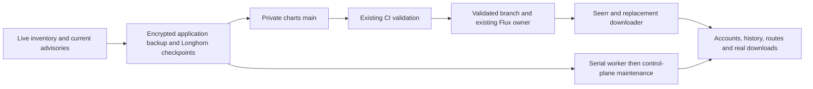

# Cluster maintenance and application migration — 2026-10-23

Current checkpoints and unresolved gates are summarized in [MIGRATION_STATUS.md](../MIGRATION_STATUS.md). This document retains operational contracts and dated attempt history.

This work is the user's requested Overseerr-to-Seerr migration, replacement of
the failing MeTube downloader, and cluster vulnerability remediation. It does
not resume or complete the separate paused BORTUS application delivery goal.
Native Kubernetes Secrets remain authoritative, managed through BORTUS.
The [current maintenance receipt](../evidence/cluster-maintenance-20261023.json)
separates verified host recovery from unfinished image/application acceptance.

## Radarr API preservation observation

Prepared source only: `scripts/migration/qualify-radarr.py` runs on the master as
the existing `james` operator with its kubeconfig. It performs only Kubernetes
GET/exec-read operations and authenticated HTTP GETs; it never stops a writer,
updates config, tests a download client, queues media or initiates a restart.
Root captures `baseline` while the original writer is running, then stops it
through Flux and captures the separate complete cold encrypted backup before
publishing the update. `after` observes the qualified candidate; `restart`
requires a different Pod UID or increased restart count from the `after` receipt.

The helper pins the existing Deployment/config-PVC UIDs, all three original
claim identities, one Ready owned Pod, the Service and its exact Ready endpoint.
It accepts only the reviewed old image/version 6.0.4.10291 or candidate
6.4.4.10685; candidate runtime identity is checked against the reviewed registry
index or linux/amd64 manifest. Before and after metadata must remain identical
during each observation. An existing config XML is read with `head` capped at
512 KiB; its API key stays in memory and an HTTP header. No API-key query string,
proxy, redirect, plaintext credential file or unverified TLS transport is used.
Private ClusterIP HTTP is the application's existing in-cluster transport;
the actual ingress hostname is sent as `Host` to exercise its host validation.
External HTTPS route verification remains a separate gate.

Supply one protected, existing 32-byte random HMAC key as 64 lowercase hex
characters on stdin for every invocation. The helper never creates or saves
that key. Receipts must be new owner-only files outside Git; their parent is
0700 and file is 0600. For example, from a protected public script staging root:

```bash
python3 qualify-radarr.py baseline --receipt /home/james/.local/share/branconet-migration/radarr-acceptance/before.json < /protected/existing-radarr-hmac-key
python3 qualify-radarr.py after --baseline /home/james/.local/share/branconet-migration/radarr-acceptance/before.json --receipt /home/james/.local/share/branconet-migration/radarr-acceptance/after.json < /protected/existing-radarr-hmac-key
python3 qualify-radarr.py restart --baseline /home/james/.local/share/branconet-migration/radarr-acceptance/before.json --prior-receipt /home/james/.local/share/branconet-migration/radarr-acceptance/after.json --receipt /home/james/.local/share/branconet-migration/radarr-acceptance/restart.json < /protected/existing-radarr-hmac-key
```

The API response limit is 16 MiB each, 64 MiB aggregate, 50,000 records per
collection and 200 history pages of 250; commands and HTTP have deadlines.
History is ordered by ID ascending and binds every record present at the start
of that capture; concurrent additions can append but deletion during capture
refuses. Existing IDs and per-field HMACs must survive subsequent observations.
History fingerprints cover stored movie ID, source title, languages, quality,
date, download ID, event type and data. They omit calculated custom-format scores,
calculated cutoff state and expanded movie metadata. Movie fingerprints cover
TMDB identity, path, profile, monitoring, availability policy, root folder, sorted
tags, addition date and add options; derived metadata, search timestamps, file
statistics and current file ID are not presented as immutable fields. These
field choices follow the pinned upstream [Movie resource](https://github.com/Radarr/Radarr/blob/v6.4.4.10685/src/Radarr.Api.V3/Movies/MovieResource.cs)
and [History resource](https://github.com/Radarr/Radarr/blob/v6.4.4.10685/src/Radarr.Api.V3/History/HistoryResource.cs).

Root folders must remain accessible and retain IDs/paths. Download-client,
indexer, quality-profile, tag, remote-path-mapping and custom-format resources
retain all original returned fields and IDs; new response fields/records are
allowed. XML API-key/auth/base-path/listener fields retain their HMACs. Raw
media titles, paths, API keys, config strings and API responses never enter
receipts or output; resource IDs, fingerprints, aggregate counts, image/UID
metadata and health issue categories do. A fingerprint mismatch refuses the
observation rather than silently broadening normalization.

The first actual candidate observation preserved the movie/history/config and
other integration fingerprints but refused the qBittorrent client's whole
`fields` array. Pinned upstream source explains its precise API presentation
change: [old qBittorrent settings](https://github.com/Radarr/Radarr/blob/v6.0.4.10291/src/NzbDrone.Core/Download/Clients/QBittorrent/QBittorrentSettings.cs)
has 14 fields; [new settings](https://github.com/Radarr/Radarr/blob/v6.4.4.10685/src/NzbDrone.Core/Download/Clients/QBittorrent/QBittorrentSettings.cs)
adds an `apiKey` field at order 4, shifting all later field orders by one.
The unchanged [SchemaBuilder](https://github.com/Radarr/Radarr/blob/v6.4.4.10685/src/Radarr.Http/ClientSchema/SchemaBuilder.cs)
renumbers them sequentially. The base settings class adds no inherited fields.
The new validator allows the existing username/password authentication when
the new API key remains empty; it rejects mixing a populated API key with
username/password.

The reviewed helper therefore applies one explicit inverse presentation mapping
in `after`/`restart` only. It requires implementation `QBittorrent`, exactly the
15 pinned field names in their exact order, integer orders 0–14, and a missing,
null or empty-string new API-key value. A masked or other nonempty value refuses.
It removes only that unused new field and changes later order numbers back by
one. The entire resulting original 14-field array, including all original
returned values, credential masks, labels, help text, option metadata and other
keys, must then match the immutable original whole-array HMAC. No original
operator value or metadata key is ignored. Other provider implementations are
unchanged. Each private observation records `schema_mappings` with the client ID
and exact mapping name. The original baseline and failed observation evidence
remain immutable; this is an explained API projection, not an account/credential
waiver or a new baseline. Source preparation does not establish the rerun's pass.

This is API-visible preservation, not a complete database proof. In particular,
API-masked password fields prove only the returned mask; SQLite integrity and
raw user/password tables, live external routes, download-client/indexer connection
tests and Seerr integration require separate evidence. Health categories are
reported, not converted into a clean-health claim. Every receipt permanently
sets `full_acceptance_complete` false. No live baseline, update or restart is
claimed by this source preparation.

## Sonarr API preservation observation

Prepared source only: `scripts/migration/qualify-sonarr.py` applies the same
GET-only, private-receipt, stdin HMAC-key and independent cold-backup workflow as
the Radarr helper above. It pins Sonarr's original Deployment
`30d19648-2af7-48cd-9d72-e9d41f4ecb20`, config PVC
`ff5158b3-cecf-46f9-b85e-ad8566cb9068`, all three original claims, owned Ready Pod
and exact Service endpoint. It accepts old version 4.0.17.2952 and the reviewed
candidate 4.0.20.3014 only. Candidate image index is
`sha256:889dcc58c6aea859033985894b519b2e6b1e55d92527ed123f9f52e42ae7c97b`;
the reviewed linux/amd64 manifest is
`sha256:c5a8178dc6d1f2e2c34b5e254716230d9769af34b4090e61cc116dc055a3083f`.
The in-cluster request uses port 8989 and `Host: sonarr.branconet.lan`, preserving
the configured base path and in-memory API-key header. No media mutation,
download, search, client/indexer test or restart is initiated by the helper.

```bash
python3 qualify-sonarr.py baseline --receipt /home/james/.local/share/branconet-migration/sonarr-acceptance/before.json < /protected/existing-sonarr-hmac-key
python3 qualify-sonarr.py after --baseline /home/james/.local/share/branconet-migration/sonarr-acceptance/before.json --receipt /home/james/.local/share/branconet-migration/sonarr-acceptance/after.json < /protected/existing-sonarr-hmac-key
python3 qualify-sonarr.py restart --baseline /home/james/.local/share/branconet-migration/sonarr-acceptance/before.json --prior-receipt /home/james/.local/share/branconet-migration/sonarr-acceptance/after.json --receipt /home/james/.local/share/branconet-migration/sonarr-acceptance/restart.json < /protected/existing-sonarr-hmac-key
```

Capture is limited to 250 series, 50,000 records per aggregate collection,
16 MiB per response, 128 MiB aggregate API responses, 768 API GETs and a hard
180-second observation deadline. Metadata commands have 30-second deadlines,
HTTP operations at most 20 seconds, and the hard deadline also interrupts a
response that keeps trickling bytes. Episode and file endpoints require a
series ID: the helper makes exactly two sequential GETs per captured series,
with no per-episode request, expanded series, images or file resource. History
uses at most 200 pages of 250 sorted by ID ascending. These bounds refuse a
larger corpus instead of silently skipping it or starting a broad recursive scan.

Per-field HMACs cover series TVDB identity, operator path/profile/monitoring,
new-item policy, season-folder/scene-numbering/type, sorted tags and addition
options; each existing season's monitored state has a separate composite
series/season identity. Episode fingerprints retain series/TVDB/season/episode
identity, monitoring and stored absolute/scene numbering. File fingerprints retain
original file IDs, series/season, relative/full paths, size/addition date, scene
name/release group, languages, quality and indexer/release flags. History retains
series/episode identities, source title, languages/quality/date/download ID/event
type and stored data. They exclude derived metadata, current episode-file
assignment, search timestamps, availability and calculated format/cutoff scores.
The selected resource fields and per-series query requirements follow pinned
upstream [Series](https://github.com/Sonarr/Sonarr/blob/v4.0.20.3014/src/Sonarr.Api.V3/Series/SeriesResource.cs),
[Episode](https://github.com/Sonarr/Sonarr/blob/v4.0.20.3014/src/Sonarr.Api.V3/Episodes/EpisodeResource.cs),
[EpisodeFile](https://github.com/Sonarr/Sonarr/blob/v4.0.20.3014/src/Sonarr.Api.V3/EpisodeFiles/EpisodeFileResource.cs)
and [History](https://github.com/Sonarr/Sonarr/blob/v4.0.20.3014/src/Sonarr.Api.V3/History/HistoryResource.cs)
contracts. A real background replacement/deletion can therefore cause a strict
old-file or history mismatch; it needs review rather than silent normalization.

Root folders remain accessible with original IDs/paths. Original returned fields
and IDs in clients, indexers, quality profiles, tags, remote-path mappings and
custom formats must remain; XML API-key/auth/listener fields retain HMACs.
Additional records/response fields are allowed. No raw title/path/config/credential
or API response is persisted or printed. Receipts retain only IDs, fingerprints,
counts, health categories and deployment/image metadata. Masks returned by APIs
do not prove underlying passwords. SQLite integrity/user-password preservation,
actual integration connections, external routes and final browser validation
remain separate; every receipt keeps `full_acceptance_complete: false`.
No Sonarr baseline, backup, rollout or restart is claimed by source preparation.

The separate prepared `verify-arr-sqlite.py` closes the SQLite/Users evidence gap
for Radarr or Sonarr only when actually executed successfully. It authenticates
the complete original cold archive, extracts only the exact database/WAL/SHM
into bounded tmpfs, then compares every original Users field by keyed HMAC with
a consistent live SQLite snapshot copied through a same-node read-only reader
into memory. It refuses readonly/WAL failures rather than using an immutable
fallback or checkpoint. No application data mutation or zero-SHM-coordination
claim is made. See the [exact contract and remaining gates](COLD-APPLICATION-STATE-BACKUP.md#radarrsonarr-sqlite-integrity-and-users-preservation).

## Bazarr SQL and API preservation observation

Prepared source only: stage `scripts/migration/qualify-bazarr.py` and its adjacent
`bazarr-sqlite-observer.py` together on the master. The controller's CLI matches
the Radarr/Sonarr baseline/after/restart workflow, using its own protected
32-byte hex HMAC key on stdin and new 0600 receipts in a 0700 directory outside
Git. It pins original Deployment `2bfbbb63-e949-4a5d-afd3-a923e2d02472`, config
PVC `5bddaab4-1974-4211-bcae-8392d1006804`, all three original claims and owned
Ready Pod/Service endpoint. Only the reviewed 1.5.6 and 1.6.2 image identities
are admitted. The new index is
`sha256:c63aa057947400abded2583f7027d6ac1f8d70a8130401c36d5a244ef5999466`;
the linux/amd64 manifest is
`sha256:df6257b02f48a5470692f066d83dfaa1844e43bc5ebb691d529bf0d44ad1801d`.

```bash
python3 qualify-bazarr.py baseline --receipt /home/james/.local/share/branconet-migration/bazarr-acceptance/before.json < /protected/existing-bazarr-hmac-key
python3 qualify-bazarr.py after --baseline /home/james/.local/share/branconet-migration/bazarr-acceptance/before.json --vendor-normalization-proof /protected/vendor-default-normalization-proof.json --receipt /home/james/.local/share/branconet-migration/bazarr-acceptance/after.json < /protected/existing-bazarr-hmac-key
python3 qualify-bazarr.py restart --baseline /home/james/.local/share/branconet-migration/bazarr-acceptance/before.json --prior-receipt /home/james/.local/share/branconet-migration/bazarr-acceptance/after.json --vendor-normalization-proof /protected/vendor-default-normalization-proof.json --receipt /home/james/.local/share/branconet-migration/bazarr-acceptance/restart.json < /protected/existing-bazarr-hmac-key
```

The standalone observer runs via the existing Pod's `/usr/bin/python3`, reads
only `/config/db/bazarr.db` through SQLite URI `mode=ro`, enables `query_only`,
and observes one `BEGIN` read snapshot with `quick_check` and foreign-key
violation fingerprints. It neither imports Bazarr's database/config/application
modules nor sets journal mode, creates a reader Pod, copies a database or runs
migrations. SQLite's normal read transaction/locking remains in use; this is
not an `immutable=1` read that could ignore a live writer's WAL. Limits are a
256 MiB database, 8 MiB scalar, 128 MiB hashed scalar input, 100,000 observed
rows, 120-second hard observer deadline and 150-second controller exec deadline.
The controller accepts at most 64 MiB observer output. Bounds refuse instead of
omitting data or expanding into NAS/media reads.

Both pinned upstream [old](https://github.com/morpheus65535/bazarr/blob/v1.5.6/bazarr/app/database.py)
and [new](https://github.com/morpheus65535/bazarr/blob/v1.6.2/bazarr/app/database.py)
schemas were compared. The five new migration projections are explicit:

- [`c00d40af333c`](https://github.com/morpheus65535/bazarr/blob/v1.6.2/migrations/versions/c00d40af333c_.py)
  adds score denominators: existing non-null scores get 360 in episode history
  and 120 in movie history, otherwise null. Baseline fingerprints include these
  expected values; after/restart hash the actual stored values for comparison.
- [`309dc062d2e4`](https://github.com/morpheus65535/bazarr/blob/v1.6.2/migrations/versions/309dc062d2e4_.py)
  adds nullable episode `tvdbId`; [`7e9a2b1c4d5f`](https://github.com/morpheus65535/bazarr/blob/v1.6.2/migrations/versions/7e9a2b1c4d5f_.py)
  adds show/movie `originalLanguage`. Their post-upgrade columns must exist.
- [`0124f9e278fb`](https://github.com/morpheus65535/bazarr/blob/v1.6.2/migrations/versions/0124f9e278fb_.py)
  converts old subtitle tuples into separate tables and adds indexes;
  [`537e9b4d10e3`](https://github.com/morpheus65535/bazarr/blob/v1.6.2/migrations/versions/537e9b4d10e3_.py)
  adds subtitle indexes. The old head must be `df76a4410347`, new head
  `537e9b4d10e3`; old subtitle columns must be dropped or cleared after conversion.

The subtitle migration catches parse/integrity errors and continues, then
removes or clears the old column. Its baseline therefore refuses malformed
literals, tuples other than two/three elements, unsupported/case-ambiguous
language suffixes, invalid path/size types and uniqueness collisions before
upgrade. It accepts unambiguous lowercase `:hi` or `:forced` only, matching the
new parser exactly. Missing size becomes null. HMAC multisets bind each subtitle's
episode/series or movie identity, base language, flags, path and size across the
conversion; no old entry may disappear. New surrogate IDs and embedded-track
metadata have no old representation and do not substitute for an old subtitle.
Additional new entries are allowed. This does not inspect subtitle/media bytes
on NAS; those remain in place and the separate cold config backup preserves the
complete original representation.

Per-row/per-column HMACs preserve stored show, episode and movie identity,
paths, profile/monitoring assignments, media metadata and tags; full original
history, language-profile, enabled-language, blacklist and notifier rows remain
checked. `TABLES` in the observer is the explicit field contract. Derived
`ffprobe_cache`, `failedAttempts`, `missing_subtitles` and automatic
`updated_at_timestamp` are outside semantic equality and remain in the complete
cold archive; their absence from comparison is not a claim of unchanged bytes.
New foreign-key violations refuse comparison; existing violation fingerprints
are reported honestly rather than treated as clean integrity.

The observer imports only the discovered vendored YAML library
`/app/bin/libs/yaml` to parse bounded `/config/config/config.yaml` in memory.
Every existing semantic config leaf, including actual auth/provider/Arr secrets,
is HMAC-bound by hashed path and value. No raw key, credential, media title/path,
database row or response is persisted or printed. Authenticated GETs to the
verified Service IP on 6767 with `Host: bazarr.branconet.lan` check
[`/api/system/status`](https://github.com/morpheus65535/bazarr/blob/v1.6.2/bazarr/api/system/status.py)
and `/api/system/health`, with the API key only in its header, no redirects/proxy,
two 1 MiB response limits and 15-second HTTP timeouts. Version and API-reported
migration must match the SQL observation. Reported Arr versions can be cached:
they are retained as metadata and are not represented as fresh connection tests.
The helper initiates no scan, sync, subtitle search/download, notification,
post-processing or application mutation. Actual Arr sync, external routes,
restart orchestration and final browser validation remain root-owned gates.
Every receipt keeps `full_acceptance_complete: false`. Source preparation does
not establish a successful qualification, backup, migration or restart.

### Evidence-bound vendor default cleanup

The actual candidate comparison initially refused 25 missing old config leaves
and two missing notifier rows; it did not silently discard those mismatches.
A separate read-only diagnosis authenticated the entire original cold archive,
loaded selected DB/config bytes only in RAM or private tmpfs, and matched their
HMACs to the immutable original baseline. Live config matched the retained
candidate diagnostic. The sanitized proof is retained on the WSL controller:
`/home/brajam/.local/share/branconet-migration/bazarr-drift-diagnosis-20261024/readonly-defaults-fda490be80bd40c0a955a8992ec53c8d.json`,
SHA256 `51819b03f0cd14ddebfc4d186d5cbe186ab90181671980a3f434b87534f4b22a`.
It contains source/baseline/archive/diagnostic bindings, field paths, row
fingerprints and booleans, without credentials or raw config/database values.

Pinned [v1.6.2 config normalization](https://github.com/morpheus65535/bazarr/blob/v1.6.2/bazarr/app/config.py)
explicitly removes legacy score and Podnapisi sections and converts/removes
`translator.gemini_key`. Its [notifier refresh](https://github.com/morpheus65535/bazarr/blob/v1.6.2/bazarr/app/notifier.py)
removes template rows no longer present in the Apprise registry. Diagnosis proves
all 23 removed score values equal the exact old Validator defaults, with zero
customized scores; Podnapisi is disabled before/after and its TLS flag equals
the old default; the old Gemini key is empty and its new list is empty; both
removed notifier rows are disabled with empty URLs. Every auth leaf survives.

`after` and `restart` now require an owner-only copy of that exact proof through
`--vendor-normalization-proof`. Its file SHA and original baseline SHA must
match. The helper recomputes keyed baseline fingerprints of all 23 exact public
integer defaults, the default true Podnapisi TLS flag and empty legacy key.
It admits only those exact 25 absent paths, requires an empty new Gemini key
list and unchanged enabled-provider fingerprint, and uses only the proof's
two exact absent notifier identities. Those rows must have exactly the original
name/enabled/URL fields, integer disabled state and null/empty URL fingerprints.
No active or nonempty row, customized score, changed present value or other
missing config/table field is exempt. All other per-row/per-column and credential
HMAC checks remain intact. Restart also compares the accepted post-upgrade
receipt strictly, without applying these removal exceptions a second time.
The original baseline, failed diagnostics and application data remain unchanged.

The new [scoring implementation](https://github.com/morpheus65535/bazarr/blob/v1.6.2/custom_libs/subliminal_patch/score.py)
changes upstream scoring behavior and weights. Removing unused old default
settings is **not** evidence of identical effective weights. Each new receipt
records the exact normalization proof and counts, source references,
`upstream_scoring_behavior_changed: true` and
`equivalent_effective_weights_claimed: false`. The prepared normalization itself
does not establish a successful rerun or final application acceptance.

## Delivery and preservation



Preserve all PVC identities, NAS media, Gluster originals and previous backups.
No cluster reset, volume deletion, Secret replacement, forced eviction or PDB
bypass is part of this maintenance. Existing application URLs remain usable.
Repeatable node patching and checkpoint operations belong in Ansible; chart
changes use the existing private `branconet-charts` publisher.

Overseerr currently has six accounts and 654 requests. Acceptance requires the
same account IDs, credentials/Plex identities, permissions and preserved history
after the vendor migration. The entire cold config must have a verified encrypted
backup; rollback restores config, ownership and the old image together. Upstream
also renames Arr request tags, so original tag records are preserved separately.
The private charts repository contains the detailed Seerr runbook.

`images/seerr/` prepares a separate upstream-source security image because the
signed vendor release retains fixable dependency findings. Its exact dependency
lock, build, scan and migration compatibility must be verified before adoption;
it is not represented as an upstream-signed image. No BORTUS application source
is changed by this recipe.
The first worker1 attempt reached production pruning but failed because upstream
prepare imported the removed development Husky package. The corrected prune skips
lifecycle scripts, preserving the already built native modules. A distinct `r2`
attempt retains the exact frozen lock and all original failure evidence; no source
service was stopped for this packaging failure.
The r2 attempt subsequently stopped at the Nodemailer/email-templates declaration
boundary during TypeScript compilation. A checksum-guarded build-only declaration
adaptation now uses Nodemailer 10's own types; application runtime mail behavior
remains unchanged. The separate ip-address 10.7.4 patch requires a newly resolved,
separately retained frozen lock. Its replacement build is not yet accepted.
Private CI run `40047979424` then passed the mail adaptation and complete Next
checking/compilation, but server TypeScript refused two image-proxy header uses
under Axios 1.20. The source override now SHA-binds that original file and adds
string guards for content-type/cache-control before the existing MIME and
cache-age operations. Valid strings and missing-header defaults remain; other
nonstring values use the existing caught cache-miss path. No cast, disabled type
check, dependency/lock change or production cutover accompanies this fix.
A fresh full image build, exact scan and actual image/data checks remain pending;
see the [image recipe explanation](../images/seerr/README.md).
That lock resolved successfully with scripts disabled and is SHA-256
`9665b245267e7c864210bdf85f1098c0891f30946c64b3781f44077fff0b7811`;
the original sealed lock remains unchanged. The focused declaration comparison
reproduced the exact failure and passed after adaptation, while the full build,
native runtime checks and application migration remain separate gates.
YTPTube's worker build completed successfully at 23:34:07 UTC. The corrected
OCI-directory scan completed at 00:00:10 UTC on October 24: one critical and
72 high advisory/package rows, including four high rows with available fixes.
A follow-up dependency patch is being prepared; the image is not accepted yet.
Seerr r2 stopped at TypeScript checking because its upgraded Nodemailer types
disagree with email-templates; no source application was stopped. Its first actual
scanner attempt refused exported file permissions before running Trivy: BuildKit
used mode 0666 inside the protected 0700 directory. Only the successful build's
OCI and metadata file modes are tightened to 0600; hashes and prior failure
evidence remain unchanged before a new bounded scan attempt.
The corrected exact-OCI scan completed at 00:00:10 UTC on October 24: one critical,
72 high rows, including four high rows with available fixes. The source recipe
updates normal msgpack, setuptools and urllib3 in both Python environments plus
the provider's ip-address package, but r2 still reports the old pip-vendored
copies despite its normal distributions passing version checks. Official pip
26.2.2 confirms those real bundled versions. The next source recipe removes
complete install-only pip/setuptools implementations and ensurepip's bundled
wheel after updating runtime packages, and verifies installer absence in both
interpreters. It does not remove just SBOM metadata or disable an analyzer.
Keep runtime package requests empty; ignore-updates alone does not disable
installation. See the [image contract](../images/ytptube/README.md).
The next private CI attempt passed both runtime-package checks and uv uninstalls,
then refused the immutable base's dangling `pip -> pip3` alias. Root verified its
exact image-layer symlink metadata. The minimal correction removes only that
known alias itself using lstat/readlink; foreign links remain refused and the
final absence check also detects dangling links. Prior failure evidence remains.
Those changes require a fresh immutable build and
scan; they do not close the unfixed findings or prove a real YouTube download.

MeTube currently reports a successful running container while download logs show
HTTP 403. Acceptance of its replacement requires a real download, not only a
Ready Pod or HTTP 200. Existing NAS downloads and legacy queue/state remain
retained. YouTube may still impose per-video authentication or network restrictions.
The prepared [MeTube preservation path](METUBE-STATE-BACKUP.md) adds a separate
Ansible cold-state archive and later full-claim reobservation. Root owns the Flux
writer stop; source preparation creates no Pod or backup. It binds all three
original PVC UIDs, streams the full state/temporary tree directly into age,
never walks NAS downloads, and compares every legacy file after YTPTube use
while excluding only its exact new config/cache directories.

The local [YTPTube security derivative](../images/ytptube/README.md) pins the
official v2.7.5 image and prepares focused OS/Python/provider dependency fixes.
Its separate `ytptube-image-build.yml` playbook and dedicated launcher stage a
sealed master-only standalone BuildKit attempt with the same aggregate cgroup
limits as Seerr, under a different root/unit identity. Both local roles now
permit only status/stop after the disk-pressure incident. A fresh worker1-only
builder is separately permitted after the existing filesystem expansion and full
maintenance recovery; the retired master attempts remain frozen. Source preparation does
not dispatch a build, qualify the image, import credentials or deploy the app.
Unfixed libxml2 and unattributed findings remain explicit acceptance limits.
The eventual immutable chart must disable extractor auto-update and remove
the writable Python overlay path, while preserving the original claims/routes.
The downloader candidate isolates its fresh configuration in a new subdirectory
on the existing two-replica state claim, whose live free space exceeds 1 GB;
legacy queue files stay intact. Large temporary downloads use the existing NAS,
avoiding a new claim and the old 2 GiB temporary volume's download-size ceiling.

The separate `application-image-preload.yml` playbook prepares serial,
checksum-and-manifest-verified OCI cache imports for Seerr, YTPTube and the
same-application Jackett/Pi-hole/FlareSolverr/Vaultwarden derivatives only.
Jackett's built OS-only derivative still has two critical and 29 high bundled
.NET findings, all with fixes. The separate unbuilt runtime candidate retains
its exact 0.24.1440 source and LSIO startup while genuinely rebuilding server
and updater with official .NET 9.0.21. Its original OS-only recipe is unchanged;
see the [candidate contract](../images/jackett/README.md#separate-same-source-runtime-candidate).
No manifest-only relabeling, app deployment or vulnerability closure is claimed.
It uses the independent containerd socket and k8s.io namespace, preserves
existing image identities, and creates fixed local digest aliases. It does
not deploy/start an app, unpack an image or touch BORTUS, Secrets or PVCs.
The optional `application_image_preload_stage_from_controller` path defaults
false, preserving pre-transferred inputs. When enabled, it verifies the fixed
owner-only WSL source, requires per-node free space of at least
`ceil(15% total) + 1 GiB + 2 * archive bytes + uncompressed layer bytes`, copies
only the six allowlisted public OCI archives without overwrite, and fully
rehashes the node copy before the existing cache import checks. Matching 0400
copies and native WSL originals are retained. Staging uses `james` without
become and never relaxes the fixed reserve. Live execution and application
acceptance remain coordinator-owned; see the
[preload contract](../k8s-rewrite/ansible-playbook/README.md#maintenance-application-cache-only-oci-preload).
Per-artifact `generation` defaults to `initial`, keeping the original
`<service>-security-20261023.oci.tar` basename. Explicit `r1`–`r999` or
`ci1`–`ci999999999999999` adds `-<generation>` before `.oci.tar` in both fixed
controller/node directories. Exact path, ownership, single-link, SHA/size and
capacity checks remain; original generations are never renamed or replaced.
The immutable service/digest image-cache aliases are unchanged. This source
extension makes no transfer, import, cleanup or runtime claim.
The exact operator allowlist also includes `flaresolverr` and `vaultwarden`, alongside `seerr`,
`ytptube`, `jackett` and `pihole`, from authenticated CI reception through protected
CI staging, offline scan and cache-only preload. Their fixed local aliases are
`docker.io/library/flaresolverr-security-20261023@sha256:<digest>` and
`docker.io/library/vaultwarden-security-20261023@sha256:<digest>`. Pi-hole and
Vaultwarden reception use the same non-Seerr original null-lock contract. Repository,
workflow, ZIP, hash, platform, provenance, resource and Seerr frozen-lock checks
are unchanged. No arbitrary service or new publisher is introduced. This support
does not dispatch/widen local builders, publish, scan or change an application.

## Offline exact-artifact scanner preparation

The scanner's explicit CI source mode accepts completed artifacts from the
approved private charts image workflow, with original uploaded result/limits/
input/lock proof files and SHA-bound operator-verified GitHub/ZIP provenance.
It records CI origin without synthetic worker-build receipts. Its default local
worker mode and all scanner limits, offline databases, findings and acceptance
boundaries remain unchanged. This is prepared source only until a new helper
setup and actual exact-artifact scan complete; see the
[full CI provenance contract](CI-IMAGE-SCAN-PROVENANCE.md).
Its standalone disabled-by-default `ci-image-artifact-stage.yml` playbook makes
the prior controller-to-worker copy repeatable. It checks full selected file
hashes, protected ownership and unchanged controller identity, copies only
missing allowlisted files without replacement, and verifies the worker copy.
It neither scans nor starts applications; prepared source is not proof of a live
transfer or security/application acceptance.
The prepared Windows `receive-ci-image.py` receiver authenticates GitHub metadata
and an already downloaded ZIP, validates original files/build limits and streams
the originals into protected native WSL storage. It accepts Seerr by default or
explicit YTPTube/Jackett service selection. Its seven-file Seerr or six-file
YTPTube/Jackett scanner proof map remains separate from retained recipe/log
evidence; Seerr's exact lock stays required and the other services cannot claim
a pnpm lock. Original BuildKit runtime metadata must match the OCI result/index.
It performs no artifact
download, layer extraction, code execution, image import or deployment; root
still owns invocation and worker1 staging.

The separate disabled-by-default `worker1-oci-scan.yml` path stages the already
verified Trivy 0.76.1 and exact offloaded DB snapshot directly from native WSL to
worker1, avoiding master disk. Explicit setup and scan are separate operations;
no download or application launch is part of either. A scan requires a completed
fixed builder archive, its reviewed SHA256 and original OCI root descriptor. It
verifies all reachable blobs, selects exactly one linux/amd64 runtime manifest,
and records both original and selected identities. Other platforms/attestations
are not vulnerability-scanned. Retained baseline reports and original archives
are preserved.

One no-network systemd cgroup bounds scanner and helper to 1 GiB, no swap and two
CPUs. DB hashes and age, coverage, all severities, fixable/unfixed residuals and
failures remain in private receipts. Results-only templating excludes full image
Env/config/history from scanner reports; no Secret scanner or Kubernetes Secret
read occurs. There are no suppressions or ignore-unfixed flags, and no clean or
runtime acceptance follows merely from successful launch/exit. See the
[complete execution contract](../k8s-rewrite/ansible-playbook/README.md#exact-offline-worker1-oci-vulnerability-scans).
This checkpoint prepares source only; execution and exact report review remain
coordinator-owned gates.

## Existing-device filesystem capacity recovery

The separate inspect-by-default `filesystem-growth.yml` playbook and
`filesystem_growth` role pin worker1's existing root/Longhorn ext4 UUID and
253,906,386,944-byte LV. Its original superblock uses only 107,374,182,400 bytes;
the larger LV is already allocated. A reviewed online `resize2fs` can use this
existing capacity without changing partitions/LVs or deleting retained data.
Source preparation does not dispatch growth. Default execution only inspects;
apply requires the exact reviewed receipt SHA, same source and boot identity,
clean filesystem and unchanged device/geometry. Planned reboot precedes fresh
inspection. Both helper and dedicated stdin/environment credential launcher
preserve running work on observation timeout. See the
[execution contract](../k8s-rewrite/ansible-playbook/README.md#pinned-worker1-existing-lv-filesystem-growth).
Full original-volume health and real application recovery remain separate gates.

The guarded online growth completed at 22:28:14 UTC without changing the existing
LV, partition or filesystem UUID. Usable filesystem capacity rose from
105,089,261,568 to 249,322,430,464 bytes, with 169,617,772,544 bytes available.
Both workers subsequently passed full recovery. Master host patch checks passed
after reboot; a transient API authorization failure stopped the play before
uncordon. Independent checks confirmed the selected kernel/runtime, all four
NVIDIA packages at 1.20.1-1, unchanged runtime configuration and retired services
still stopped. Access recovered and the master was uncordoned. At 22:44:11 UTC
the frozen recovery guard passed: all 30 original active volume UIDs healthy,
all 54 Deployments and seven DaemonSets recovered, and all nodes Ready/uncordoned
without pressure. This satisfied the prerequisite for the bounded worker1 build.

The user approved Actions and isolated image builds only in private
`jtmb/branconet-charts`. Main `11bb4f8` passed the existing validation/promotion
workflow. The first actual image job measured only 14,094,872,576 free bytes and
refused the 18 GiB reserve before creating a builder. Its failure is retained;
the expanded worker1 is the bounded fallback. Application-repository Actions
remains disabled, and no unfinished BORTUS release is included.

## Confirmed initial findings

The separate `control-plane-backup.yml` Ansible path is prepared as a fresh
prerequisite for the master-last maintenance step. It uses the existing etcd
3.7.0 static Pod's official TLS snapshot/save and snapshot/status tools, streams
the snapshot plus `/etc/kubernetes` recovery files (PKI, encryption configuration
and Longhorn crypto key included) directly into age in a protected native WSL
operator directory, and verifies authenticated archive contents and snapshot
structure/checksum. The existing SSH age identity/recipient are reused explicitly.
See the [backup execution contract](../k8s-rewrite/ansible-playbook/README.md#separate-control-plane-backup-before-master-maintenance).
Actual execution completed at 22:12:57 UTC: 46 configuration files and the etcd
snapshot are retained in a 69,700,420-byte authenticated off-node age archive,
SHA-256 `947454bb68e348ea8f0846c0c1496b6638d73305892d4ea179f4a3befe4ecc36`.
Only its verified owned temporary snapshot was removed from the master.
This scope does not run or change
the frozen BORTUS recovery helpers and does not establish an independent restore,
API decryption, application quiescence or BORTUS recovery acceptance.

| Component | Observed | Correction / remaining limitation |
|---|---|---|
| Ubuntu kernels | Running 5.15.0-173, -157, -160; 5.15.0-198 already installed | Serial protected reboot activates the installed patch; verify actual running version |
| Independent containerd | 2.4.1 on all three nodes | Checksum-verified 2.4.2, preserving its separate config/socket |
| NVIDIA toolkit on master | 1.16.0; no configured Kubernetes GPU runtime | Review and apply exact 1.20.1 packages; do not claim the dormant hook was exploitable |
| Longhorn backups | Most dated October 9 | Fresh explicitly online/crash-consistent checkpoints before rolling maintenance |
| Seerr candidate | Signed upstream 3.5.1 | Current image scan has critical dependency findings; latest release alone is not a security pass |

The initially running old kernels were affected by
[CVE-2026-43284](https://ubuntu.com/security/CVE-2026-43284).
Containerd 2.4.2 fixes
[CVE-2026-95839](https://github.com/containerd/containerd/security/advisories/GHSA-vwhp-8p66-mq4f).
The separate parallel-layer-fetch issue is conditional; that feature is disabled
in the observed configuration.

[CVE-2026-98260](https://ubuntu.com/security/CVE-2026-98260) has no released fix
for the installed Jammy kernel line as of this audit. A reboot does not close it.
The audit covers published findings and configuration exposure; no scan can
establish the absence of undisclosed zero-days. Scanner rows are package/advisory
observations, not distinct proven exploits. Report unfixable findings and scan
failures explicitly, without suppressions or an unsupported clean verdict.

## Current execution checkpoint

Charts main is `11bb4f8`; its retained application values restore one Overseerr replica and supersede the
unpromoted zero-replica preparation `971f55e`. Stop the writer for its cold backup
only after the replacement image is ready. Its existing GitHub
validation/promotion workflow passed, and live Flux fetched that exact validated SHA.
Subsequent charts commit `8b98d73` also passed and reconciled: Traefik 2.11.60
has two updated Ready replicas with successful Pod health checks and verified
media HTTPS routing through all three nodes. FlareSolverr 3.5.2 is Ready and its
browser `request.get` retrieved the public test page with HTTP 200. Their residual
image findings remain; neither update establishes a clean cluster verdict.
The user approved only private charts CI and image builds; Actions is enabled
there and confirmed disabled on the BORTUS application repository. The new
artifact workflow is published on charts main; no application image/value
cutover has been published, and the original Overseerr writer has not stopped.

All 30 attached Longhorn volumes completed fresh online checkpoints at
21:15:46 UTC. Receipt SHA-256 is
`5ae6003286e814e77b5cb60b5e78660291addef2b198f9e3d353e2e943bcccc6`.
These are crash-consistent backups, not independent restore proof. Ten detached
retained volumes were preserved and excluded. Worker 2 booted kernel
`5.15.0-198-generic` and its actual CRI reports `v2.4.2`. Docker, Gluster and the
verified unused stock containerd remain stopped/disabled; the separate Kubernetes
runtime remains active. A version-format assertion stopped the play after reboot;
the exact runtime was independently verified and the node was uncordoned. Full
volume/controller recovery is required before another node is patched. The
subsequent source also freezes DaemonSet identities and scheduling/readiness
counts, covering the storage and CNI agents as well as application controllers.

The master-only Seerr build was stopped at 21:36:57 UTC after native snapshot
cache use crossed Kubernetes' filesystem-pressure threshold and Pods were evicted.
Its 3 GiB/no-swap memory bound held with no OOM, but it lacked a filesystem reserve
guard. Build logs, source, lock and failure receipt remain. After confirming both
owned build units stopped and no mounts remained, only its disposable BuildKit
cache was removed, retaining a metadata archive and cleanup receipt. Free space
recovered to 24,630,345,728 bytes. The duplicate scanned
BORTUS export on master was removed only after verifying the original retained
worker copy. New builds require measured space, a filesystem/inode reserve and
pressure monitoring. All three nodes initially failed the reviewed local build
reserve. Private charts CI was then approved, but its image runner failed the
preflight before building. Expanded worker1 now has sufficient capacity for the
new guarded builder after full maintenance recovery. Strata remains running.
Application recovery takes priority over builds and node maintenance.

At 21:57 UTC all three nodes are Ready/uncordoned without pressure and every
application Deployment reports Ready. Storage remains incomplete: 27 original
volumes are attached/healthy, two attached/degraded, and Plex's original volume
is detached/faulted. Longhorn auto-salvage requires its original complete replica's
disk to become schedulable. At 21:59 UTC four Trivy database/metadata files were
fully copied and SHA-256 verified in native WSL, then source hashes rechecked
before removing only those master cache copies. This freed 3,189,358,592 bytes;
databases, scan reports, tools and original image evidence remain retained.
No replica failure metadata, storage thresholds or production data were changed.
Plex's original replica subsequently auto-salvaged, and all 30 active original
volumes recovered healthy before master maintenance. At 22:40 UTC every
Deployment and DaemonSet is recovered following the master reboot; three
original volumes are still degraded while their second replicas recover.
The configured 600-second replenishment delay then expired; Longhorn created
replacement replicas automatically. Full recovery passed at 22:44:11 UTC,
without changing storage thresholds or replica failure metadata.

All 67 runtime image digests in the inventory snapshot now have successful scans.
The separate BORTUS owner received its current production-image findings; this
chat does not adopt its unfinished application release. New application and host
patch acceptance remains pending. Protected detailed inventory and scan reports
are outside Git under the operator's BORTUS handoff/runtime directories.

The Jackett same-source runtime CI candidate verified SDK9.0.319/runtime9.0.21
but failed at MSBuild temporary-directory creation before restore. Its build-only
TMPDIR is corrected to `/tmp`; original runtime startup/configuration is retained.
No live Jackett chart was changed.

Sonarr4.0.20 makes the same documented qBittorrent API-key field addition as
Radarr. Its observer applies only the pinned 15-field/order projection, requiring
the new API key to be absent/null/empty and preserving every original value,
credential mask and metadata entry against the original baseline. The TV-specific
field names remain exact. No broad client-field ignore or baseline replacement
occurs. [Old settings](https://github.com/Sonarr/Sonarr/blob/v4.0.17.2952/src/NzbDrone.Core/Download/Clients/QBittorrent/QBittorrentSettings.cs)
and [new settings](https://github.com/Sonarr/Sonarr/blob/v4.0.20.3014/src/NzbDrone.Core/Download/Clients/QBittorrent/QBittorrentSettings.cs).

The first actual Bazarr baseline completed SQL/config/status reads but refused
because its cached Sonarr/Radarr version report was unknown during Sonarr's
planned cold interval. Cached peer-version availability is now recorded honestly
rather than used as a data-baseline prerequisite; no SQL/config/subtitle,
authentication or own-version check is removed. Fresh Arr connections remain
separate required live checks after the peers recover. Unknown cached versions
cannot produce an integration-success claim.

## Prepared FlareSolverr browser/OS derivative

`images/flaresolverr` derives from the deployed immutable 3.5.2 base without
changing its plain Python application or interpreter/dependency tree. Signed
existing Debian 12 repositories upgrade OS packages; Chromium/common/driver
must have identical versions, at least 156.0.8078.47. The vendor relocates its
driver to `/app/chromedriver`, so the recipe refreshes that exact path from the
upgraded package while preserving ownership/mode. All other application and
`/usr/local` files must match their original hashes and metadata. The final
vendor USER/startup/configuration is preserved, with primary OCI config evidence.

The prior base scan's 926 fixable critical/high rows include 903 browser rows;
this prepared recipe does not establish their removal. Python findings stay
explicitly open; no package metadata, SBOM or analyzer is suppressed. The existing
artifact-only CI may select `flaresolverr` under unchanged capacity/resource and
publication limits. Actual build, inherited-config comparison, exact scan,
nonroot startup, browser retrieval and route/restart acceptance remain required.
See [recipe and preservation checks](../images/flaresolverr/README.md).


## Newly published cert-manager 1.21.3 in-train patch

Read-only official release/registry research on October24 identified1.21.3
while the existing Flux release still runs1.21.2. It patches Go/x/net and
certificate trust handling, and prevents the controller copying a private key
from an unowned next-private-key Secret. The official chart has one additive
Certificate status CRD field and unchanged default values. Five exact official
image scans are required before a reviewed Flux change. The separate
[limited upstream-registry scanner](CI-IMAGE-SCAN-PROVENANCE.md#exact-official-cert-manager-1213-registry-scans)
is prepared source only; it has no CI/deployment authority. Calico3.33.0,
Longhorn1.12.1, Flux2.9.6 and Traefik2.11.60 remain latest published in-train
payloads in the recorded research; their fixed OS/compiled-library rows still
need same-source/derivative work or a later vendor patch. No unsupported or
clean-cluster verdict follows from the absence of a newer tag.

## Prepared Vaultwarden 1.37.4 OS derivative

`images/vaultwarden` is source preparation only, based on reviewed candidate
index `sha256:efb3cde962015fcc036b2ea625242248611943b27212ebf4392841fb30fad055`.
Its public linux/amd64 manifest/config and all layer blobs were SHA-verified.
Vendor USER is unset/root, ENTRYPOINT unset, CMD `/start.sh`, WORKDIR `/`,
VOLUME `/data`, port 80 and existing `/healthcheck.sh` are inherited, as is ENV.
The application remains the candidate's exact Rust binary and complete web
assets; the recipe does not rebuild application code or migrate production data.

Only signed existing Debian 13 trixie/main updates/security packages are
upgraded, with an exact source-file hash and no removal or insecure-repository
exceptions. Actual final curl/libcurl4t64 must reach at least
`8.14.1-2+deb13u7`, and libpcre2-8-0 `10.46-1~deb13u3`, covering the seven reported
OS finding rows with available fixes. Before/after hashes, types, modes,
ownership and symlinks freeze `/vaultwarden`, `/web-vault`, `/start.sh`,
`/healthcheck.sh` and any existing startup hooks. Source/keyring hashes,
installed-package inventories and OS releases remain in the built image;
previously installed packages cannot disappear. No package metadata is stripped.
The build helper never starts the application, reads `/data` or invokes health
checks/migrations. See [recipe and exact limits](../images/vaultwarden/README.md).

The exact sixth `vaultwarden` identifier is now prepared in the private
artifact-only CI and protected reception/staging/offline-scan/cache-import
allowlists, with fixed alias `docker.io/library/vaultwarden-security-20261023`.
All existing bounds, identity/provenance checks and Seerr-specific lock checks
are unchanged. No CI dispatch, build, values, Flux or live workload change is
included. A future exact scan, inherited-config comparison, protected
cold backup and 1.35.4-to-1.37.4 data/integration/restart qualification remain
required. The candidate's application fixes and a prepared OS recipe do not
prove migration completion or a clean cluster.


## Bounded scanner maintenance and FlareSolverr acceptance

Installed offline inputs can be reused through the separately reviewed
helper-only phase; exact full input hashes and file identities are verified
before only a new content-addressed helper/seal is copied. Initial database/tool
setup and every scan resource/deadline/capacity floor remain unchanged.

The new derived-only retirement role verifies seven fixed successful scans,
original archives/provenance, complete reports and every reproducible selected
blob before removing only duplicate materialization directories. It retains all
original artifacts, failed sources and reports; no application/PVC/NAS data is
in scope. The existing scanner's absent-optional-field JSON-null projection is
reproduced exactly. These operations address scanner storage, not CVEs themselves.

Actual FlareSolverr Python/OS derivative adoption passed at03:53UTC on October24
through charts commit `e7aad9893d9823aae489483e8fdba0dc94418c65` and successful
validation `40059981764`. `scripts/migration/qualify-flaresolverr.py` verified the
original owner UIDs, exact runtime digest, nonroot/native Secret/resource
contracts, Chromium/driver156.0.8078.47, all three routes and a real HTTPS public
page retrieved through the application's browser API.

Verification receipt fingerprint (SHA256)

`ddc96a6f0efe73e246ef2b07f02698aa95bc7d782c3113958dfdd1c625c3cf0f`.
Its unsuppressed scan retains4 critical/193 high, with zero available fixes in
the recorded database. Final Codex IAB UI checks and the full goal remain open.


## Vaultwarden derivative and migration preparation

Exact private image run40060033423/artifact12546559116 built the Debian13
OS derivative from the pinned1.37.4 vendor candidate. Actual offline scan
`vaultwarden-82c60a6f177d` passed at04:22:52UTC with8 critical/66 high,
115 medium/146 low/one unknown and no available critical/high fixes in the
pinned snapshot. Results SHA256:
`8d0293d8ca7bf6cd56b3cb2591cbb819efa36279e366348c1fee2df826034f6f`.
This image is not yet adopted.

[Vaultwarden acceptance](VAULTWARDEN-ACCEPTANCE.md) documents complete encrypted
cold backup and all-table/all-file comparisons. Its mandatory cold-only
preflight runs before publishing1.37.4: the upstream migration drops an existing
archives table, so the original must be proven absent. Only four exact additive
migrations may differ; all original users, credential/2FA fields, encrypted
items, organizations, devices, files and metadata must survive. No login, 2FA or
client-sync result is implied by prepared source or a package scan.
