# Seven retained volumes backed up and independently restored

Completed October 27, 20:08 UTC. Seven previously uncovered retained claims now
have completed full native backups on the existing NAS target. Each backup was
independently restored to a complete encrypted raw image using the installed
Longhorn 1.12.1 engine. All **303 blocks**, every unbacked zero region and each
LUKS header passed verification. [Exact identities, hashes and cleanup ledger](../evidence/detached-volume-native-recovery-20261027.json).

```mermaid
flowchart LR
  A[Detached retained claim] --> B[Existing engine; frontend disabled; two RW replicas]
  B --> C[Snapshot and full native NAS backup]
  C --> D[Release own ticket; normal detach]
  D --> E[Locked independent NAS readback]
  E --> F[Offline stock Longhorn restore]
  F --> G[All blocks, holes, size and encrypted header verified]
  G --> H[Reference checks; scratch removed]
```

| Retained claim | Verified native blocks | Result |
| --- | ---: | --- |
| `migration-system/migration-storage-proof` | 41 | Restored; scratch reconciled |
| `migration-system/migration-storage-restored` | 41 | Restored; scratch reconciled |
| `migration-system/migration-nas-bortus-restore` | 44 | Restored; scratch reconciled |
| `bortus/bortus-restore-b473091bebef` | 45 | Restored; scratch reconciled |
| `pihole/pihole-data-0` | 40 | Restored; scratch reconciled |
| `plex/gluetun-data-1` | 40 | Restored; scratch reconciled |
| `plex/qbittorrent-data-0` | 52 | Restored; scratch reconciled |

These are distinct retained datasets. Their verification does not substitute
for fresh checkpoints of the current application writers. Raw ciphertext was
restored; no filesystem was decrypted/mounted and no application rows were
compared in this operation. Native Secret/key recovery remains covered by the
[independent control-plane restore](FRESH-CONTROL-PLANE-RECOVERY-20261027.md).

## Production changes and repeatability

The new opt-in `detached-storage-checkpoint.yml` Ansible playbook executed
`prepare` and `apply` for each exact claim: all fourteen invocations passed.
It refuses active consumers, changed PVC/PV/volume identities, failed or missing
replicas, absent existing engine deployment, insufficient node space and an
unavailable backup target. A UID/resourceVersion guarded attachment ticket uses
the installed API's normal frontend-disabled workflow. It waits for two actual
RW replicas, creates one owned snapshot/full backup and releases only its ticket.

All seven original Volume specifications and both original replica UIDs survived;
all seven claims detached normally. No force detach, snapshot/backup deletion,
replica-count change, storage-floor change, production restore or image pull.
The inspected backend service-proxy request timed out; no network rule changed.

The maintained operator scripts bind prepared source hashes and preserve failed
attempts instead of retrying destructive actions:

- `scripts/migration/run-detached-storage-checkpoint.py`
- `scripts/migration/restore-detached-longhorn-backup.py`

Read-only export pinned the installed engine's complete hash and the existing
instance-manager Pod UID/image digest. Its stock `qemu-img`, loader and exact
library closure were exported with full pre/post hashes. No package installation,
external download, compiler or custom restore implementation was needed.

The stock `backup restore-to-file` command exited zero for every dataset.
Restored backend size is **1,090,519,040 bytes** for each 1 GiB encrypted payload;
the additional 16 MiB is retained. Longhorn's reported engine payload size must
not be mistaken for its complete raw backup size. The first generic size guard
caught this distinction before copying blocks; its source/configuration evidence
remains. [Vendor encryption behavior](https://github.com/longhorn/longhorn/releases/tag/v1.12.1),
[stock restore command](https://github.com/longhorn/longhorn-engine/blob/v1.12.1/app/cmd/restore_to_file.go),
[pinned VFS driver](https://github.com/longhorn/backupstore/blob/e5f4ddc47e4d/vfs/vfs.go).

Offline jobs requested a private network, ordinary UID, 512 MiB memory/no swap,
one CPU, 64 tasks and writes confined to their own retained-claim scratch. The
first job finished before its separate property observation: that late observation
is explicitly not live-property proof. Each subsequent job captured and enforced
the live isolation/resource properties before restoring.

## Cleanup, health and remaining work

Removed **988,717,056 allocated controller Linux bytes**: the seven NAS staging
copies, seven raw restore work directories, fourteen Ansible scratch trees and
their empty directories. The linked ledger lists every exact removed path/byte
count. Full process/unit/FD/map/mount checks, exclusive Windows file handles,
fresh original-NAS readback, inode/hash and protected-source checks passed.
This is not Windows disk recovery and did not free Kubernetes node space.

All production data, original NAS backups, source, failure witnesses and unique
receipts remain. The native operational recovery tools remain at
`platform-upstream-review-20261027/detached-volume-backups-20261027/independent-restore-tools`
under the existing F-backed root: **65,241,088 allocated bytes including directories**.
They are retained for remaining recovery work, not as a deployment image source.
The older `operator-control/tmp/system-commandline-sentinel-files` exception
remains: creator/regeneration and complete Windows-handle evidence are missing.
Older publisher copies under their 72-hour retention remain unchanged.

At 20:07 UTC, all three nodes were Ready, all **58 claim UID/bindings** and
**44 volume UIDs** matched the baseline, all Deployments/DaemonSets were available
and unsuspended Flux resources were Ready. The 28 attached volumes still had
two actual RW replicas. Storage floor remains 25%; automatic engine upgrade zero.

Native backup gaps fell from twelve to **five**: current Ruckus/Ingenium writers,
the old Ruckus source with one retained replica, old Pi-hole claim 1 requiring
another existing node, and the unused WordPress claim whose never-populated
lineage still needs verification. Existing independent archives are not assumed
to cover different datasets. Longhorn upgrade/capacity, those remaining recovery
bindings, current security/fleet review and final Seerr/YTPTube IAB acceptance
remain open. The full goal stays active.
