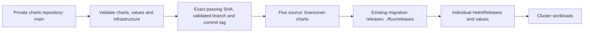

# Flux GitOps Guide

## Active chart delivery

Application charts live in the separate private [jtmb/branconet-charts](https://github.com/jtmb/branconet-charts) repository. BORTUS application source remains in `branconet-homelab`. Edit each application's `charts/<name>/values.yaml` or templates and its effective overrides in `flux/releases/<name>.yaml`; each application keeps its own chart and values.

Push chart changes to `main`. `.github/workflows/charts.yml` validates all chart packages, effective rendered releases and composed infrastructure. Only a successful non-PR main run can promote. The promotion job checks that the remote main SHA still matches the tested SHA, then atomically pushes that exact commit to `validated` and its `validated-<full-sha>` tag. If it observes a newer main revision, it skips promotion. This check is not an atomic lock on subsequent main changes; the promoted revision is nevertheless the exact validated commit. CI has no cluster credentials.



Flux polls the private repository each minute using a repository-specific read-only SSH deploy key in a native Secret outside Git. In `flux-system`, the existing `branconet-charts` GitRepository reads `validated`; the existing `migration-releases` Kustomization reads `./flux/releases`. Keep these owners rather than creating another bootstrap or source for the same resources. The approved foundation pins Flux v2.9.6 with source, Kustomize, Helm and notification controllers.

The [06:26 UTC scoped read](../evidence/flux-delivery-doc-refresh-20261011.json) observed source Ready, Kustomization Ready/Healthy, and the same source/applied revision `validated@sha1:53d224197fc6253ecac04ffd51e4b16b566c55e2`. These separate reads are not atomic; GitHub CI was not refreshed in that read. The earlier [delivery evidence](../evidence/bortus-delivery-current-refresh-20261011.json) records successful CI run 38057725194 for that SHA. Ready reconciliation does not prove the new BORTUS KV engine is deployed or accepted.

Application source pushes run separate application quality checks. They do not update the deployed image. Image delivery requires the qualified immutable source/image, image availability on every eligible node, guarded schema/data/RBAC/admission checks and a reviewed chart update. Follow [MIGRATION-OPERATIONS.md](MIGRATION-OPERATIONS.md) and [MIGRATION_STATUS.md](../MIGRATION_STATUS.md) for the current release gates.

## Data and ownership rules

Global Kustomization pruning and force are disabled during migration. Namespaces disable pruning; persistent claims/volumes use Helm `resource-policy: keep` and PV reclaim policy `Retain`. Removing a release or file is not permission to remove its data. The user excluded ETS2 and Minecraft exporter; their original datasets and protected claims remain retained. The Minecraft website remains in scope.

Native application Secret values stay outside Git. Charts contain existing Secret references only. Preserve service identities, existing claims, mount paths and storage settings when editing a release. Do not enable an unaccepted application or replace a claim merely because the chart renders successfully. Private staging excludes external routing and does not establish application acceptance.

## Retired migration layout

The raw manifests under this repository's `k8s-rewrite/charts/`, the old `test-stack`/`media-stack` workflow and the migration `codex/kubernetes-validated` branch are historical reference. The migration source is suspended and its publisher was removed. `.github/workflows/kubernetes-migration.yml` performs read-only archive validation. Do not restore that publisher, reconcile the raw-chart root, or bootstrap `branconet-homelab` alongside the active private chart owner. Legacy RBAC from this checkout must not be reapplied during the guarded BORTUS release.

## View Status

### Dashboard (Fleet-style Hierarchy)

The `/flux` page in the dashboard shows a Rancher Fleet-style expandable tree view:

- **GitRepositories** are root nodes, each showing URL, branch, readiness, last sync, and short revision hash
- **Kustomizations** appear as children of the GitRepository they pull from
- **Names are clickable links** — clicking a GitRepository goes to `/flux/<name>` detail page; clicking a Kustomization goes to `/flux/<repoName>/<ksName>` bundle detail page
- **Auto-collapse**: a parent node starts collapsed when all its children are `Ready`; it expands automatically if any child is not Ready, making failures immediately visible
- Each node shows live readiness status (green/amber), last sync time, and short revision hash
- Expand/collapse with tree-line indentation
- Sync and Delete buttons are available on root GitRepository rows

**Orphan filter:** The tree filters out GitRepositories that have no linked Kustomizations and aren't tracked in the database. Suspended GitRepositories are also hidden.

### GitRepository Detail Page (`/flux/<repoName>`)

Clicking a GitRepository name opens a full detail page showing:

- **Header**: GitBranch icon, repository name, Active/Not Ready badge, Suspended indicator
- **Meta line**: namespace, age, clickable Git URL, branch, path
- **Labels & Annotations** (collapsible)
- **Summary cards**: Bundles (ready/total) and Resources (ready/total) across all bundles
- **Bundles table**: each bundle (Kustomization) with State dot, clickable name (links to bundle detail), path, resource count breakdown by kind, last updated date
- **Conditions table**: type, status, reason, message
- **Recent Events table**: type (Normal/Warning), reason, message, age

API: `GET /api/flux/repos/<name>/detail` — calls `getGitRepoDetail()` which queries the GitRepository, all linked Kustomizations, parses inventory entries, and fetches relevant events.

### Bundle Detail Page (`/flux/<repoName>/<bundleName>`)

Clicking a Kustomization name (from the tree or the repo detail bundles table) opens the bundle detail page:

- **Breadcrumb**: Flux → repoName → bundleName
- **Header**: Layers icon, bundle name, Ready/Not Ready badge, Suspended indicator
- **Meta line**: source ref, path, age, last sync timestamp
- **Resources grouped by kind**: each kind gets its own card with a table of name, namespace, and API group. Deployments, Services, Ingresses, and PVCs are clickable links to their existing dashboard routes
- **Conditions table**: type, status, reason, message

API: `GET /api/flux/kustomizations/<name>` — calls `getKustomizationDetail()` which queries the Kustomization CRD, parses `status.inventory.entries`, and fetches events.

The tree is powered by `GET /api/flux/hierarchy` which queries GitRepositories, Kustomizations, and HelmReleases from the cluster, links them by `sourceRef.name`, and merges DB metadata (auth method, ID) for tracked repos.

### kubectl / CLI

Run these commands with the operator's protected kubeconfig or equivalent authorized credentials:

```bash
kubectl get gitrepository branconet-charts -n flux-system
kubectl get kustomization migration-releases -n flux-system
kubectl get helmreleases -n flux-system
flux get sources git -n flux-system
flux get kustomizations -n flux-system
```

Inspect `status.artifact.revision` on the source and `status.lastAppliedRevision` on the Kustomization. A successful CI run alone is not reconciliation evidence. A reconciled Kustomization alone is not application or data acceptance.

## Add or update an application

1. Work in the private chart repository and preserve the existing chart/release when updating an app.
2. Change `charts/<name>/values.yaml` or `templates/` and the effective `flux/releases/<name>.yaml`. For a new app, register its HelmRelease in `flux/releases/kustomization.yaml`.
3. Supply native Secrets externally; commit references only. Review storage ownership, data migration and consumer dependencies before activation.
4. Run the private repository's documented unit tests and `scripts/validate.py`; review rendered resources.
5. Push to main. Wait for the exact successful CI promotion and Flux's source/applied revision, then verify the actual workload, retained data and application behavior.

## Manual reconciliation

These are operator mutations. Use them only after reviewing the desired remote revision and its acceptance gates; they do not bypass CI or replace validation:

```bash
flux reconcile source git branconet-charts -n flux-system
flux reconcile kustomization migration-releases -n flux-system
```

Pausing the shared Kustomization pauses delivery for all its resources. Resume only after checking which validated revision will be applied:

```bash
flux suspend kustomization migration-releases -n flux-system
flux resume kustomization migration-releases -n flux-system
```

## Troubleshooting

- Check successful CI for the expected main SHA and its promotion; a newer main revision causes an older promotion job to skip.
- Compare source artifact and applied revisions; inspect source/Kustomization conditions and events without exposing deploy keys or application Secrets.
- Inspect the affected HelmRelease and rendered values when the source is Ready but a workload fails.
- Validate `./flux/releases` in the private repository. The legacy raw-chart root is not an appropriate dry run for current delivery.
- Source reconciliation, Helm reconciliation and application readiness are separate observations. Do not assume they have a fixed combined completion time.

## BORTUS private credentials

New private-repo credentials write native Secrets in `flux-system` through verified API access. `GitRepo.authData` is empty; old DB authData is never replayed. Existing native collisions fail instead of overwriting. Credentials never enter argv. Native value-bearing resources stay outside Git/Flux; charts reference existing Secrets. See [BORTUS-DEPLOYMENT.md](BORTUS-DEPLOYMENT.md).

## BORTUS maintenance prerequisite PR

The [chart prerequisite PR](https://github.com/jtmb/branconet-charts/pull/1)
publishes candidate 47bfca2a5c98bf2834cb5e3f2cd18cfffbe7b015 for review.
It suspends only the BORTUS HelmRelease and adds a grant-free, token-automount-
disabled bortus-kv ServiceAccount through the existing Flux composition. It
includes earlier offline delivery preparation but references no admission
policies/bindings, changes no image, and grants no new permissions. The existing
writer can still self-heal. Global pruning and force remain disabled.

The [root publication receipt](../evidence/bortus-chart-prerequisite-publication-20261011.json)
independently binds 302 frozen inputs, 10 selected raw Git blobs/modes and 35
original artifacts. Existing 22 units and full validation pass; all 33
application renders match the retained prior report. A fresh 11:41 UTC read
finds the same Ready writer, three Ready nodes, active Flux owner and absent
target ServiceAccount, with no data/Secret value reads or mutations. The PR's
exact-head CI is pending at this checkpoint. No merge, promotion or live
reconciliation is claimed; those observations and preserved workload/storage
checks are still required. Final performance/image/admission/independent restore
and native KV acceptance remain open. The completed cold journal is unchanged.

## Observed BORTUS maintenance publication

[Chart PR 1](https://github.com/jtmb/branconet-charts/pull/1) merged as
ba7c8e5bbbabe174cbbaec5b0ba7367336f62752 at 11:46 UTC. Exact-main CI run
38136779991 passed validation and promotion; main and validated match that SHA.
The [root live receipt](../evidence/bortus-chart-prerequisite-publication-20261011.json)
observes source and migration-releases Ready at the same applied revision at
11:49 UTC. Its inventory adds only bortus-kv, Flux-owned with token automount
disabled and no Secret references or RBAC grants. The same BORTUS HelmRelease
is suspended and has exactly the previously reviewed failure settings; removing
those eleven fields and suspension reproduces the original whole spec hash.
The first overly narrow suspension-only assertion is retained as an actual
failed read, followed by this exact corrected comparison; no checks were weakened.

Original writer UID, Ready state, all workload specs/images, claims/PVs,
Longhorn identities/settings, RBAC and nodes match the before checkpoint.
BORTUS storage is healthy. This prerequisite pauses Helm upgrades while leaving
workload self-healing available; it installs no guard, new app image, schema or
KV adoption. The completed cold checkpoint and originals remain intact. Final
app performance, guarded release and independent full-row restore stay open.

## Combined source and maintenance follow-through

The [root follow-through receipt](../evidence/bortus-app-maintenance-follow-through-20261011.json)
independently verifies application source c29fc8c: 333 raw Git blobs/modes, 20
exact original artifacts, 332 unchanged retained Linux source/test files and
4,262 compiled outputs. Fresh build, 214 units, lint/types and all four strict
HTTP suites exited zero with no skips; the owned supervisor and containers are
absent. This includes the Longhorn robustness-only health classification fix
and scalar known-field duplicate flags. It establishes functional correctness,
not the still-open A07/A21 performance gate or final image/live acceptance.

Chart docs-only follow-through 564fbc56894cca4d6b7934bff9c46311306cdc08 passed
main validation/promotion run 38137251240. At 11:55:44 UTC Flux source/owner are
Ready at that revision, BORTUS maintenance remains unchanged and every other
release is reconciled. Original writer/data/workload/RBAC/node preservation
checks pass. A prior 11:55:11 read caught four releases still reconciling their
unchanged packages; that actual nonpassing observation remains recorded. No
manual reconciliation, application restart, image upgrade, guard or adoption
was dispatched. The original completed cold checkpoint and data remain retained.


## 2026-10-11 13:48 UTC: legacy digest CI→Flux rollout verified

The [actual rollout receipt](../evidence/bortus-legacy-digest-flux-rollout-20261011.json)
records PR #2 merged as `182eafd4da4cda56b2a846d0c5f067e527eb79c4`.
Its tree exactly equals reviewed head `f15f1e03`; main run `38144292988`
completed validation and promotion successfully. Flux source and migration
owner are Ready at that exact validated revision with prune/force false.
BORTUS HelmRelease is resumed, UpgradeSucceeded at generation9. Its sole Ready
writer is `bortus-5c55f6d5b5-67mnk` on workernode2, with literal spec and
actual imageID `docker.io/library/bortus@sha256:3b076fb9b7fb64fd760691c0120f29d4e363d4ccb9910a596ff211bfc3ea0879`.
The complete PodList shows the previous writer name and UID absent. This
supersedes the earlier mutable-tag/config-only writer observation.

Deployment, Flux owner/source, HelmRelease, PVC/PV and external principal UIDs
are preserved. The claim remains Bound, its PV Retain, and Longhorn is encrypted
and healthy with two running replicas. Existing credential references and the
legacy service account remain unchanged. The external `bortus-kv` principal
still has zero grants and automount false; all six guard objects remain absent.
All three nodes and the other33 releases are Ready with current observed
generations. No manual reconcile, native Secret value or production DB read was
used. This is accepted-artifact maintenance, not production-row restoration,
schema-forward, new KV adoption, final app security/performance or live auth/UI
acceptance. Next guard publication must separately resuspend BORTUS and retain
both accepted legacy and qualified inert images only for pre-schema restoration;
legacy must leave all allowlists before any forward-schema entrypoint.

## 2026-10-11: guards delivered through CI and Flux

[Charts PR #3](https://github.com/jtmb/branconet-charts/pull/3) merged the
reviewed guard chart. Main CI run 38150613416 passed validation and promotion;
Flux source and `migration-releases` both applied the exact validated merge
commit. All six Fail/Deny guard specs match their reviewed renders, and all
three policies report current-generation type checking with no warnings.

Fresh actual checks preserve the original controller/storage/principal identities,
sole Ready legacy writer, credential references, encrypted healthy two-replica
Longhorn volume, three Ready nodes and the other 33 Ready releases. The BORTUS
HelmRelease is suspended with the same legacy image; its running Deployment
remains at one replica. The external `bortus-kv` principal still has no grants.

The earlier combined-command approval rejection remains historical evidence.
Separate exact branch push, PR creation and reviewed-head merge commands succeeded.
No manual Flux reconciliation was used. The
[publication evidence](../evidence/bortus-phase1-guard-publication-20261011.json)
records actual publication and metadata checks. It does not prove the 43 admission
probes or independent whole-row restore: neither has run yet. Review identified
an additional typed collection item-header assumption in probe cleanup; its
qualified correction is required before fixture creation. No forward schema or
new application entrypoint has started. Two subagents and the migration coordinator
continue the active goal; the seven old BORTUS chats remain archived.

## 2026-10-11: continuous source-control preparation

The [quiescent checkpoint](BORTUS-QUIESCENT-SOURCE.md) composes capture, full
backup and owned-holder removal while the source stays at zero writers. Its
[control observer](BORTUS-QUIESCENT-WATCH.md) owns three concurrent verified TLS
streams and fsynced metadata; a caller must check the actual prerequisite before
and after mutation dispatch and independently close the borrowed resources.
Only the explicit once-only owner transition resumes `migration-releases` so
validated Flux can withdraw the legacy image from the guards. The BORTUS
HelmRelease remains suspended and Deployment remains zero throughout that future
transition. This preparation has not run against the live source.

Independent root mTLS fixtures reproduced a deadline-renewal defect in the first
immutable observer: three late bookmarks left its readers live after the absolute
lease. The corrected source refreshes the remaining original budget before each
read; the same root fixture now observes sticky deadline failure and zero live
readers. The original handoff and failing observation are retained. The corrected
handoff passes 86 scoped local controls; root combined integration qualification
now passes all 524 test_bortus*.py cases with zero failures/errors/skips and 151
frozen inputs, including the required JSON fixture. The initial fixture-omitting
staging run is retained; production Python sources did not change between runs. These checks grant no live restore, forward-schema, image, rollback
or whole-row acceptance. The deadline-aware encrypted archive callback and
actual source/image/schema/guard producers must still be wired before live use.

See the [root integration evidence](../evidence/bortus-quiescent-root-integration-20261011.json).
