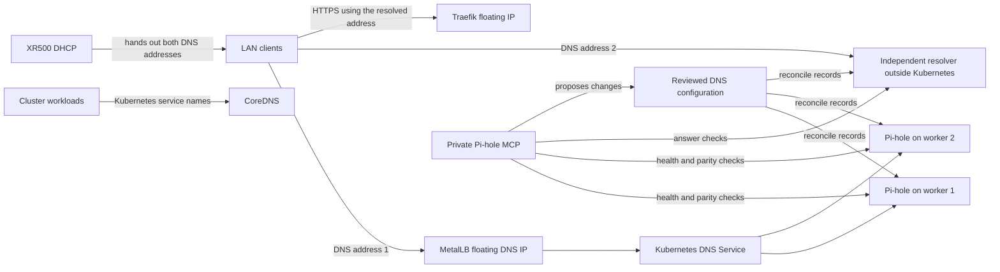

# LAN resilience and homelab MCP plan

The shared MCP rename and credential-backed local Docker runs are planned
separately in the [BORTUS MCP plan](planning/operations/00_START_HERE.md).
The deployed inventory identity stays read-only and cannot read Secrets.

## Current state

The October 30 architecture snapshot records node specifications, storage layout and deployment flow. Later networking and failover changes are recorded in this plan. [Cluster architecture](../ARCHITECTURE.md).

MetalLB has one manually assigned address, 192.168.0.254, for Plex TCP 32400. The XR500 forwards Plex to that address. The two alternate Plex forwards and the old web and game forwards were retired. Six public web routes use Cloudflare Tunnel. The Plex address moved between workers during the earlier LAN playback test. An authenticated public HTTPS endpoint responded from the LAN. Offsite playback still needs a test from an external network.

The live cluster currently has two ready Traefik replicas. Its NodePort Service exposes all three node addresses. Pi-hole has one ready replica, and its published Service also lists the three node addresses. The cluster has one control-plane node. A floating address protects the entry point against some node failures. It does not make a single backend replica or the control plane highly available.

## LAN naming and control-plane endpoint

Use role-neutral names for physical machines and purpose-based names for service endpoints. The three existing machines are the target for a three-member control plane with one voting etcd member per machine. Preserve workload eligibility on the current workers.

| Proposed LAN name | Points to |
| --- | --- |
| node01.branconet.lan | Physical address of the current masternode |
| node02.branconet.lan | Physical address of workernode1 |
| node03.branconet.lan | Physical address of workernode2 |
| k8s-api.branconet.lan | Stable Kubernetes API endpoint with failover across the three control-plane nodes |
| ingress.branconet.lan | Shared Traefik floating HTTPS address |
| plex.branconet.lan | Existing Plex floating address, subject to checking the current record |
| dns.branconet.lan | Floating address shared by the in-cluster Pi-hole backends |
| dns-independent.branconet.lan | Separately addressed resolver outside Kubernetes |

Set the Linux hostnames and Kubernetes Node names to node01, node02 and node03. Publish the corresponding fully qualified Pi-hole records on both DNS paths. Check for naming conflicts before adding records. Keep existing web app names and their certificate coverage. Give the Pi-hole backends distinct operational identities such as pihole-0 and pihole-1, and probe each through its own management endpoint. DHCP advertises resolver IP addresses. Publish the same LAN records on both DNS paths.

Before promoting workers, verify the current API endpoint and rehearse etcd restore. Set up the stable API endpoint independently of cluster DNS and workload Services so it can work during recovery. Verify certificate coverage and rehearse the worker promotions one at a time with workload and storage checks. After all three members join, prove API access and etcd quorum with one node unavailable. Treat each hostname change as a Kubernetes node identity migration. Inventory node selectors, taints, labels, local volumes, Longhorn disk and replica placement, device plugins, certificates, and Ansible and Flux references. Rehearse draining and rejoining the two workers under their new names as control-plane nodes, one at a time. Verify each node and its storage and workloads before proceeding. Migrate the original master to node01 only after both other control-plane nodes are healthy and can maintain quorum during its removal and rejoin. Verify the stable API, etcd membership, node names, storage, and application recovery after each step. Implementation remains on hold.

### Control-plane rollout preflight

The offline restore passed data recovery, API decryption, stale-revision compaction and three-member leader-loss checks. The live cluster still has one API backend and its serving certificate lacks the planned API hostname. Stage the shared TCP endpoint and a serving certificate covering both the current endpoint and the shared name. Prove authenticated readiness on the shared name with CA and hostname verification before switching kubeadm discovery or client configurations. Retain a verified direct endpoint and the original certificate and configuration as rollback material.

The Ansible bootstrap role accepts an optional shared control-plane hostname and includes it in the API certificate SANs. Local syntax and both template render paths passed. The existing cluster needs a separately staged TCP listener and a serving certificate replacement before changing kubeadm discovery.

The live serving certificate covers the four Kubernetes service DNS names, the current control-plane hostname, the Kubernetes Service IP and the physical control-plane IP. Preserve all seven SANs when adding the shared hostname and floating IP. Generate the replacement certificate and key in a protected staging directory, then verify their pairing, CA chain, and old and new SANs before any installation. Keepalived now announces the shared IP from the current control-plane node. Both workers reached the shared IP with CA and existing certificate-name verification. An authenticated node list and readiness request passed through the same IP, and Flux remained Ready. The current API now serves a replacement certificate with all seven prior SANs plus the shared hostname and floating IP. The existing serving key was reused so the certificate could be replaced atomically. The previous certificate is retained on the control-plane node. Pi-hole now publishes the shared hostname, both workers verified its DNS and TLS, and an authenticated readiness request passed. Kubeadm discovery and client migration remain separate steps.

The live API mounts an encryption provider file from its own host. Stage the same protected configuration on each candidate host and verify that the joining API server can read an encrypted record before adding that backend to the shared endpoint. The existing bootstrap role generates encryption material for initial setup. Reuse the current control-plane material during promotion. Keep the same CA and service-account trust configuration as well.

The live inventory showed 45 Longhorn volumes, zero degraded or faulted volumes, zero PVs with node affinity and 25 pods with node selectors. Check the selectors, replica placement and free disk against the exact node being changed immediately before each drain. A clean volume inventory alone does not establish drain safety.

The router MCP proposal narrows the DHCP pool from 192.168.0.253 to 192.168.0.250. It binds the change to the live pool bounds and rejects stale expected values. The proposed assignments are .251 for the shared API, .252 for Traefik and .253 for Pi-hole. Confirm the router saved the new bounds, check for retained leases or static assignments, and verify each address is unclaimed before announcing it. The approval covers the exact router diff, and the saved prior end address is the rollback value.

The Pi-hole standby candidate has its own volumes and private DNS Service. Compare local records, policy and TCP and UDP answers against the existing backend before adding the shared serving label to either pod template. The floating DNS Service selects only that explicit label. The existing Pi-hole Services continue to select the primary by its existing app label. To withdraw a backend, remove its shared serving label and verify the floating Service endpoints before proceeding.

## LAN rollout

1. Inventory router leases, static assignments, current DNS answers, Traefik and DNS ownership in Flux, and existing certificate coverage. Propose two unused addresses outside DHCP, one for Traefik and one for Pi-hole. Leave the existing Plex pool independent. A third address is useful only if deploying a second independent DNS endpoint. Apply any necessary XR500 DHCP edit only after approval of the exact change, with the old range recorded and local access available.
2. Add Traefik's floating Service in the Flux-owned charts alongside the current path. Test with an explicit hostname override before updating LAN DNS. Keep the existing LAN hostnames and certificate trust where valid. The private .lan names require a trusted private CA. A registered domain with split DNS can instead use DNS-01 issuance without exposing the app to the internet.
3. Publish Pi-hole's floating DNS Service on TCP and UDP 53. Run two Pi-hole instances on different workers behind the same floating address. Advertise a separately addressed resolver outside Kubernetes to cover loss of the whole cluster DNS path. Both DHCP-advertised addresses must resolve the same LAN names because clients can use either one. Validate local and public resolution through each resolver and confirm that both respond correctly when advertised to clients. Stage and test client DHCP DNS changes separately. Keep the old DNS and Traefik paths during validation.
4. Verify trusted LAN HTTPS, name resolution, Plex and public tunnel routes before and after a controlled worker outage. Measure recovery and verify fresh as well as existing connections. Exercise real backend movement separately from moving the MetalLB announcer. Restore the previous DNS records and DHCP DNS settings if checks fail. Retire old node-address paths after verification. Put Kubernetes resources in the charts repo and repeatable operator checks in Ansible.

## DNS paths and configuration ownership

Notification DNS rollout completed: v4 adds only notifications.branconet.lan,
preserving all48 existing names. Secondary4a352444… then primary8ecc9f87…
passed validated Flux/direct checks; the records-only Ansible update and
serial standalone refresh preserved gravity data, launchers and DHCP.
Advertised192.168.0.253/192.168.0.5 both passed actual Windows LAN TCP/UDP
queries; ordinary client DNS and DNS-based trusted HTTPS200 passed. Phone/PWA/
human notification receipt remains distinct. Evidence is in MIGRATION-PLAN.md.

Use one reviewed source for LAN records and reconcile it into independent resolver instances. Each Pi-hole keeps its own writable state. Probe each backend directly so a successful response through the floating address cannot hide drift. If only some resolvers apply an approved change, report the divergence and reconcile or roll back before declaring success. Keep raw client query logs out of default tool output. A cluster outage can leave DNS available through the independent resolver while cluster-hosted apps are unavailable. [Pi-hole API documentation](https://docs.pi-hole.net/api/).

## Five separate MCP servers

| Server | Starting point | First useful tools | Write boundary |
| --- | --- | --- | --- |
| Netgear XR500 | Custom firmware-specific adapter based on the actual admin UI and documented features | Redacted status and inventory, DHCP, DNS, reservations, forwards, Wi-Fi, firewall and settings request drafts | MCP can create a proposal only. A separately authenticated operator approves and applies the exact diff through an independent executor. Firmware upgrades, resets and changes that can sever management access require a local recovery procedure. |
| Seerr | cyanheads/seerr-mcp-server | Search, availability, list/status and request creation | Confirm before submitting and verify requester attribution. Add typed approve, decline, retry and issue operations after checking the deployed API and roles. Keep media deletion, integration secrets and server configuration separate from normal request tools. |
| Plex | aminamos/plex-mcp-server | Server health, remote mapping, library search and active playback | Start with an explicit read allowlist. Add approved library scans and narrowly scoped playback controls where supported. Remove generic API execution and any token-bearing output before deployment. |
| Kubernetes | containers/kubernetes-mcp-server | Workloads, events, rollout status and Flux health | Dedicated read-only Kubernetes identity with explicit RBAC. No Secrets, exec, port-forward or mutation permissions. Desired-state changes start as reviewed charts changes and go through Flux. |
| Pi-hole DNS | Private MCP adapter against the deployed Pi-hole API. Verify supported operations using the instance API documentation. | Check resolver health and answer parity, inspect local records, and show filtering status. Draft local record and allowlist or denylist changes. | Apply durable changes through reviewed DNS configuration. Reconcile both Pi-hole instances and the independent resolver where applicable. Require explicit approval for temporary runtime actions and bound their scope and duration. |

The Netgear acceptance contract is a firmware-specific inventory of every visible setting with read, proposal and execution coverage recorded individually. Unsupported or unverified settings stay visibly marked. No generic admin HTTP, browser, or shell tool is exposed. Store approvals outside the MCP session. Each approval binds actor, target, exact diff, current-state hash and expiry. The executor rejects stale or replayed requests, serializes changes, checks postconditions and records a redacted outcome. It must remain reachable on the LAN when cluster DNS is unavailable.

Keep all MCP endpoints private. Separate credentials and egress per service, use the existing BORTUS-backed Kubernetes Secret workflow for in-cluster credentials, and expose neither credentials nor secret-bearing settings in tool output. The router executor holds the router write credential separately. Use immutable source and image pins. Start with mocked write paths and one authenticated production read smoke check per server. Before enabling writes, prove that missing, expired and replayed approvals are rejected and that an explicitly approved low-risk action affects exactly its target.

## Gaps found during the 2026-11-17 consolidation pass

The deployed Kubernetes MCP (`kubernetes-inventory`) currently exposes only
`pods_list` and `events_list` — the "Flux health" tool this plan calls for
was never added, forcing fallback to the admin kubeconfig for every
Kustomization/HelmRelease/Certificate/CSR/Longhorn check this session.
Extend it per `docs/KUBERNETES-MCP-READONLY-CANDIDATE.md`'s existing design
(`resources_list`/`resources_get` scoped to those resource types, same
dedicated read-only identity, no new write surface).

Two additional gaps, not previously in this plan:

- **No ntfy MCP.** A subscriber-poll tool plus a test-publish tool that
  enforces the header-vs-body contract (see `docs/NOTIFICATIONS.md`) would
  have caught the 2026-11-17 malformed-notification incident before it
  reached production. Scope: read-only poll of a given topic with the
  subscriber credential, and publish with required `Title`/body fields
  validated client-side before sending — same write-boundary posture as the
  other rows above (draft/propose for anything beyond a test topic).
- **XR500 adapter has no DHCP reservation listing.** `dhcp_pool` only
  returns pool bounds, not per-device reservations, so the nftables
  allowlists' dependency on one operator-host IP staying stable (see
  `docs/NETWORK-HARDENING.md`) cannot be verified without a manual router UI
  check. Add a `dhcp_reservations` read tool to the existing redacted
  inventory coverage.

A read-only host-inventory MCP for the three cluster nodes (systemd unit
state, nftables table/counter listing, listening sockets) was also used
informally via ad-hoc Ansible throughout this pass; it isn't in this plan's
five-server list and would reduce one-off SSH/Ansible probing for routine
checks. Lower priority than the two gaps above since Ansible already covers
the mutating case.

## Source intake

These upstream candidates were downloaded as source-only Git clones under D:/Codex/branconet-mcp-upstream. They are retained for license, dependency and capability review, followed by a fork decision. Regenerate with a shallow no-checkout clone of the linked repository and fetch the exact recorded commit if the default branch has advanced. No candidate code was run or given credentials.

- [Seerr candidate](https://github.com/cyanheads/seerr-mcp-server) at ebf32a13302272fa6aced6decca3765ce1b0b14c. Its published scope excludes admin tools, which are extension work.
- [Plex candidate](https://github.com/aminamos/plex-mcp-server) at 88e00acb6140d29d6c44d9bebbde56ac7d07343c. Its broad API coverage needs an explicit tool allowlist.
- [Kubernetes candidate and security controls](https://github.com/containers/kubernetes-mcp-server/blob/main/docs/configuration.md) at 19e48a6d11b274b462f7edfad61553b5ff88bda7. Tool filtering supplements Kubernetes RBAC.
- [Netgear XR500 manual](https://www.downloads.netgear.com/files/GDC/XR500/XR500_UM_EN.pdf). Use the vendor manual and installed firmware to establish setting coverage.

## Ingress and operator hardening

The Fail2Ban SSH jail now follows the Ansible inventory port. On all three nodes, five synthetic login failures triggered a firewall reject rule for the test address on TCP 2002. The test bans were removed. This checked log ingestion and firewall rule installation. A connection from the banned address was not tested. [Fail2Ban SSH playbook](../k8s-rewrite/ansible-playbook/playbooks/fail2ban-ssh.yml).

The legacy Traefik jail watches stale host logs. The running Traefik pods have access logging disabled, and the existing host INPUT rule misses Kubernetes Service forwarding. For LAN ingress, enable structured access logs through Flux, verify the original client IP, and test a scoped ban on the actual forwarding path. For public tunnel traffic, verify Cloudflare edge controls per hostname. Check both tunnel connectors before narrowing egress, and inventory users of direct LAN app ports before removing those paths.

The [Traefik access log candidate](traefik-access-log-candidate.patch) targets the deployment in `jtmb/branconet-charts` at the Flux-observed revision `43bdf1301fa7000ef0e201233ce340141928cc24`. It records only HTTP 401 and 403 events, with timestamp, observed peer IP, route and status. Before promotion, check the target revision for drift and obtain approval for the Traefik rollout and collection of these fields. After rollout, verify attribution with controlled direct LAN and tunnel requests. A node or connector address in the log is insufficient evidence to enable a ban.

The read-only rollout baseline found two ready Traefik replicas, two ready tunnel connectors, and the expected Flux revision. Public HTTPS returned 200 on Mealie, APLB, Lucinda, Minecraft and Santos, and 307 on the media route. Windows Schannel could not check revocation for the BORTUS LAN certificate. The login endpoint returned 200 with revocation checking disabled for that diagnostic request only. Keep that distinction when comparing the post-rollout results.

For the approved logging rollout, capture the published commit and wait for Flux to apply it and for both Traefik replicas to become ready. Compare the six public HTTPS responses and the LAN HTTPS baseline. Use a known read-only endpoint that produces a 401 or 403 on each path, and correlate one request at a time by route and timestamp. Compare the direct LAN log entry with the test client's known address. Treat the tunnel peer separately and use Cloudflare for public client attribution. Record only whether each comparison matched. If Flux fails to reconcile, readiness degrades, or a baseline route regresses, revert only the logging commit through the same charts promotion path, then verify Flux, replica readiness and the affected routes. Source attribution failures block enforcement.

The Traefik rollout preflight on November 7 confirmed that Flux is Ready at the candidate base revision. Both Traefik replicas and both tunnel connectors are ready. The deployment uses RollingUpdate with 25 percent maximum unavailable and 25 percent maximum surge. With two replicas, that permits one extra pod and requires both existing replicas to stay available until a replacement is ready. The unauthenticated GET to /api/v1/auth/me returns 401 through both the media.jtmb.cc tunnel and the overseerr.branconet.lan LAN route. Use these probes without credentials after rollout. The LAN preflight used Windows revocation best-effort because the private certificate revocation check was previously unavailable.

Promotion requires explicit approval for the one-file change and for recording the listed fields on both paths. Keep Actions disabled and use the established charts promotion path only after confirming it can publish the exact reviewed change and a scoped revert. Before promotion, recheck the validated branch tip, record the current rollout revision and prepare a revert that removes only the nine logging arguments. If source attribution fails, leave enforcement pending. The direct Service currently uses externalTrafficPolicy Cluster, so a node address is a possible observed peer.

The Gluetun failure first appeared in the available logs at about 4:48 p.m. Toronto time on November 7, before the Traefik rollout. The production node sent WireGuard packets through its uplink with the expected node source address and saw no replies during capture. A disposable Gluetun probe on workernode1 used the same image and existing Secret reference with no application volume mounts. It attempted six connections, never became Ready and received zero packets on the tunnel interface. The probe was deleted and its absence verified. This reproduces the failure on a second node. The shared network path and provider credential remain candidates.

| What the probe shows | Follow-up decision |
| --- | --- |
| The LAN log matches the test client's address | Repeat against each currently advertised LAN ingress node. If attribution is consistent, prepare a separate LAN enforcement proposal and test the deny path with a disposable client. |
| A LAN log shows a node or proxy address | Keep that path out of enforcement. Determine where the source address changes before proposing a Service or routing change. |
| The public log shows a tunnel connector or another intermediary | Use Cloudflare edge evidence to verify the public client address. Evaluate any public blocking at the edge as a separate change. |
| The request fails to appear or contains fields outside the allowlist | Treat the logging change as unqualified. Check the applied revision and both replica logs, then use the scoped revert if the rollout fails its checks. |

On November 7, the local validator promoted logging commit `cd7e0cc1938ad40563bccc77b1e881c5cc0e991c`. Traefik rolled out to two ready replicas. All six public routes returned their expected success or redirect responses. Each of the three direct LAN probes logged a 401 with the expected request fields, but the observed peer was a node or cluster address in every case. The public 401 produced no matching Traefik entry. Cloudflare's trace endpoint reported a client IP, but correlation with that specific public request remains unverified. Ban enforcement remains pending. The separate qBittorrent recovery cleared the shared Flux health check. The live Kustomization reported Ready at the recovery revision.

Swarm Migration owns this plan and shared sequencing for cluster, Ansible and deployment work. BORTUS owns application implementation and follows the shared sequence for cluster dependencies. Swarm Migration coordinates both workstreams and reports progress. BORTUS retains its application scope.

The BORTUS chat verified its local OCI candidate archive at source revision `12dce115`, including its manifest, config and all nine layer digests. This qualifies artifact integrity. For A15, BORTUS recreates the expired fixture once an actual screen reader is available and records an attended check that saving announces “Configuration saved.” After A15 passes, confirm the original publication authorization and the exact private publisher and registry destination before publishing. Verify the published image by digest, then obtain the original deployment authorization and perform deployed acceptance with PRD last. GitHub Actions stays off. This sequence does not depend on the pending Traefik logging rollout.

Use a separate, short-lived identity for each agent or service, with read access scoped to its task. Route production writes through a separate approval bound to the exact target and change. Keep API endpoint and DNS changes out of this hardening pass.

On November 7, three sequential direct NodePort probes from the same LAN
client returned HTTP 401 and were correlated by timestamp with the Traefik
logs. The master request stayed local and logged the node IP. Worker 2
forwarded its request to the master and logged a cluster address. Worker 1
had no local endpoint and forwarded to worker 2, which also logged a cluster
address. The Service uses Cluster external traffic policy. Switching the
current Service to Local in place would leave the third advertised node
without a local backend. Prepare a parallel source-preserving test path and
verify routing and failure behavior before proposing a production change.
The public probe returned HTTP 401 with a Cloudflare Ray ID and produced no
Traefik log entry during the observed window. Verify that request at the
Cloudflare edge before using any public client address for enforcement.

Read-only kube-proxy inspection confirmed that the existing HTTPS NodePort
and external IPs enter the same iptables Service chain on all three nodes.
One controlled LAN request to the master incremented the external Service
masquerade counter by one and logged the master address in its local Traefik
pod. This identifies kube-proxy source NAT on that path.
The current candidate is a separate HTTPS NodePort with Local traffic policy,
no external IPs and the same ready Traefik selector. Verify the selected
port is unused and trace client attribution before proposing a live trial.

The local [Traefik test patch](traefik-local-ingress-candidate.patch) applies
cleanly to the charts repository. It adds HTTPS NodePort 32443 only. The
Service passed strict Kubernetes client validation, and the live named
target resolves to the two ready Traefik endpoints. A full Kustomize render
against charts revision f62a31c97384 added only this Service and left all 79
existing objects identical. The trial checks the
real LAN address on both nodes with ready Traefik endpoints,
expects no service on the node without one, and checks the current LAN and
public routes for regressions. Recheck current endpoint placement and port
allocation immediately before the trial. Rollback removes the test manifest
through the normal publication path, then deletes the exact test Service
after Flux applies the revert because the Kustomization has pruning disabled.
Verify the port is released and the original routes still work.

The live trial passed on both nodes with ready endpoints. The third node did not accept the test connection as expected. The validated revert reconciled successfully, the temporary Service was deleted, and existing LAN and public health probes returned HTTP 200. The public authentication probe returned a Cloudflare Ray ID, but edge-side client attribution remains open. Enforcement remains disabled.

## Phased migration and acceptance

Traefik security is the first production workstream for review. The approved access-log patch is deployed. The next step is read-only tracing of the original LAN client address and separate verification at the Cloudflare edge. Review the exact change and rollback before any production routing or enforcement change. The control-plane, hostname and LAN DNS rollout below remains a separate future decision. The BORTUS acceptance sequence and checkout consolidation can proceed independently as their own gates clear.

Consolidation retains the homelab checkout for Swarm and the application worktree for BORTUS. BORTUS reconciled its current source and recovered missing evidence. Ten checkouts remain. For five historical BORTUS worktrees, the registered owner verified recovery data, but Codex requires a valid primary checkout before it will archive them. Resolve that through a supported app repair or ownership transfer. The worker-yield checkout requires a verified owner or an approved retirement path. Cluster-headroom and threat-scan retirement remain subject to the recorded preservation, inactivity and removal approval requirements.

Swarm Migration owns sequencing, integration, final review and publication.
Assign at most one direct subagent per phase. Run independent investigations
in parallel and keep dependent rollout steps in order. Choose Luna at xhigh
or Terra at high for the task. Sol is excluded. Astra requires
an explicit request from James. Give the worker bounded implementation and
verification tasks in the existing homelab and charts checkouts. The
coordinator investigates deeper issues directly and reviews each candidate
before integration. Keep plan and source changes local until
James explicitly requests a commit or push.

| Phase | Work | Acceptance and rollout boundaries |
| --- | --- | --- |
| 1. Traefik security | Trace LAN source attribution on all three nodes, verify public attribution at Cloudflare, and prepare a parallel source-preserving ingress test and rollback. Qualify enforcement only after attribution passes. | Confirm the real LAN client address, route continuity and failure behavior. Correlate the public request at Cloudflare. Keep bans disabled until attribution is proven. Existing production routing, security and publication gates apply. API and DNS changes are excluded. |
| 2. Cluster and LAN resilience | Inventory node and storage dependencies, rehearse an etcd restore, stage a stable API endpoint, then rename and promote the nodes one at a time. After control-plane acceptance, stage floating Traefik and Pi-hole addresses, redundant DNS and LAN HTTPS. | Qualify backups, TLS and rollback before any cutover. Verify etcd quorum, scheduling, storage and Flux through a node outage. Verify both DNS resolvers, HTTPS, Plex and public tunnels before retiring old paths. API, DNS, router and node changes retain their separate rollout approvals. |
| 3. Private MCP services and handoff | Qualify Kubernetes, Pi-hole, Seerr and Plex read-only MCPs. Extend the XR500 adapter with a simulated proposal and approval workflow before any live write trial. Record the final names, addresses, ownership, Ansible and Flux changes, and recovery steps. | Verify scoped authentication, private endpoints, both supported clients and denial of missing, expired or replayed approvals. Verify any approved write against its exact target. Record live acceptance and unresolved items. |

Parallel readiness reviews found two concrete starting points:

- Phase 2 starts with an [independent etcd restore rehearsal](ETCD-RESTORE-REHEARSAL.md).
  The existing
  backup role validates an encrypted snapshot and records restore verification
  separately. Live etcd reports version 3.7.3. The existing role pins 3.7.0,
  so review the [backup pin candidate](etcd-backup-live-pin-candidate.patch)
  and recheck the live image digest before taking a fresh backup.
  The kubeadm role still points clients at the current master IP,
  so stable endpoint and TLS qualification follows the restore rehearsal
  before any worker promotion or hostname change.
- The [pinned Kubernetes MCP review](KUBERNETES-MCP-READONLY-CANDIDATE.md)
  is complete. Phase 3 starts with a shared stdio launcher and a
  bounded workload inventory tool. Use a dedicated read-only Kubernetes
  identity and prove Secrets, exec, port-forward and mutations are denied.
  Verify discovery and invocation in Codex and OpenCode before expanding to
  events, rollout status or Flux health.

A failure in API readiness, etcd health, workload placement or storage pauses the rollout at that phase. Recover the current phase and verify health before touching another node. A node or pod restart is separate evidence from an actual node outage.

## OpenCode WSL registration — 2026-11-15

The authoritative Branconet `opencode.json` now registers the four requested
shared infrastructure adapters plus Vercel Agent Browser under `mcp.servers`.
Their source was in `/home/brajam/repos/veyra-monorepo/mcp-servers/`; since
2026-11-19 `bortus`, `netgear-xr500`, `pihole-dns`, `plex-inventory` and
`seerr-inventory` live in
this repository's `mcp-servers/` (see `mcp-servers/README.md`). `agent-browser`
stays in Veyra.
OpenCode 2.2.6 lists all five as connected:

- `kubernetes-inventory`: native pod inventory passed after the existing
  operator helper refreshed its one-hour token; a native Secret-list call
  was denied by Kubernetes RBAC.
- `netgear-xr500`: pinned HTTPS authentication passed.
- `pihole-dns`: trusted API health, UDP/TCP resolver probes and authenticated
  blocking-state read passed.
- `plex-inventory`: health and authenticated library inventory passed.
- `agent-browser`: pinned official 0.43.0 native MCP; isolated HTTPS navigation,
  accessibility snapshot and close passed with the existing H-backed Chromium.

Run `/home/brajam/.opencode/bin/opencode mcp list` from this repository.
For an expired inventory token, run
`/usr/bin/python3 -B /home/brajam/repos/branconet-homelab/mcp-servers/bortus/refresh-kubeconfig.py`.
Reconnect only the inventory MCP if its process retains expired credentials.
Do not restart the shared OpenCode service for a configuration change.

The browser launcher is `mcp-servers/agent-browser/launch.py` in Veyra; its
adjacent README records installation pins, reproduction, runtime retention
and the shared Chromium patch-level advisory. The executable, guides and private
state use the existing H Linux `veyra-tool-state/agent-browser` directory.
Short `/proc/self/cwd` socket/temp paths address Linux path-length limits.
No paid provider or remote browser is used. Infrastructure adapters keep their
existing inventory/proposal scopes; deployment remains through Flux and Ansible.
This registration does not implement the proposed certificate or workload-mTLS
rollout.

### Seerr adapter moved and made dual-era — 2026-11-19

`seerr-inventory` (health, title search, recent request status and an
expiry-bound request proposal; nothing is submitted) moved from the Veyra
monorepo into `mcp-servers/seerr-inventory/`, along with its
`operator_request.py`, `lan-root-ca.pem` and private mode-0600 `.env`. It uses
this repository's `_shared/read_only_media.py` (the legacy-only copy there is
retired), so it now serves MCP 2026-07-28 as well as the previous legacy
handshake, and it is registered here with `"disabled": true`.

Verified by the agent: before the move the Veyra copy answered
`server/discover` with `Method not found` and only the legacy era worked; after
the move `server/discover` advertises 2026-07-28 first, tool names, schemas and
annotations are unchanged, and `seerr_health` and `seerr_requests` returned the
same shapes in both eras. Connecting `seerr-inventory` from two directories in
this repository left exactly one `server.py` process; both locations were
disconnected afterwards and the entry stayed disabled. The operator
`192.168.0.4` SSH port 2002 example in that server's README is still the
current masternode address (`CONNECTING-TO-A-CLUSTER.md`).

## XR500 diagnostic adapter

The first read-only implementation was written in the WSL Veyra monorepo and
now lives at `mcp-servers/netgear-xr500` in this repository. New Branconet MCP
servers must support both clients and load credentials from an ignored local
`.env`. For the XR500, set `XR500_USERNAME` and `XR500_PASSWORD` in the
mode-0600 file beside `server.py`. Authenticated log and outbound rule reads
passed on the installed firmware. Service blocking was disabled with zero
configured rules. The event log does not provide a WAN packet capture.

On November 7, 2026, an XR500 capture showed that a UDP control to the exact
Proton endpoint and port reached the WAN capture. In a separate capture,
two real initiations from an isolated Gluetun probe to that endpoint were
visible on LAN only. The WAN capture recorded the UDP DNS control in that
same window. The probe never passed its health check. The router capture was
stopped and its setting restored, the probe was removed, and captures were
analyzed in memory. These checks narrow the discrepancy to the handling or
visibility of actual WireGuard traffic and do not identify a router rule.

The original Proton profile matched the cluster credential. The same profile
connected in an isolated Gluetun userspace WireGuard probe, and a second probe
using production's server selection acquired a Proton port lease. The charts
commit f62a31c97384 sets userspace WireGuard for qBittorrent's Gluetun sidecar.
Flux applied it, both containers became Ready, and the output firewall policy
remained DROP. The monitor confirmed the leased port matched qBittorrent's
listen port, a TCP connection from outside the tunnel reached that port, and
both Radarr and Sonarr passed their configured qBittorrent connection test.
The original bound claims were retained. The router capture is off and the
diagnostic pods and temporary Secret were removed.
