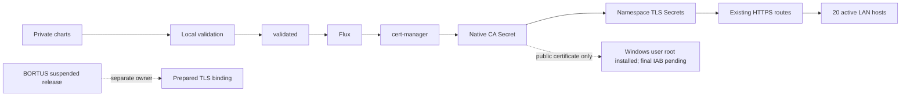

# LAN TLS and legacy proxy retirement

**October27 client follow-up:** the matching public root is now installed in
CurrentUser/Root; a second apply made zero changes.60OS-store chain/hostname/HTTP
checks pass in explicit request-only missing-CRL best-effort mode. Default strict
Schannel rejects the CA's absent revocation service; its failures remain. No
Windows security setting changed, no private key was imported, and final IAB
is still open. [Exact client evidence and limits](SNAPSHOT-AND-CLIENT-TRUST-20261027.md#windows-trust-and-precise-client-limitations).

**Server checkpoint: October27, 00:06 UTC. Full client acceptance remains open.**

Twenty active migration-owned LAN hostnames now use cert-manager-issued,
namespace-bound certificates. All60 hostname/TLS checks across the three nodes
passed with the verified CA; all18 checks for the six active public sites still
passed against normal public trust. All application routes returned their
expected successful/authentication/redirect responses. TLS verification was never
disabled. Existing hosts, backends, HTTP routes, public certificates, workload
configuration, storage and application credentials were preserved.

Private charts main, validated and live Flux source are
`d79ee5f1b3935f87892bcfe5b4090ed3e31c5bbb`. Local validation/promotion was used;
Actions was not used. No application image or release hold was changed.

The Root CA uses RSA4096 and critical DNS name constraints for branconet.lan and
branconet.local, with all IP names excluded. Private keys stay in native
Kubernetes Secrets and authenticated encrypted recovery archives; no Secret
object or key value is in Git. The public root SHA256 fingerprint is
`79b3cf11aed6c404885e555ceff33819ffa4ca534959f00f80b16e09927e2fab`.
Leaf certificates renew automatically before their90-day expiry. Root key
rotation is disabled explicitly; review and distribute the new public root/pin
when its certificate is renewed. Public-key preservation was actually verified
through the initial normal CA renewal.

The first root certificate was issued before the name-constraint update and
remained revision1 despite the Certificate reporting generation2 Ready. The
actual public certificate check caught that omission. The normal `cmctl renew`
status operation was requested with exact UID/resourceVersion preconditions;
the spec and existing CA key were preserved. The renewed root and every leaf
then passed signature and exact-name checks. Original observations, failed
verifier source and the renewal receipt remain recovery evidence.

**Windows trust is not yet installed or accepted.** The first actual Ansible
trust call timed out after60seconds, and read-back showed the root absent. The
cause of that timeout is unestablished; no policy rejection was observed.
Subsequent read-only native Windows inspection exposed and corrected a separate
signed-HRESULT end-of-store assertion. The final native inspector passes and
truthfully reports `trusted:false`. Actual final-source Ansible certificate
verification and its independent rerun pass with changed0/unreachable0/failed0;
those passing runs deliberately exclude Windows trust. Finish client trust and
the requested final IAB acceptance after the remaining implementation work.

The repeatable controller/client work is in `playbooks/lan-tls.yml`, the opt-in
`lan_tls` role and `scripts/migration/verify-lan-certificates.py`. Default trust
installation is off; installation requires the exact public fingerprint and
targets CurrentUser/Root only. It imports no private key and removes no other
roots. Source/progress/receipt checks preserve unsuccessful operations and never
change Windows execution policy. The actual server checks use an explicit CA
trust context rather than bypassing verification.

**BORTUS remains a separate owner-release exception.** Its existing HelmRelease
is deliberately suspended. The chart TLS binding and native namespace TLS
Secret are ready, but the live BORTUS Ingress is unchanged. Its owner chat was
notified for the next authorized production window, explicitly preserving the
hold. No unsuspend, application-source change, image promotion, native adoption
toggle or direct Ingress workaround was performed.

The route checks also found stale Vault CICD and Portainer proxies returning502
from their old master-node ports. Both services were already retired. Their10
Ingress/Service/EndpointSlice/Endpoints objects are now removed by exact UID and
resourceVersion after exclusion from validated Flux composition. Definitions
remain under `retired/legacy-proxies`. The newly generated, subsequently unused
Traefik-namespace leaf certificate/Secret were also retired after encrypted NAS
recovery verification and proof that no Pod or unrelated Ingress consumed them.
No namespace, PVC, application Secret, Vault/Portainer data or active service was
deleted. Native Kubernetes Secrets/BORTUS remain authoritative. The two retired
hostnames are no longer published routes and are excluded explicitly from the
active-host acceptance count; the original502 observations are retained.

Recovery evidence lives in the existing F-backed task root:

- `lan-tls-20261026`: original resources, public chains, issuance/read-only
  failures, scoped retirement, actual server route acceptance, Ansible receipts
  and remaining client/owner gates.
- `control-source/lan-tls-20261026`, `-r2`, `-r3`: exact distinct failed/final
  source versions and SHA256 manifests. No dependency/build trees were copied.
- `operator-control/lan-tls-*`: exact inventories, publisher/scratch receipts
  and metadata. The final inventory includes actual main/init/ephemeral image
  status identities as well as image specifications and owner chains.

The Root CA recovery archive is11412bytes, SHA256
`5a794755512272acba5da567ef94a3ee39b467f5bf44877de9314abbe4a421c7`.
The retired generated leaf recovery is8176bytes, SHA256
`ace18113c4960363de07f6af3a00a1dcfa8b52de20a5494338081e5942f53c7c`.
Both native-key/public-key matches and complete encrypted NAS read-back passed.
Recovery metadata is3851380bytes, SHA256
`8c37162465a6dc551d4871d6e312397e669026d9883c452aeb8c87306dee38a9`;
every member and full NAS read-back/authentication passed. Private plaintext
was never written to disk. Existing backups/recovery keys were preserved.

The00:06UTC health refresh confirms3Ready nodes without pressure,57Bound PVCs,
30Ready releases and all Kustomizations Ready. All attached Longhorn volumes
are healthy, with43volumes total. There are87Running Pods and64distinct runtime
images; four older failed diagnostic Pods remain protected evidence. The earlier
transient Kustomization observation remains recorded rather than overwritten.

Cleanup removed710791168 allocated Linux bytes /3154generated paths. The exact
per-path bytes, reachable original Git/blob proofs, original pinned tools,
regeneration, ownership and inactive process/FD/map/mount checks are retained in
`lan-tls-publisher-scratch-reconciliation.json` and
`lan-tls-ansible-scratch-reconciliation.json`. Sources, unique failures,
required encrypted recovery, public trust artifacts and all previous safety/
runtime exceptions remain. No Windows disk recovery is claimed.

The full goal remains active. Owned application publication, remaining
platform/fleet security, client trust and final Seerr/YTPTube IAB acceptance
still require completion. This checkpoint is not a zero-day-clean, complete
security-remediation, fully trusted-client or full-goal acceptance claim.
