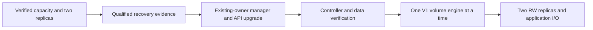

# Longhorn upgrade design: held, not implemented

Read-only review confirms installed1.12.1→pinned1.13.0 is a supported V1 upgrade
path. No upgrade, new recovery proof or capacity recovery follows from this
design. The V2-specific1.12.2 prerequisite does not apply to these43V1volumes.
[Manager procedure](https://longhorn.io/docs/1.13.0/deploy/upgrade/longhorn-manager/).

Use a standalone opt-in Ansible role with prepare/apply-manager/verify-manager/
upgrade-engine/verify phases. Bind every mutation to reviewed source, server
dry-run, live UIDs/resource versions and recovery hashes. Existing installation
ownership is kubectl; do not invent a Helm owner. No force conflict, automatic
engine upgrade or change to the current auto-upgrade limit0 is authorized.
The existing host-maintenance30-volume gate protects an original checkpoint set;
it is not current43-volume coverage and must not be replaced by a guessed count
or reused blindly for this upgrade.

Retained official manifest SHA256:
`d0f99488e7b2789312d45b0127ce7388df71a971e6fca2085e88635303cc0a1f`.
Pin all14candidate images wherever consumed, including arguments/environment/
init containers. Review effective customizations, encrypted-class/native-Secret
requirements, the dedicated CSI account's Secret GET permission, network policy,
iSCSI and the new three-replica global manager; at least one must schedule.
Kubernetes1.37.1 meets the documented ≥1.34 prerequisite.
[Important notes](https://longhorn.io/docs/1.13.0/important-notes/).

Fresh gates must include capacity for pull/unpack/coexistence, payload and
replica recovery, not just the minimum floor;43volume/engine/replica identities;
healthy attached volumes with two actual RW replicas; no concurrent recovery/
upgrade or failed BackingImages; preserved16detached datasets and57claims/
14SMB bindings. No prune, floor/replica reduction or bulk attachment is implied.
The candidate layer sum1,505,203,706B is neither deduplicated nor per-node unpack
space. Re-measure actual needs before mutation.

Existing storage_checkpoint is online/crash-consistent and attached-only; it
explicitly records application_cold_backup=false and restore_verified=false.
Combine actual app-consistent coverage, deliberate detached-data coverage,
authenticated off-node readback, native/encryption-key recovery, system backup
and a qualified restore procedure. A system backup alone does not back up general
application workloads. [System backup scope](https://longhorn.io/docs/1.13.0/advanced-resources/system-backup-restore/backup-longhorn-system/).

Wait for all manager/API/CSI/engine-image readiness and existing app I/O before
an engine mutation. Select one healthy V1 volume explicitly; verify UID/resource
version, two RW replicas and application access after each step. Old instance
managers can legitimately persist until workload-scoped detach/reattach. Do not
force-delete them or claim old runtimes retired from version labels alone.
[Engine upgrade](https://longhorn.io/docs/1.13.0/deploy/upgrade/upgrade-engine/),
[instance-manager lifecycle](https://longhorn.io/docs/1.13.0/deploy/upgrade/instance-manager-pods-during-upgrade/).

A successful1.13upgrade has no supported1.12manifest rollback. Forward repair or
qualified recovery is required; do not copy the Flux role's old-object rollback
logic. System restore requires existing volumes detached and has cross-minor
restrictions; it does not replace existing volumes/PVs/PVCs.
[Upgrade policy](https://longhorn.io/docs/1.13.0/deploy/upgrade/),
[restore limits](https://longhorn.io/docs/1.13.0/advanced-resources/system-backup-restore/restore-longhorn-system/).
