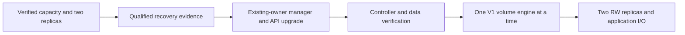

# Longhorn upgrade design: held, not implemented

**13:04UTC:** qualified Plex retirement clears worker2's scheduling floor; all
three disks are schedulable. This is not a pull/unpack/coexistence budget. The
native configuration SystemBackup and offline control-plane recovery below have
since been qualified; fresh application/detached-data coverage remains to map.
[Current cleanup/capacity evidence](LEGACY-PLEX-PRESERVATION-20261027.md).

## Live preflight implemented, October27,10:52UTC

`playbooks/longhorn-upgrade-preflight.yml` now maintains the read-only collection
of actual volume/engine/replica identities, claim/PV ownership, completed backup
records, system backups, native settings and both kubelet/Longhorn space counters.
The playbook passed syntax and live execution (`changed=0`, `failed=0`). It reads
no Secret values and provides no mutation mode. The retained vendor manifest and
14 pinned candidates are hash-bound before collection; receipts cannot replace
earlier runs. This implements inspection, not manager or engine upgrade.

Current observation: 44 volumes, 58 claims, 28 attached volumes each with two
actual RW replicas, and 16 detached volumes. Ingenium's owner added the new claim
during this inspection. All original 43 volume UIDs survived the earlier cleanup.
The backup target is available. Twelve volumes have no completed Backup CR in
this observation, including ten detached retained volumes. This does not prove
that no other independent backup exists; the existing cold/NAS receipts must be
mapped to the exact datasets and recovery requirements.

| Dataset without a completed Backup CR | State |
| --- | --- |
| ruckus/ruckus-db-data-0-security-20261025 | detached |
| ruckus/ruckus-db-upstream-20261026 | attached |
| pihole/pihole-data-0 and pihole-data-1 | detached |
| plex/gluetun-data-1 and qbittorrent-data-0 | detached |
| bortus/bortus-restore-b473091bebef | detached |
| wordpress/wordpress-db-upstream-20261026 | detached |
| migration-system/migration-storage-restored | detached |
| migration-system/migration-storage-proof | detached |
| migration-system/migration-nas-bortus-restore | detached |
| ingenium/ingenium-state | attached; separate deployment owner |

At this 10:52 preflight no SystemBackup CR existed; the later qualified native
backup is recorded in the recovery section below. The original online checkpoint remains explicitly
crash-consistent, attached-only and without independent restore proof; its
historical 30-volume guard remains unchanged. Completing a system backup does
not establish workload consistency or general application recovery. Retained
WordPress, restoration fixtures and BORTUS datasets are preserved regardless of
whether they have a current writer. No empty-data assumption follows from the
Longhorn actual-size counter.

Exact private receipts are under the existing F-backed root,
`platform-upstream-review-20261027/longhorn-preflight/{live,receipt}.json`.
The initial Ansible local RPC startup exceeded Unix socket path length before
any playbook task; its failure receipt and source survive. The rerun used the
existing inherited-directory-descriptor technique. Its short `/proc/self/fd`
alias resolves to the same declared F-backed temporary directory; no filesystem
alias or new storage root was created. Command modules receive the real owned
temporary path. Both attempts reconciled their empty scratch directories.

Concurrent Ingenium staging retains priority for the qualified headroom; no
candidate image was pulled and no volume was attached by this preflight.
Correction at 11:39 UTC: the earlier 71,908-byte packet authenticated but selected
older media receipts because a newline-sensitive source replacement did not
match. It is retained as failure evidence and is not preflight recovery proof.
The corrected 471,364-byte packet explicitly verifies the required preflight,
native-bundle, offline-restore and cleanup members; all 51 members and full NAS
authentication passed. SHA-256:
`2acc290180bad5ecb014147d9c4e60265fc46ffd7dd928a517cf62ca178bfe34`.
No application payload or parent ciphertext was duplicated into the correction.
The [sanitized receipt](../evidence/longhorn-upgrade-preflight-20261027.json)
preserves exact observed backup gaps and explicitly records `upgradeReady=false`.

The later native configuration backup and offline control-plane restore close
part of those gaps; see [qualified recovery evidence and remaining limits](LONGHORN-RECOVERY-QUALIFICATION-20261027.md).

## Upgrade design

Read-only review confirms installed1.12.1→pinned1.13.0 is a supported V1 upgrade
path. No upgrade, new recovery proof or capacity recovery follows from this
design. The V2-specific1.12.2 prerequisite does not apply to these43V1volumes.
[Manager procedure](https://longhorn.io/docs/1.13.0/deploy/upgrade/longhorn-manager/).

Use a standalone opt-in Ansible role with prepare/apply-manager/verify-manager/
upgrade-engine/verify phases. Bind every mutation to reviewed source, server
dry-run, live UIDs/resource versions and recovery hashes. Existing installation
ownership is kubectl; do not invent a Helm owner. No force conflict, automatic
engine upgrade or change to the current auto-upgrade limit0 is authorized.
The existing host-maintenance30-volume gate protects an original checkpoint set;
it is not current43-volume coverage and must not be replaced by a guessed count
or reused blindly for this upgrade.

Retained official manifest SHA256:
`d0f99488e7b2789312d45b0127ce7388df71a971e6fca2085e88635303cc0a1f`.
Pin all14candidate images wherever consumed, including arguments/environment/
init containers. Review effective customizations, encrypted-class/native-Secret
requirements, the dedicated CSI account's Secret GET permission, network policy,
iSCSI and the new three-replica global manager; at least one must schedule.
Kubernetes1.37.1 meets the documented ≥1.34 prerequisite.
[Important notes](https://longhorn.io/docs/1.13.0/important-notes/).

Fresh gates must include capacity for pull/unpack/coexistence, payload and
replica recovery, not just the minimum floor;43volume/engine/replica identities;
healthy attached volumes with two actual RW replicas; no concurrent recovery/
upgrade or failed BackingImages; preserved16detached datasets and57claims/
14SMB bindings. No prune, floor/replica reduction or bulk attachment is implied.
The candidate layer sum1,505,203,706B is neither deduplicated nor per-node unpack
space. Re-measure actual needs before mutation.

Existing storage_checkpoint is online/crash-consistent and attached-only; it
explicitly records application_cold_backup=false and restore_verified=false.
Combine actual app-consistent coverage, deliberate detached-data coverage,
authenticated off-node readback, native/encryption-key recovery, system backup
and a qualified restore procedure. A system backup alone does not back up general
application workloads. [System backup scope](https://longhorn.io/docs/1.13.0/advanced-resources/system-backup-restore/backup-longhorn-system/).

Wait for all manager/API/CSI/engine-image readiness and existing app I/O before
an engine mutation. Select one healthy V1 volume explicitly; verify UID/resource
version, two RW replicas and application access after each step. Old instance
managers can legitimately persist until workload-scoped detach/reattach. Do not
force-delete them or claim old runtimes retired from version labels alone.
[Engine upgrade](https://longhorn.io/docs/1.13.0/deploy/upgrade/upgrade-engine/),
[instance-manager lifecycle](https://longhorn.io/docs/1.13.0/deploy/upgrade/instance-manager-pods-during-upgrade/).

A successful1.13upgrade has no supported1.12manifest rollback. Forward repair or
qualified recovery is required; do not copy the Flux role's old-object rollback
logic. System restore requires existing volumes detached and has cross-minor
restrictions; it does not replace existing volumes/PVs/PVCs.
[Upgrade policy](https://longhorn.io/docs/1.13.0/deploy/upgrade/),
[restore limits](https://longhorn.io/docs/1.13.0/advanced-resources/system-backup-restore/restore-longhorn-system/).
