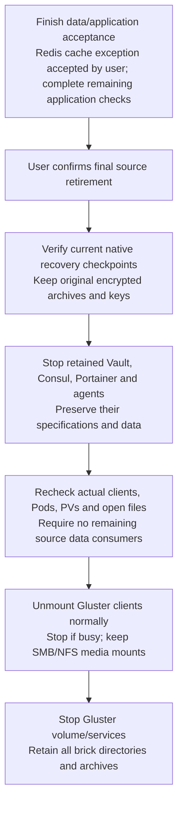
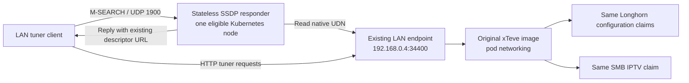
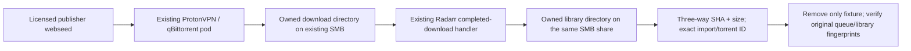
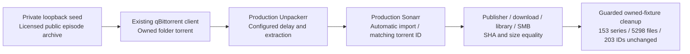
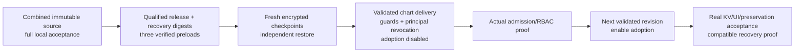

# Approved cluster migration operations

The [callable admission probe collector](BORTUS-ADMISSION-QUALIFICATION.md) keeps
permanent guards Flux-owned: complete the fresh cold checkpoint and resume its
Ready writer before publication, then verify exact successful CI/Flux revisions
and six live guard UID/RV/spec pins. Forty dry-runs and durable disposable
Pod/replicas-zero Deployment fixtures share one <=300-second deadline. Complete
LIST name/UID absence is required after owned fixture deletion; failed or ambiguous
mutations remain retained without retries. Local fixtures do not establish actual
cluster admission or restore acceptance.

The callable [independent restore coordinator](BORTUS-INDEPENDENT-RESTORE.md) is
qualified by twelve controlled local cases over current source/watch/mutation/reader/data contracts.
It requires root's separately qualified current image/preload/admission binding,
carries one absolute deadline and retains uncertain targets and journals. It has
no CLI and cannot grant overall live acceptance from callback fixtures.

The callable [inert reader launcher](BORTUS-RESTORE-READER.md) supplies fixed
kubectl exec after fresh owned Pod UID/RV/spec checks, passing only an inherited
protected kubeconfig FD. It sends no program itself; the data step supplies the
exact reader through stdin. Post-read fences and live acceptance remain separate.

The callable [restore mutation adapter](BORTUS-RESTORE-MUTATIONS.md) provides
review-bound, dispatch-once TLS create/delete callbacks under the actual borrowed
watch and durable pending intent. It proves neither admitted specs nor deletion
absence; full executor/source/image/admission/data acceptance remain separate.

Root verified the immutable native mutation handoff and its 106 retained
artifacts, excluded the import-only parent, and qualified the integrated adapter
against the current fixed metadata/source dependencies. All 398 combined local
cases pass without skips on frozen inputs. The
[integration receipt](../evidence/bortus-restore-mutations-integration-20261011.json)
records this preparatory result; it does not establish live restore acceptance.

The pure admitted-resource comparison now validates the reviewed StorageClass,
claim and holder against full fresh GETs and created identities before journal
confirmation. It permits only explicit inert API defaults and separately fenced
claim binding names. Holder deletion needs a complete fresh Pod LIST with both
owned UID and name absent; a terminating holder or replacement refuses. API
freshness, reviewed proposal authorization and the actual executor remain required.

Holder readiness requires exactly one current container state, `running`; conflicting
waiting/terminated states refuse. The pure admitted-spec, absence and shared holder
refusal boundaries clear public raw arguments before raising fixed errors. Callers
must still avoid logging their own input-bearing traceback frames. Fresh source
inspection validates the current writer node as a bounded DNS subdomain before
returning `source_node_name` or comparing alternate placement; malformed non-string
or path-like fields never enter the report. These local guards are not live proof.

The initial proposal report now binds `source_node_name` from its freshly checked
writer for the coordinator's alternate-node expectation. Repeated source checks
remain required; the recorded name does not establish ongoing writer placement.

The acceptance contract and architecture are in [PLAN.md](../PLAN.md); current evidence is in [MIGRATION_STATUS.md](../MIGRATION_STATUS.md). BORTUS application and native-transport development are handled by two scoped sub-agents in separate worktrees. Together with the migration coordinator, these are the three execution agents; former execution chats are archived. Cluster operations remain with the migration owner.

## Current operation and recovery

The checked-in Ansible defaults describe native ingress on 80/443, Pi-hole on 53 TCP/UDP and 8079, conditional LAN DNS, Flux activation and the existing NAS CIFS backup target. DNS/ingress/gitops tags were applied successfully against all three hosts. Application delivery now uses the separate private `jtmb/branconet-charts` repository: main → successful current-main CI → `validated` → `branconet-charts` GitRepository → existing `migration-releases` Kustomization. Each chart retains its own values. The old migration source/publisher is retained as a suspended historical checkpoint, not an active delivery path. Raw legacy manifests in chart folders are reference material; only Helm templates are reconciled.

For infrastructure recovery, invoke run-ansible.py with --recovery-bootstrap and appropriate stage tags, supplying its sudo JSON through a protected stdin pipe. This explicitly overrides public-port cutover, native-Pi-hole dependency and Flux activation to false. Before recovery of existing data, recover the original Kubernetes PKI/API encryption configuration, kubeconfig and Longhorn encryption key from the authenticated configuration archives. Do not create replacement keys for existing encrypted volumes. Restore the consistent etcd snapshot using the matching API encryption keys, then recover native Secrets and Longhorn claims from the NAS; establish healthy storage/DNS before enabling Flux and public routes. The isolated etcd and BORTUS NAS restore tests prove those recorded restore cases; they do not establish a complete three-host disaster rebuild.

Native backups use cifs://192.168.0.8/container_backups/k8s-migration-20261009/longhorn and the native longhorn-system/longhorn-backup-cifs Secret. Media exports and their paths remain unchanged. Thirty-one migrated application volumes have completed cold NAS backups; an independent BORTUS database restore passed decryption, SHA equality, table counts and integrity checks. The later repository-only monitor state also has a completed cold NAS checkpoint, bringing backed-up volume coverage to 32, including the two now-retained excluded game volumes. Backup holders are removed only after backup completion; incomplete runs retain their evidence and require inspection before repetition.

The original HTTPS Traefik dashboard is restored at proxy.branconet.lan/dashboard/ with unchanged BasicAuth hashes in traefik/traefik-dashboard-config. migrate-traefik-dashboard.py reads the authenticated retained source configuration directly into that native Secret, fails on conflicts, and writes only deployment references and metadata to Git. Both Ansible and Flux use the immutable original Traefik digest; the dynamic file provider routes to api@internal without enabling an insecure API listener. Source hashes and denial checks are verified; authenticated UI/API proof still requires the existing working dashboard password. traefik-dashboard-proof.py accepts optional existing passwords through --credentials-stdin and never reports them or bodies. BORTUS's existing native Secret role can read the configuration; no app changes were needed.

Keep migration_dashboard_enabled false during --recovery-bootstrap until native Secrets are restored. Then enable the persisted source dashboard configuration before final ingress reconciliation. The bootstrap watcher-limits tasks persist fs.inotify.max_user_instances=1024 at /etc/sysctl.d/98-branconet-inotify.conf; the scoped --tags watcher-limits stage was applied and read back on all three hosts after an exhausted master quota prevented file-provider startup. Dynamic watching remains enabled. Following watcher recovery, an actual two-replica restart loaded the protected route successfully. The subsequent encrypted etcd/NAS restore explicitly verified the new dashboard Secret; retain the original API encryption keys.

Application legacy published ports are recorded in evidence/application-port-cutover.json. Their original Docker specifications are encrypted in authenticated operator/NAS rollback files. Source application Services remain defined at zero replicas, with their published ports transferred to native Services. Vault/Consul and Portainer/agents remain running. A TCP connection proves routing only; application APIs/content require their separate evidence. Legacy xTeve TCP 1901 has no observed backend listener; its 34400 web/tuner route works and LAN SSDP discovery passed on all three interfaces.

qBittorrent retains its original password hash and 203-entry queue. The correct native consumer credentials were recovered from retained download-client settings. Gluetun admits inbound Web UI traffic on 8112 while torrent egress uses the preserved ProtonVPN WireGuard tunnel. The monitor reads the negotiated forwarded-port claim and persists its notification bookkeeping on its own Longhorn PVC. The user authorized restoration of the original automatic Discord alerts: client status, VPN-port updates, new downloads and stuck metadata on; download-complete off. One earlier explicitly authorized migration test delivered from the production monitor pod through the native webhook. Live rollout/environment/storage verification is recorded in evidence/monitor-alerts-restoration.json; every event type is not artificially triggered. The webhook value remains only in native Secrets.

For rollback after a destination receives writes, first stop that destination writer and take a recoverable checkpoint. Compare/synchronize the destination changes into a reviewed recovery copy before restarting a retained source. Restoring old Docker port specifications alone does not restore new application writes. Keep source Gluster bricks, cold archives and partial migration claims until the acceptance ledger is complete and final retirement is confirmed by the user.

## Gated source retirement

The read-only evidence/retirement-readiness.json audit inventories the actual Gluster mount targets and remaining source containers. Six Docker containers remain across four services: cicd_vault, cicd_server-bootstrap, portainer_portainer and the three portainer_agent tasks. Portainer and Consul still mount original Gluster data. No active native Pod directly mounts the discovered Gluster paths and no native PV uses those Gluster paths/drivers. All three /gluster/volumes directories remain present. This is a consumer inventory, not approval or proof that every application scenario has passed.



Re-run the privileged consumer/open-file audit after stopping the approved source services; a prior inventory cannot authorize shutdown of a newly discovered consumer. Do not force or lazily unmount busy clients, delete bricks/claims/backups, or disable NAS media exports. The separate read-only /mnt/migration-gluster-read client on worker2 and /mnt/container-program-files clients on all three nodes must be considered alongside source containers. Root/container filesystem visibility alone does not establish active data consumption; inspect actual holders before shutdown. Restore the original Vault data with its original user-held unseal material if rollback requires that encrypted source store. The authoritative replacement secrets recover from the tested native etcd snapshot using the retained Kubernetes encryption keys.

## Operator tools and metadata

Run migration tooling from WSL with the existing SSH identity. `scripts/migration/install-tools.py` installs checksum-verified age, Flux, Helm and kubectl into `~/.local/share/branconet-migration/bin`, leaving other installations intact. It records upstream URLs/checksums in an operator-local download manifest.

`scripts/migration/inventory.py --output evidence/live-inventory.json` captures current service/container/image/mount/port metadata from all three hosts. It deliberately excludes environment values, raw labels, command arguments and credential files. The source-to-target register must include both Swarm services and standalone containers, including anonymous volumes.

Run register.py with the isolated Python environment to produce SERVICE_REGISTER.md and evidence/service-register.json from the saved baseline. It maps every live source instance to an application chart or an explicit replacement contract, and adds repository-only applications. Replacement entries for Vault/Consul and Portainer/agents remain pending until retained data and replacement behavior are verified; no source service is silently omitted.

That baseline register already exists. Do not rerun register.py or refresh-migration-state.py after production promotion: their preparation defaults replace accumulated acceptance/release state. Run update-acceptance-register.py to enrich the retained baseline with current HelmRelease/PVC metadata, native Secret references (names/keys only), per-service cold backups and scoped evidence. False or absent historical checks remain explicit; this tool never converts HTTP/TCP readiness into full functional acceptance.

pipeline-rollback-proof.py demonstrated a real HTTP echo annotation rollout and rollback through Git, successful validation, the validated branch and Flux. Evidence preserves each commit/CI run, new Pod UID, unchanged PVC/volume and unchanged response hash. It uses Windows Git for the shared Windows checkout to avoid WSL line-ending false positives. It refuses to repeat over an existing report; review and preserve previous evidence before any repeat. This small canary tests the deployment pipeline, not data rollback after application writes.

source-status.py records replicated/global source counts and standalone health without environment values. For Pi-hole startup diagnosis it retains only error/warning lines and excludes credential-bearing lines. Restart command success is not readiness evidence; investigate any source below its recorded desired count before accepting restoration.

Pi-hole currently has a temporary Swarm constraint node.hostname==workernode2 because its worker1 FUSE client cannot stat gravity.db even though all bricks retain the file. Preserve this existing database rather than initialize a replacement. Original service configuration remains in the encrypted baseline backup; remove the temporary constraint only after the relevant mount/readiness or Kubernetes cutover is verified.

check-source-dns.py sends ordinary UDP and TCP DNS queries through port 53 of each node, validates response ID/success/answers and records evidence. A healthy Pi-hole container alone does not prove all routing paths work. This checks source restoration; destination Kubernetes DNS requires separate pod-level checks after provisioning.

Raw runtime configuration and credentials belong only in encrypted recovery backups outside Git. Initial copies of active data are staging copies, not accepted consistent backups. Final database copies require application-consistent backup or stopped writers and verified restoration.

The historical `scripts/migration/backup-config.py` produced the retained encrypted host/runtime configuration backups. Do not rerun it for the guarded release: although the local credential arrives on stdin, its wrapper embeds that credential in remote command source; its capture/encryption/copy operations also reset timeouts and permit destination overwrite. Historical successful decrypt/readback receipts remain evidence for those historical archives only. Application-data backups are a separate gate.

Fresh Kubernetes recovery configuration is prepared by `scripts/migration/capture-kubernetes-recovery-config.py`. Its callable requires the separately qualified checkpoint Transport and one absolute deadline, with no historical-helper/live CLI fallback. It captures a fixed 32-file set: standard control-plane/etcd PKI, API encryption configuration, retained Longhorn key, four component kubeconfigs and four static-pod manifests. This targeted archive complements retained broader three-host runtime archives; it does not replace their containerd/systemd/fstab contents. Custom PKI outside the fixed set requires a reviewed inventory/extension.

The callable creates an exclusive protected run under `config-captures`, pins the recipient/identity, encrypts with age and authenticates exact plaintext equality in private memory. Only ciphertext goes to the fixed exclusive NAS writer, with file/directory fsync and same-inode hash readback. Two bounded source reads must match around encryption/publication; this is per-read consistency, not continuous file history. Failed/ambiguous outputs remain retained without replay/adoption. A completed receipt also requires successful caller transport closure and actual launcher terminal0. API Secret decryption, LUKS recovery and a full three-host rebuild remain separate.

[Nine initial controls](../evidence/bortus-recovery-config-local-20261012.json) pass against immutable checkpoint v11. [Root integration](../evidence/bortus-etcd-config-root-integration-20261012.json) verifies the integrated18090f8 helper: all47 local controls pass without skips or ResourceWarnings in7.992s (8.338s wall), with164 unchanged files in a private POSIX copy. The earlier source-fence refusal and Windows-mounted fixture ownership failures remain retained without weakening checks. Real age/public-key fixtures and local transport shims run; actual SSH, sudo, Kubernetes and etcd are separate live prerequisites.

The first actual configuration run authenticated the32-file operator archive but refused NAS publication because the existing CIFS mount forces encrypted file mode0755. Both equal ciphertexts and the failed journal remain retained; that run is not accepted. A scoped configuration-writer correction permits0755 ciphertext only on the exact `/mnt/container-backups` CIFS mount, with stable mount identity, exclusive create, same UID/inode/size/hash and durable readback. The operator archive stays0600; plaintext never enters the NAS writer. Other filesystems require0600; writable group/world modes refuse. Shared SQLite/etcd writer defaults remain unchanged. The configuration/etcd qualification used only explicit config/etcd prefixes; its config default bytes remain unchanged. A separate literal SQLite ciphertext opt-in now admits the closed bortus-sqlite prefix under the same qualified CIFS identity rules; see [quiescent archive](BORTUS-QUIESCENT-ARCHIVE.md). Default SQLite NAS callers remain strict600/four-field and root must explicitly select and qualify the opt-in before latest-data capture. The integrated etcd streaming consumer retains its original512MiB ceiling, separate from the smaller configuration archive ceiling. [Twelve local controls](../evidence/bortus-config-cifs-local-20261012.json) pass with real age/cipher files and mocked CIFS forcing, covering accepted mount-forced0755, refused non-CIFS0755 and refused world-writable CIFS ciphertext. A distinct fresh actual32-file configuration run now passes authentication, transport closure and complete NAS ciphertext readback; see the [actual receipt](../evidence/bortus-kubernetes-config-actual-20261012.json).

Each migration application now has its own `Chart.yaml`, `values.yaml` and Helm template beneath the existing charts tree. `enabled: false` and zero replicas are preparation defaults. Activation requires `migration.verified`; packaging validation alone does not establish that storage, native Secrets, live configuration, or application tests are complete. Legacy raw manifests remain reference sources and must not be reconciled alongside Helm releases. Charts with an empty resources list explicitly require implementation; the CI validator rejects incomplete packages.

`chartify.py` prepares packages from sanitized live image metadata and existing manifests without enabling them. `validate-charts.py` checks Helm lint, staged rendering, integer replica types and the blocked activation path. Its `--allow-incomplete` switch is for local preparation evidence only; repository CI requires all manifests to be implemented. Kubernetes schema and functional verification remain separate acceptance checks.

`measure-storage.py` reads data path sizes and ownership through SSH/sudo supplied on stdin. Size errors remain explicit. PVC allocation must use completed measurements, replica count, free space and reserve; existing source PVC estimates are not accepted as measured capacities.

`complete-live-charts.py --refresh-live` constructs prepared live workload resources from the original sanitized source inventory, using measured data sizes for Longhorn claims and the same SMB directories. It retains legacy reference files, keeps workloads disabled, records source argument and Docker-host dependencies for review, and carries Homepage annotations forward. Run it only during preparation: it replaces prepared resource lists. It wires Gluetun as a restartable init sidecar in the qBittorrent pod; the separate Gluetun package owns its PVCs and live WireGuard runtime Secret reference. Startup/readiness use the upstream Gluetun healthcheck command. VPN egress, startup behavior, kill-switch isolation and forwarded ports still need live tests. BORTUS manifests remain a separately delivered dependency.

`import-secrets.py --kubeconfig <protected-operator-path>` prepares a metadata-only import inventory; adding `--execute` creates native Kubernetes Secrets and compares every value in memory with API readback. It reads Vault and age-encrypted original Docker configuration directly; no plaintext export is created. Existing unequal Secrets fail with a conflict. Vault records use the `bortus-secrets` namespace with original-path/type annotations; application runtime environments use their own namespaces. BORTUS provider mapping, dependency host rewrites, secret rotation and at-rest ciphertext verification require separate live checks before acceptance.

The Ansible runner writes progress into its protected operator log while it runs, so a provisioning failure can be diagnosed without waiting for the whole stage. Credentials arrive through the runner's stdin, then are passed to the Ansible child through an in-memory process environment lookup; no password is in argv or a plaintext file. This avoids Ansible 2.21 resolving /dev/stdin to a nonexistent pipe filename. Each site play explicitly loads ../group_vars/all.yml because the playbook lives below the inventory/group-vars parent directory.

`redis-audit.py` queries only Redis persistence/key-count metadata and WordPress cache-plugin/configuration presence. It does not export keys or values and does not establish historical recovery. Redis source task state had no data mount; its unrecovered historical cache was explicitly accepted as disposable by the user on 2026-10-09, retain new snapshots before further task shutdowns, and provision durable target storage if persistence is required.

`fix-worker-dns.py` records worker2's prior per-link DNS and sets its runtime systemd-resolved DNS to the already verified homelab resolver 192.168.0.6. It changes neither persistent network files nor Pi-hole listening policy. The original runtime resolver must be reconsidered during final DNS cutover and rollback; its exact prior value is in evidence/worker-dns-override.json.

`build-bortus-image.py` builds the separately delivered app commit 1438b278cdf21e98429b4836c018636b01b982a3 using source Docker on the master. Its streamed context excludes local environment files, databases, node_modules, tests and build output; it pins kubectl to the cluster version. Building an image does not run or deploy BORTUS and is not live native Secret acceptance. Protected build logs and metadata record actual build results.

For the new release, `prepare-bortus-release-context.py --source-repo <checkout> --source-commit <full-40-character-commit> --output <new-outside-checkout.tar.gz> --evidence <new-outside-checkout.json>` prepares source only. Both output parents must already exist. It reads raw committed application blobs, never the working tree, and checks each Git object identity. The deterministic archive preserves regular-file executable modes and records the exact commit, application tree, per-file hashes, migration files and archive hash. It excludes environment files, databases/sidecars, dependency/build/test directories, logs and named credential/key files without reading their payloads. Included symlinks/submodules, invalid paths, missing required build inputs and existing output paths are refused. Bounds are 2,000 tree entries, 16 MiB per included file and 128 MiB of included source, with 30-second Git command deadlines; subprocess output-size checks occur after capture and are not process-memory limits.

The helper exclusively creates and flushes its files, retains partial output after failure, and never builds an image, installs dependencies or accesses the cluster. POSIX mode 0600 does not establish a Windows ACL, so use the protected operator artifact location appropriate to the host. Exclusions are not a complete credential scan: qualify the actual selected source/context separately before build. Qualification of a current preparation commit is not final source freeze, image qualification, schema/adoption acceptance or deployment. The historical fixed-source image builder/distributor must not be reused for the new release.

[Local qualification](../evidence/bortus-release-context-qualification-20261011.json) records 13 actual POSIX fixture passes, 12 Windows passes with one explicit POSIX-only skip, successful current-checkpoint preparation and independent verification of all 263 archive files. The default pinned Gitleaks scan passes with zero findings on those selected raw files. It does not resolve the prior whole-repository scan's two historical provenance fields or qualify final source/image/live acceptance.

The separately delivered [terminal UI checkpoint](../evidence/bortus-terminal-handoff-qualification-20261011.json) at `4bea97aa` passes fresh build/lint/types and 11 local browser checks, with exact source/artifact/measurement verification by the coordinator. Viewport docking, keyboard escape, Clear, deferred-load failure feedback and private lifecycle disposal are tested against the fixture; no command is submitted. First-frame observations are 850.3/585.5 ms cold/warm, not a no-regression gate. Actual assistive-technology testing, wider zoom/readability, full coherent QA, the unchanged final frozen performance comparison and image/live acceptance remain separate requirements.

The callable `bortus-restore-watch.py` [collector contract](BORTUS-RESTORE-WATCH.md) supplies verified TLS, complete bounded LIST to exact opaque-RV watch, a concurrent bounded metadata drainer and pinned/fsynced sidecar readiness before journaled create callbacks. Its `WatchJournal` subclass serializes sidecar/journal ownership checks while callbacks remain drainable. Confirmed target PVC/PV/Longhorn identity binds early events; exact observed GET RV and true/true to true/false flags permit metadata eligibility only. Lost replies, history gaps, EOF, malformed/oversized inputs, identity drift and durability failure refuse without reconnect, relist, adoption or mutation replay. The 2,100-second lease has a separate 30-second socket timeout. Importing the library makes no requests. Its actual local TLS/POSIX fixture qualification is separate from a reviewed operator credential adapter, complete live executor, image/admission/source/consumer fences, healthy replicas and independently authenticated data equality. See the linked contract for bounds and non-atomic callback/watch limits.

[Integration qualification](../evidence/bortus-restore-watch-integration-qualification-20261011.json) binds native `b0e37521`, exact selected raw/checkout byte relations, retained initial failures and all 162 passing current root BORTUS helper cases. The native scoped 11-file default scan has zero findings. No live watch, approved credential adapter, restored-data equality, final image or production mutation is claimed by this local qualification.

`network-proof.py` runs two bounded test pods on separate workers, checks Kubernetes service DNS in each pod, and pings each peer pod across nodes. It records actual image IDs and node/runtime versions; test pods remain for diagnostic work and are not production workloads.

After post-provision configuration recovery passes, `operator-kubeconfig.py` recovers admin.conf directly from the authenticated encrypted backup to the operator runtime directory with mode 0600 and verifies the API. It never writes the credential to Git or reports it. Configuration backup metadata keeps prior snapshots instead of replacing their historical references.

Native import also creates fresh stable BORTUS signing and lookup keys in bortus/bortus-runtime; repeated execution reads that existing object rather than generating a replacement. The importer creates an explicit metadata-only bortus-secret-aliases ConfigMap: Vault path aliases for single-key records, path/key aliases for each field, and fully explicit native runtime references. Values are absent from its saved alias map. Live BORTUS read/CRUD/lookup and etcd ciphertext checks remain acceptance gates.

`distribute-bortus-image.py` streams the clean, separately delivered image into each independent Kubernetes runtime and verifies actual cached manifest digests. Successful import stdout is not tag evidence; existing verified images skip retransmission. The current staging chart uses that exact cached tag with imagePullPolicy Never until an authenticated image publication pipeline is selected.

The deployed image export is also preserved independently of the development worktree: evidence/bortus-image-recovery.json records its protected operator/NAS age archives, ciphertext checksum, full authenticated decryption and image-configuration digest. To recover, authenticate/decrypt that archive into the protected operator path recorded by evidence/bortus-image-distribution.json, with mode 0600, and verify its recorded archive SHA before importing. Then supply sudo through protected stdin to distribute-bortus-image.py, which requires the recorded export SHA and identical runtime manifest digest on all three nodes. No app rebuild or separate worktree is required for this restore path. The original build helper is historical delivery tooling with a fixed development-worktree path; do not use it as the disaster-recovery entry point. BORTUS remains on the same image and its Secrets/database recover through their separately tested backups. This proves exact image-artifact recovery, not a full three-host rebuild.


### Current immutable app release preparation

The [final app handoff](../evidence/bortus-terminal-final-handoff-20261011.json) at `32eb227e` supersedes the earlier terminal readability/zoom checkpoint. Current Windows QA passes 196 units, build/lint/types, all four HTTP suites, 11 terminal browser checks and four genuine 2x zoom checks; exact raw-source, original artifacts and separate tested working bytes are bound. Earlier HTTP/capture failures remain retained. Root independently reviewed the public screenshots and recomputed the local measurements. This is functional/browser evidence, not the unchanged controlled performance gate or actual screen-reader testing.

The [raw-Git build context](../evidence/bortus-final-release-context-20261011.json) is prepared for that exact commit: 263 included files and 11 forward migrations, with all tar paths/modes/blob/hash bindings verified. The default source-only credential scan passes zero findings. The unchanged controlled comparison completed but fails performance acceptance; `32eb227e` remains a retained candidate. The app subagent reports passing clean Linux functional tests, with independent coordinator evidence qualification pending. The actual immutable image/runtime digest and every guarded live release/data/recovery gate remain open. Do not invoke the historical fixed-image builder for this new release.

The selected [generic release builder](BORTUS-RELEASE-IMAGE.md) consumes exact commit/archive/manifest hashes and checks every included raw blob and mode before SSH. It uses the existing fixed builder, the approved cluster-compatible kubectl build argument, exclusive protected intent/logs and no automatic replay. Root retains actual build ownership; no build is dispatched while final source/performance qualification remains open. Config image IDs, OCI manifest digests and qualified runtime identities are recorded separately.

Root's [selected integration](../evidence/bortus-release-builder-integration-20261011.json) verifies the native handoff and passes all 218 current WSL helper tests. Its validation of the real retained 263-file candidate archive performs no network or image operation. The [unchanged paired performance receipt](../evidence/bortus-paired-performance-32eb-20261011.json) independently checks six alternating records and 4,122 numeric summaries and keeps performance acceptance false. Preserve those originals and the noncomparative services-cache limitation when comparing the replacement candidate.

The [fresh source preflight](../evidence/bortus-source-preflight-20261011T064554Z.json) is metadata-only: all 53 PVs are inventoried and the original Longhorn handle has one PV mapping. It preserves original identities and verifies current prerequisites without Secret/SQLite reads or mutations. These separate resource reads are not atomic and do not replace the cold capture and independent restore gates.

### Approved embedded operator transport

The replacement [unchanged `3f9b21cd` comparison](../evidence/bortus-paired-performance-3f9-20261011.json) also completed its six records and assertions but fails performance acceptance. Root independently verifies the originals and all summary arithmetic. The app subagent's next request-correlated characterization uses only synthetic data and separately owned instrumentation; it does not alter the frozen driver, source image or acceptance thresholds. Image build/cutover waits for the full source and performance requirements.

The [restore schema/status correction](../evidence/bortus-restore-schema-status-correction-20261011.json) supersedes the original synthetic collector fixtures: installed Longhorn 1.12.1 uses exact `spec.Standby` and `status.isStandby`. The corrected pure evaluator and ABI 2 collector require the canonical false spec flag and preserve observed status validity through durable projection, so faulted/deleting/standby or unsupported states cannot disappear before target/holder authorization. All 223 current root helper tests pass, including owned HTTPS post-completion failure cases. The scoped live metadata/schema inspection does not create a restore or prove independent data equality; image/admission/consumer/executor gates remain open.

The [operator adapter](BORTUS-OPERATOR-MTLS.md) reads the explicitly approved protected operator kubeconfig afresh; only embedded mTLS for the fixed API origin is supported. Native keys remain transient in sealed Linux memfds, never plaintext exports or argv. Root's integrated kubeadm context correction passes all 193 current helper cases and the scoped live complete Longhorn LIST/watch HTTP handshake, with no frames consumed or mutation. Use the [integration evidence](../evidence/bortus-operator-mtls-integration-20261011.json) for exact source, terminal and retained failure bindings. This transport proof cannot authorize restore mutations or replace durable live watch history, fresh source/consumer/image/admission fences and independent whole-row equality.

`deploy-bortus-staging.py` requires three matching cached images, native import readback and Longhorn device/relocation/restore proof, then performs an API server dry run and installs a private one-replica Helm release. The BORTUS-only staging gate allows functional testing before full acceptance and rejects Ingress/IngressRoute or external Service resources. It does not mark migration.verified or applicationChecksPassed true. Public routing requires separate completed acceptance.

`bortus-live-proof.py` reaches staging through a loopback port forward, bootstraps the james operator account with fresh credentials retained only at bortus/bortus-operator-access, and locks registration after creating a readonly acceptance account. It compares every imported Vault lookup alias in memory; checks native CRUD, version conflicts and preservation of unrelated keys/metadata; then restarts the app and proves Secret, session and runtime-key persistence. Tests use dedicated acceptance objects and never rewrite imported production values. Account credentials and HTTP bodies are not reported. Dashboard and live-outage acceptance remain separate.

The historical `backup-etcd.py` runs produced the retained isolated recovery receipts. The current replacement requires explicit source Pod/image pins, a freshly authenticated configuration archive, protected recipient/identity files, tool hashes, one absolute deadline and a unique run ID. Its former password-only CLI is refused. It encrypts/authenticates a consistent snapshot, publishes only ciphertext and independently restores the authenticated copy in an isolated loopback-only pod. Complete Secret ciphertext maps are compared at the snapshot revision; production etcd is untouched. See the [fresh checkpoint contract](BORTUS-ETCD-RECOVERY.md) for durable intents, conditional cleanup, credential/body separation and local/default transport qualification. Actual fresh checkpoint, API decryption and LUKS recovery remain separate. Matching API encryption keys require retained authenticated configuration backups; repeat checkpoint recovery after later Secret changes before retirement.

`verify-secret-encryption.py` reads each imported registry record through etcdctl inside the control-plane etcd pod and verifies the configured AES-CBC prefix in memory. It exports neither ciphertext nor plaintext. API readback comparison and encryption verification address different acceptance requirements.

The Longhorn role installs external-snapshotter v8.6.0 CRDs/controller for CSI snapshot recovery. `storage-proof.py` creates only dedicated migration-system test claims: it checks two replicas on different nodes and the actual LUKS block-device header, writes a marker, snapshots it, writes a newer marker, relocates the source claim to the other worker and restores the older snapshot into a separate claim. Existing source/application volumes are untouched. Test claims/pods/snapshot are retained; inspect them before rerunning. This proves storage primitives, not migrated application or off-cluster backup recovery.

`review-live-integration.py` recovers effective source commands/arguments only from authenticated encrypted configuration and stores them in native launch Secrets. Chart commands expand references through environment variables; argument values never enter YAML. It pins live source digests and rewrites recognized same-namespace service hostnames in native runtime Secrets. Unresolved host/IP dependencies remain metadata-only audit entries for explicit application integration. Rerunning preserves stable native launch values and removes duplicate generated references; do not use it to overwrite later independently edited runtime values.

`copy-application-data.py --chart <relative-chart>` first creates owned private zero-replica resources, then stops that source writer and confirms it is absent. Each temporary root copy pod mounts its host source read-only and a new Longhorn claim writable. It refuses a nonempty destination, copies with numeric owners/ACLs/xattrs, and compares complete file-content and metadata manifests before/after. A source or target mismatch is a failed copy; original and partial destination remain retained and the source writer is restarted. Success leaves the source stopped for destination validation/cutover and records its prior count. No application acceptance is implied by copying. Restore source traffic only through the service's rollback procedure, avoiding conflicting writers after target changes.

`prepare-flux-releases.py` creates the original validated-branch source and all in-scope individual release declarations (currently 33). It retains data resources and namespaces, starts only private BORTUS, and leaves every other application disabled. This is historical preparation tooling: rerunning resets per-release overrides and must not be used after application promotion without inspecting existing values. Validation checks blocked unaccepted activation, private renders without external routes, all chart implementations and manifest types. The original GitHub publisher was used during migration and is now removed. This branch retains read-only archive validation; current delivery uses only the separate chart repository's main → successful current-main CI → validated pipeline. Actual remote CI/Flux readiness is recorded separately in the acceptance evidence.

`scripts/migration/backup-data.py` records source replica counts and standalone containers, stops application writers for a cold-backup window, and streams encrypted archives to the NAS. It preserves Gluster logical data, NFS application data, all three local Plex directories, ETS2 configuration and anonymous Docker volumes. Its `finally` path restores the recorded Swarm replicas and starts Gluetun before qBittorrent. Sources and Gluster bricks are retained. After restarting sources it validates full authenticated decryption and tar traversal, with metadata-only evidence. An archive/decryption failure is not accepted as a completed backup; investigate and preserve the original data.

`scripts/migration/gluster-audit.py` captures privileged heal summary, split-brain/path diagnostics and logical-versus-brick path metadata without modifying the volume. A source read error is a failed data gate, even if some archives were written successfully. Preserve partial archives and original bricks; identify affected paths and obtain verified recoverable copies before provisioning or cutover.

For the observed read failures, backup-data.py accepts recover_gluster_read_errors through its protected stdin request. It retains valid original worker archives, archives all three raw bricks with ACLs/xattrs, rearchives master local/NFS state, and archives logical Gluster from the worker2 client that can read the Jackett paths. Only the obsolete Gluster Plex Logs directory is excluded from that logical archive; all its brick copies remain in the three recovery archives. Raw bricks are recovery evidence and retained originals, never the source for ordinary application imports. Baseline anonymous volume paths are included even after Swarm has replaced task containers. Every accepted archive still requires authenticated full decryption/tar validation, and provisioning additionally requires complete recovery coverage.

Missing baseline paths fail the backup gate. Swarm task replacement can remove task-owned anonymous volumes, so inspect and capture these before any subsequent task removal; the privileged audit records baseline path existence. Do not report complete data preservation when a source path is missing or unexplained. Per-archive failures are recorded while other jobs finish, preserving valid recovery artifacts and restoring source counts in finally.

The user explicitly classified FlareSolverr /config and Vault /vault/file and /vault/logs as disposable runtime state. With disposable_runtime_state_confirmed in its stdin request, backup-data.py records those exact service/mount exclusions and continues the required dataset backups. Any other baseline anonymous application path blocks writer shutdown until it has separate preservation; no broad anonymous-volume exclusion is allowed. The original sequencing error and user clarification stay in the evidence history.

verify-archives.py authenticates the valid retained worker cold archives and worker2 brick/logical archives independently of failed jobs. Its report explicitly marks complete_backup_set=false: authenticating individual files cannot satisfy missing dataset or all-brick coverage. This read-only recovery check does not stop any source services.

vault-status.py accepts the authorized unseal key/root token through stdin, unseals only when needed after a source restart, checks active HTTP health and records KV path/key/type/version metadata. It never writes secret values, tokens or unseal material. Compare its restored record/value counts and keys with the original inventory; metadata equality is not a substitute for the later in-memory value/import verification.

The health check allows a bounded 15-second leader-election interval after unsealing. If Vault stays sealed/standby/unhealthy, its source restoration is not accepted.

## Runtime coexistence

Provision a separate Kubernetes containerd service, socket and data root. Do not overwrite Docker's existing configuration or restart its runtime during Kubernetes preparation. Preserve resolver settings and verify Docker/Swarm networking after CNI changes. Keep Gluster bricks/mounts and NAS shares intact until final acceptance and user confirmation.

The revised `site.yml` uses `containerd-k8s.service` with /etc/containerd-k8s/config.toml, /run/containerd-k8s/containerd.sock and /var/lib/containerd-k8s. Bootstrap settings are versioned nonsecret configuration and do not call BORTUS. The kubeadm API uses /etc/kubernetes/encryption-config.json for native Secrets; Longhorn uses the native longhorn-crypto Secret and retained LUKS volumes. Include encryption keys and Kubernetes recovery configuration in a new encrypted recovery backup before application PVC imports.

`scripts/migration/run-ansible.py` requires completed authenticated data archives covering all three hosts, complete brick/logical/primary coverage for the recovery strategy, and successful source restart commands before provisioning. It receives sudo through stdin and supplies the Ansible child through a private in-memory environment lookup, uses explicit ANSIBLE_CONFIG under WSL and records stage exit status plus a protected operator-log path. Run foundation tags first; verify actual nodes/network/DNS and existing Docker services before subsequent storage/ingress/Flux stages. All expected node and controller readiness checks fail closed.

## Pipeline ownership

Ansible provisions hosts and the Kubernetes foundation; Flux reconciles application charts and their values. BORTUS manages native Secret values through Kubernetes. No raw secret values go into Git, process arguments or reports. Live acceptance must prove node readiness, pipeline reconciliation, storage persistence/recovery and application behavior; rendered manifests alone do not establish completion.

### Application waves and private reconciliation

Run application-wave.py only for the reviewed independent source services listed in that script. Each cold copy requires authenticated backups, stops its source writer, compares full manifests, retains originals and leaves the destination stopped. private-app-proof.py starts one private replica and checks HTTP and restart; --relocate also proves the same claim on another worker. An HTTP check alone does not establish all application functionality or public cutover.

refresh-migration-state.py retains baseline source inventory, records copy/private evidence, makes tested releases private replicas and suspends every untested release. Commit and wait for successful CI publication before Flux adopts this desired state. Temporary DNS changes and BORTUS dashboard/outage results are recorded separately.

### Native certificate and database recovery

import-ingress-certificates.py reads the retained source ACME store through the independent read-only Gluster client and imports certificates/keys directly into native TLS Secrets. Only public domains, expiry and certificate fingerprints are reported. The pinned cert-manager OCI chart is reconciled by the same Flux pipeline; HTTP01 issuance requires final port-80 routing. Native imported keys and new issuer keys require a fresh encrypted etcd backup.

database-proof.py uses the retained application account, because both original MySQL databases generated their root passwords. It verifies schema/table counts across restart after the exact cold copy. import-redis-snapshot.py restores the protected current snapshot into a retained claim; it does not recover the original task state removed before archival.

Homepage now uses its service account and native configuration Secret for cluster discovery. Original source configuration remains retained. Relevant upstream configuration: https://gethomepage.dev/configs/kubernetes/ and https://gethomepage.dev/installation/k8s/.

Ingress validation: website-ingress-proof.py checks certificate name/chain and the previously verified content hash on all three temporary HTTPS NodePorts. Traefik 2.11 needs router.tls=true and websecure entrypoint annotations; loading a TLS Secret alone does not enable its HTTPS router. Standard ports remain a separate cutover gate. Plex library proof checks retained machine identity, authenticated library totals and a real one-MiB media range through the migrated server. It leaves full client playback and relocation acceptance separate.

Unpackerr fixture acceptance uses an isolated Pod with the exact deployed digest and only an owned subdirectory of the existing SMB CSI claim. The archive is created after the watcher starts, so polling sees a new directory event; output SHA equality and archive retention are required. Production configuration is unchanged and the fixture is retained. Its real Arr API access is a separate check; this does not claim a completed real download/import. Configuration reference: https://unpackerr.zip/docs/install/configuration/.

media-import-prerequisites.py reads the configured Arr APIs in memory and records only root-folder accessibility, enabled client implementations, queue counts and health-warning types. Sonarr's /media/tv and Radarr's /media/movies are accessible and report free space; both use enabled qBittorrent clients. UpdateCheck and Radarr IndexerLongTermStatusCheck warnings remain recorded for review. The tool never changes library/configuration data or establishes a completed download/import.

xTeve's immutable 2.2 image selects the last available IPv4 address and offers no interface override. Host networking alone returned a Docker bridge address in SSDP replies. Its chart therefore keeps the xTeve process on pod networking and adds a separate host-networked discovery responder using a pinned Python utility image, ClusterFirstWithHostNet DNS and UDP 1900. The responder reads the live UDN from the existing LAN descriptor at http://192.168.0.4:34400/device.xml and advertises that exact endpoint; it mounts only its nonsecret code ConfigMap, requires no Kubernetes RBAC and changes no application settings/data. Replies are restricted to the configured LAN. The immutable xTeve image, device identity, Longhorn claims and SMB IPTV claim stay the same. Interface-selection source: https://github.com/xteve-project/xTeVe/blob/master/src/toolchain.go.

Active host networking requires both migration.routingReviewed and migration.hostNetworkingReviewed. Before setting the latter in the Flux release, check 1900/UDP on every eligible host and retain the existing 34400/TCP service ownership. The chart rejects an active deployment missing either review. The responder checks its own UDP reply against the native descriptor for readiness, withdraws advertisements when the backend becomes unavailable, and sends goodbye on termination.

Run scripts/migration/xteve-ssdp-proof.py --phase after to verify real multicast replies from all three LAN interfaces and compare device identity, tuner count and claim identities against the retained baseline. HTTP discovery/lineup checks alone do not prove multicast discovery. For a network-only rollback, remove the responder Deployment/ConfigMap from the chart through the same CI/Flux pipeline, retaining the xTeve pod networking, current claims and destination data; do not restart an outdated source instance.



The first probe incorrectly used local unicast; the corrected probe queries the native UDN through multicast and passed against the live responder. CI validated revision 519a418 before the exact nonsecret code was applied to the existing ConfigMap to release an in-flight Helm health wait. Its API readback matched byte-for-byte, and Flux then converged the full release. The helper's new pod disables its API token; no data volume is mounted. Recovery details are in evidence/xteve-gateway-readiness-recovery.json, and actual before/after protocol, image, claim and recreation evidence is in evidence/xteve-ssdp-proof.json.

Actual public-DNS HTTPS probes passed with normal browser headers. Default Python headers returned Cloudflare 1010; no Cloudflare settings were changed. This status is documented at https://developers.cloudflare.com/support/troubleshooting/http-status-codes/cloudflare-1xxx-errors/error-1010/. Run add-native-dns-records.py after recovering Pi-hole to append the recorded native repository/management names without replacing existing records.

## Retained standalone startup audit

[evidence/standalone-autostart-proof.json](../evidence/standalone-autostart-proof.json) records the six stopped source containers and scoped startup-file inspection on all three hosts. No policies were changed. Docker no/default-no and unless-stopped policies keep these stopped containers from daemon-restart autostart; see [Docker restart policies](https://docs.docker.com/engine/containers/start-containers-automatically/). The inspected cron files have no active Docker jobs; no standalone-name or Docker/Compose start matches were found in the checked startup files. This does not replace an actual reboot test or exclude arbitrary external start commands.

Repeat scripts/migration/standalone-autostart-proof.py from the repository root using the WSL migration Python runtime; supply the sudo password through stdin in memory, never in argv, Git or a credential file. The script writes only container/policy identifiers, startup-file paths/hashes/classifications and unit names. It performs no source changes and prints no environment values or startup commands.

## Owned download/import acceptance

The actual publisher-webseed qBittorrent → Radarr completed-download handler test passed. [The proof](../evidence/media-download-import-proof.json) records exact torrent/movie identity, import history, three-way file SHA/size equality and cleanup restoring original queue/library fingerprints. The film is [licensed CC BY 3.0 by its publisher](https://peach.blender.org/about/); [WebTorrent publishes the test torrent](https://github.com/webtorrent/webtorrent/blob/master/docs/free-torrents.md). The webseed required eight scoped re-add retries with partial data retained; [selected byte-range checks](../evidence/media-fixture-webseed-proof.json) do not establish the cause of the bans or full external peer connectivity. This Radarr test did not exercise indexer search, Sonarr or Unpackerr; the subsequent Sonarr chain is recorded below.



The live fixture was cleaned up. scripts/migration/media-download-import-proof.py reads protected runtime metadata and native credentials in memory; after cleanup it retains the recorded evidence and explicitly performs no new import check. scripts/migration/media-fixture-cleanup.py requires successful import/hash evidence and checks exact movie/torrent identity, the original CIFS mount, contained unique directory paths, creation times and absence of symlinks. It does not request application-level media deletion or create an import exclusion. The actual run removed only the owned files. Unused test category/tag metadata was retained because pre-test ownership was not recorded; no global settings were reset. A new fixture needs fresh identity/preexistence checks and explicit per-torrent save and incomplete paths at creation.


At 23:47:08 UTC, production Sonarr automatically imported the licensed Blender Shorts S01E02 fixture after the existing qBittorrent client downloaded its archive and production Unpackerr extracted it. History matches the exact torrent ID. The 64,657,027-byte episode matches the publisher SHA in the download, imported Sonarr file and original host SMB mount. Cleanup at 23:48:29 removed only the owned series, torrent and two test directories; all 153 original series, 5,298 original episode-file metadata records and 203 original torrent IDs retain their baseline fingerprints. The temporary loopback seed was stopped and removed. This proves the actual archive/extraction/automatic-episode-import path, using a private loopback seed; external peers and indexer searches are outside this test. The folder fixture required eight scoped seed retries. The initial single-ZIP layout blocked import and is retained in evidence/sonarr-single-archive-stage.json; only fixture layout/display name changed. Unpackerr refused to overwrite the fixture’s duplicate attribution text while successfully extracting the unchanged episode. Evidence: evidence/sonarr-archive-import-proof.json.



Run sonarr-archive-import-proof.py through WSL to inspect an active owned fixture. After successful chain proof, sonarr-fixture-cleanup.py removes only its guarded records/directories and verifies the original metadata fingerprints. sonarr-seed-cleanup.py verifies the temporary process command, owner marker and loopback socket before stopping it. The retained cleanup marker prevents an old proof rerun from overwriting the recorded result or pretending to perform a fresh import. A new acceptance run requires a new isolated fixture and baseline; do not reuse production releases or source datasets.

## BORTUS operator access

Open https://bortus.branconet.lan/auth/login and use username `james`. The bootstrapped password is held only in native Secret `bortus/bortus-operator-access`, key `password`. Retrieve it in the operator WSL terminal using the protected kubeconfig; no secret value belongs in Git or this report. Authenticated login, dashboard, Secrets page and live nodes/pods/volumes passed via LAN HTTPS in evidence/bortus-operator-bootstrap.json. The current LAN certificate is locally untrusted. Registration remains locked.

ETS2 and the Minecraft exporter are excluded by user direction. Their charts and Flux releases are removed; retained games-namespace claims, native Secrets, original sources and backups remain recoverable. The Minecraft website is retained.

Operator WSL password retrieval (run locally; output is a credential):

```bash
~/.local/share/branconet-migration/bin/kubectl --kubeconfig ~/.local/share/branconet-migration/admin.conf -n bortus get secret bortus-operator-access -o jsonpath='{.data.password}' | base64 -d
```

The read-only `scripts/migration/retirement-readiness.py` refreshes source containers, Gluster mounts/volume metadata, host fuser holders and native Pod/PV dependencies. Supply the existing sudo password in a JSON object on protected stdin. It never stops services, unmounts paths, deletes data or grants retirement approval. The current audit shows the three-brick replicated source volume still Started and Consul holding source files. After retirement approval, repeat the consumer audit after stopping the retained source services and inspect any mount-namespace holders before normal unmounts.

A fresh encrypted etcd recovery checkpoint after game removal restored all 339 current Secret records and verified the 73 original imports and dashboard Secret. Operator/NAS ciphertext checks matched; production etcd was untouched. Exact paths and hashes are in evidence/etcd-recovery.json. Older snapshots remain retained.

## Final BORTUS KV release gates

The normalization and complete-row comparison libraries accept a caller's absolute
`time.monotonic()` deadline through the keyword `deadline`. It must be finite,
unexpired and at most 300 seconds away. Pass the same deadline to both normalizations
and the recovery comparison; a later step cannot renew the remaining whole-operation
budget. Normalization also retains its `seconds` cap (default 60, maximum 300),
using the earlier limit. Comparison defaults to 300 seconds for standalone callers.
Fingerprint blocks, row iteration, multiset counts and SQLite VM progress check
the budget; failures never publish successful comparison metadata. These are
cooperative checks, not a guarantee against an operating-system I/O stall.
The public comparison library, as well as its CLI, returns only fixed failure
codes for SQLite and filesystem errors; backend exception text is never reported.
Archive encryption pins the owned mode700 output directory (or duplicates a
caller-supplied `directory_fd`) and exclusively creates a mode600 regular file.
Authentication reads ciphertext through stdin from that same retained file
descriptor; hashing rewinds that descriptor. Before and after those reads it
rechecks pathname-to-inode binding, owner, mode, link count, size and timestamps.
Substitution or modification refuses acceptance and preserves encrypted partials.
The file and directory entry are flushed before an accepted archive report.
The original cold-capture wrapper passes its already pinned checkpoint journal
directory descriptor; independent recovery must pass its own owned run descriptor.
Local regressions exercise valid ciphertext replacement both before decryption
and after authentication, same-inode modification after authentication, rejected
directory ownership and cleanup of the exact source/age child handles. These
disposable fixture cases do not prove live checkpoint or restore acceptance.
Normalization pins its newly created mode700 tmpfs directory identity before
fallible initialization, so an initialization failure can clean only that owned
partial directory. Full recovery still requires actual execution of the locally qualified coordinator and
independent live data proof; local helper qualification cannot replace either.

The [integrated local qualification](../evidence/bortus-restored-consumer-integration-20261011.json)
records 271 BORTUS helper, 13 complete-row comparison, 11 normalization and eight
encrypted archive cases passing with unchanged inputs and no skips. It includes
actual age/SQLite/tmpfs public fixtures and local TLS tests. Node, Docker, SSH,
operator credential reads and production mutations were not executed.

The selected pure [restored-consumer fence](BORTUS-RESTORED-CONSUMER-FENCE.md) supplies the current distinct PVC/PV/Longhorn mapping, complete physical-PV alias inventory, exact owned Engine/two running RW Replicas and sole inert read-only holder checks. The executor must supply fresh complete authenticated metadata, independently trusted source/target/image identities and the durable completion observation. Recheck before and after streaming; compare each selected name/UID/namespace across observations, allowing opaque RVs to advance. Its return grants metadata eligibility only. It does not perform the restore, prove the image/admission/runtime or authenticate and compare data.

Immutable image delivery uses the [qualified builder](BORTUS-RELEASE-IMAGE.md) followed by the separate [export/preload coordinator](BORTUS-RELEASE-STAGING.md). Supply exact independently verified completed receipt hashes, full source commit and config ID; hold exclusive builder/tag/import ownership. Export checks the source before/after Docker save, and sequential imports verify actual manifest/config/layer identity on each fixed node. Config ID and OCI/runtime digest remain distinct. Durable local/remote pending intents precede dispatch; an existing stage/tag, lost reply or failed validation stops further work without replay or automatic cleanup. After inspecting a retained failed preload and confirming its outcome, the migration owner may explicitly start a new unique preload attempt; both journals/stages remain separate, same-attempt replay and existing release tags still refuse. Remote sudo authorization and commands share a session, with cancellation restricted to the owned PID. The source tools and disposable fixtures are preparation only. Actual image scanning, three preloads, compatible inert holder/runtime acceptance and guarded release remain required.

The 2026-10-11 01:11:50 UTC [read-only refresh](../evidence/bortus-release-preflight-20261011T011150Z.json) confirms that production still uses `bortus:migration-1438b27`, the legacy `bortus` ServiceAccount and the original `bortus-data` claim. All three nodes and 34 HelmReleases are Ready; native admission policies and bindings are absent. This is the accepted migration runtime, not the new KV engine. Application development continues under two scoped sub-agents, with final release operations owned by the migration coordinator.

The separate chart repository's prepared [guard contract](https://github.com/jtmb/branconet-charts/blob/a82a6cb9e244b0ec05489bc7251f3e29411c64dc/docs/BORTUS-ADMISSION-GUARD.md) is outside Flux composition and has an empty approved-image list. It cannot be installed as a finished release. Review its final diff against the qualified application source before publication. Use the existing main → successful current-main CI → validated → `branconet-charts` → `migration-releases` owner for every chart change.

The current application entrypoint runs `prisma migrate deploy` before starting the server, independently of guarded adoption. Therefore the initial qualified-image rollout with adoption disabled already applies forward SQLite migrations; take the fresh consistent recovery checkpoint first and compare the resulting database before enabling adoption. Native KV ownership adoption is the later operation. The clean chart-release worktree's documentation commits `7a8f4b0` and `c6d87fe` correct the prepared sequence and forbid restoring the pre-KV source composition, which could regrant revoked legacy RBAC independently of image admission. Those commits are local preparation, not publication or live rollout. A false adoption flag does not defer schema migration or make a pre-KV recovery image compatible with the new schema.

Local [chart qualification](../evidence/bortus-chart-release-qualification-20261011.json) at exact commit `c6d87fe2bf311c5a00d57774c7b9a395d59e99da` passed the existing 17 guard regressions and the full checksum-verified validator: credential scan, 33 chart packages, 34 HelmReleases and 64-resource composition. The tracked checkout stayed clean. The copied raw report is hash-bound in the evidence. This does not validate a final guarded image/RBAC/admission diff, original extraction equivalence, CI publication, live enforcement or failure recovery; those remain required.

The [live Helm contract metadata](../evidence/bortus-helm-recovery-contract-20261011.json) confirms BORTUS zero-retry install/upgrade settings, helm-controller v1.6.5 with no explicit feature-gate override, and v2 support for explicit strategy/remediation fields. The current zero-retry defaults do not request last-failure remediation. For the final guarded release, explicitly set install and upgrade strategy to `RemediateOnFailure`, both remediation retries to zero, both `remediateLastFailure` fields to false, and `upgrade.cleanupOnFail` to false. Preserve normal readiness waits. A failed guarded transition must retain the forward state for reviewed compatible recovery, without automatic old-image/RBAC restoration or new-resource cleanup. This read-only metadata check is not an actual controller failure test; verify the effective final HelmRelease during release acceptance.

Those settings are now locally prepared and validator-enforced in chart commit `710e5ecd9434fc869eac12b497e326a21752c55e`, with both readiness/job waits explicitly enabled. [Qualification evidence](../evidence/bortus-helm-failure-qualification-20261011.json) records 22 passing guard tests and complete credential/render validation, plus read-only support for all eleven fields in the installed v2 CRD. The first validation failure remains recorded: a generated Python cache contained an inert exporter fixture header. Its exact bytes/redacted finding were preserved outside the checkout; CI now prevents bytecode output, without scanner suppression. Local QA used Python 3.14.4; actual GitHub CI on its configured Python 3.12 remains pending. No image, RBAC/admission contract or production state changed.

| Gate | Required evidence before proceeding |
|---|---|
| Final coherent source | One immutable combined commit; full A01–A22 and KV acceptance ledger; exact tracked source/mode, schema, lock and all eleven forward-migration identities. Local tests and actual browser checks must cover the combined source. |
| Compatible images | Clean Linux Node 22 build, package findings reviewed, fresh/legacy forward migration, format-1 native state and restart/recovery qualification. Record OCI digests and verify identical preloads on all three nodes. Both release and recovery references must qualify for the current schema/engine. |
| Fresh recovery | Consistent encrypted SQLite/PVC and native/etcd checkpoints immediately before cutover, independent restore proof and protected artifact hashes. Preserve accounts, password hashes, session versions, exact aliases, grants, operations and rotation metadata. Historical backups remain retained. |
| Reviewed chart contract | Preserve the one-replica Recreate workload, claim/PV/Longhorn identities, stable externally supplied signing/lookup material and exact current namespace scopes. Use the distinct `bortus-kv` principal; keep adoption disabled during initial rollout. Review protected PVC and every credential reference against rendered manifests. |
| Admission and revocation | Install the reviewed native policies/bindings through validated delivery; require no API type-check warnings and actual enforcement after propagation. Reconcile all live direct/group grants and revoke the legacy principal's credential-reaching access. Preserve unrelated subjects and RBAC. Confirm the new principal's exact positive permissions and foreign/canonical-delete denials. |
| Real rejection cases | Use bounded server dry-runs or owned fixtures to distinguish guard rejection from schema/RBAC rejection: old image, alternate principal with protected PVC/credential, mutable tag, init/ephemeral helper, reference-removal update and old-image rollback. Confirm no existing legacy worker/helper retains protected access. Never print credential responses. |
| Adoption and live acceptance | Enable adoption only in a subsequent validated revision after the preceding gates pass. Verify current/history reads, CAS/conflict, policies and identity revocation, audited import/export, rotation/recovery, retention/destroy/GC, restart persistence, legacy aliases and user/UI access against the real deployed engine. Preserve unrelated native keys/type/metadata and all accepted application data. |
| Compatible recovery | Demonstrate recovery with a separately qualified KV-compatible image and the accepted forward schema/native history. Keep current accepted writes; never restore a pre-KV database over them or mount protected references with the old image. |



These are release prerequisites, not completed results. Do not infer write authorization or guard enforcement from readiness, image labels, offline CEL tests or a true adoption flag. BORTUS maintenance may require stopping its legacy writer; keep the original claim and review controlled Flux/Helm suspend states before acting. Gluster, Vault/Consul originals and backups remain retained until the user's separate retirement approval.

`scripts/migration/compare-bortus-databases.py --source <protected-checkpoint.db> --target <protected-migrated-or-restored.db> --mode forward|recovery --output <new-evidence.json>` compares independently supplied, consistent, checkpointed BORTUS SQLite copies. It opens them immutable/read-only, rejects nonempty WAL/journal companions, checks integrity and foreign keys, and detects snapshot changes. Forward mode requires every original column and row occurrence to survive, including accounts, password hashes, aliases, configuration, migration identities and any existing KV tables. Added columns/rows are allowed; legacy accounts gaining sessionVersion must receive zero. Recovery mode requires identical schema and complete row multisets, including new accepted KV metadata; loss, extra rows or changed credentials fail. Unfinished Prisma migrations fail both modes. Its report contains counts and booleans, never stored values, row identities or credential/database digests. It refuses evidence overwrite and does not mutate either input. Limits are 256 MiB per database and 250,000 rows per table. This checks supplied snapshots only: externally prove cold/consistent capture, exact qualified migration identities, image compatibility, native current/history preservation and PVC/Longhorn recovery separately. Synthetic comparator regression results are not live migration or restore acceptance.

Before the fresh BORTUS-only checkpoint, run `scripts/migration/inspect-bortus-checkpoint.py --expected-claim-uid <retained-original-uid> --output <new-metadata-report.json>` from WSL. It reads only scoped PVC/PV/Longhorn/Deployment/Pod/ReplicaSet/Flux/backup-target metadata, verifies the original claim mapping, Retain/keep, healthy encrypted two-replica storage, exactly one Ready claim consumer, its actual Pod → ReplicaSet → Deployment owner UID chain, Recreate, and the existing chart/Flux owner. It refuses a recreated claim or inconsistent storage mapping, unexpected consumers, drift and report overwrite; output contains no database or Secret values. PV and Longhorn UIDs are recorded, but historical identity equality is not checked without an independent original baseline. Separate reads are not an atomic checkpoint, and consumer/controller ownership must be rechecked immediately before stopping the writer. The [scoped qualification](../evidence/bortus-checkpoint-preflight-qualification-20261011.json) binds nine regression tests and the actual read-only live report to the helper's exact committed bytes; it does not prove cold capture or recovery.

An optional `--holder-image <qualified-tagless-OCI-digest>` proposes one inert Node holder on the writer's node, with the original claim read-only, pullNever, no service-account token, no environment credentials and no application entrypoint. Digest syntax alone proves neither qualification, preload nor admission. The proposal is never created by this inspector. Supply the actual separately qualified KV-compatible image after final handoff, verify all three preloads and guard acceptance, and review the UID/resourceVersion-fenced suspension/cold-capture/resume sequence before execution. Do not reuse `backup-native-volumes.py` for this release: it stops unrelated writers and uses a Python holder that does not satisfy the new protected-reference guard. The historical fixed-input `restore-native-bortus-backup.py` is also not acceptance of a fresh KV checkpoint; restore that fresh backup independently with the compatible holder and the complete-row comparator. Capture/restore remain pending until executed and verified.

For the independent restore, use the newly completed checkpoint's exact Backup UID, snapshot identity and credential-free NAS URL, rather than the historical fixed backup above. `scripts/migration/inspect-bortus-independent-restore.py --checkpoint-journal <protected-completed-journal.json> --holder-image <qualified-tagless-digest> --alternate-node <other-ready-node> --output <new-report.json>` reads the current source identity chain, exact completed full cold backup/snapshot, source capacity, StorageClass and alternate node, and refuses prior target-name collisions. It requires the completed authenticated SQLite/NAS checkpoint and returns three inert proposals, exact guard reference requirements and verification metadata only. It never creates resources, reads database/Secret values, proves image qualification or substitutes for actual admission/preload/restore acceptance. Separate reads are not atomic; recheck before any execution. The installed `longhorn` StorageClass currently specifies encrypted storage, two replicas, Retain, Immediate binding, ext4, the default backup target and CSI Secret references to `longhorn-system/longhorn-crypto`; this metadata inspection reads no encryption key and is not decryption or restore proof. The preflight deliberately refuses an unreviewed parameter or a source size other than the currently verified 1 GiB. Recheck those settings at execution. Prepare a uniquely named, retained StorageClass with only the reviewed parameters and that exact `fromBackup` URL, plus a separate retained claim sized for the source. Never bind the restore claim to the original PV or scale/change the production writer for this step.

Before creating the restore consumer, add its exact claim name to the reviewed admission contract's protected references, keeping the original references and qualified image allowlist. Validate and conditionally update the actual policies, then prove denied incompatible image/ephemeral-container substitutions and an allowed inert holder. Use the independently restored claim read-only with the qualified tagless image, `imagePullPolicy: Never`, no service-account token or credential environment, no application startup and a preloaded alternate node. Recheck its actual claim/PV/Longhorn UIDs, distinct volume handle, encrypted two-replica policy, completed restore and sole owned consumer before reading. Name/digest syntax, a Ready Pod or a new claim alone establishes none of these gates.

The [hash-bound preflight qualification](../evidence/bortus-independent-restore-preflight-qualification-20261011.json) at `8caa445fb04fd86368fbefeb95053dc74ad898ef` records eight passing local restore-preflight regressions and all 58 passing helper tests. The new preflight cases use synthetic completed checkpoints, including original/backup recreation, incomplete or ambiguous capture, cold/full/source/capacity mismatches, credential-bearing or foreign NAS URLs, encryption/CSI-reference drift, unready/source-node placement, target collisions, malformed/bounded collections, private-field omission, fixed API failure and evidence-overwrite refusal. Subsequent review reproduced an additional defect: URL parsing silently discarded empty duplicate or unknown query fields. Both cold-checkpoint and restore-preflight validators now preserve blank values and allow at most two fields before requiring exactly the expected backup and volume values. Empty extra fields are refused. The [later correction qualification](../evidence/bortus-backup-url-fence-qualification-20261011.json) at `0299079dc9371f523e0c76abe59d908559dcd9b3` binds the corrected focused 30-test and complete 58-test runs, independent review and retained prior failures; the earlier qualification covers only its original source. No live checkpoint journal has been evaluated by this new helper, and it has performed no resource creation or restore.

The future restore coordinator must use its own exclusive protected journal, separate from the cold checkpoint. Persist pending/confirmed/uncertain outcomes before and after every guard update and StorageClass, claim or holder create/delete; record returned UID/resourceVersion identities. A lost reply or restart requires inspecting and explicitly resolving ownership, never replaying a mutation or adopting an object solely by name. Keep the exact fresh checkpoint/Backup UID and the created restore claim → PV → Longhorn UID/volume-handle chain in that journal. Bind the encrypted restored artifact and complete-row comparison report to those identities, the actual holder UID/image/node and controller confirmation that restoration used this exact backup. Recheck that chain, sole owned restore consumer and unchanged production source-writer/storage invariants before and after the bounded read. Proposal generation and a Ready holder alone cannot establish this ownership or restore provenance.

`scripts/migration/bortus-restore-journal.py` provides the initial ownership-ledger library for this future coordinator. It requires an owned mode-0700 parent, creates an exclusive mode-0700 run directory and mode-0600 records/locks, and pins parent/directory/file identities. Creating the run flushes the parent directory entry before initialization can succeed. Nonblocking no-follow bounded reads and both record-file and run-directory fsync precede API callbacks. Its narrow metadata schema is validated on reopen and every save; extra fields and unsupported operations refuse. It records each create/delete intent once; pending, confirmed and uncertain entries cannot be replayed on reopen. Returned create identities are retained only after caller validation and exact kind/name/namespace/run-label checks. Holder deletion requires a prior confirmed holder identity and a separately supplied fresh resourceVersion for that same UID; live spec verification still belongs to the future executor. Foreign/replaced locks and failed owned run directories are retained. The [library qualification](../evidence/bortus-restore-journal-qualification-20261011.json) at `82908019bcd522b24ca8615c0995b15d0f0b2c0a` binds ten POSIX filesystem/fault regressions and the complete 40-test focused BORTUS helper group; independent review found and verified correction of the parent-flush gap. The initial probe remains honestly identified as tool-output evidence with its exact script saved afterward, rather than a raw source/stdout archive. No actual power-loss test was performed. This library alone performs no API call, guard update, source/storage verification, capture, deletion or restore. Guard changes must continue through validated chart delivery and actual enforcement proof. Executable integration and live execution remain pending.

The [Longhorn 1.12.1 restore contract](../evidence/bortus-longhorn-restore-contract-20261011.json) binds installed metadata schemas and 38 retained primary-source/review artifacts. Its correction addendum supersedes the initial requirement that restore history must remain populated after reattachment: the sync agent initializes restore status in memory and loses it on restart. Normal manager detach also clears monitoring fields. See the [engine implementation](https://github.com/longhorn/longhorn-engine/blob/1fa902f0061b84b92af445c38392bfeb99faffb2/pkg/sync/rpc/server.go#L145-L170). A Pod created early through a dynamic PVC cannot guarantee keeping that first restore process alive, because attachment is rejected while restoration is active or pending. The executor must begin bounded metadata observations before creation and durably bind completion to the new Volume UID and exact accepted `fromBackup`. Prefer observed first-running Engine/per-replica backup consensus; alternatively, qualify the same-UID, source-bound `restoreInitiated=true` and `restoreRequired=true` → `false` controller transition together with complete independent authenticated archive/normalized recovery-row equality. That transition is set by the [completion controller](https://github.com/longhorn/longhorn-manager/blob/8320238242e8c804325d9588ec1db10feb9f36b8/controller/volume_controller.go#L4935-L5008); record which proof was actually observed. Reattachment then requires the retained distinct UID/mapping chain, encrypted healthy v1 storage with two running RW replicas, current owned Engine/Replica identities and the sole qualified read-only holder, rechecked before and after the bounded read. Empty reset history may be explained by the recorded completion; detached flags, Ready alone or observation gaps cannot substitute for it. Installed release/engine/image compatibility must be rechecked before execution. This research performed nine scoped metadata GETs and no database/Secret reads or mutations; no fresh completion observation or independent restore is yet qualified.

The pure [restore-transition library](BORTUS-RESTORE-COMPLETION.md), imported from `e1e0f8d7b9a16837ff2c9edb582613c69706d87f`, evaluates bounded, ordered metadata projections for the reviewed Longhorn 1.12.1 v1beta2 contract. It requires a same-UID, exact-source `true/true` to `true/false` restore flag transition; absent or false/false initial flags are non-evidence, while later disappearance/regression, deletion, source/spec drift and watch errors refuse. Its immutable result contains selected identities and resourceVersions only, with data acceptance false. The caller must separately prove durable pre-creation watch startup and continuity, current image/admission/healthy two-replica/consumer fences and complete independent authenticated archive/row equality. A supplied prerequisite boolean is not that proof. Thirty-three synthetic regressions and a pinned default raw-byte scan passed in the isolated handoff; the [coordinator integration qualification](../evidence/bortus-restore-transition-integration-qualification-20261011.json) also binds 33 passing tests against the imported exact source. The library does not establish a live watch, perform a restore or replace the separately locally qualified callable coordinator and its pending live qualification.

Stream the restored files through the same bounded Node reader directly into a separate new encrypted recovery artifact in the protected operator run directory. Do not call the original capture wrapper with a fabricated checkpoint: it requires the original cold-storage fences and chooses the original NAS archive name. Authenticate and normalize the original checkpoint archive and independent restored archive into separate private tmpfs directories, run the complete-row comparator in `recovery` mode, retain only metadata evidence, and clean the two exact owned memory copies. Delete only the restore holder with current UID/resourceVersion preconditions after verification; retain the independently restored claim/PV, NAS backup and encrypted artifacts. Capture/restore errors or ambiguous creates stop for identity inspection without replay or deletion of retained data. Before compatible recovery after new KV writes, take and qualify a new checkpoint of those accepted writes; restoring an older pre-KV checkpoint does not satisfy that gate. The callable fresh-restore coordinator is locally qualified; actual live proof remains pending.

The callable [independent restored-data step](BORTUS-RESTORE-DATA.md) composes the direct reader, borrowed live Collector prerequisite, fresh source/healthy identity fences, protected durable data intent, both authenticated tmpfs normalizations, full recovery row comparison and independent exact cleanup under one deadline. It has no API launcher or holder deletion and keeps overall live/image/admission acceptance false. Callback and local-fixture qualification do not establish a production restore. Existing pending/refused intents cannot be replayed or adopted. The scoped [read-only metadata adapter](BORTUS-OPERATOR-MTLS.md) supplies bounded fresh GETs and complete lists; it does not grant the executor's source/health gates itself.

`inspect-bortus-independent-restore.validate_source` repeats the full original checkpoint, source/consumer, snapshot, backup, StorageClass and alternate-node fences without checking or adopting new restore targets. `prepare` additionally requires all target names absent before generating proposals. The executor can therefore repeat the original-source fences after its own target creation without concealing existing targets or fabricating an inventory. Source and target validation remain distinct, mandatory checks.

The callable `bortus-restore-source.py` supplies those repeated checks from the pinned original journal and fresh bounded TLS metadata. Every call rechecks journal SHA/inode/ownership before and after the source reads; it returns selected original identities and exact checkpoint/ciphertext bindings only. The coordinator owns its descriptors and must close them in its outer cleanup. All 12 source-fence and 365 combined root local cases pass without skips on frozen inputs. This callable cannot authorize image/admission or restore acceptance alone; the [integration evidence](../evidence/bortus-restore-source-integration-20261011.json) records its exact scope.

Native review's additional constructor fault regression reproduced a directory-FD leak before `fstat` registration. The correction registers each opened directory FD immediately for independent cleanup, preserving the original failure and qualification sources. All 13 corrected source-fence cases pass with frozen inputs; the [correction evidence](../evidence/bortus-restore-source-init-correction-20261011.json) keeps the original actual failure separate. This was a local fault test, with no live resource access.

The new `checkpoint-bortus-volume.py capture --preflight-report <fresh-report.json> --holder-image <qualified-tagless-OCI-digest>` implements the BORTUS-only native checkpoint sequence. It rechecks the report's actual claim/PV/Longhorn/Deployment/Flux UIDs and writer, server-dry-runs and creates one inert read-only holder, then conditionally suspends the existing shared Kustomization and only the BORTUS HelmRelease. Other HelmReleases and application writers are not stopped. Every controller mutation tests UID, current resourceVersion and the controlled field through JSON Patch; private resource bodies/errors stay out of argv and reports. It scales only BORTUS to zero, waits until the original writer is gone and the sole remaining consumer is the owned holder, streams complete SQLite database/WAL/SHM/journal files directly through age, verifies authenticated decryption in memory and a matching NAS ciphertext copy, then keeps checking the cold/storage/controller fences until the owned Longhorn snapshot is Ready. It releases only the owned holder with a durable once-only UID/resourceVersion delete intent and proves complete namespace-list name/UID absence before restoring the original replica/suspend flags. This lets a resumed writer attach the RWO volume on another node. It proves the real resumed writer owner/Ready state and healthy original storage, then completes a full native NAS backup. Capture failure also independently attempts holder release and conditional restoration; pending or uncertain deletion is retained and never replayed.

`scripts/migration/normalize-bortus-sqlite-archive.py --archive <protected-age-file> --ciphertext-sha256 <retained-ciphertext-sha> --output <new-metadata-report.json>` prepares a comparator input from an authenticated archive. It pins and hashes the original ciphertext inode, decrypts only into a new mode-0700 directory on the actual `/dev/shm` tmpfs, and uses the same bounded four-file framing validator to create mode-0600 copies. The original operator SSH identity is supplied by path; values, private keys and plaintext digests never enter argv or reports. Only after age exits successfully does SQLite checkpoint/recover that private memory copy. Integrity, foreign keys, deadline, normalized size and empty WAL/journal gates must pass; the active application database/volume is never opened. Current-generation WAL headers/frames are checksum-checked before normalization; old-salt tails from reset WALs are permitted, while truncated or damaged current frames and ambiguous returning current-salt frames fail. This follows the [SQLite WAL format](https://www.sqlite.org/fileformat2.html#wal_format). It preserves the encrypted source rather than silently normalizing a damaged current WAL.

Use the returned `database_path` with the complete-row comparator after independently preparing the other input. After comparison, `normalize-bortus-sqlite-archive.py --cleanup-report <retained-metadata-report.json>` checks the exact directory device/inode/owner and removes only its four known files and empty directory. It never recurses; identity drift, unexpected files or symlinks refuse cleanup for review. Failed preparation removes only its own partial tmpfs copy and closes the owned decryption child. Output reports are exclusive mode-0600 and contain verification metadata only. [Hash-bound qualification](../evidence/bortus-sqlite-normalization-qualification-20261011.json) at `c78aeee0f275f878c5192c5f4aa87f9f46ede1a8` records eight local normalization regressions and the complete 50-test migration-helper suite, including actual age authentication, committed WAL replay, both checksum byte orders, legitimate reset tails, damaged-WAL refusal and exact cleanup. These use disposable public fixtures and synthetic identities; this transformation does not prove cold source consistency, correct image migration, native Secret/history preservation or independent Longhorn NAS restoration. Fresh live capture and independent restore remain pending.

`bortus-sqlite-archive.py` bounds framing to the four exact SQLite filenames, 256 MiB per file and 512 MiB total, with 64-KiB body buffers and bounded pipe deadlines. The inert Node reader opens nonblocking with no symlink following, refuses nonfiles, detects changing size/inode/timestamps and newly appearing sidecars, and streams fixed framing without application startup or Secret access. Nonblocking open ensures a FIFO is rejected by the file-type check instead of hanging before it. The archive is created exclusively mode-0600 in the protected run directory. Plaintext hashes stay in memory; only ciphertext hashes, generic filenames, byte counts and verification flags enter the journal. The original SSH public key selects the age recipient and its operator-held private key authenticates recovery; key contents never enter argv or Git. Interrupted encrypted partials remain unaccepted. Output-overwrite refusal also closes the exact owned source child; it cannot leave a producer waiting on a full pipe. Encryption/decryption equality does not establish SQLite integrity, checkpointed comparator inputs, whole-row preservation or independent native-volume restoration. Local framing, actual age encryption/decryption and interrupted-archive resume tests passed. The earlier `tests/test_node_sqlite_reader.py` qualification passed seven actual Linux Node fixture cases against the installed Node 22 image; an added FIFO fixture reproduced a five-second timeout, with exact owned cleanup. The [nonblocking correction qualification](../evidence/bortus-sqlite-reader-fifo-qualification-20261011.json) binds the expanded eight-case actual Linux run, with every owned process and container closed. These tests use disposable public fixtures and the production reader, with no application entrypoint, production mount or native Secret access. They do not test concurrent file changes or prove final release image qualification, integrated live capture, NAS copying or independent restoration; those gates remain pending.

The cold holder requires the exact proposed tagless `spec.image` and literal matching runtime `status.imageID`; bounded `status.image` is display-only. A Running holder must have only a running state, zero restarts and one Ready container. Checkpoint preflight, repeated consumer checks and holder absence use a raw bounded complete PodList (namespace BORTUS, at most 10,000 distinct identities, collection resourceVersion, no continuation or remaining items; embedded item TypeMeta may be omitted, but supplied types must be v1/Pod). Missing or malformed inventories refuse instead of implying absence. Resume alone may restore the original Deployment replica field while the same owned encrypted two-replica volume is normally detached/detaching/attaching with unknown robustness; identities, retention, sole physical handle, nondeletion and consumer fences remain mandatory. Cold/read/snapshot gates still require healthy storage; writer readiness and backup completion require healthy storage. Faulted volumes are never allowed. A resumed writer wait can observe normal attachment transitions without recording success prematurely. These source changes and local synthetic tests do not grant live capture, image, admission or restore acceptance.

Per-run journals live outside Git in the operator's `~/.local/share/branconet-migration/recovery/bortus-checkpoints/<run-id>/`, with exclusive locks, atomic mode-0600 writes and pending/confirmed/uncertain outcomes. API timeout or ambiguous mutation response is never automatically replayed. Conditional resume waits for a known original writer still terminating after a lost stop reply; a foreign consumer blocks unsafe restart. An interrupted run retains its encrypted archive, snapshot, backup and holder evidence; inspect the actual controller state first. `checkpoint-bortus-volume.py resume --run-id <retained-run-id>` conditionally restores recorded controller fields and checks the actual writer; it does not repeat capture, create missing archives/backups or delete retained recovery artifacts. A stale process lock requires explicit inspection, not blind deletion. Holder syntax/server dry-run is not image qualification or preload proof. The helper reads SQLite bytes directly into encryption, never reads native Secrets or persists plaintext, and does not independently restore the volume or qualify whole-row preservation. Those release gates remain required. The earlier [local qualification](../evidence/bortus-cold-checkpoint-helper-qualification-20261011.json) binds the pre-archive source's 12 fault/ownership/privacy regressions and complete 33-test migration-helper suite. The subsequent [encrypted archive qualification](../evidence/bortus-encrypted-sqlite-archive-qualification-20261011.json) binds the integrated archive source, 40 helper tests and seven actual Linux Node fixture cases, with the original overwrite-cleanup failure retained. The initial lost-stop-reply cleanup failure is also retained. The cited qualification was local only; fresh live checkpoint evidence is recorded separately by the coordinator.

The cold checkpoint journal accepts the existing operator-owned runtime anchor when it is not group/world writable (currently mode 0755); it does not chmod that anchor. It durably establishes owned mode-0700 recovery parents and flushes each parent entry before any API client is used. A run pins parent/directory descriptors, owns an exclusive nonce/inode-bound mode-0600 lock, and uses bounded no-follow nonblocking reads. Every save flushes its record, atomically replaces it through the pinned directory, then flushes that directory before a mutation callback can proceed. Changed run/lock/record identities refuse rather than overwrite foreign state; initialization failures close owned descriptors and retain partial runs for inspection. This corrects the older helper's missing directory-flush ordering. The [durability qualification](../evidence/bortus-cold-journal-durability-qualification-20261011.json) binds all 110 passing helper tests, including nine actual POSIX filesystem/fault cases, the original failures and independent review. It uses synthetic API callbacks and disposable encryption/Linux reader fixtures; it is not a power-loss or live capture test. The subsequent [runtime-anchor refinement](../evidence/bortus-cold-runtime-anchor-qualification-20261011.json) passed 23 focused cold-control/journal tests, including a tenth POSIX journal case proving an owned 0755 anchor is preserved while 0775/0757 anchors refuse. The 110-test full suite belongs to the preceding source; it was not rerun for this refinement. The [physical-volume fence integration](../evidence/bortus-physical-volume-fence-integration-qualification-20261011.json) closes the prior PV-alias inventory gap: all 100 combined pure BORTUS tests pass, and an unchanged live read-only preflight confirms a complete 53-PV list with only the expected original PV UID using that Longhorn handle. These separate reads are not atomic and must be repeated under execution/consumer/admission coordination; they do not establish a live checkpoint or restore. Holder deletion now saves the exact live holder UID/resourceVersion as pending before its existing preconditioned API request, records ambiguous outcomes as uncertain and confirms successful submission durably. A retained deletion intent always refuses another deletion request; resume only restores original controller fields and never replays deletion. The [delete-intent qualification](../evidence/bortus-cold-delete-intent-qualification-20261011.json) passes all 29 focused cold-control/journal tests, including six new actual POSIX delete cases with synthetic API callbacks. No full helper suite or production capture is claimed for this source; observed holder disappearance and final executor acceptance remain required.

`scripts/migration/inspect-bortus-release-rbac.py` inventories the old service account's direct, username and group grants before the guarded release. Supply the operator kubectl/kubeconfig and a new output path; it reads only Roles, ClusterRoles and bindings and refuses evidence overwrite. The report preserves exact binding/role UID and resourceVersion, rules, unresolved references and the count of unrelated subjects. Review every matching grant, including `system:authenticated` and service-account groups, while preserving unrelated subjects. Separate reads are not atomic; this inventory neither changes permissions nor proves actual authorization or revocation. Recheck immediately before release and qualify actual principal access afterward.

The [2026-10-11 02:25 UTC inventory](../evidence/bortus-legacy-rbac-20261011T0227Z.json) resolved all 42 matching bindings: the expected 37 direct service-account grants plus five built-in group grants. Those group rules cover self-subject reviews, public discovery, issuer keys and cluster trust bundles; retain them and unrelated subjects. The direct credential-reaching grants still require reviewed revocation and actual principal checks during the guarded release.

The [603-alias administration/rotation handoff](../evidence/bortus-kv-workflows-handoff-qualification-20261011.json) qualifies ten actual local browser checks against unchanged production code, with original failures retained. It supports UI workflow readiness only; actual workload consumption, full assistive-technology/zoom, final image and live engine/data recovery remain release gates. Root independently verifies the entire 965-blob/mode archive and all 20 retained artifacts; source scan remains exit 1 with two unresolved historical byte-provenance findings.

The [current delivery refresh](../evidence/bortus-delivery-current-refresh-20261011.json) confirms matching successful-CI/main/validated/Flux revisions while BORTUS still uses its original accepted image, principal and PVC. The [optional-code contribution measurements](../evidence/bortus-optional-code-handoff-qualification-20261011.json) are local characterization only. Neither record qualifies the final KV image/schema/principal/admission or replaces the unchanged frozen performance and full-data recovery gates.


The checkpoint source fence also requires the complete cluster PV inventory described in [BORTUS-PHYSICAL-VOLUME-FENCE.md](BORTUS-PHYSICAL-VOLUME-FENCE.md). Only the original PV name/UID may reference the original Longhorn volumeHandle through driver.longhorn.io; any duplicate or foreign PV alias refuses even when inactive, unbound or deleting. The fixed raw API list accepts at most 10,000 PVs within the existing 8 MiB output check and refuses continuation, malformed/missing lists or absent original identity. Independent restore preflight inherits this fresh source fence. Every cold storage check repeats it, including the existing before/after encrypted archive streaming and NAS-copy checks. These separate reads are not atomic and do not establish live capture or restore acceptance.

## Actual immutable recovery-holder preparation

The [7e30 holder receipt](../evidence/bortus-holder-source-image-7e30-20261011.json)
binds independently verified source/test artifacts to an actual immutable build
and verified export. The application candidate's performance gate remains failed;
this preparation is for an explicit inert Node reader, with no application startup.
Default image/image-config Secret scanning has zero findings. The scanner reports
346 vulnerability entries, including four fixable High bundled-kubectl entries;
production remediation and inert-holder reachability review remain required.
Three-node OCI preload and actual inert public-fixture Node/Prisma/reader runtime
now pass with [separate actual evidence](../evidence/bortus-holder-preload-runtime-7e30-20261011.json).
Read-only production-holder fencing, active guard qualification, fresh checkpoint
and independent complete-row restore remain open. All original sources
and data stay retained. No build/export/scanner result grants those later gates.

The [actual fresh BORTUS cold checkpoint](../evidence/bortus-cold-checkpoint-b473091bebef-20261011.json)
completed at 10:45:09 UTC on 2026-10-11. The immutable inert reader mounted the
original claim read-only; SQLite bytes went directly into authenticated age
ciphertext and the NAS copy matched. A cold snapshot and full encrypted 1 GiB
Longhorn NAS backup completed. Complete raw PodList name/UID checks prove reader
absence; the original writer is Ready on workernode2, its volume is healthy, and
Deployment/HelmRelease/Kustomization fields are restored. Capture exposed a
cross-node RWO resume-order defect; exact owned-reader removal and explicit
same-journal recovery completed without recapturing data or repeating creates.
All failed setup, transient-detach and controller-default-label attempts remain
recorded. A fresh read-only source preflight validates this closed checkpoint and
an absent masternode restore target. Complete SQLite row equality, independent
restoration, active admission and the final application release remain pending.

Root integrated the selected admission collector, exact runtime imageID checks
and cold holder-release ordering fix through immutable handoffs, preserving the
actual earlier checkpoint evidence. The [combined local receipt](../evidence/bortus-admission-cold-helper-integration-20261011.json)
records 474 passing current test_bortus*.py cases, zero failures/errors/skips,
144 frozen Python source files and reaped exact process owners. This discovery
scope excludes differently named test modules. Loopback/fake API and disposable
local data checks do not prove live guard enforcement or independent recovery.
The corrected helper has not recaptured live data; the completed checkpoint
remains bound to its original executed source and explicit recovery journal.

The [root maintenance/preflight review](../evidence/bortus-maintenance-preflight-review-20261011.json)
verifies 37 offline proposal payloads, 20 raw committed source blobs/modes, six
exact canonical guard renders, the grant-free externally Flux-owned bortus-kv
ServiceAccount and the BORTUS-only declarative suspension. The actual 11:15 UTC
metadata-only preflight using the corrected helpers passed against the unchanged
completed checkpoint: original writer/storage are healthy, the target remains
absent and masternode is the alternate. It reads no database or native Secret
values and makes no mutation. Neither offline renders nor this preflight prove
admission, independent restoration or application acceptance.

Keep Deny activation held until a qualified compatible app image permits the
planned recovery route. An inert-only allowlist would deny legacy writer
replacement even with its HelmRelease suspended. With prune:false, removing
guard files/references does not remove live Deny bindings. The reviewed
pre-adoption withdrawal alternative explicitly changes all three existing
bindings to Audit through validated Flux, requires fresh observation and owned
holder absence, then resumes the unchanged legacy release through another
validated revision. Audit is not enforcement acceptance. That withdrawal path
is forbidden after forward schema/principal migration or KV adoption; retain
guards and recover with an approved compatible image and current accepted data.
Actual invocation still needs the root's current image/runtime and admission
proof callback; complete probes before creating the isolated restore target.

## Combined source and maintenance follow-through

The [root follow-through receipt](../evidence/bortus-app-maintenance-follow-through-20261011.json)
independently verifies application source c29fc8c: 333 raw Git blobs/modes, 20
exact original artifacts, 332 unchanged retained Linux source/test files and
4,262 compiled outputs. Fresh build, 214 units, lint/types and all four strict
HTTP suites exited zero with no skips; the owned supervisor and containers are
absent. This includes the Longhorn robustness-only health classification fix
and scalar known-field duplicate flags. It establishes functional correctness,
not the still-open A07/A21 performance gate or final image/live acceptance.

Chart docs-only follow-through 564fbc56894cca4d6b7934bff9c46311306cdc08 passed
main validation/promotion run 38137251240. At 11:55:44 UTC Flux source/owner are
Ready at that revision, BORTUS maintenance remains unchanged and every other
release is reconciled. Original writer/data/workload/RBAC/node preservation
checks pass. A prior 11:55:11 read caught four releases still reconciling their
unchanged packages; that actual nonpassing observation remains recorded. No
manual reconciliation, application restart, image upgrade, guard or adoption
was dispatched. The original completed cold checkpoint and data remain retained.

## Exact c29fc application image qualification

The [c29fc image receipt](../evidence/bortus-app-source-image-c29fc-20261011.json)
records the single source-bound build (12:06:21 UTC) and export (12:10:33 UTC)
on 2026-10-11. Its 265 production entries match independently verified raw Git
sources and the tested build context. The Docker config ID is
`sha256:b147db1da11fc66634954e12f15a4ef19fb3eb5e06b8b4e7d9676212caf39b4c`;
this is not a qualified OCI manifest or runtime digest. The archive's ordered
layers/config/labels match the completed receipt. Exact child owners are closed.

A fresh pinned Trivy 0.75.0 default image and image-config scan completed at
12:11:00 UTC with exit 1: zero Secret findings, 346 vulnerability entries
(125 Low, 142 Medium, 67 High, 11 Unknown, one Critical). Nineteen fixable entries
are in bundled kubectl, including four High. The Critical zlib finding has
scanner status `will_not_fix`; no suppression or application reachability
acceptance follows from that status. The earlier inert-holder assessment cannot
qualify the application image. At that scan checkpoint, runtime/schema fixtures were pending; the later
disposable fixture below records their scoped result. Kubectl remediation and
security review, A07/A21 performance, three-node runtime qualification, active guards,
independent complete-row recovery and final live acceptance stay open.
This qualification dispatched no application rollout, cluster mutation or
production data read; the original writer and data remain preserved.

## Disposable c29fc image runtime and synthetic forward migration

The [runtime receipt](../evidence/bortus-app-disposable-runtime-c29fc-20261011.json)
records one reviewed run completed at 12:18:51 UTC on 2026-10-11. Exact config
and five source labels matched before execution. Three disposable stages ran
with no network, read-only root, UID/GID1000, 2CPU/1GiB/128PID limits and bounded
tmpfs mounts: package inventory, fresh schema/restart and legacy1438 forward
migration/restart. Liveness returned200; native-unavailable readiness returned503.
All11 migrations completed with zero schema drift and the expected account lock,
legacy principal and write/admin versus readonly/nonadmin policy bridge.

The legacy fixture uses the exact historical schema and seven raw migrations,
with every original application table populated. The unchanged comparator
checked all14 original tables, all original columns and complete row multisets:
21 source rows survived unchanged, including both users and the alias with an
underscored key. Added migration rows are separately recorded. SQLite integrity,
foreign keys, terminal migration state and new sessionVersion default0 passed.
These are synthetic rows; the fixture's arbitrary hashes do not establish login
behavior, and this is not production preservation or independent storage recovery.

Root freshly checked absence of all20 owned Linux process identities, the exact
Windows launcher and the complete owner-labelled Docker container list. Fixture
database frames remained in memory/tmpfs and cleanup completed. No production
PVC/database/native credentials, Kubernetes operation, image preload or rollout
was used. Application security, A07/A21, full-row production recovery, admission,
actual auth/UI/consumer acceptance and final live release remain separate gates.

## c29fc staging and bounded image metadata checkpoint

The [single sequential preload](../evidence/bortus-app-preload-c29fc-20261011.json)
completed at12:37:08 UTC on all three nodes. Archive/config/source labels and
selected/runtime OCI manifest match on every node; root verifies the terminal
and exact process closure. This is immutable cache staging. At this12:37
checkpoint, digest aliases and inert Kubernetes runtime were pending; their
later completion is recorded below. No production app, PVC consumer, schema
or admission change was dispatched.

The [bounded selected-file probe](../evidence/bortus-app-minizip-metadata-c29fc-20261011.json)
found no MiniZip pathname/ELF token/linkage in its selected package/runtime
files, with one copyright text reference. Eight Linux owners, the Windows child
and complete labelled container list are verified absent. Whole-image security
and reachability are not accepted; original default scan findings remain.
Complete production-row independent recovery, compatible guard withdrawal,
final performance/security and actual engine acceptance stay required.

## Immutable application audit reconciliation

The [root acceptance-ledger review](../evidence/bortus-app-acceptance-ledger-review-20261011.json)
verifies all22 original validation clauses,45 source blob/mode/working-byte
bindings,25 retained evidence byte bindings and seven exact publication files
at immutable55fdb44e/c29fc. All delivered acceptance flags remainfalse; this
is a source/evidence review, not another runtime or final image qualification.
Git LF, Windows CRLF and one retained mixed-EOL source relation are explicit.
The original selected default scan remains exit1 with one individually verified
historical prose match and no suppression; a corrected three-word UTF8byte
column review retains the original mistaken count. Two older whole-history
provenance findings remain unresolved. Later handler work is qualified separately.


## c29fc digest aliases and inert Kubernetes runtime completed

The [actual three-node runtime receipt](../evidence/bortus-app-three-node-runtime-c29fc-20261011.json)
records the separate alias-only operation at12:55:18 UTC and inert public
runtime at12:56:45 UTC on2026-10-11, both actual exit0. Each node verifies the
same config, five source labels, ordered layers and OCI manifest068254f3;
absent digest cache names were created without force or image replacement.
The image is referenced by its manifest digest, never its Docker config ID.

All three nodes ran Node22.23.3/Prisma6.19.3 against two public SQLite rows in
an8-MiB memory volume, with integrity and an8192-byte reader frame checked.
Pods used UID1000, read-only root, dropped capabilities and no service-account
token, production PVC or application entrypoint. Six owned execs completed.
UID/resourceVersion-preconditioned deletion and a fresh complete PodList prove
all three probe names/UIDs and the owner label absent. Root independently
verified all seven runtime process identities and the exact Windows launcher
absent, plus all24 frozen helper hashes unchanged. The original Deployment and
Ready writer retain their exact UIDs, resourceVersions and1438 image.

This qualifies c29fc as an inert public-fixture runtime only. The newer ab8d
application source needs its own final image qualification. No production-row
restore, active admission, original PVC schema migration, app rollout, security,
performance or live auth/UI/consumer acceptance follows from these probes.


## Accepted legacy image digest-cache maintenance prerequisite

The [actual legacy cache receipt](../evidence/bortus-legacy-digest-cache-20261011.json)
binds the retained1438 archive/config and15 ordered layers to manifest3b076
on all three nodes. Source1438 is recorded historical provenance only; this
older build is not retroactively granted the new five-label qualification.
The first operation retained actual exit1 after its first node's tag succeeded:
a second verification reused an exclusive journal filename. Root inspected its
remote intent/source-after verification and local/remote wrapper closure;
the partial receipt was never adopted as three-node success or replayed.

A reviewed corrected wrapper used distinct source/alias stage names and a fresh
owner. Actual exit0 at13:28:52 UTC verified the first exact existing alias and
created the two absent aliases without force. Each source and alias retained
config/platform/layer identity. All four Linux identities and exact Windows
launcher are absent; all45 frozen preparation files were independently rehashed.
There was no import, application startup, production schema or Secret operation.

At the pre-rollout checkpoint, the original Ready writer reported literal
config imageIDa8f40 with a mutable tag. That is not normalized into the required repo@3b076 runtime proof. A
separate disposable public-fixture qualification is required before CI/Flux
pins the same accepted legacy bytes. This is a pre-schema maintenance step;
1438 cannot be a final KV rollback image and must leave every active allowlist
before a forward-schema entrypoint can touch the original claim. Full-row
production restoration, final image/performance/security and live acceptance
remain separate requirements.


## Accepted legacy digest inert runtime completed

The [actual legacy runtime receipt](../evidence/bortus-legacy-digest-runtime-20261011.json)
records one public-only Kubernetes qualification completed at13:33:19 UTC,
actual exit0. All three Pods used literal repo@3b076 spec and actual imageID;
Node22.23.3/Prisma6.19.3, two public SQLite rows, integrity and8192-byte reader
framing pass. It uses the same frozen fixture/reader contract with no token,
production PVC, native Secret value or application entrypoint. Exact cleanup
uses UID/resourceVersion deletion plus independently fresh complete PodList
absence. Root verifies all seven Linux processes/exact Windows launcher absent
and all27 helper inputs unchanged. The original Deployment/Ready writer's UIDs,
resourceVersions and mutable spec image remain identical before and after.

This is current accepted-artifact runtime proof for the proposed pre-schema
legacy digest pin. Historical source qualification and modern five-label
provenance remain distinct. At this13:33 checkpoint, CI/Flux publication and
observation of the replacement writer, storage/controller identities and
credential references were pending; the subsequent completed rollout is below. It is not production-row preservation, schema-forward, active
admission or final KV/performance/security acceptance.


## 2026-10-11 13:48 UTC: legacy digest CI→Flux rollout verified

The [actual rollout receipt](../evidence/bortus-legacy-digest-flux-rollout-20261011.json)
records PR #2 merged as `182eafd4da4cda56b2a846d0c5f067e527eb79c4`.
Its tree exactly equals reviewed head `f15f1e03`; main run `38144292988`
completed validation and promotion successfully. Flux source and migration
owner are Ready at that exact validated revision with prune/force false.
BORTUS HelmRelease is resumed, UpgradeSucceeded at generation9. Its sole Ready
writer is `bortus-5c55f6d5b5-67mnk` on workernode2, with literal spec and
actual imageID `docker.io/library/bortus@sha256:3b076fb9b7fb64fd760691c0120f29d4e363d4ccb9910a596ff211bfc3ea0879`.
The complete PodList shows the previous writer name and UID absent. This
supersedes the earlier mutable-tag/config-only writer observation.

Deployment, Flux owner/source, HelmRelease, PVC/PV and external principal UIDs
are preserved. The claim remains Bound, its PV Retain, and Longhorn is encrypted
and healthy with two running replicas. Existing credential references and the
legacy service account remain unchanged. The external `bortus-kv` principal
still has zero grants and automount false; all six guard objects remain absent.
All three nodes and the other33 releases are Ready with current observed
generations. No manual reconcile, native Secret value or production DB read was
used. This is accepted-artifact maintenance, not production-row restoration,
schema-forward, new KV adoption, final app security/performance or live auth/UI
acceptance. Next guard publication must separately resuspend BORTUS and retain
both accepted legacy and qualified inert images only for pre-schema restoration;
legacy must leave all allowlists before any forward-schema entrypoint.


## 2026-10-11: actual legacy schema metadata qualification

The [root live schema receipt](../evidence/bortus-current-legacy-schema-20261011.json)
passes against the sole Ready legacy digest writer. Seven migration names,
finished/non-rolled-back history and all thirteen application table column layouts
match; writer UID/RV, owner/template and claim/PV identities match before and after.
The fixed Node program opens SQLite read-only and selects only migration ledger
and schema metadata. It runs through stdin; no app entrypoint, application rows
or credential values are read. Separate reads and name-based exec are non-atomic.

The first actual check failed because raw Git SQL checksums differ from deployed
SQL file bytes. Actual ledger hashes match all seven files in the immutable legacy
image: six are exact Git LF-to-CRLF conversions; the seventh is exact Git LF. The
new manifest pins this exact mixed history. It does not accept arbitrary alternate
checksums. Original failure and diagnostic receipts remain retained. An earlier
local launcher used Windows CRLF reader bytes instead of the already qualified
embedded LF program; that failure and its non-causal negative checks are retained.

The [callable producer](../scripts/migration/schema-current-writer-v1/current-schema-producer.py)
is source-bound with its fixed reader, exact image migration manifest and controls.
Six actual disposable Node fixtures and sixteen local producer controls pass,
including identity/RV/storage drift, forward schema refusal, FIFO nonblocking open,
selector-constructor failure child reaping and bounded output/deadline cleanup.
The actual producer uses fresh verified mTLS metadata and an exclusive fsynced
0600 receipt in a 0700 directory. Receipt names match the phase-one callback ABI.
Invoke it fresh under the callback's shared deadline each time; this observed
receipt is historical evidence. Guard publication, actual admission probes,
independent whole-row restoration and final app/image/performance remain open.

## 2026-10-11: live collection metadata refusal

The next read-only phase-one preflight refused at BORTUS PodList item validation:
the validated collection's items omit `apiVersion` and `kind`. The retained
diagnostic reports only shape booleans and fixed error codes. No guards, restore
resources or application mutations were dispatched. The adapter now supplies
only absent headers from a fully validated typed collection, while retaining
explicit-header, identity, completeness and duplicate refusals. Current-source
local TLS controls and a fresh actual preflight pass as recorded below; old
receipts remain bound to their original reader.

The current reader passes 57 scoped metadata/source/checkpoint preflight tests
with frozen inputs and an actual reaped child. Fresh actual SourceFence.prepare
also passes using the same metadata bytes: original storage/controller identities,
completed backup and unused restore target are confirmed. This is read-only
preflight evidence; admission publication, actual probes and whole-row restoration
remain open. The earlier metadata_shape refusal is retained. See the
[typed-collection evidence](../evidence/bortus-typed-collection-preflight-20261011.json).

## 2026-10-11: coordinator review and subagent ownership

Coordination now uses this migration coordinator and the two existing application
and native/recovery subagents. The seven old BORTUS chats are archived; no new
chats or chat messages are part of this orchestration. Application edits remain
in the isolated application worktree, and the recovery module in its own branch.

The [independent FIFO review](../evidence/bortus-account-fifo-root-review-20261011.json)
verifies 338 raw source Git blobs/modes, 16 raw qualification blobs/modes, 37
private originals, all 351 ZIP members, 337 executed source files and the 4,262
compiled hash inventory. The retained five stages have actual zero exits, with
235 unit tests and four original strict HTTP tests passing. The default scanner's
actual exit remains one: all 159 selected public checksum/prose byte spans were
independently rehashed; two historical provenance findings remain open. This
receipt covers a48601a/b6fde8d only, not the subsequent shell-error correction,
final image, live application acceptance or performance.

Automatic approval review rejected the combined guard chart push/PR command,
stating "blocked by policy", before execution. The
[rejection record](../evidence/bortus-phase1-publication-review-rejection-20261011.json)
leaves guard publication, live admission probes and independent whole-row restore
open. Existing source, storage, credentials and running writer are preserved.
The active goal remains incomplete; local recovery and app qualification continue.

## 2026-10-11: guards delivered through CI and Flux

[Charts PR #3](https://github.com/jtmb/branconet-charts/pull/3) merged the
reviewed guard chart. Main CI run 38150613416 passed validation and promotion;
Flux source and `migration-releases` both applied the exact validated merge
commit. All six Fail/Deny guard specs match their reviewed renders, and all
three policies report current-generation type checking with no warnings.

Fresh actual checks preserve the original controller/storage/principal identities,
sole Ready legacy writer, credential references, encrypted healthy two-replica
Longhorn volume, three Ready nodes and the other 33 Ready releases. The BORTUS
HelmRelease is suspended with the same legacy image; its running Deployment
remains at one replica. The external `bortus-kv` principal still has no grants.

The earlier combined-command approval rejection remains historical evidence.
Separate exact branch push, PR creation and reviewed-head merge commands succeeded.
No manual Flux reconciliation was used. The
[publication evidence](../evidence/bortus-phase1-guard-publication-20261011.json)
records actual publication and metadata checks. It does not prove the 43 admission
probes or independent whole-row restore; neither had run at that publication
checkpoint. The subsequent actual attempts are recorded below. Review identified
an additional typed collection item-header assumption in probe cleanup; its
qualified correction is required before fixture creation. No forward schema or
new application entrypoint has started. Two subagents and the migration coordinator
continue the active goal; the seven old BORTUS chats remain archived.

## 2026-10-11: continuous source-control preparation

The [quiescent checkpoint](BORTUS-QUIESCENT-SOURCE.md) composes capture, full
backup and owned-holder removal while the source stays at zero writers. Its
[control observer](BORTUS-QUIESCENT-WATCH.md) owns three concurrent verified TLS
streams and fsynced metadata; a caller must check the actual prerequisite before
and after mutation dispatch and independently close the borrowed resources.
Only the explicit once-only owner transition resumes `migration-releases` so
validated Flux can withdraw the legacy image from the guards. The BORTUS
HelmRelease remains suspended and Deployment remains zero throughout that future
transition. This preparation has not run against the live source.

Independent root mTLS fixtures reproduced a deadline-renewal defect in the first
immutable observer: three late bookmarks left its readers live after the absolute
lease. The corrected source refreshes the remaining original budget before each
read; the same root fixture now observes sticky deadline failure and zero live
readers. The original handoff and failing observation are retained. The corrected
handoff passes 86 scoped local controls; root combined integration qualification
now passes all 524 test_bortus*.py cases with zero failures/errors/skips and 151
frozen inputs, including the required JSON fixture. The initial fixture-omitting
staging run is retained; production Python sources did not change between runs. These checks grant no live restore, forward-schema, image, rollback
or whole-row acceptance. The deadline-aware encrypted archive callback and
actual source/image/schema/guard producers must still be wired before live use.

See the [root integration evidence](../evidence/bortus-quiescent-root-integration-20261011.json).


## 2026-10-11: actual admission attempts and explicit fixture recovery

The [actual probe progress](../evidence/bortus-admission-progress-20261011.json)
retains the first 12-case refusal. Its inert Pod and replicas-zero Deployment
were explicitly deleted with their confirmed creation UIDs, fresh RVs, full
semantic specs and complete LIST/name absence checks. The original uncertain
PUT journal remains unchanged. Kubernetes added the standard Secret-volume
mode 420; the exact strict matcher correction and cleanup composition pass 58
root controls against the current frozen dependencies.

A distinct new probe reached 25 completed cases before a generic probe refusal.
All six recorded fixture mutations were confirmed; its inert Pod and zero-replica
Deployment were subsequently explicitly recovered (see the current evidence below). A separate actual dry-run
for the next scaleIO-reference case returns a correctly attributed guard denial.
That diagnostic does not prove the earlier failure's cause or a full 43-case pass.
No whole-row restore, forward schema or new app entrypoint has run.

The [independent process-group review](../evidence/bortus-operator-group-root-review-20261011.json)
checks 341 raw frontend files, 364 retained artifacts, a successful fresh build,
six HTTP/process controls and thirteen enabled-shell controls. Root also verifies
340 actual retained source files and 4262 compiled files. The selected eight-file
default scan returns one finding: an exact unchanged public prose span,
independently reviewed with zero untriaged findings; it is not a clean scan or
resolution of the two historical provenance findings. This proof covers the
prior process-group source only. All six recorded fixture mutations were confirmed; its inert Pod and zero-replica
Deployment were subsequently explicitly recovered (see the current evidence below).


## 2026-10-11: current admission and private-resource evidence

The [current admission receipt](../evidence/bortus-admission-current-20261011.json)
records successful explicit cleanup of both the 25-case and subsequent one-case
fixtures, preserving each original refusal. An earlier distinct run completed
all 40 protection cases, then refused a legacy ReplicaSet dry-run response. Its
two persistent inert fixtures were subsequently explicitly recovered. A separate
actual HTTP201 dry-run response has a valid UID and no resourceVersion; its name
remains absent. This diagnostic does not reconstruct the earlier reply or grant
the missing three-case, whole-row restore, schema or application acceptance.

Flux metadata independently showed Ready=Unknown while Reconciling=True, both
Progressing at the unchanged chart revision. The root read-only provider now
waits at most ten seconds for that exact current-generation state within the
original absolute deadline. A fresh Ready=True proof is still required; other
failures refuse, and mutations are not retried. The current dependency and
readiness composition passes 79 local controls.

The [private-resource review](../evidence/bortus-private-resource-root-review-20261011.json)
binds candidate f27cfa10 to 342 raw Git files, 416 retained artifacts, 341 actual
source files and 4262 compiled files; three focused controls, a fresh build, six
HTTP/process controls and six browser checks pass. Two mixed-line-ending
bindings explicitly run from working bytes to raw Git bytes; both directions
were independently verified. The selected default scan still reports one
individually reviewed unchanged public prose finding. Historical findings,
performance and final live-image acceptance remain open. This candidate is not
deployed.


The [quiescent archive adapter](BORTUS-QUIESCENT-ARCHIVE.md) is now available
with a [root composition receipt](../evidence/bortus-quiescent-archive-root-20261011.json):
45 scoped local controls pass against current dependencies. It supplies the
encrypted, authenticated SQLite stream and exclusive fsynced NAS ciphertext
copy under the original quiescent deadline; existing archive callers retain
their default behavior. No live capture was dispatched. Actual schema/image/
admission producers and independent restore still precede forward execution.

## 2026-10-11: completed admission stage and current verification preparation

The [current admission receipt](../evidence/bortus-admission-current-20261011.json)
records a distinct completed operator run: 40 policy outcomes plus three legacy
positive dry-run checks, all eleven operations confirmed, and 135.613 seconds
within the original 300-second budget. The original writer stays Ready with the
same template. Both inert fixtures have named404 and complete LIST/name/UID
absence proof. Six guard UID/RV/spec pins and chart/CI/Flux stable fields remain
exact. The Flux owner's status RV may advance during normal reconciliation,
with fresh Ready/current-generation proof at the same UID/revision.

The root reporting wrapper incorrectly expected 43 entries in the policy-only
array and exited 1 after operator completion. Independent read-only verification
checks the original unchanged completed transcript, strict attribution, separate
three positives, all confirmed deletes and fresh current closure; it exits 0.
Its first overly strict full Flux owner RV equality assertion is also retained.
No admission probes were replayed or lost responses reconstructed.

The [pinned current-verification proposal](../evidence/bortus-pinned-current-root-20261011.json)
passes 117 local controls with isolated exact-source suite copies. The original
shared fixture-directory setup failure remains retained. This separately qualified
private callback reuses the completed 43 transcript as labelled static evidence,
with fresh six exact guard UID/RV/spec GETs, source/image/publication fences and
two distinct schema receipts inside each callback floor. All six callbacks share
one absolute 300-second deadline. Actual producer wiring, independent whole-row
restore, final checkpoint, schema upgrade, rollback and release acceptance remain
open. No live callback or application entrypoint was dispatched.

The [log-choice candidate review](../evidence/bortus-log-container-root-review-20261011.json)
verifies 342 raw Git files, 192 original artifacts and 341 retained source and 4262
compiled files. Six focused controls, fresh types/lint/build and six HTTP/process
checks pass. Eight browser checks belong to an overall failed attempt; three
complementary checks pass on the same immutable build with exact compiled shared
focus-refresh attribution. This is not one uninterrupted 11-pass run. The selected
ten-file default scan retains one independently reviewed unchanged public prose
finding, zero untriaged findings and two historical provenance findings still
open. This candidate is not deployed; performance and whole-audit gates stay open.

The [root current source/image verification receipt](../evidence/bortus-current-image-root-20261011.json) records 154 local controls and one actual isolated read-only callback passing in 17.731 seconds. Twelve sequential SSH inspections freshly verify manifest/config hashes, source labels, ordered descriptors and cache blob presence on the three Ready nodes; all owned SSH children are absent. Two new schema receipts and exact current writer/storage/guard pins accompany the explicitly reused completed43 transcript. Layer bytes and the prior inert runtime fixture are not reexecuted. The timing-only callback trace correctly remains incomplete/refused because only one of six calls ran; its graph and deadline are never reused. This establishes timing and current prerequisites, not independent whole-row recovery or application startup. The initial v19 missing fixture-directory failure is retained; frozen v20 suites passed on unchanged exact sources.

The [actual independent b473 recovery proof](../evidence/bortus-independent-live-b473-20261011.json) completed at 17:41:44 UTC in 189.566 seconds under the original 300-second deadline. The separately restored encrypted Longhorn volume passed the complete SQLite recovery-row comparison against the authenticated cold archive. Both tmpfs copies were cleaned; all four operations, six callbacks, 72 fresh SSH inspections and twelve schema receipts completed. Same-UID watch evidence records restore flags true/true at RV1220694 then true/false at RV1220836, with no later regression. The inert reader is absent by fresh named404 and complete PodList UID/name checks; its StorageClass remains retained and its PVC remains Bound. Fresh post-run metadata confirms the original Ready writer/template/storage and six guard UID/RV/spec pins, plus current Ready Flux revision. The first post-review used the wrong lowercase standby key and refused; the corrected exact Longhorn `Standby` review passed without replaying restoration. Static completed43 outcomes and prior image runtime proof remain explicitly reused. Exact schema invocation floors are enforced by executed source, not separately reconstructed from retained scalar fields. Original coordinator overall flags remain false; this separate receipt accepts the cold-baseline recovery gate only. Latest-data capture, updated app build/performance/image, forward schema migration and final rollback/live acceptance remain pending. Gluster/Vault/Consul originals are retained.

The callable quiescent graph can use the [bounded interval client](BORTUS-QUIESCENT-INTERVAL.md)
for original-lease reads and durable once-only CAS dispatches guarded by the actual
continuous Observer. This adds no CLI or live authority and changes no existing
Ready/cold default; phase/schema/image/guard producers remain separately required.

The [separate phase producer](BORTUS-QUIESCENT-PHASE.md) now supplies canonical
six-guard reads, unchanged Ready-before-stop schema receipts and static authenticated
latest-capture schema proof with fresh zero-writer/observer fences. Actual root
source/image/publication authority remains an explicit callback and must be wired
to current receipt bytes and fresh cache metadata before use; local controls do not
accept a final image, latest-data capture or forward migration.


The separate [custom kubectl security build contract](BORTUS-KUBECTL-SECURITY-BUILD.md)
consumes pinned upstream1.37.1 source and Go1.26.9 archives, with reviewed
x/net0.60.0 and transitive pins. It is a local-only candidate for a custom
binary, not an upstream1.37.2 release or image security pass. Existing Dockerfile
and release-builder defaults remain unchanged pending separately qualified
source-linked injection and actual image/runtime acceptance.


Custom kubectl build receipts keep detailed source/cache diffs in a bounded,
protected fsynced metadata sidecar and full before/after ZIP; only count/SHA/path
stay in the1MiB ownership record. Public archive modes are preserved inside the
private run. The first actual attempt failed before compiler dispatch at the
record bound; earlier fixtures did not qualify its cache scale. Existing image
contracts and defaults remain unchanged; see [custom build](BORTUS-KUBECTL-SECURITY-BUILD.md).

## 2026-10-12 05:31 UTC: actual custom kubectl build and component scan

The [actual root receipt](../evidence/bortus-kubectl-actual-build-root-20261012.json) records all12 build stages with exit0, completed at05:18:10UTC. The 61,960,354-byte binary is a custom `v1.37.1-bortus.security.1-dirty`, built with Go1.26.9 and x/net0.60.0; SHA-256 `a3c4741294f061550b30bd2e3f357197ffbac37eefc5a45d686fe9cd29032b75`. All observed build command, helper and supervisor PIDs are absent.

Root independently verifies34 transferred originals, complete CRC-valid original/diff ZIPs and32,084 changed-file byte identities. All31,916 paths remain retained, including31,723 generated cache paths; faithful archive modes eliminate artificial mode-only changes. The detailed sidecar is12,741,184bytes while the main completion record is8,902bytes. Source changes outside generated cache are module records and x/* vendor files, including upstream-selected sync/tools/mod transitives.

Default Trivy0.75 component scan returns0 with zero vulnerability or secret findings and explicitly analyzes the kubectl Go binary and90 packages. The first protected copy had mode600 and yielded no Go analysis; that report is retained and rejected. A new owned scan uses the unchanged binary with its original0755 mode inside a private directory, confirms Go1.26.9/x/net0.60.0, retains all severities and uses no suppressions. The original image scan remains346 findings (1Critical/67High). This component result does not accept a final image, deployment, performance, schema migration or live engine. Source-linked image injection, full image/runtime gates and the latest-data cutover remain open.


A separate [patched ELF image adapter](BORTUS-PATCHED-KUBECTL-IMAGE.md) can bind a
completed custom kubectl receipt and exact ELF to a named BuildKit context while
keeping the raw Git source tar and five source labels. Its protected injection
sidecar is required for root qualification; existing export/preload alone does
not qualify the patch. Default builder and frontend Dockerfile stay unchanged;
actual binary/image/security/runtime acceptance remains separately required.

## 2026-10-12: integrated patched-binary image adapter

The [root qualification](../evidence/bortus-patched-kubectl-image-root-20261012.json) independently verifies all10 raw native files,50 retained originals and1,879 CRC-valid ZIP members. Three source/test files and the dedicated image-adapter doc are integrated; later root build/scan sections are preserved. All21 POSIX orchestration controls pass without skips in2.510s (2.620s wall), with seven original sources unchanged and the owned test child reaped. The first root freeze check incorrectly counted newly generated test-fixture copies as original sources; that failed harness result remains retained, and no source/test behavior was altered.

Root separately validates all six actual compiled artifacts in3.138s: complete247,076,441-byte source diff ZIP,12,741,184-byte metadata sidecar/all31,916 paths, ELF, completed build receipt, actual version and Go build metadata. Their identities and bytes remain unchanged. These checks call no build, transfer, SSH or Docker operation. The default builder/export/five-label contracts and frontend Dockerfile remain unchanged.

A future source-linked build must carry both completed image and injection receipts, exact owner/config/context identities and actual launcher terminal0. The adapter supplies the separately verified kubectl through a named BuildKit context and checks its SHA in the image consumer; interrupted or mismatched outcomes cannot qualify. Actual consumer/source image construction, full image/runtime/performance, latest-data and live schema/RBAC/admission/rollback gates remain open.

## 2026-10-12 06:00 UTC: current charts delivery and cluster health

The [read-only receipt](../evidence/bortus-current-delivery-health-20261012.json) confirms current charts `main` and `validated` both point to7828f5b5d219770077b72bd53d81fe745c61b621. The single [validation/promotion workflow](https://github.com/jtmb/branconet-charts/actions/runs/38150613416) succeeded for that exact push. The current Ready charts GitRepository and unsuspended Ready `migration-releases` Kustomization consume and apply that same validated revision. All3 nodes are Ready and all33 other HelmReleases are current, Ready and unsuspended.

BORTUS retains its original Deployment and service account and one Ready old3b076 writer. Its HelmRelease remains suspended at generation10/status observedGeneration10; its retained Ready condition belongs to generation9, so no current active Helm reconciliation or final engine rollout is claimed. This is maintenance status, not new image/schema/performance/data/recovery acceptance. No mutation or credential/Secret value was reported.


[Current root qualification](../evidence/bortus-canonical-cifs-root-20261012.json)
verifies canonical deny-all policy generation, fixed typed LIST endpoints and
the closed configuration/etcd ciphertext-writer factory:58 local controls pass
without skips or ResourceWarnings on164 unchanged private POSIX source files.
Fourteen configuration cases include exact CIFS mode handling and closed-prefix
refusals. Retained server dry-run metadata proves exact admitted policy spec
and typed complete collections, with no persistent resource ownership inferred.
The streaming consumer and narrow CIFS creator-close correction are now integrated and pass75 root controls. The [fresh actual configuration receipt](../evidence/bortus-kubernetes-config-actual-20261012.json) accepts only the32-file age archive and exact NAS ciphertext readback. The raw etcd checkpoint and complete encrypted-registry restore now have [actual acceptance](../evidence/bortus-etcd-actual-recovery-root-20261012.json); API decryption, Longhorn recovery and the guarded app rollout remain pending. Both refused archives remain retained without replay/adoption.


The [second retained actual configuration run](../evidence/bortus-config-close-refusal-20261012.json)
authenticated its32-file operator archive, then refused the CIFS creator-close/
reopen timestamp fence. The NAS ciphertext hash matches; the refused run remains
unaccepted without replay/adoption. A distinct encrypted public fixture proves
both timestamps advance3.7178ms on close while device/inode/owner/mode/link-count/
size and full mount identity stay exact. The narrow CIFS-boundary correction is integrated: it pins a full reopened
fingerprint and preserves strict full readback/POSIX/owner/inode/hash/mount/
deadline checks. The new successful configuration archive is distinct from
this retained failed run; no production etcd snapshot is claimed.

The [isolated API plaintext recovery preparation](BORTUS-ETCD-API-PROOF.md)
supplies fixed memory-bundle framing and an independent retained-snapshot
AES-CBC/protobuf Secret-to-API oracle. It changes no raw checkpoint acceptance,
starts no production process and creates no resources. Root must bind actual
authenticated inputs, isolation/cache/CNI and UID/RV cleanup before dispatch.
Local fixtures do not grant API decryption or full disaster-recovery acceptance.
The separate callable API transport now supplies explicit binary stdin and fixed
ConfigMap/ephemeral PUT/conditional cleanup methods under its own closed journal.
Existing checkpoint transport defaults remain unchanged. Root must wire real
source/material/cache/isolation receipt verification and the complete ciphertext
baseline before API addition; this source preparation has dispatched no resource.

## 2026-10-12: root integrated API transport and TLS readiness qualified locally

The [root qualification](../evidence/bortus-api-transport-readiness-root-20261012.json) verifies eleven native raw blobs/modes and 564 retained artifacts, then integrates the separate recovery journal/transport and fixed readiness operation. All 14 root Python transport controls and 15 actual pinned Node22 TLS controls pass, with 176 inputs unchanged and a fresh successful query proving the owned Node container absent. The first root supervisor refused during a transport run; unchanged inputs and observed child closure are retained, but its exact supervisory predicate is unproven. Successful tool output is retained by the execution tools; receipt fields are explicit transcriptions rather than claims of original stdout files.

The default checkpoint transport and CJS oracle remain unchanged. The new API journal/adapter requires actual external source/material/cache/CNI receipt authority and original absolute deadlines. Verified TLS readiness precedes the once-only oracle; pending/uncertain mutations cannot replay or adopt. These public/shim/TLS controls grant no cached-binary, live API decryption, Longhorn or complete recovery acceptance. No live resource or credential delivery occurred.

The [root retained-master preload controls](../evidence/bortus-retained-master-preload-controls-root-20261012.json) verify26 selected raw artifacts,58 closed archive members (57 originals plus exact manifest) and14 current executed source hashes. All11 public POSIX controls pass once in0.393 seconds; the gated supervisor exits0 in0.589 seconds under its original30-second bound. Default17-file scan exits0 with no findings, and fresh root checks prove all five test/supervisor/shim/scanner identities absent. V3 changes the fixture socket binding only; production helper/composer stay exactV2. The setup bootstrap and packaging failures and syntax warning remain visible. These controls exercise validators and actual public Python child/file primitives, not full privileged root_entry or image postconditions. The current retained server archive remains unobserved; a separate fixed-master caller and independent journal reader must qualify before server-side inspection/import. No image/import/Pod/policy operation is accepted here.

## 2026-10-12: current preparation gates

The [retained master inspection](../evidence/bortus-retained-master-inspection-root-20261012.json) is complete with independent closure; full archive verification/import is held. The [compile/prune partial review](../evidence/bortus-runtime-build-partial-root-20261012.json) verifies successful component commands while preserving wrapper failures. The [JWT/alias source candidate](../evidence/bortus-jwt-alias-focused-root-20261012.json) has28 affected tests, fresh types and lint,358 exact working/raw bindings and42 freshly absent process identities. Full functional/compiled HTTP and unchanged paired performance remain required. No cluster writer, schema, image alias or application source in this migration checkout was changed by these reviews.

## 2026-10-12: cache import and functional continuation

[Master cache import](../evidence/bortus-retained-master-import-root-20261012.json) is verified with full archive identity and independent closure; digest alias and API recovery remain pending. The [compiler fixture mount cause](../evidence/bortus-tmpfs-execution-cause-root-20261012.json) is measured rather than inferred. [Source9fd functional composition](../evidence/bortus-jwt-alias-functional-composite-root-20261012.json) passes280 units and8 HTTP/process controls without changing source, oracles or runtime-production permissions. Original failures remain retained. Original paired performance, immutable final image/security, latest-data backups and guarded live cutover remain open.

## 2026-10-12: source 9fd comparison and master alias verified

The [unchanged three-pair comparison](../evidence/bortus-jwt-alias-paired-root-20261012.json) completes both builds and six observations with runner and supervisor exits of zero. Root verifies 107 originals, 430 exported Git/blob/mode/tar bindings, 520 current Git proof bindings and all 1,386 distributions. Current compiled snapshots contain 3,894 baseline and 4,263 candidate regular files. Ten PID/start identities, a separate dispatcher PID-only absence check and eight exact container absences are independently verified. Native Secret HTTP medians (baseline/candidate milliseconds) are 77.24/75.01, 65.82/71.74, 73.59/72.33, 267.55/174.35, 201.31/144.47 and 123.31/108.71. Whole-fixture CPU median falls from 35.94 to 30.61 seconds while peak memory rises from 356.98 to 413.11 MiB. All 69 comparable latency/workflow/CPU median increases remain recorded; A07/A21 stay failed/open. Alias listing takes one baseline request versus seven bounded 100-row candidate pages; this is source-backed context, not an exemption. No trimming, tolerance change, benchmark replay or source adoption.

The [alias-only public controls](../evidence/bortus-current-master-alias-controls-root-20261012.json) pass eight tests with 21 unchanged inputs under the original 30-second supervisor. The default scan exits with code 1 for one exact public dependency-hash declaration, transparently triaged without suppression. The [actual master alias](../evidence/bortus-current-master-alias-root-20261012.json) then completes once in 20.04 seconds within the original 75-second local/60-second remote bounds. All 13 image commands exit successfully and are reaped, fixed digest/config metadata matches before and after, and root independently observes 17 remote and four local identities absent. Current source and authority bytes stay unchanged. This adds the already imported c29 image's digest reference without an import, transfer, pull, application writer or data change.

Original-image version/isolation/API recovery, final image/security, latest-data backups and guarded live cutover remain open. Gluster/Vault/Consul originals and accepted backups remain preserved; the goal stays active.

## 2026-10-12: authoritative account-read mechanism diagnostic

The [isolated public diagnostic](../evidence/bortus-public-account-read-root-20261012.json) completes with outer/supervisor exits of zero, ten controls and all 24 untrimmed observations. Root verifies 78 originals and independently observes 20 PID/start identities and both exact container references absent. On selected Node 22.23.3/SQLite 3.51.3, median two fresh reads cost 0.637 ms through Prisma and 0.059 ms through prepared readonly SQLite, including native file identity checks. Both refuse locking, schema and permission faults; independent writes, revocation, demotion and deletion remain visible. The native reader refuses file replacement while the existing Prisma fixture connection returns its old snapshot. This is diagnostic behavior, not an existing production fence. Experimental warnings and all tails are retained.

No HTTP or asynchronous-worker performance acceptance follows these timings. A reviewable candidate may replace only the two current session/account reads with an asynchronous worker, preserving independent boundaries, projections, all extra permission and mutation checks, status mapping and the 100-row alias bound. Proposed auxiliary reader bounds are one active read, 64 queued and a 5,000 ms end-to-end deadline; native Secret limits stay unchanged. No rows, roles or sessions may be cached. Actual worker ownership, path/URL/schema parity, blocking/failure behavior, compiled packaging and original functional/performance gates remain required. A07/A21 remain failed/open; no live deployment or data change.

## 2026-10-12: held original-image version launcher controls

The [root receipt](../evidence/bortus-version-launcher-controls-root-20261012.json) retain the first fixture-copy setup failure and a distinct corrected input-only run: all 13 public controls pass in 0.567 seconds, with actual outer exit zero. Production launcher and assertions are unchanged. Root verifies all 310 files and 311 unique ZIP members by bytes, hashes and CRC, reads the complete launcher/original runner, and independently observes all 14 preflight/control/scanner PID-start identities absent. The selected ten-file default scan exits zero with no findings. These controls import the original default source graph and validate receipt drift, expiry and refusal; they do not construct a Transport or make a cluster request.

The actual version probe is still held at this checkpoint. Its scope is an inert temporary utility Pod plus the original API image's version command under the original 120-second deadline, without snapshot material or server startup. Historical TCP-denial evidence and current exact Calico correspondence do not establish new or continuous enforcement. Actual outer success, source stability, child closure and complete typed Pod/policy absence are still required; plaintext API recovery and overall acceptance remain open.

## 2026-10-12: async account-reader candidate rejected

The [root verdict](../evidence/bortus-async-account-reader-verdict-root-20261012.json) preserves both actual terminal failures. V3 passes 20/22 tests: the resolver incorrectly decodes a percent-containing filename that Prisma treats literally, and the cost guard correctly refuses timing after that failed prerequisite. V4 fixes only that resolver and passes all 22 focused checks, including the 13 original authorization outcomes and 24 untrimmed cost observations; types then fail on two test-only TS7022 annotations and lint does not run. Root verifies all 810 and 896 archived originals against their retained locations and independently confirms 23 and 44 local PID/start identities absent plus every exact owned container ID/name absent. Source, existing compiled artifacts, dependencies and inputs remain unchanged during each run.

The asynchronous worker removes the useful direct-SQLite timing gain: median two fresh reads cost 0.712 ms through Prisma versus 0.709 ms through the worker. Fresh-connection startup after controls costs 3.906 ms versus 86.919 ms. Those fixture results provide no HTTP or compiled-isolate acceptance. Root rejects this mechanism as the current performance remedy and preserves its experimental branch and failed packages. No full build, original pair, integration or deployment follows. The next source-only diagnosis concerns the unchanged seven-request, 100-row-page alias workflow; catalog loading occurs per refresh, not necessarily per page, and actual compiled owner/query counts remain unproved. A07/A21 stay failed/open.

## 2026-10-12: original version probe refused; separate cleanup verified

The [root receipt](../evidence/bortus-version-refusal-cleanup-root-20261012.json) records the once-only 4c version probe as an actual failure. Its 111 kubectl jobs exit zero and are reaped, but the semantic probe refuses after only the policy and inert Pod creates are confirmed; API-add never occurs. A later read-only observation finds the same Pod RunningReady with the correct original utility image and full spec. That does not reveal which original predicate failed. No API container, server or snapshot material was used, and no version success is accepted.

A separately reviewed d829 cleanup then completes with actual outer/caller/supervisor exits zero and 48 reaped successful CLI jobs. Fresh UID/resourceVersion delete intents remove only that owned Pod, prove complete typed name/UID absence, then remove its policy. Root independently verifies named404 and complete typed lists (six other Pods, zero policies), 50 cleanup process identities absent, and a further 171 distinct local PID/start identities absent across failure, cleanup and readers. The original refused journal stays byte-for-byte unchanged. Root verifies the 40-file/41-member immutable package by bytes/hashes/CRC, including 38 reread retained originals and two derived documents. Cleanup grants no version or API recovery acceptance. A source-only predicate trace is the next investigation; the original matcher, 120-second deadline and once-only dispatch remain fixed. Gluster/Vault/Consul originals and backups remain preserved.

## 2026-10-12: late read-only Flux metadata refresh

The [root metadata receipt](../evidence/bortus-flux-readonly-refresh-root-20261012.json) records three fixed status-only GETs with actual outer exit zero. The charts source and migration-releases owner are Ready at validated commit7828f5b5d219770077b72bd53d81fe745c61b621; all33 active releases report Ready with matching top-level observed generations. The34th release, BORTUS, stays suspended at generation10. Its retained Ready condition is not new application or active reconciliation acceptance; this read does not query that condition's observed generation. Root separately verifies all four reader/CLI PID-start identities absent. No specs, Secret values or condition messages are requested, and no deployment changes. This refresh does not retest node health, application data, performance, security or recovery.

## 2026-10-13: public numeric observer qualified; compiled attribution held

The [root observer receipt](../evidence/bortus-alias-observer-controls-root-20261013.json) verifies71 successful-control originals,63 initial failed-run originals and19 refused-clone originals against their retained bytes and ZIP hashes/CRC. The initial UID1001 fixture could not read the private UID1000 source; a proposed traversal-preserving clone also refused. A distinct fixture uses original runtime UID1000 without changing or copying retained files. All15 public HTTP/actual Prisma/HMAC/privacy/restoration/forwarding controls pass; root independently verifies15 recorded PID-start identities and the exact container ID/name absent. The selected16-file default scan exits0 without findings. These controls do not prove actual Next attachment.

Review refuses the unused asynchronous output launcher because a final failed write could leave an older complete report. Seven separate synchronous-output fault controls pass without replaying the15 interface controls; their exact owned resources are independently absent. The new publisher writes/fsyncs/closes an exclusive no-follow temporary file before rename and refuses failures without retry. Root independently verifies all72 archived originals against their retained bytes and hashes/CRC. One separately held original-driver compiled observation remains pending. Synchronous instrumentation adds I/O overhead, with no hard kernel-I/O bound or performance acceptance. A07/A21 stay failed/open; source, live deployment, original data and accepted backups are unchanged.

## 2026-10-13: compiled alias attribution verified

The [root compiled observation](../evidence/bortus-alias-compiled-observation-root-20261013.json) completes once with actual driver/container/supervisor/outer exits zero and all six original profiles complete. Independent root recomputation verifies 42 alias GETs, 84 fresh projected User reads and 84 HMAC operations. Each profile has two Prisma owners, one visible catalog owner and one CryptoKey owner. Only the first page performs a SecretReference query and alias-file stream creation; the remaining six reuse the catalog. Repeated catalog loading and JWT key import are therefore not demonstrated bottlenecks in this workflow. Both independent account boundaries remain fresh.

Instrumented median HTTP finish, Prisma-facade and HMAC spans are 5,336.5, 838 and 269 microseconds. These overlapping spans include observer overhead; Prisma timing includes queue/IPC/SQL and is not isolated SQL. Synchronous publication adds client-visible cost after the recorded finish. This observation establishes actual Next/Prisma request correlation, without private catalog-method or universal-isolate claims, and grants no latency acceptance. Root freshly verifies 37 PID/start identities and both exact container references absent; source, compiled files, dependencies and inputs are unchanged. A07/A21, final image/security, recovery and guarded live acceptance remain open.

## 2026-10-13: modeled version trace qualification

The [root trace receipt](../evidence/bortus-version-trace-controls-root-20261013.json) records 24 passing modeled controls, followed by a default scanner exit 1 for a verified public source-hash declaration. Original outer exit 1 is retained; separate source adjudication and fresh four-process absence do not upgrade it. The corrected binding follows the original loader's AST recipe with strict typed code fields. The detailed [API proof](BORTUS-ETCD-API-PROOF.md) preserves failed prerequisites, the 46-function diagnostic and exact scope. The traced original caller is reviewed source only; no new version/resource dispatch, material or server start is accepted. Actual version/API recovery, final image/security and guarded live gates remain open.

## 2026-10-13: traced refusal, current dry-run default and owned cleanup

The [root receipt](../evidence/bortus-version-dryrun-cleanup-root-20261013.json) preserves the original a726 failure: 87 successful CLI jobs and 47 trace events identify refusal at dryrun_match, before API-add. The full original reply was not retained, so its exact rejecting predicate remains unproved. Root verifies 102 archived files, 103 ZIP members and 99 current originals; the original failure is not upgraded.

A distinct current dryRun-only request succeeds with 23 reaped CLI jobs. The original matcher rejects the response, which contains exactly an extra empty resources object; removing only that field from a disposable in-memory comparison makes the unchanged matcher pass. Same Pod/policy UID and resourceVersion, source and CNI checks pass before and after. No persistent API-add, server or materials are dispatched. This identifies current default normalization only. The metadata reader exits zero, and root freshly verifies all 26 recorded identities absent.

A separate c931 cleanup succeeds with 48 reaped CLI jobs, deleting only the owned Pod with fresh UID/resourceVersion preconditions, proving complete absence, then deleting its policy. Independent typed reads confirm both names and UIDs absent (six other Pods, zero policies); root freshly verifies all 56 cleanup/reader identities absent. The original refused record is unchanged. Version/API recovery remain unaccepted; Gluster, Vault/Consul originals and accepted backups stay preserved. A minimal exact-empty-default correction remains a distinct source proposal.

## 2026-10-13: direct account reader focused controls pass

The [root focused receipt](../evidence/bortus-direct-account-focused-root-20261013.json) qualifies frozen candidate 94a0704 for focused evaluation only. Root verifies 377 source ZIP members, 384 preparation members, 383 current Linux inputs and exact raw Git tree/blob identities. The default scan of all 13 changed files exits zero with no findings. All 27 focused tests pass once: 25 distinct subtests plus two parents, including all original authorization outcomes, database lock/event-loop behavior, revocation/deletion, path/schema/type failures, queue expiry and ownership through actual filesystem settlement. Root independently verifies every expected test name exactly once, 23 process identities absent and the exact container name/ID absent. Source, dependencies and inputs remain unchanged.

Two independent session/account boundaries stay fresh; no role, row, session or result is cached. Native admission remains eight, flat metadata pages 16 MiB, generic pages 4 MiB, aggregate 32 MiB and 10,000 items. The proposed account-reader envelope is one active read, 64 queued and 5,000 ms admission-to-result; synchronous SQLite/kernel I/O has no hard wall bound, and directory ownership/modes remain deployment assumptions. Separate cost, types, build, original HTTP performance and live gates are pending. The worker experiment remains rejected; this candidate is not adopted.

## 2026-10-13: direct account reader cost observation verified

The [root cost receipt](../evidence/bortus-direct-account-cost-root-20261013.json) completes once with dispatcher, supervisor, container and diagnostic exits zero. Six prerequisites pass before 24 untrimmed observations alternate backend order across 12 pairs, each measuring 100 two-boundary read pairs. Root independently recomputes every row and statistic. Median cost per two fresh reads is 0.609412 ms through Prisma and 0.563993 ms through the direct reader: 0.045419 ms saved, about 7.45%. The reported batch p95 is the maximum of 12 batches (69.387 versus64.782 ms), not an individual HTTP percentile. Fresh connections after controls, including close, cost2.781 versus0.988 ms; this is not process startup.

Median CPU per100pairs rises from68.494 to76.250 ms, about11.3%. Whole-process observed high-water memory reaches119156 KiB; it is not independent backend memory attribution. All owners drain. Root freshly verifies17 process identities and exact container ID/name absent; source, dependencies and inputs stay unchanged. The first post-reader draft names the wrong preparation and remains unrun; a distinct reader corrects only that constant before dispatch. This is a modest diagnostic latency gain with higher CPU, not A07, HTTP, image, live or adoption acceptance. Frozen source94a requires functional/types/build and the unchanged HTTP gates next.

## 2026-10-13: exact-empty ephemeral resource default controls

The [root pure-control receipt](../evidence/bortus-empty-ephemeral-resources-controls-root-20261013.json) records a distinct two-line proposal that uses existing strict default normalization only for ephemeralContainers. Absent expected resources may match exactly an observed empty object; nonempty resources, wrong types, command/security/unknown-field drift, ordinary containers and explicit expected resources retain their original checks. All16 pure controls pass, including original request-body/input immutability and UID/resourceVersion fences. The first launcher executes zero tests and exits5 because it uses a detached module namespace; that failure is preserved. A distinct launcher changes execution to the real main module and completes the controls with actual exit0 in0.156s. Both test identities are freshly absent. The default scan of changed source/tests/review exits0 with no findings.

These controls make no Transport construction or API request. Original f080 source and accepted graphs remain immutable; new source5e47 is only a separately pinned proposal for a fresh held version procedure. The current empty-default observation does not reconstruct the original failed reply. Actual version, API recovery, final image/security and live adoption remain unaccepted.

## 2026-10-13: corrected typing passes; full HTTP interrupted

The [root type receipt](../evidence/bortus-direct-account-types-root-20261013.json) preserves the original94a type failure (three errors; child2, supervisor/outer1). Candidate8cf changes only two environment type annotations and one invalid-input fixture cast; production code and test assertions remain unchanged. Actual TypeScript5.9.3 emits identical JavaScript for both helpers. Fresh types/lint exit0; root verifies39 identities and four exact container references absent,914 current originals and the nine-file default scan0/0. Focused/cost observations were not replayed. A separate full run builds and loads the native module and passes293 units, then exits1 on a supervisor ProcessLookupError during HTTP testing after three passed cases. Full HTTP, performance, image and live acceptance remain open; the failure is retained.

## 2026-10-13: original-image version branch and independent cleanup verified

The [root version receipt](../evidence/bortus-original-image-version-root-20261013.json) binds the separately qualified exact-empty ephemeral resources normalization to a fresh version-only run. Caller/supervisor/actual outer exit0, all five operations are confirmed and155 CLI jobs are reaped. The independent reader adds ten successful read-only jobs, proves named and complete typed Pod/policy absence, and verifies source/CNI correspondence. Root freshly verifies169 PID/start/UID identities absent and118 archived files. Original e190 image spec/status match and its version branch exits0; version stdout was not observed and no server or recovery material started. The eight-source default scan retains exit1/one finding, independently identified as the public spec SHA, without suppression or upgrading its scanner result. The original a726 failure/cause remain unchanged. API plaintext recovery, final image/security and live acceptance remain open.

## 2026-10-13: supervisor race controls pass; retained build bound

The [updated root type receipt](../evidence/bortus-direct-account-types-root-20261013.json) independently verifies137 failed-run PID/start identities and eight exact container references absent, plus362 source files and5384 compiled objects at their recorded bytes/modes/links. The original full-run outer1 and incomplete HTTP result remain unchanged; its exact raising callsite was not captured. A separate narrow controller correction retries a proc lookup once after ESRCH and accepts a signal ESRCH only when a fresh owned-session group is empty. Eight controls pass once, including actual stale-proc and vanished-group cases and refusal of live, uncertain or mismatched identities. Root verifies six process identities absent and all13 inputs/six core copies unchanged. Three earlier outer drafts remain unrun. No build,293-unit suite or benchmark was replayed. A fresh HTTP-only qualification against the retained build is next; performance and live acceptance remain open.

## 2026-10-13: fresh eight-case HTTP qualification completes local composition

The [updated root functional receipt](../evidence/bortus-direct-account-types-root-20261013.json) records one fresh HTTP-only run against the retained8cf build. Dispatcher/supervisor/container/child all exit0; every unchanged integration case passes (8/8, zero failures/skips/cancellations). Root verifies62 PID/start identities and both exact container references absent, current362 source files/5384 compiled objects/40635 postbuild dependency objects, lock32b and both native8dde copies. All223 new originals are independently verified. The original1215 failed full-run originals and outer1 remain separate: successful build/native/293-unit phases plus this fresh HTTP result compose local functional qualification, not an uninterrupted full-run0. No install, build or293-unit replay occurred. Actual compiled fresh SQL ownership, the original performance gates, final image/security, recovery and live rollout remain pending; no limit adoption follows.

## 2026-10-13: actual compiled fresh SQL boundaries verified

The [root compiled SQL receipt](../evidence/bortus-direct-account-compiled-sql-root-20261013.json) passes ten isolated observer controls, including exact result/error forwarding, restoration and numeric-only reporting. A separate actual compiled8cf fixture completes ten HTTP requests with twelve fresh SELECTs: five session projections and seven account projections. Successful vars requests exercise both independent reads; role changes, session-version withdrawal, user deletion and schema outage produce the expected responses. There are zero unscoped known queries and no publication failures. This run observes one connection and two statement owners, without asserting universal process/isolate ownership or caching roles/rows. Root verifies15 control and18 fixture host identities plus exact container absence, and independently verifies81 control/97 fixture originals. The server PID is checked only in its container namespace. No source, build, dependency or authority result is replaced, and no benchmark/rebuild is replayed. Synchronous observer overhead precludes latency acceptance. The unchanged original three-pair comparison against baseline51e8 is next; A07/A21, recovery, final image/security and live adoption remain open.

## 2026-10-13: source scans pass; performance comparison dispatched; recovery controls refuse

The [root checkpoint receipt](../evidence/bortus-qualification-checkpoint-root-20261013.json) records separate default scans of seven tested observer/lifecycle sources and eight raw documentation files: both exit0 with zero findings, unchanged selected bytes and freshly absent scanner identities; all44 retained originals are independently verified. The original paired comparison passes its66-input preflight and starts once against baseline51e8 and candidate8cf, using the unchanged five fixtures, exporter, driver, limits and three alternating pairs. Measurement and acceptance are pending.

The first public27 recovery-helper run exits1 with a late-durability/closure/deadline classification under its90-second supervisor. Its exact final refusal cause is unproved. Partial stderr contains material and TCP errors; there is no final test count, stdout or terminal journal, so no suite pass is claimed. Root independently proves the two recorded PID/start/UID identities absent and observes no members of either owned process session in a fresh97-process census. Public fixtures model age output and TCP/API replies; actual cryptography, network enforcement and recovery material are not accepted. Original failed inputs/output remain preserved. No live deployment, limit adoption or source-data retirement occurs.

## 2026-10-13: original comparison completes; warm-cache acceptance remains failed

The [root checkpoint receipt](../evidence/bortus-qualification-checkpoint-root-20261013.json) records unchanged original three-pair measurement with driver, supervisor and actual outer exit0. All six observations contain six complete profiles with equivalent expected inventories. Root freshly verifies10 PID/start identities and the separate dispatcher PID absent, eight exact container names absent,66 frozen inputs and431 exported-source hashes unchanged. CPU/memory/network/PID limits match every observation. The original summary is generated without altered fixtures, thresholds, timing windows or trimming.

Concurrent warm Pod p95 median baseline/candidate milliseconds are49.47/60.29 (small),58.57/70.99 (200),77.18/76.25 (1k),48.24/56.32 (25large),51.38/54.86 (three largest). Four comparable fixtures regress, so the required no-warm-cache-regression gate remains failed. Native Secret HTTP medians are88.82/76.30,67.90/68.84,70.83/76.09,259.42/175.48,187.85/152.31 and116.26/113.91. Whole-fixture CPU median falls35.21→30.91 seconds; peak memory rises364.39→419.56 MiB, with no observed OOM or throttling. These include fixture/driver work and do not isolate app CPU or memory. A07 remains failed/open; A21 and final image/recovery/live acceptance remain open. No source adoption, live rollout, benchmark replay or limit change follows.

A separate one-case diagnostic against the unchanged TCP helper/test captures child exit1 and one TypeError at test line232: inherited `self.state` is a PosixPath and hides the TCP fixture’s `state()` method. The diagnostic supervisor/actual outer exit0 means capture and cleanup only. Root freshly verifies13 PID/start/UID identities absent and all204 source bytes/modes/UID/link counts unchanged. This proves the selected assertion’s fixture failure, not the other original errors, a full-suite pass, actual age authentication or live TCP denial. A distinct source-only fixture correction remains pending.

## 2026-10-13: current cluster and charts pipeline read-only verification

The [current root cluster receipt](../evidence/bortus-cluster-current-root-20261013.json) verifies all three nodes Ready on Kubernetes1.37.1. The private charts repository has main7828f5b, one active validation/promotion workflow, and successful main-push run38150613416. Flux’s branconet-charts artifact and migration-releases applied revision both match validated7828f5b; their current Ready generations match. All33 active HelmReleases are Ready. BORTUS remains suspended at generation10, whose Ready condition is historical generation9; its one Ready pod still runs old image3b076fb9. No new candidate is deployed.

All54 PVCs are Bound. Observed attached Longhorn volumes report healthy, encryption enabled and two configured replicas; detached retained volumes report unknown robustness. These metadata reads do not establish data integrity, latest backups or plaintext restore acceptance. Retained game/recovery PVCs are preserved; no game release was installed. The observations span separate read-only queries, not an atomic snapshot. Final image/security, performance, recovery and guarded live acceptance remain open.

## 2026-10-13: filesystem scheduling controls and isolated HTTP cost

The [root local-controls receipt](../evidence/bortus-sync-fence-recovery-controls-root-20261013.json) qualifies an outside-production prototype that runs every ancestor/leaf lstat and access check synchronously, then yields with setImmediate before either success or refusal. All16 controls pass: fresh projections, revocation/deletion, all checks after a fault, permission/symlink/schema/config/inode failures, queue saturation, abort/close ownership, BUSY retry and deadline expiry. Root verifies130 originals, current362 source files,5384 compiled and40635 dependency objects;20 recorded identities and both exact container references are absent. No authority result or filesystem identity is cached.

A separate once-only public loopback diagnostic passes480 requests in24 untrimmed alternating batches. Both independent identical agents open20 sockets on their first batch and fully drain. Median batch latency is11.151→8.016ms; median CPU is15.296→9.203ms. Batch p95 is the maximum of12 batches,60.153→16.366ms; individual client p95 over240 requests is50.380→10.957ms. First batches and instrumentation remain included. Shared-process setup and aggregate event-loop occupancy prevent isolated syscall/startup claims; timer samples cannot prove absence of blocking. This measures one fresh session projection per request, without JWT or Next. Root confirms all current inputs unchanged,16 recorded identities absent and both exact container references absent. Production integration and the original functional/Next performance gates are still required. One-active/64-queue/5000ms semantics and native eight-request/size/item limits remain unchanged; kernel I/O has no hard wall bound. A07/A21 and deployment stay open.

## 2026-10-13: corrected recovery helper controls and bounded identity evidence

The [root local-controls receipt](../evidence/bortus-sync-fence-recovery-controls-root-20261013.json) preserves the original public27 exit1 and absent final count; its whole-run refusal cause remains unproved. The separate one-case diagnostic identifies only the fixture method shadowing by a Path. The corrected fixture renames that accessor, fixes the closed-stdin age-exit assertion, and adds two once-only replay refusals; material production remains unchanged.

Nine identity-publication controls pass, covering boundary counts, exclusive publication, partial writes, changed input/hash and manifest collision. The separate corrected29-case suite exits0 with zero errors/failures in43.260s. After actual child shutdown/reaping/absence checks, it publishes1172 observed identities across five hash-bound shards; root reads every shard and freshly confirms1173 identities including the supervisor absent and207 source files unchanged. Only this fixture's evidence capacity increases512→4096; operation, output and90-second/closure limits stay unchanged. Root verifies240 archived originals plus21 pure-control and21 diagnostic originals by bytes/hashes/CRC. The first partial copy refusal is preserved; its unrecorded Windows stat difference has unknown cause, and Windows stat is not Linux metadata authority.

These controls prove real local FD/child/pin and publication behavior using modeled age output and API/TCP replies. They establish neither actual age cryptography nor live network denial, accepted private-material delivery or Kubernetes API plaintext recovery. Actual public TCP isolation is the next independent gate, before private recovery parts. Final image/security, latest backups, guarded rollout and full recovery remain open; Gluster/Vault/Consul originals remain retained.

## 2026-10-13: fresh read-only utility cache attestation

The [root current-cache receipt](../evidence/bortus-current-utility-cache-root-20261013.json) completes a new once-only inspection with actual caller/outer exit0 in25.012s. The literal c29 utility digest reference already exists, with exact linux/amd64 manifest/config hashes, five source labels and16 ordered layer descriptors/content names. Exactly four read-only CTR jobs exit0 and are reaped; no alias, import, pull, export or image/server operation occurs. Layer bodies are not rehashed. Root verifies17 source/authority files unchanged after execution, independently confirms eight remote and four local process identities absent, and verifies87 archived originals plus85 current-original byte matches. The credential used only the qualified private stdin/controlling TTY route; foreground identity and disabled echo were independently checked before input. No credential file, argv value or input log is created.

The four-source default scan retains literal exit1/one generic-api-key finding. Root binds that finding to the exact public inspector source checksum without suppressing, altering or replaying the scan. This accepts sampled current utility-cache metadata and closure only. It proves neither continuous cache residency, layer-body integrity, original API-server recovery, live network enforcement nor private-material delivery. Actual bidirectional TCP denial remains required before nine private recovery parts. Original Gluster/Vault/Consul data and accepted backups stay retained.

## 2026-10-13: canonical build succeeds; test-only type correction pending checks

The [root failed-run receipt](../evidence/bortus-sync-full-type-failure-root-20261013.json) preserves canonical16adaea actual outer1: build/native loading pass, lint passes, then fresh type checking exits2 with two TS2540 errors in the filesystem mock. Unit/HTTP tests never run. The source/compiled/dependency inventories remain verified, with native8dde and5384 compiled objects. Root independently confirms89 recorded host identities and seven exact container ID/name queries absent, and verifies all705 archived originals against current bytes. No failed run is relabeled successful.

Followup a720 changes only three test type casts to writable mapped facades; production, assertions and runtime inputs remain unchanged. Its nine-file default scan exits0/zero findings with fresh scanner absence. A separate continuation is dispatched to verify actual TypeScript emitted-JavaScript parity, fresh lint/types/295 units and eight HTTP checks against the retained build and dependencies mounted read-only. Those results are still pending here. No build/native replay, original performance pass, final image, live deployment or data retirement follows.

## 2026-10-13: composed sync-reader functional qualification and separate probe refusal

The [root composite receipt](../evidence/bortus-sync-functional-composite-root-20261013.json) verifies the retained16adaea build/native pass plus fresh a720 lint/types/295 units/eight HTTP checks, with no failures/skips/cancellations. Actual TypeScript5.9.3 emits identical JavaScript before/after the three test annotation changes; production bytes and assertions are unchanged. Root verifies734 archived/current originals,362 source files,377 preparation inputs and the current compiled/dependency inventories, then freshly confirms104 host identities and four exact container queries absent. This composes local functional qualification; original full-run exit1 remains preserved and is not an uninterrupted pass. Build/native phases are not replayed.

A separate actual compiled SQL probe exits1 before its final report. Its retained trace eventually contains ten expected HTTP statuses and12 fresh SQL projections (five session/seven account), one connection/two statement owners, zero unscoped known queries and zero publication failures. All12 terminal numeric guards pass against that closed report; the first nine sequential parent body/status assertions preceded request10, but the last parent JSON read and final report assignment were not recorded. The original failed assertion is unknown; a publication timing race is only a source-supported hypothesis. Root freshly confirms17 host identities and both exact container references absent; server PID closure is a container-namespace observation only. The read-only validator's archive verification completed after invocation, an ordering mistake retained without workload replay. This does not upgrade the original probe to success. Deterministic publication observation and a fresh complete probe remain required before the unchanged original paired performance gates. Final image/security, live TCP/crypto recovery, latest backups and guarded rollout remain open; no data retirement occurs.

## 2026-10-13: fresh compiled SQL qualification after publication controls

The [root compiled qualification receipt](../evidence/bortus-sync-publication-compiled-root-20261013.json) preserves the original compiled fixture exit1 as unaccepted; its failure cause remains unproved. A fixture-only publication waiter passes ten controls, refusing stale nine-request traces, unknown files, corrupt JSON, wrong statuses, publication faults and expired deadlines. The new waiter uses the existing child deadline and requires a stable complete trace with no temporary files; it changes no production or frozen performance code. Root verifies92 control originals and106 failed-probe originals against archive CRC/hashes and current bytes.

One fresh compiled observation exits0, completing all ten original HTTP status/body assertions and twelve fresh SQL reads: five session and seven account projections. Role changes, session revocation, deletion and schema outage checks pass. The selected observation has one database and two statement owners, zero unscoped known queries/publication faults and no numeric refusal. Root verifies108 archived/current originals and current362 source files,5384 compiled objects and40,635 dependency objects. Fresh closure verifies18 host identities and both exact container references absent; server closure retains container-namespace scope. Control closure separately verifies14 host identities and both container references absent. Earlier failures are retained separately.

This qualifies the new local compiled observation alongside the composed functional pass. The unchanged original three-pair comparison is dispatched against baseline51e8 and candidatea720 only after fresh cleanup, current input verification and a quiet-window release. Its result remains pending. A07/A21 performance, final image/security, live TCP/crypto recovery, latest backups and guarded rollout remain open. Native concurrency stays eight; no source/runtime/live adoption or data retirement follows.

## 2026-10-13: synchronous-fence original paired comparison remains failed

The [root paired receipt](../evidence/bortus-sync-paired-root-20261013.json) records unchanged original three alternating pairs against baseline51e8 and candidatea720, with all six observations/six profiles complete and driver/supervisor/actual outer exit0. Current66 frozen inputs and431 exported source files match. The original pure summary is recomputed identically; no fixture, oracle, limit, timing window, warmup or tolerance changes. Fresh verification confirms ten birth-bound identities, the separately PID-only dispatcher and eight exact owned container names absent. No container IDs were retained for these eight names, so ID-based absence is not claimed.

Concurrent warm-Pod p95 medians baseline/candidate milliseconds are46.479/46.008 (small),54.455/49.267 (200),63.240/74.664 (1,000),47.157/45.968 (25large),43.743/45.603 (three largest). Two comparable concurrent cases regress. Serial warm p95 also rises in the small,1,000 and three-largest cases. The original no-warm-regression gate remains failed/open; functional and compiled-query success does not override it. Native metadata medians are94.129/71.003,62.476/80.857,66.610/68.644,240.327/163.624,177.490/140.893 and117.045/96.868. Whole-fixture CPU median falls33.104→28.180 seconds, while peak memory rises364.063→418.770 MiB. No OOM is observed; baseline throttling has median0 and one1.642ms observation, candidate0. These include fixture/driver costs, not isolated app measurements.

The result is retained without replay, adoption or deployment. A bounded causal investigation is required before another candidate. A07 remains failed/open and A21/final image/security/live TCP/crypto recovery/latest backups/guarded rollout remain open. Native concurrency stays eight and all original Gluster/Vault/Consul data and backups remain retained.

### Public TCP attempt refused; independent failure inspection (2026-10-13)

The [root failure receipt](../evidence/bortus-public-tcp-refusal-root-20261013.json) preserves both attempts. The first attempt stopped before operation setup; a separate filesystem witness found a missing external path. Its original caught exception remains unknown. Root verifies all229 immutable originals. Corrected external paths pass a six-file protected preflight before a fresh200-file stage and second attempt.

The fresh e983 attempt exits1 after14.411 seconds. Both public utility Pods are confirmed; policy creation remains pending with its observed UID. No accepted TCP result or cleanup follows. An independent30-second read-only post exits0: all200 source bytes are unchanged, all198 observed and197 registered jobs (199 unique identities including supervisor) are freshly absent, and five queries confirm the three exact-owned resources remain present with full matching specs. Root separately confirms the post reader and its five jobs absent.

The current typed NetworkPolicyList item omits apiVersion/kind. Its unchanged strict matcher refuses the item; a copy adding only the missing envelope-derived headers passes the full matcher. This identifies a current semantic defect consistent with the last durable boundary, without claiming a recorded historical exception. Cleanup must use exact UID/current resourceVersion preconditions, remove both Pods before their policy and verify complete typed absence. Cleanup is pending at this checkpoint.

Default corrected-source scanning retains literal exit1 and two public checksum-constant findings, with no suppression or overall scan pass. Performance observer V3 and its14-control preparation remain unrun after source review identifies explicit connection-attribution and late-publication gaps. No benchmark replay, limit change, private material, source adoption or original data retirement follows. A07/A21, final image/security, fresh recovery and guarded rollout remain open.

### Exact-owned public utility cleanup completed (2026-10-13)

Separate cleanup787848d38638 exits0 in1.980 seconds under its original30-second deadline, with an early recorded child gate and the same inherited deadline. Fresh full specs and fixed UIDs precede each once-only DELETE with current resourceVersion preconditions. Both utility Pods are verified absent before withdrawing their policy. All three actions and the five final read-only checks pass. Root freshly verifies the recorded supervisor, child and24 CLI jobs absent; original refused ledgers remain byte-identical. The two selected cleanup sources pass default scanning with zero findings and fresh scanner absence. This root outer is not claimed as a generally qualified failure-closure controller.

A separate five-query read-only observer exits0 and independently confirms all three names/UIDs absent from complete typed collections, all200 source files unchanged, and its reader/five jobs freshly absent. The original TCP actor remains exit1 and its gate remains open. No private material, benchmark replay, live app adoption or original data retirement follows. The [root receipt](../evidence/bortus-public-tcp-refusal-root-20261013.json) includes both failure and cleanup scopes.

### Compiled warm-request attribution with unchanged bounds (2026-10-13)

The [root causal receipt](../evidence/bortus-warm-causal-root-20261013.json) qualifies one current compiled trace: one cold seed plus20 warm requests return every1000-Pod field correctly. All65 fresh queries, explicit request/operation/database ownership,20 row-memo hits and actual original Next shutdown/terminal publication checks pass. Independent review verifies362 source files,5384 compiled objects,40635 dependency objects and25 preparation inputs;19 captured host births and exact container ID/name queries are absent. Root verifies103 earlier-control,107 final-control,130 trace and261 TCP failure/cleanup originals. Nine pure typed-envelope tests pass separately; they do not qualify live denial.

Across20 disjoint held-reader intervals,106.177ms includes101.597ms in scheduled-yield windows,1.542ms in identity setup/check windows and1.588ms in SQLite calls. Response construction occupies8.601ms; envelope work occupies0.201ms and overlaps it. These are instrumented wall spans, not isolated CPU costs. Warm row projection/stringification is already memoized. Nearest-rank p50/p95 is used consistently with the frozen driver. All20 client promises start together, but server arrivals spread84.037ms; parent full-field validation shares the2CPU cgroup. The151.936ms parent phase is not original benchmark latency or a simultaneous server burst.

The dispatcher enforces its original180-second deadline before verification and retains60 seconds for closure. The inherited controller incorrectly labels its terminal annotation300; that original remains unchanged. A focused independent source/deadline guard proves180 and records the discrepancy without replaying the observation or current-graph/container checks.


A distinct secondary hypothesis proposes a lazy immutable row Blob and a fresh per-request availability/body composition; Blob is an immutable representation in the pinned [Node22 documentation](https://nodejs.org/download/release/v22.23.3/docs/api/buffer.html#class-blob). Complete-read costs, clone/cancel/mutation isolation and small-response behavior remain unproved. No source edit or adoption follows. Both real yields, one active reader through settlement,64 queued reads,5000ms deadline and native8/16MiB/32MiB/10000-item bounds stay fixed. Original performance gates remain failed/open; final image/security, live TCP/crypto recovery, latest backups, guarded rollout and original data retirement remain open.


### Complete-read response experiment — 2026-10-13

The [root component review](../evidence/bortus-blob-component-root-20261013.json) verifies16 controls,144 untrimmed observations/3168 complete reads, all18 independently recomputed conditions,114/126 immutable originals, current362/5384/40635 objects and27 inputs each. Recorded15/17 process births and exact container IDs/names are freshly absent.

For20 complete ASCII reads, twelve-sample nearest-rank medians (reference→Blob, milliseconds) are0.628→2.193 at3 rows,1.452→1.564 at200 and9.583→2.709 at1000. Unicode/long-label medians are0.533→1.387,11.947→2.465 and67.187→20.575. Cold/one-warm/concurrent, CPU and sampled memory distributions are all retained. The shared196.875MiB HWM is not an independent backend peak; these are component measurements, not HTTP/auth acceptance.

Blanket Blob adoption is rejected for small-case regressions. No fitted threshold, production edit or original benchmark replay follows. The earlier rejected bytes path already used private redacted-row Buffer reuse plus fresh Buffer.concat; the substantially repeated BufferSource option is withdrawn unimplemented/unrun. Original immutable qualification stays preserved. A07 concurrent-warm failure2/5 remains open. Both real yields, one active reader held through settlement,64 queued/5000ms deadline, every fresh path/schema/account check and native8/16MiB/32MiB/10000-item bounds stay fixed. Changing a bound requires a concrete reviewed proposal and explicit evaluation approval.


### TCP acknowledgement and interrupted proof — 2026-10-13

The [root acknowledgement review](../evidence/bortus-tcp-delete-ack-root-20261013.json) preserves dda81 actor outer/caller1 separately from readonly0, guarded cleanup0 and typed absence0. The original target DELETE was not repeated; peer/policy used fresh UID/RV preconditions. The281 immutable originals distinguish executed Linux bytes from Windows CRLF copies and preserve the earlier packaging refusal.

Kubernetes [Pod storage](https://github.com/kubernetes/kubernetes/blob/v1.37.1/pkg/registry/core/pod/storage/storage.go#L72-L83) permits a returned Pod on deletion. Twelve pure acknowledgement controls pass: exact original Status or Pod-role v1/Pod/full original spec/name/namespace/UID/valid RV, with only a bounded deletion timestamp removed on a copy. Body, grace, deadline, wait, typed absence and confirmation remain unchanged. Historical reply/exception is unretained.

The new6de44 actor remains failed: outer1/caller-15, no caller terminal or registered-job terminal evidence, all three creates confirmed and no deletion intent. The incomplete `source_unchanged:false` flag does not prove drift: root freshly verifies200 staged files unchanged and281 recorded births absent. An uncaught `/proc` ProcessLookupError is a possible source boundary, not a proven exception. Five readonly full-spec/UID checks precede three separate guarded deletions;26 cleanup births and six independent reader births are freshly absent. Named and complete typed lists confirm all three owned identities gone. No success-only reader replay, public TCP acceptance, private holder authority/private recovery execution or original-data retirement follows. Supervisor qualification, final image/security/latest backups/guarded rollout remain open.


### Authorized account-read evaluation and initial controls

The reviewed source-only V3 proposal (handoff SHA256 `5081cd59012bef7f5eadee67a9885c7d54c1a1670240306ae32cc79e6d05fcae`, proposed reader SHA256 `ac2f761d69db7f20e6f245487ee5e2b95518f33da9baa6642a20aab7c1fea08e`) changes one retained active read to two overlapping envelopes on one synchronous readonly SQLite connection. Total admitted ownership would change from 65 to 66; the 64 waiting slots remain fixed. It includes cold-import rechecks and captured-connection fences at SQL completion and final public settlement, with 19 mandatory controls before a bounded comparison. SQL calls remain synchronous on one isolate. Both real yields, fresh checks, the 5-second result fence and all native limits stay fixed. No performance benefit is claimed.

The user instruction to continue autonomously authorizes the isolated two-read V3 evaluation, as scoped in the immediate root notice. Production source remains at one pending qualification/adoption. The initial isolated controls exit zero: contract cases01–17/19 and preliminary module-owner18a pass; original case18 actual Next compiled ownership remains open. Root verifies362 source,5384 compiled,40635 dependency objects and22 preparation inputs unchanged,23 process births absent and both exact container name/ID absent. This is control qualification only; full functional/build, actual compiled ownership and unchanged performance acceptance remain required before adoption. The changed bound applies only to the isolated evaluation. Original case18 actual Next compiled ownership remains mandatory; preliminary module-owner controls cannot replace it. Earlier V1/V2 proposals stay unrun and retained. This authorizes controls and one bounded comparison only, followed by fresh functional and original performance qualification for any later candidate. Original driver/oracles and acceptance remain unchanged.


The interrupted6de44 proof is now preserved in284 independently hash/CRC-verified immutable files (handoff SHA256 `4e5dcba6055b2a244d9cc5c98e26f9f64b782159e8776b05920d68656de4618a`). Actual caller-15 and absent caller/job terminals remain literal; separate readonly/guarded cleanup/independent absence0 do not turn it into success. No actor replay or private execution follows.


### 2026-10-13: local supervisor qualification and failed build checkpoint

The [root controls receipt](../evidence/bortus-proc20-controls-root-20261013.json) verifies all20 local supervisor controls (12 modeled predicates/eight actual local process and pipe checks), actual suite/outer0, unchanged ten sources, nine wrapper/suite/fixture births absent and the independent reader birth separately absent. The original30-second budget includes its two-second closure reserve. All78 immutable files/79 ZIP members and76 current originals verify; the selected four-file default scan exits0 with zero findings. This qualifies the isolated supervisor source only. The actual historical kernel exception, live TCP, private holder authority and recovery acceptance remain unproved.

The separate two-reader full build exits1 at direct-account-reader.ts152:53 because TypeScript narrows the post-import connection to never. Native-load, units and HTTP do not run. Root preserves the failure and confirms362 sources/379 inputs and retained dependencies unchanged,34 captured births absent and all five exact container queries absent. Partial compiled artifacts remain unqualified. Four erased type assertions are prepared; a fresh full build and actual Next case18 remain required before cost or original performance comparison. Production remains unchanged.

The image command closure is prepared from pinned definitions:72 slices/21 packages, retaining the prior62 definitions and restoring sed/Perl dependencies. All1085 tool/release objects and26 content-addressed seed cache files are copied separately. The new cut, signed-package verification, runtime ABI and full image scan remain pending. No original data or backups are retired.


### 2026-10-13: explicit two-reader evaluation and completed controls

The user explicitly approved 19 controls followed by one bounded comparison, for evaluation only. The [root qualification receipt](../evidence/bortus-two-reader-qualified-root-20261013.json) records a fresh four-phase build/native/lint-types-units/HTTP run with every phase exiting zero, 295 unit tests and eight integration tests passing without skips. Erased type assertions fix compilation while emitted runtime code remains identical to the original two-reader proposal. The two earlier failed builds remain preserved separately. Root verifies 987 immutable originals against current bytes, plus the 528 and 537 originals from those failures; 172 recorded process identities and eight exact container queries are absent.

Actual compiled Next case18 passes ten HTTP requests and twelve fresh SQL calls, with one connection and two statement owners. Together with initial cases01-17/19, all19 mandatory controls pass; preliminary module-owner18a is excluded from that union. Current source, compiled files, dependencies and preparation inputs match. Eighteen captured host births and both exact container ID/name are freshly absent. An early fresh reader refused a missing exact-review file before issuing queries; the later ordered exact and fresh checks both exit zero.

The next step is the single authorized bounded comparison. Production remains at one active reader; the evaluation admits two with64 queued reads, both real yields and the5-second result deadline unchanged. All native Secret limits and the original performance benchmark/oracles remain fixed. These functional controls establish no performance acceptance, adoption or deployment. Original data and backups remain preserved.


### 2026-10-13: expanded rootfs signed provenance

The [root signed-package receipt](../evidence/bortus-command-image-signed-root-20261013.json) verifies the expanded72-slice/21-package filesystem, including sed and Perl. The original cut command exits zero but its outer verifier exits one; that failure remains literal and its exact cause is unproved. A distinct signed verifier initially exits one after five successful signature checks. A read-only diagnostic identifies four newly downloaded cache files with mode0666; root verifies their bytes/content addresses and tightens only those four to0600. Existing seed cache files and source inputs remain unchanged.

The fresh signed verifier and independent reader both exit zero: five release signatures, ten signed indexes and21 selected package controls bind the exact package archives. Root verifies904 filesystem objects,1085 source objects,26 seed files and all36 current cache entries;38 recorded process identities and the reader's own birth are freshly absent. All186 immutable files/187 archive members and184 current originals match. No cut, GPG or package-control command was replayed by the independent reader.

The selected source scan retains exit1 with one finding on a verified public archive-key checksum; no suppression or overall source-scan pass is claimed. This proves provenance and current filesystem bytes only. Coherent canonicala720 application compilation/pruned dependencies, runtime ABI/startup/migration qualification and a durable full default image scan remain required before deployment. The isolated two-reader evaluation is excluded from image source selection until separately adopted. Original data and backups remain preserved.


### 2026-10-13: single two-reader cost sample complete; no adoption

The [root cost receipt](../evidence/bortus-two-reader-cost-root-20261013.json) preserves all24 alternating batches/480 successful requests and480 real returned session SQL reads. Exact postchecks and fresh cleanup both exit zero; current source, compiled artifacts, dependencies and20 inputs match,16 captured host births and both exact container ID/name are absent. The116 compiled-case18 originals are independently hash/CRC/current verified. Selected source6-file and preparation3-file default scans exit zero without findings or suppressions.

Timing is mixed: independent batch medians are10.097064ms for one reader and9.960943ms for two, but the two-reader version is slower in7/12 matched pairs and the median paired ratio is1.013742 (1.37% slower). All twelve pairs remain included. First pair60.244226ms versus22.922091ms contains first connections and preceding setup effects; it cannot establish startup causality. Shared process/CPU/memory, forwarding SQL counters and timers are disclosed; this sample does not measure Next/JWT or establish A07 acceptance.

The canonical application source remains at one active reader; the live deployment is unchanged. All101 cost originals and the complete paired analysis are independently hash/CRC/current verified. The user was immediately asked whether to extend evaluation to the unchanged original three-pair benchmark on an isolated candidate; the original evaluation authorization is exhausted and no dependent benchmark or adoption proceeds without that answer. Image preparation continues against canonicala720 independently. Original data/backups and all earlier failures remain preserved; the overall goal remains active.


### 2026-10-13: original benchmark authorized; canonical build/prune checkpoint

The user approved the unchanged original three-pair benchmark on a distinct isolated candidate, with no adoption/deployment. Candidate3be78557da928a3da01b73b771bf342d6baa71bd on codex/bortus-two-reader-evaluation contains the qualified two-reader source/test bytes and five checked docs; the original canonical checkout remains clean and unchanged. Its selected seven-file default scan exits zero without findings, with fresh scanner absence and current-byte verification. The subsequently completed benchmark is recorded below; baseline51e8, original driver/exporter/oracles, limits and alternation remain unchanged. There is no pending user question.

The [canonical artifact receipt](../evidence/bortus-canonical-build-prune-root-20261013.json) binds274 raw Git source bodies/modes and286 scanned source/metadata files. Initial preparation exits one because the root wrapper's umask made a newly requested0755 directory0700. A separate correction changes only three owned new directory modes; independent full source and original/copied40635-dependency checks exit zero. The original failure remains literal; no preparation replay occurs.

Fresh canonical build exits zero and binds the native8dde artifact. The separate prune child times out at150 seconds with null status/SIGTERM/ETIMEDOUT, and the actor exits one; the cause is unproved and no complete pruned manifest is produced. A separate failed-owner reader exits zero, verifies source/full dependency authority and completed compiled/native manifests, and freshly confirms174 captured identities plus two exact container-ID queries absent; its own birth is independently absent. Success-only context copying stays unrun. Partial21 signed metadata is rendered outside the original rootfs, with explicit72-slice markers. A distinct new-copy pruning proposal was held during the benchmark timing window; that window is now released for review. No new image is qualified or deployed, and original data/backups remain preserved.


### 2026-10-13: isolated two-reader original benchmark complete; not adopted

The [root original benchmark receipt](../evidence/bortus-two-reader-paired-root-20261013.json) records baseline51e8 and isolated candidate3be7855, with both builds and all six observations/six profiles complete and actual outer/runner/supervisor exit zero. Independent verification checks66 unchanged frozen inputs,431 exported source files and recomputes the original pure summary identically. Ten captured process births, the separately PID-only dispatcher and eight exact container names are freshly absent. No container IDs were retained for these eight names, so ID-based absence is not claimed.

Concurrent warm-Pod p95 medians baseline/candidate milliseconds are48.539/49.441 (small),57.668/52.342 (200),71.366/70.398 (1,000),49.033651/49.052621 (25large) and55.111/47.385 (three largest). The small and25large cases regress; serial warm small also rises14.869/16.368. All three pairs and distributions remain retained without trimming or tolerance changes. Whole-fixture CPU median falls34.854/29.224 seconds, while peak memory rises363.004/427.383 MiB; no OOM or throttling is observed. These are fixture/driver measurements, not isolated app costs, and comparison with the earlier a720 run cannot establish a matched two-reader gain.

The original no-warm-regression acceptance gate remains failed/open. The two-reader candidate is not adopted or deployed; canonical source remains one-reader and live deployment remains unchanged. The benchmark quiet window is released for independent canonical image work. No evaluation permission is pending. A07/A21, coherent image/security, current recovery and guarded live acceptance remain open; original Gluster/Vault/Consul data and backups remain preserved and the overall goal is active.


### 2026-10-13: canonical offline prune fails explicitly; closure verified

The [root offline-prune receipt](../evidence/bortus-offline-prune-root-20261013.json) records a distinct fresh-copy preparation with actual exit zero, followed by independent verification of274 current source files/modes, original and copied40635 dependency objects and identical retained/copied compiled/native artifacts. The selected283-file default source scan exits zero without findings; scanner birth and current bytes are freshly verified. The successful build is copied from its retained original build0, without replaying it or reusing the earlier partially pruned dependency directory.

The new network-disabled prune exits one with child status1, null signal and null child errorCode. Original stderr identifies npm ENOTCACHED for @eslint/eslintrc registry metadata in only-if-cached mode. This establishes this new failure, not the cause of the earlier150-second timeout. A separate failure reader exits zero, verifies current source/full dependency authority and unchanged completed compiled/native artifacts, confirms14 recorded process identities and the exact container ID absent, and keeps all11 CLI jobs and the literal actor failure. The reader and its new query child are independently freshly absent. No complete pruned manifest, success context, accepted image or live deployment follows.

Root verifies all560 earlier failed-build/prune archive files/561 members and557 current originals. All178 isolated original-benchmark originals also pass current hash and archive CRC verification; the failed loose-copy assumption in the first root archive reader remains recorded separately before its corrected ZIP-only metadata pass. Lock-respecting pruning is being investigated on a fresh copy with the original source/lock and resource limits preserved. A07/A21, coherent image/security and recovery/live acceptance remain open. Production and all original migration data/backups remain unchanged; the goal remains active with no pending user decision.


### 2026-10-13: canonical pruned context passes; small-fixture trace qualified

The [root canonical context receipt](../evidence/bortus-canonical-pruned-context-root-20261013.json) records a fresh lock-respecting offline prune with actual actor/container/child exits zero. It reads the existing lock with package-lock=true/no-save/ignore-scripts, preserves both package and lock hashes, and records actual npm10.9.9/Arborist8.0.5 plus five public tool-source hashes. The unchanged original150/180/900-second bounds, network isolation and resource limits remain. Initial preparation and independent full source/dependency/compiled/native checks exit zero; the original successful build is reused without replay. The selected284-file source scan and6-file context-post scan exit zero without findings, with fresh current-byte and scanner-birth checks.

Independent context checks verify the actual29814-object pruned dependency tree, unchanged completed compiled/native artifacts and retained full40635-object dependency authority. Eighteen captured actor process identities and the exact prune container ID are absent; the context reader and its query child are independently freshly absent. A new durable context retains715 standalone objects, excludes exactly3332 objects in standalone/node_modules, and uses only the verified pruned tree for dependencies. Original source/compiled files remain unchanged. This qualifies future image inputs only: no runtime/native/HTTP/full-image security or deployment acceptance follows. Earlier timeout and ENOTCACHED failures remain preserved; all70 offline-failure archive files/71 members and67 current originals are verified.

A separate quiet three-Pod diagnostic preserves the qualified observer and original21-request/65-SQL protocol, all20 warm results and one cold seed. Actual actor and exact/fresh posts exit zero;362 sources,5384 compiled objects,40635 dependency objects and32 preparation bindings remain current,19 host births and exact container ID/name are absent. Observed warm held intervals total94.690ms, including89.768ms in real scheduled-yield windows,1.680ms in identity/setup checks and1.715ms in SQL; response construction totals1.397ms. The spans include instrumentation and shared fixture/framework/client scheduling; nested spans cannot be added as independent CPU costs. This is causal evidence only. Both real yields, one active reader, all fresh checks and existing bounds remain unchanged. The isolated two-reader original benchmark still fails its warm criterion and remains unadopted.

Current image assembly and a distinct performance remedy remain open. No user decision is pending. A07/A21, full coherent image/security, latest recovery and guarded live acceptance remain open; production and all original Gluster/Vault/Consul data and backups remain unchanged, and the overall goal remains active.
