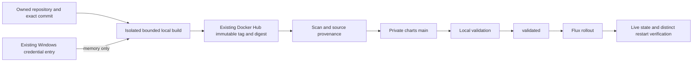

# Owned qBittorrent monitor publication — October27, 2026

The production monitor now comes from its own repository and the existing Docker
Hub namespace. This replaces the ad hoc local-only image; qBittorrent itself,
its credentials, alerts settings and torrents were not restarted or rewritten.

- Source: [jtmb/qbit-monitor](https://github.com/jtmb/qbit-monitor/tree/f365b49bad13eab9d5e7083ecebeb4db2cc9fa69), commit `f365b49bad13eab9d5e7083ecebeb4db2cc9fa69`.
- Published image: `docker.io/jtmb92/qbit-monitor:git-f365b49bad13eab9d5e7083ecebeb4db2cc9fa69@sha256:397c69f6b04bd0ae328c48c3f492795d73fbbc2e19da10b5ae3a08619914b1fe`.
- Maintained pinned Alpine3.24 base; all nine accepted shell scripts match the old production files byte for byte. Shell and publisher syntax checks passed.
- Remote manifest/config bytes and repository/revision labels were independently checked after publication. No GitHub Actions, new registry, plaintext credential file, default-builder change or local saved-image deployment was used.
- Private charts production revision `80dfe1b6206ccb366cd9d9092911e3b1fd1e9c4e`; independent restart revision/current main/validated/live `76d06d618bda73384ccb34e76aaf411db9b53192`. Only the image/chart version and then one Pod restart annotation changed.

`ops/publish.py`, `ops/windows-docker-credential.py`, build definition, source
repairs and update instructions live in the owned application repository. The
new immutable source tag is never overwritten. The helper uses only the existing
Credential Manager Docker Hub entry and passes credentials to the client in
memory; secret values are absent from argv, Git, Docker config and receipts.
The builder used the existing pinned BuildKit, 3GiB RAM/zero swap, 1.5CPUs,
512processes and a2GiB allocated build budget, with15GiB retained floors on C:
and both F: filesystems. Context/cache/client/sockets stayed on the existing
declared F-backed root; its exact new container was stopped and removed.

## Actual production and restart acceptance

Production Pod `2d0bab6e-7b5a-4e08-a759-5e3421a25b29` and distinct restarted
Pod `65a9799c-9dc8-4d68-98da-698bd51e9f00` each passed two real queue cycles,
native login, VPN forwarded-port synchronization and unauthenticated API denial.
All nine script hashes, all12653 original notification-state bytes and their
owner/mode, both PVC/PV identities/specs, native Secret UIDs/resourceVersions/types
and every original alerts/resource/mount/affinity field were preserved. No extra
Discord test message was sent. The original qBittorrent Pod remained unchanged.

The first restart observer selected the previous healthy Pod before Flux replaced
it and correctly refused acceptance. Its source/log remain. The corrected observer
waited for a distinct UID before evaluating the same acceptance checks; it did not
request another restart or relax an application/data requirement.

The exact published image scan completed against the pinned, then-fresh October26
feed and all34 installed packages, with no suppression and no reported CVEs or
KEV matches. This is bounded scan evidence, not a promise about unknown zero-days.

## Evidence and cleanup

Evidence root: `/home/brajam/.local/share/branconet-migration/local-image-build-offload-20261025/owned-qbit-release-20261027`.

Publication source/resource/registry receipts remain under
`qbit-monitor-f365b49bad13-c7a940d1ed4e/artifacts`. Original Git source and its
lockfiles, scan inputs/results, failure evidence, backups and published runtime
are retained. Detailed removed paths, measured allocation and regeneration
commands are in `operator-control/owned-qbit-{build,publisher,review}-scratch-reconciliation.json`.

Removed **391942144 allocated Linux bytes**: build state/context/client/socket
36343808B; two terminal publisher stages355409920B; scan/empty Ansible scratch
188416B. This does not claim Windows free-space recovery. The first cleanup
inactivity guard retained all four build targets before deletion because it found
a matching native command. A fresh full check after that launcher exited passed;
no process/workload was stopped to force cleanup. Exact prior failure is retained.

Retained exceptions: minimal unique publication/validation/source manifests and
scan/Ansible receipts; the original application repositories; existing
`operator-control/tmp/system-commandline-sentinel-files`, whose creator/regeneration
and complete inactive Windows-handle proof remain unresolved. Its parent is not
empty. No denied target, old failed cache, shared image or volume was pruned.

At00:39UTC all three nodes were Ready without pressure, all57claims Bound,
all30HelmReleases and all Kustomizations Ready,27attached Longhorn volumes
healthy and16detached (43total). Four older failed diagnostic Pods remain intentionally preserved.
Final browser acceptance, remaining owned Ruckus/site releases, remaining platform
security and Windows client trust remain open. BORTUS production remains held by
its separate owner; the full goal is active.

Combined checkpoint recovery metadata:2540340bytes,
SHA256`515f5d58d22946cbd1de2087eb6486baa1c8e4053bd17c6d2f96a98c6a4756f0`;
every metadata member and full authenticated NAS read-back passed. Existing
protected recovery-key backup was reused and verified; originals were retained.
