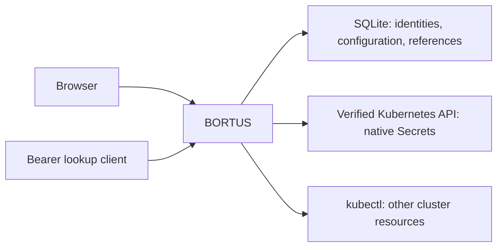

# BORTUS technology stack

The selected-path workbench uses next/dynamic in a Client Component and mounts only after Values and versions, following the versioned Next15 lazy-loading guide. Its private requests bypass shared metadata queries. This integration adds no dependency or migration; the recorded combined Node22 unit/build/HTTP and native-browser subset passed. Full KV polling still needs shared lifecycle/hidden-page dedup qualification; final image and controlled browser CPU/LCP remain open.

The pure metadata-query admission helper checks resolved paths, retaining existing named/resource metadata contracts while rejecting private KV, key/job output, YAML/log/exec and normalized alternate URL spellings. It adds no dependency. The preceding combined 125-unit/lint run passed, but build rejected a fixture's typed constructor/toString property comparison; own-entry Map checks correct that synthetic assertion. The corrected full source is being requalified and the failure is retained.

Independent backend security follow-up, 2026-10-10: selected fields and SHA256 of the local `evidence/bortus-backend-security-qualification.json` report were inspected. This follow-up remains uncommitted and is separate from a82a6cb's functional Linux proof. The coordinator reports shipped deepmerge-ts 7.1.5 stack overflow and startup migration loading/invoking the merger. No HTTP exploit was demonstrated; runtime exposure remains unresolved. An isolated exact 8.0.0 substitution and scoped `@prisma/config@6.19.3` override reportedly preserve Prisma/client and migrate with/without synthetic config; app install/lockfile/full-regression qualification is still required. Trivy scan_completed is true, vulnerability_gate_passed false, with no production credentials/access. The documented inventories contain 340 Debian, 22 Node and 19 kubectl package findings; only one Node finding is under the app, the other 21 under global npm. Vendor/architecture observations qualify specific entries: three perl-base findings have Debian's u4 fix; one requires a 32-bit precondition absent on this amd64 image; the zlib/minizip finding has a specific Debian build qualification. These are presence findings, not blanket exploit or clean-image proof. A separate maintenance executor owns supported base refresh, scoped override compatibility, package provenance and final fixed-image rescan. No dependency, OS or kubectl package changes in the metadata UI stage.

The KV metadata UI uses existing React/Next/shared metadata queries and abortable explicit requests, adding no dependency or migration. A pure named-route/filter guard admits only read-only KV metadata to cache; values, adoption, operation resolution, transfer and rotation remain excluded. Tables render up to 100 records in the requested cursor page. Local Node22 118-test/build/HTTP/browser qualification passed; build estimates are 6.19 KiB route/118 KiB first load. This does not certify controlled first-load/CPU/RSS improvement or the final image.

The locally qualified static rotation workflow uses Node crypto, the existing native CAS/history protocol and metadata-only KvRotation state. An additive forward migration records consumer UID/RV for explicit reload/recovery; no dependency is added. Named workload reload uses structured kubectl JSON Patch conditions and returns only selected identity/marker metadata. Local unit/build/HTTP qualification passed; final-image/live acceptance remains pending.

BORTUS is the Kubernetes management application at `k8s-rewrite/front-end/`. Its source and documentation are included in `main` alongside the existing Swarm homelab. Kubernetes provisioning, charts and live Flux source configuration are maintained separately; this application publication does not replace those systems.

Native Secret transport uses Node HTTPS/JSON with the Kubernetes SDK's credential, CA, client-certificate and proxy handling. This preserves valid `__proto__` map keys that the SDK's generated serializer drops; direct JSON also preserves unknown canonical metadata. Request, queue, body and pagination bounds are documented in the [Secrets engine](SECRETS-ENGINE.md).

| Component | Declared version | Role |
|---|---|---|
| Node.js | 22.23.3/bookworm-slim, pinned by SHA256 | Application runtime; installed Debian packages refreshed during build |
| Next.js | 15.5.27 | App Router and standalone server |
| React / React DOM | ^18.3.0 | Dashboard UI |
| TypeScript | ^5.7.0 | Strict type checking |
| Prisma / Prisma Client | ^6.0.0 | SQLite schema and migrations |
| Tailwind CSS | ^3.4.0 | Dark zinc and indigo theme |
| PostCSS | ^8.5.29 | Build-time CSS processing; Next's older pinned PostCSS is overridden to this same compatible major |
| jose | ^6.2.3 | HS256 session JWTs |
| bcryptjs | ^3.0.3 | User password hashing |
| @kubernetes/client-node | ^1.4.0 | Native Secret API client |
| node-fetch | 2.7.0 | Retained direct dependency; native transport now uses Node HTTPS |
| zod | ^3.23.0 | Input validation |
| tsx | ^4.20.6 | Node test runner and TypeScript execution |
| ESLint / eslint-config-next | 9.39.5 / 15.5.27 | Direct noninteractive CLI with Next Core Web Vitals and hook lifecycle rules |
| kubectl | v1.37.1 Docker default, checksum verified | Other dashboard resource operations; compatible with the 1.37 API server |

`package-lock.json` records resolved dependency versions. The scoped `@prisma/config@6.19.3` override resolves DeepmergeTS 8.0.0 while retaining Prisma/client 6.19.3. Override Docker `KUBECTL_VERSION` for a separately qualified supported patch within one minor of every API server; see the official [patch releases](https://kubernetes.io/releases/) and [skew policy](https://kubernetes.io/releases/version-skew-policy/#kubectl). Cluster, CNI, storage and Flux versions belong to the operator's deployment configuration rather than this application package.

The Docker base is `node:22.23.3-bookworm-slim@sha256:c3de60bf2f9dd0ac6370e6117950ff62d6e339527e7472301c9c78a017978392`. Builds upgrade installed Debian packages and enforce `perl-base >= 5.36.0-7+deb12u4`, the [Debian fixed version](https://security-tracker.debian.org/tracker/DSA-5902-1). APT security resolution remains time-dependent; record the resulting inventory/image digest for each artifact. npm, npx, Corepack and Yarn are removed only from the final runtime; local Prisma migrations and the standalone server use Node directly. Source/runtime qualification and package findings for this maintenance stage are recorded separately from historical audits and final integrated release acceptance.

The checked-in flat ESLint configuration follows the [versioned Next 15 guide](https://nextjs.org/docs/15/app/api-reference/config/eslint). The lint command invokes ESLint directly and treats warnings as failures; strict TypeScript remains a separate check. Optional legacy YAML syntax-highlighter dependencies are removed because no source imports them. Next 15's ESLint peer contract supports ESLint through major 9; npm reports that 9.39.5 is no longer supported upstream. This tooling maintenance constraint remains explicit rather than bypassing peer dependencies to major 10. The app-only GitHub quality workflow defines lockfile install, lint, build/typechecks and unit/production-HTTP fixtures on Node 22.23.3/Linux, with read-only repository permissions and synthetic credentials. It never publishes an image, imports values or deploys. A [clean Node22 Windows run](implementation-evidence/quality-node22.json) passes every command and matches the tested source by SHA256; external Linux CI/image acceptance remains pending.

## Dependency review, 2026-10-10

Alias and readiness metadata caching passed local unit and production HTTP/TLS checks with bounded coalescing, refresh deadlines and no stale-error fallback. Alias files use bounded Node streams and fatal UTF-8 decoding; readiness uses PartialObjectMetadataList instead of fetching Secret values. Independent shared browser metadata queries and 100-reference alias pages passed local readonly/mobile browser checks. No dependency was added.

Native history GC now uses bounded mandatory PartialObjectMetadataList negotiation before selected immutable-object verification/deletion; no dependency was added. This API stage passed local unit and production HTTP/TLS qualification. Readiness and ordinary alias metadata bounds also passed local checks; image, memory and real-cluster acceptance remain pending.

Compatible lockfile updates keep Next 15.5.27, React 18, Prisma 6.19.3 and Tailwind 3.4.19. PostCSS 8.5.29 replaces Next's pinned 8.4.31 through a scoped override to the declared PostCSS dependency. Nanoid 3.3.20, source-map-js 1.2.2, Browserslist 4.29.3 and baseline-browser-mapping 2.11.28 remove their reported advisories. No forced major upgrade or tool downgrade was used. [Frozen audit metadata](implementation-evidence/dependency-review.json) records before/after results: all dependencies 16→12 findings (10 high, 2 moderate after adding the lint toolchain); production 7→3 high findings. Counts include dependency chains and do not mean 12 independent defects.

| Remaining root advisory | Local reachability and disposition |
|---|---|
| [DeepmergeTS recursive object graphs](https://github.com/advisories/GHSA-ggr8-5vv4-36mx) | The historical review retained Prisma → @prisma/config → DeepmergeTS 7.1.5. Runtime maintenance replaces that transitive copy with 8.0.0 through a parent-version-scoped override; Prisma CLI remains in the image for migrations. Ordinary config/CLI, full app and image qualification must accompany the override. No vulnerability payload testing is used. |
| [Braces deeply nested patterns](https://github.com/advisories/GHSA-vfj7-8cjw-p6xm) | Braces/micromatch/fast-glob/chokidar are reached by Tailwind source scanning and Next's lint plugin. Inputs are repository/build configuration; no dashboard endpoint accepts glob patterns for these libraries. Retained tooling risk; do not run trusted build tooling on untrusted source/config without isolation. Audit suggests Tailwind 4 or downgrading the matching Next lint package, which is outside this compatible stage. |
| [PostCSS selector quadratic parsing](https://github.com/advisories/GHSA-rj75-hqrm-r3gf) | Tailwind 3/postcss-nested retain selector-parser 6.1.4; patched major 7 is outside their dependency contract. Only trusted build CSS is processed here, consistent with the advisory's reachability qualification. No CSS upload/sanitizer/playground request path was found. Retained build risk and future-input constraint. |

Package results do not replace the separate image/OS scan. ESLint 9's upstream retirement, the remaining advisories and the PostCSS override need continuing maintenance. Clean lockfile installation and validation are recorded separately; a dependency declaration alone is not compatibility evidence.

SQLite stores users/password hashes, roles, nonsecret configuration, jobs and explicit Secret reference metadata. Native Kubernetes Secrets store credential values. Signing/lookup keys are supplied externally; no SQLite-to-cluster pushes or startup DB/SSH kubeconfig bootstrap run.

The KV foundation adds metadata-only mount/path/field/policy/service-grant/operation/audit/rotation tables, scoped identity credential hashes and a forward user engineAdmin flag. Logical paths reject alternate encodings/Unicode spellings before complete-segment policy checks. Default deny and explicit deny override apply to value actions; tokens intersect their own grant with fresh owner privileges. Effective engine administration gates infrastructure and peer identity tools that could extract credentials or impersonate a broader-policy user. Native versioning/adoption/import/export/rotation/UI remain the next stage; foundation tables never ingest values.

Middleware explicitly uses the supported [Next 15.5 Node runtime](https://nextjs.org/docs/15/app/api-reference/file-conventions/middleware) to verify current SQLite account/session versions on protected requests. Account mutations use a seeded SQLite serialization row and a transaction for bootstrap/last-writer invariants. Session versions are metadata, not signing material or authority.

Cluster resource snapshots and the structured kubectl process pool live in globalThis to survive module isolation/HMR. Reads request named resource sets; each resource coalesces concurrent work, retains bounded stale data and backs off independently on failure. The CLI pool allows four active and 64 queued commands, includes queue time in deadlines and bounds output to two MiB. Native Secrets retain their independent verified API client. See [API contracts](API-USAGE.md).

Browser metadata queries share session/resource subscriptions, one in-flight request per URL, completion-based polling, hidden-page cancellation, generation checks, bounded inactive entries and retry backoff. Public native Secret lists contain metadata only; the client starts with 20 full native objects per page and immediately projects key names/type/identity, without value retention across namespaces. Only locally detected oversized successful full-list GET responses reduce the page size (20/10/5/2/1), retaining the cursor and reduced size for that namespace. A shared 32-MiB received-wire/10,000-accepted-item/15-second budget covers the selected scope, including rejected page prefixes. This read strategy passed local 100-test/build/HTTP and 24 controlled Linux measurements: small-object requests/latency improve, while large-record retries increase transfer/CPU/memory. See secret-adaptive-read.json and API-USAGE.md; full-server/live resource acceptance remains separate. No metadata-negotiation fallback or mutation retry is introduced. The shared browser hook refuses value-key queries. Revealed values, credentials, logs, YAML and exports are excluded from that cache. UI migration and lifecycle acceptance are in progress; see the implementation ledger.

Resource actions import their dropdown/dialog code after first activation. Administration/inventory editors and confirmations load only when opened. YAML/log content and xterm shells remain conditional imports. This changes optional feature timing; build estimates and actual browser interaction are recorded separately in the implementation evidence.

Native Secret metadata reuses the shared searchable/sortable resource table with at most 100 object rows and 100 key rows for one explicitly opened object. Only metadata enters these rows; private values retain the separate explicit editor flow. [Local qualification](implementation-evidence/secret-tables.json) passed without new dependencies or API/schema changes. Shared table reuse adds approximately 10 KiB to the Secret route's first-load estimate (120 KiB); DOM paging is not a CPU/LCP/RSS improvement claim.

Administration mutations use one abortable task per view, a 20-second deadline and generation/identity checks. Completion after unmount or a previous activation cannot update a new form. A timed-out or partial operation is never labelled saved or retried automatically; the operator checks the actual state before another explicit request. Values/passwords are local form state, not shared query data.

Provisioning history shares metadata queries without captured output. Explicit log reads use bounded SQLite substrings and Unicode code-point cursors; streams follow consumer backpressure and completion-based polling with unified cancellation. The browser keeps one bounded text tail in component memory and closes its EventSource on completion/error/unmount/hidden-page transitions. The optional local runner now generates a fixed producer callback and consumes bounded exact lifecycle/role records; raw stdout/stderr and task/module/exception text are withheld before persistence. Isolated Ansible-core 2.20.0 producer and Windows production consumer/storage/stream checks passed; full deployed Linux runner/image qualification remains separate. Historical raw output is unchanged and no storage migration is introduced.

The lint gate enforces complete hook dependencies. Metadata row arrays are memoized, and the stream effect depends on the stable refetch function rather than the changing query wrapper; ordinary metadata refreshes must not reopen an EventSource. Terminal initialization retains only functions it actually uses.

Sidebar and paginated resource-table links disable speculative Next prefetch. Browser inspection found unrelated overview/settings/users/Flux code and many detail requests loading on a resource page before navigation. Navigation still uses ordinary Next links, with destination loading at activation; this avoids metadata/DB work proportional to visible rows.

The image exposes port 4000, uses UID/GID 1000 and a persistent SQLite volume at `/data`. See [deployment contract](BORTUS-DEPLOYMENT.md) for probes, credentials and namespace-scoped RBAC.

The separate private `jtmb/branconet-charts` repository owns deployment charts,
values and Flux configuration. Its main → CI → validated → Flux pipeline is the
only application deployer. This repository's BORTUS source/build work is independent;
see [Flux contract and image releases](FLUX-GITOPS.md).

Forward migration 20261010230000_legacy_access_audit adds nullable authorization metadata principal/alias/key on KvAudit. Existing metadata and native values are preserved. Fresh serialized legacy controls use SHA-256 fingerprints of authorization metadata including mount revision/scope, canonical request field order, bounded fresh alias reads, 100-row preview pages and exact affected-alias acknowledgements. There is no new package, credential store or native verb. [Local qualification passed](implementation-evidence/kv-legacy-access.json); final image remains pending.

## Standalone KV workbench

The standalone [KV workbench](BORTUS-KV-WORKBENCH.md) uses existing React/Radix/Tailwind and browser Blob/TextEncoder APIs. Its exclusive browser harness uses existing esbuild/Tailwind plus externally available Playwright and installed Chrome; it adds no package or manifest dependency.
