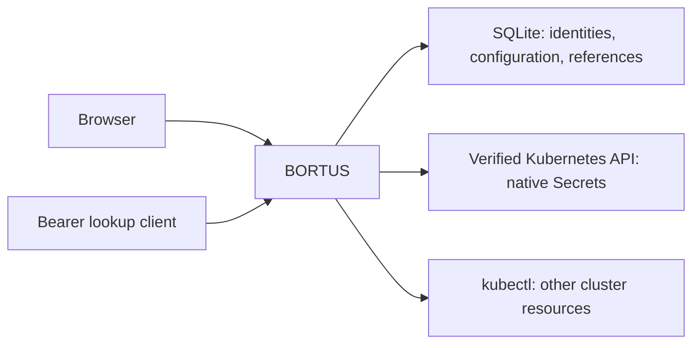

# BORTUS technology stack

BORTUS is the Kubernetes management application at `k8s-rewrite/front-end/`. Its source and documentation are included in `main` alongside the existing Swarm homelab. Kubernetes provisioning, charts and live Flux source configuration are maintained separately; this application publication does not replace those systems.

| Component | Declared version | Role |
|---|---|---|
| Node.js | 22 (Docker image) | Application runtime |
| Next.js | 15.5.27 | App Router and standalone server |
| React / React DOM | ^18.3.0 | Dashboard UI |
| TypeScript | ^5.7.0 | Strict type checking |
| Prisma / Prisma Client | ^6.0.0 | SQLite schema and migrations |
| Tailwind CSS | ^3.4.0 | Dark zinc and indigo theme |
| PostCSS | ^8.5.29 | Build-time CSS processing; Next's older pinned PostCSS is overridden to this same compatible major |
| jose | ^6.2.3 | HS256 session JWTs |
| bcryptjs | ^3.0.3 | User password hashing |
| @kubernetes/client-node | ^1.4.0 | Native Secret API client |
| node-fetch | 2.7.0 | Verified HTTPS transport |
| zod | ^3.23.0 | Input validation |
| tsx | ^4.20.6 | Node test runner and TypeScript execution |
| ESLint / eslint-config-next | 9.39.5 / 15.5.27 | Direct noninteractive CLI with Next Core Web Vitals and hook lifecycle rules |
| kubectl | v1.34.1 Docker default | Other dashboard resource operations |

`package-lock.json` records resolved dependency versions. Override Docker `KUBECTL_VERSION` to match the target cluster. Cluster, CNI, storage and Flux versions belong to the operator's deployment configuration rather than this application package.

The checked-in flat ESLint configuration follows the [versioned Next 15 guide](https://nextjs.org/docs/15/app/api-reference/config/eslint). The lint command invokes ESLint directly and treats warnings as failures; strict TypeScript remains a separate check. Optional legacy YAML syntax-highlighter dependencies are removed because no source imports them. Next 15's ESLint peer contract supports ESLint through major 9; npm reports that 9.39.5 is no longer supported upstream. This tooling maintenance constraint remains explicit rather than bypassing peer dependencies to major 10. The app-only GitHub quality workflow defines lockfile install, lint, build/typechecks and unit/production-HTTP fixtures on Node 22.23.3/Linux, with read-only repository permissions and synthetic credentials. It never publishes an image, imports values or deploys. A [clean Node22 Windows run](implementation-evidence/quality-node22.json) passes every command and matches the tested source by SHA256; external Linux CI/image acceptance remains pending.

## Dependency review, 2026-10-10

Compatible lockfile updates keep Next 15.5.27, React 18, Prisma 6.19.3 and Tailwind 3.4.19. PostCSS 8.5.29 replaces Next's pinned 8.4.31 through a scoped override to the declared PostCSS dependency. Nanoid 3.3.20, source-map-js 1.2.2, Browserslist 4.29.3 and baseline-browser-mapping 2.11.28 remove their reported advisories. No forced major upgrade or tool downgrade was used. [Frozen audit metadata](implementation-evidence/dependency-review.json) records before/after results: all dependencies 16→12 findings (10 high, 2 moderate after adding the lint toolchain); production 7→3 high findings. Counts include dependency chains and do not mean 12 independent defects.

| Remaining root advisory | Local reachability and disposition |
|---|---|
| [DeepmergeTS recursive object graphs](https://github.com/advisories/GHSA-ggr8-5vv4-36mx) | Prisma → @prisma/config → deepmerge-ts accounts for all three production entries. Installed Prisma config code loads a repository-owned prisma.config JS/TS file with this merger; none exists here. App source imports PrismaClient, not Prisma config/deepmerge, and user JSON/config entries never become those executable config files. No request path was found. Prisma CLI remains in the image for migrations, so this is retained and documented, not described as absent from production. Reassess any future externally supplied executable config. |
| [Braces deeply nested patterns](https://github.com/advisories/GHSA-vfj7-8cjw-p6xm) | Braces/micromatch/fast-glob/chokidar are reached by Tailwind source scanning and Next's lint plugin. Inputs are repository/build configuration; no dashboard endpoint accepts glob patterns for these libraries. Retained tooling risk; do not run trusted build tooling on untrusted source/config without isolation. Audit suggests Tailwind 4 or downgrading the matching Next lint package, which is outside this compatible stage. |
| [PostCSS selector quadratic parsing](https://github.com/advisories/GHSA-rj75-hqrm-r3gf) | Tailwind 3/postcss-nested retain selector-parser 6.1.4; patched major 7 is outside their dependency contract. Only trusted build CSS is processed here, consistent with the advisory's reachability qualification. No CSS upload/sanitizer/playground request path was found. Retained build risk and future-input constraint. |

Package results do not replace the separate image/OS scan. ESLint 9's upstream retirement, the remaining advisories and the PostCSS override need continuing maintenance. Clean lockfile installation and validation are recorded separately; a dependency declaration alone is not compatibility evidence.

SQLite stores users/password hashes, roles, nonsecret configuration, jobs and explicit Secret reference metadata. Native Kubernetes Secrets store credential values. Signing/lookup keys are supplied externally; no SQLite-to-cluster pushes or startup DB/SSH kubeconfig bootstrap run.

The KV foundation adds metadata-only mount/path/field/policy/service-grant/operation/audit/rotation tables, scoped identity credential hashes and a forward user engineAdmin flag. Logical paths reject alternate encodings/Unicode spellings before complete-segment policy checks. Default deny and explicit deny override apply to value actions; tokens intersect their own grant with fresh owner privileges. Effective engine administration gates infrastructure and peer identity tools that could extract credentials or impersonate a broader-policy user. Native versioning/adoption/import/export/rotation/UI remain the next stage; foundation tables never ingest values.

Middleware explicitly uses the supported [Next 15.5 Node runtime](https://nextjs.org/docs/15/app/api-reference/file-conventions/middleware) to verify current SQLite account/session versions on protected requests. Account mutations use a seeded SQLite serialization row and a transaction for bootstrap/last-writer invariants. Session versions are metadata, not signing material or authority.

Cluster resource snapshots and the structured kubectl process pool live in globalThis to survive module isolation/HMR. Reads request named resource sets; each resource coalesces concurrent work, retains bounded stale data and backs off independently on failure. The CLI pool allows four active and 64 queued commands, includes queue time in deadlines and bounds output to two MiB. Native Secrets retain their independent verified API client. See [API contracts](API-USAGE.md).

Browser metadata queries share session/resource subscriptions, one in-flight request per URL, completion-based polling, hidden-page cancellation, generation checks, bounded inactive entries and retry backoff. The native Secret list is metadata only; the shared hook refuses value-key queries. Revealed values, credentials, logs, YAML and exports are excluded from that cache. UI migration and lifecycle acceptance are in progress; see the implementation ledger.

Resource actions import their dropdown/dialog code after first activation. Administration/inventory editors and confirmations load only when opened. YAML/log content and xterm shells remain conditional imports. This changes optional feature timing; build estimates and actual browser interaction are recorded separately in the implementation evidence.

Administration mutations use one abortable task per view, a 20-second deadline and generation/identity checks. Completion after unmount or a previous activation cannot update a new form. A timed-out or partial operation is never labelled saved or retried automatically; the operator checks the actual state before another explicit request. Values/passwords are local form state, not shared query data.

Provisioning history shares metadata queries without captured output. Explicit log reads use bounded SQLite substrings and Unicode code-point cursors; streams follow consumer backpressure and completion-based polling with unified cancellation. The browser keeps one bounded text tail in component memory and closes its EventSource on completion/error/unmount/hidden-page transitions. Real Ansible output persistence remains unchanged; no incremental storage migration is introduced by this read-path correction.

The lint gate enforces complete hook dependencies. Metadata row arrays are memoized, and the stream effect depends on the stable refetch function rather than the changing query wrapper; ordinary metadata refreshes must not reopen an EventSource. Terminal initialization retains only functions it actually uses.

Sidebar and paginated resource-table links disable speculative Next prefetch. Browser inspection found unrelated overview/settings/users/Flux code and many detail requests loading on a resource page before navigation. Navigation still uses ordinary Next links, with destination loading at activation; this avoids metadata/DB work proportional to visible rows.

The image exposes port 4000, uses UID/GID 1000 and a persistent SQLite volume at `/data`. See [deployment contract](BORTUS-DEPLOYMENT.md) for probes, credentials and namespace-scoped RBAC.

The separate private `jtmb/branconet-charts` repository owns deployment charts,
values and Flux configuration. Its main → CI → validated → Flux pipeline is the
only application deployer. This repository's BORTUS source/build work is independent;
see [Flux contract and image releases](FLUX-GITOPS.md).
