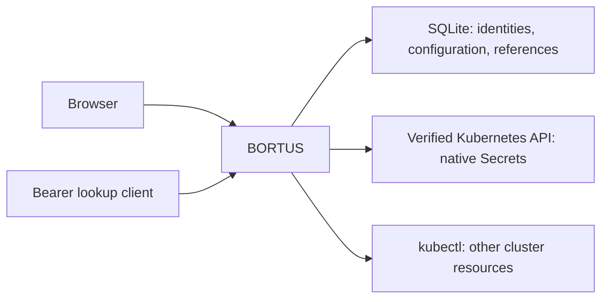

# BORTUS technology stack

## Current finite A19 sensitivity qualification

Hosted run `38770022640` now qualifies seven finite source-regression sensitivities: the unchanged five flat cases plus A02 deleted-account and A03 bootstrap-writer DB cases. Validation commit `3420513ec034439c38e0cd2adc17aa2c96b9136e` has the complete frontend tree `2dd777cadd669b214631401a98f85bf4a4eeda78` equal to owning commit `e386e5bfdcaf07e01054f98f1e537452334db171`, with workflow blob `a8198320c23d28628750ae86e573e038208ea032`. Normal locked build/lint/types and unchanged342+8 passed. All seven pristine executions exited0 and all seven disposable mutants exited1 at their declared unchanged assertions; original inputs and restoration checks passed, with no skips/cancellations, signals or spawn errors. The A02 account parent has pristine5/5/0 and mutant5/3/2 tests/pass/fail, including only its final post-deletion child assertion plus parent aggregate. The A03 registration parent has11/11/0 and11/4/7, including six declared open-registration child assertions plus parent aggregate; the other four children pass. The exact166-byte SQLite warning is retained in both A02 executions; A03 and all five flat cases have empty stderr. The five flat pairs took3493ms and the four DB executions6362ms in this observation, within separate unchanged240-second/20-second-reserve runners,30-second children,1MiB per stream and five-minute2CPU/1GiB/no-swap/PID256/networknone steps. The original90-second accounts and30-second registration parent timers and all342+8 bodies/flags remain unchanged. The initial metadata parser refused a timestamp BOM; its correction parsed the same retained hosted log without refetch or CI rerun. Default log/result scan `135142` passed0/zero; the committed-source authority is fresh raw394-file scan `1dbbd8`, not the earlier normalized snapshot `5aa92f`. Prior three/five qualifications and source-only preparation receipts remain immutable and source-specific. These unit/VM and synthetic DB checks do not establish A01 cross-process sensitivity, browser CI smoke, universal mutation/redaction coverage or complete A19. Actual AT, the two warm performance regressions, image/security/recovery/live and adoption limits remain open. [Seven-regression hosted qualification](implementation-evidence/a19-seven-regression-sensitivity-qualification.json) records the exact cases and limits.

Hosted browser CI remains unqualified: run `38781205292` recorded Pods HTTP503, app `/tmp` noexec and fake-CLI EACCES. The new source-only correction adds explicit exec only to the disposable app tmpfs; driver, diagnostic, assertions, ownership, limits and production mounts are unchanged. It has not run. Exact prior failures and recorded cleanup scope are retained in [the CI fixture source receipt](implementation-evidence/a19-browser-ci-app-tmp-exec-source.json). Actual AT, performance and adoption remain open.

The five-case sensitivity extension is now hosted-qualified on run `38764208687`, validation commit `aa13eb7326997960a11c9298ac909488a5c9f4c0`, with the complete frontend tree `b78f417d7e4a1e9e41cb98dacf32a7b5ec1dcf7f` equal to owning commit `cfabf77658bff5e8742b350447af12954e9e62cc` and workflow blob `cd8d2979fd498ecfe5c73decd04460ce4d6b77c7`. All five pristine controls exited0 and all five disposable mutants exited1 at their exact unchanged named assertion, operator and ERR_ASSERTION location; there were no skips/cancellations, signals, spawn errors, stderr or restoration failures, and original inputs stayed exact. The ten children completed in3534ms in this observation under the unchanged240-second whole/20-second reserve,30-second child,1MiB per-stream, five-minute step and2CPU/1GiB/no-swap/PID256/networknone/readonly-checkout bounds. Normal locked build/lint/types and342+8 passed with unchanged flags and test bodies. The434050-byte retained hosted log and numeric result passed the default unsuppressed two-file scanner0/zero, with source current and scanner noLive. The added deployment case executes actual route source through its existing TypeScript/VM unit fixture with real Next responses and validators but controlled auth/CLI/cache dependencies; it does not establish a compiled deployment action or real-cluster outcome. The private KV cache case exercises actual admission modules on a synthetic named `/data` path without reading private values. Fourteen pinned LF inputs, the exact literal route allowance and original three mutant definitions/shared run/assert/restore logic remain bound. Earlier three-case hosted evidence and both source-only preparation records stay unchanged and source-specific; no local test replay was performed. Other meaningful source-regression coverage and original A19/manual/actual AT/performance/image/recovery/live/adoption gates remain open. [Five-regression hosted qualification](implementation-evidence/a19-five-regression-sensitivity-qualification.json) retains the exact cases and limits.

The one-prop overview correction at `ea628d2411238a6776acf3cf742adb03cbe5d6af` (frontend `2d47cae1abf1ed2d969ee552e41104fd29791713`) now has a fresh local build/native-load/342-unit/8-HTTP pass and independent current/process closure. Hosted clean CI run `38750289826` passed the unchanged342+8 checks on lean validation commit `2f4d84f2e9c0c6cc86810f8119b707909145f01a`, whose complete frontend bytes/modes equal that payload. Four finite actual-browser cases also passed: terminal success200 and failed-command502/redaction, then real inventory DELETE500 with six-table rollback and retained dialog/input/in-dialog error, followed by one explicit retry200 after removing the synthetic abort trigger. The premature-launch workflow remains failed and preserved; it created no business browser job. Independent exact/Linux/Windows/final closure passed for the fresh four-case owner. These results do not transfer historical6e receipts to new source or close whole A05/A19, actual AT, performance, image, live or adoption acceptance.

The prior qualified three-case `npm run test:regression-sensitivity` command runs in a separate read-only CI step for three disposable mutations only: A04 permissive name admission, A05 failed subprocess stdout treated as success, and A06 outage treated as an empty list. Each runs its unchanged named test on a pristine copy and then its single mutant; success requires exactly the pinned assertion location, operator, ERR_ASSERTION and expected witness, not an arbitrary exit1. Nine LF input files and unique replacements/mutant hashes are pinned; the copies resolve installed dependencies through a node_modules link to the read-only checkout. Only this filtered step uses Node22.23.3 `--experimental-test-isolation=none` so the selected test runs inside each directly awaited child OS process; normal342+8 flags stay unchanged. TSX may use threads in the same process. Timeout, spawn error, signal, output overflow or unexpected stderr refuse, and a child return is not a universal descendant-absence proof. The six sequential children each have a30-second limit and1MiB per-stream cap, within a240-second runner deadline with20 seconds reserved and a five-minute CI step; the isolated container retains2CPU/1GiB/no swap/PID256/networknone. Every copy is restored/verified even on failure and removed; original selected bytes are checked. Complete bounded synthetic TAP/status records are printed to hosted logs; temp records last only for the container lifetime. Hosted run `38760696046` now passed this exact committed step on validation commit `8f0c0e30cf5cd204d87622eb8b32a60c14988af0`, with the complete frontend tree `8cc04e769bed874ddf513590aaaa69c9a1723cb2` equal to owning commit `e9274f89630157daa4a922a45fada713b48b2ed5` and unchanged workflow blob `1f6ea96c11f125b0457c140cf6c66d23a90570fb`. All three pristine children exited0 and all three mutants exited1 at their exact named assertion; there were no skipped/cancelled tests, stderr, spawn errors or signals. All restore/original-input checks passed. The six controls took1775ms in this observation, within the fixed bounds. Locked build/lint/types and the original342+8 tests also passed. The retained416155-byte hosted log and numeric result passed a default unsuppressed two-file scanner0/zero with current bytes and scanner noLive verified. This is a hosted finite sensitivity pass; no local replay was performed. The historical source-only preparation record stays unchanged. [Hosted three-regression qualification](implementation-evidence/a19-three-regression-sensitivity-qualification.json) records the exact cases and limits. The original342-unit/8-HTTP bodies and steps are unchanged; deliberate sensitivity for remaining source regressions is still open, and manual acceptance clauses are not replaced by these tests.

Fresh public-lock audits retain literal full exit1 with nine development-dependency rows (seven high/two moderate from two advisories) and omit-dev exit0/zero. The coordinator accepted only trusted-source controlled build use through `2026-10-22T23:59:59Z`, with re-review on dependency/input/boundary changes and expiry. Final pruned image package/bundle inspection remains required. No dependency update, clean full-audit claim or image-system waiver follows. Root checkpoint `40e351859c0e295315a2143b346f4b79f4706321` binds these receipts. The original two warm regressions, ten MEDIUM image findings and recovery/other original acceptance gaps remain open.

The frozen `whole-server.mjs` repeats only `/api/cluster/pods` in `warm-pods-12` and `warm-pods-concurrent-20` when the profile has fewer than 10000 Pods. Each profile makes one configuration metadata GET and one native Secret metadata GET; neither has a repeated warm phase. References to warm/concurrent 25-large or 3-large profiles describe their Pod reads, not native metadata reads. A07/A21 remain failed/open; the original driver, assertions and thresholds are unchanged.
Shared-query focus refresh coalesces an active read, including the read started by visibility restoration. It immediately refreshes idle visible subscriptions; explicit invalidation continues to abort/fence old generations. This removes duplicate focus-driven request replacement without changing hidden aborts, metadata-only storage or fresh server authorization. Six focused query regressions, combined170-unit quality and nine actual browser checks passed.

The qualified Flux fixture keeps its 201-root/bundle/inventory metadata within the unchanged generic two-MiB CLI ceiling; the trusted eight-MiB exception remains Pods-only. Its public discovery/reply holds and optional external axe script are test setup, not runtime dependencies or performance acceptance.

Flux hierarchy and repository/bundle details now use the existing shared metadata-query lifecycle instead of independent timers or one-shot fetches. The new Flux table component searches projected public metadata, renders at most 100 rows per table and uses the existing typed comparator for date/numeric fields; ordinary keyboard navigation links disable speculative prefetch. Private repository forms use disposable mutation owners and the existing Radix dialog wrapper. No dependency or framework version changes. Fresh UI/build/test evidence is pending for this source stage; Next 15's versioned Link/client-component documentation was checked because the installed package lacks dist/docs.

The current combined source adds a trusted all-namespace Pod-list read with an 8-MiB UTF-8 output ceiling and at most 10,000 accepted objects. General kubectl reads/mutations remain at 2 MiB. The same four-active/64-queued pool and ten-second Pod collection deadline include queue time and post-parse acceptance; kubectl collects its normal pages, and nonempty continuation/remaining-item metadata, malformed replies, excess items or bytes fail explicitly without truncation. Failed lists retain the existing labelled stale/backoff behavior. The Pod route reads only its resource snapshot and avoids unused overview running-Pod scans; redacted projection/filter/status/quantity/zero semantics and fresh account/sessionVersion checks remain unchanged. The exact combined source passed a fresh Node22 production build, 167/167 units, zero-warning lint, typecheck and all four production HTTP suites. The actual Pod route returned every identity from a 7,931,129-byte/10,000-Pod fixture, retained privacy/filter/zero semantics and kept the complete labelled stale inventory when a later reply was partial. [Combined qualification](implementation-evidence/pod-list-combined-qualification.json) retains the first test DTO mismatch and all raw CLI captures. Unchanged controlled performance and final image/live acceptance remain open; A07 remains failed.

Shared-query freshness follow-up is in progress. A single per-query timer now alternates polling and a 15-second expiry notification, including slow in-flight refreshes and failure backoff. Capability/session consumers receive an explicit stale flag without another request or per-subscriber clock. The workbench shares its parent's capability endpoint and clears private state on page hiding; its separate capability poll and one-second clock are removed. Corrected Node22 source passed 144 units, lint, production build/typecheck and four HTTP suites; actual-route shared freshness browser checks now pass against the recovered production build. See [execution handoff](implementation-evidence/shared-freshness-handoff.json) and [recovered-source browser evidence](implementation-evidence/shared-freshness-browser.json). Current native-status/history shared source passed the separately recorded11-check lifecycle browser qualification; Flux lifecycle has the later local170-unit/browser/zoom checkpoint. Explicit private operations remain outside query caches.

The warm Pod list stage retains a weak-key redacted summary/serialized metadata array for each immutable raw Pod snapshot. Its lifetime follows existing cache replacement and bounded stale retention; it does not add an unbounded query-key cache. Availability/warnings and account checks stay fresh. Diagnostic CPU profiling of checkpoint 1e0030a found repeated metadata projection/summary/serialization work. Exact 61e2588 controlled qualification now completes with improved warm medians but failed sequential p95; final candidate performance acceptance remains open.

The selected-path workbench uses next/dynamic in a Client Component and mounts only after Values and versions, following the versioned Next15 lazy-loading guide. Its private requests bypass shared metadata queries. This integration adds no dependency or migration; the recorded combined Node22 unit/build/HTTP and native-browser subset passed. Shared capability expiry/hidden-page dedup now passed actual-route browser checks; full native-status/transfer lifecycle remains open; final image and controlled browser CPU/LCP remain open.

Administration and audit also uses conditional next/dynamic mounting after explicit entry. Its pre/post fresh-session private requests remain outside shared metadata queries, and metadata callbacks carry only scope names. The integrated browser fixture serves the actual production route with the current build's static assets copied into standalone output; its first missing-asset attempt is retained as failed setup. No dependency or source-runtime contract changed for this entry.

The pure metadata-query admission helper checks resolved paths, retaining existing named/resource metadata contracts while rejecting private KV, key/job output, YAML/log/exec and normalized alternate URL spellings. It adds no dependency. The initial combined build rejected a fixture's typed constructor/toString comparison; own-entry Map checks corrected it. The 6651685 integration passed 127 tests/build/HTTP and native-browser checks, with the earlier failure retained. Later runtime/warm-Pod changes need their own combined qualification.

Independent backend security follow-up, 2026-10-10: selected fields and SHA256 of the local `evidence/bortus-backend-security-qualification.json` report were inspected. This follow-up remains uncommitted and is separate from a82a6cb's functional Linux proof. The coordinator reports shipped deepmerge-ts 7.1.5 stack overflow and startup migration loading/invoking the merger. No HTTP exploit was demonstrated; runtime exposure remains unresolved. An isolated exact 8.0.0 substitution and scoped `@prisma/config@6.19.3` override reportedly preserve Prisma/client and migrate with/without synthetic config; app install/lockfile/full-regression qualification is still required. Trivy scan_completed is true, vulnerability_gate_passed false, with no production credentials/access. The documented inventories contain 340 Debian, 22 Node and 19 kubectl package findings; only one Node finding is under the app, the other 21 under global npm. Vendor/architecture observations qualify specific entries: three perl-base findings have Debian's u4 fix; one requires a 32-bit precondition absent on this amd64 image; the zlib/minizip finding has a specific Debian build qualification. These are presence findings, not blanket exploit or clean-image proof. A separate maintenance executor owns supported base refresh, scoped override compatibility, package provenance and final fixed-image rescan. No dependency, OS or kubectl package changes in the metadata UI stage.

The KV metadata UI uses existing React/Next/shared metadata queries and abortable explicit requests, adding no dependency or migration. A pure named-route/filter guard admits only read-only KV metadata to cache; values, adoption, operation resolution, transfer and rotation remain excluded. Tables render up to 100 records in the requested cursor page. Local Node22 118-test/build/HTTP/browser qualification passed; build estimates are 6.19 KiB route/118 KiB first load. This does not certify controlled first-load/CPU/RSS improvement or the final image.

The locally qualified static rotation workflow uses Node crypto, the existing native CAS/history protocol and metadata-only KvRotation state. An additive forward migration records consumer UID/RV for explicit reload/recovery; no dependency is added. Named workload reload uses structured kubectl JSON Patch conditions and returns only selected identity/marker metadata. Local unit/build/HTTP qualification passed; final-image/live acceptance remains pending.

BORTUS is the Kubernetes management application at `k8s-rewrite/front-end/`. Its source and documentation are included in `main` alongside the existing Swarm homelab. Kubernetes provisioning, charts and live Flux source configuration are maintained separately; this application publication does not replace those systems.

Native Secret transport uses Node HTTPS/JSON with the Kubernetes SDK's credential, CA, client-certificate and proxy handling. This preserves valid `__proto__` map keys that the SDK's generated serializer drops; direct JSON also preserves unknown canonical metadata. Request, queue, body and pagination bounds are documented in the [Secrets engine](SECRETS-ENGINE.md).

| Component | Declared version | Role |
|---|---|---|
| Node.js | 22.23.3/trixie-slim, pinned by SHA256 | Prepared application runtime; separate full Bookworm compiler builder |
| Next.js | 15.5.27 | App Router and standalone server |
| React / React DOM | ^18.3.0 | Dashboard UI |
| TypeScript | ^5.7.0 | Strict type checking |
| Prisma / Prisma Client | ^6.0.0 | SQLite schema and migrations |
| Tailwind CSS | ^3.4.0 | Dark zinc and indigo theme |
| PostCSS | ^8.5.29 | Build-time CSS processing; Next's older pinned PostCSS is overridden to this same compatible major |
| jose | ^6.2.3 | HS256 session JWTs |
| bcryptjs | ^3.0.3 | User password hashing |
| @kubernetes/client-node | ^1.4.0 | Native Secret API client |
| node-fetch | 2.7.0 | Retained direct dependency; native transport now uses Node HTTPS |
| zod | ^3.23.0 | Input validation |
| tsx | ^4.20.6 | Node test runner and TypeScript execution |
| ESLint / eslint-config-next | 9.39.5 / 15.5.27 | Direct noninteractive CLI with Next Core Web Vitals and hook lifecycle rules |
| kubectl | Reviewed source-built v1.37.1 Linux amd64 component, SHA256 verified | Named BuildKit context; other dashboard resource operations |

`package-lock.json` records resolved dependency versions. The scoped `@prisma/config@6.19.3` override resolves DeepmergeTS 8.0.0 while retaining Prisma/client 6.19.3. Supply the coordinator-reviewed source-built kubectl artifact through the named `bortus_kubectl` context and `BORTUS_KUBECTL_SHA256`; preserve supported skew within one minor of every API server; see the official [patch releases](https://kubernetes.io/releases/) and [skew policy](https://kubernetes.io/releases/version-skew-policy/#kubectl). Cluster, CNI, storage and Flux versions belong to the operator's deployment configuration rather than this application package.

The prepared Docker runtime is `node:22.23.3-trixie-slim@sha256:154ba2f4d6fec323d28e4f4bb86bba4677f1223391a1979cf521304e03a98dfa`. It upgrades installed distribution packages and explicitly installs ca-certificates/OpenSSL/Bash, with no curl/download stage. The separately pinned full Bookworm Node22.23.3/GCC builder and native postbuild trace/copy remain unchanged. A named BuildKit context supplies the reviewed kubectl ELF, checked against its full SHA256; no mutable release download or binary Git input is used. npm/npx/Corepack/Yarn are stripped only from runtime; local Prisma migrations and the standalone server use Node directly. Record each actual image/package inventory because APT resolution is time-dependent; no clean-image, native-runtime, performance or release acceptance is inferred from this source delta. Historical Bookworm/Perl-floor maintenance findings below retain their original scope.

[Isolated corrected-source qualification](implementation-evidence/runtime-maintenance/README.md) passed clean Linux Node 22 install/generation/lint/build/types, 114 unit tests, all three production HTTP/TLS fixtures and fresh/legacy eleven-migration restart checks. It verifies one installed/resolved DeepmergeTS 8.0.0 copy and the fixed Perl floor. Current production npm reporting has zero entries; full npm has nine tooling entries (seven high, two moderate). One pinned offline Trivy package scan retains 346 rows: 327 Debian, zero Node-package, 19 kubectl compiled-dependency rows. These are raw findings, with a separate Debian applicability note for the retained critical zlib/minizip row; the image vulnerability gate is not clean. Final combined-source/image/live/recovery acceptance remains external.

The checked-in flat ESLint configuration follows the [versioned Next 15 guide](https://nextjs.org/docs/15/app/api-reference/config/eslint). The lint command invokes ESLint directly and treats warnings as failures; strict TypeScript remains a separate check. Optional legacy YAML syntax-highlighter dependencies are removed because no source imports them. Next 15's ESLint peer contract supports ESLint through major 9; npm reports that 9.39.5 is no longer supported upstream. This tooling maintenance constraint remains explicit rather than bypassing peer dependencies to major 10. The app-only GitHub quality workflow defines lockfile install, lint, build/typechecks and unit/production-HTTP fixtures on Node 22.23.3/Linux, with read-only repository permissions and synthetic credentials. It never publishes an image, imports values or deploys. A [clean Node22 Windows run](implementation-evidence/quality-node22.json) passes every command and matches the tested source by SHA256; external Linux CI/image acceptance remains pending.

## Dependency review, 2026-10-10

The standalone [KV administration component](BORTUS-KV-ADMINISTRATION-UI.md) uses the existing React, Next 15 usePathname and shared session subscription without adding dependencies. Metadata/token state lives only in the mounted component; it does not extend the shared KV query cache. Its test-only browser harness uses the existing esbuild/tsx tooling and disposable production routes. Integrated bundle/image/performance acceptance remains separate.

Alias and readiness metadata caching passed local unit and production HTTP/TLS checks with bounded coalescing, refresh deadlines and no stale-error fallback. Alias files use bounded Node streams and fatal UTF-8 decoding; readiness uses PartialObjectMetadataList instead of fetching Secret values. Independent shared browser metadata queries and 100-reference alias pages passed local readonly/mobile browser checks. No dependency was added.

Native history GC now uses bounded mandatory PartialObjectMetadataList negotiation before selected immutable-object verification/deletion; no dependency was added. This API stage passed local unit and production HTTP/TLS qualification. Readiness and ordinary alias metadata bounds also passed local checks; image, memory and real-cluster acceptance remain pending.

Compatible lockfile updates keep Next 15.5.27, React 18, Prisma 6.19.3 and Tailwind 3.4.19. PostCSS 8.5.29 replaces Next's pinned 8.4.31 through a scoped override to the declared PostCSS dependency. Nanoid 3.3.20, source-map-js 1.2.2, Browserslist 4.29.3 and baseline-browser-mapping 2.11.28 remove their reported advisories. No forced major upgrade or tool downgrade was used. [Frozen historical audit metadata](implementation-evidence/dependency-review.json) records that earlier stage's before/after results: all dependencies 16→12 findings (10 high, 2 moderate after adding the lint toolchain); production 7→3 high findings. The newer maintenance report above supersedes those current counts. Counts include dependency chains and do not mean 12 independent defects.

| Remaining root advisory | Local reachability and disposition |
|---|---|
| [DeepmergeTS recursive object graphs](https://github.com/advisories/GHSA-ggr8-5vv4-36mx) | The historical review retained Prisma → @prisma/config → DeepmergeTS 7.1.5. Runtime maintenance replaces that transitive copy with 8.0.0 through a parent-version-scoped override; Prisma CLI remains in the image for migrations. Ordinary config/CLI, full app and image qualification must accompany the override. No vulnerability payload testing is used. |
| [Braces deeply nested patterns](https://github.com/advisories/GHSA-vfj7-8cjw-p6xm) | Braces/micromatch/fast-glob/chokidar are reached by Tailwind source scanning and Next's lint plugin. Inputs are repository/build configuration; no dashboard endpoint accepts glob patterns for these libraries. Retained tooling risk; do not run trusted build tooling on untrusted source/config without isolation. Audit suggests Tailwind 4 or downgrading the matching Next lint package, which is outside this compatible stage. |
| [PostCSS selector quadratic parsing](https://github.com/advisories/GHSA-rj75-hqrm-r3gf) | Tailwind 3/postcss-nested retain selector-parser 6.1.4; patched major 7 is outside their dependency contract. Only trusted build CSS is processed here, consistent with the advisory's reachability qualification. No CSS upload/sanitizer/playground request path was found. Retained build risk and future-input constraint. |

Package results do not replace the separate image/OS scan. ESLint 9's upstream retirement, the remaining advisories and the PostCSS override need continuing maintenance. Clean lockfile installation and validation are recorded separately; a dependency declaration alone is not compatibility evidence.

SQLite stores users/password hashes, roles, nonsecret configuration, jobs and explicit Secret reference metadata. Native Kubernetes Secrets store credential values. Signing/lookup keys are supplied externally; no SQLite-to-cluster pushes or startup DB/SSH kubeconfig bootstrap run.

The KV foundation adds metadata-only mount/path/field/policy/service-grant/operation/audit/rotation tables, scoped identity credential hashes and a forward user engineAdmin flag. Logical paths reject alternate encodings/Unicode spellings before complete-segment policy checks. Default deny and explicit deny override apply to value actions; tokens intersect their own grant with fresh owner privileges. Effective engine administration gates infrastructure and peer identity tools that could extract credentials or impersonate a broader-policy user. Native versioning/adoption/import/export/rotation/UI remain the next stage; foundation tables never ingest values.

Middleware explicitly uses the supported [Next 15.5 Node runtime](https://nextjs.org/docs/15/app/api-reference/file-conventions/middleware) to verify current SQLite account/session versions on protected requests. Account mutations use a seeded SQLite serialization row and a transaction for bootstrap/last-writer invariants. Session versions are metadata, not signing material or authority.

Cluster resource snapshots and the structured kubectl process pool live in globalThis to survive module isolation/HMR. Reads request named resource sets; each resource coalesces concurrent work, retains bounded stale data and backs off independently on failure. The CLI pool allows four active and 64 queued commands, includes queue time in deadlines and bounds output to two MiB. Native Secrets retain their independent verified API client. See [API contracts](API-USAGE.md).

Browser metadata queries share session/resource subscriptions, one in-flight request per URL, completion-based polling, hidden-page cancellation, generation checks, bounded inactive entries and retry backoff. Public native Secret lists contain metadata only; production reads up to four namespaces concurrently, starts with 200 full native objects per page and immediately projects key names/type/identity, without value retention across namespaces. Only locally detected oversized successful full-list GET responses use the existing 200-to-10/5/2/1 fallback, optionally choosing a smaller positive limit from a bounded completed-item prefix count, retaining the cursor and reduced size for that namespace. Compatibility/default transports start at 20; default SecretStore callers remain serial. A shared 32-MiB received-wire/10,000-accepted-item/15-second budget covers the selected scope, including rejected page prefixes. The earlier adaptive strategy passed local 100-test/build/HTTP and 24 controlled Linux measurements recorded in secret-adaptive-read.json. Current worker/page-window functional qualification passed 140 tests; its completed six-run whole-server comparison still misses the native no-regression gate. See BORTUS-NATIVE-LIST-PERFORMANCE.md and API-USAGE.md; final combined/image/live acceptance remains separate. No metadata-negotiation fallback or mutation retry is introduced. The shared browser hook refuses value-key queries. Revealed values, credentials, logs, YAML and exports are excluded from that cache. UI migration and lifecycle acceptance are in progress; see the implementation ledger.

Resource actions import their dropdown/dialog code after first activation. Administration/inventory editors and confirmations load only when opened. YAML/log content and xterm shells remain conditional imports. This changes optional feature timing; build estimates and actual browser interaction are recorded separately in the implementation evidence.

Native Secret metadata reuses the shared searchable/sortable resource table with at most 100 object rows and 100 key rows for one explicitly opened object. Only metadata enters these rows; private values retain the separate explicit editor flow. [Local qualification](implementation-evidence/secret-tables.json) passed without new dependencies or API/schema changes. Shared table reuse adds approximately 10 KiB to the Secret route's first-load estimate (120 KiB); DOM paging is not a CPU/LCP/RSS improvement claim.

Administration mutations use one abortable task per view, a 20-second deadline and generation/identity checks. Completion after unmount or a previous activation cannot update a new form. A timed-out or partial operation is never labelled saved or retried automatically; the operator checks the actual state before another explicit request. Values/passwords are local form state, not shared query data.

Provisioning history shares metadata queries without captured output. Explicit log reads use bounded SQLite substrings and Unicode code-point cursors; streams follow consumer backpressure and completion-based polling with unified cancellation. The browser keeps one bounded text tail in component memory and closes its EventSource on completion/error/unmount/hidden-page transitions. The optional local runner now generates a fixed producer callback and consumes bounded exact lifecycle/role records; raw stdout/stderr and task/module/exception text are withheld before persistence. Isolated Ansible-core 2.20.0 producer and Windows production consumer/storage/stream checks passed; full deployed Linux runner/image qualification remains separate. Historical raw output is unchanged and no storage migration is introduced.

The lint gate enforces complete hook dependencies. Metadata row arrays are memoized, and the stream effect depends on the stable refetch function rather than the changing query wrapper; ordinary metadata refreshes must not reopen an EventSource. Terminal initialization retains only functions it actually uses.

Sidebar and paginated resource-table links disable speculative Next prefetch. Browser inspection found unrelated overview/settings/users/Flux code and many detail requests loading on a resource page before navigation. Navigation still uses ordinary Next links, with destination loading at activation; this avoids metadata/DB work proportional to visible rows.

The image exposes port 4000, uses UID/GID 1000 and a persistent SQLite volume at `/data`. See [deployment contract](BORTUS-DEPLOYMENT.md) for probes, credentials and namespace-scoped RBAC.

The separate private `jtmb/branconet-charts` repository owns deployment charts,
values and Flux configuration. Its main → CI → validated → Flux pipeline is the
only application deployer. This repository's BORTUS source/build work is independent;
see [Flux contract and image releases](FLUX-GITOPS.md).

Forward migration 20261010230000_legacy_access_audit adds nullable authorization metadata principal/alias/key on KvAudit. Existing metadata and native values are preserved. Fresh serialized legacy controls use SHA-256 fingerprints of authorization metadata including mount revision/scope, canonical request field order, bounded fresh alias reads, 100-row preview pages and exact affected-alias acknowledgements. There is no new package, credential store or native verb. [Local qualification passed](implementation-evidence/kv-legacy-access.json); final image remains pending.

## Standalone KV workbench

The standalone [KV workbench](BORTUS-KV-WORKBENCH.md) uses existing React/Radix/Tailwind and browser Blob/TextEncoder APIs. Its exclusive browser harness uses existing esbuild/Tailwind plus externally available Playwright and installed Chrome; it adds no package or manifest dependency.

The locally qualified responsive UID workflow stage uses an immediate icon-rail width below the768px desktop breakpoint; sidebar width transitions are confined to desktop collapse/expand. This avoids leaving a narrow mobile content column during viewport reflow. Fresh affected actual-route browser qualification passed unchanged320/390/768 fit assertions; native/API behavior is unchanged by this CSS delta.

Locally qualified metadata-body reader: only policy create/update/delete and legacy principal/grant commit routes accept 3 MiB after a fresh human engine-administrator check before body consumption. Their existing strict metadata schemas, exact complete-alias acknowledgment, serialized fresh-admin/revision/fingerprint verification, 20-second read deadline, 4096-chunk limit and 10,000 x 253 alias bounds remain. Generic/value/automation/metadata-preview readers keep 512 KiB. Import bundle remains 1 MiB with its existing 64 KiB wrapper/plans allowance. No value store, native verb, runtime/schema/RBAC/package or mutation retry changes. Actual production HTTP accepted the complete 2,560,286-byte policy/principal acknowledgment, rejected incomplete, malformed, oversized and unauthorized requests, retained other route limits and made no native writes. See [scoped qualification](implementation-evidence/metadata-body-qualification.json); complete UI/image/live gates remain open.

Current rejected-prefix sizing is optional and restricted to local four-MiB full-list GET overflow. A bounded byte scanner examines existing chunks without concatenating, decoding, parsing JSON into objects, or retaining native names/values. It counts complete top-level item objects only when literal apiVersion/kind headers and an unfinished items array are unambiguous. It detects duplicate recognized root headers; nested member names are not retained or compared, and unseen trailing root members are not validated by this prefix hint. Unknown/escaped root names, malformed UTF-8/grammar, excessive depth, missing headers, a closed array or zero complete items leave the original fallback in place. The hint can only lower the next limit; all prefix/late bytes are charged, all accepted inventory comes from a new fully validated response, and cursor, quotas, deadlines, fresh authentication and four-reduction maximum remain unchanged. Functional qualification passed all161 Windows Node22.23.3 unit tests, zero-warning lint and pre/post type checks; final combined build/HTTP and unchanged paired performance qualification remain pending.

Locally qualified shared native workbench metadata: status and versions use the selected-path parent query owners. Actual production-route browser checks passed shared deduplication without value reads; unchanged draft/capture across polling and status outage/recovery; changed native revision pauses save and explicit reconcile creates a new head; retained history rollback/delete/restore; export initiation with in-memory Blob/revocation and cancellation before disk; reviewed import overwrite; blank write without read; genuine hiding with zero11-second polls and held-reply fencing; original404 expiry at15,077ms without creation. Values, version values, adoption preview, tokens and transfer content remain private requests outside shared caches. Fresh head/resourceVersion/path revision matches a frozen action capture; no permission/value cache or mutation retry is added. See [scoped workbench qualification](implementation-evidence/workbench-lifecycle-qualification.json). Full administration workflows, manual assistive-technology review, final image/live and A07 remain separate.

The pinned Next 15.5.27 Node middleware has a locally reproduced body-finalization race: oversized denied POST/PATCH/DELETE requests can fail during NextRequest construction before the handler, returning HTML 500 instead of the strict 403/413 contract. Safe diagnostics confirmed the fixed disturbed/locked-body classification and framework adapter stack. `predev` and `prebuild` apply only the one-line awaited-finalization backport from [upstream PR85418](https://github.com/vercel/next.js/pull/85418), after verifying exact version and both distributed CJS/ESM server SHA256s before changing either file. The guard accepts only original or exactly patched bytes and fails closed on source/version drift; no package upgrade, body-limit change, client retry, permission exception or request-body logging is introduced. Build traces the patched runtime into standalone output. A disposable standalone HTTP probe deliberately delays middleware finalization by100ms and emits fixed ordering counters only; its strict response assertions are unchanged. Original failures and unpatched negative controls remain retained. Fresh build196units/lint/types, three HTTP suites plus corrected strict native KV HTTP, and11 actual lifecycle browser checks jointly qualified this source; final Linux/OCI runtime remains pending.

Combined native/lifecycle/backport source passed a fresh production build,196 units, zero-warning lint and types. Three HTTP suites passed in the full run; corrected affected native KV HTTP plus lint/types passed against unchanged production, including complete10,000-alias/strict403/413 body contracts.154 delayed finalizations and154 original-body-correlated request constructions completed. The original global pending oracle is retained as inconclusive for concurrent unrelated requests. The exact missing-await negative control returned503 before its first delayed finalize completed, whereas the guarded awaited runtime passed the strict suite; this demonstrates the causal HTTP effect. The per-body pending flag alone did not detect every framework representation in the negative control and is not an independent ordering proof. No new whole-suite pass is invented. Eleven actual lifecycle browser checks passed; earlier failed attempts remain retained. Final Linux/OCI/runtime and live qualification remain open.

The next A22 harness tests the unchanged production build with the existing disposable UI fixture: three cold/warm pairs each for /deploy completed-job confirmation and /pods actions/YAML, fixed390x844 CSS viewport,4x renderer CPU throttle,150ms latency/200,000-byte/s download/93,750-byte/s upload. It records actual script response/cache bytes and exact public chunk hashes, separate offline gzip/Brotli estimates, renderer Script/Task duration, bounded compile/evaluate trace summaries without event arguments, buffered LCP and click-to-visible-frame timing distinct from locator wall time. Initial versus explicitly opened chunk inventories must remain disjoint; geometry/focus and zero mutation remain assertions. Container provisioning stays disabled and real runner/image remains separate. Results are pending; no source speed improvement is inferred. The implementation follows official [Next15 conditional lazy-loading guidance](https://nextjs.org/docs/15/app/guides/lazy-loading) and public [Chrome DevTools protocol](https://chromedevtools.github.io/devtools-protocol/) measurement methods; browser emulation is not realzoom or field Core Web Vitals.

The first A22 browser run completed all12 samples/fit/focus/zero-mutation assertions and normal cleanup. Its existing UI gateway served assets directly without production cache headers, so cache-preserved reloads retransferred all scripts; that run is retained as attempt1 and is not warm-cache proof. The new opt-in BORTUS_UI_PRODUCTION_ASSETS_FIXTURE copies exact current .next/static to standalone and forwards assets to actual Next, preserving its cache/encoding headers; default existing fixtures remain unchanged. The repeated profile requires immutable production headers and observed disk-cache/zero-wire warm scripts. Exact original harness/fixture/report and launcher/source/CLI are retained, and final measurements remain pending.

A22 attempt2 confirmed actual production immutable cache headers and gzip in its cold sample, then failed the disk-cache-only warm oracle. Its original failed report/source/CLI/normal cleanup are retained; warm rows were not captured before that assertion, so their cause is not inferred. The next diagnostic persists pending initial rows and records the public Network.requestServedFromCache event as well as fromDiskCache. Genuine warm acceptance still requires observed browser-cache serving and zero encoded wire bytes for every script; no threshold, profile or application behavior is changed.

Current A22 characterization passed12 actual mobile samples: three cold/warm pairs each for /deploy confirmation and /pods actions/YAML at390x844,4xCPU,150ms/200,000down/93,750up. Actual production immutable/gzip assets were forwarded; all warm scripts had zero encoded wire bytes with observed browser-cache serving (39 memory-cache event rows and42 disk-cache rows across initial and optional phases; mixed cache proof). Deferred confirmation adds one7,271-byte raw chunk (2,885gzip/2,572Brotli estimate); Pods actions/YAML add two chunks totaling17,716raw (6,978gzip/6,220Brotli). Cold initial actual encoded script bytes were164,448deploy and161,058Pods, with0warm; cold optional encoded bytes3,281 and7,770, with0warm. Local median buffered LCP cold/warm was1696/628msdeploy and592/328msPods; renderer ScriptDuration medians79.238/79.181ms and320.379/218.038ms. These are fixed-profile current-source observations, not source-before/after improvement, field CoreWebVitals or total host CPU claims. Click-to-visible-frame and overlapping compile/evaluate summaries remain in the raw reports; locator wall times are separate. Fit/focus/return/zero mutation and stream cleanup passed. Lint/types passed separately; production/build unchanged, so no new unit/build/HTTP pass is invented. Both original cache fixture/oracle attempts remain retained. See [measurement qualification](implementation-evidence/optional-code-qualification.json). First-terminal loading/accessibility, wider actualzoom/AT, final image/runner, A07 and live acceptance remain open.

### Terminal dock contract and qualification history
The terminal is a named nonmodal region anchored to the viewport's current content width, including sidebar resize. Restore and switch use buttons; height is adjustable with ArrowUp/ArrowDown and Home/End on its named separator. The active command input receives focus and uses xterm5.3 screenReaderMode supporting DOM. Closing the last user-opened pod terminal returns focus to its originating Actions button when still connected. Minimize disposes the private terminal and input/history; its bar exposes Restore/Maximize/Close and no misleading Clear. Active Clear resets buffer and input/history, rewrites the public welcome/prompt and focuses input. Hidden/pagehide/navigation and fresh permission/runtime withdrawal close terminals; command ownership aborts and late replies remain fenced by unmount. Initialization owns its animation frame and terminal disposer independently of a detached DOM ref. A loading status covers the deferred chunk. At that draft point, these changes had not yet passed fresh build/browser qualification and do not establish real AT or image acceptance. See https://xtermjs.org/docs/api/terminal/interfaces/iterminaloptions/ and https://xtermjs.org/docs/api/terminal/classes/terminal/.

The short actual current-build Tab diagnostic reproduced a keyboard trap (input retained focus after Tab; normal owned cleanup). The one-shot runner now explicitly leaves Tab/Shift+Tab to the browser using xterm attachCustomKeyEventHandler; it has no tab completion. Final browser checks require leaving input and reaching Close with reverse Tab, public welcome contrast>=4.5, and actual refused deferred JS fixed feedback/Close/origin focus return. Qualified actualAT and image evidence remain open.

### Qualified local terminal checkpoint
The final fresh production build/lint/typecheck passed (terminal-quality3), followed by11 actual-route checks and six fixed390x844/4xCPU/150ms cold/warm samples. The viewport dock fits320/390/768/1280 on the long Pods page. Keyboard restore/switch, Tab escape and reverse-Tab Close, height adjustment, active input clearing, private disposal, origin focus return, genuine hidden zero11s polling, navigation and fresh admin withdrawal passed. Actual deferred-JS refusal produced fixed local feedback with Close/focus return. No shell command was submitted. Pinned axe4.14 reported22 passes, zero violations and one color-contrast incomplete; public rendered welcome spans measured at least13.46:1, while xterm supporting-DOM review remains distinct from actual AT. Accessible API names/supporting DOM were observed. The mobile screenshot confirms bounded controls/input, not complete banner or arbitrary command-output readability. Original label failure,3.943 welcome contrast review and Tab-trap diagnostic are retained. Current renderer/LCP/chunk observations are contribution measurements, not source speed improvement. Wider genuine zoom/loading/manual AT, coherent full QA, final frozen A07/A21 and image/live gates remain open. See [terminal qualification](implementation-evidence/terminal-qualification.json).

### Narrow terminal instructions and wider zoom continuation
The fixed-width decorative welcome box is replaced by short public one-shot command instructions, word-wrapped to the immediately fitted terminal columns. Native namespace/pod identities remain complete across lines; no fixed-width truncation is applied. Clear still erases local input/history. Ctrl+C stops client ownership only, so the instructions explicitly require inspecting server state before retrying. Fresh coherent build/unit/lint/types/HTTP and affected browser/zoom qualification are pending for this source delta; prior4bea checkpoint remains separately bound.

### Coherent local terminal and real-zoom source checkpoint
The revised public instructions preserve the complete pod identity and wrap at the immediately fitted terminal width. Fresh production build,196 units, zero-warning lint and types passed. The first four-HTTP group passed three suites but retained one initial unauthenticated-fetch connection failure; its exact original fixture is preserved, and the cause did not reproduce. A test-only fixed diagnostic retained401/no retries; affected HTTP passed, then the complete current four-suite group passed unchanged production, including complete10kPod inventory,10,000-alias maximum bodies and154/154 owner-correlated delayed body-finalization checks. No backend workaround is introduced.
Eleven affected actual terminal checks and six fixed-mobile contribution samples passed, including complete public390px instructions/identity, keyboard controls, Clear, genuine hidden zero11s polling, fresh withdrawal and deferred-JS refusal. Genuine tabs.setZoom/getZoom2.0 with unchanged1000x900 window passed four wider checks for provisioning confirmation, KV metadata workbench and held-terminal loading/keyboard/focus/complete instructions. Exact fractional visualViewport bounds are used; the integer374 versus fractional374.5 failed oracle is retained. Public four-corner preflight verified full984x749 capture. A later manual review found origin-clipped scrolled modal images uniformly dark; paired original/actual-layout-offset captures prove that cause (origin1pixelclass vs721/703), and corrected full-surface dialog images were manually viewed. The terminal screenshot also shows all instructions at keyboard80% height. All owned browser/fixture processes exited0; launcher records are terminal.
These are bounded synthetic local checks. Scoped axe/AX supporting DOM and keyboard review do not establish an actual screen-reader pass. Current LCP/renderer/chunk measurements remain contribution observations, with warm disk or memory cache, not a before/after speed claim. A07/A21 unchanged final controlled comparison, final Linux OCI/runtime/runner/package review and guarded live recovery/adoption remain open. Historical whole-evidence scanner two unmatched checksum provenance findings remain distinct from root's earlier263-file source-only0/0 scan. See [exact final local qualification](implementation-evidence/terminal-final-qualification.json).

Current32eb227e additionally passed fresh Linux Node22.23.3 production builds,196units and all four strict HTTP suites from exact raw Git source/test bytes, with retained first fixture-layout failure and normal owned cleanup. The unchanged six-profile/three-pair comparison passed all inventory assertions but still fails overall no-regression performance:1k warm improves, while200warm/25largeconcurrent/native1k/25large/3large regress. Full raw reports/source modes and independently recalculated percentiles are in [combined Linux receipt](implementation-evidence/paired-32eb227e-qualification.json). ActualAT/finalOCI/runtime/runner/package/live remain open.

The current oversized-page sizing hint adds an allocation-free four-byte fast path only for ASCII bytes allowed inside raw JSON strings in an already bounded rejected prefix. Each word must exclude JSON control bytes below32, non-ASCII bytes, quotes and backslashes; all exceptional bytes, escapes, UTF-8 and chunk edges still pass through the existing scalar grammar. No byte decoding, string/native-object materialization, accepted inventory, changed retry sizing rule or value retention is introduced. Received bytes remain charged before rejection and the four-MiB per-response,32-MiB aggregate,10,000-item,15-second list, four-active/64-queued and fresh-authentication contracts remain unchanged. This source passed33 focused native prefix/window/capacity/auth tests, all197 unit tests, a fresh production build, zero-warning lint, typecheck and all four strict production HTTP suites on Windows Node22.23.3. Exhaustive256-byte classes at eight alignments and five chunk boundaries, escaped controls, quote/backslash borrow cases, multibyte UTF-8 and long strings preserve the scalar grammar; existing live synthetic transport tests retain exact received-byte charging and accepted inventories. All312 frozen working source/test/runtime inputs were unchanged through qualification and retained exactly outside Git. The actual terminal is0 and all owned processes are absent. See [source/runtime qualification](implementation-evidence/native-ascii-qualification.json). A fresh unchanged paired comparison is still required; no performance improvement or acceptance is claimed yet.

Exact3f9b21c passed197units/four production HTTP suites on Linux Node22.23.3 and all unchanged frozen six-profile/three-pair assertion inventories. Overall no-regression performance remains failed: native200/1k/large and warm1k concurrent/25large sequential regress; no final image/live/AT pass. Original source modes, reports, recalculated percentiles and owned cleanup are retained in [3f9 Linux receipt](implementation-evidence/paired-3f9b21c-qualification.json).

Metadata-summary transport candidate: production flat metadata listing explicitly calls the new typed listSummaries path when available. It validates the complete bounded UTF-8/JSON SecretList response, native object identity/schema, pagination, exact data key names (including special spellings), type/immutability and full native metadata, while skipping data/stringData and unknown-field value strings in existing byte chunks. No fake V1Secret values are created; full-value list/visitor/get/write contracts remain unchanged. Summary DTOs retain UID/resourceVersion and managed-policy metadata internally; the existing public list projection remains namespace/name/resourceVersion/type/immutable/keys. Recognized duplicate root/Secret schema members, malformed/truncated UTF-8/JSON, wrong schema, trailing bytes, excessive32-level nesting and existing bounds fail with a fixed503 error; unknown fields are completely grammar-validated and discarded. Four namespace workers, fresh SDK auth/TLS, operation-owned agents,4MiB response/32MiB aggregate/10k items/15s list/8s request and authentication/4active64queue, charged rejected+late bytes and size-only fallback remain unchanged. This source passed48 focused native tests, all205 unit tests, zero-warning lint, typecheck and all four strict production HTTP suites on Windows Node22.23.3. The successful fresh production build from QA v2 is reused explicitly: the only v2-to-v3 source difference is a test budget observer, all production/runtime/configuration/lock inputs are exact, and687 compiled output files remain byte-identical after HTTP qualification. All314 current source/test/runtime inputs and25 original artifacts are retained with exact hashes; both full-QA observer failures and the earlier focused-hook failure remain separate. See [functional qualification](implementation-evidence/native-summary-qualification.json). Unchanged paired performance and clean Linux functional qualification remain required; no speed, final-image or live acceptance is claimed.

The next metadata-summary candidate reuses one fatal UTF-8 TextDecoder only within each complete parsed document, replacing per-selected-field decoder construction. Every decode remains non-streaming and reader byte grammar remains unchanged. No decoder, credential, value or native object is shared between requests/documents. A new regression checks single-document ownership across multibyte/chunk/escape boundaries and a fixed decode failure followed by an independent clean document. This narrowly scoped allocation candidate follows measured capture/encoding/GC samples; isolated same-input characterization and full functional/build/HTTP plus unchanged performance qualification remain pending, with no speed claim.

The document-scoped fatal decoder candidate passed49 focused native tests, all206 unit tests, a fresh production build, zero-warning lint, typecheck and all four strict production HTTP suites on Windows Node22.23.3 with no skips and normal owned cleanup. All314 frozen source/test/runtime inputs and compiled output files are retained exactly. Its isolated same-public-byte comparison preserves identical metadata and10 fixed malformed refusals:18 alternating observation pairs after three warmups yielded200-object parser medians2.610→2.471ms and1000/five-page13.536→11.880ms, with decoder constructions3207→1 per200-object document. These are parser-only diagnostics, not request or acceptance speed claims. The preceding exact-dafb request characterization binds chronological six-profile fixture order and1202 unchanged compiled files; selected capture/decoding/GC and rejected-prefix parsing appear in weighted samples, with overlapping inclusive time and observer/idle costs explicitly nonadditive. Original setup failure, shims, source inputs and all terminal records remain in [decoder qualification](implementation-evidence/native-summary-decoder/qualification.json). Fresh unchanged paired performance and Linux qualification are still required, and final image/runtime/live/actualAT gates remain open.

The exact8f1a document-decoder candidate completed the unchanged three-pair/six-profile comparison with every inventory/assertion and normal owned cleanup, but still fails no-regression. Native medians baseline→candidate were102.114→106.235ms (small),70.284→97.084ms (200),78.219→108.771ms (1k),275.890→277.912ms (10k),209.439→255.981ms (25large),131.083→205.139ms (3large). Warm200 Pod p50/p95 regressed4.758/7.909→5.909/18.286ms and concurrent68.276→71.856ms; warm1k improved6.647/10.954→5.006/8.020ms and concurrent83.780→73.310ms. Whole-fixture CPU median36.445→31.507s and peak366.867→424.871MiB are observational totals; candidate throttling median0/max4.076ms, no OOM. Baseline10kPods and distinct Services-after-Pods envelopes remain noncomparative. Separately exact-source Linux Node22.23.3 passed206 units and four strict production HTTP suites, no skips, read-only source/tests/build/dependencies and normal cleanup. Original artifacts and421 raw baseline/candidate blobs+modes are preserved in [decoder follow-up](implementation-evidence/native-summary-decoder-followup/qualification.json). Performance, final image/runtime/live and actual AT gates remain open.

The next summary-only candidate reuses the existing complete string byte grammar to identify selected, unescaped ASCII strings that begin and end in one chunk. Only those selected key/header/type strings use Buffer ASCII decoding directly after full validation, avoiding selected-piece and JSON decoder allocations. Escaped, multibyte and cross-chunk strings retain the document-owned fatal UTF-8/JSON fallback; complete metadata objects and booleans retain their existing parsing. Native data/stringData/unknown values remain validated without capture/materialization. Transport, fresh authentication, budgets, concurrency, charging and frozen gates are unchanged. Differential selected-byte/chunk/escape/Unicode/prototype/header and value-nonmaterialization tests, bounded identical-input characterization and full functional/build/HTTP qualification are pending. Exact8f1a remains performance failed; no parser timing or final-image acceptance is inferred.

Selected-ASCII full QA attempt1 stopped before build with50/51 focused tests passing. The existing parse-time deadline test advanced its synthetic clock only through TextDecoder, which the verified ASCII path bypasses. Exact314 first-attempt sources/logs are retained before correction. The test now explicitly observes selected-ASCII materialization and complete metadata decoding in separate cases, requires an actual clock advance and preserves fixed503 timeout/no visit/no accepted items/no retry/exact charged bytes. Production deadline and transport code is unchanged; corrected full qualification remains pending.

Selected-ASCII QA attempt2 passed51 focused tests, a fresh production build,208 units and lint, then stopped at test-only Buffer observer implicit-any/unknown TypeScript errors; HTTP did not start. Exact314 attempt2 sources and687 fresh compiled files are retained before correcting observer types only. All production/build inputs and all687 compiled bytes are verified unchanged. The corrected coherent run explicitly reuses that successful fresh build and repeats focused/full units/lint/types/fourHTTP; no terminal2 or unrun stage is counted as passing.

The selected-string ASCII candidate passed51 focused and208 full unit tests, the original successful fresh v2 build under exact production-input/687-file compiled equivalence, zero-warning lint, types and all four strict production HTTP suites on Windows Node22.23.3, no skips, normal owned cleanup. The first50/51 focused failure and second test-only typecheck failure, both314 original source states, the fresh v2 build and687 compiled bytes remain retained; the corrected observer explicitly proves deadline crossings in both ASCII and metadata-decode branches without weakening refusal/no-publish/no-retry/charging assertions. Differential tests retain all256 selected-key byte classes, every split, escaped/Unicode/prototype/header identity and value-nonmaterialization, with complete metadata/boolean decoding unchanged. Isolated exact8f1a-before/draft-after same-public-input observation preserved1414 split oracles and10 fixed malformed refusals;18 alternating pairs after three warmups measured200-object2.325→1.584ms and1000/five-page11.703→8.112ms, selected decodes3207→401. Those are parser-only characterization, not request or no-regression acceptance. All314 frozen source/test/runtime inputs and fresh compiled outputs are retained in [selected ASCII qualification](implementation-evidence/native-summary-selected-ascii/qualification.json). Fresh unchanged paired performance and Linux functional proof remain required; final image/runtime/live/actualAT gates remain open.

Exact selected-ASCII candidate7e30b9b completed the unchanged three-pair/six-profile comparison with every inventory/assertion and normal owned cleanup but still fails no-regression. Native medians baseline→candidate were95.354→104.936ms (small),68.916→105.642ms (200),73.698→108.006ms (1k),273.758→293.335ms (10k),193.815→305.224ms (25large),124.222→214.274ms (3large). Warm1k p50/p95 improved7.209/11.371→6.412/8.989ms and concurrent85.633→73.421ms; warm200 p50/p95 changed4.733/8.024→5.380/8.065ms and concurrent68.469→59.445ms. Small and3large concurrent p95 regress54.275→57.739ms and53.568→56.737ms. Whole-fixture CPU median38.135→33.274s and peak363.434→417.934MiB are observational totals, with zero throttling/OOM. Native25large/3large call counts18→21/20 retain bounded rejected-page retries; no CPU causality or request improvement is inferred from parser microtiming. Baseline10kPod and differing Services-after-Pods envelopes remain noncomparative. Separately clean exact-source Linux Node22.23.3 passed208 units and four strict HTTP suites, no skips, read-only source/tests/build/dependencies, normal cleanup. Original40 paired/10 functional artifacts and421 raw baseline/candidate blobs+modes, recomputed percentiles and pinned264-file raw-source scan0 are retained in [selected ASCII follow-up](implementation-evidence/native-summary-selected-ascii-followup/qualification.json). Performance, final image/runtime/live and actual AT gates remain open.

### Distinct long native value scan

The native summary and rejected-prefix grammars use a distinct long-value method only when the current chunk has at least 4 KiB remaining. It checks bounded 4 KiB Buffer views using numeric quote/backslash searches, native ASCII validation and all raw control bytes 0–31 before advancing. Short spans, escapes, multibyte UTF-8 and chunk boundaries retain the existing scalar grammar. Selected keys, headers and text keep the original string method; captured metadata retains its complete fatal decoding and JSON parsing. No native value string is decoded, copied or cached by this path. Complete schema/UTF-8 validation, prefix-only sizing hints, received-byte charging, four active requests, 64 queued requests and all existing size/item/deadline/permission bounds remain unchanged.

The retained isolated diagnostic supports a CPU optimization for large ASCII values, with small-case and p95 variability recorded separately. Exact4668 source subsequently passed Windows and Linux211-unit/four-HTTP functional qualification, but the unchanged three-pair comparison still failed A07/A21. These results qualify that earlier source only; the later known-field duplicate-guard draft requires its own functional proof. No endpoint, final image or live acceptance is inferred from parser microtiming.

The distinct-value scanner passed54 focused and211 full unit tests, a fresh production build, zero-warning lint, types and all four strict production HTTP suites on Windows Node22.23.3, no skips. The normal launcher terminal,331 exact frozen working inputs and fresh compiled outputs are retained in [distinct scanner qualification](implementation-evidence/native-distinct-span/qualification.json). Both original string methods remain byte-for-byte unchanged. All earlier diagnostic attempts, including the original setup failure and rejected broader/threshold variants with untrimmed timings, are retained. A07/A21 remain failed/open on the preceding frozen candidate; this local functional pass does not establish endpoint latency, Linux, image or live acceptance.

Known-field duplicate guards in the metadata-summary parser now use scalar bits for the four root schema fields and seven Secret schema fields. This removes per-item/root duplicate-guard Sets and repeated fixed-name membership arrays; it preserves refusal of literal/escaped recognized duplicates, acceptance and complete validation of repeated unknown/prototype-like names, and the exact Reader string/skip/capture/text methods, fatal decoding and JSON parsing. Keys still use their existing Set and preserve exact spelling. Namespace authorization, four-request/same-options operation pool, metadata/value boundaries, byte/item/depth/deadline ceilings and retry charges are unchanged. The prior public differential diagnostic supports reduced allocation and typical median CPU savings, with mixed p95 regressions and a0.149ms56-object/16KiB saving retained explicitly; this does not close the34ms endpoint gap. This candidate has passed the scoped fresh Windows functional qualification recorded below; Linux and endpoint performance remain separate, and no paired comparison or image/live acceptance is claimed.

The narrow known-schema duplicate-guard candidate passed56 focused security/native tests,213 full units, a fresh production build, zero-warning lint, types and all four strict production HTTP suites on Windows Node22.23.3, no skips. All332 frozen working inputs and687 selected compiled output files are retained with exact hashes; both original Reader methods and capture/decode semantics remain exact. The first supervising launcher vanished before ownership metadata (exit unknown), but the exact still-live test PID/start was attached without restarting tests; cached OS exit0 matches the child durable terminal0 and owned process/child absence was verified. [Functional source/artifact qualification](implementation-evidence/fixed-field-qualification/qualification.json) retains that limitation, all original logs/scripts and full inputs. This does not establish Linux functional or A07/A21 endpoint performance; no new paired run or live rollout occurred. The mixed-tail public allocation diagnostic remains separate.

### Longhorn overview health classification

The overview Longhorn healthy-volume count requires explicit `status.robustness === "healthy"`. Attachment (`status.state`) is a separate display attribute: attached degraded, faulted, unknown or missing robustness never counts as healthy; detached or creating records with explicit healthy robustness do. Total inventory and attachment display are unchanged. Labelled retained snapshots keep their original counts on failure; once unavailable, no healthy inventory is invented. This follows the distinct [Longhorn state/robustness definitions](https://raw.githubusercontent.com/longhorn/longhorn-manager/master/k8s/pkg/apis/longhorn/v1beta2/volume.go); upstream source is semantic context, not live cluster evidence.

The actual focused public-fixture qualification passed20 tests, zero-warning lint and types on Windows Node22.23.3 with333 exact frozen source inputs. Stale and unavailable counters are explicitly asserted. Prior213-unit Windows and211-unit Linux receipts retain their own earlier source coverage; combined fresh Linux functional qualification remains pending. See [focused source/artifact receipt](implementation-evidence/overview-health/qualification.json). A07/A21, actual AT, final image and guarded live acceptance remain open.

Exact combined source c29fc8c44847172e040e83df11c51ad42f1da51e (fixed-known-field duplicate guards plus robustness-only Longhorn overview counter) passed fresh Linux Node22.23.3 npm ci/build,214 units, zero-warning lint, types and all four strict production HTTP suites, with no skips. The actual terminal was0 at2026-10-11T11:45:13.559138Z; owned supervisor and containers were absent. All332 raw source/test inputs and4262 .next files remained unchanged. [Combined Linux/source qualification](implementation-evidence/combined-c29fc8c/qualification.json) retains14 original artifacts, exact runner scripts, raw frontend Git blobs/modes and a pinned default265-file production-only scan0/0. That scan excludes docs/tests/dependencies/image/history; the two historical checksum source-provenance findings remain pending. The original213-unit Windows bitmask and20-test A06 receipts retain separate source scopes. A07/A21 still failed/open on4668; no new pair, image/runtime/live or actual AT pass is inferred.

The public-only page-batching parser diagnostic was rejected for small typical savings and long-annotation regressions; production source and A07/A21 gates remain unchanged. See [assessment](implementation-evidence/selected-page-batch/assessment.json).

### Bounded account-change admission

AccountStore mutations now share one process-global non-reentrant FIFO: one active,64 queued maximum and a10-second monotonic queued admission deadline. Full/expired queued requests fail fixed503 without invoking their operation. Active ownership persists through actual SQL callback/retry settlement and is never released by a timeout race. SQL AccountLock, all four retries/maxWait/timeout, fresh actor/sessionVersion/role/admin checks and last-writer/admin invariants are unchanged after admission; the process queue is not cross-process authority. Ordinary GET authentication/native/KV work stays outside it. Waiting account inputs are retained only in bounded process memory, never persisted/logged; this includes already computed password hashes. No HTTP-disconnect cancellation is added. Nested admission is unsupported and would wait behind its owner until queued expiry. Database outages can hold the active slot through existing retries; waiters remain bounded and expire, and failures release ownership on actual settlement. The original strict403/409 bootstrap permutations, queue fault/expiry/fresh withdrawal checks and actual independent-process SQLite invariants passed locally on the final source; exact image/live acceptance remains separate. A07/A21 and image/live gates remain open.

### Focused account FIFO qualification

The FIFO candidate passes the original named six-request bootstrap case with one writer/effective administrator/policy and five exact403 refusals, then all ten unchanged distinct/duplicate environment/AppSetting permutations (strict403/409). Eleven focused tests passed, including64-waiter saturation, FIFO/failure/queued-expiry ownership, fresh SQLite demotion/reset/deletion after admission and six actual two-process last-writer/admin SQL races. SQL locking remains authoritative across those independent queues. The first focused attempt retained a later V8 typecheck heap OOM/SIGABRT under1GiB; lint did not run. A types/lint-only4CPU/4GiB attempt passed fresh noEmit/incrementalfalse and zero-warning lint on the same337 frozen source bytes, without replaying completed cases. Both attempts have verified owned cleanup and unchanged original333 source/4262 compiled bytes. See [focused source/originals](implementation-evidence/account-fifo/assessment.json). Fresh full functional/build/HTTP was pending at that earlier focused checkpoint; the final-source qualification below now closes that local gate. Prior A03 failures, original clauses and A07/A21 failed/open gates remain unchanged.

Queue busy errors use a process-global Symbol.for brand plus a fixed internal code, allowing genuine module copies to share an existing owner. AccountStore constructs the fixed503 busy message; it never forwards a dynamic error message. The brand confers no account authorization. The genuine module-copy regression and final-source strict registration matrix now pass; prior first/ten-case passes remain separately bound to preceding code.

The stable-brand revision passed six affected queue/fresh-authority tests (including genuine separately loaded module-copy ownership/overflow translation), fresh noEmit/incrementalfalse types and zero-warning lint, normal owned cleanup and338 immutable working-source checks. The original first/ten-permutation passes remain bound to the preceding revision; the new permanent ten-case unit oracle subsequently passed on final branded source during the fresh full suite. [Exact affected source/originals](implementation-evidence/account-fifo-brand/assessment.json) retain this scope. That focused receipt alone supplies no performance, image/live or fresh full functional pass; the separate full receipt below establishes the latter local gate.

### Fresh final-source FIFO functional qualification

Exact immutable a48601ae69dfacd3812ba72c3b668ccb891ed552 passed fresh Linux Node22.23.3 npm ci/production build,235 unit tests, zero-warning lint, fresh noEmit/incrementalfalse types and all four unchanged strict production HTTP suites, with no skips. The final branded revision passed all ten distinct/duplicate bootstrap environment/AppSetting permutations with original403/409 expectations, genuine module-copy fixed busy translation, queued fresh demotion/reset/deletion and six actual independent-process last-writer/admin SQLite races. The separate original A03 busy503 failures and1GiB typecheck OOM remain retained.

Actual terminal0 was2026-10-11T14:21:54.511356Z. Independent PID/start identity and complete owned-container checks prove normal cleanup;337 exported raw source/test inputs and4262 compiled files remained unchanged. The raw Git frontend manifest includes338 files: the exporter intentionally excludes `.env.example`, whose exact raw bytes remain bound in the source handoff; it was not a runtime input. Build/unit/lint/types used the established4CPU/4GiB envelope, and original HTTP fixtures used2CPU/1GiB with networknone and read-only source/build. [Exact qualification and original manifests](implementation-evidence/account-fifo-full/qualification.json) bind this local scope. This is not a performance, new OCI image, actual AT or live deployment pass. A07/A21 and remaining delivered acceptance remain open.

### Enabled operator-shell failure correction (affected local qualification)

The original enabled Linux host-shell negative returned200 and exposed synthetic failed-command stdout/stderr despite exit1. This was distinct from the previously qualified disabled501 gate and typed kubectl wrapper. Its actual terminal1, exact unchanged337 source/4262 compiled bindings and normal owned cleanup are retained in [the negative assessment](implementation-evidence/command-shell-negative/assessment.json). The host-shell wrapper now throws fixed typed failures (exit502, timeout504, missing bash503, output overflow502); successful stdout and fresh effective-admin/runtime authorization remain unchanged. Captured failed output and dynamic child errors are never response fields. The30-second/2MiB bounds remain. The `/home/shell` directory helper is not a security sandbox. Actual child four-stream exit1, success, timeout, missing executable and output bounds, existing kubectl regressions, fresh types and zero-warning lint passed in [focused qualification](implementation-evidence/operator-command-focused/qualification.json). The fresh build, original4strictHTTP and11 affected enabled-shell productionHTTP controls passed with no skips and normal owned cleanup in [the qualified receipt](implementation-evidence/operator-command-qualified/qualification.json); this source does not satisfy every A04/A05 route/UI or real-cluster clause. A07/A21 remain open.

### Invocation-owned operator process group (affected Linux qualification)

The corrected same-source descendant fixture recorded an actual sleeping orphan (`S`, same PID/start, PPID1) after31s; the fixed504 response had already settled in30,031.9ms. This proves executable descendant survival rather than held output pipes or delayed response. The first group draft failed actual ownership: `execFile` did not forward `detached`, so its nine earlier controls passed but the strict process-group assertion failed before types/lint. That terminal1 and frozen source are retained in [focused attempt1](implementation-evidence/operator-group-focused-v1/qualification.json). The corrected executor uses Node22 `spawn` with `detached:true` on POSIX and manually counts each output stream in bytes; successful stdout is UTF8-decoded only after completion and stderr is discarded. It now creates one POSIX process group per invocation and closes that group on timeout/output overflow with TERM then KILL after250ms. Successful stdout, the30-second/2MiB bounds and fresh effective-admin/runtime gates remain. It signals only that invocation group; this is cleanup, not an operating-system sandbox. Windows operator shell remains disabled501 before execution; the non-POSIX helper retains direct-child behavior. The corrected spawn draft passed all11 focused controls, including actual Linux ordinary and TERM-ignoring trees, overflow and exact byte/UTF8 output behavior. Fresh types then failed only the missing required `NODE_ENV` field in the missing-bash test fixture; lint was not run. [Attempt2](implementation-evidence/operator-group-focused-v2/qualification.json) retains this terminal1. After correcting only that fixture field, [fresh noEmit types and zero-warninglint](implementation-evidence/operator-group-types-lint/qualification.json) passed with actual terminal0 and no owned processes/containers remaining. The production executor bytes are unchanged from the11 passed controls. [Fresh production qualification](implementation-evidence/operator-group-qualified/qualification.json) passed the original four strict HTTP suites plus two new process integration controls and13 enabled-shell HTTP checks, with no skips. Actual30-second ordinary and TERM-ignoring requests returned fixed504 in30,272.6/30,282.2ms; their group leaders were absent and same-identity descendants were non-executing zombies. The TERM-ignoring overflow tree returned fixed502 in475.8ms. The30-second execution deadline is followed by at most250ms of TERM/KILL escalation; response settlement also includes framework/transport work. All owned fixture processes/containers were absent after normal cleanup. Descendant zombie reaping is not a production acceptance claim. Source `2b83d6739082858137a991f854797c3cbbe991e1` is bound to340 exported/executed source files and4262 compiled files; no earlier full235-unit result is reassigned to this source. Every mutation/UI and actual matching-cluster A04 matrix remain open. Zombie reaping is distinct from executable descendant closure and is not claimed complete. A07/A21 remain open.

### Resource-menu private state withdrawal

Resource-menu permission withdrawal: an actual production-route synthetic browser reproduction on 2b83 returned fresh session engineAdmin=false and direct log 403 while one previously fetched log dialog remained visible. The two earlier setup failures are retained; the corrected fixture later closed at its global deadline with owned processes/containers absent, so normal uninterrupted fixture completion is not claimed. The menu now gates held YAML/log/confirmation rendering on fresh effective administration, aborts pending private reads and clears their retained local state when that permission becomes unavailable. Late aborted replies cannot restore content, and restored administration requires a new explicit read. Ordinary public metadata remains readable and outside this private state. No shared value/output cache, server permission exception, mutation retry or dependency change is introduced. Three focused actual-source component hook/state scenarios, fresh noEmit/incremental-false TypeScript and selected zero-warning lint now pass; the test-only recursion and reserved-variable lint failures are retained. Fresh Linux production build and all four unchanged strict HTTP suites plus two process-tree controls passed; six affected actual-browser checks now pass for held logs, viewed/editable YAML, late-response fencing, explicit new reads and readonly public metadata at 390 px. Final browser/fixture normal cleanup is independently verified; the first affected setup TypeError remains retained with its exact cause unproven. [Production source and artifacts](implementation-evidence/resource-private-withdrawal/production-qualification.json) bind this scope; this fixes a concrete A08/A12/A16 subset, not the complete audit. A07/A21 and image/live acceptance remain open.

### Explicit Pod log container choice

Pod logs now expose a named container selector. Multiple observed regular/init/ephemeral container names require an explicit choice before any private log read; one observed container is selected explicitly. List rows retain their existing projection and obtain names with one explicit existing redacted Pod-detail read, while detail actions can use their already displayed metadata. Each log request sends the selected name through the existing validated container query/structured -c argument, retaining fresh effective-administration checks, no-store, bounded tail/output and fixed failures. Selection replaces and aborts the prior read, immediately clears old output, and fences late success/error. Closing aborts pending reads; fresh permission withdrawal erases the entire private dialog. Restored administration requires a new explicit entry/read. Metadata failure does not fall back to an unselected kubectl request; log failures remain visible; an explicit Refresh logs control retries the selected container without requiring a selection change. The unused legacy cluster-menu import is a compatibility re-export of this same canonical menu, rather than a second private request owner. No polling, API/schema change, private shared cache, extra RBAC grant or performance claim is introduced. The preceding six-check withdrawal checkpoint is immutable; Six focused actual-component scenarios, fresh noEmit/incremental-false types and selected zero-warning lint now pass. The first TS2739 legacy-caller failure is retained; the alias correction has fresh qualification. [Focused source/evidence](implementation-evidence/log-container-choice/qualification.json) records this narrow scope; Fresh Linux production build and all four unchanged strict HTTP suites plus two process controls pass. Actual browser proof comprises eight passed checks in the retained failing broad attempt plus three complementary checks on the identical source/build, not one uninterrupted eleven-check pass. The aggregate detail counter failures are retained; metadata-only initiator traces prove independent fresh focus revalidation, with zero menu-owned detail reads. Multi-container/single/init/ephemeral selection, exact structured server container arguments, explicit retry, held late success/error, close, fresh withdrawal/restore, missing metadata404, readonly403 and390px focus/fit are covered. Normal owned cleanup and unchanged production/compiled bytes are independently verified. [Production qualification](implementation-evidence/log-container-choice/production-qualification.json) preserves exact scope and failures; actual matching CLI, universal action cases, final image/live and AT remain open. A04 real matching CLI, universal A08, A07/A21, image/live and actual AT remain open.

## Indexed native flat-list candidate (source qualification; final release pending)

The current candidate adds a distinct typed `listFlatSummaries` path used by the production native factory and `SecretStore.list`. Its Linux amd64 NAPI8 selector validates the complete bounded byte grammar, UTF-8, escapes/surrogates, depth32 including overwritten duplicate-key values, recognized duplicates, item/namespace identity and pagination. It constructs only final namespace/name/resourceVersion/type/immutable/key rows. Unknown metadata and native data/stringData values are validated without value strings or a full object tree. Indexed chunk lookup and own data properties preserve dense-chunk/prototype behavior. Generic summary/full-value list/visitor/get/write/metadata APIs and the public `createSecretTransport` factory retain their contracts. Identity fields remain required own properties with string-or-undefined values. Only an actual ENOENT module absence permits the distinct fixed16MiB portable flat entry sharing the existing generic grammar and literal flat projection; the public generic parser retains4MiB and its complete metadata output; permission/ENOTDIR/nonregular/symlink/load/ABI/parse faults produce fixed503 without fallback or a second parse.

The approved global request, operation-local socket and native namespace-worker ceilings are eight. Queue64,16MiB flat-page/4MiB generic response,32MiB delivered-byte aggregate,10,000 items,16,384 chunks,depth32,15-second list/eight-second request deadlines,200 initial page with bounded size-only fallback and900KiB writes remain unchanged. Slots remain owned through validated parsing; fresh SDK credentials/options and current account/namespace/role authorization remain authoritative. There is no credential/value/metadata response cache or mutation retry. Kubectl's independent four-active pool and compatibility Store default-one scheduling remain unchanged.

C source is committed; generated ELF/build receipts are ignored. The compiler builder is official Node22.23.3 Bookworm digest `c4d5523090a817b7aa86d2111241fdd4f66d1e27782b44160e6aa63b357ecb2d`. Builds bind the Node executable, exact installed headers, absolute GCC12, explicitly selected bfd/search prefix and actual cc1/as/collect2/ld realpath/hash pins. Compiler subprocesses receive only fixed PATH/LANG/LC_ALL/TZ/SOURCE_DATE_EPOCH, excluding parent compiler/include/library/preload overrides. The immutable builder also binds the sysroot. Two compilations must be byte-identical; packaging verifies the ELF in both `native/` and `.next/standalone/native/`. Runtime has no compiler; Node-API ABI compatibility does not cover the separately recorded libc memcpy dependency. Final Linux qualification must prove actual native loading, avoiding a silent portable-fallback performance result.

Scoped Linux controls passed eight original generic tests,3674 differential,54 supplemental and39 indexed/prototype cases plus37 focused tests. The first type declaration mismatch TS2345 is retained; its type-only correction passed fresh types/lint. A subsequent loader/build correction passed five affected tests including actual POSIX EACCES, and four normal/altered-parent-environment compilations produced the same qualified ELF `fa78988fe11085e95d6883e0052d093530ec729e88e1f5e41a173673a45aafce`. Its test-only TS7022 is retained; a number annotation changes no runtime/oracle and now passes separate fresh types/lint without replaying those controls. All owned processes/containers are absent. Fresh source a00baa8 now passes the original three quality commands at UID/GID1001 in the pinned full Node image: locked install/standalone build, zero-warning lint, fresh nonincremental types,267 units and all four strict HTTP suites/two process controls (6/6), with no skips. Actual native loading, byte-identical compiled ELF in source/standalone,350 retained executed source files (4 exact and346 literal CRLF-to-Git-LF relationships, actual0664 archive modes/UID1001) and4263 unchanged compiled files are bound in the [functional receipt](implementation-evidence/indexed-flat-functional-a00baa8.json). Client browser receipts retain their unchanged4ae9 source scope; hosted CI, final image/runtime/live and performance acceptance remain open.

Seven cap8 prototype admission/cancellation/budget sections and one original six-profile diagnostic passed inventory assertions. Native wall observations were76.531/72.026/76.311/182.976/237.754/161.629ms (small/200/1k/10k/25large/3large). This single instrumented observation uses a different verified diagnostic image and is not an uninstrumented paired no-regression pass. Large-object retry/fixture-producer work and warm Pod tails remain unresolved. A07/A21 are explicitly failed/open; no acceptance threshold, fixture, warmup or oracle changed. Historical four-request evidence above retains its original source scope.

The app-only quality workflow preserves the locked install/build/lint/type/unit/integration checks inside the pinned compiler image at the hosted runner's nonroot UID. Its writable build still generates the source-linked account worker; the subsequent read-only unit phase invokes `node --import tsx --test tests/*.test.ts` directly. It bypasses the `npm test` lifecycle because `pretest` unconditionally rewrites worker artifacts. No generation, test body, assertion, source-readonly or resource guard is relaxed. The revised read-only command has now passed lint, fresh nonincremental types and all342 original unit tests without skips in one bounded checks-only run. Independent exact/current, host-birth and exact CID/name closure checks passed. It used fresh raw6e source with frozen qualified dependency/compiled output; this does not qualify a new clean install, build, eight HTTP integration checks, remote workflow, or each deliberately reintroduced regression. Historical producer results below retain their original source. Runtime checks use networknone/readonly source and disposable /tmp SQLite; types explicitly disable incremental caches. Ordinary lint/types/units use4GiB, strict HTTP/process controls2CPU/1GiB, and exact named-container traps handle cancellation. This workflow publishes no image and is independent of private charts main-to-validated Flux delivery. It has no Gitleaks job: default source scanner exit1 with individually verified public header checksums is review evidence, not an automated scan0. Historical local validation of the three original CI producer commands passed on a00baa8 at UID/GID1001; the later exact-frontend hosted342+8 result and still-unrun sensitivity step are distinguished in the current status above. The four public header checksum findings in that source were individually verified, but the unchanged frozen exporter still refused their filename-to-hex map syntax before candidate build or measurement. Current checksum records use explicit path/sha256 fields with identical complete public hashes and verification; no encoding, exclusion or scanner-rule change is used. Final runtime security/base/patched-kubectl selection is owned by release coordination.

All three quality containers explicitly create/use HOME=/tmp/bortus-quality-home; nonroot builds never depend on the full-image default root home or mount host credentials/cache. Local producer qualification must execute the actual three workflow commands at UID/GID1001, using an owned writable copied source and this exact environment; the published workflow uses the hosted runner's actual nonroot UID/GID. The fresh a00baa8 run proved the writable HOME and completed the actual three CI commands at UID/GID1001; this is local producer evidence, not a hosted-CI pass.

The attempted a00baa8 paired runner stopped with actual exit1 after baseline build0, before candidate build or any performance observation, because the unchanged source exporter requires default scanner exit0. Its original failure and four verified public header-map findings are retained. The transparent checksum-record/prose correction passed old/new public pin and generated-receipt equivalence, two identical native compilations, four corrupted-header and Node/GCC/ld pin refusals (nine controls). Its affected lint fixture initially lacked the /app dependency mount; that failure is retained, and corrected lint-only passed without repeating the compiler controls. The correction changes no parser, transport, permission or compiled application behavior; default full committed-source export must still pass before another immutable comparison. A07/A21 remain failed/open.

The subsequent18c86a7 unchanged comparison passed both raw-source builds and the first baseline observation, then failed the original audit-small/native-secret-metadata assertion before completing any candidate profile. Read-only compiled inspection found Next15.5.27 transformed the default dynamic createRequire loader into an undefined call; source-level loading proofs did not exercise that translation. A new compiled-route regression requires the actual ELF, all334 original audit-small identities/types/resourceVersions/exact key maps across18 scopes, private projection and an observed successful native load. The test uses an owned static Node preload that records only artifact metadata, never body/value/token data. The compiled loading defect is closed by the later canonical69 build/regression below; final image/runtime and A07/A21 acceptance remain open.

The independent actual compiled regression reproduced503 (expected200), fixed native-loader error and no observed native load; its server exited normally and all owned resources closed. A Docker-only readonly nested-mount setup failure is retained separately. The corrected default loader obtains Node22's built-in module API through process.getBuiltinModule("module").createRequire at runtime, so webpack does not substitute a bundled lookup. [Node22.23.3 builtin-module API](https://nodejs.org/download/release/v22.23.3/docs/api/process.html#processgetbuiltinmoduleid) and [Next15 server dependency guidance](https://nextjs.org/docs/15/app/api-reference/config/next-config-js/serverExternalPackages) were reviewed. This introduces no eval/generated loader, cache, permission change or broader fallback: only actual ENOENT permits the existing portable parser; any present-module/ABI/load fault remains fixed503. Five focused loader controls, fresh whole352-source types and zero-warning affected lint now pass with the actual native artifact present. Fresh canonical69 compiled-route/build qualification now passes as recorded below; source-only proof alone is insufficient.

Fresh69a357a qualification now reads all352 canonical Git blob bytes/modes without git-archive filters. Its UID1001/pinned Node22 standalone build passed, producing the same native ELF, followed by the actual compiled GET regression:200, all334 exact audit-small records/keymaps across18 native namespace requests, private projection and an observed successful native load. The old compiled503 failure remains retained. All352 source inputs/4263 compiled files remained unchanged and all owned processes/containers closed. This is scoped compiled-native functionality, not a complete new267-unit/four-HTTP-suite rerun or performance pass.

The regression fixture's own stop helper now checks signalCode as well as exitCode, preventing it from waiting for an exit event already emitted after a signal. Affected fixture-only controls passed2/2 on the retained69 build: an actual already-SIGTERM-exited child settled without waiting for a second exit event, and the normal compiled route still loaded the actual ELF, returned all334 exact records and closed normally. Fresh353-source fixture types and affected lint passed; no production behavior or rebuild changed in this cleanup correction.

## Fresh canonical e50 source qualification

Exact source `e50ecd10151565d0fdbe9c4e5e3c2f57e5cf5675` now passes a fresh canonical raw-Git functional run: all353 non-environment frontend inputs have exact Git blob bytes/modes, without archive or working-EOL filters. The original three quality commands ran at UID/GID1001 with a disposable writable HOME in the pinned full Bookworm Node22.23.3 builder. Locked install/standalone build, zero-warning lint, fresh nonincremental types and267 units passed. All eight integration controls passed: four strict HTTP suites, two process-tree/output controls and two compiled-native/early-signal controls, with no skips. The actual compiled native GET returned all334 audit-small records across18 namespace requests and observed successful native loading; the expected ELF is present in both source and standalone output. All353 source inputs/4263 compiled files remained unchanged and every owned process/container closed.

[Canonical source/compiled bindings and original terminal evidence](implementation-evidence/canonical-e50-functional.json) retain383 original artifacts plus the complete protected compiled inventory. The obsolete352-count preparation assertion and first launcher newline-framing SyntaxError occurred before qualification runtime and remain retained; corrected preparation/launcher did not change production inputs or assertions. This is local source/standalone functionality in the compiler image, distinct from the e50 Trixie OCI artifact. No new browser/AT, hosted-CI, image-security/runtime/recovery/live or performance pass is claimed. A07/A21 remain failed/open; the qualified candidate source ceiling stays8; no live concurrency was measured or adopted, and the rejected18-request diagnostic does not authorize adoption.

## Flat metadata-page source candidate (canonical functional proof; paired gate pending)

The reviewed evaluation now has a source candidate: only the internal flat-summary response ceiling and native flat-selector input ceiling become16MiB. The distinct portable flat entry also permits16MiB, sharing the existing full grammar/UTF8/depth/duplicate validation and literal projection. Its existing selected metadata capture is retained before projection; it does not claim the native C path's lower allocation behavior. The generic parser/public API, generic full-value/list/summary operations and metadata probes retain4MiB. Present-module/native faults remain fixed503 without fallback or a second parse; only actual ENOENT selects the portable entry.

Candidate concurrency remains eight;64 queued requests,32MiB charged aggregate/10,000 items/16,384 chunks/depth32,15-second list/eight-second request deadlines, initial200 size-only fallback, fresh account/SDK/TLS/namespace authorization and900KiB writes remain unchanged. All delivered/rejected/late bytes are charged before buffering or suppression. The existing rejected-prefix hint remains bounded to4MiB and is unavailable on a longer rejected prefix, leaving the established bounded fallback intact. No role/value/credential/response cache, mutation retry, namespace expansion, migration, image or live deployment change is introduced. These are candidate source bounds, not a measurement of the current live deployment.

Focused source qualification passed17 controls, including native/portable16MiB parity, generic4MiB refusal, malformed UTF8/grammar/chunks/depth, private-value exclusion, actual TLS flat16MiB acceptance, generic read refusal and retained32MiB rejected-byte charging. The actual pinned GCC double compile produced the evaluation's identical8dde selector. Fresh nonincremental types and zero-warning lint passed. PreparationV1 named two nonexistent test files and was corrected before runtime; V2 passed17 controls then failed only test-wrapper typing; V3 corrected that annotation and passed the17 controls plus types/lint. A producer replacement error retained the focused stage in V3, so this is a repeated corrected-source control run, not a remainder-only claim. All source bytes stayed unchanged and owned processes/containers closed. [Focused source qualification](implementation-evidence/metadata16-source-focused.json) retains the original preparations, logs and source/tool bindings.

The unchanged single-observation originals and failed fixture remain in the16MiB evaluation receipt. Exact candidate2216fa62acf642862517dbda884c345197e540ed now passes fresh canonical raw-Git qualification:355 source files retain their exact blobs/modes; original UID/GID1001 quality commands completed fresh install/standalone build,271 units, zero-warning lint, fresh nonincremental types and all eight integration controls without skips. Those controls cover four strict HTTP suites, two process controls and two compiled-native/early-signal controls. The compiled default loader actually loaded8dde and returned all334 metadata rows across18 namespaces. All4263 compiled files and355 source files remained unchanged; owned process/container identities closed. [Canonical functional receipt](implementation-evidence/metadata16-canonical-functional.json) retains381 original artifacts plus complete source/compiled inventories. One read-only WSL status command failed with a connection timeout; bounded UNC observation succeeded and the original qualification was never restarted. This is compiler-image source/standalone proof, not a Noble/Trixie final-image runtime or security pass. No new browser/AT pass follows from unchanged client source.

The unchanged original three-alternating-pair comparison remains pending root source/functional review and a separately reserved quiet window. A07/A21 remain failed/open; no threshold, fixture or oracle is relaxed.

## Current JWT-key and alias-page candidate

JWT HS256 signing still passes a current-secret-bound, nonextractable HMAC SHA-256 CryptoKey to jose rather than importing a fresh raw Uint8Array for every signature. The isolated candidate verification path passes that same opaque key directly to public Node HMAC; its qualification remains separate below. One shared key slot and one active import are bounded per Node runtime; secret rotation fences pending operations. Fresh account/sessionVersion/role queries remain independent and unchanged. Alias GET pagination uses a binary cursor search and clones only the returned page (at most100 metadata rows), while the catalog continues its existing10-second nonsecret TTL, maximum10000 mappings and exact indexed resolution.

## Direct fresh-account reader evaluation

A separate reversible candidate replaces only the session/account authority reads with selected Node22.23.3 `node:sqlite` reads. Each middleware/handler boundary executes fresh parameterized SQL for its original three/five fields; no account, role, session, JWT or result cache is introduced. Other permissions, login/password operations, AccountStore/AccountLock mutations and KV transactional checks remain on Prisma. Alias pages remain100, and all native request/page/aggregate/item/deadline/privacy bounds remain unchanged. Focused source controls passed27 tests, including real independent SQL/parity and the original authorization outcomes. Fresh nonincremental whole-source types and lint passed on source8cfb1c8. Local functional qualification is composed from original build/native-load/293-unit success with a retained supervisor failure and a separate fresh eight-HTTP/process pass. A separately bound compiled fixture passed ten HTTP cases and twelve fresh account SQL reads in the selected Node22 runtime. Performance remains unqualified; there is no live adoption and A07/A21 stay failed/open.

The proposed auxiliary owner admits one active read and64 queued per actual isolate/module owner, with a5000ms monotonic envelope. SQLite timeout0 avoids deliberate synchronous lock waiting; numeric BUSY alone retries the read after bounded asynchronous25ms delays. Queued expiry and late/configuration/replaced-file results fail closed. Active ownership is retained until actual checks/settlement/close. Existing null versus fixed availability status mappings remain unchanged. The selected experimental API runs synchronously on the HTTP isolate: timers cannot interrupt SQLite/kernel I/O, so this is not a hard five-second response or atomic path-binding guarantee. Warnings remain visible. Focused controls qualify ancestor symlink/directory types, file read access, leaf identity/schema and actual Prisma URL/typed-row parity. The separate compiled fixture now qualifies both middleware/handler fresh SQL boundaries for its ten local cases; it does not establish universal isolate ownership or performance.

The direct-reader draft loads the Node builtin inside the guarded read rather than making module availability a successful authority fallback. Load/open/schema/permission faults use the same fixed unavailable path; no extra native addon, worker, package hook or Next tracing rule is added. The separately bound ten-case compiled fixture verifies builtin loading and actual fresh SQL in the selected Node22 runtime; final-image/runtime and live qualification remain separate.

Directory owner/mode trust remains a deployment assumption, not a reader-enforced check. Filesystem checks do not prove atomic path binding. The candidate awaits every initiated check even after a sibling rejects; its passing causal deferred/rejected-check fixture proves active ownership and no queued SQL until actual settlement. This is a filesystem-facade model, separate from real-file/refusal controls.

### Composed local functional evidence (2026-10-13)

The original full supervisor exited1 with ProcessLookupError after build, native-load and293 unit tests exited0; three partial HTTP results do not count as a completed HTTP pass. Its1215 immutable artifacts and unknown original raising callsite are retained. A separate fresh HTTP-only owner used the same source362, compiled5384 objects, postbuild dependency40635 objects, unchanged source lock and actual native8dde bytes. All eight original HTTP/process checks passed with no failures, skips or cancellations. Root independently verified62 birth-bound identities absent and exact container ID/name absence. No install, rebuild or unit replay occurred. This is a composition of successful stages, not one uninterrupted whole-run success. Experimental SQLite warnings, synchronous kernel-I/O/path-binding limits, the small isolated elapsed saving and increased CPU cost remain visible. Compiled SQL attribution subsequently passed in the separately bound ten-case fixture below; original A07/A21 performance, final image/runtime and live adoption remain open.

### Actual compiled fresh-SQL fixture (2026-10-13)

A separate outside-source numeric observer qualified ten actual standalone HTTP cases and twelve fresh account reads: five original session three-field projections and seven account five-field projections. Successful protected GETs executed both independent boundaries; later requests observed role/engine-admin demotion, sessionVersion revocation, account deletion and schema outage with the original status behavior. One connection owner and two prepared statements were observed, not assumed. Every selected SQL call had a completed request scope; missing compiled attachments or ambiguous attribution refused. The observer retained no rows, query arguments, tokens or response bodies. Its ten independent public forwarding/restoration/privacy controls passed separately. Root freshly observed18 host process identities and the exact fixture container ID/name absent; the server child identity is container-namespace evidence. These are behavior/ownership checks with instrumentation overhead, not latency or A07/A21 acceptance. Native request8/flat16/generic4/aggregate32/item10k and all deadlines/permissions are unchanged; no source adoption or live deployment follows.

### Original paired performance follow-up (2026-10-13)

Exact raw source8cf completed the original three alternating pairs against the original audit baseline51e8 in the same pinned full Node22.23.3 image, with unchanged six profiles, driver, payloads, resources and acceptance oracles. All six observations completed their inventory assertions; runner/supervisor exit0 is not performance acceptance. A07 remains failed/open: concurrent warm-Pod p95 baseline to candidate medians were49.47 to60.29ms (small),58.57 to70.99ms (200),48.24 to56.32ms (25large),51.38 to54.86ms (3large), and77.18 to76.25ms (1k). Native metadata improved in four cases, while200 changed67.90 to68.84ms and1k70.83 to76.09ms. Whole-fixture CPU changed35.21 to30.91seconds and peak memory364.39 to419.56MiB, with no OOM or throttling. These totals include the fixture/server/CLI and do not isolate a cause. All raw arrays, ranges and286 numeric phase-median increases (including body/CPU/RSS and noncomparative rows) are retained, not reclassified as286 mandatory gate failures. The existing incomplete baseline10kPod and Services-after-Pods envelope caveats remain; there is no new exemption, tolerance, cache or pagination bound change. Root verifies ten birth-bound identities plus a PID-only dispatcher absence and eight exact container names absent. Original104 artifacts,431 raw Git blobs/modes and exact archive members are bound in the private handoff21a8d5. Source/runtime/image/live adoption remain held.

### Synchronous path-fence candidate (2026-10-13)

The evaluation source now performs the same fresh ancestor and leaf bigint lstat checks and leaf read-access check synchronously before and after each authoritative SQLite read. Every check still runs after a sibling fault. An explicit setImmediate yield precedes success or refusal, retaining the active owner until actual settlement and allowing cancellation, close, configuration changes and expiry to fence SQL and authority. No stat, row, role, session or JWT result cache is added. Both existing fresh middleware/handler boundaries remain; warm Pods still use only their existing middleware session projection. The one-active/64-queued/5000ms monotonic reader envelope, timeout-zero SQLite, BUSY-only asynchronous25ms retry, all status/parity/schema/path checks and native8-request/16MiB metadata bounds are unchanged. Synchronous filesystem and SQLite operations occupy the HTTP isolate and cannot be interrupted by timers; no hard kernel-I/O or five-second response bound, owner/mode protection, or atomic path-binding guarantee is claimed.

The outside-source candidate passed16 causal controls, followed by24 untrimmed alternating batches of20 public loopback requests, one fresh three-field session read each. Independent identical socket pools established20 sockets for each first batch and both pools/readers drained. Median batch elapsed time changed11.1506015 to8.015815ms and CPU15295.5 to9202.5 microseconds. All first batches remain included; first-batch times were60.153161 and16.365654ms. Aggregate event-loop active medians were11.126898 and8.025400ms, with utilization0.994467 and1.0, including instrumentation. Observed timer lateness is conditional on delivered ticks and does not bound syscall blocking. Both backends shared one process and the reference ran first; its first batch may load the SQLite module before the candidate. Independent cold socket pools do not make the first-pair difference a startup-causal attribution. All twelve observations per backend remain untrimmed. These public cost results do not measure Next/JWT or satisfy original A07/A21. The immutable103-original cost handoff04f3bf and130-original control handoff35cce4 retain earlier unused preparations and independent current-input/fresh closure proofs. The canonical synchronous-fence candidate now has narrowly composed original functional and fresh compiled SQL/HTTP qualification as recorded below; the unchanged original paired comparison has completed and its no-warm-regression gate remains failed/open. Existing failed8cf performance evidence remains unchanged; no runtime/image/live adoption follows.

#### Canonical type-fixture correction

The first canonical16adaea full run preserved build/native-load success, then failed fresh TypeScript checking with two TS2540 errors because the filesystem mock facade exposed lstatSync as readonly. Lint passed; unit and HTTP execution did not occur. The correction changes only the three test filesystem type casts to a writable mapped facade. Production code, runtime inputs and every test assertion are unchanged. Exact TypeScript5.9.3 emitted-code parity and fresh lint/types/295-unit/8-HTTP qualification subsequently passed in a separate retained continuation. The existing retained build/native artifacts may be reused only with their original source and compiled inventories bound separately; no rebuild, native replay, uninterrupted full pass, timing pass or adoption is claimed. The original failed owner and unused successful postcheck remain retained.

### Synchronous-fence compiled qualification follow-up (2026-10-13)

Source a720 retains the exact production behavior from16adaea; its delta only corrects test filesystem type annotations and documentation. Functional evidence is composed from the original16adaea build/native-load success with retained outer1/type2 failure, followed by a separately owned a720 continuation passing fresh types/lint,295 units and eight strict HTTP/process cases without skipped tests. There was no rebuild or native-load replay for the type-only correction, and no uninterrupted full-run pass is claimed. The current362 source files,5384 compiled objects and40,635 dependency objects remain independently bound.

The first synchronous-fence compiled fixture exited1 and remains unaccepted. Its eventual closed report satisfied the twelve terminal numeric guards, but the last parent JSON read and final report assignment were not observed; publication-race causality was not established. A separate fixture-only deterministic publication waiter then passed ten public controls, including refusal of stale nine-request reports, unknown files, corrupt reports, publication faults and expired deadlines. A fresh actual compiled observation subsequently exited0 and completed all original ten HTTP status/body assertions and twelve fresh account SQL reads: five session projections and seven account projections. Role demotion, session-version revocation, account deletion and schema-outage status checks passed; no rows, arguments or bodies were printed. One database owner and two statement owners were observed in that selected compiled fixture, not assumed to be universal across isolates. Independent closure proved eighteen host PID/start identities absent and two exact container ID/name queries absent; server identity checks have container-namespace scope. Separate controls proved fourteen host identities and two exact container absences.

The original failed fixture and all originals remain retained separately from the successful new observation. Immutable handoffs8a5e45 (92 control originals) and c50162 (108 compiled-observation originals) include the exact/fresh root proofs. The publication helper changes only the outside-source fixture; production, frozen benchmark files, acceptance oracles and source a720 remain unchanged. Original failed8cf paired measurements remain evidence. A07/A21 performance acceptance is still open; no image, runtime or live adoption follows from this local qualification.

### Original synchronous-fence paired result (2026-10-13)

Exact raw a720 was compared with the original51e8 baseline in the same pinned full Node22.23.3 runtime, using the unchanged six profiles, three alternating pairs, fixtures, driver, limits and oracles. All six observations completed successfully, but A07/A21 remain failed/open. Concurrent warm-Pod median p95 changed46.479 to46.008ms (small),54.455 to49.267ms (200),63.240 to74.664ms (1k),47.157 to45.968ms (25large), and43.743 to45.603ms (3largest); two of five cases regressed. Serial warm-Pod p95 also increased in small14.764 to15.282ms,1k11.055 to11.895ms, and3largest6.206 to6.463ms. These are rounded summaries; all three original observations and ranges remain retained, without trimming or a new tolerance.

Cold native metadata medians changed94.129 to71.003ms,62.476 to80.857ms,66.610 to68.644ms,240.327 to163.624ms,177.490 to140.893ms, and117.045 to96.868ms across the original six profiles. Whole-fixture CPU changed33.104 to28.180seconds and peak memory364.063 to418.770MiB, with no OOM; one baseline observation recorded1.642ms throttling while both median throttling values were zero. These totals include the fixture/API/CLI/server and do not isolate an application mechanism. All265 numeric phase-median increases are retained, including noncomparative and CPU/body/memory rows; they are not265 mandatory gate failures. The existing incomplete-baseline10kPod and Services-after-Pods envelope/cache caveats remain the only recorded comparison limitations. No fresh account check, request/page/item budget, pagination bound, oracle or acceptance clause was changed.

Immutable paired handoff653899 retains149 original artifacts,431 raw Git blob/mode/archive/current-file bindings, the unchanged pure summary and fresh closure proof. Ten birth-bound identities and the separate PID-only dispatcher were absent; eight exact owned container names were absent, with no retained container IDs to claim. The unused postcheck assuming summary-original.json remains preserved; its corrected reader uses the actual summary.json without copying or rerunning it. Local functional and compiled qualification remain accepted only in their stated scopes. No live adoption, image acceptance, source deployment or performance pass follows from runner exit0.

### Worker event-loop isolation focused evaluation (not adopted)

A separate evaluation worktree, based on canonical docs commit d456072 with unchanged a720 frontend authority, prepares a new worker mechanism. Canonical one-reader source and the original benchmark remain unchanged. This is not the rejected b080 worker: the current direct core keeps both real identity setImmediate yields, complete fresh ancestor/leaf/type/R_OK/inode checks, schema checks, three/five-column account projections, timeout-zero SQLite and BUSY-only25ms backoff. Parent admission remains one active/64 queued with an original-call5000ms monotonic result deadline; neither worker receipt nor startup resets it. Cancellation and close share a per-operation atomic refusal fence, while the admitted owner remains held until actual core settlement or actual worker exit. An idle close requires an exact validated successful SQLite-close acknowledgement and actual expected thread exit; a close request alone never proves closure. Unacknowledged/crash/error or malformed acknowledgement exits reject close and retain closeFailed; missing/load/IPC/close faults fail closed without a Prisma or direct-main-thread fallback.

The trusted worker explicitly uses Node SHARE_ENV to observe current operator DATABASE_URL instead of a stale environment clone; parent checks the current configuration and fresh full path identity again before accepting a row. Sharing environment visibility introduces cross-thread configuration interleavings and does not create an atomic file/configuration guarantee. A root-owned focused run completed worker preparation, semantic types, selected fixtures and lint with all83 TAP tests passed, including the original fixtures and25 new worker-lane/fault-model cases. The fresh whole functional build and standalone worker byte packaging subsequently passed. Actual compiled middleware/handler-to-worker SQL attribution and cold/end-to-end performance remain unqualified and must pass before any comparison. No cached account/role/session, extra admitted reader, queue enlargement, page/body change or artificial prewarm is proposed. The current rootfs/image proposal is not changed by this source evaluation.

The verified three-Pod trace holds94.690ms across twenty warm reads, including89.768ms in scheduled-yield windows; SQL totals1.715ms. These overlapping instrumented spans support a scheduler-isolation hypothesis, not a prediction of HTTP improvement. The older worker near-parity0.711589/0.709279ms two-read microcomparison and86.919ms cold setup remain rejected evidence. Lazy startup, worker-to-parent delivery and final parent validation may erase any benefit. Current installed JOSE is6.2.12 within the declared^6.2.3 range: its supported jwtVerify route still uses WebCrypto. That earlier scheduler-isolation proposal introduced no synchronous HMAC replacement or JOSE-private-import dependency; the later isolated HS256 integration candidate below is separate. A07/A21 remain failed/open, and no worker runtime, image or live adoption has occurred.

Worker/core/receipt leaf regular-file and consistency hashes do not independently establish immutable trusted source: they do not fence all loader ancestors or authenticate a mutable receipt. Evaluation authority must come from the root-reviewed source/compiled manifest and actual read-only container image/source mounts with before/after guards. The isolated focused container source/mount bindings passed; final image and actual compiled Next worker prerequisites remain unqualified. No atomic loader/path or signed-receipt protection is claimed.

Worker-lane qualification source now includes coordinated pre/post-real-yield cancellation, close and current-ENV rotation, actual shared monotonic clock/callback forwarding, denied ancestor/leaf/R_OK/symlink/missing paths, actual Prisma absolute/literal-percent/query/relative-file parity, BUSY release and held-yield deadline/queued-SQL refusal. The fixture-only numeric preload retains original argument references, receivers and Promise/Immediate returns; it can hold an already scheduled identity callback only in these public controls. It is absent from production and any future cost/benchmark actor. Core-only tests do not qualify these worker-specific fences. The selected83 tests/25 worker cases and semantic types/lint passed in their isolated focused scope; standalone byte packaging subsequently passed; actual compiled worker SQL ownership and performance remain unqualified.

Root focused dispatchbb995e completed6bfcb1 with all four phase exits0 and fixed source/controller checks. The25 worker cases include actual pre/post-yield cancel/close/shared-ENV fences, real SQLite/file/Prisma parity and shared-clock/callback forwarding, with explicit transport fault models kept distinct. Source370,409 prepared inputs,40,635 retained dependencies and5,384 retained compiler-context objects stayed unchanged. Independent root fresh proofa527bdc4 records82 birth-bound identities absent and eight exact container ID/name absences, with its own nine query/post identities closed. Retained canonical .next files were compiler context, not a new compiled worker build. Original NodeSQLite experimental warnings and private test logs are retained. Root public focused receipt is evidence/bortus-worker-focused-root-20261013.json at root259bdf3. No source adoption, full functional/compiled acceptance, A07/A21 performance pass, image or live deployment follows; canonical one-reader remains unchanged.

The distinct root-owned fresh full functional dispatch7b6e67 completedb92363 with all four original command phases0: build, native-load, checks and HTTP. Checks passed322/322 tests (original295 plus27 TAP nodes for25 worker cases and two parents), and integration passed8/8 without failures, skips or cancellation. The fresh owned copy used all370 selected frontend payloads and a verified40,635-object dependency copy; no install, prune or old .next reuse occurred. Actual compiled output has5,382 file/directory/link objects. Worker core/build receipt/worker entry/Prisma schema in standalone matched their source-linked bytes, and source/standalone native ELF loading retained the approved8dde digest. Checks had a narrowly declared writable new source bind because the unchanged npm pretest regenerates the same two worker artifacts; selected inputs and generated bytes stayed guarded. Independent root fresh proof390cc5af records179 birth-bound runtime identities and eight exact container ID/name absences; its own post/query nine identities were separately closed. Root tool4478210/1776aa0 and original logs, SQLite experimental warnings and inventories remain retained. This is functional and packaging evidence only: actual compiled middleware/handler/worker SQL attribution, original A07/A21 no-regression gate, complete final image, live adoption and deployment remain OPEN. Canonical one-reader source is unchanged; this is the separate worker evaluation branch.

## Isolated synchronous HS256 integration candidate (2026-10-14)

The isolated evaluation overlay based on worker source8299384 changes only JWT verification to Node22.23.3 public `createHmac`/`timingSafeEqual` with the same current-secret-bound nonextractable CryptoKey. Public JOSE6.2.12 protected-header/base64url decoding and, only after the original compact HS256 signature succeeds, public `UnsecuredJWT.decode` preserve the fixed existing claims-validation profile. The internal fixed unsigned header is never an external authentication option or fallback. Original compact header/payload bytes are authenticated verbatim. HS256-only critical-header handling, neutral refusal, subject/username/session-version checks, signing, cookie/status behavior and secret-rotation fences stay unchanged.

Root-owned primitive controls passed all ten sections and175 differential cases (counts1/16/24/55/46/24/8/1/0/0), with exact/current370-source/18-input/5382-compiled/40635-dependency verification and fresh16 birth identities plus exact container ID/name absence. These evaluated cases establish primitive/profile compatibility only; original13 authorization outcomes, typed integration, actual compiled middleware/handler fresh reads, full functional qualification and original A07/A21 performance remain unqualified for this overlay. Previous failed original performance results remain retained and failed/open. The overlay is committed only in codex/bortus-sync-hs256-evaluation; integration qualification remains pending, and it is not adopted or deployed.

The retained `@types/node`22.20.5 `createHmac` declaration omits runtime-supported CryptoKey. A narrow declaration-only overload expresses that public Node22 input without `any`, key export or KeyObject conversion; semantic TypeScript/lint/build proof remains required. Synchronous HMAC consumes event-loop CPU; existing HTTP cookie/header limits remain unchanged, with no new token cap or hard kernel/response-time bound. Both independent fresh account boundaries, one active/64 queued/5000ms reader envelope, both real yields, fresh path/schema/SQL checks, all permission/mutation rules and native8/flat16 limits are unchanged. No authorization/result/role/session cache is introduced.
