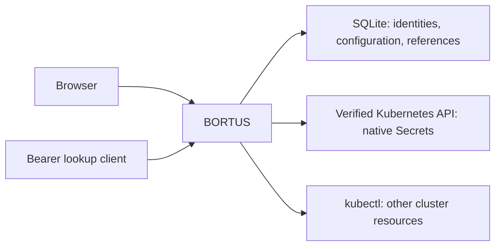

# BORTUS technology stack

Shared-query focus refresh coalesces an active read, including the read started by visibility restoration. It immediately refreshes idle visible subscriptions; explicit invalidation continues to abort/fence old generations. This removes duplicate focus-driven request replacement without changing hidden aborts, metadata-only storage or fresh server authorization. Six focused query regressions, combined170-unit quality and nine actual browser checks passed.

The qualified Flux fixture keeps its 201-root/bundle/inventory metadata within the unchanged generic two-MiB CLI ceiling; the trusted eight-MiB exception remains Pods-only. Its public discovery/reply holds and optional external axe script are test setup, not runtime dependencies or performance acceptance.

Flux hierarchy and repository/bundle details now use the existing shared metadata-query lifecycle instead of independent timers or one-shot fetches. The new Flux table component searches projected public metadata, renders at most 100 rows per table and uses the existing typed comparator for date/numeric fields; ordinary keyboard navigation links disable speculative prefetch. Private repository forms use disposable mutation owners and the existing Radix dialog wrapper. No dependency or framework version changes. Fresh UI/build/test evidence is pending for this source stage; Next 15's versioned Link/client-component documentation was checked because the installed package lacks dist/docs.

The current combined source adds a trusted all-namespace Pod-list read with an 8-MiB UTF-8 output ceiling and at most 10,000 accepted objects. General kubectl reads/mutations remain at 2 MiB. The same four-active/64-queued pool and ten-second Pod collection deadline include queue time and post-parse acceptance; kubectl collects its normal pages, and nonempty continuation/remaining-item metadata, malformed replies, excess items or bytes fail explicitly without truncation. Failed lists retain the existing labelled stale/backoff behavior. The Pod route reads only its resource snapshot and avoids unused overview running-Pod scans; redacted projection/filter/status/quantity/zero semantics and fresh account/sessionVersion checks remain unchanged. The exact combined source passed a fresh Node22 production build, 167/167 units, zero-warning lint, typecheck and all four production HTTP suites. The actual Pod route returned every identity from a 7,931,129-byte/10,000-Pod fixture, retained privacy/filter/zero semantics and kept the complete labelled stale inventory when a later reply was partial. [Combined qualification](implementation-evidence/pod-list-combined-qualification.json) retains the first test DTO mismatch and all raw CLI captures. Unchanged controlled performance and final image/live acceptance remain open; A07 remains failed.

Shared-query freshness follow-up is in progress. A single per-query timer now alternates polling and a 15-second expiry notification, including slow in-flight refreshes and failure backoff. Capability/session consumers receive an explicit stale flag without another request or per-subscriber clock. The workbench shares its parent's capability endpoint and clears private state on page hiding; its separate capability poll and one-second clock are removed. Corrected Node22 source passed 144 units, lint, production build/typecheck and four HTTP suites; actual-route shared freshness browser checks now pass against the recovered production build. See [execution handoff](implementation-evidence/shared-freshness-handoff.json) and [recovered-source browser evidence](implementation-evidence/shared-freshness-browser.json). Current native-status/history shared source passed the separately recorded11-check lifecycle browser qualification; Flux lifecycle has the later local170-unit/browser/zoom checkpoint. Explicit private operations remain outside query caches.

The warm Pod list stage retains a weak-key redacted summary/serialized metadata array for each immutable raw Pod snapshot. Its lifetime follows existing cache replacement and bounded stale retention; it does not add an unbounded query-key cache. Availability/warnings and account checks stay fresh. Diagnostic CPU profiling of checkpoint 1e0030a found repeated metadata projection/summary/serialization work. Exact 61e2588 controlled qualification now completes with improved warm medians but failed sequential p95; final candidate performance acceptance remains open.

The selected-path workbench uses next/dynamic in a Client Component and mounts only after Values and versions, following the versioned Next15 lazy-loading guide. Its private requests bypass shared metadata queries. This integration adds no dependency or migration; the recorded combined Node22 unit/build/HTTP and native-browser subset passed. Shared capability expiry/hidden-page dedup now passed actual-route browser checks; full native-status/transfer lifecycle remains open; final image and controlled browser CPU/LCP remain open.

Administration and audit also uses conditional next/dynamic mounting after explicit entry. Its pre/post fresh-session private requests remain outside shared metadata queries, and metadata callbacks carry only scope names. The integrated browser fixture serves the actual production route with the current build's static assets copied into standalone output; its first missing-asset attempt is retained as failed setup. No dependency or source-runtime contract changed for this entry.

The pure metadata-query admission helper checks resolved paths, retaining existing named/resource metadata contracts while rejecting private KV, key/job output, YAML/log/exec and normalized alternate URL spellings. It adds no dependency. The initial combined build rejected a fixture's typed constructor/toString comparison; own-entry Map checks corrected it. The 6651685 integration passed 127 tests/build/HTTP and native-browser checks, with the earlier failure retained. Later runtime/warm-Pod changes need their own combined qualification.

Independent backend security follow-up, 2026-10-10: selected fields and SHA256 of the local `evidence/bortus-backend-security-qualification.json` report were inspected. This follow-up remains uncommitted and is separate from a82a6cb's functional Linux proof. The coordinator reports shipped deepmerge-ts 7.1.5 stack overflow and startup migration loading/invoking the merger. No HTTP exploit was demonstrated; runtime exposure remains unresolved. An isolated exact 8.0.0 substitution and scoped `@prisma/config@6.19.3` override reportedly preserve Prisma/client and migrate with/without synthetic config; app install/lockfile/full-regression qualification is still required. Trivy scan_completed is true, vulnerability_gate_passed false, with no production credentials/access. The documented inventories contain 340 Debian, 22 Node and 19 kubectl package findings; only one Node finding is under the app, the other 21 under global npm. Vendor/architecture observations qualify specific entries: three perl-base findings have Debian's u4 fix; one requires a 32-bit precondition absent on this amd64 image; the zlib/minizip finding has a specific Debian build qualification. These are presence findings, not blanket exploit or clean-image proof. A separate maintenance executor owns supported base refresh, scoped override compatibility, package provenance and final fixed-image rescan. No dependency, OS or kubectl package changes in the metadata UI stage.

The KV metadata UI uses existing React/Next/shared metadata queries and abortable explicit requests, adding no dependency or migration. A pure named-route/filter guard admits only read-only KV metadata to cache; values, adoption, operation resolution, transfer and rotation remain excluded. Tables render up to 100 records in the requested cursor page. Local Node22 118-test/build/HTTP/browser qualification passed; build estimates are 6.19 KiB route/118 KiB first load. This does not certify controlled first-load/CPU/RSS improvement or the final image.

The locally qualified static rotation workflow uses Node crypto, the existing native CAS/history protocol and metadata-only KvRotation state. An additive forward migration records consumer UID/RV for explicit reload/recovery; no dependency is added. Named workload reload uses structured kubectl JSON Patch conditions and returns only selected identity/marker metadata. Local unit/build/HTTP qualification passed; final-image/live acceptance remains pending.

BORTUS is the Kubernetes management application at `k8s-rewrite/front-end/`. Its source and documentation are included in `main` alongside the existing Swarm homelab. Kubernetes provisioning, charts and live Flux source configuration are maintained separately; this application publication does not replace those systems.

Native Secret transport uses Node HTTPS/JSON with the Kubernetes SDK's credential, CA, client-certificate and proxy handling. This preserves valid `__proto__` map keys that the SDK's generated serializer drops; direct JSON also preserves unknown canonical metadata. Request, queue, body and pagination bounds are documented in the [Secrets engine](SECRETS-ENGINE.md).

| Component | Declared version | Role |
|---|---|---|
| Node.js | 22.23.3/bookworm-slim, pinned by SHA256 | Application runtime; installed Debian packages refreshed during build |
| Next.js | 15.5.27 | App Router and standalone server |
| React / React DOM | ^18.3.0 | Dashboard UI |
| TypeScript | ^5.7.0 | Strict type checking |
| Prisma / Prisma Client | ^6.0.0 | SQLite schema and migrations |
| Tailwind CSS | ^3.4.0 | Dark zinc and indigo theme |
| PostCSS | ^8.5.29 | Build-time CSS processing; Next's older pinned PostCSS is overridden to this same compatible major |
| jose | ^6.2.3 | HS256 session JWTs |
| bcryptjs | ^3.0.3 | User password hashing |
| @kubernetes/client-node | ^1.4.0 | Native Secret API client |
| node-fetch | 2.7.0 | Retained direct dependency; native transport now uses Node HTTPS |
| zod | ^3.23.0 | Input validation |
| tsx | ^4.20.6 | Node test runner and TypeScript execution |
| ESLint / eslint-config-next | 9.39.5 / 15.5.27 | Direct noninteractive CLI with Next Core Web Vitals and hook lifecycle rules |
| kubectl | v1.37.1 Docker default, checksum verified | Other dashboard resource operations; compatible with the 1.37 API server |

`package-lock.json` records resolved dependency versions. The scoped `@prisma/config@6.19.3` override resolves DeepmergeTS 8.0.0 while retaining Prisma/client 6.19.3. Override Docker `KUBECTL_VERSION` for a separately qualified supported patch within one minor of every API server; see the official [patch releases](https://kubernetes.io/releases/) and [skew policy](https://kubernetes.io/releases/version-skew-policy/#kubectl). Cluster, CNI, storage and Flux versions belong to the operator's deployment configuration rather than this application package.

The Docker base is `node:22.23.3-bookworm-slim@sha256:c3de60bf2f9dd0ac6370e6117950ff62d6e339527e7472301c9c78a017978392`. Builds upgrade installed Debian packages and enforce `perl-base >= 5.36.0-7+deb12u4`, the [Debian fixed version](https://security-tracker.debian.org/tracker/DSA-5902-1). APT security resolution remains time-dependent; record the resulting inventory/image digest for each artifact. npm, npx, Corepack and Yarn are removed only from the final runtime; local Prisma migrations and the standalone server use Node directly. Source/runtime qualification and package findings for this maintenance stage are recorded separately from historical audits and final integrated release acceptance.

[Isolated corrected-source qualification](implementation-evidence/runtime-maintenance/README.md) passed clean Linux Node 22 install/generation/lint/build/types, 114 unit tests, all three production HTTP/TLS fixtures and fresh/legacy eleven-migration restart checks. It verifies one installed/resolved DeepmergeTS 8.0.0 copy and the fixed Perl floor. Current production npm reporting has zero entries; full npm has nine tooling entries (seven high, two moderate). One pinned offline Trivy package scan retains 346 rows: 327 Debian, zero Node-package, 19 kubectl compiled-dependency rows. These are raw findings, with a separate Debian applicability note for the retained critical zlib/minizip row; the image vulnerability gate is not clean. Final combined-source/image/live/recovery acceptance remains external.

The checked-in flat ESLint configuration follows the [versioned Next 15 guide](https://nextjs.org/docs/15/app/api-reference/config/eslint). The lint command invokes ESLint directly and treats warnings as failures; strict TypeScript remains a separate check. Optional legacy YAML syntax-highlighter dependencies are removed because no source imports them. Next 15's ESLint peer contract supports ESLint through major 9; npm reports that 9.39.5 is no longer supported upstream. This tooling maintenance constraint remains explicit rather than bypassing peer dependencies to major 10. The app-only GitHub quality workflow defines lockfile install, lint, build/typechecks and unit/production-HTTP fixtures on Node 22.23.3/Linux, with read-only repository permissions and synthetic credentials. It never publishes an image, imports values or deploys. A [clean Node22 Windows run](implementation-evidence/quality-node22.json) passes every command and matches the tested source by SHA256; external Linux CI/image acceptance remains pending.

## Dependency review, 2026-10-10

The standalone [KV administration component](BORTUS-KV-ADMINISTRATION-UI.md) uses the existing React, Next 15 usePathname and shared session subscription without adding dependencies. Metadata/token state lives only in the mounted component; it does not extend the shared KV query cache. Its test-only browser harness uses the existing esbuild/tsx tooling and disposable production routes. Integrated bundle/image/performance acceptance remains separate.

Alias and readiness metadata caching passed local unit and production HTTP/TLS checks with bounded coalescing, refresh deadlines and no stale-error fallback. Alias files use bounded Node streams and fatal UTF-8 decoding; readiness uses PartialObjectMetadataList instead of fetching Secret values. Independent shared browser metadata queries and 100-reference alias pages passed local readonly/mobile browser checks. No dependency was added.

Native history GC now uses bounded mandatory PartialObjectMetadataList negotiation before selected immutable-object verification/deletion; no dependency was added. This API stage passed local unit and production HTTP/TLS qualification. Readiness and ordinary alias metadata bounds also passed local checks; image, memory and real-cluster acceptance remain pending.

Compatible lockfile updates keep Next 15.5.27, React 18, Prisma 6.19.3 and Tailwind 3.4.19. PostCSS 8.5.29 replaces Next's pinned 8.4.31 through a scoped override to the declared PostCSS dependency. Nanoid 3.3.20, source-map-js 1.2.2, Browserslist 4.29.3 and baseline-browser-mapping 2.11.28 remove their reported advisories. No forced major upgrade or tool downgrade was used. [Frozen historical audit metadata](implementation-evidence/dependency-review.json) records that earlier stage's before/after results: all dependencies 16→12 findings (10 high, 2 moderate after adding the lint toolchain); production 7→3 high findings. The newer maintenance report above supersedes those current counts. Counts include dependency chains and do not mean 12 independent defects.

| Remaining root advisory | Local reachability and disposition |
|---|---|
| [DeepmergeTS recursive object graphs](https://github.com/advisories/GHSA-ggr8-5vv4-36mx) | The historical review retained Prisma → @prisma/config → DeepmergeTS 7.1.5. Runtime maintenance replaces that transitive copy with 8.0.0 through a parent-version-scoped override; Prisma CLI remains in the image for migrations. Ordinary config/CLI, full app and image qualification must accompany the override. No vulnerability payload testing is used. |
| [Braces deeply nested patterns](https://github.com/advisories/GHSA-vfj7-8cjw-p6xm) | Braces/micromatch/fast-glob/chokidar are reached by Tailwind source scanning and Next's lint plugin. Inputs are repository/build configuration; no dashboard endpoint accepts glob patterns for these libraries. Retained tooling risk; do not run trusted build tooling on untrusted source/config without isolation. Audit suggests Tailwind 4 or downgrading the matching Next lint package, which is outside this compatible stage. |
| [PostCSS selector quadratic parsing](https://github.com/advisories/GHSA-rj75-hqrm-r3gf) | Tailwind 3/postcss-nested retain selector-parser 6.1.4; patched major 7 is outside their dependency contract. Only trusted build CSS is processed here, consistent with the advisory's reachability qualification. No CSS upload/sanitizer/playground request path was found. Retained build risk and future-input constraint. |

Package results do not replace the separate image/OS scan. ESLint 9's upstream retirement, the remaining advisories and the PostCSS override need continuing maintenance. Clean lockfile installation and validation are recorded separately; a dependency declaration alone is not compatibility evidence.

SQLite stores users/password hashes, roles, nonsecret configuration, jobs and explicit Secret reference metadata. Native Kubernetes Secrets store credential values. Signing/lookup keys are supplied externally; no SQLite-to-cluster pushes or startup DB/SSH kubeconfig bootstrap run.

The KV foundation adds metadata-only mount/path/field/policy/service-grant/operation/audit/rotation tables, scoped identity credential hashes and a forward user engineAdmin flag. Logical paths reject alternate encodings/Unicode spellings before complete-segment policy checks. Default deny and explicit deny override apply to value actions; tokens intersect their own grant with fresh owner privileges. Effective engine administration gates infrastructure and peer identity tools that could extract credentials or impersonate a broader-policy user. Native versioning/adoption/import/export/rotation/UI remain the next stage; foundation tables never ingest values.

Middleware explicitly uses the supported [Next 15.5 Node runtime](https://nextjs.org/docs/15/app/api-reference/file-conventions/middleware) to verify current SQLite account/session versions on protected requests. Account mutations use a seeded SQLite serialization row and a transaction for bootstrap/last-writer invariants. Session versions are metadata, not signing material or authority.

Cluster resource snapshots and the structured kubectl process pool live in globalThis to survive module isolation/HMR. Reads request named resource sets; each resource coalesces concurrent work, retains bounded stale data and backs off independently on failure. The CLI pool allows four active and 64 queued commands, includes queue time in deadlines and bounds output to two MiB. Native Secrets retain their independent verified API client. See [API contracts](API-USAGE.md).

Browser metadata queries share session/resource subscriptions, one in-flight request per URL, completion-based polling, hidden-page cancellation, generation checks, bounded inactive entries and retry backoff. Public native Secret lists contain metadata only; production reads up to four namespaces concurrently, starts with 200 full native objects per page and immediately projects key names/type/identity, without value retention across namespaces. Only locally detected oversized successful full-list GET responses use the existing 200-to-10/5/2/1 fallback, optionally choosing a smaller positive limit from a bounded completed-item prefix count, retaining the cursor and reduced size for that namespace. Compatibility/default transports start at 20; default SecretStore callers remain serial. A shared 32-MiB received-wire/10,000-accepted-item/15-second budget covers the selected scope, including rejected page prefixes. The earlier adaptive strategy passed local 100-test/build/HTTP and 24 controlled Linux measurements recorded in secret-adaptive-read.json. Current worker/page-window functional qualification passed 140 tests; its completed six-run whole-server comparison still misses the native no-regression gate. See BORTUS-NATIVE-LIST-PERFORMANCE.md and API-USAGE.md; final combined/image/live acceptance remains separate. No metadata-negotiation fallback or mutation retry is introduced. The shared browser hook refuses value-key queries. Revealed values, credentials, logs, YAML and exports are excluded from that cache. UI migration and lifecycle acceptance are in progress; see the implementation ledger.

Resource actions import their dropdown/dialog code after first activation. Administration/inventory editors and confirmations load only when opened. YAML/log content and xterm shells remain conditional imports. This changes optional feature timing; build estimates and actual browser interaction are recorded separately in the implementation evidence.

Native Secret metadata reuses the shared searchable/sortable resource table with at most 100 object rows and 100 key rows for one explicitly opened object. Only metadata enters these rows; private values retain the separate explicit editor flow. [Local qualification](implementation-evidence/secret-tables.json) passed without new dependencies or API/schema changes. Shared table reuse adds approximately 10 KiB to the Secret route's first-load estimate (120 KiB); DOM paging is not a CPU/LCP/RSS improvement claim.

Administration mutations use one abortable task per view, a 20-second deadline and generation/identity checks. Completion after unmount or a previous activation cannot update a new form. A timed-out or partial operation is never labelled saved or retried automatically; the operator checks the actual state before another explicit request. Values/passwords are local form state, not shared query data.

Provisioning history shares metadata queries without captured output. Explicit log reads use bounded SQLite substrings and Unicode code-point cursors; streams follow consumer backpressure and completion-based polling with unified cancellation. The browser keeps one bounded text tail in component memory and closes its EventSource on completion/error/unmount/hidden-page transitions. The optional local runner now generates a fixed producer callback and consumes bounded exact lifecycle/role records; raw stdout/stderr and task/module/exception text are withheld before persistence. Isolated Ansible-core 2.20.0 producer and Windows production consumer/storage/stream checks passed; full deployed Linux runner/image qualification remains separate. Historical raw output is unchanged and no storage migration is introduced.

The lint gate enforces complete hook dependencies. Metadata row arrays are memoized, and the stream effect depends on the stable refetch function rather than the changing query wrapper; ordinary metadata refreshes must not reopen an EventSource. Terminal initialization retains only functions it actually uses.

Sidebar and paginated resource-table links disable speculative Next prefetch. Browser inspection found unrelated overview/settings/users/Flux code and many detail requests loading on a resource page before navigation. Navigation still uses ordinary Next links, with destination loading at activation; this avoids metadata/DB work proportional to visible rows.

The image exposes port 4000, uses UID/GID 1000 and a persistent SQLite volume at `/data`. See [deployment contract](BORTUS-DEPLOYMENT.md) for probes, credentials and namespace-scoped RBAC.

The separate private `jtmb/branconet-charts` repository owns deployment charts,
values and Flux configuration. Its main → CI → validated → Flux pipeline is the
only application deployer. This repository's BORTUS source/build work is independent;
see [Flux contract and image releases](FLUX-GITOPS.md).

Forward migration 20261010230000_legacy_access_audit adds nullable authorization metadata principal/alias/key on KvAudit. Existing metadata and native values are preserved. Fresh serialized legacy controls use SHA-256 fingerprints of authorization metadata including mount revision/scope, canonical request field order, bounded fresh alias reads, 100-row preview pages and exact affected-alias acknowledgements. There is no new package, credential store or native verb. [Local qualification passed](implementation-evidence/kv-legacy-access.json); final image remains pending.

## Standalone KV workbench

The standalone [KV workbench](BORTUS-KV-WORKBENCH.md) uses existing React/Radix/Tailwind and browser Blob/TextEncoder APIs. Its exclusive browser harness uses existing esbuild/Tailwind plus externally available Playwright and installed Chrome; it adds no package or manifest dependency.

The locally qualified responsive UID workflow stage uses an immediate icon-rail width below the768px desktop breakpoint; sidebar width transitions are confined to desktop collapse/expand. This avoids leaving a narrow mobile content column during viewport reflow. Fresh affected actual-route browser qualification passed unchanged320/390/768 fit assertions; native/API behavior is unchanged by this CSS delta.

Locally qualified metadata-body reader: only policy create/update/delete and legacy principal/grant commit routes accept 3 MiB after a fresh human engine-administrator check before body consumption. Their existing strict metadata schemas, exact complete-alias acknowledgment, serialized fresh-admin/revision/fingerprint verification, 20-second read deadline, 4096-chunk limit and 10,000 x 253 alias bounds remain. Generic/value/automation/metadata-preview readers keep 512 KiB. Import bundle remains 1 MiB with its existing 64 KiB wrapper/plans allowance. No value store, native verb, runtime/schema/RBAC/package or mutation retry changes. Actual production HTTP accepted the complete 2,560,286-byte policy/principal acknowledgment, rejected incomplete, malformed, oversized and unauthorized requests, retained other route limits and made no native writes. See [scoped qualification](implementation-evidence/metadata-body-qualification.json); complete UI/image/live gates remain open.

Current rejected-prefix sizing is optional and restricted to local four-MiB full-list GET overflow. A bounded byte scanner examines existing chunks without concatenating, decoding, parsing JSON into objects, or retaining native names/values. It counts complete top-level item objects only when literal apiVersion/kind headers and an unfinished items array are unambiguous. It detects duplicate recognized root headers; nested member names are not retained or compared, and unseen trailing root members are not validated by this prefix hint. Unknown/escaped root names, malformed UTF-8/grammar, excessive depth, missing headers, a closed array or zero complete items leave the original fallback in place. The hint can only lower the next limit; all prefix/late bytes are charged, all accepted inventory comes from a new fully validated response, and cursor, quotas, deadlines, fresh authentication and four-reduction maximum remain unchanged. Functional qualification passed all161 Windows Node22.23.3 unit tests, zero-warning lint and pre/post type checks; final combined build/HTTP and unchanged paired performance qualification remain pending.

Locally qualified shared native workbench metadata: status and versions use the selected-path parent query owners. Actual production-route browser checks passed shared deduplication without value reads; unchanged draft/capture across polling and status outage/recovery; changed native revision pauses save and explicit reconcile creates a new head; retained history rollback/delete/restore; export initiation with in-memory Blob/revocation and cancellation before disk; reviewed import overwrite; blank write without read; genuine hiding with zero11-second polls and held-reply fencing; original404 expiry at15,077ms without creation. Values, version values, adoption preview, tokens and transfer content remain private requests outside shared caches. Fresh head/resourceVersion/path revision matches a frozen action capture; no permission/value cache or mutation retry is added. See [scoped workbench qualification](implementation-evidence/workbench-lifecycle-qualification.json). Full administration workflows, manual assistive-technology review, final image/live and A07 remain separate.

The pinned Next 15.5.27 Node middleware has a locally reproduced body-finalization race: oversized denied POST/PATCH/DELETE requests can fail during NextRequest construction before the handler, returning HTML 500 instead of the strict 403/413 contract. Safe diagnostics confirmed the fixed disturbed/locked-body classification and framework adapter stack. `predev` and `prebuild` apply only the one-line awaited-finalization backport from [upstream PR85418](https://github.com/vercel/next.js/pull/85418), after verifying exact version and both distributed CJS/ESM server SHA256s before changing either file. The guard accepts only original or exactly patched bytes and fails closed on source/version drift; no package upgrade, body-limit change, client retry, permission exception or request-body logging is introduced. Build traces the patched runtime into standalone output. A disposable standalone HTTP probe deliberately delays middleware finalization by100ms and emits fixed ordering counters only; its strict response assertions are unchanged. Original failures and unpatched negative controls remain retained. Fresh build196units/lint/types, three HTTP suites plus corrected strict native KV HTTP, and11 actual lifecycle browser checks jointly qualified this source; final Linux/OCI runtime remains pending.

Combined native/lifecycle/backport source passed a fresh production build,196 units, zero-warning lint and types. Three HTTP suites passed in the full run; corrected affected native KV HTTP plus lint/types passed against unchanged production, including complete10,000-alias/strict403/413 body contracts.154 delayed finalizations and154 original-body-correlated request constructions completed. The original global pending oracle is retained as inconclusive for concurrent unrelated requests. The exact missing-await negative control returned503 before its first delayed finalize completed, whereas the guarded awaited runtime passed the strict suite; this demonstrates the causal HTTP effect. The per-body pending flag alone did not detect every framework representation in the negative control and is not an independent ordering proof. No new whole-suite pass is invented. Eleven actual lifecycle browser checks passed; earlier failed attempts remain retained. Final Linux/OCI/runtime and live qualification remain open.

The next A22 harness tests the unchanged production build with the existing disposable UI fixture: three cold/warm pairs each for /deploy completed-job confirmation and /pods actions/YAML, fixed390x844 CSS viewport,4x renderer CPU throttle,150ms latency/200,000-byte/s download/93,750-byte/s upload. It records actual script response/cache bytes and exact public chunk hashes, separate offline gzip/Brotli estimates, renderer Script/Task duration, bounded compile/evaluate trace summaries without event arguments, buffered LCP and click-to-visible-frame timing distinct from locator wall time. Initial versus explicitly opened chunk inventories must remain disjoint; geometry/focus and zero mutation remain assertions. Container provisioning stays disabled and real runner/image remains separate. Results are pending; no source speed improvement is inferred. The implementation follows official [Next15 conditional lazy-loading guidance](https://nextjs.org/docs/15/app/guides/lazy-loading) and public [Chrome DevTools protocol](https://chromedevtools.github.io/devtools-protocol/) measurement methods; browser emulation is not realzoom or field Core Web Vitals.

The first A22 browser run completed all12 samples/fit/focus/zero-mutation assertions and normal cleanup. Its existing UI gateway served assets directly without production cache headers, so cache-preserved reloads retransferred all scripts; that run is retained as attempt1 and is not warm-cache proof. The new opt-in BORTUS_UI_PRODUCTION_ASSETS_FIXTURE copies exact current .next/static to standalone and forwards assets to actual Next, preserving its cache/encoding headers; default existing fixtures remain unchanged. The repeated profile requires immutable production headers and observed disk-cache/zero-wire warm scripts. Exact original harness/fixture/report and launcher/source/CLI are retained, and final measurements remain pending.

A22 attempt2 confirmed actual production immutable cache headers and gzip in its cold sample, then failed the disk-cache-only warm oracle. Its original failed report/source/CLI/normal cleanup are retained; warm rows were not captured before that assertion, so their cause is not inferred. The next diagnostic persists pending initial rows and records the public Network.requestServedFromCache event as well as fromDiskCache. Genuine warm acceptance still requires observed browser-cache serving and zero encoded wire bytes for every script; no threshold, profile or application behavior is changed.

Current A22 characterization passed12 actual mobile samples: three cold/warm pairs each for /deploy confirmation and /pods actions/YAML at390x844,4xCPU,150ms/200,000down/93,750up. Actual production immutable/gzip assets were forwarded; every warm script emitted requestServedFromCache with zero encoded wire bytes (memory cache, not disk-only proof). Deferred confirmation adds one7,271-byte raw chunk (2,885gzip/2,572Brotli estimate); Pods actions/YAML add two chunks totaling17,716raw (6,978gzip/6,220Brotli). Cold initial actual encoded script bytes were164,448deploy and161,058Pods, with0warm; cold optional encoded bytes3,281 and7,770, with0warm. Local median buffered LCP cold/warm was1696/628msdeploy and592/328msPods; renderer ScriptDuration medians79.238/79.181ms and320.379/218.038ms. These are fixed-profile current-source observations, not source-before/after improvement, field CoreWebVitals or total host CPU claims. Click-to-visible-frame and overlapping compile/evaluate summaries remain in the raw reports; locator wall times are separate. Fit/focus/return/zero mutation and stream cleanup passed. Lint/types passed separately; production/build unchanged, so no new unit/build/HTTP pass is invented. Both original cache fixture/oracle attempts remain retained. See [measurement qualification](implementation-evidence/optional-code-qualification.json). First-terminal loading/accessibility, wider actualzoom/AT, final image/runner, A07 and live acceptance remain open.
