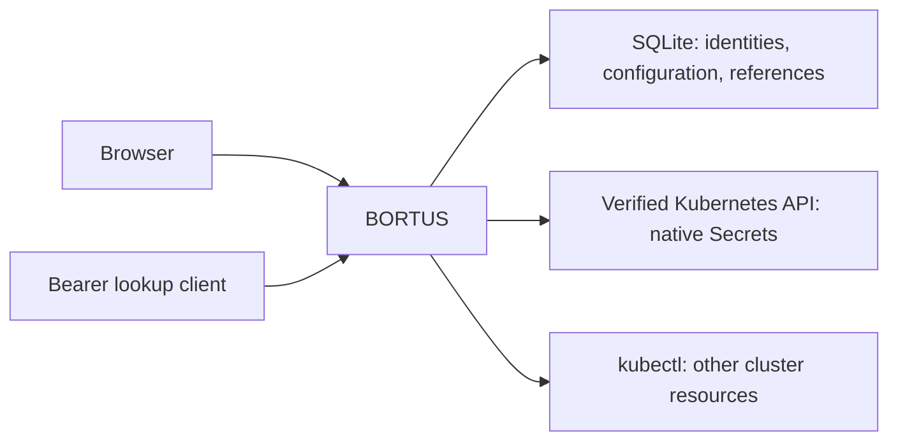

# BORTUS technology stack

BORTUS is the Kubernetes management application at `k8s-rewrite/front-end/`. Its source and documentation are included in `main` alongside the existing Swarm homelab. Kubernetes provisioning, charts and live Flux source configuration are maintained separately; this application publication does not replace those systems.

| Component | Declared version | Role |
|---|---|---|
| Node.js | 22 (Docker image) | Application runtime |
| Next.js | 15.5.27 | App Router and standalone server |
| React / React DOM | ^18.3.0 | Dashboard UI |
| TypeScript | ^5.7.0 | Strict type checking |
| Prisma / Prisma Client | ^6.0.0 | SQLite schema and migrations |
| Tailwind CSS | ^3.4.0 | Dark zinc and indigo theme |
| jose | ^6.2.3 | HS256 session JWTs |
| bcryptjs | ^3.0.3 | User password hashing |
| @kubernetes/client-node | ^1.4.0 | Native Secret API client |
| node-fetch | 2.7.0 | Verified HTTPS transport |
| zod | ^3.23.0 | Input validation |
| tsx | ^4.20.6 | Node test runner and TypeScript execution |
| kubectl | v1.34.1 Docker default | Other dashboard resource operations |

`package-lock.json` records resolved dependency versions. Override Docker `KUBECTL_VERSION` to match the target cluster. Cluster, CNI, storage and Flux versions belong to the operator's deployment configuration rather than this application package.

SQLite stores users/password hashes, roles, nonsecret configuration, jobs and explicit Secret reference metadata. Native Kubernetes Secrets store credential values. Signing/lookup keys are supplied externally; no SQLite-to-cluster pushes or startup DB/SSH kubeconfig bootstrap run.

Middleware explicitly uses the supported [Next 15.5 Node runtime](https://nextjs.org/docs/15/app/api-reference/file-conventions/middleware) to verify current SQLite account/session versions on protected requests. Account mutations use a seeded SQLite serialization row and a transaction for bootstrap/last-writer invariants. Session versions are metadata, not signing material or authority.

Cluster resource snapshots and the structured kubectl process pool live in globalThis to survive module isolation/HMR. Reads request named resource sets; each resource coalesces concurrent work, retains bounded stale data and backs off independently on failure. The CLI pool allows four active and 64 queued commands, includes queue time in deadlines and bounds output to two MiB. Native Secrets retain their independent verified API client. See [API contracts](API-USAGE.md).

Browser metadata queries share session/resource subscriptions, one in-flight request per URL, completion-based polling, hidden-page cancellation, generation checks, bounded inactive entries and retry backoff. The native Secret list is metadata only; the shared hook refuses value-key queries. Revealed values, credentials, logs, YAML and exports are excluded from that cache. UI migration and lifecycle acceptance are in progress; see the implementation ledger.

Resource actions import their dropdown/dialog code after first activation. Administration/inventory editors and confirmations load only when opened. YAML/log content and xterm shells remain conditional imports. This changes optional feature timing; build estimates and actual browser interaction are recorded separately in the implementation evidence.

Administration mutations use one abortable task per view, a 20-second deadline and generation/identity checks. Completion after unmount or a previous activation cannot update a new form. A timed-out or partial operation is never labelled saved or retried automatically; the operator checks the actual state before another explicit request. Values/passwords are local form state, not shared query data.

Provisioning history shares metadata queries without captured output. Explicit log reads use bounded SQLite substrings and Unicode code-point cursors; streams follow consumer backpressure and completion-based polling with unified cancellation. The browser keeps one bounded text tail in component memory and closes its EventSource on completion/error/unmount/hidden-page transitions. Real Ansible output persistence remains unchanged; no incremental storage migration is introduced by this read-path correction.

Sidebar and paginated resource-table links disable speculative Next prefetch. Browser inspection found unrelated overview/settings/users/Flux code and many detail requests loading on a resource page before navigation. Navigation still uses ordinary Next links, with destination loading at activation; this avoids metadata/DB work proportional to visible rows.

The image exposes port 4000, uses UID/GID 1000 and a persistent SQLite volume at `/data`. See [deployment contract](BORTUS-DEPLOYMENT.md) for probes, credentials and namespace-scoped RBAC.

The separate private `jtmb/branconet-charts` repository owns deployment charts,
values and Flux configuration. Its main → CI → validated → Flux pipeline is the
only application deployer. This repository's BORTUS source/build work is independent;
see [Flux contract and image releases](FLUX-GITOPS.md).
