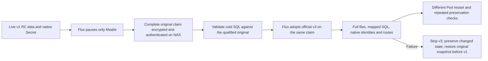

# Mealie maintained vendor migration

**Accepted backend/state/restart checkpoint, October 26 05:00 UTC.** Official
Mealie 3.29.0 reached private charts main/validated/live Flux revision
`271bfc5f40c7c8761f75c730eba3ea0732894185` on a distinct Ready Pod,
`afd46f76-e0df-4382-9088-c51fd086c521`, with zero restarts. The complete original
247 filesystem entries and their ownership/modes remain, plus the vendor's new
session-secret file. All three users and original credential rows, one group,
33 recipes, 330 ingredients, nine mapped ratings, cookbook filtering and two
last-made history relationships passed the exact vendor transformation audit.
All nine routes, native Secret/resource/storage identities and requests passed;
all 69 tables / 860 rows matched the accepted after state through restart.
Personal login/browser acceptance is not claimed by these backend observations.

| Recovery artifact | Encrypted bytes | SHA-256 |
| --- | ---: | --- |
| Complete original production claim: 106 files / 7699686 file bytes | 7927892 | `20b5f7b33b4f7405b872737d8f0d0b859742529fbef54b0560fab375ad1df4ae` |
| Qualification, all distinct SQL snapshots, executed sources and failure evidence | 14923524 | `8febfc2fc2ffecac57e525719c1f0b84f95bb03e0a687315918c6ba39aa7567c` |
| New production session-signing file, encrypted from RAM | 276 | `bc325a979970db3ada3c47b6e9a899b2f5a14495eedcac4d3453ff30aae0bd69` |

All three archives passed complete NAS read-back/age authentication; original sources,
keys and encrypted recovery artifacts survive. Cold SQL matched the qualified
original and live baseline before adoption. Final health found all three nodes
Ready without pressure, all 55 PVCs Bound, 34 HelmReleases Ready and 41 attached
Longhorn volumes healthy. The two earlier failed Seerr diagnostic Pods remain
protected evidence. Eight third-party derivative transitions remain. Current
Mealie vendor findings and the existing self-signed LAN certificate remain
explicit exceptions; the full migration/security goal is active and incomplete.

The initial non-root launch failed because the copy qualification did not
reproduce legacy on-volume ownership: 246 original entries belong to UID 0/GID
999; the top directory belongs to UID 1000/GID 65534. No recursive chown was
performed. The corrected chart uses the published `/opt/mealie/bin/mealie`
command directly at `/app`, retains UID 0/GID 999, disables privilege escalation,
drops all capabilities except `DAC_OVERRIDE`, and sets the official PATH/frontend
paths. The root read-only observer verifies effective capability mask 2 and
NoNewPrivs 1 before capturing state. Existing file metadata and the original JWT
secret remain exact. The new session-secret file's UID/GID/mode/content remained
unchanged through restart. Both startup logs, failed Pod identity and every
executed source generation remain in the authenticated recovery evidence.

This retains the existing ownership model; no non-root hardening or security
clearance is claimed. The deployment consumes the immutable upstream registry
artifact. The controller's exported filesystem is qualification scratch, not its
deployment source. [Exact cleanup and retained exceptions](TASK-OUTPUT-INVENTORY.md).

Checkpoint cleanup removed **2738618368 allocated Linux bytes**, including
599146496 bytes of completed publisher tool copies and empty scratch. Protected
source/evidence/input hashes remain unchanged. The exported
filesystem's 31561 descendants matched its original pinned tar before removal;
no application data or unique failed state was deleted. A separate tiny backup
captures the actual production session-signing file, matching its restart HMAC;
the controller copy's independently generated key is not substituted for it.
The charts repository's Actions setting was read directly on October 26
05:32 UTC and remains **disabled**; local validation/Flux is the delivery path.

Owner: cluster maintenance chat `01a12045-bf7e-73b3-8557-752d17c72ffd`.
Use only the existing task-owned F:-backed ext4 root documented in
[the output inventory](TASK-OUTPUT-INVENTORY.md). New stage paths are
`upstream-mealie-20261026` for protected copies, migration observations and keys,
`control-source/upstream-mealie-20261026` for frozen executed controls, and the
existing `operator-control` / `security-review-20261026` for receipts and scans.
No second drive/output root, source dependency copy or third-party build is allowed.

The original derivative retained Mealie v1.0.0-RC1.1 application data and APIs.
The original acceptance preserved 53 SQLite tables / 847 rows, three users,
one group, 33 recipes and 247 filesystem entries. Recheck current state before
adoption; these counts are historical evidence, not a fresh snapshot.
The original controller, Secret and Longhorn claim remain authoritative.

Official [upgrade FAQ](https://mealie.io/documentation/getting-started/faq/#is-it-safe-to-upgrade-mealie)
supports automatic database upgrades from v1 builds, including beta builds.
The [migration guide](https://mealie.io/contributors/developers-guide/migration-guide/)
documents API/household changes; exact schema equality across versions is not
an adequate preservation contract. Registry metadata and release notes must bind
the selected version and immutable artifact before any pull or execution.

First qualify the maintained upstream migration on an isolated protected copy.
The live deployment and original claim must remain untouched during this stage.
Use only bounded resource execution, no notification/search/scrape requests,
no new credentials or account resets and no external publication. Preserve all
original identities, credential hashes, permission relationships, recipe IDs and
complete recipe data through the vendor's declared transformations. A count-only
or Ready-only observation is insufficient. Record every changed schema/data field
and bind it to the exact upstream migration before promoting production.

Regeneration: retained immutable source, original authenticated cold backup and
the selected vendor migration command reproduce the isolated stage. Configure
all controller scratch/cache/TEMP inside the declared root before execution;
measure C:/native/node free space before a pull or large copy. A rollback must
retain the complete pre-upgrade archive and previous artifact; an image rollback
alone cannot revert a migrated database. Copy/authenticate new recovery data to
the existing NAS before any production cutover. All failed migration states and
unique observations remain protected. Reconcile proven reproducible inactive
scratch using containment, ownership, inode, source/lock and active-reference
checks; report exact paths/bytes and retained safety exceptions.

The preparation history below predates the accepted production checkpoint above.
Its original proposal and failures remain documented rather than counted as
passing deployment or security evidence.

## Isolated migration and live baseline verified

Official release 3.29.0 resolves to
`ghcr.io/mealie-recipes/mealie:v3.29.0@sha256:78eb28b8776d0bad40c5e605c72b3f4f5976793e491558c7dcbdfc04c835d4bc`,
amd64 `243e33ea66e71b2094cb1f9c9167af24452405a33fc899a1dc7359dc210506f8`.
Both the release tag and `latest` matched. The installed migration source matched
upstream commit `89a14202dd8044749cce444147ea4b301c77af13` byte for byte.

The fresh read-only transactional snapshot again contained 53 tables / 847 rows,
three users, one group and 33 recipes. Snapshot cipher SHA-256 is
`c80c1186290ddee27eb17d55321d24af6726a553810cbdb18064f739e129f7d7`.
The official migration ran with no network on a copy and reached 69 tables at
Alembic head `1e69ea7cd45e`; integrity/FK checks passed. The original copy stayed
unchanged. The separate full-data audit passed 46 complete original row
projections, all 33 recipe transformations, 330 ingredient transformations,
three credential/permission rows, nine migrated ratings, the original cookbook
filter and two last-made history relationships. Original values were never
printed; all changed fields were checked against the declared vendor functions
or exact migration logic, rather than accepted by count or ignored wholesale.

Private proof: `upstream-mealie-20261026/copy-audit.json`; executed audit source
SHA-256 `67b169357981ab86418827e51eb7e5ff918eb141b90078de58ba7ea0e428d873`.
Live baseline at private charts revision
`fd0b167de8923e46aeeccece5a783522e65fef90` passed all 247 filesystem entries,
the same full SQL state, native resource/Secret identities, nine routes,
public version and API schema. The existing generated self-signed Traefik
certificate remains an explicit untrusted-TLS limitation.

Initial filesystem-mount-view and empty Docker VOLUME mountpoint failures are
preserved. No vendor migration ran in the first failed fixture. A later audit
framing failure came from vendor logger output before JSON; the corrected
observer retains complete private stdout and requires exactly one result packet.
The live baseline observer's initial certificate-format assertion failed;
explicit RFC2253 subject/issuer checking fixed it without accepting another
certificate or weakening trust. Original failed sources/logs/receipts survive.

Current selected-image scan is complete against the verified read-only advisory
inputs: **8 Critical / 240 High / 336 Medium / 264 Low / 24 Unknown** finding rows,
35 Critical/High rows with listed fixes, no CISA KEV intersection. Exact result
SHA-256 `7e6ca3a0228c3cf35823bfde8dbb4bb101c4a4ac1da06b35c043deefc218995b`.
This is a supported vendor transition with explicit remaining findings, not a
security-clearance claim. No bespoke derivative or runtime package patch is used.

## Production cutover and rollback contract

The original claim and volume UIDs stay fixed. Preserve the existing native
`mealie-runtime` Secret UID/RV/type/values and all resources/routes. Its obsolete
public `STATIC_FILES=/spa/static` image-layout value is overridden in the chart
with the official package frontend path. The original non-root proposal failed
the existing root-owned files' write requirements. The accepted direct vendor
command retains the original UID/GID with only the required file-access
capability and bypasses the recursive entrypoint chown. Existing ownership/modes
remain exact. No production credential is reset. The vendor may create its declared
new `.session_secret` file; verify its identity/content persists through restart
and preserve the original `.secret` exactly.

Only after every source/check is prepared, quiesce via the private charts
replica override and existing local validator/Flux. Use the explicit dated
`upstream-mealie-20261026` complete-backup profile, non-root UID/GID 1000 on
pinned workernode1. It keeps the complete four-GiB / 4096-entry archive bound;
the real claim is one GiB. Require complete archive authentication, original
claim identities, full NAS read-back and helper UID deletion before adoption.
Decrypt the cold SQLite state privately inside the F:-backed root and require
it to match the qualified original; a mismatch requires fresh qualification.

Rollback source is charts revision `fd0b167de8923e46aeeccece5a783522e65fef90`
and its original immutable image. **Do not start v1 on a v3 database.** If a
cutover fails, first stop Mealie through Flux, preserve/authenticate the changed
complete claim separately, then restore the authenticated original database and
complete files/metadata on the same original claim with no other consumers.
Retain all post-migration state and new runtime files as separate recovery
evidence; do not delete or overwrite them as an image-rollback shortcut. Restore
the original chart launch specification only after the original data has been
verified, then repeat baseline SQL/file/native/route checks. The production
cutover and independent restart passed their exact receipts above. Final browser
acceptance and the disclosed vendor security exceptions remain open.

The isolated qualification uses a digest-verified official filesystem exported
with upstream crane 0.22.1, whose release archive SHA-256 is
`0ab7a1d6932a213aed964ce97666c3077fe691c8606413674a8b3e0b9ec4cda0`.
New reproducible paths `upstream-mealie-20261026/{crane,go-containerregistry-v0.22.1.tar.gz,vendor-rootfs.tar,vendor-rootfs,tmp,home,docker-config}`
are controller qualification inputs only, never the cluster's maintained image
source. Regenerate with the exact retained `prepare-mealie-upstream-copy.py`
and official image reference. A one-GiB/no-swap/two-CPU bounded user unit hides
credentials and sockets. Filesystem extraction has no network and can write
only its new rootfs and task-owned temporary directory; host filesystems remain
read-only or absent. The later migration will also have no network and will
write only the protected copied data. These reproducible inputs must pass the
normal guarded cleanup at the checkpoint; actual failures remain preserved.
