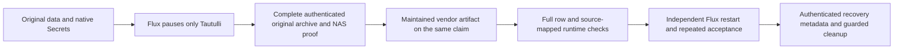

# Tautulli maintained vendor acceptance

Accepted backend/data/API/routes and independent restart on October 26. Private
charts main, validated and live Flux are
`be08b5035e5861320a98aea0a420711378baafa5`. The 13:15 UTC health check found all
3 nodes Ready without pressure, all 55 PVCs Bound, 34 HelmReleases Ready, no
unavailable desired workloads and 41 healthy attached Longhorn volumes. Two old
failed Seerr diagnostic Pods remain protected evidence. Final browser acceptance
and the full migration/security goal remain open.

## Deployed artifact and preserved identities

Production consumes the [maintained LinuxServer distribution](https://docs.linuxserver.io/images/docker-tautulli/):
`ghcr.io/linuxserver/tautulli:v2.18.2-ls249@sha256:c6a48416d16b26f254b000133d2d844c1905ee58ed0f44aad9bda66598d39988`.
Its amd64 manifest is
`sha256:88cb2fd7ab5b356e58b73a07b2ed1e44819e933e4982b7de4096e52406853823`.
The running app is 2.18.2, Python 3.14.8. Pinned application-source checks match
[the official 2.18.2 commit](https://github.com/Tautulli/Tautulli/releases/tag/v2.18.2),
`9484667bc1f2d159368a999320b8f495bbfbd00a`. No third-party image was built,
patched, imported from a local tar or republished.

| Binding | Preserved identity |
| --- | --- |
| Deployment `plex/tautulli` | `9db52ebb-23c8-47c6-82c8-ebde3b0a2775` |
| HelmRelease `flux-system/tautulli` | `e5aa088f-22a3-4f47-b7c4-094be5354bf4` |
| Longhorn claim `plex/tautulli-data-0` | `97eb095e-37ec-4185-80ed-4d8f3c19f486` |
| Adopted Pod | `c90f77c3-ebe6-4b6e-8d76-c6f442bd25c9` |
| Distinct restart Pod | `baff648a-79d3-4014-a354-a879fe729bf1` |

Complete normalized workload/PVC/PV/Service/Ingress specifications, native Secret
UID/resourceVersion/type/content and resource requests (25m CPU / 64Mi memory)
matched. The original UID/GID 1000 and file ownership/modes remain. The maintained
entrypoint's ownership setup uses those same identities. Only the image, pause/
resume replica override and the independent restart annotation changed.

## Data and runtime acceptance

Every original account and permanent row/cell passed complete SQL comparison,
not count-only checks. All 16 accounts, credential/permission fields, original
2878 history records and their complete media/metadata rows remain. Canonical
configuration, including API/JWT/Plex credentials and user choices, is unchanged.
The source-derived avatar refresh for one account was checked against two real
Plex HTTPS endpoints; an original custom avatar choice could not be reset.

The session active before cutover finished normally while the app was running.
Its new history/media/metadata rows preserve 110 shared original fields, with
only the pinned source's raw-stream transcode-dimension projection and live
stop/offset changes. Its continuation timestamp matches that completed history.
The resulting 2879 history records persist through restart. Every old permanent
row remains; newly appended legitimate records are permitted. Sequence counters
are monotonic. Optimizer statistics match the exact source `analysis_limit=400`
and `ANALYZE` statements replayed on a separate RAM copy, never the production DB.
Accordingly, the after snapshot has 11368 total rows and restart has 11367: the
one-row optimizer-statistics difference is expected, not lost application data.
Both retain the same complete schema of 24 tables.

All original cold files are checked, with narrow source-owned runtime changes:

- `version.lock` moves from the commit string to the equivalent `v2.18.2` vendor
  version marker. The actual pinned application source and release remain fixed.
- The version cache preserves its complete GitHub data while its timestamp
  advances. The refreshed commit-comparison cache matches the complete real
  immutable GitHub HTTPS comparison response, not an arbitrary replacement.
- The completed session's metadata cache is removed by the pinned vendor
  completion path. Its complete original content remains in the cold archive.
- SQLite WAL/SHM presence is transient; complete committed SQL is verified from
  authenticated cold/current snapshots instead of requiring stale sidecar files.
- One websocket-log rotation passed the pinned five-backup, 5000000-byte logger
  behavior: active prefix and shifted retained backups match. Other logs append
  normally. Every original log remains in the authenticated cold archive.

The final file observation contains 801 entries. There is no blanket config,
cache, log or sessions-table exclusion. Full private SQL snapshots, keyed file/
field observations, source mappings and original failed checks remain protected.

Authenticated API checks prove unauthenticated rejection, application version,
configured and actual Plex identity, user/library views, active Plex library
statistics, history access and notifier configuration reads. No test notification
or login/refresh mutation was sent. Across all three nodes, the published 9119
port and HTTP/HTTPS ingress passed 27 status/redirect/login-page checks on both
adopted and restart Pods. The existing self-signed Traefik certificate remains
explicitly untrusted; personal login and browser acceptance are not claimed.

## Recovery and rollback

Both archives passed complete local authentication and NAS read-back/authentication
on the existing `TRUENAS/plex_smb_share/Branconet-Recovery-Backups/2026-10-25` target.
Original sources and ciphertexts remain. The existing recovery-key copy is bound
to the Windows CurrentUser DPAPI profile; it is not claimed portable to another
profile. The original WSL identity remains intact.

| Artifact | Encrypted bytes | SHA-256 |
| --- | ---: | --- |
| Complete original claim: 793 files / 158565158 data bytes | 159475924 | `a5b76de5260cbab8a7b5a592bb61cc023d6c19e6895c8db72ab8daea8cfcd0de` |
| Distinct current/restart SQL, verification key, exact sources, proofs and failures | 41318452 | `b137026f98ce407137f5fc31bfe416ec659a0606ebf41fd2cede2e939bd0d15c` |

The dated Ansible/controller generation `upstream-tautulli-20261026` captured
only the zero-writer original claim with a UID/GID 1000 reader on workernode1,
the complete four-GiB/4096-entry bound and exact original resource/image guards.
Its helper Pod was verified deleted. The controller never scaled another app.

Pause revision was `f0431dfbe9fb8315e919344372cfe005a0ad7444`; adoption was
`533f6f6a2d2dfdd5b3776cd3912dd51fa4bfd440`. Rollback reference before the pause is
`271bfc5f40c7c8761f75c730eba3ea0732894185` and the retained original immutable
Tautulli derivative. Preserve/authenticate newer complete state before any
rollback or restore; do not discard new history or restore over a running writer.
Complete archive authentication is not a claim of an independent blank-cluster
restoration drill.

## Remaining findings and delivery boundaries

The original publisher's current official 2.18.2 image was evaluated, not deployed:
4 Critical / 113 High findings. The selected newer LinuxServer artifact reports
**0 Critical / 7 High / 4 Medium / 45 Low / 2 Unknown** rows against the same
current pinned advisory feed. The seven High rows have package fixes absent from
this maintained artifact: brotli, curl/libcurl, msgpack, setuptools and urllib3.
Neither scan intersects the pinned CISA KEV catalog used for those scans. This is not a security
clearance or assurance about unknown vulnerabilities. Suppression and custom
third-party rebuilds were not used. Both complete reports and verified inputs remain.

GitHub Actions is directly verified disabled; publication uses the established
private charts local validation -> validated -> Flux path. Seven application
chart transitions, remaining platform/fleet security, owned publication and final
Codex IAB acceptance remain open. BORTUS app development remains with its separate
owner. Native Kubernetes Secrets managed through BORTUS remain authoritative.

Owner: chat `01a12045-bf7e-73b3-8557-752d17c72ffd`. All generated controller work
reused the same F:-backed ext4 root and UUID in [the output inventory](TASK-OUTPUT-INVENTORY.md).
Cleanup removed **534061056 allocated Linux bytes**, preserving required data,
source, failure and recovery evidence. One unresolved managed-command sentinel
directory remains; exact paths, checks, regeneration and exceptions are recorded
in [the checkpoint reconciliation](TASK-OUTPUT-INVENTORY.md#tautulli-checkpoint-reconciliation-october-26-1313-utc).
