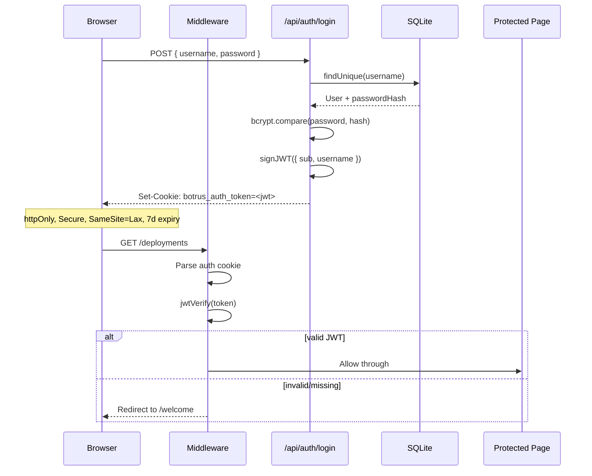

# BORTUS User Permissions

The BORTUS K8s dashboard uses a **two-role permission system** with cookie-based JWT authentication. Roles are enforced at three layers: middleware (auth gate), API routes (write gating), and client UI (conditional rendering).

---

## Role System

| Role | Description |
|------|-------------|
| `write` | Full access — view everything, modify resources, run deployments, manage users, sync variables |
| `readonly` | Read-only access — view dashboards, pods, nodes, deployments. Cannot modify, delete, or deploy |

There is no third role. No granular per-resource permissions. Every user is either `readonly` or `write`.

Roles are stored in the `User.role` column in SQLite (`prisma/schema.prisma`):

```prisma
model User {
  id           String   @id @default(cuid())
  username     String   @unique
  passwordHash String
  role         String   @default("readonly") // "readonly" | "write"
  createdAt    DateTime @default(now())
}
```

---

## Authentication Flow



### JWT Payload

```typescript
{
  sub: string;      // user.id
  username: string; // user.username
  iat: number;      // issued at
  exp: number;      // 7 days from issue
}
```

The JWT does **not** carry the role. Roles are always looked up from the database on every authorization check — so role changes take effect immediately without re-login.

### Cookie

| Property | Value |
|----------|-------|
| Name | `botrus_auth_token` |
| HttpOnly | `true` (inaccessible to JS) |
| Secure | `true` in production |
| SameSite | `lax` |
| Max Age | 7 days |

---

## Middleware: Authentication Gate

`src/middleware.ts` runs on every request. It intercepts requests before they reach pages or API routes.

**Public paths** (no auth required):
- `/welcome`, `/auth/login`, `/auth/register`
- `/api/auth/*`, `/api/cluster/info`, `/_next/*`, `/favicon.ico`
- Exact `/api/vars/lookup` (Bearer inside handler), `/api/health/live`, `/api/health/ready`

**Protected paths** (everything else):
- **Page requests** → redirect to `/welcome` if no valid cookie
- **API requests** → return `401 Unauthorized` if no valid cookie

The middleware only checks whether a user is authenticated — it does **not** check roles. Role enforcement happens deeper.

---

## API-Level Authorization: `requireWrite()`

`src/lib/permissions.ts` provides two functions:

### `requireWrite()`

Used in every API route that modifies state. Pattern:

```typescript
import { requireWrite } from "@/lib/permissions";

export async function POST(request: NextRequest) {
  const auth = await requireWrite();
  if (auth instanceof NextResponse) return auth; // 401 or 403

  // auth.id, auth.username available — user has write access
}
```

Checks performed:
1. Is there a valid session? → No = `401 Unauthorized`
2. Does the user's DB role equal `"write"`? → No = `403 Forbidden — write access required`

### `getCurrentRole()`

Returns the session's role without enforcing anything. Used for client-side conditional rendering:

```typescript
const session = await fetch("/api/auth/session").then(r => r.json());
// session.role === "write" | "readonly"
```

---

## Write-Gated API Routes

Every mutating endpoint calls `requireWrite()`. Read-only endpoints (like `GET /api/users`, `GET /api/vars`, `GET /api/cluster/*`) do **not** gate on role — any authenticated user can read.

| Endpoint | Method | Gate |
|----------|--------|------|
| `/api/nodes` | POST | `requireWrite` |
| `/api/nodes/[id]` | PATCH, DELETE | `requireWrite` |
| `/api/users` | POST | `requireWrite` |
| `/api/users/[id]` | PATCH, DELETE | `requireWrite` |
| `/api/vars` | POST, PATCH, DELETE | `requireWrite` |
| `/api/vars/sync` | POST | `requireWrite` |
| `/api/settings` | POST, PATCH | `requireWrite` |
| `/api/deploy/start` | POST | `requireWrite` |
| `/api/deploy/stop` | POST | `requireWrite` |
| `/api/deploy/history` | POST | `requireWrite` |
| `/api/cluster/*/delete` | POST | `requireWrite` |
| `/api/cluster/*/yaml` | PATCH | `requireWrite` |
| `/api/cluster/refresh` | POST | `requireWrite` |
| `/api/cluster/pods/*/shell` | POST | `requireWrite` |
| `/api/flux/repos/*` | POST, PATCH, DELETE | `requireWrite` |

---

## Registration Rules

`POST /api/auth/register` enforces these rules:

1. **First user ever → `write` role automatically.** The system needs at least one admin.
2. **Subsequent users → `readonly` role.** New users start as viewers.
3. **Registration lock:** After the first user exists, registration is disabled unless:
   - `ALLOW_REGISTRATION=true` environment variable is set, OR
   - The `AppSetting` with key `allow_registration` is `"true"` (set via the settings UI)

---

## User Management

Users with `write` role can manage other users at `/users` or via the API:

### Create User — `POST /api/users`
- Username: 3–30 chars, `[a-zA-Z0-9_-]`
- Password: 8+ characters
- Role: optional, defaults to `readonly`

### Update User — `PATCH /api/users/[id]`
- Can change role (`readonly` ↔ `write`) or reset password
- **Cannot change own role** (self-protection)
- **Cannot demote the last write user** (prevents lockout)

### Delete User — `DELETE /api/users/[id]`
- **Cannot delete yourself**
- **Cannot delete the last write user** (prevents lockout)

---

## Client-Side Role Awareness

The session endpoint `GET /api/auth/session` returns the user's role:

```json
{
  "authenticated": true,
  "username": "admin",
  "role": "write",
  "hasUsers": true,
  "registrationOpen": false
}
```

The users management page (`/users`) fetches this session to conditionally render admin controls:

```typescript
const isWrite = currentRole === "write";

// Only write users see "Create User" button
{isWrite && <CreateUserButton />}

// Demotion warning when editing the last write user
{editing.role === "write" && editRole === "readonly" && (
  <Warning>Demoting the last write user will lock everyone out!</Warning>
)}
```

---

## Security Properties

| Threat | Mitigation |
|--------|------------|
| Token theft | Cookie is HttpOnly (inaccessible to JS) |
| Token replay | Tokens expire after 7 days |
| Privilege escalation | Role stored server-side in DB, not in JWT |
| Self-demotion | Cannot change own role |
| Complete lockout | Cannot delete/demote last write user |
| Unauthorized registration | Locked after first user unless explicitly enabled |
| Session hijacking | Secure cookies in production (HTTPS only) |

---

## Development vs Production

| Setting | Development | Production |
|---------|-------------|------------|
| Cookie Secure flag | `false` | `true` |
| JWT secret source | operator env | native Secret env reference |
| HTTPS required | No | Yes (for cookie) |

Supply stable BOTRUS_JWT_SECRET independently (native Secret env reference in Kubernetes). ensureJwtSecret fails if absent, never writes SQLite/.env.local.

---

## Troubleshooting

**"Authentication required" (401) on API call**
→ Cookie expired or missing. Log in again at `/auth/login`.

**"Forbidden — write access required" (403) on write endpoint**
→ Your user has `readonly` role. Ask a `write` user to promote you at `/users`.

**"You cannot change your own role" (403)**
→ Self-serve role changes aren't allowed. Ask another `write` user to change it.

**"Cannot demote/delete the last write user" (403)**
→ Promote another user to `write` first, then demote/delete.

**"Registration is locked" (403)**
→ Set `ALLOW_REGISTRATION=true` in `.env.local`, or enable it via `/settings` (requires write access).

**Can't log in after restart**
→ If the JWT secret changed, all existing cookies become invalid. Re-login.

## Native value permissions

Readonly authenticated users list Secret metadata/keys. Value reveal and all mutations require fresh DB write role. Bearer lookup is a privileged automation credential scoped to registered aliases/nonsecret config. Sensitive legacy variable values are never exposed. SQLite retains password hashes/roles rather than authoritative Secret values.


## 2026-10-11: narrow auth/command proof and registration failure

The [independent acceptance review](../evidence/bortus-app-narrow-auth-command-a03-20261011.json)
verifies two immutable docs/evidence commits,27 raw Git blobs/modes and46 original
artifacts against their retained Linux bytes. Source333/compiled4262 hashes remain
unchanged from ab8d450; nine owned process identities and three containers are absent.
Seventeen A02 checks pass: expired cookies, logout response attributes/applied cookie
jar,120 anonymous protected templates and exact public boundaries. These prove
neither stolen-token/global logout revocation nor all authorized handler behavior.
Six A05 production/shared-client stdout-only/stderr-only/neither cases pass fixed
502 redaction and child settlement. The first noexec fixture failure is retained;
actual EACCES and same-byte executable-bind controls establish the fixture cause.

A03 remains failed. Its named first concurrent bootstrap case retains exactly one
writer/effective administrator/policy but returns three busy503 refusals where
strict403 is required. Exact inner Prisma lock/timeout subtype is unproven; the
remaining nine permutations were not run. The proposed process-local bounded queue
must retain the real DB lock and fresh checks, pass unchanged strict predicates,
and prove independent-process invariants before acceptance. Neither source edits
nor acceptance follows from the proposal. Original default scans remain exit1 with
one independently verified unchanged public prose span, zero new untriaged findings
and two older unresolved source-provenance findings. No suppression, full A02/A03/A05,
performance, new image or live KV acceptance is claimed.


## Root review of final4ae9 browser and universal action evidence

The [independent root receipt](../evidence/bortus-browser-actions-4ae9-root-20261011.json) binds all264 functional/browser and99 universal originals by raw SHA. The five bounded compiled production route groups passed27 actions,513 recorded control labels and270 failure outcomes, including exact single-invocation argv, four nonzero-output combinations, missing executable, real timeouts, both output bounds, RBAC/NotFound and fresh authorization before input. PV reclaim retains its documented207 partial-result semantics. Two failed harness setup attempts are retained. Fresh root verification finds all344 executed sources and4262 compiled outputs unchanged, every observed universal child absent and no owned containers.

Browser scope comprises seven completed assertions in a run that later failed a Secrets locator, one completed Secrets assertion in a run that later failed a Flux locator, and two completed Flux/Settings assertions in the final terminal0 run. This is ten completed checks across7+1+2, not one uninterrupted ten-check pass. The six held success/error action classes fence stale callbacks and private state after fresh withdrawal and permission ABA; current Configuration/Users/KV/Secrets/Flux/Settings paths retain task completion and failure drafts. Only the exact Next framework route-announcer is excluded from application-alert assertions. All original failures remain retained. Browser request-event arrays are empty, so this does not establish physical request/replay counts. Controlled CLI/localhost fixtures do not establish real cluster action acceptance. Performance, patched-image security, latest-data migration and live/rollback acceptance remain separate open gates.

## 2026-10-12: authoritative account-read mechanism diagnostic

The [isolated public diagnostic](../evidence/bortus-public-account-read-root-20261012.json) completes with outer/supervisor exits of zero, ten controls and all 24 untrimmed observations. Root verifies 78 originals and independently observes 20 PID/start identities and both exact container references absent. On selected Node 22.23.3/SQLite 3.51.3, median two fresh reads cost 0.637 ms through Prisma and 0.059 ms through prepared readonly SQLite, including native file identity checks. Both refuse locking, schema and permission faults; independent writes, revocation, demotion and deletion remain visible. The native reader refuses file replacement while the existing Prisma fixture connection returns its old snapshot. This is diagnostic behavior, not an existing production fence. Experimental warnings and all tails are retained.

No HTTP or asynchronous-worker performance acceptance follows these timings. A reviewable candidate may replace only the two current session/account reads with an asynchronous worker, preserving independent boundaries, projections, all extra permission and mutation checks, status mapping and the 100-row alias bound. Proposed auxiliary reader bounds are one active read, 64 queued and a 5,000 ms end-to-end deadline; native Secret limits stay unchanged. No rows, roles or sessions may be cached. Actual worker ownership, path/URL/schema parity, blocking/failure behavior, compiled packaging and original functional/performance gates remain required. A07/A21 remain failed/open; no live deployment or data change.

## 2026-10-12: async account-reader candidate rejected

The [root verdict](../evidence/bortus-async-account-reader-verdict-root-20261012.json) preserves both actual terminal failures. V3 passes 20/22 tests: the resolver incorrectly decodes a percent-containing filename that Prisma treats literally, and the cost guard correctly refuses timing after that failed prerequisite. V4 fixes only that resolver and passes all 22 focused checks, including the 13 original authorization outcomes and 24 untrimmed cost observations; types then fail on two test-only TS7022 annotations and lint does not run. Root verifies all 810 and 896 archived originals against their retained locations and independently confirms 23 and 44 local PID/start identities absent plus every exact owned container ID/name absent. Source, existing compiled artifacts, dependencies and inputs remain unchanged during each run.

The asynchronous worker removes the useful direct-SQLite timing gain: median two fresh reads cost 0.712 ms through Prisma versus 0.709 ms through the worker. Fresh-connection startup after controls costs 3.906 ms versus 86.919 ms. Those fixture results provide no HTTP or compiled-isolate acceptance. Root rejects this mechanism as the current performance remedy and preserves its experimental branch and failed packages. No full build, original pair, integration or deployment follows. The next source-only diagnosis concerns the unchanged seven-request, 100-row-page alias workflow; catalog loading occurs per refresh, not necessarily per page, and actual compiled owner/query counts remain unproved. A07/A21 stay failed/open.

## 2026-10-13: public numeric observer qualified; compiled attribution held

The [root observer receipt](../evidence/bortus-alias-observer-controls-root-20261013.json) verifies71 successful-control originals,63 initial failed-run originals and19 refused-clone originals against their retained bytes and ZIP hashes/CRC. The initial UID1001 fixture could not read the private UID1000 source; a proposed traversal-preserving clone also refused. A distinct fixture uses original runtime UID1000 without changing or copying retained files. All15 public HTTP/actual Prisma/HMAC/privacy/restoration/forwarding controls pass; root independently verifies15 recorded PID-start identities and the exact container ID/name absent. The selected16-file default scan exits0 without findings. These controls do not prove actual Next attachment.

Review refuses the unused asynchronous output launcher because a final failed write could leave an older complete report. Seven separate synchronous-output fault controls pass without replaying the15 interface controls; their exact owned resources are independently absent. The new publisher writes/fsyncs/closes an exclusive no-follow temporary file before rename and refuses failures without retry. Root independently verifies all72 archived originals against their retained bytes and hashes/CRC. One separately held original-driver compiled observation remains pending. Synchronous instrumentation adds I/O overhead, with no hard kernel-I/O bound or performance acceptance. A07/A21 stay failed/open; source, live deployment, original data and accepted backups are unchanged.

## 2026-10-13: compiled alias attribution verified

The [root compiled observation](../evidence/bortus-alias-compiled-observation-root-20261013.json) completes once with actual driver/container/supervisor/outer exits zero and all six original profiles complete. Independent root recomputation verifies 42 alias GETs, 84 fresh projected User reads and 84 HMAC operations. Each profile has two Prisma owners, one visible catalog owner and one CryptoKey owner. Only the first page performs a SecretReference query and alias-file stream creation; the remaining six reuse the catalog. Repeated catalog loading and JWT key import are therefore not demonstrated bottlenecks in this workflow. Both independent account boundaries remain fresh.

Instrumented median HTTP finish, Prisma-facade and HMAC spans are 5,336.5, 838 and 269 microseconds. These overlapping spans include observer overhead; Prisma timing includes queue/IPC/SQL and is not isolated SQL. Synchronous publication adds client-visible cost after the recorded finish. This observation establishes actual Next/Prisma request correlation, without private catalog-method or universal-isolate claims, and grants no latency acceptance. Root freshly verifies 37 PID/start identities and both exact container references absent; source, compiled files, dependencies and inputs are unchanged. A07/A21, final image/security, recovery and guarded live acceptance remain open.

## 2026-10-13: direct account reader focused controls pass

The [root focused receipt](../evidence/bortus-direct-account-focused-root-20261013.json) qualifies frozen candidate 94a0704 for focused evaluation only. Root verifies 377 source ZIP members, 384 preparation members, 383 current Linux inputs and exact raw Git tree/blob identities. The default scan of all 13 changed files exits zero with no findings. All 27 focused tests pass once: 25 distinct subtests plus two parents, including all original authorization outcomes, database lock/event-loop behavior, revocation/deletion, path/schema/type failures, queue expiry and ownership through actual filesystem settlement. Root independently verifies every expected test name exactly once, 23 process identities absent and the exact container name/ID absent. Source, dependencies and inputs remain unchanged.

Two independent session/account boundaries stay fresh; no role, row, session or result is cached. Native admission remains eight, flat metadata pages 16 MiB, generic pages 4 MiB, aggregate 32 MiB and 10,000 items. The proposed account-reader envelope is one active read, 64 queued and 5,000 ms admission-to-result; synchronous SQLite/kernel I/O has no hard wall bound, and directory ownership/modes remain deployment assumptions. Separate cost, types, build, original HTTP performance and live gates are pending. The worker experiment remains rejected; this candidate is not adopted.

## 2026-10-13: direct account reader cost observation verified

The [root cost receipt](../evidence/bortus-direct-account-cost-root-20261013.json) completes once with dispatcher, supervisor, container and diagnostic exits zero. Six prerequisites pass before 24 untrimmed observations alternate backend order across 12 pairs, each measuring 100 two-boundary read pairs. Root independently recomputes every row and statistic. Median cost per two fresh reads is 0.609412 ms through Prisma and 0.563993 ms through the direct reader: 0.045419 ms saved, about 7.45%. The reported batch p95 is the maximum of 12 batches (69.387 versus64.782 ms), not an individual HTTP percentile. Fresh connections after controls, including close, cost2.781 versus0.988 ms; this is not process startup.

Median CPU per100pairs rises from68.494 to76.250 ms, about11.3%. Whole-process observed high-water memory reaches119156 KiB; it is not independent backend memory attribution. All owners drain. Root freshly verifies17 process identities and exact container ID/name absent; source, dependencies and inputs stay unchanged. The first post-reader draft names the wrong preparation and remains unrun; a distinct reader corrects only that constant before dispatch. This is a modest diagnostic latency gain with higher CPU, not A07, HTTP, image, live or adoption acceptance. Frozen source94a requires functional/types/build and the unchanged HTTP gates next.

## 2026-10-13: corrected typing passes; full HTTP interrupted

The [root type receipt](../evidence/bortus-direct-account-types-root-20261013.json) preserves the original94a type failure (three errors; child2, supervisor/outer1). Candidate8cf changes only two environment type annotations and one invalid-input fixture cast; production code and test assertions remain unchanged. Actual TypeScript5.9.3 emits identical JavaScript for both helpers. Fresh types/lint exit0; root verifies39 identities and four exact container references absent,914 current originals and the nine-file default scan0/0. Focused/cost observations were not replayed. A separate full run builds and loads the native module and passes293 units, then exits1 on a supervisor ProcessLookupError during HTTP testing after three passed cases. Full HTTP, performance, image and live acceptance remain open; the failure is retained.

## 2026-10-13: fresh eight-case HTTP qualification completes local composition

The [updated root functional receipt](../evidence/bortus-direct-account-types-root-20261013.json) records one fresh HTTP-only run against the retained8cf build. Dispatcher/supervisor/container/child all exit0; every unchanged integration case passes (8/8, zero failures/skips/cancellations). Root verifies62 PID/start identities and both exact container references absent, current362 source files/5384 compiled objects/40635 postbuild dependency objects, lock32b and both native8dde copies. All223 new originals are independently verified. The original1215 failed full-run originals and outer1 remain separate: successful build/native/293-unit phases plus this fresh HTTP result compose local functional qualification, not an uninterrupted full-run0. No install, build or293-unit replay occurred. Actual compiled fresh SQL ownership, the original performance gates, final image/security, recovery and live rollout remain pending; no limit adoption follows.

## 2026-10-13: actual compiled fresh SQL boundaries verified

The [root compiled SQL receipt](../evidence/bortus-direct-account-compiled-sql-root-20261013.json) passes ten isolated observer controls, including exact result/error forwarding, restoration and numeric-only reporting. A separate actual compiled8cf fixture completes ten HTTP requests with twelve fresh SELECTs: five session projections and seven account projections. Successful vars requests exercise both independent reads; role changes, session-version withdrawal, user deletion and schema outage produce the expected responses. There are zero unscoped known queries and no publication failures. This run observes one connection and two statement owners, without asserting universal process/isolate ownership or caching roles/rows. Root verifies15 control and18 fixture host identities plus exact container absence, and independently verifies81 control/97 fixture originals. The server PID is checked only in its container namespace. No source, build, dependency or authority result is replaced, and no benchmark/rebuild is replayed. Synchronous observer overhead precludes latency acceptance. The unchanged original three-pair comparison against baseline51e8 is next; A07/A21, recovery, final image/security and live adoption remain open.
