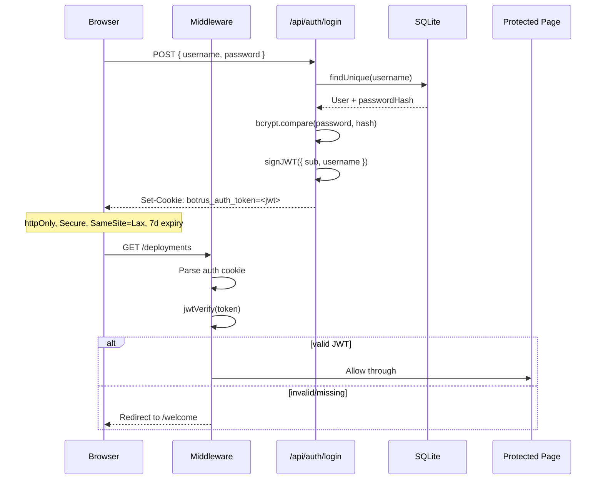

# BORTUS User Permissions


## Collection Previous/Next cursor transition source review - 2026-10-20 (Toronto)

Application b4c71f446a7cecfceefbe50b4291f0e9bb5265fc remains unchanged. The public CursorControls Previous callback passes cursors.slice(0, -1) to move; Next checks truthy next and passes [...cursors, next]. Both produce new arrays. The caller stores that array in the respective mount/path cursor state and clears only that collection's search text. The collection queries use the last cursor when their arrays are nonempty. No cursor truncation, deduplication, maximum-length condition or 100-entry history cap is present in these inspected declarations. The visible up to 100 records text describes API-page records, not cursor-history length. This corrects the next-feature premise in the preceding handoff; it does not establish an application failure or authorize adding a cap.

The Previous disabled expression is disabled || !cursors.length; Next is disabled || !next. The callback bodies do not themselves check disabled; Next checks next. These are literal source declarations, without invoking callbacks or browser activation. Mount/path callers use the respective usable data, nextCursor and refreshing/error disabled predicate. Exact labels, query/Retry bindings, selected IDs and navigation remain. No concrete supported correction compatible with the preserved navigation and frozen expectations was established; production is retained.

The complete108-line14-case kv-metadata-announcements test source selects CursorControls and KvBrowser with inert hooks, forbidden state setters and a table stub. It checks Next availability with a synthetic cursor and its denial/error suppression, but never invokes a cursor Previous/Next callback or supplies populated cursor state. Its invoked onClick belongs to Retry. A targeted text search over accepted public metadata/mount/registration/selected-path test sources finds additional CursorControls string stubs, without full-file evaluation of those additional sources. Unrelated form/retention/timer matches were incidental, not evaluated. No exhaustive suite coverage claim.

All333 accepted inputs and22 owner documents freshly match at receipt and preparation. Only binding/evidence/doc preparation scripts are adapted after reading selected scripts; no prior application runner/build/review/monitor is adapted or executed. No candidate/new suite/workload/test/build/lint/types/graph/application commit/push/newCI; no AST/transpile/VM/model/QueryStore/mountedReact/hooks/effects/useMutation/DOM/focus/browser/HTTP/backend/native/actualAT/security/performance/recovery/image/live evaluation. Oversized outputs were narrowed; omitted/null fields were not evidence. Adjacent private/form declarations, workbench documentation and audit headings were incidentally visible without private/native/form evaluation or finding inspection/disposition.

Prior BuildIDp1bLLgS38NiOt1_HfYyPM/662focusedpasses/333inputs/37428dependencies/41723graph/exactly one prior ROOT fullgraphcomparison remain retained, not rerun. Prior finite146 recorded-birth closure is historical, not refreshed; no universal/exhaustive/unrecorded-preparation/Windows/helper/observer-self absence claim. Only retained exact-head PR39397653304/push39397643969 have currentAllSuccessful=true, each12steps/1242units; overallCIQualified=false. PR39376493085/PR39335907142/push39345339490 failures remain unresolved/causeUNESTABLISHED. Rejected retention-stale candidate/five ORIGINAL frozen failures remain private/rejected; separate331build NEVER executed; earlier424preparation historical/unexecuted. No native-fixture diagnosis/replay/manualdispatch/workflowchange.

RootdocsLOCAL; four new/prior32/earlier one findings UNRESOLVED. All44originalclauses/frozenfixtures/failures/A07five-of-tenwarmfailures and durable boundaries remain. FullgoalACTIVE; PRDdeployment AND actualverification FINAL after ALL original preceding gates. Next separate bounded public source/saved metadata-test review: MetadataTable copied-array sorting, selected-column comparison, exact ID tie breaker and100-row rendering slice. No deeper next-feature evaluation began here.

[Bounded source-inspection receipt](../evidence/bortus-collection-cursor-transitions-review-root-20261020.json).


## Collection metadata query URL construction source review - 2026-10-20 (Toronto)

Application b4c71f446a7cecfceefbe50b4291f0e9bb5265fc remains unchanged. The mounts query starts with /api/kv/mounts and appends ?cursor= plus encodeURIComponent of the last mount cursor only when the cursor array has length. The paths query creates URLSearchParams, sets mountId only when the exact selected mount ID is truthy, then cursor only when the path cursor array has length, using its last entry. It appends ? plus those parameters only when size is nonzero. Empty defaults retain the exact bare collection URLs; no search term, inferred name, page number or explicit limit is added. Collection QueryState labels remain mounts and paths with their respective exact refetch bindings. This is literal source review, without executing serialization, query owners, hooks or requests. No concrete supported correction was found.

The entire108-line14-case metadata-announcements source selects KvBrowser with inert hooks and a query stub accepting only the two bare collection URLs. It saves explicit default-query and Retry expectations, but supplies no selected mount or populated cursor state. The entire14-line two-case kv-metadata-query and15-line two-case metadata-query sources assert predicate admission/rejection of fixed URL examples, including mount/cursor examples; they do not call the collection constructors. Native/private route strings in those test vectors are incidental spellings only, without implementation evaluation. A targeted text search over accepted public metadata/mount/registration/selected-path test sources found additional bare-URL parent stubs; those files were not read in full or executed. This establishes a coverage limit in the inspected sources, not an exhaustive suite or runtime result.

All333 accepted inputs and22 owner documents freshly match at receipt and preparation. Production, labels, exact query/Retry bindings, selected IDs, session/freshness/capability/action gates, drafts, polling, cursor/page bounds, search, selection and navigation remain unchanged. Only binding/evidence/doc preparation scripts were adapted after reading the selected scripts. No candidate/new suite/workload/test/build/lint/types/graph/application commit/push/newCI. Oversized outputs were narrowed; omitted/null fields were not evidence. Adjacent private/form declarations, workbench documentation and audit headings were incidentally visible without private/native/form evaluation or finding inspection/disposition. No prior application runner/build/review/monitor was adapted or executed.

Prior BuildIDp1bLLgS38NiOt1_HfYyPM/662focusedpasses/333inputs/37428dependencies/41723graph/exactly one prior ROOT fullgraphcomparison remain retained, not rerun. Prior finite146 recorded-birth closure remains historical, without new process/container or universal/exhaustive/unrecorded-helper/observer-self absence claims. Retained exact-head PR39397653304/push39397643969 each succeeded12steps/1242units; currentAllSuccessful ONLY those retained runs, overallCIQualifiedFALSE. PR39376493085/PR39335907142/push39345339490 failures remain unresolved/causeUNESTABLISHED. Rejected retention-stale candidate/five ORIGINAL frozen failures remain private/rejected; separate331build NEVER executed; earlier424 preparation historical/unexecuted. No native-fixture diagnosis/replay/manualdispatch/workflowchange. No AST/transpile/VM/model/QueryStore/mountedReact/hooks/effects/useMutation/DOM/focus/browser/HTTP/backend/native/actualAT/security/performance/recovery/image/live qualification.

RootdocsLOCAL; four new/prior32/earlier one findings UNRESOLVED. All44originalclauses/frozenfixtures/failures/A07five-of-tenwarmfailures and durable boundaries remain. FullgoalACTIVE; PRDdeployment AND actualverification FINAL after ALL original preceding gates. Next separate bounded public source/saved metadata-test review: collection Previous/Next cursor callbacks and their exact stack transitions and100-entry bound. Adjacent cursor declarations were incidentally visible; no callback evaluation began here.

[Bounded source-inspection receipt](../evidence/bortus-collection-query-construction-review-root-20261020.json).


## Collection Refresh KV metadata control source review - 2026-10-20 (Toronto)

Application b4c71f446a7cecfceefbe50b4291f0e9bb5265fc remains unchanged. The literal header button label is Refresh KV metadata. The button has no declared disabled attribute or surrounding loading/refreshing/error/denied-snapshot gate. Its callback first increments the existing administrationRefresh counter using a functional updater, then calls the imported refetchKvMetadata() with no arguments. This public declaration remains the same across initial loading, refreshing, ordinary errors and denied collection snapshots; it establishes no current permission or successful request. No helper implementation, administration behavior or native/private state was evaluated. No concrete supported correction was found.

The saved108-line14-case metadata-announcements source selects KvBrowser with inert hooks and explicitly forbids refetchKvMetadata; its assertions do not invoke the header control. The106-line12-case metadata-refresh and117-line14-case metadata-freshness sources select only usable/QueryState with synthetic QueryStore loaders/timers; their Retry checks do not select this header control. All three were read in full, not executed. Relevant public parent-harness excerpts in kv-mount-edit-snapshot.test.ts and kv-registration-snapshot.test.ts find the exact Refresh KV metadata label, invoke its onClick, and use a counter stub for refetchKvMetadata. Their matching saved assertions expect one counter increment and slot10 update; these are synthetic source expectations, not real metadata transport, mounted React or full form qualification. Those two files were read only in selected excerpts; adjacent form declarations and callbacks were incidentally visible without form/mutation evaluation.

All333 accepted inputs and22 owner documents freshly match at receipt and preparation. No candidate/new suite/workload/test/build/lint/types/graph/application commit/push/newCI was created. Labels, exact query/Retry bindings, selected IDs, session/freshness/capability/action gates, mappings, captured drafts, polling, cursors/page bounds, search, selection and navigation remain unchanged. Only binding/evidence/doc preparation scripts were adapted after reading them. No prior application runner/build/review/monitor was adapted or executed. Oversized outputs were narrowed; omitted/null fields were not evidence. A source-directory search skipped ignored paths and was replaced by exact-file reads. Adjacent private-source declarations, test form setup, workbench documentation and audit headings were incidentally visible without private/native/form evaluation or finding inspection/disposition.

Prior BuildIDp1bLLgS38NiOt1_HfYyPM/662focusedpasses/333inputs/37428dependencies/41723graph/exactly one prior ROOT fullgraphcomparison remain retained, not rerun. Prior finite146 recorded-birth closure remains historical, not refreshed; no new process/container or universal/exhaustive/unrecorded-helper/observer-self absence claim. Retained exact-head PR39397653304/push39397643969 each succeeded12steps/1242units; currentAllSuccessful ONLY those retained runs, overallCIQualifiedFALSE. PR39376493085/PR39335907142/push39345339490 failures remain unresolved/causeUNESTABLISHED. Rejected retention-stale candidate/five ORIGINAL frozen failures remain private/rejected; separate331build NEVER executed; earlier424 preparation historical/unexecuted. No native-fixture diagnosis/replay/manualdispatch/workflowchange. No AST/transpile/VM/model/QueryStore/mountedReact/hooks/effects/useMutation/DOM/focus/browser/HTTP/backend/native/actualAT/security/performance/recovery/image/live qualification.

RootdocsLOCAL; four new/prior32/earlier one findings UNRESOLVED. All44originalclauses/frozenfixtures/failures/A07five-of-tenwarmfailures and durable boundaries remain. FullgoalACTIVE; PRDdeployment AND actualverification FINAL after ALL original preceding gates. Next separate bounded public source/saved metadata-test review: collection mount/path metadata query URL construction, exact selected mount/cursor serialization and public saved test coverage. These adjacent declarations were incidentally visible; no deeper query-construction review began here.

[Bounded source-inspection receipt](../evidence/bortus-collection-refresh-control-review-root-20261020.json).


## Shared QueryState message composition source review - 2026-10-20 (Toronto)

Application b4c71f446a7cecfceefbe50b4291f0e9bb5265fc remains unchanged. Loading and Refreshing are mutually exclusive; stale status is independently gated by truthy usable data and stale, and the error alert by error. Pending, stale and error messages may therefore coexist. In source order they are pending, stale, error/Retry; this establishes no actual assistive-technology announcement order. HTTP401/403 and absent/falsy data suppress retained-data claims. Retry remains inside the error alert, directly bound to its supplied callback, without a declared disabled attribute or added pending/stale gate. All text, including the frozen duplicate path metadata stale wording, remains unchanged. No concrete supported correction compatible with frozen expectations was found.

The saved12-case metadata-refresh,14-case metadata-freshness and14-case metadata-announcements test sources were read in full, not executed. They select public declarations into synthetic JSX, with QueryStore synthetic timers/load callbacks in the first two and inert hooks in the third. Their assertions retain pending/stale/error co-presence, exact Retry callbacks and denial suppression. This review executed no AST/model, QueryStore, mounted React/hooks/effects/useMutation, DOM/focus/browser, HTTP/backend/native or actual AT workload. No candidate, suite, test/build/lint/types/graph, application commit/push or new CI was created. All333 accepted inputs and22 owner documents freshly match at receipt and preparation. Exact labels/query bindings, selected IDs, session/freshness/capability/action gates, mappings, captured drafts, polling, cursors/page bounds, search, selection and navigation remain.

Only binding/evidence/doc artifacts were prepared after reading preparation scripts; no prior application runner/build/review/monitor was adapted or executed. Oversized outputs were narrowed; omitted/null fields were not evidence. Adjacent declarations, workbench documentation, audit headings and unrelated test matches were incidentally visible without private/native evaluation or finding inspection/disposition. Prior finite146 recorded-birth closure remains historical; no new closure or universal/exhaustive/unrecorded-helper/observer-self absence claim. Prior BuildIDp1bLLgS38NiOt1_HfYyPM/662focusedpasses/333inputs/37428dependencies/41723graph/exactly one prior ROOT fullgraphcomparison remain retained, not rerun. Only retained exact-head PR39397653304/push39397643969 have currentAllSuccessful=true, each12steps/1242units; overallCIQualified=false. PR39376493085/PR39335907142/push39345339490 failures remain unresolved/cause unestablished. Rejected retention-stale candidate/five original frozen failures remain private/rejected;331build never executed;424preparation historical/unexecuted. No native-fixture diagnosis/replay/manualdispatch/workflowchange.

RootdocsLOCAL; four new/prior32/earlier one findings unresolved. All44 original clauses/frozen fixtures/failures/A07five-of-ten warm failures and durable boundaries remain. Full goal ACTIVE; PRD deployment AND actual verification remain FINAL after all original preceding gates. Next separate bounded public source/saved-test review: standalone collection Refresh metadata control label, disabled predicate and exact metadata-refetch binding. No deeper next-feature inspection began here.
[Bounded source-inspection receipt](../evidence/bortus-query-state-status-composition-review-root-20261020.json).


## Selected-path QueryState caller review — 2026-10-20 (Toronto)

Application b4c71f446a7cecfceefbe50b4291f0e9bb5265fc remains unchanged. PathDetail binds path metadata to pathQuery.refetch and path capabilities to capabilities.refetch. The former spreads the original path snapshot and replaces only data with the existing capability-gated path; the latter passes capabilities directly. Ordinary retained metadata keeps its qualification. Path or capability401/403 suppresses the path body and its retained-body/stale claims; the capability message applies usable to its own snapshot. These public messages establish no current permission or native-state authority.

The shared stale template literally produces Previously loaded path metadata metadata is stale. The frozen selected-path test explicitly expects that text; it remains unchanged. No supported behavior correction, candidate or fixture/oracle change was made. Exact selected IDs/query keys, labels/Retry callbacks, all session/freshness/capability/action gates, mappings, captured drafts, polling, cursors/page bounds, search, selection and navigation remain unchanged.

The89-line21-case selected-path-presentation test and109-line22-case empty-mappings test source were read in full, not executed. The former selects only the path-metadata caller and asserts projection/query/Retry identity using synthetic snapshots/JSX; its callback counter is a local test callback. It does not select the capability QueryState caller. The latter selects mapping/table paragraphs with a string placeholder. No model execution, mounted React/hooks/effects/useMutation, DOM/focus/browser/HTTP/backend/native/actual AT/security/performance/recovery/image/live qualification occurred. All333 accepted inputs and22 owner documents freshly match at receipt and preparation.

Only binding/evidence/doc artifacts were prepared; no application source, candidate/new suite/workload/test/build/lint/types/graph/application commit/push/newCI. Evidence/doc preparation scripts were read in full before adaptation; no prior application runner/build/review/monitor was adapted or executed. Oversized outputs were narrowed and a Windows wildcard-search error corrected. Adjacent declarations/audit headings/search matches were incidentally visible without private/native evaluation or finding inspection/disposition. Prior finite146 recorded-birth closure remains historical, without new closure/universal/exhaustive/unrecorded-helper/observer-self absence claims.

Accepted BuildIDp1bLLgS38NiOt1_HfYyPM/662focusedpasses/333inputs/37428dependencies/41723graph and exactly one prior ROOT fullgraphcomparison remain prior source-specific evidence, not rerun. Retained exact-head PR39397653304/push39397643969 each succeeded12steps/1242units; currentAllSuccessful ONLY those retained runs, overallCIQualifiedFALSE. PR39376493085/PR39335907142/push39345339490 remain unresolved/causeUNESTABLISHED. Rejected retention-stale candidate/five ORIGINAL frozen failures remain private/rejected; separate331build NEVER executed, earlier424 preparation historical/unexecuted. No native-fixture diagnosis/replay/manualdispatch/workflowchange.

RootdocsLOCAL/fournew+prior32+earlierone findings UNRESOLVED. All44originalclauses/frozenfixtures/failures/A07five-of-tenwarmfailures and durable boundaries remain. FullgoalACTIVE; PRDdeployment AND actualverification FINAL after ALL original preceding gates. Next separate bounded public source/saved-test review: shared QueryState message co-presence, status/alert declarations and Retry visibility. Its declarations were incidentally visible; no deeper composition review began here.
[Bounded source-inspection receipt](../evidence/bortus-selected-path-query-messages-review-root-20261020.json).


## Selected-path field-mapping table source review — 2026-10-20 (Toronto)

Application b4c71f446a7cecfceefbe50b4291f0e9bb5265fc remains unchanged. PathDetail names its table KV field mappings and supplies Logical field and Exact native key columns. It directly maps saved item.field to row id/field and item.key to key, without normalization, joining or reconstruction. Caller projection retains source array order; the shared table sorts a copied array by its selected column, initially field ascending, then ascending ID tie breaker, and renders at most100 rows. No actions prop is supplied. No concrete supported presentation correction was found.

The table and ordinary empty explanation require the existing visible path. Empty saved fields keep the table plus No field mappings are recorded in this path metadata snapshot. This does not establish whether native data exists. Ordinary retained snapshots use the same declarations, qualified separately by QueryState. Path or capability401/403 hides the body. Exact selected IDs/query keys/field-key strings, all session/freshness/capability/action gates, drafts, polling, cursors/page bounds, search, selection and navigation remain unchanged. The109-line22-case empty-mappings test source and108-line14-case collection metadata test source were read in full, not executed. The former asserts caller props/paragraphs using a string table placeholder; the latter forbids PathDetail. Neither qualifies real cells/sorting/row reconciliation/mounted transitions or actual AT.

All333 accepted inputs and22 owner documents freshly match at receipt and source preparation. Only binding/evidence/doc artifacts were prepared. No candidate/new suite/workload/test/build/lint/types/graph/application commit/push/newCI; no AST/model execution, mounted React/hooks/effects/useMutation, DOM/focus/browser/HTTP/backend/native/actualAT/security/performance/recovery/image/live qualification. Evidence/doc preparation scripts were read in full before adaptation; no prior application runner/build/review/monitor was adapted or executed. Oversized outputs were narrowed; absent guessed filenames and read-only projection parser errors were corrected. Adjacent declarations/audit headings were incidentally visible without private/native evaluation or finding inspection/disposition.

Accepted BuildIDp1bLLgS38NiOt1_HfYyPM/662focusedpasses/333inputs/37428dependencies/41723graph and exactly one prior ROOT fullgraphcomparison remain prior source-specific evidence, not rerun. Prior finite146 recorded-birth closure remains historical, without new closure/universal/exhaustive/unrecorded-helper/observer-self absence claims. Retained exact-head PR39397653304/push39397643969 each succeeded12steps/1242units; currentAllSuccessful ONLY those retained runs, overallCIQualifiedFALSE. PR39376493085/PR39335907142/push39345339490 remain unresolved/causeUNESTABLISHED. Rejected retention-stale candidate/five ORIGINAL frozen failures remain private/rejected; separate331build NEVER executed, earlier424 preparation historical/unexecuted. No native-fixture diagnosis/replay/manualdispatch/workflowchange.

RootdocsLOCAL/fournew+prior32+earlierone findings UNRESOLVED. All44originalclauses/frozenfixtures/failures/A07five-of-tenwarmfailures and durable boundaries remain. FullgoalACTIVE; PRDdeployment AND actualverification FINAL after ALL original preceding gates. Next separate bounded public source/saved metadata review: selected-path path-metadata/path-capabilities QueryState labels, exact Retry bindings and retained/denied snapshot qualification. These callers were incidentally visible; no deeper next-feature review began here.
[Bounded source-inspection receipt](../evidence/bortus-selected-path-mapping-table-review-root-20261020.json).


## Collection row/cell and Actions header source review — 2026-10-20 (Toronto)

Application b4c71f446a7cecfceefbe50b4291f0e9bb5265fc remains unchanged. MetadataTable maps headers and data cells from the same ordered columns array, keys both by item.key, and displays row[item.key]. Each row uses its exact metadata row.id as a React key. The optional action renderer appends an Actions th with sr-only text and a matching final td calling actions(row); both mount/path callers supply it. React keys are not DOM association attributes. This helper declares no explicit scope, headers or header IDs and no row-header th. Native table/thead/tbody/tr/th/td structure and corresponding column order are present. No concrete supported presentation correction was found; no computed browser/header association or assistive-technology result is claimed.

Mount projections retain name, joined saved namespaces and revision; path projections retain logical path, namespace, Secret name, mapping count and retention. Ordinary retained snapshots use the same declarations, qualified separately by QueryState;401/403 suppress usable tables. Exact IDs/names/namespace arrays/revisions, comparator/directions/ID tie breaker, queries/session/freshness/capability/action gates, retained metadata/captured drafts, polling, cursors/page bounds, search, selection and navigation remain unchanged. All108 lines of the14-case metadata-announcements test source were read, not executed. Its props-only table stub and ID projection assertions do not qualify real table cells, Actions headers/cell invocation, reconciliation or mounted retained-state associations.

All333 accepted inputs and22 owner documents freshly match at receipt and source preparation. Only binding/evidence/doc artifacts were prepared. No candidate/new suite/workload/test/build/lint/type run/graph/application commit/push/newCI; no AST/model execution, mounted React/hooks/effects/useMutation, DOM/focus/browser/HTTP/backend/native/actualAT/security/performance/recovery/image/live qualification. Evidence/doc preparation scripts were read in full; no prior application runner/build/review/monitor was adapted or executed. Oversized output was narrowed; omitted/null properties were not evidence. Adjacent declarations/audit headings and unrelated test-search matches were incidentally visible without private/native evaluation or finding inspection/disposition.

Accepted BuildIDp1bLLgS38NiOt1_HfYyPM/662focusedpasses/333inputs/37428dependencies/41723graph and exactly one prior ROOT fullgraphcomparison remain prior source-specific evidence, not rerun. Prior finite146 recorded-birth closure is retained, not refreshed; no new process/container or universal/exhaustive/unrecorded-helper/observer-self absence claim. Retained exact-head PR39397653304/push39397643969 each succeeded with12steps/1242units; currentAllSuccessful applies ONLY to those retained runs, overallCIQualifiedFALSE. PR39376493085/PR39335907142/push39345339490 remain unresolved/causeUNESTABLISHED. Rejected retention-stale candidate/five ORIGINAL frozen failures remain private/rejected; separate331build NEVER executed, earlier424 preparation historical/unexecuted. No native-fixture diagnosis/replay/manualdispatch/workflowchange.

RootdocsLOCAL/fournew+prior32+earlierone findings UNRESOLVED. All44originalclauses/frozenfixtures/failures/A07five-of-tenwarmfailures and durable boundaries remain. FullgoalACTIVE; PRDdeployment AND actualverification FINAL after ALL original preceding gates. Next separate bounded public source/saved metadata review: selected-path field-mapping table labels, exact saved field/key projections and empty-snapshot qualification. No deeper next-feature review began here.
[Bounded source-inspection receipt](../evidence/bortus-collection-row-cell-review-root-20261020.json).


## Collection sort-header label and aria-sort source review — 2026-10-20 (Toronto)

Application b4c71f446a7cecfceefbe50b4291f0e9bb5265fc remains unchanged. The public MetadataTable initializes its sort key from the first declared column and its direction to ascending. Each data-column th declares ascending or descending only when that key is selected, otherwise none, and supplies the same active predicate and direction to SortHeader. The button label is Sort by followed by the column label, with currently ascending/descending for the active header. The existing toggle changes an active ascending column to descending and otherwise selects ascending. Mount/Namespaces/Revision and Logical path/Namespace/Secret/Fields/Retention remain the declared labels; Revision, Fields and Retention retain numeric sort kinds. No concrete supported presentation correction was found.

Ordinary retained snapshots pass through the same table declarations without an added stale/error/refreshing sort-button gate. QueryState separately qualifies retained stale/error metadata; HTTP401/403 suppresses the respective usable table. Existing sorting copies the rows, keeps compareValues and the ascending ID tie breaker, and renders at most100 rows. Page controls explicitly limit search/sort to this API page. Exact IDs/names/namespace arrays/revisions, queries/session/freshness/capability/action gates, captured drafts, polling, cursors, search, selection and navigation are unchanged. These are literal source declarations, without executed sorting, mounted state transitions, computed accessible names or assistive-technology qualification.

All333 accepted inputs and22 owner documents freshly match at receipt and source preparation. The existing14-case metadata-announcements test source was read in full, not executed: inert hooks and a MetadataTable stub omit the real table, SortHeader and useSort, and do not assert aria-sort or sort labels/transitions. A targeted text search returned unrelated Flux browser and legacy-node stub matches; none were executed or adopted as KV sort qualification. No candidate/new suite/workload/test/build/lint/type run/graph/application commit/push/new CI was created. No AST/model execution, mounted React/hooks/effects/useMutation, DOM/focus/browser/HTTP/backend/native/actual AT/security/performance/recovery/image/live qualification. Evidence/doc preparation scripts were read in full before adaptation; no prior application runner/build/review/monitor was adapted or executed. Oversized outputs were narrowed; omitted/null fields were not evidence. A read-only projection parser error was corrected before execution; array schema was then treated explicitly. Initial preparation stopped on a stale report filename before root writes; that reference was corrected without product changes. Adjacent native/workbench/form declarations and audit headings were incidentally visible without private/native evaluation or finding inspection/disposition.

Accepted BuildIDp1bLLgS38NiOt1_HfYyPM/662focusedpasses/333inputs/37428dependencies/41723graph and exactly one prior ROOT fullgraphcomparison remain prior source-specific evidence, not rerun. Prior finite146 recorded-birth closure is retained, not refreshed; no new process/container closure or universal/exhaustive/unrecorded-helper/observer-self absence claim. Retained exact-head PR39397653304/push39397643969 each succeeded with12steps/1242units; currentAllSuccessful applies ONLY to those retained runs, overallCIQualifiedFALSE. PR39376493085/PR39335907142/push39345339490 remain unresolved/causeUNESTABLISHED. Rejected retention-stale candidate/five ORIGINAL frozen failures stay private/rejected; separate331build NEVER executed, earlier424 preparation historical/unexecuted. No native-fixture diagnosis/replay/manualdispatch/workflowchange.

RootdocsLOCAL/fournew+prior32+earlierone findings UNRESOLVED, without rootpush/findinginspection/disposition/rescan/savedpacketrepublication. All44originalclauses/frozenfixtures/failures/A07five-of-tenwarmfailures and durable boundaries remain. FullgoalACTIVE; PRDdeployment AND actualverification FINAL after ALL original preceding gates. Next separate bounded public source/saved metadata review: collection table row/cell associations and action-column header declarations, including ordinary retained snapshots. Adjacent declarations were incidentally visible; no deeper next-feature review has begun.

[Bounded source-inspection receipt](../evidence/bortus-collection-sort-header-review-root-20261020.json).


## Collection section, table and search label relationships — 2026-10-20 (Toronto)

Application b4c71f446a7cecfceefbe50b4291f0e9bb5265fc remains unchanged. The public Mounts and Paths sections declare separate aria-labelledby references to their respective h2 IDs. Each search input is nested inside its own label, explicitly limited to this API page. The matching MetadataTable receives KV mounts or KV paths, and the shared helper places that label on its table. A selected mount qualifies the Paths heading while the table and search retain their collection/page scope. This is a source declaration relationship; no explicit search-to-table aria-controls/description relationship or mounted accessible-name result is claimed. No concrete supported presentation correction was found.

Collection headings and search labels are outside the usable-data table condition. Ordinary retained snapshots keep the same labels, with QueryState's matching mounts/paths loading, refreshing, stale and ordinary-error messages. HTTP401/403 suppress the respective usable table/navigation while the collection section and search label declarations remain. This establishes no current permission or native state. Exact IDs/names/namespace arrays/revisions, queries/session/freshness/capability/action gates, retained metadata/captured drafts, polling, cursors/page bounds, search/sort, selection and navigation remain unchanged. The existing14-case metadata-announcements test source was read in full, not executed. Its MetadataTable stub does not render the real table, and the tests do not assert section-heading/search/table label relationships or qualify mounted retained-state behavior.

All333 accepted application inputs and all22 owner documents freshly match at receipt and source preparation. No application source, candidate, suite, workload, test/build/lint/type run, graph traversal, application commit/push or new CI was created. No AST/model execution, mounted React/hooks/effects/useMutation, DOM/focus/browser/HTTP/backend/native/actual AT/security/performance/recovery/image/live qualification. Only binding/evidence/doc artifacts were prepared; no prior application runner/build/review/monitor was adapted or executed. The prior evidence/doc-preparation checkpoint.ps1 was read in full before adapting its preparation pattern. Oversized outputs were narrowed; omitted/null fields were not evidence. An initial read-only PowerShell projection had a parser error before execution and was corrected. Adjacent native/workbench/form declarations and audit headings were incidentally visible without private/native evaluation or finding inspection/disposition.

Accepted BuildIDp1bLLgS38NiOt1_HfYyPM/662focusedpasses/333inputs/37428dependencies/41723graph and exactly one prior ROOT fullgraphcomparison remain source-specific prior evidence, not rerun. Prior finite146 recorded-birth closure is retained, not refreshed; no new process/container closure or universal/exhaustive/unrecorded-helper/observer-self absence claim. Latest retained exact-head PR39397653304/push39397643969 each succeeded with12steps/1242units; currentAllSuccessful applies ONLY to those retained runs, overallCIQualifiedFALSE. PR39376493085/PR39335907142/push39345339490 remain unresolved/causeUNESTABLISHED. Rejected retention-stale candidate/five ORIGINAL frozen failures remain private/rejected; separate331build NEVER executed, earlier424 broader byte-copy preparation historical/unexecuted. No native-fixture diagnosis/replay/manualdispatch/workflowchange.

RootdocsLOCAL/fournew+prior32+earlierone findings UNRESOLVED, without rootpush/findinginspection/disposition/rescan/savedpacketrepublication. All44originalclauses/frozenfixtures/failures/A07five-of-tenwarmfailures and durable boundaries remain. FullgoalACTIVE; PRDdeployment AND actualverification FINAL after ALL original preceding gates. Next separate bounded public source/saved metadata review: collection sort-header labels and aria-sort declarations, including ordinary retained snapshots. Those declarations were incidentally visible here; no deeper sort-header review has begun.

[Bounded source-inspection receipt](../evidence/bortus-collection-label-relationships-review-root-20261020.json).


## Collection scope and public entry-label source review — 2026-10-20 (Toronto)

Application b4c71f446a7cecfceefbe50b4291f0e9bb5265fc remains unchanged. Literal public source shows Browse followed by the exact saved mount name; its callback selects that mount ID and clears the path cursor stack, selected path and path search. The Paths heading qualifies a selected mount, while Show all permitted paths removes that mount filter and clears path cursors/selection without changing the existing path search. Search and page controls separately qualify the current API page. Open path has the accessible label Open KV path followed by the saved logical path and selects the exact row ID. No name-to-ID reconstruction, namespace/revision replacement or new capability gate is introduced. No concrete supported presentation correction was found.

These entry controls have no added stale, refreshing or ordinary-error disabled predicate in the inspected source. Their collection data comes through the existing usable helper: ordinary retained snapshots remain available with QueryState stale/error messaging, while HTTP401/403 suppress that collection's usable data and table actions. This describes source declarations only; it does not establish current permission, native state, executed navigation, focus behavior or actual accessible names in a browser. The existing14-case metadata-announcements test source was read in full, not executed. It uses inert hooks and a MetadataTable stub that does not invoke row actions; it does not qualify Browse/Open path callbacks, scoped mount transitions, real table rendering or navigation.

All333 accepted application inputs and all22 owner documents freshly match at receipt and source preparation. No application source, candidate, suite, workload, test/build/lint/type run, graph traversal, application commit/push or new CI was created. No AST/model execution, mounted React/hooks/effects/useMutation, DOM/focus/browser/HTTP/backend/native/actual AT/security/performance/recovery/image/live qualification. Only binding/evidence/doc artifacts were prepared; no prior application runner/build/review/monitor was adapted or executed. The evidence/doc-preparation script was adapted only after reading its actual source. Oversized outputs were narrowed; omitted/null fields were not evidence. A guessed USER-PERMS section title was refused before writes, then the actual headings were located. Pre-execution review corrected an evidence-baseline reference before the preparation script ran. A hidden .git observation without Force failed; Git metadata commands remained authoritative. Adjacent native/workbench/form declarations and audit headings were incidentally visible without private/native evaluation or finding inspection/disposition.

Accepted BuildIDp1bLLgS38NiOt1_HfYyPM/662focusedpasses/333inputs/37428dependencies/41723graph and exactly one prior ROOT fullgraphcomparison remain source-specific prior evidence, not rerun. Prior finite146 recorded-birth closure is retained, not refreshed; no new process/container closure or universal/exhaustive/unrecorded-helper/observer-self absence claim. Latest retained exact-head PR39397653304/push39397643969 each succeeded with12steps/1242units; currentAllSuccessful applies ONLY to those retained runs, overallCIQualifiedFALSE. PR39376493085/PR39335907142/push39345339490 remain unresolved/causeUNESTABLISHED. Rejected retention-stale candidate/five ORIGINAL frozen failures remain private/rejected; separate331build NEVER executed, earlier424 broader byte-copy preparation historical/unexecuted. No native-fixture diagnosis/replay/manualdispatch/workflowchange.

RootdocsLOCAL/fournew+prior32+earlierone findings UNRESOLVED, without rootpush/findinginspection/disposition/rescan/savedpacketrepublication. All44originalclauses/frozenfixtures/failures/A07five-of-tenwarmfailures and durable boundaries remain. FullgoalACTIVE; PRDdeployment AND actualverification FINAL after ALL original preceding gates. Next separate bounded public source/saved metadata review: mount/path collection section, table and search label relationships, including ordinary retained snapshots. Those relationships were incidentally visible here; no deeper next-feature review has begun.
[Bounded source-inspection receipt](../evidence/bortus-collection-entry-review-root-20261020.json).


## Collection API-page navigation source review — 2026-10-20 (Toronto)

Application b4c71f446a7cecfceefbe50b4291f0e9bb5265fc is retained unchanged. The public mount/path collections supply separate cursor stacks and nextCursor metadata to the shared navigation. It names each collection's API pages, shows API page stack-length plus one, and explicitly says up to 100 records and sort/search this page. Previous is disabled without a prior cursor; Next is disabled without a supplied next cursor; both also honor the collection's refreshing/error gate. Ordinary stale retained metadata has a separate QueryState warning; staleness alone is not an added navigation gate. Ordinary retained errors disable navigation, while HTTP401/403 suppress the usable page and its navigation. Search filters returned page items, MetadataTable sorts a copied row array and renders at most 100 rows, and navigation callbacks retain their existing cursor/search updates. No concrete supported presentation correction was found. Literal source inspection establishes neither server page-size enforcement nor current authority, native state or actual navigation behavior.

All333 accepted application inputs and all22 owner documents freshly match at receipt and source review. The existing14-case metadata-announcements test source was read in full, not executed: inert hooks, a MetadataTable stub, first-page empty/nonmatching next-cursor cases, empty retained409/503 and denial401/403 cases. It does not establish all populated/stale/error/refreshing/multi-page combinations or real table sorting/navigation. No candidate, new suite, workload, test/build/lint/type run, graph traversal, application commit/push or new CI was created. No AST/model execution, mounted React/hooks/effects/useMutation, DOM/focus/browser/HTTP/backend/native/actual AT/security/performance/recovery/image/live qualification. Only binding/evidence/doc artifacts were prepared; no prior application runner/build/review/monitor was adapted or executed. Oversized outputs were narrowed; omitted/null fields were not evidence. Adjacent native/workbench/form declarations and audit headings were incidentally visible without private/native evaluation or finding inspection/disposition.

Accepted BuildIDp1bLLgS38NiOt1_HfYyPM/662focusedpasses/333inputs/37428dependencies/41723graph and exactly one prior ROOT fullgraphcomparison remain source-specific prior evidence, not rerun. Prior finite146 recorded-birth closure is retained, not refreshed; no new process/container closure or universal/exhaustive/unrecorded-helper/observer-self absence claim. Latest retained exact-head PR39397653304/push39397643969 each succeeded with12steps/1242units; currentAllSuccessful applies ONLY to those retained runs, overallCIQualifiedFALSE. PR39376493085/PR39335907142/push39345339490 remain unresolved/causeUNESTABLISHED. Rejected retention-stale candidate/five ORIGINAL frozen failures remain private/rejected; separate331build NEVER executed, earlier424 broader byte-copy preparation historical/unexecuted. No native-fixture diagnosis/replay/manualdispatch/workflowchange.

RootdocsLOCAL/fournew+prior32+earlierone findings UNRESOLVED, without rootpush/findinginspection/disposition/rescan/savedpacketrepublication. All44originalclauses/frozenfixtures/failures/A07five-of-tenwarmfailures and durable boundaries remain. FullgoalACTIVE; PRDdeployment AND actualverification FINAL after ALL original preceding gates. Next separate bounded public source/saved metadata review: mount-to-path scope labels and public Browse/Open path entry labels, including ordinary retained snapshots. These entry controls were incidentally visible here; no deeper next-feature review has begun.

[Bounded source-inspection receipt](../evidence/bortus-collection-navigation-review-root-20261020.json).


## Mount-list empty/search-result scope review — 2026-10-20 (Toronto)

Application b4c71f446a7cecfceefbe50b4291f0e9bb5265fc is retained unchanged. Ten literal collection observations and nine public-helper literals bind the mount search label and both empty-result messages to this API page. Table filtering and the no-match predicate use the same case-insensitive name/namespace substring rule over usable returned items. Empty success text requires no error; QueryState separately describes stale and ordinary-error retained metadata, while HTTP401/403 suppress page data. A supplied next cursor remains independent of zero matching rows under existing controls. No concrete supported presentation correction was found. This establishes no current authority, global absence or native state.

All333 accepted application inputs and all22 owner documents freshly match at receipt and source review. The existing14-case metadata-announcements test source was read in full, not executed; it uses inert hooks and a MetadataTable stub, with empty retained409/503 and denial401/403 cases rather than all populated-error/filter combinations. No candidate, new suite, workload, test/build/lint/type run, graph traversal, application commit/push or new CI was created. Literal source inspection establishes no AST/model execution, mounted React/hooks/effects/useMutation, DOM/focus/browser/HTTP/backend/native/actual AT/security/performance/recovery/image/live qualification. Prior runner/build/review/monitor scripts were neither adapted nor executed. Oversized output was narrowed; omitted/null fields were not evidence. Adjacent declarations and audit headings were incidentally visible without private/native evaluation or finding inspection/disposition.

Accepted BuildIDp1bLLgS38NiOt1_HfYyPM/662focusedpasses/333inputs/37428dependencies/41723graph and exactly one prior ROOT fullgraphcomparison remain source-specific prior evidence, not rerun. Prior finite146 recorded-birth closure is retained, not refreshed; no new process/container closure or universal/exhaustive/unrecorded-helper/observer-self absence claim. Latest retained exact-head PR39397653304/push39397643969 each succeeded with12steps/1242units; currentAllSuccessful applies ONLY to those retained runs, overallCIQualifiedFALSE. PR39376493085/PR39335907142/push39345339490 remain unresolved/causeUNESTABLISHED. Rejected retention-stale candidate/five ORIGINAL frozen failures remain private/rejected; separate331build NEVER executed, earlier424 broader byte-copy preparation historical/unexecuted. No native-fixture diagnosis/replay/manualdispatch/workflowchange.

RootdocsLOCAL/fournew+prior32+earlierone findings UNRESOLVED, without rootpush/findinginspection/disposition/rescan/savedpacketrepublication. All44originalclauses/frozenfixtures/failures/A07five-of-tenwarmfailures and durable boundaries remain. FullgoalACTIVE; PRDdeployment AND actualverification FINAL after ALL original preceding gates. Next separate bounded public source/saved metadata review: mount/path collection API-page navigation labels, page-size/search-sort scope and disabled presentation, including retained snapshots. Only current empty-result/next-cursor context was examined here; no broader navigation review begun.

[Bounded source-inspection receipt](../evidence/bortus-mount-list-empty-review-root-20261020.json).

## Mount-list column and metadata provenance review — 2026-10-20 (Toronto)

Application b4c71f446a7cecfceefbe50b4291f0e9bb5265fc is retained unchanged. Ten literal public collection observations and eleven helper literals bind Mount to the saved name, Namespaces to the saved namespace array joined with comma-space in recorded order, and numeric Revision to the mount metadata revision. Existing QueryState qualifies stale and ordinary-error retained snapshots; HTTP401/403 suppresses data. These projections establish no current authority, live namespace existence, native resourceVersion, history version or recovery result. No concrete supported presentation correction was found.

All333 accepted application inputs and all22 owner documents freshly match at receipt and source review. The existing14-case metadata-announcements test source was read in full, not executed; its MetadataTable stub does not qualify rendered column labels or cells. No candidate, new suite, workload, test/build/lint/type run, graph traversal, application commit/push or new CI was created. This is literal source inspection without AST/model execution, mounted React/hooks/effects/useMutation, DOM/focus/browser/HTTP/backend/native/actual AT/security/performance/recovery/image/live qualification. Prior runner/build/review/monitor scripts were neither adapted nor executed. Oversized output was narrowed; omitted/null projections were not evidence. Adjacent native/workbench/form declarations and mount empty/search/cursor context were incidentally visible without deeper evaluation/adaptation.

Accepted BuildIDp1bLLgS38NiOt1_HfYyPM/662focusedpasses/333inputs/37428dependencies/41723graph and exactly one prior ROOT fullgraphcomparison remain source-specific prior evidence, not rerun. Prior finite146 recorded-birth closure is retained, not refreshed; no new process/container closure or universal/exhaustive/unrecorded-helper/observer-self absence is claimed. Latest retained exact-head PR39397653304/push39397643969 each succeeded with12steps/1242units; CurrentAllSuccessful describes ONLY those retained runs, overallCIQualifiedFALSE. PR39376493085/PR39335907142/push39345339490 failures remain UNRESOLVED/causeUNESTABLISHED. Rejected retention-stale candidate/five ORIGINAL frozen failures remain private/rejected; separate331build NEVER executed and earlier424 broader byte-copy preparation historical/unexecuted. No native-fixture diagnosis/replay/manualdispatch/workflowchange.

RootdocsLOCAL/fournew+prior32+earlierone findings UNRESOLVED, without rootpush/findinginspection/disposition/rescan/savedpacketrepublication. All44originalclauses/frozenfixtures/failures/A07five-of-tenwarmfailures and durable boundaries remain. FullgoalACTIVE; PRDdeployment AND actualverification FINAL after ALL original preceding gates. Next separate bounded public source/saved metadata review: mount-list empty/search-result messages and per-API-page scope, including ordinary retained snapshots. Only incidental context was seen; no deeper next-feature review has begun.

[Bounded source-inspection receipt](../evidence/bortus-mount-list-column-review-root-20261020.json).


## Path-list column and metadata provenance review — 2026-10-20 (Toronto)

Application b4c71f446a7cecfceefbe50b4291f0e9bb5265fc is retained unchanged. Eleven literal collection observations and eleven public-helper literals bind the five path-list columns to saved public metadata: Logical path to path, Namespace to namespace, Secret to name, Fields to the number of recorded field mappings, and Retention to the saved retention setting. The introduction describes exact native-key mappings; existing QueryState messages qualify stale and ordinary-error retained metadata, while HTTP401/403 suppresses data. These projections establish no current authority, native existence/key count, history count or recovery result. No concrete supported presentation correction was found.

All333 accepted application inputs and all22 owner documents freshly match their hashes at receipt and source review. The existing14-case metadata-announcements test source was read, not executed; its MetadataTable stub does not directly qualify all column labels or rendered cells. Four actual prior runner/build/review/monitor scripts were read through exact WSL UNC without adaptation/execution. No candidate, new suite, workload, test/build/lint/type run, graph traversal, application commit/push or new CI was created. This is literal source inspection without AST/model execution, mounted React/hooks/effects/useMutation, DOM/focus/browser/HTTP/backend/native/actual AT/security/performance/recovery/image/live qualification. Oversized outputs were narrowed; null/omitted projections were not evidence. Incorrect template/type-file paths were refused and corrected to the actual reference template and public Path declaration. Adjacent native/workbench and mount declarations were incidentally visible without evaluation/adaptation.

Accepted BuildIDp1bLLgS38NiOt1_HfYyPM/662focusedpasses/333inputs/37428dependencies/41723graph and exactly one prior ROOT fullgraphcomparison remain source-specific prior evidence, not rerun. Prior finite146 recorded-birth closure is retained, not refreshed; no new process/container closure or universal/exhaustive/unrecorded-helper/observer-self absence is claimed. Latest retained exact-head automatic PR39397653304/push39397643969 successes each have12steps/1242units. CurrentAllSuccessful describes ONLY those retained runs; overallCIQualifiedFALSE. PR39376493085/PR39335907142/push39345339490 failures remain retained UNRESOLVED/causeUNESTABLISHED. The rejected retention-stale candidate keeps all five ORIGINAL frozen failures/private copies; separate331build NEVER executed and earlier424 broader fixture-byte-copy preparation historical/unexecuted. No native-fixture diagnosis/replay/manualdispatch/workflowchange.

RootdocsLOCAL/fournew+prior32+earlierone findings UNRESOLVED, without rootpush/findinginspection/disposition/rescan/savedpacketrepublication. All44originalclauses/frozenfixtures/failures/A07five-of-tenwarmfailures and durable boundaries remain. FullgoalACTIVE; PRDdeployment AND actualverification FINAL after ALL original preceding gates. Next separate bounded public source/saved metadata review: mount-list column labels and displayed metadata provenance, including namespace joining, metadata revision and ordinary retained snapshots. Only incidental adjacent mount table context was seen here.

[Bounded source-inspection receipt](../evidence/bortus-path-list-column-review-root-20261020.json).


## Path-list empty/search-result scope review — 2026-10-20 (Toronto)

Application b4c71f446a7cecfceefbe50b4291f0e9bb5265fc is retained unchanged. Fourteen literal public collection observations and eight helper literals bind page-local path filtering, both exact empty-result sentences, usable metadata, error suppression, selected IDs and existing cursor/table gates. Search and empty-result wording explicitly say this API page. QueryState separately labels stale and ordinary retained metadata; a next cursor is independent of the number of matching rows under the existing gates. No concrete supported presentation correction was found. This establishes no current authority, global absence or native state.

All333 current pinned application inputs and all22 owner documents freshly match the accepted hashes at receipt and source review. The existing14-case public metadata announcement test source was read, not executed; it includes empty/search, matching rows, initial loading, retained-empty errors and empty-page next-cursor cases. No candidate, new suite, workload, test/build/lint/type run, graph traversal, application commit/push or new CI was created. This is literal source inspection without AST/model execution, mounted React/hooks/effects/useMutation, DOM/focus/browser/HTTP/backend/native/actual AT/security/performance/recovery/image/live qualification. Four actual prior run/build/review/monitor scripts were read through exact WSL UNC and were not adapted or executed. Adjacent native/workbench declarations were incidentally visible without evaluation or adaptation. Oversized outputs were narrowed; omitted/null projections were not evidence. A prior inventory's array shape was recognized after a property listing exposed array metadata; no product/fixture/oracle/resource/gate change resulted.

Accepted BuildIDp1bLLgS38NiOt1_HfYyPM/662focusedpasses/333inputs/37428dependencies/41723graph and exactly one prior ROOT fullgraphcomparison remain source-specific prior evidence. Prior finite146 recorded-birth closure is retained, not refreshed; no new process/container closure or universal/exhaustive/unrecorded-helper/observer-self absence is claimed. Latest retained exact-head automatic PR39397653304/push39397643969 successes each have12steps/1242units. CurrentAllSuccessful describes ONLY those two retained runs; overallCIQualifiedFALSE. PR39376493085/PR39335907142/push39345339490 failures remain retained UNRESOLVED/causeUNESTABLISHED. The rejected retention-stale candidate keeps all five ORIGINAL frozen failures/private copies; separate331build NEVER executed and earlier424 broader fixture-byte-copy preparation historical/unexecuted. No native-fixture diagnosis/replay/manualdispatch/workflowchange.

RootdocsLOCAL/fournew+prior32+earlierone findings UNRESOLVED, without rootpush/findinginspection/disposition/rescan/savedpacketrepublication. All44originalclauses/frozenfixtures/failures/A07five-of-tenwarmfailures and durable boundaries remain. FullgoalACTIVE; PRDdeployment AND actualverification FINAL after ALL original preceding gates. Next separate bounded public source/saved metadata review: path-list column labels and displayed metadata provenance, including ordinary retained snapshots. Existing row mapping was incidentally seen; no deeper next-feature review has begun.

[Bounded source-inspection receipt](../evidence/bortus-path-list-empty-review-root-20261020.json).


## Selected-path heading and selected-ID review — 2026-10-20 (Toronto)

Application b4c71f446a7cecfceefbe50b4291f0e9bb5265fc is retained unchanged. The generic KV path heading uses path?.path ?? id: the visible logical path when available, otherwise the exact selected ID. Fourteen literal observations bind selected row/remount/query identity, the public denial projection, heading content and existing focus declarations, projected QueryState, exact body/mappings and unchanged retention/capability gates. Five public-helper literals retain ordinary retained/stale metadata messaging and denial suppression. No concrete supported presentation correction was found. This does not establish current identity, authority, native state, rendered focus or accessibility behavior.

All333 pinned application inputs and all22 owner documents freshly match the accepted checkpoint hashes twice. The existing selected-query/public QueryState synthetic test source was read, not run; it does not directly qualify the heading. No candidate, new suite, workload, test/build/lint/type run, graph traversal, application commit/push or new CI was created. This is literal source inspection without AST/model execution, mounted React/hooks/effects/useMutation lifecycle, DOM/focus/browser/HTTP/backend/native/actual AT/security/performance/recovery/image/live qualification. Adjacent native/status/version/workbench and collection context was incidentally visible, without evaluation or adaptation. Five actual prior runner/build/review/monitor/unpack scripts were read and not adapted. Oversized outputs were narrowed; omitted/null projections were not evidence. An initial orchestration invocation stopped before shell execution because btoa is unavailable and was corrected with a properly quoted JSON goal string. No product/fixture/oracle/resource/gate change resulted.

Accepted BuildIDp1bLLgS38NiOt1_HfYyPM/662focusedpasses/333inputs/37428dependencies/41723graph and exactly one prior ROOT fullgraphcomparison remain source-specific prior evidence. Prior finite146 recorded-birth closure is retained, not refreshed; no new process/container closure or universal/exhaustive/unrecorded-helper/observer-self absence is claimed. Latest retained automatic exact-head PR39397653304/push39397643969 successes each have12steps/1242units. CurrentAllSuccessful describes ONLY those two retained runs; overallCIQualifiedFALSE. PR39376493085/PR39335907142/push39345339490 failures remain retained UNRESOLVED/causeUNESTABLISHED. The rejected retention-stale candidate keeps all five ORIGINAL frozen failures/private copies; separate331build NEVER executed and earlier424 broader fixture-byte-copy preparation historical/unexecuted. No native-fixture diagnosis/replay/manualdispatch/workflowchange.

RootdocsLOCAL/fournew+prior32+earlierone findings UNRESOLVED, without rootpush/findinginspection/disposition/rescan/savedpacketrepublication. All44originalclauses/frozenfixtures/failures/A07five-of-tenwarmfailures and durable boundaries remain. FullgoalACTIVE; PRDdeployment AND actualverification FINAL after ALL original preceding gates. Next separate bounded public source/saved metadata review: path-list empty/search-result messages and their per-API-page scope, including ordinary retained snapshots. Only incidental collection context has been seen; no deeper next-feature work has begun.

[Bounded source-inspection receipt](../evidence/bortus-selected-path-heading-review-root-20261020.json).

## Selected-path metadata revision and retention summary review — 2026-10-20 (Toronto)

Application b4c71f446a7cecfceefbe50b4291f0e9bb5265fc is retained unchanged. The public selected-path summary already labels metadata revision and displays exact path.revision/path.retention from the visible path snapshot. Twelve literal source observations bind the summary, explicit selected query, public projection, existing denial/body gates, exact mappings, retained form and separate selected-ID/revision capability summary. Five public-helper literals preserve ordinary retained/stale messaging and denial suppression. Existing RetentionForm text separately explains its captured revision and explicit reload; refreshing the displayed metadata does not replace that captured draft. No concrete supported presentation correction was found. The original pathId-only canUpdate mismatch behavior is preserved; no current-identity, authority or native-state claim is added.

All333 current pinned application inputs and all22 owner documents freshly match the accepted checkpoint hashes. Existing selected public metadata and retention snapshot test sources were read, not executed. No candidate, new suite, test/build/lint/type run, graph traversal, application commit/push or new CI was created. This is literal public source inspection, without AST/model execution, mounted React/hooks/effects/useMutation lifecycle, DOM/focus/browser/HTTP/backend/native/actual AT/security/performance/recovery/image/live qualification. Adjacent native status/version/workbench context was incidentally visible and was neither evaluated nor adapted. Oversized output, null projections and a read-only PowerShell property-index listing refusal were corrected/narrowed; they changed no product, fixture, oracle, resource or gate. An initial documentation-preparation tool invocation was refused by the JavaScript parser before execution; the corrected invocation uses explicit newline characters.

Accepted BuildIDp1bLLgS38NiOt1_HfYyPM/662focusedpasses/333inputs/37428dependencies/41723graph and the one prior ROOT fullgraphcomparison remain source-specific prior evidence. The prior finite146 recorded-birth closure is retained, not refreshed here; no unrecorded preparation/Windows/helper/universal/exhaustive/observer-self absence is claimed. Latest retained automatic exact-head PR39397653304/push39397643969 successes each have12steps/1242units; currentAllSuccessful describes ONLY those two runs and does not represent a new run. OverallCIQualifiedFALSE. PR39376493085/PR39335907142/push39345339490 remain retained UNRESOLVED/causeUNESTABLISHED. Prior rejected retention-stale candidate keeps all five ORIGINAL frozen failures/private copies; separate331build NEVER executed, earlier424 broader fixture-byte-copy preparation historical/unexecuted. No native-fixture diagnosis/replay/manualdispatch/workflowchange.

RootdocsLOCAL/fournew+prior32+earlierone findings UNRESOLVED, without rootpush/findinginspection/disposition/rescan/savedpacketrepublication. All44originalclauses/frozenfixtures/failures/A07five-of-tenwarmfailures and durable delivery boundaries remain. FullgoalACTIVE; PRDdeployment AND actualverification FINAL after ALL original preceding gates. Next separate bounded public source/saved metadata review: selected-path heading and logical-path versus opaque selected-ID disclosure. No deeper next-feature work has begun.

[Bounded source-inspection receipt](../evidence/bortus-selected-path-summary-review-root-20261020.json).


## Selected-path empty field-mapping explanation — 2026-10-20 (Toronto)

Application checkpoint b4c71f446a7cecfceefbe50b4291f0e9bb5265fc adds one ordinary paragraph after the public selected-path field-mapping table when the existing visible path metadata has no mappings. It says that no mappings are recorded in this metadata snapshot and that this does not establish whether native data exists. Ordinary retained empty snapshots keep the explanation; populated mappings preserve exact field/native-key rows and labels without it. Missing or capability-denied path data has no orphan paragraph. One exact raw inverse preserves selected IDs, native references/mappings, query/session/freshness/capability/action gates, retained metadata/captured drafts, form behavior, polling, selection, navigation and private workbench. This adds no current identity/authorization/native-state claim.

FINALFROZEN22new+640retained: baseline662/648pass/14expected missing-paragraph failures; changed662pass/0fail/skip/cancel. All640 retained and8 new positive controls pass the unchanged baseline. Six frozen copies bind bc70ba0d1917fa8ee3ffdf8bb008f3a48d0234247f835d29094c007c2b136e21. Fresh BuildID p1bLLgS38NiOt1_HfYyPM, focused zero-warning lint/full nonincremental types/333raw Windows-build-committed filtered inputs/37428dependencies/41723graph pass. Exactly ONE ROOT full graph comparison. All22 owner docs reviewed: four raw-invertible additions/18unchanged. Twenty-eight actual prior directories/186selected script-schema records read via WSL UNC before adaptation. Only332original pins plus ONE new frozen suite copied; prior rejected stale suite not copied/adopted. Original tests2CPU1GiB60s/build4CPU4GiB900s/no-extra-swap/PID256/network-none/read-only-root/explicit Next pre-post packaging/inert absent-parent DATABASE_URL/no Prisma CLI remain. Finite closure checks144sampled births/3exact container pairs absent; unrecorded preparations/Windows/helpers/universal/exhaustive/observer-self absence unclaimed.

Selected public declarations/JSX and synthetic public snapshots do not mount React or execute hooks/effects/useMutation lifecycle or establish DOM/focus/browser/HTTP/backend/native/actual AT/security/performance/recovery/image/live acceptance. Retained client/session/public metadata controls separately preserve drafts/requests. Prior rejected retention-stale candidate retains all five ORIGINAL frozen failures/private copies and separate331-input build NEVER executed. Earlier424-input broader native fixture-byte-copy preparation remains historical/unexecuted, without diagnosis/replay or blanket source-inspection absence claims. This preparation retains an initial guessed public source path refusal, narrowed oversized outputs, a read-only PowerShell Matches projection collision, an absent /mnt/c script path corrected through exact WSL UNC, and corrected mixed-newline documentation insertion. No source/fixture/oracle/resource/gate change resulted from those preparation errors. No persistent runtime or worker.

Automatic exact-head pull_request39397653304 success, steps=12, TAP={"tests":[1242],"pass":[1242],"fail":[0],"cancelled":[0],"skipped":[0]}; push39397643969 success, steps=12, TAP={"tests":[1242],"pass":[1242],"fail":[0],"cancelled":[0],"skipped":[0]}. VerifiedJSON 40c165e3194396a8d3401b0593cec34944d773efed639400f6bd173c42227566 binds raw archives/jobAPI/head/exact numbered step members/every LF-delimited-line timestamp; all28 archive members match extracted bytes. CurrentAllSuccessful=True describes ONLY these two new runs. Successful runs preserve eight original sensitivity pairs/eight integration-process controls/finite compiledPods208wire100initial3filtered8nonagecolumns3exactlinks/noMutationsAttempted/ATfalse/performancefalse. Workflow/native fixture objects unchanged by IDs only; no native-fixture diagnosis/replay/manualdispatch/workflowchange. Later source/25selected-artifact/retained graph-hash/same six exact queries verifies146 recorded prior births absent, including the ROOT graph reader and CI collector; own observer/unrecorded preparation/helper/universal/exhaustive absence unclaimed. Prior PR39395069572/push39395060547 successes are now historical source-specific evidence. OverallCIQualifiedFALSE; prior PR39376493085FAILURE947/942pass5TAPfail(nativegroupedKV4children+parent)/6skipped/deny_cleanupFALSE, PR39335907142FAILURE690/688pass2TAPfail(nativehistorychild+parent)/6skipped/no such triggerdeny_cleanup, push39345339490installECONNRESETerrno-104exit152/7skipped/no units remain retained UNRESOLVED/causeUNESTABLISHED. AppPR28/chartsPR5 draft/open/unmerged, not refreshed here.

RootdocsLOCAL/fournew+prior32+earlierone findings UNRESOLVED. No rootpush/findinginspection/disposition/rescan/savedpacketrepublication. All44originalclauses/frozenfixtures/failures/A07five-of-tenwarmfailures and all durable delivery boundaries remain. FullgoalACTIVE; PRDdeployment AND actualverification FINAL after ALL original preceding gates. Next separate bounded public source/saved metadata review: selected-path metadata revision and retention summary wording. No deeper next-feature work has begun.

[Bounded source/model/build receipt](../evidence/bortus-empty-mappings-root-20261020.json).


## Selected-path retention editability explanation — 2026-10-20 (Toronto)

Application checkpoint 29f126ccb344b7a0d2d3e22fd5b1abd6d5ac17c3 adds one ordinary paragraph beside the public selected-path RetentionForm only when the form remains visible and its existing canUpdate result is false. It explains that saving and reloading retention are unavailable, requests refreshed path metadata/capabilities/session information, and distinguishes editing the draft from saved metadata. Missing permission/data or a withdrawn writer still hides the form and explanation; fresh editable states have no extra paragraph. One bounded raw inverse preserves exact selected IDs/references/mappings, retained metadata/captured drafts, form visibility, field/Save associations, all query/session/freshness/action gates, save/reload callbacks, polling, navigation and private workbench. The original pathId-only mismatch behavior of canUpdate is explicitly preserved; this paragraph adds no selected-identity authority claim. The separate summary/workbench binding remains unchanged.

FINALFROZEN26new+614retained: baseline640/626pass/14expected missing-paragraph failures; changed640pass/0fail/skip/cancel. All614 retained and12 new positive controls pass the unchanged baseline. Six frozen copies bind ff529faaacc369199c901612fa226d9a19ac06373136f561b0d6b8f54fa2f163. Fresh BuildID Ax9GIGo-ieuZ2sliZ1Zzc, focused zero-warning lint/full nonincremental types/332raw Windows-build-committed filtered inputs/37428dependencies/41723graph pass. Exactly ONE ROOT full graph comparison. All22 owner docs reviewed: four raw-invertible additions/18unchanged. Twenty-seven actual prior directories/177selected scripts-schema records were read via WSL UNC before adaptation. Only331current original pins plus ONE new frozen suite were copied; the prior rejected stale suite was not copied or adopted. Original tests2CPU1GiB60s/build4CPU4GiB900s/no-extra-swap/PID256/network-none/read-only-root/explicit Next pre-post packaging/inert absent-parent DATABASE_URL/no Prisma CLI remain. Finite closure checks141sampled births/3exact container pairs absent; unrecorded preparation/Windows/helpers/universal/exhaustive/observer-self absence are not claimed.

Selected public declarations/JSX and synthetic public snapshots use an inert child form; they do not mount React or execute hooks/effects/useMutation lifecycle or establish DOM/focus/browser/HTTP/backend/native/actual AT/security/performance/recovery/image/live acceptance. Retained client/session/public metadata controls separately preserve drafts/requests. Prior rejected retention-stale candidate keeps all five ORIGINAL frozen failures, private copies and separate331-input build NEVER executed. Earlier424-input broader native-fixture byte-copy preparation remains historical/unexecuted, without diagnosis/replay or blanket source-inspection absence claims. This preparation retains an early missing-run.py refusal before copy completion, a stage-comparison precedence refusal, a relative Git input-path refusal and a guessed fixture-path object query refusal; all were corrected without product/fixture/oracle/resource/gate changes. Oversized history output was narrowed. No persistent runtime or worker.

Automatic exact-head pull_request39395069572 success, steps=12, TAP={"tests":[1220],"pass":[1220],"fail":[0],"cancelled":[0],"skipped":[0]}; push39395060547 success, steps=12, TAP={"tests":[1220],"pass":[1220],"fail":[0],"cancelled":[0],"skipped":[0]}. VerifiedJSON e8acda556a85774bdb1fa2f47042ceb92f22ddc92b47424832eef375707a5e7a binds raw archives/jobAPI/head/exact numbered step members/every LF-delimited-line timestamp; all28 archive members match extracted bytes. CurrentAllSuccessful=True describes ONLY these two new runs. Successful runs preserve eight original sensitivity pairs, eight integration/process controls and finite compiledPods208wire/100initial/3filtered/8nonagecolumns/3exactlinks/noMutationsAttempted/ATfalse/performancefalse. Workflow/native fixture objects remain unchanged by IDs only; no native-fixture diagnosis/replay/manualdispatch/workflowchange. Later source/25selected-artifact/retained graph-hash/same six exact queries verifies143 recorded prior births absent, including the ROOT graph reader and CI collector; own observer/unrecorded preparations/helpers/universal/exhaustive absence unclaimed. Prior automatic PR39392754296/push39392747426 successes are retained historical source-specific evidence. OverallCIQualifiedFALSE; PR39376493085/PR39335907142/push39345339490 failures remain retained, UNRESOLVED and causeUNESTABLISHED. AppPR28/chartsPR5 remain draft/open/unmerged.

RootdocsLOCAL/fournew+prior32+earlierone findings UNRESOLVED. No rootpush/findinginspection/disposition/rescan/savedpacketrepublication. All44originalclauses/frozenfixtures/failures/A07five-of-tenwarmfailures and all durable delivery boundaries remain. FullgoalACTIVE; PRDdeployment AND actualverification FINAL after ALL original preceding gates. Next separate bounded public source/saved metadata review: selected-path empty field-mapping explanation. No deeper next-feature work has begun.

[Bounded source/model/build receipt](../evidence/bortus-retention-editability-root-20261020.json).


## Selected-path capability summary correction — 2026-10-20 (Toronto)

Application checkpoint 4dab2091f96fabf79e4af065a11705088778ce5a qualifies the public selected-path Allowed actions and native-mutation operator-assertion text using the existing fresh path metadata and selected-ID/revision-bound fresh capability snapshot. Stale, expired, unavailable, denied or mismatched snapshots explain that current actions and native mutation status are unavailable and request a metadata/capability refresh. Both branches retain the external admission/RBAC verification boundary. Only the summary changes; exact references/mappings, ordinary retained metadata/drafts, query/session/freshness/action gates, selection, navigation, polling and private workbench remain unchanged.

FINALFROZEN24new+590retained: baseline614/595pass/19expected summary failures; changed614pass/0fail/skip/cancel. Six current frozen copies bind SHA256 6c288e2c995818fa842756cbbc6b961b6006201482c6958a7452e6b746a9dca8. Fresh isolated BuildID jocvGvchse48iTgUs01Ak, focused zero-warning lint and full nonincremental types pass on331raw Windows/build inputs,37428pinned dependencies and41723graph records with exactly one ROOT full graph comparison. All22owner docs reviewed: four raw-invertible additions and18unchanged. Twenty-seven actual prior directories/177selected script-schema records were read through WSL UNC before adaptation. Only330original pinned inputs plus the new frozen suite were copied. Tests2CPU/1GiB/60s and build4CPU/4GiB/900s retain no-extra-swap/PID256/network-none/read-only-root, explicit Next pre/post packaging and inert absent-parent DATABASE_URL without Prisma CLI. Finite closure checks138sampled births/three exact container pairs absent; unrecorded preparation/Windows/helpers and universal/exhaustive/observer-self absence are not claimed. The one ROOT graph reader is separately recorded, not self-qualified absent.

These selected public declarations/JSX and synthetic snapshots do not mount React or execute hooks/effects and establish no DOM/focus/browser/HTTP/backend/native/actual AT/security/performance/recovery/image/live acceptance. The prior rejected retention-stale candidate retains all five original frozen failures, its private copies and prepared331build NEVER executed. Prior broader424input fixture-byte-copy preparation remains historical/unexecuted, without diagnosis/replay or blanket source-inspection absence. Preparatory Windows gh absence, WSL argument/UNC-path errors, an observed incomplete331copy and repaired documentation insertion remain recorded; those preparation errors changed no product or frozen-fixture bytes and did not alter resources or gates. An initial broad source search returned incidental private-component matches; no private component was evaluated or adapted.

Automatic exact-head PR39392754296/push39392747426 pass all12steps and1194units each (1194pass/0fail/skip/cancel). VerifiedJSON f986c35ad010d45bcdee63de01765cc722ef21875752d35c0db72bb0de977a94 binds both raw archives/jobAPI/head/exact12 numbered step members/every LF-line timestamp; all28ZIPmembers match extracted bytes. Eight original sensitivity pairs,8integration/process controls and finite compiledPods208wire/100initial/3filtered/8nonagecolumns/3exactlinks/noMutationsAttempted/ATfalse/performancefalse remain. Workflow f8b7ec07d69dcd1806ca44f6c566685108639cb3/nativefixture d398410d3921b028178a3ecf1f13c7d809bb19a5 remain unchanged by objectID evidence only. No native-fixture diagnosis/replay, manualdispatch or workflowchange. CurrentAllSuccessfulTrue describes ONLY these two new exact-head runs. Later source/25selected-artifact/retained graph-hash/same six exact container queries checks140recorded prior births absent, including the ROOT graph reader and CI collector; its own observer absence and unrecorded preparations/helpers remain unclaimed. Retained prior unchanged-head PR39388085556/push39388077933 successes remain historical. OverallCIQualifiedFALSE; PR39376493085/PR39335907142/push39345339490 failures remain retained, unresolved and causeUNESTABLISHED. RootdocsLOCAL/fournew+prior32+earlierone findings UNRESOLVED, without rootpush/findinginspection/disposition/rescan/savedpacketrepublication. All44originalclauses/frozenfixtures/failures/A07five-of-tenwarmfailures and all durable delivery boundaries remain. FullgoalACTIVE; PRDdeployment AND actualverification FINAL after ALL original preceding gates. Next separate bounded public review: selected-path retention editability explanation under stale/unavailable/mismatched capability metadata; no next-feature work beyond incidental current PathDetail context has begun.

[Bounded source/model/build receipt](../evidence/bortus-selected-path-capability-root-20261020.json).

## Selected-path native-reference source review — 2026-10-20 (Toronto)

Application bdae08051c20dd48a8e3396c3215ea651314b79e is retained unchanged. The selected public PathDetail already labels its exact namespace/name as Native target and maps each explicit logical field to its exact native key. Twelve literal source observations bind those projections, labels, selected query/identity, public-body and capability-denial gates, plus the unchanged usable helper and Path metadata contract. No supported presentation correction was found. All 330 original pinned application inputs and all 22 owner application docs match their restored hashes. No candidate, new suite, source/build preparation, test, build, lint, typecheck, graph traversal, app commit/push or CI run was created. This is source inspection, without AST/React/DOM/focus/browser/HTTP/backend/native/actual AT/security/performance/recovery/image/live qualification. The existing selected-path suite was read, not rerun; it models public projection/query keys, not reference rendering or real authorization/object existence.

Twenty-seven actual prior directories and 177 selected existing script/schema records were inspected through WSL UNC without execution or adaptation. The prior retention candidate remains REJECTED: 616 controls/611 passes/five original retained frozen failures, with all 26 new controls passing; baseline 616/594 passes/22 missing-association failures. Its four frozen copies, all five failures, raw inverse/restoration, prepared-but-never-executed 331-input build and finite 114 sampled births/two exact container-pair closure remain retained prior evidence. No fixture/oracle/gate was changed. Earlier 424-input broader fixture-byte-copy preparation remains historical and unexecuted; no blanket absence-of-source-inspection claim is available. Current preparation errors include guessed paths, parser/glob refusals, narrowed oversized output and one irrelevant synthetic backend-helper test source read; that test was neither executed nor adapted and no API/native handler was read for this review.

The latest retained unchanged-head automatic PR39388085556/push39388077933 successes and accepted source-specific BuildID Rs8MomMlW5jIrJlVUKWET remain historical evidence; no new workload/CI/archive/manual dispatch/workflow change occurred. Overall CI qualification remains FALSE. PR39376493085, PR39335907142 and push39345339490 stay retained, UNRESOLVED and causeUNESTABLISHED. Root docs remain LOCAL, root four+prior32+earlierone findings UNRESOLVED, without finding inspection/disposition/rescan or saved-packet republication. All44 clauses, frozen failures, failed A07 gate and original delivery boundaries remain. Full goal ACTIVE; PRD deployment AND actual verification are FINAL after ALL original preceding gates. Next separate bounded public review: selected-path Allowed actions summary and operator-assertion explanation for stale/unavailable/mismatched capability snapshots; only incidental adjacent context was seen here.

[Bounded source-inspection receipt](../evidence/bortus-selected-path-reference-review-root-20261020.json).


## Standalone retention stale-revision association review — 2026-10-20 (Toronto)

Application bdae08051c20dd48a8e3396c3215ea651314b79e remains unchanged. A public-source candidate added a target ID to the existing stale alert and linked the form, input and Save retention button to it. The frozen retained save-guidance controls require input/Save description references to be absent while stale. The candidate therefore was rejected: all 26 new controls passed, but five of the 590 retained controls failed at that original association expectation (585 retained passed). No fixture, oracle or gate was changed. Candidate bytes and failures remain private; all 330 pinned application inputs and all 22 application docs were restored to their original hashes and the application checkout is clean. No application commit/push or new automatic CI was triggered.

FINALFROZEN26new+590retained: the unchanged baseline gives 594 passes and 22 expected missing-association failures out of 616; candidate gives 611 passes and five retained failures, with zero skips/cancellations. Four retained private copies bind SHA256 7c472a55aedb1f4c5c3695151a154a9cd64751bca50c1e2cd19a91d175842546. All five candidate failures are the unchanged field/save aria-describedby-undefined expectation in kv-retention-save-guidance.test.ts. The candidate has an exact raw inverse to original production. Both isolated test phases retain 2CPU/1GiB/60s/no-extra-swap/PID256/network-none/read-only-root and 37,428 pinned dependencies. A separate fresh 331-input build source was prepared but NEVER executed; there is no current build/graph/lint/type qualification. Twenty-six actual prior directories and 585 selected script/schema records were inspected before adaptation. Only the prior 330 pinned inputs plus the one frozen suite were copied for this candidate; the predecessor's retained 424-input broader fixture-byte-copy preparation remains historical and unexecuted, without diagnosis/replay or a blanket absence-of-inspection claim.

Selected-declaration synthetic hooks and held public metadata MutationTask controls do not mount React or execute useMutation lifecycle and establish no DOM/focus/browser/HTTP/backend/native/actual AT/security/performance/recovery/image/live acceptance. Finite closure verifies 114 sampled births from the two test phases and two exact container ID/name pairs absent. Unrecorded Windows/preparation/implementation/reporting/helper births, universal/exhaustive and observer-self absence are not claimed. No persistent runtime or worker was started. A reporting name guard initially refused the fourth failure's name; full error blocks were then independently checked against the exact retained helper line. That refusal did not affect already completed restoration or fixtures and remains recorded.

The unchanged application's latest automatic PR39388085556/push39388077933 remain successful at the same head; their previously verified raw archives remain source-specific evidence, not a new run or a fresh build. Overall CI qualification remains FALSE. PR39376493085, PR39335907142 and push39345339490 remain retained, unresolved and causeUNESTABLISHED. AppPR28/chartsPR5 remain draft/open/unmerged. Root docs remain LOCAL with four new, prior32 and earlierone findings unresolved; no finding inspection/disposition/rescan or saved-packet republication occurred. All44 original clauses, frozen fixtures/failures, failed A07 performance gate and every original delivery boundary remain. Full goal ACTIVE; PRD deployment AND actual verification are FINAL after all original preceding gates. Next separate bounded public-source review: selected-path metadata native-reference labeling and mapping disclosure. No next-feature work has begun.

[Bounded rejected-candidate and restoration receipt](../evidence/bortus-retention-stale-guidance-review-root-20261020.json).


## Standalone retention captured-snapshot explanation — 2026-10-20 (Toronto)

Application bdae08051c20dd48a8e3396c3215ea651314b79e adds one ordinary paragraph to standalone RetentionForm explaining the captured metadata revision used by the draft, that refreshing metadata does not replace the draft, and that explicit Reload retention discards it and uses the new revision after a revision change. The displayed revision follows the existing captured snapshot, including successful-save metadata. One raw-invertible paragraph preserves exact captured path object/ID/revision/retention, editable/stale gates, all drafts/defaults/bounds, existing field/save guidance, metadata PATCH, ordinary errors, busy/captured requests, explicit reload, saved status, callbacks and polling. No backend/native/authority/private-workbench redesign.

FINALFROZEN20new+570retained: baseline570pass20expected missing-explanationfail; changed590pass0fail/skip/cancel. All20 baseline failures are the new missing paragraph only. Five frozen copies bind5b63d09fdf341e5516ed485fac184415503d960ec20248397c92063c28aa4ddf. FreshBuildID Rs8MomMlW5jIrJlVUKWET, focused zero-warning lint/full nonincremental types/330raw Windows-build-committedfiltered inputs/37428dependencies/41723graph pass. Exactly ONE ROOT fullgraph traversal;25selected artifacts/3worker bindings/5standalone copies; no independent review/worker claim. All22appdocs:4raw-inverse additions18same. Twenty-four prior directories/312selected scripts-schema records were inspected before adaptation. The first424-input preparation copied broader tracked-test bytes, including the native-test fixture; it was never executed and remains retained separately. The corrected preparation uses only329prior pinned inputs plus the unchanged frozen new suite. No broader-test diagnosis or replay occurred; a blanket absence-of-source-byte-inspection claim is unavailable. Original production/fixtures/oracles/resources/gates remain unchanged; CRLF advisories retained. The inherited build recipe base field remains historical; current identity uses all330raw Windows/build/committed-filtered inputs.

Selected declarations/synthetic hook slots/held public metadata MutationTask do not mount React, execute useMutation lifecycle or establish DOM/focus/browser/HTTP/backend/native/actualAT/security/performance/recovery/image/live acceptance. Original tests2CPU1GiB60s/build4CPU4GiB900s/no-extra-swap/PID256/network-none/read-only-root/explicit Next pre-post packaging/inert absent-parent DATABASE_URL/no Prisma CLI remain. Three accepted phases bind133sampled births/3exact CID-name pairs absent. Finite combined135recorded births absent includes the graph reader and latest CI collector. The first broader-byte-copy preparation did not execute a workload. Unrecorded Windows/preparation/implementation/commit/archive/jobAPI/verifier/helper births, universal/exhaustive/observer-self absence are NOT claimed. No persistent runtime or worker.

Automatic exact-head pull_request39388085556 and push39388077933 pass all12steps and1170units each (1170pass/0fail/skip/cancel). VerifiedJSON55b8d2d88d1a5ff107c5f30f16c8934c5cd0cc3716aa3ac1a057b2a746126f06 binds raw archives/jobAPI/run/head/exact numbered per-step members/every LF-delimited-line timestamp; all28ZIPmembers match extracted bytes. Eight original sensitivitypairs(A02mutant2/A03mutant7/others1/pristines0),8integration/processcontrols and finite compiledPods208wire/100initial/3filtered/8nonagecolumns/3exactlinks/noMutationsAttempted/ATfalse/performancefalse remain. Workflowf8b7ec07d69dcd1806ca44f6c566685108639cb3/nativefixtured398410d3921b028178a3ecf1f13c7d809bb19a5 remain unchanged. Post-correction queries use objectIDs only; the initial broader fixture-byte-copy limitation remains retained. No native-fixture diagnosis/replay, workload replay/manualdispatch/workflowchange. CurrentAllSuccessful=True describes only these latesttwo runs; overall CI qualification remains FALSE. PR39376493085, PR39335907142 and push39345339490 failures remain retained, unresolved and causeUNESTABLISHED. Earlier latest successes PR39386050127/push39386042222 remain historical source-specific evidence. RootdocsLOCAL/fournew+prior32+earlierone findings UNRESOLVED without finding inspection/classification/diagnosis/rescan/suppression/disposition/securityacceptance/savedpacketrepublication. All44originalclauses/frozenfixtures/failures/A07five-of-tenwarmfailures remain. AppPR28/chartsPR5 remain draft/open/unmerged. FullgoalACTIVE; PRDdeployment AND actualverification FINAL after ALL original preceding gates. Next separate bounded review: standalone RetentionForm stale-revision guidance association; no deeper next-feature work beyond incidental current form context has begun.
[Bounded source/model/build receipt](../evidence/bortus-retention-snapshot-guidance-root-20261020.json).


## Standalone retention field and save guidance — 2026-10-20 (Toronto)

Application fa0dab72349e1d7520ee5df2941898b1af5e81d2 links the RetentionForm input and Save retention button to nearby guidance for invalid or unchanged retention while editable, idle and using the captured revision. Invalid drafts explain the unchanged whole-number rule from 1 to 100 and server-configured maximum; unchanged drafts explain that retention must change to enable saving. Valid changed drafts, busy requests, stale metadata or a false editable gate clear the paragraph and references. Four raw-invertible replacements preserve exact captured path object/ID/revision/retention, drafts/defaults/bounds, metadata PATCH, ordinary errors, explicit Reload retention, saved status, callbacks and polling. No backend/native/authority/private-workbench redesign.

FINALFROZEN49new+521retained: accepted baseline533pass37expected missing-guidancefail; changed570pass0fail/skip/cancel. All37 baseline failures are new missing-guidance presentation only. Five copies bind 5bbea93fd8a6f3dc39ab24566d59f33e65f26797fbb3eb154758012ead387d03. Fresh BuildID B4_A_pBMsO1khaqN5jxOt, focused zero-warning lint/full nonincremental types,329raw Windows/build/committed-filtered inputs/37428dependencies/41723graph pass. Exactly ONE ROOT graph traversal;25selected artifacts/3worker bindings/5standalone copies; no independent review/worker claim. All22appdocs:4raw-inverse additions18same. Twenty-two prior directories/293selected scripts/schema records plus six own retained preparation records were inspected before their adaptation. First preparation run and frozen fixture remain retained: only synthetic snapshot-helper initialization was corrected before accepted baseline; assertions and original production were unchanged. The absent ci.yml object-ID query refusal was corrected using the actual bortus-quality.yml path; no native fixture source inspection/diagnosis/replay. The inherited build recipe base field is historical; current source identity is bound by all329 raw Windows/build and committed filtered inputs.

Selected declarations/synthetic hooks/held public metadata MutationTask do not mount React, execute useMutation lifecycle or establish DOM/focus/browser/HTTP/backend/native/actualAT/security/performance/recovery/image/live acceptance. Original tests2CPU1GiB60s/build4CPU4GiB900s/no-extra-swap/PID256/network-none/read-only-root/explicit Next pre-post packaging/inert absent-parent DATABASE_URL/no Prisma CLI remain. Accepted phase review binds129sampled births/3exact CID-name pairs absent. Finite combined183recorded births/4exact container pairs absent includes52sampled initial preparation births and the graph/latest CI collector readers; the failed preparation is retained separately. Unrecorded Windows/preparation/implementation/commit/archive/jobAPI/verifier/helper births, universal/exhaustive/observer-self absence are NOT claimed. No persistent runtime or worker.

Automatic exact-head pull_request39386050127 and push39386042222 pass all12steps and1150units each (1150pass/0fail/skip/cancel). VerifiedJSON bc80f2262574dd7289b99a4dabad419073eff483a5ce80834b8deb2bcd72b5b4 binds both raw archives/job APIs/run/head/exact numbered per-step members/every LF-delimited-line timestamp; all28ZIP members match extracted bytes. Eight original sensitivity pairs, eight integration/process controls and finite compiledPods208wire/100initial/3filtered/8nonagecolumns/3exactlinks/noMutationsAttempted/ATfalse/performancefalse remain. Workflow f8b7ec07d69dcd1806ca44f6c566685108639cb3/nativefixture d398410d3921b028178a3ecf1f13c7d809bb19a5 unchanged via objectIDsONLY. No workload replay/manual dispatch/workflow change. CurrentAllSuccessful=True describes only these latest two runs. Overall CI qualification remains FALSE. PR39376493085, PR39335907142 and push39345339490 failures remain retained, unresolved and causeUNESTABLISHED. RootdocsLOCAL/fournew+prior32+earlierone findings UNRESOLVED without inspection/classification/diagnosis/rescan/suppression/disposition/securityacceptance/savedpacketrepublication. All44originalclauses/frozenfixtures/failures/A07five-of-tenwarmfailures remain. AppPR28/chartsPR5 remain draft/open/unmerged. FullgoalACTIVE; PRDdeployment AND actualverification FINAL after ALL original preceding gates. Next separate bounded review: standalone RetentionForm captured-snapshot explanation; no deeper next-feature work beyond incidental current form context has begun.

[Bounded source/model/build receipt](../evidence/bortus-retention-save-guidance-root-20261020.json).


## Standalone registration mapping field guidance — 2026-10-20 (Toronto)

Application cca97511fa73898fcafcedb54a941daea8aefdb7 links all standalone RegisterForm field/native-key inputs to one nearby explanation when the existing mapping validation is invalid and the form is idle. The explanation names the unchanged 1–253 ASCII letter/digit/dot/underscore/hyphen rule and separate field/native-key uniqueness. Valid mappings or a busy form clear the paragraph and input references. Four raw-invertible replacements name the unchanged expression validMappings and preserve combined form/Register and all other field guidance, original mapping-limit fieldset/Add references, exact captured mount object/ID/revision/scopes, all drafts/stable identities, metadata payloads, ordinary errors, busy/captured requests, administrator/scoped-writer gates, callbacks, consumed focus requests and polling. No destructive/private/backend/native/authority redesign.

FINALFROZEN39new+482retained: baseline490pass31expected missing-guidancefail, changed521pass0fail/skip/cancel. Five copies bind fe230b86036f680889aa8a701a1d29ffd09b07e99076b90cd4c24cc32ec51786. FreshBuildID GpVwM9iuAUj5iRaC8px0L, zero-warning focusedlint/full nonincrementaltypes,328raw Windows/build/committed-filtered inputs/37428dependencies/41723graph. Exactly ONE ROOT graph traversal,25selected artifacts/3worker bindings/5standalone copies; no independent review/worker claim. All22appdocs:4raw-inverse additions18same. Twenty-one ACTUAL prior directories/249selected scripts/schema records were inspected before adaptation. Preparation document-assets/.env.example/source-count guards and the retained pre-graph reader fixture-path refusal were corrected before their accepted phases. Frozen source/fixtures/oracles/resources/gates were unchanged; CRLF advisories remain retained.

Selected declarations/synthetic hooks/inert parent children/held public metadata MutationTask do not mount React, execute useMutation lifecycle or establish DOM/focus/browser/HTTP/backend/native/actualAT/security/performance/recovery/image/live acceptance. Original tests2CPU1GiB60s/build4CPU4GiB900s/no-extra-swap/PID256/network-none/read-only-root/explicit Next pre-post packaging/inert absent-parent DATABASE_URL/no Prisma CLI remain. Three accepted phases bind 126 sampled births/3exact CID-name pairs absent. Finite combined 129 recorded births absent includes the separately retained failed pre-graph reader and graph/CI collector records. Unrecorded Windows/preparation/implementation/commit/archive/jobAPI/verifier/helper births and universal/exhaustive/observer-self absence are NOT claimed. No persistent runtime or worker.

automatic exact-head pull_request39384258713 success tests=1101/pass=1101/fail=0; automatic exact-head push39384252842 success tests=1101/pass=1101/fail=0. VerifiedJSON cbe0cfb1b78e1d4145977f8c3b802f01b4d0fbe6be6b93fa27c7de656a761e5b binds both rawarchives/jobAPI/run/head/exact numbered per-step members/every LF-delimited-line timestamp; all28ZIP members independently match extracted bytes. Successful runs preserve all12steps/1101units, eight original sensitivitypairs(A02mutant2/A03mutant7/othermutants1/pristines0), eightintegration/processcontrols and finitecompiledPods208wire/100initial/3filtered/8nonagecolumns/3exactlinks/noMutationsAttempted/ATfalse/performancefalse. Workflow f8b7ec07d69dcd1806ca44f6c566685108639cb3/nativefixture d398410d3921b028178a3ecf1f13c7d809bb19a5 unchanged via objectIDsONLY; no nativefixture sourceinspection/diagnosis/replay. No workloadreplay/manualdispatch/workflowchange. CurrentAllSuccessful=True describes only these latest two runs. OverallCIgate remains FALSE.

PR39376493085 FAILURE947tests942pass5TAPfail(four nativegroupedKVchildren+parent),sixlaterstagesskipped/deny_cleanupmarkerFALSE/causeUNESTABLISHED; PR39335907142 FAILURE690tests688pass2TAPfail(nativehistorychild+parent),sixlaterstagesskipped/no such trigger: deny_cleanup/causeUNESTABLISHED; push39345339490 FAILURElockedinstallnpmreadECONNRESET/errno-104/exit152,sevenlaterstagesskipped/no units/causeUNESTABLISHED remain retained and UNRESOLVED. Raw titles are observations only. RootdocsLOCAL/fournew+prior32+earlierone findings UNRESOLVED without inspection/classification/diagnosis/rescan/suppression/disposition/securityacceptance/savedpacketrepublication. All44originalclauses/frozenfixtures/failures/A07five-of-tenwarmfailures remain. AppPR28/chartsPR5 remain draft/open/unmerged. FullgoalACTIVE; PRDdeployment AND actualverification FINAL after ALL original preceding gates. Next separate bounded review: standalone RetentionForm field-specific save guidance; no deeper next-feature work beyond incidental current form context has begun.

[Bounded source/model/build receipt](../evidence/bortus-registration-mapping-guidance-root-20261020.json).

## Standalone registration optional retention field guidance — 2026-10-20 (Toronto)

Application 8a520f516c6f8e90a9a791e2ccbb4cd80474fcda links the standalone RegisterForm invalid optional retention input to its own nearby explanation while idle. Blank retains the operator default; explicit retention keeps the existing decimal integer rule from 1 to 100. The server enforces its configured maximum. A valid retention or busy form clears the paragraph and input reference. Two raw-invertible replacements name the unchanged predicate validRetention and preserve combined form/Register, logical-path/native-name guidance, exact captured mount object/ID/revision/scopes, all drafts, metadata payloads, ordinary errors, busy/captured requests, administrator/scoped-writer gates, callbacks, focus return and polling. No destructive/private/backend/native/authority redesign.

FINALFROZEN40new+442retained controls give baseline450pass/32expected missing-guidance failures and changed482pass/0fail/skip/cancel; five copies bind 25be2bda779879ba4d982d1da4ed23fa033e07b92039e8d14ff665aa2d3b8b8f. Fresh BuildID Z_SbGvath_9PkSfi94MfZ passes zero-warning focused lint/full nonincremental types.327raw Windows/build/committed-filtered inputs,37428pinned dependencies and41723graph records match exactly ONE ROOT graph traversal;25selected artifacts/3workerbindings/5standalonecopies bind. All22appdocs:4raw-inverse additions/18same. Twenty ACTUAL prior directories/266selected scripts-schema records were inspected before adaptation. Initial prior-only baseline runner omission was retained and corrected before the accepted baseline; documentation inverse-reader boundary refusal after the first owned final addition was corrected using the original insertion offset. No original/source/fixture/oracle/resource/gate changes were used to address preparation/refusal issues; CRLF advisories remain recorded. A private finite-closure preparation shell parser refusal before writes and new-handoff link-reader refusal after owned additions are retained; fixes changed only private script assembly and new handoff links. All eight final handoff links resolve.

Selected declarations/synthetic hook slots/inert parent children/held public metadata MutationTask do not mount React, execute useMutation lifecycle or qualify DOM/focus/browser/HTTP/backend/native/actualAT/security/performance/recovery/image/live behavior. Tests2CPU1GiB60s/build4CPU4GiB900s/no-extra-swap/PID256/network-none/read-only-root/explicit Next pre-post packaging/inert absent-parent DATABASE_URL/no Prisma CLI remain. Three accepted phases bind121sampled births/3exactCID-namepairs absent. Finite combined recorded births absent=169, including separately retained preparation-run and graph/CI reader records. Unrecorded Windows/preparation/implementation/commit/archive/jobAPI/verifier/helper births and universal/exhaustive/observer-self absence are NOT claimed. No persistent runtime/worker or independent-review claim.

automatic exact-head pull_request39382349656 success units=1062/pass=1062/fail=0; automatic exact-head push39382342180 success units=1062/pass=1062/fail=0. Current raw archives/jobAPI/run/head/exact numbered per-step members/every LF-delimited line timestamp bind verifiedJSON 8a436d322cd41e6ce63eff75f6e78d23f3ce7c12ab490dcf6673f9a7e9096aa6; all extracted archive members match original ZIP bytes. Success preserves all12steps/1062units, eight original sensitivitypairs(A02mutant2/A03mutant7/others1/pristines0), eightintegration/processcontrols and finitecompiledPods208wire/100initial/3filtered/8nonagecolumns/3exactlinks/noMutationsAttempted/ATfalse/performancefalse. Workflow f8b7ec07d69dcd1806ca44f6c566685108639cb3/nativefixture d398410d3921b028178a3ecf1f13c7d809bb19a5 unchanged via objectIDsONLY; no nativefixture sourceinspection/diagnosis/replay. No workload replay/manualdispatch/workflowchange. CurrentAllSuccessful=True describes only these latest two runs; overallCIgateFALSE.

Earlier PR39376493085 FAILURE947tests942pass5TAPfail(four nativegroupedKVchildren+parent),sixlaterstagesskipped/deny_cleanupmarkerFALSE/causeUNESTABLISHED; PR39335907142 FAILURE690tests688pass2TAPfail(nativehistorychild+parent),sixlaterstagesskipped/no such trigger: deny_cleanup/causeUNESTABLISHED; push39345339490 FAILURElockedinstallnpmreadECONNRESET/errno-104/exit152,sevenlaterstagesskipped/no units/causeUNESTABLISHED all remain retained and UNRESOLVED. RootdocsLOCAL/fournew+prior32+earlierone findings UNRESOLVED without inspection/classification/diagnosis/rescan/suppression/disposition/securityacceptance/savedpacketrepublication. All44originalclauses/frozenfixtures/failures/A07five-of-tenwarmfailures remain. AppPR28/chartsPR5 remain draft/open/unmerged. FullgoalACTIVE; PRDdeployment AND actualverification FINAL after ALL original preceding gates. Next separate bounded review: standalone RegisterForm field/native-key mapping field-specific save guidance; no deeper next-feature work beyond incidental current form context has begun.

[Bounded source/model/build receipt](../evidence/bortus-registration-retention-guidance-root-20261020.json).


## Standalone registration native Secret-name field guidance — 2026-10-20 (Toronto)

Application a3a0476a50a8fed5ef1aa9aaa84417719488e379 links the standalone RegisterForm native Secret-name input to its own nearby rule explanation while idle and invalid. Both paragraph and input reference disappear for a valid name or busy form. Two raw-invertible replacements preserve the exact existing name expression (now validNativeName), including permissive dotted cases. Combined form/Register and logical-path guidance, captured mount object/ID/revision/scopes, all drafts, metadata payloads, ordinary errors, busy/captured requests, administrator/scoped-writer gates, callbacks, focus return and polling remain. No destructive/private/backend/native/authority redesign.

FINALFROZEN37new+405retained synthetic controls give baseline416pass/26expected missing-guidance failures and changed442pass/0fail/skip/cancel; five copies bind3c816dd1b28b7865511831fd2960db7bee51a6dd259b78464b74a00fd8ce5fd4. Fresh BuildIDHBIIJuI8ktG52p33ZVPR7 passes zero-warning focused lint/full nonincremental types.326raw Windows/build/committed-filtered inputs,37428pinned dependencies and41723graph records match exactly ONE ROOT graph traversal;25selected artifacts/3workerbindings/5standalonecopies bind. All22appdocs:4raw-inverse additions/18same. Nineteen ACTUAL prior directories/235selected script-schema records were inspected before adaptation. Initial preparation shell parser refusal before writes, stage-comparison precedence refusal after owned final docs/stage, targeted95/full99root inventory distinction and CRLF advisories are retained; no source/fixture/oracle/resource/gate weakening or reset/discard.

Selected declarations/synthetic hooks/inert children/held public metadata MutationTask do not mount React, execute useMutation lifecycle or qualify DOM/browser/HTTP/backend/native/actualAT/security/performance/recovery/image/live behavior. Tests2CPU1GiB60s/build4CPU4GiB900s/no-extra-swap/PID256/network-none/read-only-root/explicitNextpre-post/inertabsent-parentDATABASE_URL/noPrismaCLI remain. Three accepted phases bind116sampled births/3exactCID-namepairs absent. Including separately recorded readers gives118finite recorded births absent. Recorded Windows writers are checked separately. Unrecorded preparation/implementation/commit/archive/jobAPI/verifier/helper births and universal/exhaustive/observer-self absence are NOT claimed. No persistent runtime/worker or independent-review claim.

Automatic exact-head pull_request39380653517 AND push39380642595 SUCCESS: all12steps/1022units, eight original sensitivitypairs(A02mutant2/A03mutant7/othermutants1/pristines0), eightintegration/processcontrols and finitecompiledPods208wire/100initial/3filtered/8nonagecolumns/3exactlinks/noMutationsAttempted/ATfalse/performancefalse. VerifiedJSON5ec7c5cf4a5398b5894ccb08d3fec2af2bec12741bd3c7a7c9a3d52c83121e07 binds rawarchives/jobAPI/run/head/exactnumberedper-stepmembers/everyLF-delimited-line timestamp. All28archive members independently match extracted bytes; LF parsing preserves embedded U+0085. Workflowf8b7ec07d69dcd1806ca44f6c566685108639cb3/nativefixtureblobd398410d3921b028178a3ecf1f13c7d809bb19a5 remain unchanged viaobjectIDsONLY; no nativefixture sourceinspection/diagnosis/replay. No manual dispatch, workload replay or workflow change.

These successes CANNOT clear PR39376493085 FAILURE947tests942pass5TAPfail(four nativegroupedKVchildren+parent),sixlaterstagesskipped/deny_cleanupmarkerFALSE/causeUNESTABLISHED; priorPR39335907142 FAILURE690tests688pass2TAPfail(nativehistorychild+parent),sixlaterstagesskipped/no such trigger: deny_cleanup/causeUNESTABLISHED; or priorpush39345339490 FAILURElockedinstallnpmreadECONNRESET/errno-104/exit152,sevenlaterstagesskipped/no units/causeUNESTABLISHED. All remain UNRESOLVED. currentAllSuccessfulTRUE describes only latesttwo; overallCIgateFALSE. RootdocsLOCAL/fournew+prior32+earlierone findingsUNRESOLVED without inspection/classification/diagnosis/rescan/suppression/disposition/securityacceptance/savedpacketrepublication. All44originalclauses/frozenfixtures/failures/A07five-of-tenwarmfailures remain. FullgoalACTIVE; PRDdeployment AND actualverification FINAL afterALLoriginalprecedinggates. AppPR28/chartsPR5 draft/open/unmerged. Next separate bounded review: RegisterForm optional retention field-specific save guidance; no deeper next-feature work beyond incidental current form context has begun.

[Bounded source/model/build receipt](../evidence/bortus-registration-name-guidance-root-20261020.json).


## Standalone registration logical-path field guidance — 2026-10-20 (Toronto)

Application 2bae82b139eb180de9c28ef7f9bf7eaf726fbcc3 adds a conditional RegisterForm logical-path explanation and input aria-describedby association while idle and invalid. Both disappear when the path is valid or busy. One raw-invertible replacement preserves the exact validPath predicate, captured mount object/ID/revision/scopes, path and other drafts, metadata payloads, ordinary errors, busy/captured requests, administrator/scoped-writer gates, callbacks, focus return and polling. Existing combined form/Register guidance remains. No other field, destructive callback, private workbench, backend, native or live behavior changes.

The identical FINALFROZEN38 new plus367 retained synthetic controls give baseline379pass/26expected missing-guidance failures and corrected405pass/0fail/skip/cancel. Five copies bind 131fcbdcfd3367b30fd483f1a52ae433f7693ad997abda8d882e38380145cd5f. The original baseline is reused without replay. Initial changed source also passed405; its first build failed four JSX apostrophe lint errors. That failed build remains preserved. Encoding apostrophes as JSX entities changes no displayed text or frozen fixture; corrected source was retested and rebuilt. No lint rule/gate was weakened. Fresh BuildID5iPPq4X4pLqTGeTRNjOVM passes focused zero-warning lint/full nonincremental types.325Windows/build/committed-filtered inputs,37428pinned dependencies and41723graph records match exactly ONE ROOT graph traversal;25selected artifacts/3workerbindings/5standalonecopies are bound. All22appdocs:4raw-inverse additions/18same.

Selected declarations, synthetic hook slots, inert parent children and held public metadata MutationTask transport do not mount React, execute useMutation lifecycle or establish DOM/browser/HTTP/backend/native/actualAT/security/performance/recovery/image/live acceptance. Original tests2CPU1GiB60s/build4CPU4GiB900s/no-extra-swap/PID256/network-none/read-only-root/explicitNextpre-post/inertabsent-parentDATABASE_URL/noPrismaCLI remain. Three accepted phases bind112sampled births/3exactCID-namepairs absent; including retained initial phases and recorded readers gives175finite recorded births/5exactCID-namepairs absent. FiveWindowswriterartifacts bind5distinct recorded births separately absent; latestCIreader is checked separately. Unrecorded preparation/implementation/commit/archive/jobAPI/verifier/helper births, exhaustive and observer-self absence are not claimed. No persistent runtime/worker or independent-review claim.

Seventeen actual prior directories/107selected scripts-schema records were inspected before adaptation. Oversized/truncated reads, wrong initial source-path read, display-only null projection, pre-freeze wording correction, case-insensitive PowerShell evidence-writer collision, documentation mixed-line-ending/shared-prefix guard refusals, a guessed native-fixture object path refusal and CRLF advisories remain recorded. Only this feature's own inserted documentation was repositioned; original bytes reverse exactly. Current source/fixture/oracle/resources/gates were not weakened.

Automatic exact-head pull_request39378522933 AND push39378518648 SUCCESS: all12steps/985units, eight original sensitivitypairs(A02mutant2/A03mutant7/othermutants1/pristines0), eightintegration/processcontrols and finitecompiledPods208wire/100initial/3filtered/8nonagecolumns/3exactlinks/noMutationsAttempted/ATfalse/performancefalse. VerifiedJSONd1731e4722bf03a2210de06fbf102f674a82d657332c620aef5e30c2c0934dd9 binds rawarchives/jobAPI/run/head/exactnumberedper-stepmembers/everyLF-delimited-line timestamp; all28archive members independently match extracted bytes. Initial Python splitlines refusal on embedded U+0085 in synthetic test names is retained; the corrected reader preserves U+0085 within LF-delimited lines without workload replay or fixture changes. Workflowf8b7ec07d69dcd1806ca44f6c566685108639cb3/nativefixtureblobd398410d3921b028178a3ecf1f13c7d809bb19a5 remain unchanged viaobjectIDsONLY; no nativefixture sourceinspection/diagnosis/replay.

Latest successes DO NOT clear PR39376493085 FAILURE947tests942pass5TAPfail(four native grouped-KV children plus parent),sixlaterstagesskipped/deny_cleanup markerFALSE/causeUNESTABLISHED; priorPR39335907142 FAILURE690tests688pass2TAPfail(nativehistory child+parent),sixlaterstagesskipped/no such trigger: deny_cleanup/causeUNESTABLISHED; or priorpush39345339490 FAILURElockedinstall npmreadECONNRESET/errno-104/exit152,sevenlaterstagesskipped/no units/causeUNESTABLISHED. All remain UNRESOLVED; currentAllSuccessfulTRUE describes only these latest two runs; overallCIgateFALSE. RootdocsLOCAL/fournew+prior32+earlierone findingsUNRESOLVED without inspection/classification/diagnosis/rescan/suppression/disposition/securityacceptance/savedpacketrepublication. All44originalclauses/frozenfixtures/failures/A07five-of-ten warm failures remain. FullgoalACTIVE; PRDdeployment AND actualverification FINAL afterALLoriginalprecedinggates. AppPR28/chartsPR5 draft/open/unmerged. Next separate bounded review: RegisterForm native Secret-name field-specific save guidance; no deeper next-feature work beyond incidental current form context has begun.

[Bounded source/model/build receipt](../evidence/bortus-registration-path-guidance-root-20261020.json).


## Standalone mount field-specific guidance — 2026-10-20 (Toronto)

Application e149bb0cccf8b3c0f61d165af572758c15d47308 links each invalid MountForm name/namespace input to a nearby field-specific explanation while idle. Guidance and references disappear when that field is valid or busy. The existing combined form/Save and unchanged-edit guidance remain. Three raw-invertible replacements split the exact validation expressions without changing parsing, validity, dirty checks, captured original ID/revision, drafts, metadata requests, ordinary errors, administrator gating, callbacks, focus return or polling. No destructive/private/backend/native change occurred.

FINALFROZEN45 new plus322 retained controls give baseline330pass/37expected missing-field-guidance failures and changed367pass/0fail/skip/cancel. Fivecopies bind dd0a6ca2b260b447206efc03aa30fafe107aa98a574116715b339e9f61d76996. Selected declarations/synthetic hookslots/inert parent children/held public metadata MutationTask do not mountReact or execute useMutation lifecycle, DOM/browser/HTTP/backend/native/actualAT. Fresh BuildID4HbFIwBr_FGPjFwOHBkzt passes focused zero-warning lint/full nonincremental types;324Windows/build/committed-filtered inputs/37428dependencies/41723graphrecords match. ExactlyONE ROOT graphtraversal binds25selectedartifacts/3workerbindings/5standalonecopies. All22appdocs:4raw-inverse additions/18same; selected current domains only/no historical semantic-corpus claim. Tests2CPU1GiB60s/build4CPU4GiB900s/noextraswap/PID256/networknone/readonlyroot/explicitNextpre-post/inertabsentparentDATABASE_URL/noPrismaCLI remain. No independent-review claim.

Threephases bind110sampledpriorbirths/3exactCID-namepairs absent. FiveWindowswriterartifacts bind5distinctrecordedbirths separatelyabsent; graph/latestCIreaders and later rootstagewriter checked separately. Unrecorded helper/preparation/implementation/commit/archive/jobAPI/verifier births and universal/exhaustive/observer-selfabsence are not claimed. No persistent runtime or worker. Sixteen actualprior directories/100selectedscripts-schema records inspected before adaptation. PowerShell Write-alias and unparenthesized-array path failures stopped before production edits; exact existing frozen fixture was preserved. Oversized/truncated reads, initial docs-only rootinventory91 correctedto97 before root edits, and CRLFadvisories retained. No source/fixture/oracle/resource/gate weakening.

Automatic exact-head push39376484489 success AND pull_request39376493085 failure. CurrentAllSuccessful is FALSE; both exact-head outcomes remain distinct. Push units 947 / passes 947 / failures 0; PR units 947 / passes 942 / failures 5. Failed PR stages: Original lint, type and unit checks with isolated runtime network; later stages skipped 6. Five TAP failures comprise four native grouped-KV child tests and their parent; titles are retained as raw-log observations only. CauseUNESTABLISHED; newPR39376493085 remainsUNRESOLVED. Observed deny_cleanup trigger-error marker: False. No nativefixture sourceinspection/diagnosis/replay. Successful push retains all12steps/947units, eightoriginal sensitivitypairs(A02mutant2/A03mutant7/othermutants1/pristines0), eightintegration/processcontrols and finitecompiledPods208wire/100initial/3filtered/8nonagecolumns/3exactlinks/noMutationsAttempted/ATfalse/performancefalse. VerifiedJSON25260a6c2200eb10c0aafb6700b64e24f000c5236fb7484178142586d7d6be53 binds both rawarchives/jobAPI/run/head/exactnumberedper-stepmembers/everylinetimestamp. No workloadreplay/manualdispatch/workflowchange. Workflowf8b7ec07d69dcd1806ca44f6c566685108639cb3/nativefixtureblobd398410d3921b028178a3ecf1f13c7d809bb19a5 unchanged viaobjectIDsONLY.

EarlierPR39335907142 FAILURE690tests688pass2TAPfail(nativehistorysubtest+parent),sixlaterstagesskipped/no such trigger: deny_cleanup/causeUNESTABLISHED remainsUNRESOLVED. Earlierpush39345339490 FAILURElockedinstall npmreadECONNRESET/errno-104/exit152,sevenlaterstagesskipped/no units/causeUNESTABLISHED remainsUNRESOLVED. The current successful push cannotclear any failed PR/push; overallCIgateFALSE. RootdocsLOCAL/fournew+prior32+earlierone findingsUNRESOLVED without inspection/classification/diagnosis/rescan/suppression/disposition/securityacceptance/savedpacketrepublication. All44originalclauses/frozenfixtures/failures/A07five-of-tenwarmfailures retained. FullgoalACTIVE; PRDdeployment AND actualverification FINAL afterALLoriginalprecedinggates. AppPR28/chartsPR5 draft/open/unmerged. Next separate bounded source review: RegisterForm logical-path field-specific save guidance; no deeper next-feature work beyond incidental current form context has begun.
[Bounded source/model/build receipt](../evidence/bortus-mount-save-guidance-root-20261020.json).

## Standalone mount edit captured snapshot — 2026-10-20 (Toronto)

Application 7ac430e553bed9f14ac33bc7f052ce5d1e0dd108 adds one raw-invertible, edit-only MountForm paragraph. It displays the exact captured mount revision, explains that refreshing the mount list does not update the open edit form, and directs cancel/reopen to use refreshed metadata. The server checks submitted revision/current permissions. The parent retains the captured original object/ID/revision. Name/namespace drafts, validation, metadata PATCH, ordinary errors, busy/captured requests, administrator gating, saved/close callbacks, focus return and polling remain. Create mode has no captured-edit claim. No destructive callback or private/native/backend behavior changed.

The identical FINALFROZEN15 new plus307 prior synthetic client/session/metadata controls give baseline310pass/12expected missing-explanation failures and changed322pass/0fail/skip/cancel. Fivecopies bind fd405adfc4c6fce4e79c3f539a41c840318bd80ed383d6514b0aeb20f5291cea. Selected declarations/synthetic hook slots/inert parent children/held public metadata MutationTask do not mount React, execute useMutation lifecycle, or establish DOM/browser/HTTP/backend/native/actualAT. Fresh BuildID N0B5FtQw4VwJunmGSsns0 passes focused zero-warning lint/full nonincremental types.323Windows/build/committed-filtered inputs/37428pinned dependencies/41723compiled-dependency records match. ExactlyONE ROOT graph traversal;25selected artifacts/3workerbindings/5standalonecopies. All22appdocs:4raw-inverse additions/18same;8selectedcurrentdomains only, no historical semantic corpus claim. Tests2CPU1GiB60s/build4CPU4GiB900s/noextraswap/PID256/networknone/readonlyroot/explicitNextpre-post/inertabsentparentDATABASE_URL/noPrismaCLI remain. No independent-review claim.

Three recorded phases bind104sampled prior births and3exactCID/namepairs absent. Four Windows writer artifacts bind4distinct recorded births, separately absent; graph/CI reader and later root-stage births are checked separately. Unrecorded preparation/implementation/commit/archive/jobAPI/verifier/helper births, universal/exhaustive and observer-selfabsence are not claimed. No persistent runtime or worker. Fifteen actual prior directories/93selected scripts-schema records were inspected before adaptation. Oversized/truncated reads, schema-depth projection warning, snapshot.env.example/existing-directory guard refusals, implementation process-creation AccessDenied before execution, UNC unsigned-helper execution refusal, stage comparison-precedence refusal before Git add, null-only display projection, optional gh/jq/WSL quoting refusal and CRLF advisories are retained. The same reviewed helper ran locally; evidence corrections changed no production/frozen fixture/oracle/resource/gate.

Automatic exact-head pull_request39375124890 AND push39375118612 SUCCESS: all12steps/902units, eight original sensitivitypairs(A02mutant2/A03mutant7/othermutants1/pristines0), eightintegration/processcontrols and finitecompiledPods208wire/100initial/3filtered/8nonagecolumns/3exactlinks/noMutationsAttempted/ATfalse/performancefalse. VerifiedJSON3906708d970dfd85707d2f1025131899ec70b2bccc56bc33666ecd2fc4f8c1c6 binds raw archives/jobAPI/run/head/exactnumberedper-stepmembers/everylinetimestamp. No workloadreplay/manualdispatch/workflowchange. Originalworkflowf8b7ec07d69dcd1806ca44f6c566685108639cb3/nativefixtureblobd398410d3921b028178a3ecf1f13c7d809bb19a5 unchanged viaobjectIDsONLY; no nativefixture sourceinspection/diagnosis/replay. Later success never clears earlier failure gates.

Earlier PR39335907142 remains UNRESOLVED:690tests688pass2TAPfail(nativehistory subtest+parent),sixlaterstagesskipped,no such trigger: deny_cleanup,causeUNESTABLISHED. Earlier push39345339490 remains UNRESOLVED:lockedinstall npmreadECONNRESET/errno-104/exit152,sevenlaterstagesskipped/no units,causeUNESTABLISHED. Latest successes cannot clear either; overallCIgateFALSE. RootdocsLOCAL/fournew+prior32+earlierone findingsUNRESOLVED without inspection/classification/diagnosis/rescan/suppression/disposition/securityacceptance/savedpacketrepublication. All44clauses/frozenfixtures/failures/A07five-of-ten warm failures retained. FullgoalACTIVE; PRDdeployment AND actualverification FINAL afterALLoriginalprecedinggates. AppPR28/chartsPR5 draft/open/unmerged. Next separate bounded source review: MountForm field-specific save guidance for invalid names/scopes; no deeper next-feature work beyond incidental current form context has begun.
[Bounded source/model/build receipt](../evidence/bortus-mount-edit-snapshot-root-20261020.json).


## Standalone registration captured mount snapshot — 2026-10-20 (Toronto)

Application 7c3afcab7246da194f2c56ba19d83bfcd7dda831 adds one raw-invertible RegisterForm paragraph. It displays the captured mount metadata revision and explains that refreshing the mount list does not update the open form. Cancel/reopen guidance identifies how to use refreshed metadata; current server scope/create-policy checks remain authoritative. The parent keeps the exact captured mount object/ID/scopes. Namespace and other drafts, stable mapping identities/field-key-only payloads, consumed add/remove focus, numbered labels, one-to-64 limits/guidance, optional retention, ordinary errors, busy/captured requests, administrator/scoped-writer distinctions, callbacks and polling remain. No current-freshness or authorization assertion is introduced.

The identical FINALFROZEN12 new plus295 prior controls give baseline298pass/9expected missing-notice failures and changed307pass/0fail/skip/cancel. Five copies bind c57092583397810fa5364cbb8dc0750d90e2d6cac5ebf395fbce03819b2dee28. Synthetic selected declarations/hooks, inert parent children and held public-metadata MutationTask transport do not mount React, execute useMutation lifecycle, or establish DOM/browser/HTTP/backend/native/actualAT. Fresh BuildID_v5l-x5GhZaYilUPCCWCG passes focused zero-warning lint/full nonincremental types;322Windows/build/committed-filtered inputs,37428dependencies and41723graph match. Exactly ONE ROOT graph traversal binds25selected artifacts/3workerbindings/5standalonecopies, without an independent-review claim. All22appdocs:4raw-inverse additions/18same. Original tests2CPU1GiB60s/build4CPU4GiB900s/noextraswap/PID256/networknone/readonlyroot/explicitNextpre-post/inertabsentparentDATABASE_URL/noPrismaCLI remain.

Three recorded phases bind102sampled prior births and3exactCID/namepairs absent. Three Windows writer artifacts bind two distinct recorded births, separately absent. Graph/CI reader and later root-stage births are checked separately. Unrecorded preparation/implementation/commit/archive/jobAPI/verifier/helper births, universal/exhaustive and observer-selfabsence are not claimed. No persistent runtime or worker. PowerShell nested-array JSON flattening refused unpack before graph traversal, then a corrected evidence helper passed without fixture/production changes. Initial btoa/orchestration parse refusals before dependent actions, oversized/truncated reads, rg wildcard refusal and CRLF advisories are retained. Prior scripts/schema were inspected in separate passes; the13directory final inventory was recorded after adaptation, with no all-before-adaptation claim. No source/fixture/oracle/resource/gate weakening.

Automatic exact-head pull_request 39373738669 success; push 39373733566 success. Both current runs pass all12steps/887units, eight original sensitivitypairs(A02mutant2/A03mutant7/others1/pristines0), eightintegration/processcontrols and finitecompiledPods208wire/100initial/3filtered/8nonagecolumns/3exactlinks/noMutationsAttempted/ATfalse/performancefalse. Exact raw numbered per-step archives/jobAPI/run/head/every-line timestamps bind verifiedJSON74e1aceeea8b7743e774b9439e9d53fb41a56e3412874bfab8e20f5665aacbab. No workloadreplay/manualdispatch/workflowchange. Originalworkflowf8b7ec07d69dcd1806ca44f6c566685108639cb3/nativefixtureblobd398410d3921b028178a3ecf1f13c7d809bb19a5 unchanged via objectIDsONLY; no nativefixture sourceinspection/diagnosis/replay. Current outcomes never clear earlier failure gates.

Earlier PR39335907142 remains UNRESOLVED:690tests688pass2TAPfail(nativehistory subtest+parent),sixlaterstagesskipped,no such trigger: deny_cleanup,causeUNESTABLISHED. Earlier push39345339490 remains UNRESOLVED:lockedinstall npmreadECONNRESET/errno-104/exit152,sevenlaterstagesskipped/no units,causeUNESTABLISHED. Later successes cannot clear either; overallCIgateFALSE. RootdocsLOCAL/fournew+prior32+earlierone findingsUNRESOLVED without inspection/classification/diagnosis/rescan/suppression/disposition/securityacceptance/savedpacketrepublication. All44clauses/frozenfixtures/failures/A07five-of-ten warm failures retained. FullgoalACTIVE; PRDdeployment AND actualverification FINAL afterALLoriginalprecedinggates. AppPR28/chartsPR5 remain draft/open/unmerged. Next separate bounded review: MountForm metadata-edit draft association after public mount-list refresh; no deeper next-feature work beyond incidental captured-mount context.
[Bounded source/model/build receipt](../evidence/bortus-registration-snapshot-root-20261020.json).


## Standalone registration namespace draft association — 2026-10-20 (Toronto)

Application 528f69715855f0a20863303bb2df58a9d827c3e3 makes three raw-invertible RegisterForm substitutions. An exact selected namespace outside its supplied mount scope stays visible as a disabled option; linked idle guidance explains reselection and retained drafts. Validation and direct submit require exact supplied-scope membership. Restoring scope or explicitly choosing an allowed namespace retains the other drafts and stable mapping identities, with no automatic request. Numbered labels, consumed add/remove focus, one-to-64 limits/guidance, explicit mount/field-key-only payloads, optional retention, ordinary errors, busy/captured requests, callbacks and polling remain. The parent retains its selected mount snapshot; current freshness or server scope/create-policy authority is not inferred.

The identical FINALFROZEN16 new plus279 prior synthetic client/session/metadata checks give baseline289pass/6expected namespace failures and changed295pass/0fail/skip/cancel. Fivecopies bind SHA6d475f73d13de3660bca3621d1a8fe8c8c941eab8867af34159e651e3fcc9b99. Selected declarations/synthetic hook slots/keys/manuallyattachedrefs/MutationTask held public metadata do not mount React, execute useMutation lifecycle, or prove DOM selection/focus/browser/HTTP/backend/native/actualAT. Fresh BuildID5zmfnpHZ0DW4QKSvbnXNN, focused zero-warning lint/full nonincremental types pass321Windows/build/committed-filtered inputs/37428dependencies/41723graph. Exactly ONE ROOT traversal matches25selected artifacts/3workerbindings/5standalonecopies; no independent-review claim. All22appdocs4rawinverseadditions/18same. Tests2CPU1GiB60s/build4CPU4GiB900s/noextraswap/PID256/networknone/readonly/explicitNextpre-post/inertabsentparentDATABASE_URL/noPrismaCLI remain.

Three recorded phases bind95sampled prior births/3exactCID-namepairs absent; three recorded Windows binding/selected/stage births and graph/latestCIcollector readers are separately absent. Unrecorded preparation/implementation/commit/archive/jobAPI/verifier/helper births, universal/exhaustive and observer-selfabsence are not claimed; no persistent runtime or worker. Initial Write/Write-Output alias collision printed public preparation before missing-file refusal without production/fixture writes; follow-up empty-directory guard refusal, unavailable early build-log read, guessed workflow-path refusal, truncated/oversized reads and CRLF advisories are retained. No source/fixture/oracle/resource/gate weakening.

Automatic exact-head runs pull_request 39372344983 success; push 39372340033 success. Current successful runs pass all12steps/875units, eight original sensitivitypairs(A02mutant2/A03mutant7/others1/pristines0), eightintegration/processcontrols and finitecompiledPods208wire/100initial/3filtered/8nonagecolumns/3exactlinks/noMutationsAttempted/ATfalse/performancefalse. Exact raw numbered per-step archive members/jobAPI/run/head/every-line timestamps bind verifiedJSON03699bb6d706a6f6c1bb104ed919cfc32fd1e7f8b7b37d8cffbd2f8480a7c591. No workload replay/manualdispatch/workflowchange. Original workflowf8b7ec07d69dcd1806ca44f6c566685108639cb3/nativefixtureblobd398410d3921b028178a3ecf1f13c7d809bb19a5 unchanged via objectIDsONLY; no nativefixture sourceinspection/diagnosis/replay.

Earlier PR39335907142 remains UNRESOLVED:690tests688pass2TAPfail(nativehistory subtest+parent),sixlaterstagesskipped,no such trigger: deny_cleanup,causeUNESTABLISHED. Earlier push39345339490 remains UNRESOLVED:lockedinstall npmreadECONNRESET/errno-104/exit152,sevenlaterstagesskipped/no units,causeUNESTABLISHED. Latest successes never clear either; overallCIgateFALSE. RootdocsLOCAL/fournew+prior32+earlierone findingsUNRESOLVED without inspection/classification/diagnosis/rescan/suppression/disposition/securityacceptance/savedpacketrepublication. All44clauses/frozenfixtures/failures/A07five-of-ten warm failures retained. FullgoalACTIVE; PRDdeployment AND actualverification FINAL afterALLoriginalprecedinggates. AppPR28/chartsPR5 draft/open/unmerged. Next separate bounded review: captured mount snapshot presentation after public list metadata refresh; no deeper next-feature work beyond incidental snapshot context.
[Bounded source/model/build receipt](../evidence/bortus-registration-namespace-root-20261020.json).


## Standalone registration mapping row identities — 2026-10-20 (Toronto)

Application 04bf2dba4b19adeacca972acf9b158f2d4ec5720 adds stable local numeric row identities in standalone RegisterForm. Middle/first/last removal and draft edits retain each surviving row's identity; later additions do not reuse removed identities during the form lifetime. Registration explicitly projects field/key pairs, so local identities stay out of the request. Reversing four production substitutions restores exact prior raw source. Numbered wrapping labels, consumed add/remove focus requests, one-to-64 limits/guidance, exact drafts, ordinary errors, explicit mount IDs/scopes, optional retention, fresh administrator/scoped-writer distinctions, callbacks and polling remain.

The identical FINALFROZEN18 new plus261 prior client/session/metadata checks give baseline271pass/8expected identity failures and changed279pass/0fail/skip/cancel. Fivecopies bind SHA2cf62ad7d9cd730604fcfbb1bff69785ba65fc86a9c270c797df35c35b68c5b6. Synthetic selected declarations/hooks/keys/manuallyattachedrefs/MutationTask heldpublicmetadata do not mount React, execute useMutation lifecycle or prove DOM identity/focus continuity/browser/HTTP/backend/native/actualAT. Fresh BuildIDunoiksTd2VsGeQWtoN07U, focused zero-warning lint/full nonincremental types pass320Windows/build/committed-filtered inputs/37428dependencies/41723graph. Exactly ONE ROOT full graph traversal matches25selected artifacts/3workerbindings/5standalonecopies; no independent-review claim. All22appdocs4rawinverseadditions/18same. Tests2CPU1GiB60s/build4CPU4GiB900s/noextraswap/PID256/networknone/readonly/explicitNextpre-post/inertabsentparentDATABASE_URL/noPrismaCLI remain.

Three recorded phases bind94sampled prior births and3exact container ID/name pairs absent. Three recorded Windows binding/stage/selected writers and the graph/CI collector reader births are separately checked. The later committed-input writer is checked separately. Unrecorded prepare/implementation/commit/archive/jobAPI/verifier/helper births, universal/exhaustive and observer-self absence are not claimed. No persistent runtime/worker started. Truncated/oversized reads, guessed path refusal, initial gh argument-parser refusal, initial orchestration parse refusal before mutation, and CRLF advisories are retained. No source/fixture/oracle/resource/gate weakening.

Automatic exact-head runs pull_request 39371016492 success; push 39371010536 success pass all12steps:859units, eight original sensitivity pairs (A02mutant2/A03mutant7/othermutants1/pristines0), eight integration/process controls and finite compiledPods208wire/100initial/3filtered/8non-age-columns/3exact-links/noMutationsAttempted/ATfalse/performancefalse. Exact per-step raw archive members and job API metadata bind run/head/timestamps and preserve every original assertion; verifiedJSON3a8a1b298b8cf3ba679296eb477205f66a2d6a63eaf95966d6d28f9fea886e39. No workload replay/manualdispatch/workflowchange. Workflowf8b7ec07d69dcd1806ca44f6c566685108639cb3 and original nativefixtureblobd398410d3921b028178a3ecf1f13c7d809bb19a5 are unchanged via object IDs only; no fixture sourceinspection/diagnosis/replay.

Earlier PR39335907142 remains unresolved:690tests/688pass/2TAPfail(native-history subtest and parent),sixlaterstagesskipped,no such trigger: deny_cleanup,causeUNESTABLISHED. Earlier push39345339490 remains unresolved:locked install npm readECONNRESET/errno-104/exit152,sevenlaterstagesskipped/no units,causeUNESTABLISHED. Latest runs never clear either original failure; overallCIgateFALSE. RootdocsLOCAL; fournew/prior32/earlierone findingsUNRESOLVED without inspection/classification/diagnosis/rescan/suppression/disposition/securityacceptance/savedpacketrepublication. All44clauses/frozenfixtures/failures/A07five-of-ten warm failures retained. FullgoalACTIVE; PRDdeployment AND actualverification FINAL afterALLoriginal preceding gates. AppPR28/chartsPR5 remain draft/open/unmerged. Next separate review: RegisterForm selected namespace draft association when mount scopes change; no deeper work beyond incidental current registration scope context.

[Bounded source/model/build receipt](../evidence/bortus-metadata-mapping-identity-root-20261020.json).


## Standalone registration mapping focus requests — 2026-10-20 (Toronto)

Application `1772158cff53472c598da31de0d6e464d54ce314` adds one local nullable focus request, a conditional Field-input ref, and focus selection in the existing Add/Remove callbacks. Add selects the new row; Remove selects the next surviving row, or the previous row when deleting the last mapping. Attachment consumes the request; null detachment leaves it pending. Ordinary draft/status renders do not request focus after consumption. Reversing the four production substitutions restores the exact prior raw source. Numbered wrapping labels, one-to-64 limits, limit guidance, exact field/native-key drafts, ordinary failure errors, explicit mount IDs/scopes, optional retention, administrator/scoped-writer gates, requests/callbacks and polling are preserved. No native/private/destructive operation was attempted.

The identical FINALFROZEN **21 new plus 240 prior** client/session/metadata controls give baseline **244 pass / 17 expected missing-focus failures** and changed **261 pass / zero fail, skip or cancel**. Five copies bind SHA256 `83bcb807a54350e3e01a7847b058a450139cfbd577d8adf74c93606d322dc61d`. The models manually attach synthetic refs to selected declarations and use the existing MutationTask/held public-metadata transport. They do not mount React, establish DOM focus timing/continuity, or prove browser, HTTP/backend/native or actual assistive-technology acceptance.

Fresh BuildID `vblJFdXmCTNuWnZIN3cUi`, focused zero-warning lint and full nonincremental types pass. All **319** Windows/build/committed-filtered Git inputs match; **37,428** pinned dependencies and one ROOT traversal of **41,723** compiled/dependency records match, with 25 selected artifacts, three worker bindings and five standalone copies. There is no independent-review claim. All 22 app Markdown docs were checked: four additions have exact raw inverses and 18 are unchanged. Tests retain 2CPU/1GiB/60s; build retains 4CPU/4GiB/900s; both have no extra swap, PID256, no network and a read-only root. Explicit Next pre/post packaging and inert absent-parent DATABASE_URL remain; no install/download, Prisma CLI, server/API/native-handler or local database execution was authorized.

Three recorded phases bind 86 sampled prior births and three exact container ID/name pairs absent. Three recorded Windows writer births and the graph/collector reader births are checked separately. Unrecorded helper, universal/exhaustive and observer-self absence are not claimed; no persistent runtime or worker was started. Preparation read/projection/path/quoting refusals, unavailable first Next URL, corrected pre-traversal helper filename and CRLF advisories are retained. No source/fixture/oracle/resource/acceptance gate was weakened.

Automatic exact-head push `39369515023` and PR `39369523100` both pass all12steps: **841 units**, eight original sensitivity pairs (A02 mutant2/A03 mutant7/other mutants1/pristines0), eight integration/process controls and finite compiled Pods smoke208wire/100initial/3filtered/8non-age-columns/3exact-links/noMutationsAttempted/ATfalse/performancefalse. Verified JSON SHA256 `5fa0691afcb05c79e94ffeefa5c73876ce9ad8ef62807e3b568287fcac944f13` binds exact run/head, raw archives and job API metadata. The initial whole-job timestamp slice included a following pristine one-test phase and correctly refused the push counts; corrected exact numbered per-step archive reading preserves every original assertion and verifies line timestamps against job API. No workload replay, manual dispatch or workflow change. Current runs are successful; original failure gates remain open.

Earlier PR `39335907142` remains unresolved (690 tests, 688 pass, two TAP failures: native-history subtest and parent; six later stages skipped; `no such trigger: deny_cleanup`, cause unestablished). Earlier push `39345339490` remains unresolved (locked install npm read ECONNRESET/errno -104/exit152; seven later stages skipped; no units). Original workflow blob `f8b7ec07d69dcd1806ca44f6c566685108639cb3` and native fixture blob `d398410d3921b028178a3ecf1f13c7d809bb19a5` remain unchanged via object IDs only; no fixture content inspection, diagnosis or replay. Later successes cannot resolve either failure. Overall CI gate remains **false**.

Root documentation remains LOCAL. Four new, prior 32 and earlier one findings remain UNRESOLVED without inspection, classification, diagnosis, rescan, suppression, disposition, security acceptance or saved-packet republication. All 44 original clauses, frozen failures and A07 five-of-ten warm failures remain. The full goal is ACTIVE; PRD deployment **and actual verification** remain the final phase after every original preceding security/performance/actual-AT/compatible-independent-recovery/fresh-backup/quiescence/schema/effective-RBAC/admission/data gate. App PR28 and charts PR5 remain draft, open and unmerged. Next separate source review: standalone RegisterForm mapping-row identity and draft association across middle-row removal; no next-feature work beyond incidental current mapping context has begun.

[Bounded source/model/build receipt](../evidence/bortus-metadata-mapping-focus-root-20261020.json).


## Standalone registration mapping-limit guidance checkpoint - 2026-10-19 (Toronto)

Application042db3bd adds exactly one conditional mapping-limit status paragraph and two aria-describedby attributes in standalone RegisterForm. At64rows while idle, it explains why Add field mapping is disabled and how to free a row. The paragraph/references disappear below64rows or while busy. Existing numbered wrapping labels, row-specific Remove names, one-row minimum/64-row cap, add/remove callbacks and keyboard-focus behavior remain unchanged. Removing the paragraph/attributes restores exact prior production bytes. Ordinary failure drafts/errors, explicit mount IDs/revisions/namespace scopes/field-native-key mappings, registration retention defaults/bounds, fresh administrator/scoped-writer distinctions, saved/close callbacks, request/status/error contracts and polling remain. No native/private workbench/destructive action occurred.

The identical FINALFROZEN18 new selected-declaration/MutationTask synthetic checks plus222prior client/session/metadata controls give baseline232pass/8expected missing-limit-guidance failures and changed240pass/0fail/skip/cancel. Fivecopies bindc8464a1e951efe2a6c8f80f52554bb4798b2970eeda07647ac6ee6d806e5a6b9. Counts1/2/63/64, numbered wrapping labels, explicit row removal, busy/below-limit description removal, exact64-pair optional-retention payloads, duplicate mappings and ordinary failure drafts/errors are covered. Synthetic hook slots/public metadata/held transport do not prove mounted React effects/useMutation lifecycle/DOM/browser/HTTP/backend/native/actualAT or keyboard-focus continuity. Fresh BuildIDOcwUFeUxlCd_EZIQQr3B3, focused zero-warning lint/full nonincremental types pass318inputs/37428deps/41723graph. Root318Windows/build/committedfilteredGit plus25selected artifacts/3workerbindings/5standalonecopies match; exactly ONE ROOT full graph traversal/no independent-review claim. All22appdocs4raw-inverse additions/18same; eight selected current domains only. Test2CPU1GiB60s/build4CPU4GiB900s/noextraswap/PID256/networknone/readonly/explicitNextpre-post/inertabsentparentDATABASE_URL/noPrismaCLI remain.

Three recorded phases bind86sampled prior births/3exactCID-namepairs absent. Four recorded Windows binding/stage writers and the graph/initialCI reader births are separately absent; final CI/initial/interim collector and prior closure births are recorded separately absent. Archive/job-API/verifier helper birth absence is not claimed. No universal/exhaustive/helper/observer-selfabsence claim or persistent runtime. Truncated preparation reads, absent guessed app-root AGENTS, initial inverse-reader line-matching refusal before graph traversal, unsignedUNC launch refusal/reviewedPStext, PowerShell stage-comparison refusal and CRLF advisories remain retained. Corrected readers/comparisons leave source/finalfrozenfixture unchanged; no replay or gate weakening.

Automatic exact-head PR39345346136 succeeds all12steps:820units, eight original sensitivity pairs with observed A02mutant2/A03mutant7/othermutants1/pristines0, eight integration/process controls and finite compiledPods208wire/100initial/3filtered/8nonagecolumns/3exactlinks/noMutationsAttempted/ATfalse/performancefalse. Automatic push39345339490 fails locked install: npm ECONNRESET/read errno-104, exit152; seven later stages skipped, no units executed. Underlying cause remains unestablished; successful PR cannot clear the failed push. Raw run archives/job API metadata bind the same exact head and TAP phases; verifiedJSON88207e973e4e3079cc3974d9af3f191accb712004c932788789e2d1c697d0479. Zero-byte CLI-log snapshots and initial archive UTF8-BOM timestamp-parser refusal remain retained. No manualdispatch/replay/workflowchange or new localDB/backend/native/acceptance authority.

Earlier push39335900890 success and PR39335907142 failure remain unresolved:690tests/688pass/2TAPfail(one native-history subtest plus parent),sixlaterstagesskipped,no such trigger: deny_cleanup,cause UNESTABLISHED. Workflowf8b7ec07 and original native fixture blobd398410d remain unchanged via blobIDs only; no nativefixture sourceinspection/diagnosis/replay. New CI outcomes cannot clear or establish a cause for that earlier failure. Overall CI gate FALSE. Rootdocs LOCAL; four+prior32+earlierone findings UNRESOLVED without inspection/classification/diagnosis/rescan/suppression/disposition/security acceptance or saved-packet republication. All44clauses/frozenfixtures/failures/A07five-of-ten warm failures retained. Fullgoal ACTIVE; PRDdeployment AND actualverification FINAL after ALL original preceding gates. No localDB/backend/API/nativehandler/browser/security/performance/actualAT/recovery/image/live authority. Next separate source review: standalone RegisterForm mapping-row keyboard focus continuity after add/remove; no deeper next-feature trace/patch/fixture/workload begun beyond current mapping-control context.

[Bounded source/model/build receipt](../evidence/bortus-metadata-mapping-controls-root-20261019.json).


## Standalone metadata save guidance checkpoint - 2026-10-19 (Toronto)

Application750243b7 adds conditional explanatory paragraphs for existing standalone MountForm invalid-metadata/unchanged-edit and RegisterForm invalid-metadata save-disabled states. Each form and its save button reference only the present paragraph with aria-describedby; guidance and references disappear while busy or when save is enabled. Existing wrapping input labels remain. Reversing these two paragraphs/four attributes restores exact prior production bytes. Validation predicates/disabled conditions, ordinary failure drafts/errors, explicit mount IDs/captured revisions/namespace scopes/field-native-key mappings, registration retention defaults/bounds, fresh administrator/scoped-writer distinctions, saved/close callbacks, polling and request/status/error contracts remain. No destructive/native/private workbench action occurred.

The identical FINALFROZEN42 new selected-declaration/MutationTask synthetic checks plus180prior client/session/metadata controls give baseline193pass/29expected missing-guidance failures and changed222pass/0fail/skip/cancel. Five copies bind6aec4ef515cb0e847d890a9f8ef68dfc336363a872e950d5e83c817b2d135e58. Wrapping labels, linked guidance, invalid metadata boundaries/duplicate mappings, unchanged drafts, busy references, ordinary error/draft retention and exact optional-retention payloads are covered. Synthetic hook slots/public metadata/held transport are not mounted React effects/useMutation lifecycle/DOM/browser/HTTP/backend/native/actualAT. Fresh BuildIDmmuOi8Jqf69IDCzYrU9v6, zero-warning focused lint/full nonincremental types pass317inputs/37428deps/41723graph. Root317Windows/build/committedfilteredGit plus25selected artifacts/3workerbindings/5standalonecopies match; exactly ONE ROOT full graph traversal/no independent-review claim. All22appdocs4raw-inverse additions/18same; semantics cover eight selected current domains only. Test/build resource/network-none/read-only/no-extra-swap/PID/deadline limits and explicit Next pre/post packaging/inert absent-parent DATABASE_URL/noPrismaCLI remain.

Three recorded phases bind83sampled prior births/3exactCID-namepairs absent. Five recorded Windows binding/stage/copy writers and graph/initialCI reader births are separately absent; final CI reader closure is recorded separately. No universal/exhaustive/helper/observer-selfabsence claim or persistent runtime. Oversized/truncated reads, absent guessed doc names, pre-workload synthetic label-object preparation correction, CRLF advisories, precommit PowerShell comparison refusal and current-CI jq quoting refusal are retained. No source/fixture/oracle/resource/gate weakening. Automatic exact-head push39343771943 and PR39343778654 both pass all12steps:802units, eight original sensitivity pairs with observed A02mutant2/A03mutant7/othermutants1/pristines0, eight integration/process controls and finite compiledPods208wire/100initial/3filtered/8nonagecolumns/3exactlinks/noMutationsAttempted/ATfalse/performancefalse. Logs/metadata bind750243b7 and verified JSON8a0eea5b5dbd3180af86caee9a09a77ec75f8607d758fe0b68453ad17bb65a6c. No manualdispatch/replay/workflowchange or new localDB/backend/native/acceptance authority.

Earlier push39335900890 success and PR39335907142 failure remain unresolved:690tests/688pass/2TAPfail(one native-history subtest plus parent),sixlaterstagesskipped,no such trigger: deny_cleanup,cause UNESTABLISHED. Workflowf8b7ec07 and original native fixture blobd398410d unchanged via blobIDs only; no native fixture sourceinspection/diagnosis/replay. New successes cannot clear or establish a cause for earlier failure. Overall CI gate FALSE. Rootdocs LOCAL; four+prior32+earlierone findings UNRESOLVED without inspection/classification/diagnosis/rescan/suppression/disposition/security acceptance or saved-packet republication. All44clauses/frozenfixtures/failures/A07five-of-ten warm failures retained. Fullgoal ACTIVE; PRDdeployment AND actualverification FINAL after ALL original preceding gates. No localDB/backend/API/nativehandler/browser/security/performance/actualAT/recovery/image/live authority. Next separate source review: standalone RegisterForm field-mapping add/remove controls/row labels/keyboard focus continuity/64-row limit presentation; no deeper next-feature trace/patch/fixture/workload begun beyond incidental current form/mapping context.

[Bounded source/model/build receipt](../evidence/bortus-metadata-input-presentation-root-20261019.json).


## Standalone metadata success-message dismissal checkpoint - 2026-10-19 (Toronto)

Application4e0dad27 replaces one standalone KvBrowser success JSX expression with the same exact status paragraph and a separate Dismiss success message button. Dismissal clears only the notice and uses the existing connected form trigger/path-search fallback, tolerating absent refs. It preserves open metadata intent and sends no refresh/request. Existing saved callbacks, explicit cancel, exact success text, ordinary failure drafts/errors, explicit mount IDs/captured revisions/namespace scopes/field-native-key mappings/registration retention defaults and bounds, fresh administrator/scoped-writer distinctions and polling remain. Reversing that one JSX replacement restores exact prior production bytes. No destructive callback/native/private workbench work occurred.

The identical FINALFROZEN21 new actual-parent-declaration source checks plus159prior client/session/metadata controls give baseline173pass/7expected missing-dismissal failures and changed180pass/0fail/skip/cancel. Fivecopies bind6a8a0b5e106112cb2287b6658da0237f94ca6c9ad1dbb047a05ac62bd69c5288. Synthetic hook slots/public metadata/inert children/callbacks establish selected source wiring, not mounted React effects/useMutation lifecycle/DOM/browser/HTTP/backend/native/actualAT. Fresh BuildIDGFaOnKu1ItWLywTEI33pO, focused zero-warning lint/full nonincremental types pass316inputs/37428deps/41723graph with unchanged isolation and explicit Next pre/post packaging/inert absent-parent DATABASE_URL/noPrismaCLI. Root316Windows/build/committedfilteredGit plus25selected artifacts/3workerbindings/5standalonecopies match; exactly ONE ROOT full graph traversal, no independent-review claim. All22appdocs4raw-inverse additions/18same; eight selected current domains only.

Three recorded test/build phases bind79sampled prior births/3exactCID-namepairs absent. Three recorded Windows binding writers and the graph/initialCI reader births are separately absent; final CI reader closure is recorded separately. No universal/exhaustive/helper/observer-selfabsence claim or persistent runtime. Stale private root alias refusal/single-field correction, truncated reads, absent guessed paths/prior optional schema, initial copy-writer session-display gap, OrderedDictionary grouping display, unsigned-UNC launch refusal and CRLF advisories remain retained; no source/fixture/oracle/resource/gate weakening.

Automatic exact-head push39342071269 and PR39342077577 both pass all12steps:760units, eight original sensitivity pairs with observed A02mutant2/A03mutant7/othermutants1/pristines0, eight integration/process controls and finite compiledPods208wire/100initial/3filtered/8nonagecolumns/3exactlinks/noMutationsAttempted/ATfalse/performancefalse. Workflowf8b7ec07 and original native fixture blobd398410d unchanged via blobIDs only. No manualdispatch/replay/workflowchange/nativefixture sourceinspection/diagnosis/replay. Earlier push39335900890 success and PR39335907142 failure remain unresolved:690tests/688pass/2TAPfail(one native-history subtest plus parent),sixlaterstagesskipped,no such trigger: deny_cleanup,cause UNESTABLISHED. New successes cannot clear or establish a cause for that earlier failure. Overall CI gate FALSE. Rootdocs LOCAL; four+prior32+earlierone findings UNRESOLVED without inspection/classification/diagnosis/rescan/suppression/disposition/security acceptance or saved-packet republication. All44clauses/frozenfixtures/failures/A07five-of-ten warm failures retained. Fullgoal ACTIVE; PRDdeployment AND actualverification FINAL after ALL original preceding gates. No new localDB/backend/API/nativehandler/browser/security/performance/actualAT/recovery/image/live authority. Next separate source review: standalone metadata input-label associations and invalid-metadata/save-disabled feedback; no deeper next-feature trace/patch/fixture/workload begun beyond incidental current form context.

[Bounded source/model/build receipt](../evidence/bortus-metadata-success-presentation-root-20261019.json).


## Standalone mount and registration pending-status checkpoint - 2026-10-19 (Toronto)

Application6c58e799 adds exactly two role=status paragraphs driven by existing mutation.busy: Saving mount metadata… while MountForm's removal dialog is closed, and Registering path metadata… in RegisterForm. Removing those insertions restores exact prior production bytes. Existing error alerts and ordinary failure drafts, mount IDs/captured revisions, namespace scopes, explicit field/native-key mappings, registration retention defaults/bounds, disabled controls, fresh administrator/scoped-writer distinction, saved callbacks and polling remain. Delete dialog presentation retains its own loading/error props; no destructive callback is invoked by this qualification. No immediate direct scoped403 withdrawal, universal remount or new authority is inferred.

The identical FINALFROZEN31 new actual-selected-declaration/MutationTask synthetic checks plus128prior client/session/metadata controls give baseline153pass/6expected missing-status failures and changed159pass/0fail/skip/cancel. Five copies bind7840d80486cefc019efed69afa0fb298b3692d3095ea55ab08cb0ca8b62312e1. Synthetic hook slots, metadata and held transport qualify selected callbacks/JSX and task fencing, not mounted React effects/useMutation lifecycle/DOM/browser/HTTP/backend/native/actualAT. Fresh BuildIDl5LfTwgN2SsAr6uODYlpv, zero-warning focused lint/full nonincremental types pass on315inputs/37428dependencies/41723graph. Root315Windows/build/committed-filteredGit plus25selected artifacts/3workerbindings/5standalonecopies match; exactly one ROOT full graph traversal, no independent-review claim. All22appdocs4raw-inverse additions/18same, selected eight current domains only.

Three recorded phases cover the final frozen baseline/changed pair and fresh build.74sampled prior births/3exactCID-namepairs are absent; four recorded Windows binding writers and the graph reader are separately absent. No exhaustive/universal/helper/observer-selfabsence claim. Truncated/oversized reads, unavailable first Next docs URL, pre-write receipt helper failure, read-command parser refusal, optional OrderedDictionary display projection and CRLF advisories remain retained. No source/fixture/oracle/resource/gate weakening, independent worker or persistent runtime started.

Automatic exact-head push39340182432 and PR39340187620 both pass all12steps:739units, eight original sensitivity pairs with exact observed failures (A02mutant2/A03mutant7/othermutants1/pristines0), eight original integration/process controls and finite compiledPods208wire/100initial/3filtered/8nonagecolumns/3exactlinks/noMutationsAttempted/ATfalse/performancefalse. Logs and metadata bind6c58e799; workflowf8b7ec07 and original native fixture blobd398410d remain unchanged. No manual dispatch/replay/workflow change or native fixture source inspection/diagnosis/replay occurred. Earlier push39335900890 success and PR39335907142 failure remain retained:690tests/688pass/2TAPfail from one native-history subtest plus parent, six later stages skipped, no such trigger: deny_cleanup, cause UNESTABLISHED, original fixture blobd398410d unchanged. New successes cannot resolve or establish a cause for that failure. Overall CI gate FALSE. No new localDB/backend/API/nativehandler/browser/security/performance/actualAT/recovery/image/live authority. Rootdocs LOCAL; four+prior32+earlierone findings UNRESOLVED without inspection/classification/diagnosis/rescan/suppression/disposition/security acceptance or saved-packet republication. All44clauses/frozen failures/A07five-of-ten warm failures remain. Fullgoal ACTIVE; PRDdeployment AND actualverification FINAL after ALL original preceding gates. Next separate source review: standalone KvBrowser metadata success-notice/dismissal/close/cancel focus-return presentation; no deeper selected next-feature trace/patch/fixture/workload begun beyond incidental current callback context.

[Bounded source/model/build receipt](../evidence/bortus-metadata-form-presentation-root-20261019.json).


## Standalone retention pending-status checkpoint - 2026-10-19 (Toronto)

Application366fb6e8 adds exactly one Saving retention metadata… role=status paragraph while standalone RetentionForm's existing mutation.busy is true. Removing the paragraph restores the exact prior production bytes. Captured revision/explicit registered ID/PATCH, ordinary drafts/exact errors, server-authoritative bounds, conflict alert/explicit Reload retention, disabled controls, success metadata, fresh scoped-writer gates and polling remain. No immediate direct scoped403 withdrawal, universal remount or new authority is inferred.

The identical FINALFROZEN18 selected-form/actual MutationTask synthetic checks plus110 prior client/session/metadata controls give baseline125pass/3expected missing-status failures, then128pass/0fail/skip/cancel. Five copies bind SHAa58251cae8aecab19568bf36a781560f3823c60a5cd0f26fe39225473dbe40ed. Synthetic hook slots/metadata/held transport qualify selected callbacks/JSX and task fencing, not mounted React effects/useMutation lifecycle/DOM/browser/HTTP/backend/native/actualAT. Fresh BuildIDc8QELNAfCAQm5Yf4MaYOZ, zero-warning focused lint/full nonincremental types pass on314inputs/37428dependencies/41723graph. Root314Windows/build/committed-filteredGit plus25selected artifacts/3workerbindings/5standalonecopies match; exactly one ROOT full graph traversal, no independent-review claim. All22appdocs4raw-inverse additions/18same, selected current domains only.

Six recorded phases include the initial frozen pair and initial build lint failure, then the final frozen pair/build.139sampled prior births/six exact container ID/name pairs are absent; two prior Linux readers and three recorded Windows binding writers are separately absent. No exhaustive/universal/helper/observer-selfabsence claim. Initial fixture/pre-freeze settlement adjustment, missing unexecuted extra runner path, test-local module lint failure, pre-container dependency-path substitution refusal, heading/LF doc inverse guard refusal/correction, parser/truncated/guessed reads and CRLF advisories remain. Final test-only lexical rename preserves assertions; no source/fixture/oracle/resource/gate weakening. No independent worker or persistent runtime started.

Current automatic exact-head push39338297710 and PR39338308354 each pass all12steps:708units, eight original sensitivity pairs with unchanged observed failure counts, eight original integration/process controls and finite compiledPods208wire/100initial/3filtered/8nonagecolumns/3exactlinks/noMutationsAttempted/ATfalse/performancefalse. Saved metadata/logs match366fb6e8; workflowf8b7ec07 and original native fixture blobd398410d remain unchanged. These new successes do not resolve or establish a cause for the earlier failed PR. Earlier push39335900890 all12success and PR39335907142 failure remain retained:690tests/688pass/2TAPfail from one native-history subtest plus parent,six later stages skipped,no such trigger: deny_cleanup,cause UNESTABLISHED,fixture blobd398410d unchanged. Overall CI gate FALSE. No manualdispatch/replay/workflowchange or native fixture source inspection/diagnosis/replay. No new localDB/backend/API/nativehandler/browser/security/performance/actualAT/recovery/image/live authority. Rootdocs LOCAL; four+prior32+earlierone findings UNRESOLVED without inspection/classification/diagnosis/rescan/suppression/disposition/security acceptance or saved-packet republication. All44clauses/frozen failures/A07five-of-ten warm failures remain. Fullgoal ACTIVE; PRDdeployment AND actualverification FINAL after ALL original preceding gates. Next separate source review: standalone MountForm/RegisterForm metadata-only pending/failure presentation; no selected next-feature trace/patch/fixture/workload begun beyond incidental shared-file context.
[Bounded source/model/build receipt](../evidence/bortus-retention-presentation-root-20261019.json).


## Selected public path metadata display checkpoint - 2026-10-19 (Toronto)

Application3685a37b projects only the path-metadata QueryState data through the same existing visible path as its body. Capability401/403 already hides that body; its retained-data-is-shown and stale-data notices now follow the same suppression. Raw query data, status/error/loading/refresh/stale/age fields and exact actionable Retry callback remain. Ordinary retained metadata/drafts, polling, explicit selected IDs and query keys, permitted pages, mappings and scoped-writer/request contracts are preserved. Collection-page absence does not imply global deletion or denial and does not reset selection. Removing the single production projection restores the exact prior raw bytes.

The identical final frozen21 new selected-declaration/JSX models plus89 prior controls give baseline102pass/8expected presentation failures, then110pass/0fail/skip/cancel. Five test copies bind SHA19c958f12c63ccc4a5de4feb2077576dff4b456e71a65ba91694f002635cbec4. Synthetic snapshots/query lookup/JSX only; no hooks/effects/forms/React remount/concurrent requests/DOM/backend/native execution. Exact-ID checks qualify expressions only. Fresh BuildIDjbe3Xt84z4EbIKAwaMLRG, focused zero-warning lint/full nonincremental types:313inputs/37428dependencies/41723graph. Root313Windows/build/committed-filteredGit plus25selected compiled/native artifacts,3workerbindings/5copies match; one independent full graph traversal accepted with a separately bound closure-only amendment. All22appdocs4raw-inverse additions/18same; eight selected current domains, no historical corpus claim.

Four retained phases include initialv1 plus final baseline/changed/build:83sampled prior birthidentities and4exactCID/namepairs absent. Root2recorded binding-writer births and supplied final independent Windows/Linux reader births separately absent. No universal/exhaustive/helper/observer-selfabsence claim. Initial assertion ordering, guessed-path/bracket-wildcard/null-hash/preparation-runner exit gap/session-wrapper/truncated-read/optional-schema-display/CRLF errors remain; the independent graph observer initially refused expected docker-inspect JSON[] stdout, then a closure-only validator correction passed without graph/source/model/build replay. No fixture/oracle/resource/gate weakening.

Automatic exact-head push CI39335900890 passes all12steps:690units,eight original pristine0/mutant1 sensitivity pairs,eight integration/process controls and finite compiledPods208wire/100initial/3filtered/8nonagecolumns/3exactlinks/noMutationsAttempted/ATfalse/performancefalse. PR CI39335907142 fails its unit stage:690tests/688pass/2TAPfail from one native-history subtest plus its parent; six later stages skipped. The saved log reports no such trigger: deny_cleanup; cause UNESTABLISHED. Its original fixture blobd398410d is unchanged, with no fixture-source inspection/diagnosis/replay or native work. Overall hosted CI gate remains FALSE; push success does not clear this failure. Unchanged workflowf8b7ec07; no manualdispatch/replay/workflowchange. No localDB/backend/API/nativehandler/browser/security/performance/actualAT/recovery/image/live authority added. Rootdocs LOCAL; four+prior32+earlierone findings UNRESOLVED without inspection/classification/diagnosis/rescan/suppression/disposition/security acceptance or saved-packet republication. All44clauses/frozen failures/A07five-of-ten warm failures remain. Fullgoal ACTIVE; PRDdeployment AND actualverification FINAL after ALL original preceding gates. Both workers complete/stopped. Next separate source review is standalone metadata-only RetentionForm conflict/reload/pending/failure presentation; no deeper next trace/patch/fixture/workload begun.

[Bounded source/model/build receipt](../evidence/bortus-metadata-selection-source-root-20261019.json).


## Standalone retained metadata stale-status checkpoint - 2026-10-19 (Toronto)

Application f53e43f4 adds exactly one amber QueryState role=status paragraph when !!usable(query) && query.stale: Previously loaded {label} metadata is stale. The sentence follows the existing original-success-age flag; it supplies no independent timestamp or authority. Removing it restores the exact prior production bytes. Loading/Refreshing, retained ordinary-error alerts, exact actionable Retry invalidation/replacement, polling, ordinary metadata/drafts, denial suppression, permitted pages, filters/cursors/selection/mappings and scoped-writer/request/status/error contracts remain.

The identical final frozen14 new actual QueryState/QueryStore models plus75 prior controls give baseline81pass/8missing-stale-status failures, then89pass/0fail/skip/cancel. Synthetic metadata/promises/timers only; no effects/forms/selected-detail/DOM/requests. Generic PathDetail sharing does not transfer mounts/paths model coverage to selected-detail or concurrent forms. Fresh BuildID qZ_-sXEUeRlm4qZDAOXsU, focused zero-warning lint/full nonincremental types pass:312inputs/37428dependencies/41723graph. Root312Windows/build/committed-filteredGit plus25selected compiled/native/worker artifacts,3workerbindings/5copies match; one independent full graph walk accepted. All22appdocs4inverse-exact additions/18same, eight selected current domains only. Three recorded phases/62sampled prior birthidentities/3exactCID-namepairs absent; root3recorded prior Windows binding writers absent. Separate root proof confirms the independent graph reader and two CI metadata/log reader birth identities absent. No universal/exhaustive/helper/current-reader-selfabsence claim. Source/model/build remain distinct from browser/backend/actualAT acceptance.

Both exact-head automatic CI runs39333297432(push)/39333305507(PR) pass all12steps:669units,eight original pristine0/mutant1 sensitivity pairs,eight integration/process controls and finite compiledPods208wire/100initial/3filtered/8nonagecolumns/3exactlinks/noMutationsAttempted/ATfalse/performancefalse. Workflowf8b7ec07 unchanged; no manualdispatch/replay/workflowchange. Root documentation stays LOCAL; four new+prior32+earlierone findings remain UNRESOLVED without inspection/classification/diagnosis/rescan/suppression/disposition/security acceptance or saved-packet republication. All44clauses/frozen fixtures/failures and A07five-of-ten warm failures remain. PRDdeployment AND actual verification are the FINAL required phase after ALL original preceding gates. Fullgoal ACTIVE; no localDB/backend/API/nativehandler/browser/security/performance/recovery/image/live authority added. Preparation errors remain: oversized/guessed-path/null-schema reads; root stale content-hashed page filename refusal corrected in a selected-only reader; owner absent-object casing guard failure repaired without replay; owner ScriptBlock JSON failure/zero-byte partial and observed transient writer memory retained; independent boundary-LF doc guard correction. No source/fixture/oracle/resource/gate weakening. Both workers complete/stopped. Next separate feature is selected registered-path metadata identity/context/unavailable presentation; no deeper trace/patch/fixture/workload begun.

[Bounded source/model/build receipt](../evidence/bortus-metadata-freshness-source-root-20261019.json).


## Standalone metadata refresh status checkpoint - 2026-10-19 (Toronto)

Application d17d029d adds one Refreshing role=status paragraph when refreshing and not loading. Initial Loading, retained errors, exact actionable Retry invalidation/replacement, polling, ordinary metadata/drafts, denial suppression, paging/filter/selection/mappings and scoped-writer/request contracts remain. Removing the added paragraph restores exact original production bytes. Final frozen12 new actual QueryState/QueryStore models plus63 prior controls give baseline67pass/8missing-status failures, then75pass/0fail/skip/cancel. Models use synthetic metadata/promises/timers; no effects/forms/selected detail/DOM/requests. Generic helper also serves PathDetail; fixture coverage does not transfer to selected-detail/concurrent component or browser/AT acceptance.

Fresh BuildID y54z9MuAqC50JghHnkAkA, focused zero-warning lint and full nonincremental types pass:311inputs/37428dependencies/41723graph. Root311Windows/build/committed-filtered-Git plus25selected compiled/native/worker artifacts,3workerbindings/5standalonecopies match. Independent ONE full graph check accepts source/model/build only; eight recorded phases,146sampled prior births and8exactCID/name pairs absent, plus root3recorded prior readers absent; no universal/exhaustive/helper/reader-selfabsence claim. All22appdocs inventory/four inverse-exact additions/18same; eight selected current domains only. Initialv1 incorrect Retry model remains unaccepted; v2 outcomes retained; build1 lintfailure and v3 local-binding-only repair/freshqualification retained. Root premature binding refusal/cause unestablished and all preparation errors remain. No fixture/oracle/resource/gate weakening.

Both exact-head automatic CI runs39330967801(push)/39330975355(PR) pass all12steps:655units,eight original pristine0/mutant1 sensitivity pairs,eight integration/process controls and finite compiledPods208wire/100initial/3filtered/8nonagecolumns/3exactlinks/noMutationsAttempted/ATfalse/performancefalse. Unchanged workflow f8b7ec07; no manualdispatch/replay/workflowchange. No new local database/backend/API/native-handler/browser/security/performance/actualAT/recovery/image/live authority. Both workers complete/stopped; no persistent runtime. Rootdocs LOCAL; four+32+one findings UNRESOLVED. All44 clauses/frozen fixtures/failures and A07five-of-ten warm failures remain. Fullgoal ACTIVE; PRDdeployment AND actualverification FINAL after ALL original preceding gates. Next separate source feature: previously loaded metadata freshness/stale-state presentation after failed refresh or success-age expiry; no deeper next trace/patch/fixture/workload begun.
[Bounded source/model/build receipt](../evidence/bortus-metadata-refresh-source-root-20261019.json).


## Standalone metadata empty-result status checkpoint - 2026-10-19 (Toronto)

Application74c54c30 changes exactly two existing standalone mount/path empty-result paragraphs to role=status. Current-permitted-page wording/predicates, error suppression, cursors, search, selection/forms and request/status/error contracts remain. QueryState loading status, error alerts and explicit Retry callback wiring are preserved. The final frozen14-case public presentation fixture plus49 prior client/session/metadata controls gives baseline59pass/four missing-status failures, then63pass/zero failures/skips/cancellations. The selected declaration model uses inert hooks and synthetic metadata, excluding effects/forms/detail/private components/DOM/requests; retained-error controls use empty pages, not a complete populated-error/filter cross product.

Fresh BuildID1dUHyH95EO171mhY7Zvpz, focused zero-warning lint and full nonincremental types pass on310 current inputs;37428 pinned dependencies match before/after. Independent41723-record graph qualification and root310Windows/build/committed-filtered-Git plus25selected compiled/native/worker bindings remain source/model/build evidence only. All22appdocs checked within inventory/eight-selected-current-domain scope, four updated with inverse-exact prior bodies and18unchanged. Finite52sampled prior births and three exactCID/name pairs absent; no universal/exhaustive/helper/reader-self-absence claim. Preparation errors retained. No localDB/backend/API/native-handler/browser/security/performance/recovery/image/live work. Both exact-head automatic CI runs39328390016/39328397689 pass all12steps:643units,eight original sensitivity pairs,eight integration/process controls and finite compiledPods208wire/100initial/3filtered/8nonagecolumns/3exactlinks/noMutationsAttempted/ATfalse/performancefalse. No manual dispatch/replay/workflow change or new local database/backend/native/acceptance authority follows.

Rootdocs LOCAL; four+32+one findings UNRESOLVED without inspection/classification/diagnosis/rescan/suppression/disposition/security acceptance or saved-packet republication. All44clauses/frozen fixtures/failures and A07five-of-ten warm failures remain. Fullgoal ACTIVE; PRDdeployment AND actual verification FINAL after all original preceding gates. Next separate feature: bounded public previously-loaded metadata refresh/retry-in-progress presentation source review. QueryState/refresh flags were read only for this completed loading/error review; no deeper next-feature trace/patch/fixture/workload begun.

[Bounded source/model/build receipt](../evidence/bortus-metadata-announcements-source-root-20261019.json).


## Metadata keyboard and sorting source decision - 2026-10-19 (Toronto)

Application17401664 and charts835dabeb remain unchanged. The [bounded source receipt](../evidence/bortus-metadata-keyboard-source-review-root-20261019.json) records native button entry and sorting controls, a stable mounted detail-heading focus callback, explicit close to the connected row/form trigger or path search fallback, and autoFocus on metadata-form entry. Sort state toggles the same column and starts a new column ascending; aria-sort and accessible button labels expose direction. Numeric/date column kinds, unknown-last comparisons, ascending ID tie-breaks and copied current-page sorting capped at100 rows remain.

No concrete supported correction was selected. Automatic permission-driven form removal does not use the explicit close callback; no universal focus-return or inline Escape contract is inferred. Source wiring is not React/browser keyboard or actual assistive-technology acceptance. Scoped writers, ordinary failure metadata/drafts, explicit selection/mappings and request/status/error contracts remain intact.

Eight instruction/source/test raw and filtered-Git bindings and all22 appdoc inventory/no-impact dispositions were checked; semantics cover eight selected current domains, not the historical corpus. No source/test/appdoc/dependency/workflow/chart changes, tests/build/lint/types/requests/CI dispatch/replay/browser/DB/API/native/security/performance/recovery/image/live work. Prior build/CI remains historical. No independent worker or persistent runtime was started; no universal/self-absence claim. Rootdocs LOCAL; four+32+one findings UNRESOLVED; all44 clauses/frozen failures/A07 five-of-ten warm failures retained. Full goal ACTIVE; PRD deployment AND actual verification remain FINAL after all original preceding gates. Next: separate public metadata loading/error/empty-state/retry-announcement source review; existing QueryState and empty messages were read only for current context, with no deeper next-feature trace, patch, fixture or workload begun.


## Metadata navigation source decision - 2026-10-19 (Toronto)

Application17401664 and charts835dabeb remain unchanged. The [bounded source receipt](../evidence/bortus-metadata-navigation-source-review-root-20261019.json) supports retaining current-page case-insensitive mount/path filtering, copied sorting capped at100 rendered rows, and cursor controls outside filtered rows. Empty filtered pages can advance when nextCursor exists. Cursor moves clear their corresponding search; Browse mount resets path paging/selection/search, while Show all resets mount/paging/selection and retains search. Explicit row selection is independent of filtered rows; captured mount forms keep their explicit target mappings and fresh administrator/scoped-writer distinction.

No concrete supported correction was selected. Page/search changes do not universally clear selected detail or metadata drafts. Pager controls require usable page data and are disabled during refresh/error; initially failed pages without data expose Retry without a pager. No capped standalone cursor history, universal navigation reset or new preflight contract is inferred. Ordinary failure metadata/drafts,401/403 suppression, explicit mappings and request contracts remain intact.

Eight selected instruction/source/test raw and filtered-Git bindings and all22 appdoc inventory/no-impact dispositions were checked; semantics cover eight selected current documentation domains, not the historical corpus. No source/test/appdoc/dependency/workflow/chart changes, tests/build/lint/types/requests/CI dispatch/replay/browser/DB/API/native/security/performance/recovery/image/live work. Prior build/CI remains historical. This bounded review used no independent worker and started no persistent runtime; no universal/self-absence claim. Rootdocs LOCAL; four+32+one findings UNRESOLVED; all44 clauses/frozen failures/A07 five-of-ten warm failures retained. Full goal ACTIVE; PRD deployment AND actual verification remain FINAL after all original preceding gates. Next: separate public metadata keyboard entry, focus return and sortable-column source review; no deeper next-feature trace, patch, fixture or workload begun.
## Standalone metadata forms source decision - 2026-10-19 (Toronto)

Application17401664 and charts835dabeb remain unchanged. The [bounded source receipt](../evidence/bortus-standalone-metadata-forms-source-review-root-20261019.json) records parent fresh-session gates: mount editing requires engineAdmin canWrite, while registration preserves scoped canKvWrite. Fresh mount metadata gates opening existing mount/registration forms; captured mount props and revisions remain explicit. Ordinary mutation errors preserve drafts. Parent removal disposes the existing mutation owner and fences late success/state.

No concrete supported form-only correction was selected. These forms have no independent session/capability preflight or direct authorization-loss callback. Shared401 clears session metadata;403 only revalidates it, so immediate scoped403 registration removal is not established. No local hidden/pagehide reset or universal same-ID mount/revision remount policy is claimed. A new preflight/reset model exceeds this review and could change preserved-draft behavior.

Root11 selected instruction/source/test bindings and the independent source/doc bindings were checked. All22 app docs have inventory/per-document no-impact dispositions; semantics cover eight selected current domains, not the historical corpus. No source/test/appdoc/dependency/workflow/chart changes or test/build/lint/types/request/CI dispatch/replay/browser/DB/API/native/security/performance/recovery/image/live work occurred. Prior build/CI remains historical. The independent reviewer is complete and stopped; no persistent runtime started, with no universal/self-absence claim. Rootdocs LOCAL; four+32+one findings UNRESOLVED; all44 clauses/frozen failures/A07 five-of-ten warm failures retained. Full goal ACTIVE; PRD deployment AND actual verification remain FINAL after every original preceding gate. Next: bounded metadata list filtering/cursor navigation and selected-form state source review; it has not begun.


## Workbench parent metadata source decision - 2026-10-19 (Toronto)

Application17401664 and charts835dabeb remain unchanged. The [bounded source receipt](../evidence/bortus-workbench-session-source-review-root-20261019.json) records matching parent path/capability metadata, independent fresh scoped-writer gating and existing withdrawal wiring. No concrete supported correction was selected. Ordinary failed metadata retention and permission-equivalent draft preservation remain. The key excludes logical path/mountId/revision; selected source does not establish legal same-ID reassignment or a universal revision-remount policy. This limitation remains open without a speculative patch.

Root8 selected source bindings and independent6 source/22doc hashes were checked, including six selected raw byte ranges and six filtered-Git bindings. All22 app docs have inventory/no-impact dispositions; eight selected current domain sections were reviewed. No source/test/appdoc/dependency/workflow change or test/build/lint/types/request/CI replay/browser/DB/API/native/security/recovery/image/live work occurred. Historical runtime/build/CI remains separate. One independent reviewer complete/stopped; no persistent runtime started or universal/self-absence claim. Rootdocs LOCAL; four+32+one findings UNRESOLVED; all44 clauses/frozen failures/A07 five-of-ten warm failures retained. Full goal ACTIVE; PRD deployment AND actual verification remain FINAL after every original preceding gate. Next: separate bounded standalone mount/path metadata-form preflight/withdrawal source review.

## Session freshness and metadata subscriber source decision - 2026-10-19 (Toronto)

Application `1740166465e6b92c72224abafcb322d687b096db` is retained unchanged. The bounded source review found no concrete supported correction: `useSession` requires authenticated write role, no error, nonstale data and the original success age below 15 seconds; `canWrite` additionally requires engineAdmin while `canKvWrite` preserves scoped writers. Resubscription/visibility restoration expires the original timestamp without renewing it. Last-subscriber teardown cancels its timer, increments generation and aborts the outer request owner; existing result and notification fences reject late owners. Browser listener retention releases at zero. Selected administration ownership separately closes on hide/pagehide/session-ended. Recent cached metadata reuse and ordinary failure behavior remain intentional; no authority/cache/transport/form-hook redesign is selected.

The [bounded source receipt](../evidence/bortus-session-projection-source-review-root-20261019.json) records root10 selected instruction/client/test bindings and independent11, plus root verification of all33 independent source/document hashes and11 filtered-Git source bindings. All22 application docs were inventoried with per-document no-impact dispositions; only seven selected current domain sections were semantically reviewed. These are source/byte conclusions, not complete historical-corpus or React/browser teardown acceptance. App source/tests/docs/dependencies/workflows and charts remain unchanged. No test, build, lint, types, CI dispatch/replay, request, database, server/API/native handler, browser, benchmark, scan, image or live workload ran. Previous build/automatic CI evidence remains historical and separate. Truncated reads, wrong guessed paths and null-schema display attempts remain retained; no acceptance is assigned to those attempts. The one independent worker is complete and stopped; no persistent runtime was started, with no universal/self-absence claim.

Root documentation stays LOCAL and unscanned for publication; explicit tracking/live remain `412e563086d80ec2b03c6dea219655a967766e8d`, configured upstream `origin/k8s-rewrite`, and local-ahead state is required. Four new, prior32 and earlierone findings remain UNRESOLVED without inspection/classification/diagnosis/rescan/suppression/disposition/security acceptance or saved-packet republication. All44 original clauses/frozen failures and A07 five-of-ten warm failures remain. Full goal ACTIVE: PRD deployment AND actual verification are REQUIRED as the FINAL phase after all original security/performance/actual AT/compatible independent recovery/fresh backup/quiescence/schema/effective RBAC/admission/data gates pass. Next separate feature: bounded public standalone KV workbench parent session/path-capability metadata projection and withdrawal wiring; no deeper next-feature trace, patch, fixture or workload has begun.

## Shared metadata owner fence checkpoint - 2026-10-19 (Toronto)

Application 1740166465e6b92c72224abafcb322d687b096db fences only metadata-owned session effects with the existing outer QueryStore cancellation signal. Obsolete ignored-abort fetch401/403 and late authenticated:false session bodies cannot clear or revalidate replacement metadata. The exported requestJson signature and direct cancellation/denial behavior remain; current denials still notify before body parsing. The inner20-second transport timeout is distinct from owner retirement. QueryStore algorithms, ordinary409/503, status/error/data/204/malformed-success502 behavior, metadata allowlists and scoped-writer distinctions remain.

The same frozen16new plus33prior synthetic client/session/metadata checks give baseline42pass/7fail then49pass with zero failures/skips/cancellations. Fresh BuildID Na_o0KOtkaLFH2s7X9saZ, zero-warning focused lint and full nonincremental types pass on309 selected current source/test/control inputs;37,428 dependencies match before/after. One independent41,723-record graph walk passes; root309raw Windows/build and filteredGitHEAD bindings plus25selected compiled/native/worker,3workerbindings/5standalonecopies pass. All22app docs inventoried/current selected semantics reviewed,8additions preserve prior bodies exactly and14others remain unchanged. Finite56known prior births and3exact CID/name pairs are absent; final independent reader and Windows receipt writer are separately absent. No universal/helper/root-reader-self-absence claim follows. Exact-head unchanged automatic app CI outcomes are recorded separately in the bounded receipt; no manual dispatch/replay or new localDB/backend authority follows. See [bounded source/build receipt](../evidence/bortus-metadata-owner-fence-root-20261019.json).

Root documentation stays LOCAL and unscanned for publication; explicit tracking/live remain412e563086d80ec2b03c6dea219655a967766e8d with required local-ahead state. Four new, prior32 and earlierone findings remain UNRESOLVED without inspection/classification/diagnosis/rescan/suppression/disposition/security acceptance or saved-packet republication. All44original clauses/frozen failures and A07five-of-ten warm failures remain. The full goal stays ACTIVE: BORTUS PRD deployment AND actual verification are REQUIRED as the FINALphase after all original preceding security/performance/actualAT/compatibleindependentrecovery/freshbackup/quiescence/schema/effectiveRBAC/admission/data gates pass. No browser/native/backend/AT/security/performance/recovery/image/live acceptance follows. Next separate feature: existing useSession freshness projection and metadata-subscriber teardown/withdrawal source review; no deeper next-feature trace, patch, fixture or workload has begun.


## Shared metadata denial notification checkpoint - 2026-10-19 (Toronto)

Application `dfaa1e8f5d789eb39abf3350122e8fab9054cc77` moves only the existing shared requestJson HTTP401 clear/session-ended and HTTP403 session-only invalidation ahead of denial-body parsing. Body settlement, error/status/data handling, ordinary409/503 behavior and metadata admission remain. Existing cancellation can abort body decoding and select the existing status fallback. HTTP403 revalidates session metadata; immediate removal of a still-write scoped-policy-denied standalone form remains unproved.

The frozen17new plus16existing synthetic client/session/metadata checks give baseline23pass/10fail, then33pass with no failures/skips/cancellations. Fresh BuildID C4zNNlyPHzMbxw0ZIVzQm, focused zero-warning lint and full nonincremental types pass on308 selected current source/test/control inputs;37,428 pinned dependencies match before/after. One independent41,723-record graph walk passes; root308raw current input and25selected compiled/native/worker bindings pass. The graph reader later fails only closure serialization, retained and repaired in a closure-only reader without graph/workload replay. Finite47original/prior-reader births,3exact CID/name pairs and6sampled query births are absent; final Linux reader and two Windows proof/composition writers are separately absent. No universal/helper/root-final-reader self-absence claim follows. All22app docs reviewed,8updated with original bodies preserved. Both unchanged automatic exact-head CI runs39316646482/39316657348 pass all12steps:613units,8original sensitivity pairs,8integration/process controls and finite compiledPods smoke. No manual dispatch/replay or new localDB/backend authority follows. See [bounded source/build receipt](../evidence/bortus-shared-metadata-denial-root-20261019.json).

Root documentation remains LOCAL and unscanned for publication; explicit tracking/live stay412e563086d80ec2b03c6dea219655a967766e8d. Four new, prior32 and earlierone findings remain UNRESOLVED without inspection/classification/diagnosis/rescan/suppression/disposition/security acceptance or saved-packet republication. All44clauses/frozen failures, A07five-of-ten warm failures and original security/performance/actualAT/compatibleindependentrecovery/freshbackup/quiescence/schema/effectiveRBAC/admission/data gates remain. Full goal ACTIVE: PRD deployment and actual verification are REQUIRED as FINALphase after every original preceding gate passes. No native value/recovery/manual browser/live acceptance is claimed. Next separate feature: shared QueryStore metadata denial-settlement source review; existing source was read only for this correction, no deeper next-feature trace, patch, fixture or workload begun.


## Standalone retention metadata source decision - 2026-10-19 (Toronto)

The standalone metadata RetentionForm is retained unchanged at application `48e3648ae9065e2bf9880760c39c94614717e67b`. Captured revision, entered retention, explicit reload, pending controls and ordinary conflict/error draft preservation match the existing source contract. The parent removes the form when its role/path/capability mount gate observes withdrawal. Immediate form-specific direct-denial cleanup is not established: mutation 403 invalidates session metadata only, while shared requestJson notifies 401/403 after response-body parsing. A still-write scoped denial need not immediately unmount the form. Error-text matching is unsupported; tying mutation lifetime to ordinary metadata freshness would change preserved-draft behavior. No concrete supported form-only correction was selected.

The [bounded public-source receipt](../evidence/bortus-standalone-retention-source-review-root-20261019.json) records owner and independent source decisions, root rechecking of 29 current instruction/source/doc bindings (9 raw exact,20 literal CRLF-to-LF only), and the 22-document application inventory with per-document no-impact dispositions. These are selected source semantics and byte bindings, not a full historical semantic review. Source, tests, app docs, dependencies and workflows remain unchanged. No tests/build/lint/types, requests, browser, database, API/native handler, benchmark, scan, image or live workload ran; previous build/CI evidence remains historical and separate. Preparation/read/parser failures and incidental adjacent source exposure remain retained without deeper tracing or evaluation. Both workers are complete/stopped; no owned server/container/long-running worker was started. Finite owner receipt-writer absence was observed; no universal/helper/root-reader-self-absence claim follows.

Root documentation stays LOCAL and unscanned for publication; explicit tracking/live stay `412e563086d80ec2b03c6dea219655a967766e8d`. Four new, prior32 and earlierone findings remain UNRESOLVED without inspection/classification/diagnosis/rescan/suppression/disposition/security acceptance or saved-packet republication. All44 original clauses/frozen failures and A07 five-of-ten warm failures remain. Original security, performance, actual AT, compatible independent recovery/rollback, fresh backup, quiescence, schema, effective RBAC/admission and data gates stay open. The full goal remains ACTIVE: PRD deployment and actual verification are the FINAL required phase after all preceding gates pass. App/charts stay unchanged; no CI dispatch/replay occurs. Next separate feature: shared metadata requestJson denial-notification ordering source review; no next-feature trace, patch, test or fixture has begun.


## History retention metadata withdrawal checkpoint - 2026-10-19 (Toronto)

Application `48e3648ae9065e2bf9880760c39c94614717e67b` wires a retention-only reset into History's existing operation client. Direct authorization loss clears the entered limit, exact retention confirmation and shared prior status message. Existing lifecycle cleanup uses the same reset. Ordinary 409/503 retains the entered limit and status while the existing error effect clears confirmation and marks the capture finished. Selected history and other workflow state remain outside the reset apart from the shared status message. Captured revision/limit confirmation, metadata-only PATCH, shared hooks/client, server authority and all excluded workflow code remain unchanged.

The [bounded source/build receipt](../evidence/bortus-retention-metadata-withdrawal-root-20261019.json) records identical final test bytes: baseline 22 gives 4 passes/18 failures; corrected 22 plus prior 108 gives 130 passes with no failures/skips/cancellations. The fixture selects actual hooks/client, the History state prefix and first retention JSX box with asserted boundaries omitting all adjacent callbacks/remaining JSX. Only synthetic session and retention PATCH metadata execute, without initial capture/native reads. Fresh BuildID 5U1mzGoJTJMa2F-PbOgqZ, focused lint and full nonincremental types pass on 303 current source/test/control inputs;37,428 pinned dependencies match before/after. One independent 41,723-record graph walk and root 303-input/25 selected compiled/native/worker checks remain distinct from backend/browser/AT acceptance. The single graph reader later exited1 at a closure message-case assertion; separate successful closure-only checks preserve that failure without graph replay. Finite47 positive original births and3 exact container ID/name pairs are absent, with9 reader/query births and the last independent reader separately absent; no universal/helper/daemon/root-final-reader self-absence claim follows. Both unchanged automatic exact-head CI runs 39311720277 and 39311729130 pass all 12 steps: 596 units/eight original sensitivity pairs/eight integration-process controls/finite compiled Pods smoke. No manual dispatch/replay or new localDB/backend authority follows. App 22 docs inventory/selected current semantics/perdoc dispositions,3 updated; root 70 Markdown including PLAN/status before this handoff. Baseline 45-second timer drain and all preparation/read/receipt-schema errors remain retained.

Root documentation remains LOCAL and unscanned for publication; explicit tracking/live stay `412e563086d80ec2b03c6dea219655a967766e8d`. Four new, prior32 and earlierone findings remain UNRESOLVED without inspection/classification/diagnosis/rescan/suppression/disposition/security acceptance. All 44 original clauses/frozen failures, A07 five-of-ten warm failures and original security/performance/actual-AT/compatible-independent-recovery/fresh-backup/quiescence/schema/effective-RBAC/admission/data gates remain. The full goal stays ACTIVE: PRD deployment and actual verification are the FINAL delivery phase after those gates pass. No destruction/GC/value/version/operation-resolution/recovery/backend/API/browser/operator/live work occurs. Next separate feature: standalone KV metadata RetentionForm source review; no deeper trace, patch, test or fixture begun.


## Static-rotation declaration withdrawal checkpoint - 2026-10-19 (Toronto)

Application `c1dd33963ada930efdcb6c3db2d4c883f07f52e0` shares one declaration reset between rotation prepare and independent metadata-list clients. Direct authorization loss clears the mapped field, restores consumer kind to Deployment, clears consumer name, exact prepare confirmation and prior status. Ordinary operation/list 409/503 retains those drafts and status, including prepare confirmation; existing operation-error finished behavior remains. Selected rotation and other workflow state remain outside this reset. No sibling-client epoch invalidation, full-panel withdrawal, transport, authority or CAS change is claimed.

The [bounded source/build receipt](../evidence/bortus-rotation-declaration-withdrawal-root-20261019.json) records identical final test bytes: baseline28 gives7passes/21failures; changed declaration28 plus prior80 controls gives108passes, no failures/skips/cancellations. Actual selected hooks/JSX/client use synthetic session/list/declaration metadata only, with asserted boundaries omitting action and row-workflow branches. Fresh BuildID2s8JqxFYTI9qLacdHqEQp, focused lint and full nonincremental types pass on302current source/test/control inputs;37428pinned dependencies match before/after. One independent41723record graph walk and root302input/25selected compiled/native/worker checks remain distinct from backend/browser/AT acceptance. Three exact container ID/name pairs and44sampled positive original births are absent, as are both independent readers within finite proof. No universal/Windows-helper/daemon-fingerprint or root-final-reader self-absence claim follows. Both exact-head unchanged automatic CI runs39308548346 and39308559412 pass all12steps:574units/eight original sensitivity pairs/eight integration-process controls/finite compiledPods smoke. No manual dispatch/replay or new local database/backend authority follows. App22docs inventory/selected current semantics/perdoc dispositions,3updated; root69Markdown including PLAN/status before this handoff. Preparation/read-only lookup errors remain retained.

Root documentation remains LOCAL and unscanned for publication; explicit tracking/live stay `412e563086d80ec2b03c6dea219655a967766e8d`. Four new, prior32 and earlierone findings remain UNRESOLVED without inspection/classification/diagnosis/rescan/suppression/disposition/security acceptance. All44original clauses/frozen failures, A07five-of-ten warm failures and original security/performance/actual-AT/compatible-independent-recovery/fresh-backup/quiescence/schema/effective-RBAC/admission/data gates remain. The full goal stays ACTIVE: PRD deployment and actual verification are the FINAL delivery phase after those gates pass. No generation, consumer reload/acknowledgment, recovery, native/backend/API/browser/operator or live operation occurs in this feature. Next separate feature: bounded history retention-limit declaration source review; no deeper next-feature trace, patch, test or fixture has begun.


## Legacy editor authorization withdrawal checkpoint - 2026-10-19 (Toronto)

Application `7e3e82d43339cd1cffc96d1ce8d5ba5f5fab87e9` shares one editor reset between Legacy operations and the independent grant-list client. Direct authorization loss clears principal metadata, entered alias, captured change/expected text, impact/complete alias set, acknowledgments, confirmation and prior success. Ordinary 409/503 retains draft/capture and invalidates preview/confirmation. Existing complete-impact pagination and exact alias/configuration acknowledgment remain. This does not add sibling-client epoch invalidation or promise operation denial clears the sibling grant page; existing list-load clearing is preserved. No model, transport, backend authority, CAS or pager change occurs.

The [bounded source/build receipt](../evidence/bortus-legacy-editor-withdrawal-root-20261019.json) records identical final test bytes: baseline 4 passes/20 failures; changed legacy24 plus unchanged audit16/policy15/identity25 gives 80 passes, no failures/skips/cancellations. Fresh production build `gne2FNyRB7UJFCDBeH6n8`, focused lint and full nonincremental types pass on all 301 current source/test/control inputs. One independent 41,723-record graph review and root 301-input/25-selected compiled/native/worker bindings (17 raw-equal/284 explicit CRLF-to-Git relations) remain distinct from browser/backend/AT acceptance. The baseline timer-drain limitation and unused restored fixture preparation remain retained; no unused v1 red2 workload occurred. V1 failed final types on an unsupported test findLast; its equivalent filter(...).at(-1) correction has a separate v2 final-test baseline/green/build. No resource, compiler-library or oracle change occurred. Both exact-head unchanged automatic CI runs pass all 12 steps, 546 units, eight original sensitivity pairs, eight integrations/process controls and the finite compiled Pods smoke; no manual dispatch/replay or new local DB/backend authority follows. All22 application docs were checked within the stated inventory/selected semantic scope; three updated.

Root documentation remains LOCAL and unscanned for publication; explicit tracking/live stay `412e563086d80ec2b03c6dea219655a967766e8d`. Four new, prior32 and earlierone findings remain UNRESOLVED without inspection/classification/diagnosis/rescan/suppression/disposition/security acceptance. All44 original clauses/frozen failures, A07 five-of-ten warm failures and original security/performance/actual-AT/compatible-independent-recovery/fresh-backup/quiescence/schema/effective-RBAC/admission/data gates remain. The full goal stays ACTIVE: PRD deployment and actual verification are the FINAL delivery phase after those gates pass. No image/chart/local native/recovery/browser operation or live change occurs. Next separate feature: bounded static-rotation declaration metadata source review; no deeper next-feature trace, patch, test or fixture has begun.


## Audit metadata filter and withdrawal checkpoint - 2026-10-19 (Toronto)

Application `9faa82a6d7a3206459d47f0a5e70b559d0c6fb2d` resets cursor history when audit filters change. Direct authorization loss clears entered/applied filters, validation and pager state, leaving the query inactive until deliberate Apply. Existing load already cleared rows before a denied request; this corrects retained filter/navigation state. Empty filtered pages remain forward-reachable and ordinary errors retain filters. Shared paging cleanup is local state only; request authority, transport and metadata contracts are unchanged.

The [bounded source/build receipt](../evidence/bortus-audit-metadata-withdrawal-root-20261019.json) records identical final audit-test bytes: baseline five passes/11 failures, then all 56 audit/policy/identity regressions pass without skips or cancellations. Actual hooks, JSX and client use synthetic metadata only. A fresh production build, focused lint and full nonincremental types pass on 300 selected source/test/control inputs. Independent review walks all 41,723 compiled/dependency records once; root separately binds all 300 inputs and 25 selected compiled/native/worker artifacts. Explicit 16 raw-equal/284 CRLF-to-Git relations, three worker bindings and five standalone copies remain distinct from runtime acceptance.

The first isolated launch failed at a missing readonly dependency mountpoint before tests started. Its original log/container result and the actual failed baseline remain. Four exact owned container ID/name pairs and 45 recorded original process births are absent; no universal/Windows-helper absence claim follows. Reader/parser/classifier errors remain retained. Both unchanged automatic exact-head CI runs 39300953714 and 39300985608 pass all 12 steps: 522 units, eight original pristine-zero/mutant-one pairs, eight integration/process controls and the finite compiled Pods smoke; no manual dispatch/replay or new local database/backend authority follows. All 22 app docs were inventoried/reviewed within the stated limited scope and three updated.

Root docs remain LOCAL and unscanned for publication; explicit tracking/live stay `412e563086d80ec2b03c6dea219655a967766e8d`. Four new, prior 32 and earlier one findings remain UNRESOLVED without inspection/classification/diagnosis/rescan/suppression/disposition/security acceptance. All 44 clauses, frozen failures, A07 five-of-ten warm failures and original security/performance/actual-AT/compatible-independent-recovery/fresh-backup/quiescence/schema/effective-RBAC/admission/data gates remain. The full goal stays ACTIVE: deploy BORTUS to PRD and verify it as the FINAL delivery phase after those gates pass. No new image, chart, native value, recovery, manual browser or live operation occurs. The next separate feature is bounded public legacy administration source review; it has not begun.


## Identity editor compiled preview preparation limit - 2026-10-19 (Toronto)

The [bounded preparation receipt](../evidence/bortus-identity-editor-presentation-preparation-root-20261019.json) records one isolated preview launch on unchanged application `b2ab7bc44726c26ff80edfba86d114d48cfb96d6` and retained BuildID `XuHhJsK8v4tM3t4Dw_MKf`. Fresh root/independent checks bind all 299 current working/build inputs and 21 selected compiled/native/worker artifacts, with explicit Git CRLF relations and fresh receipt/standalone-copy checks. The previous full 41,723-record graph proof is retained; no full graph rewalk, new build or product change occurs. Original 2 CPU/1 GiB/no-extra-swap/PID256/network-none/read-only/1800-second/32-connection bounds and only the previously approved disposable tmpfs shell remain.

The initial integrated IAB navigation returns `ERR_EMPTY_RESPONSE`. The owned runtime/socket is ready, but no compiled page reach, relay cause or product defect is established. No interaction, input, DOM/AX capture, image, revoke or issuance occurs. The socket request log is absent and its saved closed projection is empty: zero observed transactions is not proof of no incoming page request, because that log records the upstream page response. The browser-generated data error page blocks subsequent tab binding/close; no URL-policy bypass occurs. Explicit error-tab closure is unconfirmed; the unmarked temporary tab remains subject to automatic turn-end cleanup. No probe, restart, replay or native-handler fallback follows.

The owned runtime closes with launcher exit 0. Root and independent checks confirm three recorded Linux births, exact container ID/name and Linux/Windows 4401 listeners absent; the pre-existing Windows relay is untouched. Private syntax/read/binding/browser failures remain retained. Compiled identity presentation and actual AT remain unqualified; source-model qualification remains its earlier distinct evidence. No new app source/docs, CI, chart, image, native value, recovery or live changes occur.

Root documentation stays LOCAL and unscanned for publication; explicit root tracking/live remain `412e563086d80ec2b03c6dea219655a967766e8d`. Four new, prior 32 and earlier one findings remain UNRESOLVED without inspection/classification/diagnosis/rescan/suppression/disposition/security acceptance. All 44 clauses, frozen failures, A07 five-of-ten warm failures and original security/performance/actual-AT/compatible-independent-recovery/fresh-backup/quiescence/schema/effective-RBAC/admission/data gates remain. The full goal stays ACTIVE: deploy BORTUS to PRD and verify that deployment as the FINAL phase after those gates pass. The next separate feature is bounded public audit metadata source review; it has not begun.


## Identity editor authorization withdrawal - 2026-10-19 (Toronto)

Application `b2ab7bc44726c26ff80edfba86d114d48cfb96d6` shares one full identity reset between operation and independent metadata-list clients. Direct authorization loss clears the credential display/issued ID, owner/name/expiry/scopes, captured revocation, acknowledgments, exact confirmation and prior success without waiting for shared session polling. Exact captured ID/owner/expiry confirmation, ordinary-error draft/selection retention, pending controls and the existing non-CAS revoke contract remain unchanged. No transport, server authority or automatic retry changes.

The [bounded source/build receipt](../evidence/bortus-identity-editor-withdrawal-root-20261019.json) records identical final test bytes: baseline five passes/20 failures versus corrected 25 passes, no skips/cancellations. Actual production hooks, JSX and request client use synthetic session/list/revoke metadata and refuse issuance. A local noncredential sentinel checks display clearing. Fresh Next production build, full-context focused lint and nonincremental types pass on all 299 selected current source/test/control inputs, including both current tests. Independent review rehashes the full 41,723-record compiled/dependency graph; root separately checks all 299 working/build inputs and 20 selected compiled/native/worker records. Explicit CRLF-to-Git relations remain; these are not 299 production files or browser/AT/backend acceptance.

Six exact owned container ID/name pairs and 34 valid sampled process births are absent; independent checks also close the original dispatcher/query identities. Initial PID-zero observations are excluded from ownership proof. The first missing-mountpoint lint refusal, partial-context advisory, first 45-second mock cleanup delay, case-sensitive closure reader refusal, oversized reads and corrected root CRLF reader remain. No failed business operation is replayed or acceptance weakened.

The reviewed app checkpoint uses the existing authorized unchanged automatic synthetic CI; both exact-head runs pass all 12 steps: 506 units, eight original sensitivity pairs, eight integrations/process controls and the finite compiled Pods smoke. No manual dispatch/replay or new local database/backend permission follows. Root documents remain LOCAL and unscanned for publication; remote root stays `412e563086d80ec2b03c6dea219655a967766e8d`. Four new, prior 32 and earlier one findings remain UNRESOLVED, without inspection/classification/diagnosis/rescan/suppression/disposition/security acceptance. All 44 clauses, frozen failures, A07 five-of-ten warm failures and original security/performance/actual-AT/compatible-independent-recovery/backup/quiescence/schema/effective-RBAC/admission/data gates remain. The full goal stays active; deploy BORTUS to PRD and verify it as the FINAL delivery phase after those gates pass. No image, chart, native value, recovery or live change occurs.


## Compiled policy editor presentation - 2026-10-19 (Toronto)

The [bounded presentation receipt](../evidence/bortus-policy-editor-presentation-root-20261019.json) qualifies actual compiled policy-editor paging and settlement on unchanged app `0cb1f24`/BuildID `zp1Pgq5N8AEeZQjpQwdpU`. Two 100+1 synthetic impact pages block acknowledgment/commit until complete; exact captured confirmation enables one synthetic success with all 101 aliases. Direct list 403 clears prior success/fields; stale 409 retains draft/selection while clearing preview/confirmations; direct operation 401 resets captured state. The shared synthetic admin session stays unchanged. Six explicit clears, three entries and seven planned mutation-shaped transactions are retained separately from 16 full AX states, six DOM records and five independently inspected JPEG viewport fragments. No actual AT or backend permission/CAS proof follows.

All 71 browser API transactions (64 GET, five POST, two PATCH) are intercepted, with zero forwarding. Existing approved disposable tmpfs schema/signing/human shell and original 2 CPU/1 GiB/no-extra-swap/PID256/network-none/read-only/1800-second/32-connection isolation remain. The owned tab, three recorded Linux births, container ID/name and Linux/Windows listener close. Fresh 298-input and 19 selected compiled/native/worker checks preserve the known final-test-only composition; no full graph rewalk or new build is claimed. Reused synthetic principal revision/fingerprint across phases does not prove real cross-operation metadata evolution. Fixture preparation refusals and the prelaunch semaphore-name correction remain.

Root docs remain LOCAL. Four new, prior 32 and earlier one findings remain UNRESOLVED without inspection/classification/diagnosis/rescan/suppression/disposition/security acceptance; no root push or new publication scan occurs. All 44 original clauses, frozen failures, A07 five-of-ten warm failures and original security/performance/actual-AT/compatible-independent-recovery/backup/quiescence/schema/effective-RBAC/admission/data gates remain. The full goal stays active: deploy BORTUS to PRD and verify it as the FINAL delivery phase after those preceding gates pass. No product source, app docs, workflow, chart, image or live state changes.


## User-authorized app CI, local docs and PRD-final goal - 2026-10-19 (Toronto)

The user authorized publishing application `0cb1f24` and its unchanged synthetic CI. Both automatic push CI 39288354619 and PR CI 39288375010 pass all 12 steps: 481 units, eight original pristine/mutant sensitivity pairs, eight integration/process checks and the finite compiled Pods smoke. [Saved exact-head CI evidence](../evidence/bortus-policy-editor-hosted-ci-root-20261019.json) keeps raw-log bindings and source/runtime acceptance separate; no manual dispatch or replay occurred.

The user also requested an active full-delivery goal, a fresh successor chat and **BORTUS deployment to PRD as the final delivery phase**, including verification of that deployment after all original preceding gates pass. This feature does not complete that goal. Root documents remain LOCAL as explicitly directed. Frozen checkpoint c9ffc91 retains its exact nine scanned blobs and literal exit 1 and four UNRESOLVED findings; prior 32 and one findings also remain. No finding inspection/classification/diagnosis/rescan/suppression/disposition/acceptance occurs. This new local continuation record is not a new scanned publication packet. All 44 clauses, A07 five-of-ten warm failures, data/identity/backup protections and existing security/AT/recovery/schema/effective-permission/live gates remain.


## Policy editor authorization withdrawal - 2026-10-19 (Toronto)

The policy editor's operation and independent list tasks now clear captured policy drafts, previews, acknowledgments, confirmations and success text directly on authorization loss. Existing 409 draft/selection retention, complete-alias/revision contracts and server behavior remain unchanged. [Source-model/build evidence](../evidence/bortus-policy-editor-withdrawal-root-20261019.json) records 15 final passing cases, production-current build plus final test-only lint/types composition, independent review and retained failures. Local app `0cb1f24c91ac231480d1542404f19a3681340f35` remains unpushed: its automatic Prisma/database/HTTP/browser CI exceeds this feature's explicit source-only boundary, so publication/transfer awaits clarification. Original acceptance and unresolved findings remain open.


## Policy mutation and legacy acknowledgement source review - 2026-10-19 (Toronto)

No concrete supported correction is selected by the [bounded source review](../evidence/bortus-policy-mutation-source-root-20261019.json). Application `a912ab02` and charts `835dabeb` remain unchanged. Root binds 24 selected application files and nine historical records; independent review binds 23 public files. Whole-file identity is distinct from selected semantic read scope.

Policy commits check fresh human administration before the larger strict metadata body, then recheck inside the account-lock transaction. Existing-policy preview/update/delete requires a positive safe revision; missing revision is 428 and stale revision is 409 subject to the existing validation/record ordering. Updates increment revision. Prefix/action/principal/mount validation, the rule cap and legacy list/read audience remain intact. Either incoming or previous legacy principal triggers impact checks, including moving a rule away from legacy lookup.

The recomputed authorization-metadata fingerprint includes normalized intended fields, prior policy, current principal/rules, exact aliases/targets, grants, path/mount revisions and normalized scopes. Previews page at 100 rows; commits require the exact complete unique alias set, including old/new read scopes whose effective result is unchanged. Missing acknowledgement returns 428, malformed/duplicate acknowledgement 400 and changed fingerprint/set 409. Policy mutation, legacy principal revision and metadata audit share the transaction. Source does not prove a person reviewed every row; the external alias file cannot join that transaction, and previews prove no native head/key availability.

Existing selected unit/HTTP assertions and historical receipts were read only. No tests, build, fixture, token issuance/reveal, database opening, Prisma/SQL/migration, native/API/backend/browser/operator/recovery/security retry or live operation occurs. The 62 root Markdown and 22 application-doc inventory is bytes/hashes/headings plus selected relevant sections, not full semantic review. Oversized root and independent reads remain recorded with bounded rereads. All original 44 clauses, A07 five-of-ten warm failures and all security/actual-AT/compatible-recovery/backup/quiescence/schema/effective-RBAC/admission/live-data gates remain. Saved 32 and earlier one publication findings remain unresolved. Full delivery is incomplete; the next separate feature reviews policy-editor preview/confirmation/conflict source and has not begun.

## Automation identity authority source review - 2026-10-19 (Toronto)

The [bounded source receipt](../evidence/bortus-automation-identity-source-root-20261019.json) selects no concrete supported correction. Application `a912ab02` and charts `835dabeb` remain unchanged. Root binds24 selected application files and8 historical records to raw Git blobs/modes, with explicit partial-read scopes; independent review binds26 public files. A full-file hash is a currentness binding, not a claim of complete semantic review. This feature traces issuance, distinct credential audience, authentication, current owner/identity checks and selected native authorization boundaries from public source only.

A fresh human writer can issue for themself; issuing for another current writer requires effective engine administration. The serialized issuance transaction captures the owner's sessionVersion and stores a credential hash, explicit scopes and bounded future expiry. The credential helper uses UUID4 plus32 random bytes; exact Bearer grammar and hash comparison separate automation from human JWTs and legacy lookup. The handler authenticates before body parsing/dispatch; list projection excludes credential/hash and replies are private/no-store. Current owner existence, matching actor/recorded owner sessionVersion, identity ownership, expiry, revokedAt and write role are checked afresh; effective rights intersect current deny-aware owner and identity policies. Automation cannot administer identities or become an engine administrator.

Explicit revocation atomically records revokedAt and metadata audit. Password reset increments owner sessionVersion; owner deletion fails the fresh owner lookup without a claimed cascade. Demotion denies while the current role is readonly; role-only changes do not increment sessionVersion or stamp revokedAt, so later re-promotion may restore a still-valid identity subject to current policies. This review does not claim permanent invalidation on demotion or change that current-privilege contract. Identity DELETE has no revision/CAS field; the already documented pending CAS work remains pending, without inventing a new acceptance requirement. Selected value reads reauthorize in their audit transaction before release; selected changes recheck before canonical replacement. These checks do not make authorization atomic across an external native request or qualify every dispatch branch.

Existing foundation/HTTP/administration test assertions were read, including audience/projection, policy intersection, expiry/revoke/reset/current demotion/deletion and selected scope refusals. No tests, fixtures, build, credential issuance/reveal, database opening, Prisma/SQL/migration, native/API/backend/browser/operator/recovery/security retry or live operation occurs. Root documentation/evidence only; no app source/docs/dependency/workflow/chart/image/runtime change. All44 original clauses, A07five-of-ten warm failures and security/actualAT/independent compatible recovery/fresh backup/quiescence/schema/effectiveRBAC/admission/live-data gates remain. Saved32 and earlier1 publication findings remain unresolved without inspection/classification/diagnosis/rescan/suppression/disposition/security acceptance. Full delivery is incomplete; the next separate feature reviews public policy mutation/acknowledgement source. Its deeper trace and any next patch/test/fixture have not begun.


## Forward metadata migration and startup schema source review - 2026-10-19 (Toronto)

The [bounded source receipt](../evidence/bortus-app-schema-source-root-20261019.json) selects no concrete supported correction. Application `a912ab02` and charts `835dabeb` remain unchanged. Root binds31 selected application files and7 historical records to actual raw Git blobs/modes; an independent review records30 public files. All eleven forward migration sources are reviewed without executing them. Static DDL text reconstruction accounts for24 tables/186 scalar columns matching current Prisma field names; it does not execute SQL or validate database constraints, indexes, migration-ledger integrity or populated rows.

The three historical table-copy statements retain all prior GitRepo, Node and pre-role User columns. New repository namespace/node name default empty; the original role addition defaults existing pre-role users to readonly, preserving IDs, names, hashes and timestamps rather than inventing a prior role. Later account/KV changes add sessionVersion, the serialization row, engineAdmin for existing writers, role-dependent policies and the legacy principal. Exact alias metadata is additive; identity creation is in the initial KV metadata migration, and later rotation/audit additions are nullable without rewriting existing rows. This source reasoning is not complete-row or populated-identity preservation evidence.

Readiness checks lock/principal existence, selected user columns, aliases and the latest audit columns. It does not inspect every model, identity/rotation columns, defaults, constraints, indexes or migration history; empty user/audit query results are accepted. Its documented contract is a dependency read check, while both packaged entrypoints require forward migrate deploy before server startup. Existing synthetic test source covers selected account/alias/rotation/audit fields and fresh/repeated migration/schema diff; the foundation fixture asserts zero identities rather than populated identity preservation. No new test, fixture, build, Prisma/SQL/migration execution, database opening, native/API/browser/operator/recovery or live operation occurs.

All44 original clauses, A07five-of-ten warm failures and security/actualAT/independent compatible recovery/fresh backup/quiescence/schema/effectiveRBAC/admission/live-data gates remain. Saved32 and earlier1 publication findings remain unresolved, with no inspection/classification/diagnosis/rescan/suppression/disposition or security acceptance. Full delivery remains incomplete. Next is a separate bounded public identity/revocation source review; no next patch/test/fixture or token operation has begun.

## KV cleanup summary compiled presentation - 2026-10-19 (Toronto)

The [bounded presentation receipt](../evidence/bortus-kv-cleanup-presentation-root-20261019.json) reviews unchanged application `a912ab02` / frontend `91078cd2`, using BuildID `NXhSomXkQG0Ty4ZzFvFhX`. Root binds297 current raw Git/build inputs through actual WSL UNC reads, including one declared CRLF-to-LF relation. The initial prelaunch checks all41,723 compiled/dependency records plus native/worker bindings. After a readonly first-start refusal, the revised fixture reuses that graph check with no writer/source change and fresh source/native/worker checks. All297 inputs remain unchanged after runtime; no final graph walk, source patch, test or rebuild occurs.

Integrated IAB records14 full sequential AX states, three read-only DOM projections and three inspected images. Exactly two intercepted synthetic destroy submissions display pending, complete and partial cleanup metadata. The first hold is file-released after20.140s. Each complete/partial paragraph has `role="status"`, zero table descendants and a separate sibling table: `deleted / 200`, then `conflict / 409`. Partial is a successful HTTP200 metadata response with a409 detail row, not an exercised error-response branch. Six explicit clears surround three text entries; closing administration returns entry focus, then the tab closes. No GC, recovery, identity or additional error interaction is attempted. These separate action/DOM/AX/image observations establish finite presentation only; actual AT remains open.

All browser APIs are intercepted:63 API events represent62 transactions (60GET +2POST; the first POST has held/settled events), zero API forwarding. A fresh tmpfs-only schema/account and server-memory synthetic human cookie enable the actual compiled protected page; no cookie is issued to the browser, no operator authentication/schema changes, values or KV-issued credentials occur. The fixture internally reads app liveness for startup. Original2CPU/1GiB/no-extra-swap/PID256/network-none/readonly/1800s/32-connection bounds hold. Exact v1/v2 container IDs/names, all three recorded v2 actor births and Linux/Windows4401 listeners are absent.

The v1 Docker-start refusal is retained before READY/browser; discarded stderr leaves its exact cause unestablished. Absent standalone nested mountpoints are observed; v2 instead serves exact compiled static bytes with strict path/size checks. Initial CRLF readers, IAB initialization timeout, unused exact-argv reader and API event-count wording remain retained. Returned screenshots are JPEG1270×714 despite initial `.png` names; originals and identical `.jpg` aliases are preserved. IAB defaults were not overridden; CSS viewport dimensions were not separately measured. No actual AT, real native cleanup/history/CAS/rotation/recovery/rollback, performance, release-image, security or live-adoption gate closes. All44 original clauses and A07five-of-ten warm failures remain. Full delivery is incomplete; the next separate feature reviews immutable-image/guarded-adoption source wiring without publication or live action.

## KV cleanup summary status semantics - 2026-10-19 (Toronto)

The [bounded source/build receipt](../evidence/bortus-kv-cleanup-status-root-20261019.json) records isolated application `a912ab02` / frontend `91078cd2`. The only production change adds `role="status"` to the existing complete/partial History cleanup summary. Its detailed table stays outside that status element. Removing the attribute restores the entire original component; handlers, state, text, authorization and data contracts are unchanged. Existing pending/error and other result roles provide no basis for a broader rewrite. This fixes a source semantics gap without inferring a failed or successful screen-reader announcement.

The same three actual-source TSX/JSX element-model tests produce old1pass/2fail and changed3pass; no React DOM is mounted and no request is sent. Full-context selected lint exits0 with empty output. A fresh offline build/typecheck passes at original4CPU/4GiB/no-extra-swap/PID256/900s bounds, copying and checking37,428 pinned dependency records rather than installing. Root binds297 current source inputs; independent review checks all41,723 final compiled records and worker/native packaging. All six owned container IDs/names are absent; the separate build host process has no retained birth identity.

Automatic push39223852253 and PR39223859898 CI pass all12steps:466units,8original sensitivity pairs,8integrations and the compiled Pods smoke (208wire/100initial/3filtered/8non-age columns/3exact links). Saved metadata/raw logs are parsed independently of feature acceptance; no manual corpus replay, release image or adoption follows.

The initial missing read-only mountpoint refuses before Node/TAP. Initial reduced-context lint exits0 with a pages-path advisory. The earlier full-context lint inventory differs from the later final build at138 generated trace records; all297 source/test inputs match. Its inventory is not final-build immutability proof, and no writer cause is claimed. The independent reader's overbroad inventory assertion, case-sensitive absence parser and mistaken standalone provenance-JSON probe remain retained; no workload or graph replay follows. All56 existing root Markdown documents and22 app docs are checked; two app docs and current root evidence are updated. This feature adds no manual cleanup-summary browser review, actual AT, operator native-backend/recovery operation, real operator authentication, schema, release image, performance measurement or live operation. Automatic hosted CI separately exercises its unchanged synthetic HTTP and Pods browser fixtures. All44 original clauses and failed A07five-of-ten comparison remain. Full delivery is incomplete; the next separate feature is bounded integrated synthetic cleanup-summary presentation review, not native-operation acceptance.

## A07 history-aware source decision - 2026-10-19 (Toronto)

The [bounded source decision](../evidence/bortus-a07-history-source-review-root-20261019.json) selects no justified A07 patch. Current application `5d25f7ff` / frontend `60a7af22` remains unchanged. Root rechecks the preserved raw/full-summary digests and reconstructs only the 60 saved warm phases/960 requests and ten three-run median comparisons: five still regress. This reads saved data; it adds no measurement, diagnostic, runtime test or build and does not repeat the prior complete 1,386-distribution reconstruction.

The first lexical-plan proposal is withdrawn after checking historical `169107f`: that isolated candidate already reused lexical paths and reduced identity allocations, yet its original comparison failed two warm cases, with all three metadata-1,000 serial candidate samples slower. A narrower local-plan variant has no new isolated support. Removing sorting from row-key validation is also not selected: exact length/membership preserves legitimate plain projections but can change malformed-object behavior when enumerable names contain commas and required fields are inherited or non-enumerable. These are source decisions, not a latency diagnosis or a claim that optimization is impossible. The initial conditional independent selection receipt remains retained and is superseded by its history-aware amendment.

Seventeen current source/control bindings are checked. Sixteen match the measured candidate; middleware differs only in its previously qualified four welcome-image public paths, with the authenticated Pods branch unchanged. The reader's initial overbroad equality assertion refused before producing its receipt; only that saved-source reader was corrected. Both real yields, fresh account/role/session/SQL/filesystem/path/schema/config/deadline checks, complete sibling checks, refusal drains, parent delivery fence and one-active/64-queued/5s envelope remain intact. No row, role, session or filesystem-result cache is introduced.

All 55 existing root Markdown documents including PLAN/status and all 22 application docs are checked; existing dated application review records stay historical. Current status/operations/permissions and the new handoff record this decision. No source, test, dependency, workflow, frozen fixture/oracle/resource/threshold, image, chart, schema or production change occurs. All44 original clauses, failed comparisons and rejected security/recovery boundaries remain. Full delivery remains incomplete. The next separate feature reviews KV administration metadata-only asynchronous announcement semantics; it has not begun and cannot close actual AT, performance, security, recovery or live adoption.

## Overlapping welcome lookups - 2026-10-19 (Toronto)

The [bounded receipt](../evidence/bortus-welcome-overlap-root-20261019.json) reviews unchanged application `5d25f7ff` / frontend `60a7af22`, reusing BuildID `g9s2FM_HN2yKmoyUlr-nZ` only after current binding of296 raw production-export files and prelaunch verification of41,723 compiled/dependency records and native/worker bindings. No source patch, new source test or rebuild is warranted.

Exactly two explicit clicks on the same enabled header Get Started button produce two overlapping synthetic lookups. The second completes first: destination GET order is `/auth/login`, then `/auth/register`. GET destination responses are briefly held so the unchanged welcome page remains mounted. After the second lookup settles, its checking status remains populated and all3 buttons stay enabled/busy; after the final lookup settles, status empties and busy clears. Releasing navigation yields the actual registration page. Both arrival and post-hygiene observations have empty fields;3 explicit clears, zero form submissions or forwarded mutations, zero accounts. Seven sequential DOM/AX observations and4 inspected PNGs support this finite result. Images show visible page state; the status is visually hidden.

Both lookup holds and both navigation holds are file-released. Navigation responses release registration then login; their close records do not prove cancellation. No visible first sign-in arrival is claimed. The180s fixture response hold is a ceiling subject to the unchanged60s relay inactivity bound; the global timer edit also covers unused auth holds. The third session request belongs to registration mount, not another welcome activation. Actions, DOM, AX and images are separate observations; actual AT remains unproved. AX captures01-05 are incremental/no-change outputs without a persisted full welcome base; no standalone full-AX reconstruction is claimed. Full DOM snapshots and read-only attribute projections support status/busy. Existing three-destination/fallback source and previous failures remain unchanged; other overlap combinations are not replayed.

Unified launcher exits0; exact preview/build IDs and names, supervisor birth and Linux/Windows4401 listeners are absent. All296 raw sources remain unchanged; no final graph rewalk. Every existing root/app doc is checked, with current evidence updated in root status/operations/workflow/permissions only. All44 acceptance clauses, A07 five-of-ten warm failures, security/recovery restrictions and data protections remain. No live/authentication/security/performance/native-value/history/CAS/rotation/rollback/recovery/adoption gate closes. Full delivery remains incomplete. Next is a bounded source review of preserved A07 warm failures for one justified minimal candidate; no next test, patch, diagnostic or benchmark has begun.

## Registration unavailable keyboard review - 2026-10-19 (Toronto)

The [bounded receipt](../evidence/bortus-register-unavailable-keyboard-root-20261019.json) reviews unchanged application `5d25f7ff` / frontend `60a7af22`. Current raw Git binding covers all 296 production-export files; prelaunch checks all 41,723 compiled/dependency records and native/worker bindings before reusing BuildID `g9s2FM_HN2yKmoyUlr-nZ` under the original isolated preview bounds. No source patch, new source test or rebuild is warranted.

Integrated IAB at default 1280x720 records 23 sequential states and five inspected, cleared-field PNGs. Held successful-response JSON exposes the existing named checking status with no form. Unknown HTTP500 availability and explicit closed availability leave body focus; Tab reaches the visibly focused sign-in link, reverse Tab leaves page content, and forward Tab returns. Enter reaches sign-in from both. One keyboard submit receives synthetic HTTP403 headers: form, three inputs and pending status disappear before the body, body becomes active, next Tab visibly reaches Go to sign in, and Enter reaches sign-in while that body is still held. All three sign-in arrivals have populated fields, cleared without submitting; exact values and cause remain unqualified. Nine explicit field clears cover the three arrivals and pre-input registration hygiene; the refusal withdraws the three synthetic inputs and navigation unmounts that page.

One intercepted POST/two auth events and three session requests/five session events remain synthetic, with no forwarded mutation or retained request body, zero accounts and no other mutation. Every hold is file-released. Initial capture01 was already unknown after HTTP500 headers, so its checking label is not checking evidence; checking is separately observed at07/08. A body-locator Tab call times out after reverse traversal without activation; fresh AX followed by documented IAB key input resumes navigation without resubmission. Initial Windows-to-WSL script-path absence is a preparation refusal before launch. Original records remain; DOM/AX/actions/images are sequential, not simultaneous. Exact password equality and actual AT remain unproved.

The exact preview/build container ID/name, supervisor birth and Linux/Windows4401 listeners are absent; all296 raw sources remain unchanged, with no final graph rewalk. All51 existing docs/ Markdown documents, PLAN.md, MIGRATION_STATUS.md and22 app docs are checked; only root evidence/status/workflow documentation changes. No benchmark, release image, live authentication, security, native-value/history/CAS/rotation/rollback, recovery or adoption is qualified. Original44 clauses and A07 five-of-ten warm failures remain; full delivery is incomplete. The next bounded feature observes previously unexercised overlapping welcome lookups and completion-order navigation; no next interaction, test or patch has begun.

## Authentication entry keyboard review - 2026-10-19 (Toronto)

The [finite keyboard receipt](../evidence/bortus-auth-keyboard-root-20261019.json) reviews unchanged application `5d25f7ffc488dcf1d28209e196d171a8b3e907db` / frontend `60a7af22a37e8e584bed073be61534fcded282fd`. The existing compiled build is reused only after current raw Git binding of all296 production-export files and prelaunch verification of41723 compiled/dependency records, native/worker bindings and original readonly/network-none isolation. No source patch, new source test or rebuild is warranted by these observations.

Integrated IAB at its default1280x720 records73 sequential states and11 visually inspected PNGs;8 cleared-field images are public. Forward/reverse traversal reaches welcome controls and both open forms with visible focus. Header Enter, hero Space and final-CTA Enter select sign-in, the synthetic root marker and registration using fresh synthetic session responses. Root is navigation-only, not authenticated-dashboard acceptance. Held welcome requests retain initiating-button focus. Empty form submission focuses Username through native validation; registration mismatch keeps Create account focus. Disabling a pending form submit leaves body active; next Tab reaches Back with visible focus and settlement retains Back. Later sign-in-link and registration arrivals leave body active, then first Tab reaches Username. The existing initial registration check already exposes its named status.

Three welcome activations and five form-submit attempts produce two intercepted POSTs/four auth events; three validations send none. All session and authentication responses are synthetic; bodies are not retained, no mutation forwarded and zero accounts created. All held responses are file-released. Eighteen field-clear operations surround synthetic entry; a later populated sign-in arrival is cleared without submitting. The first welcome-to-sign-in focus was observed only after hygiene moved focus, so its natural arrival remains unqualified. Private value projections report lengths/equality differing from the inspected typed-username image; exact field content/password equality and the cause remain unqualified. Those original records stay private without resubmitting. DOM/AX/image captures are separate sequential observations.

The exact preview container ID/name, supervisor birth and Linux/Windows4401 listeners are absent;296 raw sources are unchanged, with no final graph rewalk. All50 existing root Markdown docs and22 app docs are checked; only root evidence/operation docs change. Preparation refusals are retained separately. The finite review does not close actual AT, real authentication/bootstrap/outage, performance, image security, compatible independent recovery, native-value/history/CAS/rotation/rollback or live adoption. A07 still fails5/10 and all44 original acceptance clauses and protected files remain. No release/merge/deploy follows. The next bounded feature reviews keyboard access after registration unknown/closed availability or403 form replacement; no such next interaction/test/patch has begun. Full delivery remains incomplete.

## Welcome pending session status - reviewed source and bounded UI

Application `5d25f7ffc488dcf1d28209e196d171a8b3e907db` adds only an in-flight counter, one persistent sr-only `Checking session…` status outside the three Get Started buttons and their shared busy attributes. Buttons stay enabled; every explicit click obtains a fresh session. Existing guards, three destinations and all failure fallbacks remain unchanged. Removing eight lines restores the entire prior page. Same-final actual-source tests old5/41 then46/46 and lint0 pass; the earlier guessed-microtask observer failures remain retained after an explicit JSON-entry barrier correction.

The [finite receipt](../evidence/bortus-welcome-pending-root-20261019.json) binds a fresh production build and synthetic IAB states. All7held states expose status/busy semantics; all3destinations, HTTP500, invalidJSON and malformed flags are observed. The root destination is a synthetic navigation marker. One destroyed-connection attempt unexpectedly reaches registration after two synthetic-safe responses; its timed-out sign-in wait and cleared-field image remain private, with no cause, browser-network-fallback pass or replay claimed. The source catch remains byte-identical and model-tested. Seven explicit Get Started clicks send zero form submissions; all16PNGs inspected,15public,fields cleared before captures,zeroaccounts. Captures are sequential and actual screen-reader announcements remain unproved. Build/preview/listeners are closed. No image or production operation follows.

## Registration pending submission status - reviewed development source

Application `170de4e5295b465d633e92c11ebd4c417ac5785d` adds an always-mounted, screen-reader-only `role="status"` outside the open registration form, loading-derived `aria-busy`, and `aria-hidden="true"` on its decorative spinner. The status contains `Creating account…` only while the existing loading state is true. Removing that paragraph and two attributes restores the entire prior page. Availability, validation, retained fields, disabled submit, explicit retry, feedback alerts, neutral wording, navigation and fresh server authority are unchanged. HTTP403 still replaces form and pending status with its lock alert before reading the body.

The [finite receipt](../evidence/bortus-registration-pending-root-20261019.json) records same-final-tests old42pass/19fail then61/61,lint0,fresh compiled source,11 sequential synthetic IAB states and two successful source CI runs. Held fetch/500-body states expose busy/status semantics;settlement restores feedback;held403,closed and unknown retain no form/status. Four deliberate clicks produce3interceptedPOSTs;validation sends none,no bodies retained,zeroaccounts. Two early stale frames and a capture binding error remain private;current frames are captured without resubmitting. All11 selected screenshots are visually checked. Exact password equality and actual screen-reader announcements remain unproved. No release image or production operation follows.


## Login pending submission status - reviewed development source

Application `29036ff9548d67374354d40be2c042dc59a902ce` adds an always-mounted, screen-reader-only `role="status"` outside the login form, `aria-busy` from the existing loading state, and `aria-hidden="true"` on the decorative spinner. The status contains `Signing in…` only while loading, including reading an unsuccessful response body. Removing that paragraph and two attributes restores the entire prior page; handlers, fields, validation, feedback alerts, navigation and fresh server authority are unchanged.

The [finite receipt](../evidence/bortus-login-pending-root-20261019.json) records same-final-tests old29pass/24fail then53/53, lint0, fresh compiled source and six sequential synthetic IAB states (five public images). Held-request and held-body states expose busy/status semantics; string and malformed-body settlements restore the form and existing alerts. An initial autofill race and a mismatched initial screenshot remain private; no browser-validation or simultaneous-initial-blank claim follows. All three attempts were intercepted, no bodies retained and zero accounts created. Exact password equality and actual screen-reader announcements remain unproved. Source CI passes; no release image or production operation follows.

## Registration lock alerts - reviewed development source

Application `ac15e9cdd537c0be2d92b418bc30c85e7371cb43` adds one `role="alert"` to the existing locked heading/explanation group. The sign-in link stays outside and no focus target/movement is added. Confirmed-closed availability and HTTP403 replace the form with this notice;403 still locks before body parsing. Availability, submission behavior and fresh server authority remain unchanged. The [finite receipt](../evidence/bortus-registration-lock-root-20261019.json) records same-tests old31pass/14fail then45/45, lint0, fresh compiled source, seven synthetic IAB states and exact-source pushCI success. Its separate PR registry502 failure/7validation skips remain preserved. Four lock states each expose one application alert;unknown/open/validation and sign-in navigation remain intact. Source/model/DOM observations do not establish actual screen-reader announcements or live acceptance. No new image or production action follows.


## Authentication submission alerts - reviewed development source

Application `7b852b021e604f3c1190dbfad8b1a58f3a906286` adds `role="alert"` to the two existing conditional login/registration error containers. Submission, validation, feedback strings, loading, fields, availability,403 lock, success navigation and fresh server authority remain unchanged. The [finite receipt](../evidence/bortus-auth-announcements-root-20261019.json) records same-test old15pass/26fail then41/41, lint0, fresh compiled source, eight synthetic IAB cases and exact-source CI. Seven feedback cases expose content-scoped alerts; the403 case preserves its existing lock screen. These source/DOM observations do not prove actual screen-reader announcements or live acceptance. Exact password equality is unobserved because DOM values are redacted; screenshots retain visible synthetic username and masked nonempty fields. No new image or production action follows.

## Login refusal presentation - reviewed development source

Application `0b9d244b6479dd559ebd1270af3e3c3e60569c20` renders only a string `error`
from a nonarray JSON object after an unsuccessful login HTTP response. Unreadable
or malformed bodies use `Login failed`; transport failures keep the network-error
message. Loading recovery, entered fields, form behavior and successful `push("/")`
remain unchanged. Fresh server authentication is unchanged. The same actual-page
TSX/VM test passes 10/fails 6 on old source and passes all 16 on the correction;
these are client-model results. See the [bounded evidence](../evidence/bortus-login-errors-root-20261019.json)
for compiled/UI/CI evidence and its limits; no new release image or live acceptance
follows from source qualification.

The [original A02 account/auth clause](../evidence/bortus-a02-composite-boundary-root-20261015.json) is qualified for reviewed source through the existing issued-cookie160-call deletion matrix and distinct demotion,native permission,expiry and logout checks. Root verifies17 current auth/test source files unchanged from their qualified source and seven evidence bindings. The earlier17-check supplement retains its later A05 failure; its completed expiry/logout assertions are scoped evidence. Logout qualifies cookie removal, with no global copied-JWT revocation claim. Delivered/live acceptance remains separate.

The BORTUS K8s dashboard uses a **two-role permission system** with cookie-based JWT authentication. Roles are enforced at three layers: middleware (auth gate), API routes (write gating), and client UI (conditional rendering).

---

## Role System

| Role | Description |
|------|-------------|
| `write` | Full access — view everything, modify resources, run deployments, manage users, sync variables |
| `readonly` | Read-only access — view dashboards, pods, nodes, deployments. Cannot modify, delete, or deploy |

There is no third role. No granular per-resource permissions. Every user is either `readonly` or `write`.

Roles are stored in the `User.role` column in SQLite (`prisma/schema.prisma`):

```prisma
model User {
  id           String   @id @default(cuid())
  username     String   @unique
  passwordHash String
  role         String   @default("readonly") // "readonly" | "write"
  createdAt    DateTime @default(now())
}
```

---

## Authentication Flow



### JWT Payload

```typescript
{
  sub: string;      // user.id
  username: string; // user.username
  iat: number;      // issued at
  exp: number;      // 7 days from issue
}
```

The JWT does **not** carry the role. Roles are always looked up from the database on every authorization check — so role changes take effect immediately without re-login.

### Cookie

| Property | Value |
|----------|-------|
| Name | `botrus_auth_token` |
| HttpOnly | `true` (inaccessible to JS) |
| Secure | `true` in production |
| SameSite | `lax` |
| Max Age | 7 days |

---

## Middleware: Authentication Gate

`src/middleware.ts` runs on every request. It intercepts requests before they reach pages or API routes.

**Public paths** (no auth required):
- `/welcome`, `/auth/login`, `/auth/register`
- `/api/auth/*`, `/api/cluster/info`, `/_next/*`, `/favicon.ico`
- Exact `/api/vars/lookup` (Bearer inside handler), `/api/health/live`, `/api/health/ready`

**Protected paths** (everything else):
- **Page requests** → redirect to `/welcome` if no valid cookie
- **API requests** → return `401 Unauthorized` if no valid cookie

The middleware only checks whether a user is authenticated — it does **not** check roles. Role enforcement happens deeper.

---

## API-Level Authorization: `requireWrite()`

`src/lib/permissions.ts` provides two functions:

### `requireWrite()`

Used in every API route that modifies state. Pattern:

```typescript
import { requireWrite } from "@/lib/permissions";

export async function POST(request: NextRequest) {
  const auth = await requireWrite();
  if (auth instanceof NextResponse) return auth; // 401 or 403

  // auth.id, auth.username available — user has write access
}
```

Checks performed:
1. Is there a valid session? → No = `401 Unauthorized`
2. Does the user's DB role equal `"write"`? → No = `403 Forbidden — write access required`

### `getCurrentRole()`

Returns the session's role without enforcing anything. Used for client-side conditional rendering:

```typescript
const session = await fetch("/api/auth/session").then(r => r.json());
// session.role === "write" | "readonly"
```

---

## Write-Gated API Routes

Every mutating endpoint calls `requireWrite()`. Read-only endpoints (like `GET /api/users`, `GET /api/vars`, `GET /api/cluster/*`) do **not** gate on role — any authenticated user can read.

| Endpoint | Method | Gate |
|----------|--------|------|
| `/api/nodes` | POST | `requireWrite` |
| `/api/nodes/[id]` | PATCH, DELETE | `requireWrite` |
| `/api/users` | POST | `requireWrite` |
| `/api/users/[id]` | PATCH, DELETE | `requireWrite` |
| `/api/vars` | POST, PATCH, DELETE | `requireWrite` |
| `/api/vars/sync` | POST | `requireWrite` |
| `/api/settings` | POST, PATCH | `requireWrite` |
| `/api/deploy/start` | POST | `requireWrite` |
| `/api/deploy/stop` | POST | `requireWrite` |
| `/api/deploy/history` | POST | `requireWrite` |
| `/api/cluster/*/delete` | POST | `requireWrite` |
| `/api/cluster/*/yaml` | PATCH | `requireWrite` |
| `/api/cluster/refresh` | POST | `requireWrite` |
| `/api/cluster/pods/*/shell` | POST | `requireWrite` |
| `/api/flux/repos/*` | POST, PATCH, DELETE | `requireWrite` |

---

## Registration Rules

`POST /api/auth/register` enforces these rules:

1. **First user ever → `write` role automatically.** The system needs at least one admin.
2. **Subsequent users → `readonly` role.** New users start as viewers.
3. **Registration lock:** After the first user exists, registration is disabled unless:
   - `ALLOW_REGISTRATION=true` environment variable is set, OR
   - The `AppSetting` with key `allow_registration` is `"true"` (set via the settings UI)

---

## User Management

Users with `write` role can manage other users at `/users` or via the API:

### Create User — `POST /api/users`
- Username: 3–30 chars, `[a-zA-Z0-9_-]`
- Password: 8+ characters
- Role: optional, defaults to `readonly`

### Update User — `PATCH /api/users/[id]`
- Can change role (`readonly` ↔ `write`) or reset password
- **Cannot change own role** (self-protection)
- **Cannot demote the last write user** (prevents lockout)

### Delete User — `DELETE /api/users/[id]`
- **Cannot delete yourself**
- **Cannot delete the last write user** (prevents lockout)

---

## Client-Side Role Awareness

The session endpoint `GET /api/auth/session` returns the user's role:

```json
{
  "authenticated": true,
  "username": "admin",
  "role": "write",
  "hasUsers": true,
  "registrationOpen": false
}
```

The users management page (`/users`) fetches this session to conditionally render admin controls:

```typescript
const isWrite = currentRole === "write";

// Only write users see "Create User" button
{isWrite && <CreateUserButton />}

// Demotion warning when editing the last write user
{editing.role === "write" && editRole === "readonly" && (
  <Warning>Demoting the last write user will lock everyone out!</Warning>
)}
```

---

## Security Properties

| Threat | Mitigation |
|--------|------------|
| Token theft | Cookie is HttpOnly (inaccessible to JS) |
| Token replay | Tokens expire after 7 days |
| Privilege escalation | Role stored server-side in DB, not in JWT |
| Self-demotion | Cannot change own role |
| Complete lockout | Cannot delete/demote last write user |
| Unauthorized registration | Locked after first user unless explicitly enabled |
| Session hijacking | Secure cookies in production (HTTPS only) |

---

## Development vs Production

| Setting | Development | Production |
|---------|-------------|------------|
| Cookie Secure flag | `false` | `true` |
| JWT secret source | operator env | native Secret env reference |
| HTTPS required | No | Yes (for cookie) |

Supply stable BOTRUS_JWT_SECRET independently (native Secret env reference in Kubernetes). ensureJwtSecret fails if absent, never writes SQLite/.env.local.

---

## Troubleshooting

**"Authentication required" (401) on API call**
→ Cookie expired or missing. Log in again at `/auth/login`.

**"Forbidden — write access required" (403) on write endpoint**
→ Your user has `readonly` role. Ask a `write` user to promote you at `/users`.

**"You cannot change your own role" (403)**
→ Self-serve role changes aren't allowed. Ask another `write` user to change it.

**"Cannot demote/delete the last write user" (403)**
→ Promote another user to `write` first, then demote/delete.

**"Registration is locked" (403)**
→ Set `ALLOW_REGISTRATION=true` in `.env.local`, or enable it via `/settings` (requires write access).

**Can't log in after restart**
→ If the JWT secret changed, all existing cookies become invalid. Re-login.

## Native value permissions

Readonly authenticated users list Secret metadata/keys. Value reveal and all mutations require fresh DB write role. Bearer lookup is a privileged automation credential scoped to registered aliases/nonsecret config. Sensitive legacy variable values are never exposed. SQLite retains password hashes/roles rather than authoritative Secret values.


## 2026-10-11: narrow auth/command proof and registration failure

The [independent acceptance review](../evidence/bortus-app-narrow-auth-command-a03-20261011.json)
verifies two immutable docs/evidence commits,27 raw Git blobs/modes and46 original
artifacts against their retained Linux bytes. Source333/compiled4262 hashes remain
unchanged from ab8d450; nine owned process identities and three containers are absent.
Seventeen A02 checks pass: expired cookies, logout response attributes/applied cookie
jar,120 anonymous protected templates and exact public boundaries. These prove
neither stolen-token/global logout revocation nor all authorized handler behavior.
Six A05 production/shared-client stdout-only/stderr-only/neither cases pass fixed
502 redaction and child settlement. The first noexec fixture failure is retained;
actual EACCES and same-byte executable-bind controls establish the fixture cause.

A03 remains failed. Its named first concurrent bootstrap case retains exactly one
writer/effective administrator/policy but returns three busy503 refusals where
strict403 is required. Exact inner Prisma lock/timeout subtype is unproven; the
remaining nine permutations were not run. The proposed process-local bounded queue
must retain the real DB lock and fresh checks, pass unchanged strict predicates,
and prove independent-process invariants before acceptance. Neither source edits
nor acceptance follows from the proposal. Original default scans remain exit1 with
one independently verified unchanged public prose span, zero new untriaged findings
and two older unresolved source-provenance findings. No suppression, full A02/A03/A05,
performance, new image or live KV acceptance is claimed.


## Root review of final4ae9 browser and universal action evidence

The [independent root receipt](../evidence/bortus-browser-actions-4ae9-root-20261011.json) binds all264 functional/browser and99 universal originals by raw SHA. The five bounded compiled production route groups passed27 actions,513 recorded control labels and270 failure outcomes, including exact single-invocation argv, four nonzero-output combinations, missing executable, real timeouts, both output bounds, RBAC/NotFound and fresh authorization before input. PV reclaim retains its documented207 partial-result semantics. Two failed harness setup attempts are retained. Fresh root verification finds all344 executed sources and4262 compiled outputs unchanged, every observed universal child absent and no owned containers.

Browser scope comprises seven completed assertions in a run that later failed a Secrets locator, one completed Secrets assertion in a run that later failed a Flux locator, and two completed Flux/Settings assertions in the final terminal0 run. This is ten completed checks across7+1+2, not one uninterrupted ten-check pass. The six held success/error action classes fence stale callbacks and private state after fresh withdrawal and permission ABA; current Configuration/Users/KV/Secrets/Flux/Settings paths retain task completion and failure drafts. Only the exact Next framework route-announcer is excluded from application-alert assertions. All original failures remain retained. Browser request-event arrays are empty, so this does not establish physical request/replay counts. Controlled CLI/localhost fixtures do not establish real cluster action acceptance. Performance, patched-image security, latest-data migration and live/rollback acceptance remain separate open gates.

## 2026-10-12: authoritative account-read mechanism diagnostic

The [isolated public diagnostic](../evidence/bortus-public-account-read-root-20261012.json) completes with outer/supervisor exits of zero, ten controls and all 24 untrimmed observations. Root verifies 78 originals and independently observes 20 PID/start identities and both exact container references absent. On selected Node 22.23.3/SQLite 3.51.3, median two fresh reads cost 0.637 ms through Prisma and 0.059 ms through prepared readonly SQLite, including native file identity checks. Both refuse locking, schema and permission faults; independent writes, revocation, demotion and deletion remain visible. The native reader refuses file replacement while the existing Prisma fixture connection returns its old snapshot. This is diagnostic behavior, not an existing production fence. Experimental warnings and all tails are retained.

No HTTP or asynchronous-worker performance acceptance follows these timings. A reviewable candidate may replace only the two current session/account reads with an asynchronous worker, preserving independent boundaries, projections, all extra permission and mutation checks, status mapping and the 100-row alias bound. Proposed auxiliary reader bounds are one active read, 64 queued and a 5,000 ms end-to-end deadline; native Secret limits stay unchanged. No rows, roles or sessions may be cached. Actual worker ownership, path/URL/schema parity, blocking/failure behavior, compiled packaging and original functional/performance gates remain required. A07/A21 remain failed/open; no live deployment or data change.

## 2026-10-12: async account-reader candidate rejected

The [root verdict](../evidence/bortus-async-account-reader-verdict-root-20261012.json) preserves both actual terminal failures. V3 passes 20/22 tests: the resolver incorrectly decodes a percent-containing filename that Prisma treats literally, and the cost guard correctly refuses timing after that failed prerequisite. V4 fixes only that resolver and passes all 22 focused checks, including the 13 original authorization outcomes and 24 untrimmed cost observations; types then fail on two test-only TS7022 annotations and lint does not run. Root verifies all 810 and 896 archived originals against their retained locations and independently confirms 23 and 44 local PID/start identities absent plus every exact owned container ID/name absent. Source, existing compiled artifacts, dependencies and inputs remain unchanged during each run.

The asynchronous worker removes the useful direct-SQLite timing gain: median two fresh reads cost 0.712 ms through Prisma versus 0.709 ms through the worker. Fresh-connection startup after controls costs 3.906 ms versus 86.919 ms. Those fixture results provide no HTTP or compiled-isolate acceptance. Root rejects this mechanism as the current performance remedy and preserves its experimental branch and failed packages. No full build, original pair, integration or deployment follows. The next source-only diagnosis concerns the unchanged seven-request, 100-row-page alias workflow; catalog loading occurs per refresh, not necessarily per page, and actual compiled owner/query counts remain unproved. A07/A21 stay failed/open.

## 2026-10-13: public numeric observer qualified; compiled attribution held

The [root observer receipt](../evidence/bortus-alias-observer-controls-root-20261013.json) verifies71 successful-control originals,63 initial failed-run originals and19 refused-clone originals against their retained bytes and ZIP hashes/CRC. The initial UID1001 fixture could not read the private UID1000 source; a proposed traversal-preserving clone also refused. A distinct fixture uses original runtime UID1000 without changing or copying retained files. All15 public HTTP/actual Prisma/HMAC/privacy/restoration/forwarding controls pass; root independently verifies15 recorded PID-start identities and the exact container ID/name absent. The selected16-file default scan exits0 without findings. These controls do not prove actual Next attachment.

Review refuses the unused asynchronous output launcher because a final failed write could leave an older complete report. Seven separate synchronous-output fault controls pass without replaying the15 interface controls; their exact owned resources are independently absent. The new publisher writes/fsyncs/closes an exclusive no-follow temporary file before rename and refuses failures without retry. Root independently verifies all72 archived originals against their retained bytes and hashes/CRC. One separately held original-driver compiled observation remains pending. Synchronous instrumentation adds I/O overhead, with no hard kernel-I/O bound or performance acceptance. A07/A21 stay failed/open; source, live deployment, original data and accepted backups are unchanged.

## 2026-10-13: compiled alias attribution verified

The [root compiled observation](../evidence/bortus-alias-compiled-observation-root-20261013.json) completes once with actual driver/container/supervisor/outer exits zero and all six original profiles complete. Independent root recomputation verifies 42 alias GETs, 84 fresh projected User reads and 84 HMAC operations. Each profile has two Prisma owners, one visible catalog owner and one CryptoKey owner. Only the first page performs a SecretReference query and alias-file stream creation; the remaining six reuse the catalog. Repeated catalog loading and JWT key import are therefore not demonstrated bottlenecks in this workflow. Both independent account boundaries remain fresh.

Instrumented median HTTP finish, Prisma-facade and HMAC spans are 5,336.5, 838 and 269 microseconds. These overlapping spans include observer overhead; Prisma timing includes queue/IPC/SQL and is not isolated SQL. Synchronous publication adds client-visible cost after the recorded finish. This observation establishes actual Next/Prisma request correlation, without private catalog-method or universal-isolate claims, and grants no latency acceptance. Root freshly verifies 37 PID/start identities and both exact container references absent; source, compiled files, dependencies and inputs are unchanged. A07/A21, final image/security, recovery and guarded live acceptance remain open.

## 2026-10-13: direct account reader focused controls pass

The [root focused receipt](../evidence/bortus-direct-account-focused-root-20261013.json) qualifies frozen candidate 94a0704 for focused evaluation only. Root verifies 377 source ZIP members, 384 preparation members, 383 current Linux inputs and exact raw Git tree/blob identities. The default scan of all 13 changed files exits zero with no findings. All 27 focused tests pass once: 25 distinct subtests plus two parents, including all original authorization outcomes, database lock/event-loop behavior, revocation/deletion, path/schema/type failures, queue expiry and ownership through actual filesystem settlement. Root independently verifies every expected test name exactly once, 23 process identities absent and the exact container name/ID absent. Source, dependencies and inputs remain unchanged.

Two independent session/account boundaries stay fresh; no role, row, session or result is cached. Native admission remains eight, flat metadata pages 16 MiB, generic pages 4 MiB, aggregate 32 MiB and 10,000 items. The proposed account-reader envelope is one active read, 64 queued and 5,000 ms admission-to-result; synchronous SQLite/kernel I/O has no hard wall bound, and directory ownership/modes remain deployment assumptions. Separate cost, types, build, original HTTP performance and live gates are pending. The worker experiment remains rejected; this candidate is not adopted.

## 2026-10-13: direct account reader cost observation verified

The [root cost receipt](../evidence/bortus-direct-account-cost-root-20261013.json) completes once with dispatcher, supervisor, container and diagnostic exits zero. Six prerequisites pass before 24 untrimmed observations alternate backend order across 12 pairs, each measuring 100 two-boundary read pairs. Root independently recomputes every row and statistic. Median cost per two fresh reads is 0.609412 ms through Prisma and 0.563993 ms through the direct reader: 0.045419 ms saved, about 7.45%. The reported batch p95 is the maximum of 12 batches (69.387 versus64.782 ms), not an individual HTTP percentile. Fresh connections after controls, including close, cost2.781 versus0.988 ms; this is not process startup.

Median CPU per100pairs rises from68.494 to76.250 ms, about11.3%. Whole-process observed high-water memory reaches119156 KiB; it is not independent backend memory attribution. All owners drain. Root freshly verifies17 process identities and exact container ID/name absent; source, dependencies and inputs stay unchanged. The first post-reader draft names the wrong preparation and remains unrun; a distinct reader corrects only that constant before dispatch. This is a modest diagnostic latency gain with higher CPU, not A07, HTTP, image, live or adoption acceptance. Frozen source94a requires functional/types/build and the unchanged HTTP gates next.

## 2026-10-13: corrected typing passes; full HTTP interrupted

The [root type receipt](../evidence/bortus-direct-account-types-root-20261013.json) preserves the original94a type failure (three errors; child2, supervisor/outer1). Candidate8cf changes only two environment type annotations and one invalid-input fixture cast; production code and test assertions remain unchanged. Actual TypeScript5.9.3 emits identical JavaScript for both helpers. Fresh types/lint exit0; root verifies39 identities and four exact container references absent,914 current originals and the nine-file default scan0/0. Focused/cost observations were not replayed. A separate full run builds and loads the native module and passes293 units, then exits1 on a supervisor ProcessLookupError during HTTP testing after three passed cases. Full HTTP, performance, image and live acceptance remain open; the failure is retained.

## 2026-10-13: fresh eight-case HTTP qualification completes local composition

The [updated root functional receipt](../evidence/bortus-direct-account-types-root-20261013.json) records one fresh HTTP-only run against the retained8cf build. Dispatcher/supervisor/container/child all exit0; every unchanged integration case passes (8/8, zero failures/skips/cancellations). Root verifies62 PID/start identities and both exact container references absent, current362 source files/5384 compiled objects/40635 postbuild dependency objects, lock32b and both native8dde copies. All223 new originals are independently verified. The original1215 failed full-run originals and outer1 remain separate: successful build/native/293-unit phases plus this fresh HTTP result compose local functional qualification, not an uninterrupted full-run0. No install, build or293-unit replay occurred. Actual compiled fresh SQL ownership, the original performance gates, final image/security, recovery and live rollout remain pending; no limit adoption follows.

## 2026-10-13: actual compiled fresh SQL boundaries verified

The [root compiled SQL receipt](../evidence/bortus-direct-account-compiled-sql-root-20261013.json) passes ten isolated observer controls, including exact result/error forwarding, restoration and numeric-only reporting. A separate actual compiled8cf fixture completes ten HTTP requests with twelve fresh SELECTs: five session projections and seven account projections. Successful vars requests exercise both independent reads; role changes, session-version withdrawal, user deletion and schema outage produce the expected responses. There are zero unscoped known queries and no publication failures. This run observes one connection and two statement owners, without asserting universal process/isolate ownership or caching roles/rows. Root verifies15 control and18 fixture host identities plus exact container absence, and independently verifies81 control/97 fixture originals. The server PID is checked only in its container namespace. No source, build, dependency or authority result is replaced, and no benchmark/rebuild is replayed. Synchronous observer overhead precludes latency acceptance. The unchanged original three-pair comparison against baseline51e8 is next; A07/A21, recovery, final image/security and live adoption remain open.

## 2026-10-14: legacy Nodes focused permission and inventory checks pass

The [focused candidate receipt](../evidence/bortus-legacy-node-permissions-focused-root-20261014.json) records11 passing actual TSX/useMutation/MutationTask model tests, fresh nonincremental types and affected-file lint. The correction gates controls/handlers with canonical fresh write/admin authority, uses encoded inventory IDs for PUT/DELETE, retains failed edit drafts with modal errors, and blocks mutations after inventory-read failure until explicit successful refresh. Model tests are distinct from DOM, session-polling and server authorization proof. Independent checks bind374 sources,386 inputs,40635 installed and5382 historical compiled-context objects;47 owned host births, all three exact CIDs/names and seven later reader/query births are absent. The initial reused preparer refuses a historical322-test count before workspace creation; a distinct preparation corrects only that count to the retained331-test authority. A new342-unit/eight-integration build and browser checks remain pending. No performance acceptance or production change occurs.

## 2026-10-14: committed Nodes correction full qualification passes

The [fresh6e2efbd full receipt](../evidence/bortus-legacy-node-permissions-full-root-20261014.json) records build/native load/lint/types,342 unit tests and eight HTTP integrations with all original commands and limits. Independent checks bind374 raw committed sources,399 inputs,5383 new compiled and40635 installed objects, all four standalone worker file bindings and the native module.190 host births and all four exact CIDs/names are absent; nine later reader/query births are also absent. This does not prove compiled middleware/handler SQL on the worker. The separate nine-case browser run fails at case4 after three accepted cases, with failed-outcome independent closure being prepared; no nine-case browser, performance or production acceptance is claimed.

## 2026-10-14: failed Nodes browser workflow independently closed

The [literal failed-browser receipt](../evidence/bortus-legacy-node-permissions-browser-failure-root-20261014.json) preserves browser/server exit1, fixture child0, three completed checkpoints and24 network events ending in real PUT409. The failure is the first global alert-count assertion at browser.mjs123:10 after the modal alert was visible. Historical actual count/DOM were not retained. Installed Next source creates an additional clipped open-shadow role=alert route announcer; conflation is a grounded source inference rather than a recovered DOM fact. No all-nine workflow is qualified. Independent exact/Linux/Windows checks exit0, bind374 sources/35 inputs/5383 compiled/40635 installed objects, verify96 Linux births and exact CID/name absent, and ten Windows recorded births with no live process. Later Linux reader/two queries and Windows reader are closed. Success-only readers remain unrun. A new harness must distinguish framework announcements from exactly one owned modal error and preserve duplicate-application-alert checks; no product/performance/adoption change is made.

## 2026-10-14: corrected finite legacy Nodes browser qualification passes

The [corrected browser receipt](../evidence/bortus-legacy-node-permissions-browser-qualified-root-20261014.json) records nine passing permission/inventory/error workflows and38 page request events against committed6e2efbd. Application/main/modal alert counts are checked separately from the pinned Next framework announcer. The two observed global/app counts are2/1 at the failed-edit modal and1/0 after pending authority withdrawal; the previous failed run remains failed with its historical count unknown. Product source and all nine business oracles are unchanged. Independent exact/Linux/Windows checks pass with374 sources,39 actual inputs,5383 compiled and40635 installed objects current;40 Linux births are absent and10 Windows births have no live recorded process. Later reader/query checks pass. The original preparation summary said35 inputs; its separate preserved metadata correction binds40 copies/39 inputs. The synthetic gateway503 proves the UI transport-error path, not a database outage. Fencing a late response cannot undo a server-accepted write. Actual assistive-technology, whole-UI, performance, runtime/image and production acceptance remain separate.

## 2026-10-14: current compiled authorization worker ownership qualifies

The [current compiled ownership receipt](../evidence/bortus-legacy-node-compiled-ownership-root-20261014.json) verifies ten HTTP requests, twelve fresh worker SQL reads (five session/seven account projections), thirteen exact dispatch/operation/settlement joins and zero parent SQL calls. Current6e2 compiled middleware and handlers exercise role changes, session revocation, account deletion and schema outage with unchanged complete-response oracles. Independent exact/fresh/later checks pass:374 raw sources plus four generated extras,35 inputs,5383 compiled and40635 installed objects are current;19 recorded births and exact CID/name are absent, followed by three later reader/query births. This composes with the earlier full342+8 and nine-case browser qualification; it does not assert universal ownership or latency acceptance. V1 preparer exit1 at its Windows-UNC prerequisite is retained before workspace/actor creation. Distinct V2 corrects only canonical POSIX receipt paths and owner/input bindings. Its literal source default scan exits1 with one finding, independently traced to public container-name/prior-attempt status metadata; no suppression, exclusion or scanner replay occurs. Performance, runtime/security-image, private recovery and guarded live acceptance remain open.


## 2026-10-15: issued-cookie deletion breadth remains open

The [current source inventory and first executable attempt](../evidence/bortus-a02-deleted-cookie-source-review-root-20261015.json) cover124 declared protected API methods and32 protected pages. The actual first run passes all124 API401 assertions after exact synthetic-user deletion, then stops on the first page Location equality after307. It does not qualify all pages, final preservation or zero downstream work. NextURL normalizes loopback127 to localhost before middleware; the proposed fixture correction preserves the exact same-origin307/welcome requirement. No product authorization change, historical Location observation or A02 completion is inferred.

## 2026-10-15: second A02 redirect-format refusal retained

The localhost-only fixture correction also returns1 after the same124 API401 checks and first page307; it does not resolve the exact Location assertion and accepts no pages. The first failure is independently closed, including858 current pins/22 absent host births. Its later reader1 is retained as a Windows/native name-order mismatch with exactly the same19 names; root's combined native final check verifies the unchanged names, bytes and births. The second attempt's independent closure is pending.

Installed Next router code (`resolve-routes.js:450–465`, `relativize-url.js:27–37`) converts same-origin middleware redirect destinations to relative URLs for ordinary HTTP requests. A fresh fixture correction will allow only exact `/welcome` or exact absolute base-origin `/welcome`, with explicit resolved-origin/path/empty-query/empty-fragment checks and bounded Boolean diagnostics. This matches the original same-origin destination requirement; arbitrary relative paths and external redirects remain rejected. The historical unretained headers remain unknown. Both failed attempts and all other160-call oracles remain preserved in the [A02 receipt](../evidence/bortus-a02-deleted-cookie-source-review-root-20261015.json).

## 2026-10-15: compiled issued-cookie deletion matrix completes

The [corrected160-call fixture](../evidence/bortus-a02-issued-deleted-compiled-root-20261015.json) returns actual0: four real login/session/setup calls,124 protected API401 assertions and32 protected page307 assertions. The first-page Boolean diagnostic observes exact relative `/welcome`, which resolves to the required same origin and path with no query/fragment; redirects are never followed. Both earlier absolute-only fixture failures remain retained and closed. The same actual unexpired cookie, signing key, role and sessionVersion are preserved until exact victim deletion. All other table rows/schema and the writer anchor remain unchanged; postwithdrawal main-thread CLI/native HTTPS admission counters are zero and final observer publication succeeds. Original resources,160 requests and remaining assertions stay fixed. Independent completion/current-file/process closure is pending. This is local compiled route evidence, not A05 authorized mutations, a performance pass or production/live adoption.

## 2026-10-15: deletion matrix independently closed; next UI boundary identified

Independent and final root checks now qualify the [current compiled160-call deletion matrix](../evidence/bortus-a02-issued-deleted-compiled-root-20261015.json):856 current original pins,19 completed-post files,23 absent host births and exact container ID/name absence. File hashes and full fingerprints match before/after; original resources and historical failures remain retained. This closes the finite issued-cookie/deleted-account breadth gate; the other original A02 retests and delivered/live acceptance are not inferred.

The [A05 source follow-up](../evidence/bortus-a05-current6e-source-followup-root-20261015.json) verifies11 current files/Git blobs. Shared child-error controls already cover nonzero output/timeout/missing/redaction and need no replay. The remaining focused UI seam is one actual successful and one failed harmless terminal command through the current route. Separately, overview Clear inventory sets an error but omits the existing confirmation dialog error prop; a narrow application fix is delegated to the owning checkout. That source defect has not been runtime reproduced, and no new application source, build or live acceptance is claimed in this checkpoint.

## 2026-10-15: finite real-API route checks independently pass

The [finite actual-API receipt](../evidence/bortus-a04-real-api-finite-root-20261015.json) records actor0 and44 completed checks against Kubernetes v1.37.1, etcd3.7.0 and the patched real kubectl, using only generated public fixture credentials. The permitted Namespace YAML read uses the exact fixed kubeconfig argv; crafted queries cause no alternate-server hits. Seven readonly YAML families deny child admission. Two Services/volumes PUT outcomes are405 method rejection and do not qualify handler validation. All52 Docker jobs exit0 and all five containers are removed.

Corrected independent post0 verifies285 public actor records, four source files,374 raw sources,5383 compiled objects and40635 dependency objects before/after. Root current/fresh checks verify57 original and11 post/query host identities absent,54 post records current, three Windows dispatchers not live and the final reader absent. The earlier V1-5 inspect-spelling refusal remains1 with independent cleanup; the first success observer remains1 for a flat-versus-envelope version comparison, with no owner or Docker query created. Neither failure is rewritten or replayed.

This fixture adds NET_BIND_SERVICE only to its disposable API roles and changes no production capability policy. It is API-only, with no workers or controllers; the observed etcd version is not a claim of the complete upstream support matrix. Full A04 remains open for Flux create/stored-name validation, real Flux list/status and remaining successful write-handler cases. Successful kubelet-backed logs/exec require separate evidence. Performance, private recovery, final image/security and live rollout remain open; original data is preserved.

## 2026-10-15: Flux argument-order failure isolated

The [additional real-API probe receipt](../evidence/bortus-a04-flux-order-probes-root-20261015.json) retains the separate remainder failure: eight cases complete, then Flux hierarchy returns502. With the same real CLI/API/config and duplicate JSON flags, leading `--all-namespaces` exits1 while moving only that flag after `get helmreleases` exits0 with a valid empty list. The withheld63-byte error text is not characterized. Independent checks verify290 actor records, current source/build/dependencies,57 original and11 post/query identities absent, all five IDs/names absent and final reader closure. Individual probe PID identities were not recorded; their containment evidence is the removed anchor namespace/cgroup. The three affected Flux calls are being corrected separately; the corrected compiled45-case fixture remains unproved. The earlier44-check qualification remains unchanged; full A04 and live acceptance remain open.
