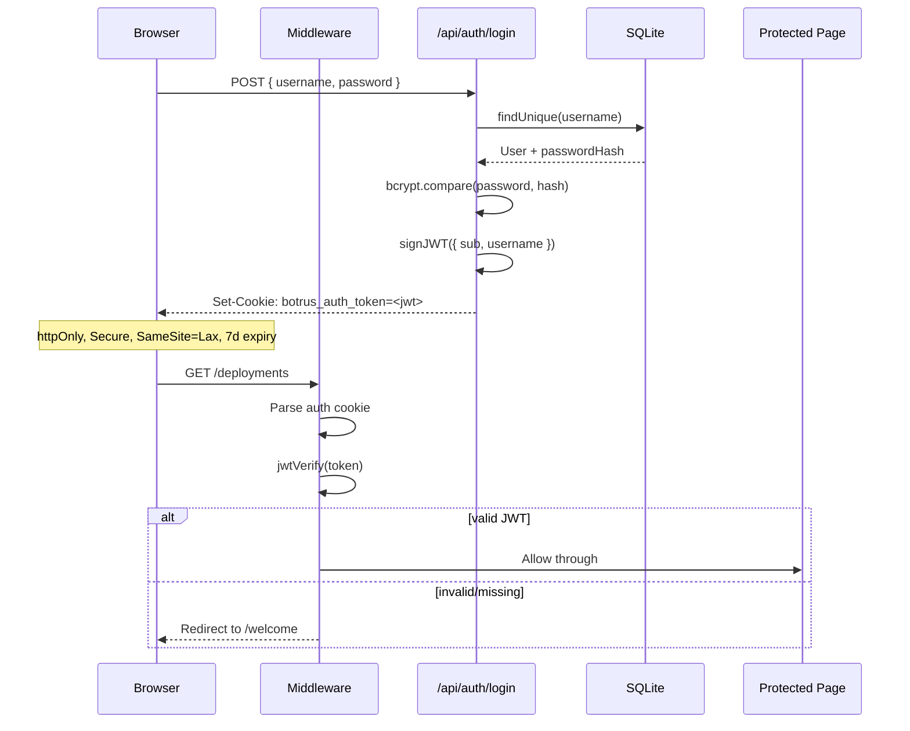

# BORTUS User Permissions

## Policy mutation and legacy acknowledgement source review - 2026-10-19 (Toronto)

No concrete supported correction is selected by the [bounded source review](../evidence/bortus-policy-mutation-source-root-20261019.json). Application `a912ab02` and charts `835dabeb` remain unchanged. Root binds 24 selected application files and nine historical records; independent review binds 23 public files. Whole-file identity is distinct from selected semantic read scope.

Policy commits check fresh human administration before the larger strict metadata body, then recheck inside the account-lock transaction. Existing-policy preview/update/delete requires a positive safe revision; missing revision is 428 and stale revision is 409 subject to the existing validation/record ordering. Updates increment revision. Prefix/action/principal/mount validation, the rule cap and legacy list/read audience remain intact. Either incoming or previous legacy principal triggers impact checks, including moving a rule away from legacy lookup.

The recomputed authorization-metadata fingerprint includes normalized intended fields, prior policy, current principal/rules, exact aliases/targets, grants, path/mount revisions and normalized scopes. Previews page at 100 rows; commits require the exact complete unique alias set, including old/new read scopes whose effective result is unchanged. Missing acknowledgement returns 428, malformed/duplicate acknowledgement 400 and changed fingerprint/set 409. Policy mutation, legacy principal revision and metadata audit share the transaction. Source does not prove a person reviewed every row; the external alias file cannot join that transaction, and previews prove no native head/key availability.

Existing selected unit/HTTP assertions and historical receipts were read only. No tests, build, fixture, token issuance/reveal, database opening, Prisma/SQL/migration, native/API/backend/browser/operator/recovery/security retry or live operation occurs. The 62 root Markdown and 22 application-doc inventory is bytes/hashes/headings plus selected relevant sections, not full semantic review. Oversized root and independent reads remain recorded with bounded rereads. All original 44 clauses, A07 five-of-ten warm failures and all security/actual-AT/compatible-recovery/backup/quiescence/schema/effective-RBAC/admission/live-data gates remain. Saved 32 and earlier one publication findings remain unresolved. Full delivery is incomplete; the next separate feature reviews policy-editor preview/confirmation/conflict source and has not begun.

## Automation identity authority source review - 2026-10-19 (Toronto)

The [bounded source receipt](../evidence/bortus-automation-identity-source-root-20261019.json) selects no concrete supported correction. Application `a912ab02` and charts `835dabeb` remain unchanged. Root binds24 selected application files and8 historical records to raw Git blobs/modes, with explicit partial-read scopes; independent review binds26 public files. A full-file hash is a currentness binding, not a claim of complete semantic review. This feature traces issuance, distinct credential audience, authentication, current owner/identity checks and selected native authorization boundaries from public source only.

A fresh human writer can issue for themself; issuing for another current writer requires effective engine administration. The serialized issuance transaction captures the owner's sessionVersion and stores a credential hash, explicit scopes and bounded future expiry. The credential helper uses UUID4 plus32 random bytes; exact Bearer grammar and hash comparison separate automation from human JWTs and legacy lookup. The handler authenticates before body parsing/dispatch; list projection excludes credential/hash and replies are private/no-store. Current owner existence, matching actor/recorded owner sessionVersion, identity ownership, expiry, revokedAt and write role are checked afresh; effective rights intersect current deny-aware owner and identity policies. Automation cannot administer identities or become an engine administrator.

Explicit revocation atomically records revokedAt and metadata audit. Password reset increments owner sessionVersion; owner deletion fails the fresh owner lookup without a claimed cascade. Demotion denies while the current role is readonly; role-only changes do not increment sessionVersion or stamp revokedAt, so later re-promotion may restore a still-valid identity subject to current policies. This review does not claim permanent invalidation on demotion or change that current-privilege contract. Identity DELETE has no revision/CAS field; the already documented pending CAS work remains pending, without inventing a new acceptance requirement. Selected value reads reauthorize in their audit transaction before release; selected changes recheck before canonical replacement. These checks do not make authorization atomic across an external native request or qualify every dispatch branch.

Existing foundation/HTTP/administration test assertions were read, including audience/projection, policy intersection, expiry/revoke/reset/current demotion/deletion and selected scope refusals. No tests, fixtures, build, credential issuance/reveal, database opening, Prisma/SQL/migration, native/API/backend/browser/operator/recovery/security retry or live operation occurs. Root documentation/evidence only; no app source/docs/dependency/workflow/chart/image/runtime change. All44 original clauses, A07five-of-ten warm failures and security/actualAT/independent compatible recovery/fresh backup/quiescence/schema/effectiveRBAC/admission/live-data gates remain. Saved32 and earlier1 publication findings remain unresolved without inspection/classification/diagnosis/rescan/suppression/disposition/security acceptance. Full delivery is incomplete; the next separate feature reviews public policy mutation/acknowledgement source. Its deeper trace and any next patch/test/fixture have not begun.


## Forward metadata migration and startup schema source review - 2026-10-19 (Toronto)

The [bounded source receipt](../evidence/bortus-app-schema-source-root-20261019.json) selects no concrete supported correction. Application `a912ab02` and charts `835dabeb` remain unchanged. Root binds31 selected application files and7 historical records to actual raw Git blobs/modes; an independent review records30 public files. All eleven forward migration sources are reviewed without executing them. Static DDL text reconstruction accounts for24 tables/186 scalar columns matching current Prisma field names; it does not execute SQL or validate database constraints, indexes, migration-ledger integrity or populated rows.

The three historical table-copy statements retain all prior GitRepo, Node and pre-role User columns. New repository namespace/node name default empty; the original role addition defaults existing pre-role users to readonly, preserving IDs, names, hashes and timestamps rather than inventing a prior role. Later account/KV changes add sessionVersion, the serialization row, engineAdmin for existing writers, role-dependent policies and the legacy principal. Exact alias metadata is additive; identity creation is in the initial KV metadata migration, and later rotation/audit additions are nullable without rewriting existing rows. This source reasoning is not complete-row or populated-identity preservation evidence.

Readiness checks lock/principal existence, selected user columns, aliases and the latest audit columns. It does not inspect every model, identity/rotation columns, defaults, constraints, indexes or migration history; empty user/audit query results are accepted. Its documented contract is a dependency read check, while both packaged entrypoints require forward migrate deploy before server startup. Existing synthetic test source covers selected account/alias/rotation/audit fields and fresh/repeated migration/schema diff; the foundation fixture asserts zero identities rather than populated identity preservation. No new test, fixture, build, Prisma/SQL/migration execution, database opening, native/API/browser/operator/recovery or live operation occurs.

All44 original clauses, A07five-of-ten warm failures and security/actualAT/independent compatible recovery/fresh backup/quiescence/schema/effectiveRBAC/admission/live-data gates remain. Saved32 and earlier1 publication findings remain unresolved, with no inspection/classification/diagnosis/rescan/suppression/disposition or security acceptance. Full delivery remains incomplete. Next is a separate bounded public identity/revocation source review; no next patch/test/fixture or token operation has begun.

## KV cleanup summary compiled presentation - 2026-10-19 (Toronto)

The [bounded presentation receipt](../evidence/bortus-kv-cleanup-presentation-root-20261019.json) reviews unchanged application `a912ab02` / frontend `91078cd2`, using BuildID `NXhSomXkQG0Ty4ZzFvFhX`. Root binds297 current raw Git/build inputs through actual WSL UNC reads, including one declared CRLF-to-LF relation. The initial prelaunch checks all41,723 compiled/dependency records plus native/worker bindings. After a readonly first-start refusal, the revised fixture reuses that graph check with no writer/source change and fresh source/native/worker checks. All297 inputs remain unchanged after runtime; no final graph walk, source patch, test or rebuild occurs.

Integrated IAB records14 full sequential AX states, three read-only DOM projections and three inspected images. Exactly two intercepted synthetic destroy submissions display pending, complete and partial cleanup metadata. The first hold is file-released after20.140s. Each complete/partial paragraph has `role="status"`, zero table descendants and a separate sibling table: `deleted / 200`, then `conflict / 409`. Partial is a successful HTTP200 metadata response with a409 detail row, not an exercised error-response branch. Six explicit clears surround three text entries; closing administration returns entry focus, then the tab closes. No GC, recovery, identity or additional error interaction is attempted. These separate action/DOM/AX/image observations establish finite presentation only; actual AT remains open.

All browser APIs are intercepted:63 API events represent62 transactions (60GET +2POST; the first POST has held/settled events), zero API forwarding. A fresh tmpfs-only schema/account and server-memory synthetic human cookie enable the actual compiled protected page; no cookie is issued to the browser, no operator authentication/schema changes, values or KV-issued credentials occur. The fixture internally reads app liveness for startup. Original2CPU/1GiB/no-extra-swap/PID256/network-none/readonly/1800s/32-connection bounds hold. Exact v1/v2 container IDs/names, all three recorded v2 actor births and Linux/Windows4401 listeners are absent.

The v1 Docker-start refusal is retained before READY/browser; discarded stderr leaves its exact cause unestablished. Absent standalone nested mountpoints are observed; v2 instead serves exact compiled static bytes with strict path/size checks. Initial CRLF readers, IAB initialization timeout, unused exact-argv reader and API event-count wording remain retained. Returned screenshots are JPEG1270×714 despite initial `.png` names; originals and identical `.jpg` aliases are preserved. IAB defaults were not overridden; CSS viewport dimensions were not separately measured. No actual AT, real native cleanup/history/CAS/rotation/recovery/rollback, performance, release-image, security or live-adoption gate closes. All44 original clauses and A07five-of-ten warm failures remain. Full delivery is incomplete; the next separate feature reviews immutable-image/guarded-adoption source wiring without publication or live action.

## KV cleanup summary status semantics - 2026-10-19 (Toronto)

The [bounded source/build receipt](../evidence/bortus-kv-cleanup-status-root-20261019.json) records isolated application `a912ab02` / frontend `91078cd2`. The only production change adds `role="status"` to the existing complete/partial History cleanup summary. Its detailed table stays outside that status element. Removing the attribute restores the entire original component; handlers, state, text, authorization and data contracts are unchanged. Existing pending/error and other result roles provide no basis for a broader rewrite. This fixes a source semantics gap without inferring a failed or successful screen-reader announcement.

The same three actual-source TSX/JSX element-model tests produce old1pass/2fail and changed3pass; no React DOM is mounted and no request is sent. Full-context selected lint exits0 with empty output. A fresh offline build/typecheck passes at original4CPU/4GiB/no-extra-swap/PID256/900s bounds, copying and checking37,428 pinned dependency records rather than installing. Root binds297 current source inputs; independent review checks all41,723 final compiled records and worker/native packaging. All six owned container IDs/names are absent; the separate build host process has no retained birth identity.

Automatic push39223852253 and PR39223859898 CI pass all12steps:466units,8original sensitivity pairs,8integrations and the compiled Pods smoke (208wire/100initial/3filtered/8non-age columns/3exact links). Saved metadata/raw logs are parsed independently of feature acceptance; no manual corpus replay, release image or adoption follows.

The initial missing read-only mountpoint refuses before Node/TAP. Initial reduced-context lint exits0 with a pages-path advisory. The earlier full-context lint inventory differs from the later final build at138 generated trace records; all297 source/test inputs match. Its inventory is not final-build immutability proof, and no writer cause is claimed. The independent reader's overbroad inventory assertion, case-sensitive absence parser and mistaken standalone provenance-JSON probe remain retained; no workload or graph replay follows. All56 existing root Markdown documents and22 app docs are checked; two app docs and current root evidence are updated. This feature adds no manual cleanup-summary browser review, actual AT, operator native-backend/recovery operation, real operator authentication, schema, release image, performance measurement or live operation. Automatic hosted CI separately exercises its unchanged synthetic HTTP and Pods browser fixtures. All44 original clauses and failed A07five-of-ten comparison remain. Full delivery is incomplete; the next separate feature is bounded integrated synthetic cleanup-summary presentation review, not native-operation acceptance.

## A07 history-aware source decision - 2026-10-19 (Toronto)

The [bounded source decision](../evidence/bortus-a07-history-source-review-root-20261019.json) selects no justified A07 patch. Current application `5d25f7ff` / frontend `60a7af22` remains unchanged. Root rechecks the preserved raw/full-summary digests and reconstructs only the 60 saved warm phases/960 requests and ten three-run median comparisons: five still regress. This reads saved data; it adds no measurement, diagnostic, runtime test or build and does not repeat the prior complete 1,386-distribution reconstruction.

The first lexical-plan proposal is withdrawn after checking historical `169107f`: that isolated candidate already reused lexical paths and reduced identity allocations, yet its original comparison failed two warm cases, with all three metadata-1,000 serial candidate samples slower. A narrower local-plan variant has no new isolated support. Removing sorting from row-key validation is also not selected: exact length/membership preserves legitimate plain projections but can change malformed-object behavior when enumerable names contain commas and required fields are inherited or non-enumerable. These are source decisions, not a latency diagnosis or a claim that optimization is impossible. The initial conditional independent selection receipt remains retained and is superseded by its history-aware amendment.

Seventeen current source/control bindings are checked. Sixteen match the measured candidate; middleware differs only in its previously qualified four welcome-image public paths, with the authenticated Pods branch unchanged. The reader's initial overbroad equality assertion refused before producing its receipt; only that saved-source reader was corrected. Both real yields, fresh account/role/session/SQL/filesystem/path/schema/config/deadline checks, complete sibling checks, refusal drains, parent delivery fence and one-active/64-queued/5s envelope remain intact. No row, role, session or filesystem-result cache is introduced.

All 55 existing root Markdown documents including PLAN/status and all 22 application docs are checked; existing dated application review records stay historical. Current status/operations/permissions and the new handoff record this decision. No source, test, dependency, workflow, frozen fixture/oracle/resource/threshold, image, chart, schema or production change occurs. All44 original clauses, failed comparisons and rejected security/recovery boundaries remain. Full delivery remains incomplete. The next separate feature reviews KV administration metadata-only asynchronous announcement semantics; it has not begun and cannot close actual AT, performance, security, recovery or live adoption.

## Overlapping welcome lookups - 2026-10-19 (Toronto)

The [bounded receipt](../evidence/bortus-welcome-overlap-root-20261019.json) reviews unchanged application `5d25f7ff` / frontend `60a7af22`, reusing BuildID `g9s2FM_HN2yKmoyUlr-nZ` only after current binding of296 raw production-export files and prelaunch verification of41,723 compiled/dependency records and native/worker bindings. No source patch, new source test or rebuild is warranted.

Exactly two explicit clicks on the same enabled header Get Started button produce two overlapping synthetic lookups. The second completes first: destination GET order is `/auth/login`, then `/auth/register`. GET destination responses are briefly held so the unchanged welcome page remains mounted. After the second lookup settles, its checking status remains populated and all3 buttons stay enabled/busy; after the final lookup settles, status empties and busy clears. Releasing navigation yields the actual registration page. Both arrival and post-hygiene observations have empty fields;3 explicit clears, zero form submissions or forwarded mutations, zero accounts. Seven sequential DOM/AX observations and4 inspected PNGs support this finite result. Images show visible page state; the status is visually hidden.

Both lookup holds and both navigation holds are file-released. Navigation responses release registration then login; their close records do not prove cancellation. No visible first sign-in arrival is claimed. The180s fixture response hold is a ceiling subject to the unchanged60s relay inactivity bound; the global timer edit also covers unused auth holds. The third session request belongs to registration mount, not another welcome activation. Actions, DOM, AX and images are separate observations; actual AT remains unproved. AX captures01-05 are incremental/no-change outputs without a persisted full welcome base; no standalone full-AX reconstruction is claimed. Full DOM snapshots and read-only attribute projections support status/busy. Existing three-destination/fallback source and previous failures remain unchanged; other overlap combinations are not replayed.

Unified launcher exits0; exact preview/build IDs and names, supervisor birth and Linux/Windows4401 listeners are absent. All296 raw sources remain unchanged; no final graph rewalk. Every existing root/app doc is checked, with current evidence updated in root status/operations/workflow/permissions only. All44 acceptance clauses, A07 five-of-ten warm failures, security/recovery restrictions and data protections remain. No live/authentication/security/performance/native-value/history/CAS/rotation/rollback/recovery/adoption gate closes. Full delivery remains incomplete. Next is a bounded source review of preserved A07 warm failures for one justified minimal candidate; no next test, patch, diagnostic or benchmark has begun.

## Registration unavailable keyboard review - 2026-10-19 (Toronto)

The [bounded receipt](../evidence/bortus-register-unavailable-keyboard-root-20261019.json) reviews unchanged application `5d25f7ff` / frontend `60a7af22`. Current raw Git binding covers all 296 production-export files; prelaunch checks all 41,723 compiled/dependency records and native/worker bindings before reusing BuildID `g9s2FM_HN2yKmoyUlr-nZ` under the original isolated preview bounds. No source patch, new source test or rebuild is warranted.

Integrated IAB at default 1280x720 records 23 sequential states and five inspected, cleared-field PNGs. Held successful-response JSON exposes the existing named checking status with no form. Unknown HTTP500 availability and explicit closed availability leave body focus; Tab reaches the visibly focused sign-in link, reverse Tab leaves page content, and forward Tab returns. Enter reaches sign-in from both. One keyboard submit receives synthetic HTTP403 headers: form, three inputs and pending status disappear before the body, body becomes active, next Tab visibly reaches Go to sign in, and Enter reaches sign-in while that body is still held. All three sign-in arrivals have populated fields, cleared without submitting; exact values and cause remain unqualified. Nine explicit field clears cover the three arrivals and pre-input registration hygiene; the refusal withdraws the three synthetic inputs and navigation unmounts that page.

One intercepted POST/two auth events and three session requests/five session events remain synthetic, with no forwarded mutation or retained request body, zero accounts and no other mutation. Every hold is file-released. Initial capture01 was already unknown after HTTP500 headers, so its checking label is not checking evidence; checking is separately observed at07/08. A body-locator Tab call times out after reverse traversal without activation; fresh AX followed by documented IAB key input resumes navigation without resubmission. Initial Windows-to-WSL script-path absence is a preparation refusal before launch. Original records remain; DOM/AX/actions/images are sequential, not simultaneous. Exact password equality and actual AT remain unproved.

The exact preview/build container ID/name, supervisor birth and Linux/Windows4401 listeners are absent; all296 raw sources remain unchanged, with no final graph rewalk. All51 existing docs/ Markdown documents, PLAN.md, MIGRATION_STATUS.md and22 app docs are checked; only root evidence/status/workflow documentation changes. No benchmark, release image, live authentication, security, native-value/history/CAS/rotation/rollback, recovery or adoption is qualified. Original44 clauses and A07 five-of-ten warm failures remain; full delivery is incomplete. The next bounded feature observes previously unexercised overlapping welcome lookups and completion-order navigation; no next interaction, test or patch has begun.

## Authentication entry keyboard review - 2026-10-19 (Toronto)

The [finite keyboard receipt](../evidence/bortus-auth-keyboard-root-20261019.json) reviews unchanged application `5d25f7ffc488dcf1d28209e196d171a8b3e907db` / frontend `60a7af22a37e8e584bed073be61534fcded282fd`. The existing compiled build is reused only after current raw Git binding of all296 production-export files and prelaunch verification of41723 compiled/dependency records, native/worker bindings and original readonly/network-none isolation. No source patch, new source test or rebuild is warranted by these observations.

Integrated IAB at its default1280x720 records73 sequential states and11 visually inspected PNGs;8 cleared-field images are public. Forward/reverse traversal reaches welcome controls and both open forms with visible focus. Header Enter, hero Space and final-CTA Enter select sign-in, the synthetic root marker and registration using fresh synthetic session responses. Root is navigation-only, not authenticated-dashboard acceptance. Held welcome requests retain initiating-button focus. Empty form submission focuses Username through native validation; registration mismatch keeps Create account focus. Disabling a pending form submit leaves body active; next Tab reaches Back with visible focus and settlement retains Back. Later sign-in-link and registration arrivals leave body active, then first Tab reaches Username. The existing initial registration check already exposes its named status.

Three welcome activations and five form-submit attempts produce two intercepted POSTs/four auth events; three validations send none. All session and authentication responses are synthetic; bodies are not retained, no mutation forwarded and zero accounts created. All held responses are file-released. Eighteen field-clear operations surround synthetic entry; a later populated sign-in arrival is cleared without submitting. The first welcome-to-sign-in focus was observed only after hygiene moved focus, so its natural arrival remains unqualified. Private value projections report lengths/equality differing from the inspected typed-username image; exact field content/password equality and the cause remain unqualified. Those original records stay private without resubmitting. DOM/AX/image captures are separate sequential observations.

The exact preview container ID/name, supervisor birth and Linux/Windows4401 listeners are absent;296 raw sources are unchanged, with no final graph rewalk. All50 existing root Markdown docs and22 app docs are checked; only root evidence/operation docs change. Preparation refusals are retained separately. The finite review does not close actual AT, real authentication/bootstrap/outage, performance, image security, compatible independent recovery, native-value/history/CAS/rotation/rollback or live adoption. A07 still fails5/10 and all44 original acceptance clauses and protected files remain. No release/merge/deploy follows. The next bounded feature reviews keyboard access after registration unknown/closed availability or403 form replacement; no such next interaction/test/patch has begun. Full delivery remains incomplete.

## Welcome pending session status - reviewed source and bounded UI

Application `5d25f7ffc488dcf1d28209e196d171a8b3e907db` adds only an in-flight counter, one persistent sr-only `Checking session…` status outside the three Get Started buttons and their shared busy attributes. Buttons stay enabled; every explicit click obtains a fresh session. Existing guards, three destinations and all failure fallbacks remain unchanged. Removing eight lines restores the entire prior page. Same-final actual-source tests old5/41 then46/46 and lint0 pass; the earlier guessed-microtask observer failures remain retained after an explicit JSON-entry barrier correction.

The [finite receipt](../evidence/bortus-welcome-pending-root-20261019.json) binds a fresh production build and synthetic IAB states. All7held states expose status/busy semantics; all3destinations, HTTP500, invalidJSON and malformed flags are observed. The root destination is a synthetic navigation marker. One destroyed-connection attempt unexpectedly reaches registration after two synthetic-safe responses; its timed-out sign-in wait and cleared-field image remain private, with no cause, browser-network-fallback pass or replay claimed. The source catch remains byte-identical and model-tested. Seven explicit Get Started clicks send zero form submissions; all16PNGs inspected,15public,fields cleared before captures,zeroaccounts. Captures are sequential and actual screen-reader announcements remain unproved. Build/preview/listeners are closed. No image or production operation follows.

## Registration pending submission status - reviewed development source

Application `170de4e5295b465d633e92c11ebd4c417ac5785d` adds an always-mounted, screen-reader-only `role="status"` outside the open registration form, loading-derived `aria-busy`, and `aria-hidden="true"` on its decorative spinner. The status contains `Creating account…` only while the existing loading state is true. Removing that paragraph and two attributes restores the entire prior page. Availability, validation, retained fields, disabled submit, explicit retry, feedback alerts, neutral wording, navigation and fresh server authority are unchanged. HTTP403 still replaces form and pending status with its lock alert before reading the body.

The [finite receipt](../evidence/bortus-registration-pending-root-20261019.json) records same-final-tests old42pass/19fail then61/61,lint0,fresh compiled source,11 sequential synthetic IAB states and two successful source CI runs. Held fetch/500-body states expose busy/status semantics;settlement restores feedback;held403,closed and unknown retain no form/status. Four deliberate clicks produce3interceptedPOSTs;validation sends none,no bodies retained,zeroaccounts. Two early stale frames and a capture binding error remain private;current frames are captured without resubmitting. All11 selected screenshots are visually checked. Exact password equality and actual screen-reader announcements remain unproved. No release image or production operation follows.


## Login pending submission status - reviewed development source

Application `29036ff9548d67374354d40be2c042dc59a902ce` adds an always-mounted, screen-reader-only `role="status"` outside the login form, `aria-busy` from the existing loading state, and `aria-hidden="true"` on the decorative spinner. The status contains `Signing in…` only while loading, including reading an unsuccessful response body. Removing that paragraph and two attributes restores the entire prior page; handlers, fields, validation, feedback alerts, navigation and fresh server authority are unchanged.

The [finite receipt](../evidence/bortus-login-pending-root-20261019.json) records same-final-tests old29pass/24fail then53/53, lint0, fresh compiled source and six sequential synthetic IAB states (five public images). Held-request and held-body states expose busy/status semantics; string and malformed-body settlements restore the form and existing alerts. An initial autofill race and a mismatched initial screenshot remain private; no browser-validation or simultaneous-initial-blank claim follows. All three attempts were intercepted, no bodies retained and zero accounts created. Exact password equality and actual screen-reader announcements remain unproved. Source CI passes; no release image or production operation follows.

## Registration lock alerts - reviewed development source

Application `ac15e9cdd537c0be2d92b418bc30c85e7371cb43` adds one `role="alert"` to the existing locked heading/explanation group. The sign-in link stays outside and no focus target/movement is added. Confirmed-closed availability and HTTP403 replace the form with this notice;403 still locks before body parsing. Availability, submission behavior and fresh server authority remain unchanged. The [finite receipt](../evidence/bortus-registration-lock-root-20261019.json) records same-tests old31pass/14fail then45/45, lint0, fresh compiled source, seven synthetic IAB states and exact-source pushCI success. Its separate PR registry502 failure/7validation skips remain preserved. Four lock states each expose one application alert;unknown/open/validation and sign-in navigation remain intact. Source/model/DOM observations do not establish actual screen-reader announcements or live acceptance. No new image or production action follows.


## Authentication submission alerts - reviewed development source

Application `7b852b021e604f3c1190dbfad8b1a58f3a906286` adds `role="alert"` to the two existing conditional login/registration error containers. Submission, validation, feedback strings, loading, fields, availability,403 lock, success navigation and fresh server authority remain unchanged. The [finite receipt](../evidence/bortus-auth-announcements-root-20261019.json) records same-test old15pass/26fail then41/41, lint0, fresh compiled source, eight synthetic IAB cases and exact-source CI. Seven feedback cases expose content-scoped alerts; the403 case preserves its existing lock screen. These source/DOM observations do not prove actual screen-reader announcements or live acceptance. Exact password equality is unobserved because DOM values are redacted; screenshots retain visible synthetic username and masked nonempty fields. No new image or production action follows.

## Login refusal presentation - reviewed development source

Application `0b9d244b6479dd559ebd1270af3e3c3e60569c20` renders only a string `error`
from a nonarray JSON object after an unsuccessful login HTTP response. Unreadable
or malformed bodies use `Login failed`; transport failures keep the network-error
message. Loading recovery, entered fields, form behavior and successful `push("/")`
remain unchanged. Fresh server authentication is unchanged. The same actual-page
TSX/VM test passes 10/fails 6 on old source and passes all 16 on the correction;
these are client-model results. See the [bounded evidence](../evidence/bortus-login-errors-root-20261019.json)
for compiled/UI/CI evidence and its limits; no new release image or live acceptance
follows from source qualification.

The [original A02 account/auth clause](../evidence/bortus-a02-composite-boundary-root-20261015.json) is qualified for reviewed source through the existing issued-cookie160-call deletion matrix and distinct demotion,native permission,expiry and logout checks. Root verifies17 current auth/test source files unchanged from their qualified source and seven evidence bindings. The earlier17-check supplement retains its later A05 failure; its completed expiry/logout assertions are scoped evidence. Logout qualifies cookie removal, with no global copied-JWT revocation claim. Delivered/live acceptance remains separate.

The BORTUS K8s dashboard uses a **two-role permission system** with cookie-based JWT authentication. Roles are enforced at three layers: middleware (auth gate), API routes (write gating), and client UI (conditional rendering).

---

## Role System

| Role | Description |
|------|-------------|
| `write` | Full access — view everything, modify resources, run deployments, manage users, sync variables |
| `readonly` | Read-only access — view dashboards, pods, nodes, deployments. Cannot modify, delete, or deploy |

There is no third role. No granular per-resource permissions. Every user is either `readonly` or `write`.

Roles are stored in the `User.role` column in SQLite (`prisma/schema.prisma`):

```prisma
model User {
  id           String   @id @default(cuid())
  username     String   @unique
  passwordHash String
  role         String   @default("readonly") // "readonly" | "write"
  createdAt    DateTime @default(now())
}
```

---

## Authentication Flow



### JWT Payload

```typescript
{
  sub: string;      // user.id
  username: string; // user.username
  iat: number;      // issued at
  exp: number;      // 7 days from issue
}
```

The JWT does **not** carry the role. Roles are always looked up from the database on every authorization check — so role changes take effect immediately without re-login.

### Cookie

| Property | Value |
|----------|-------|
| Name | `botrus_auth_token` |
| HttpOnly | `true` (inaccessible to JS) |
| Secure | `true` in production |
| SameSite | `lax` |
| Max Age | 7 days |

---

## Middleware: Authentication Gate

`src/middleware.ts` runs on every request. It intercepts requests before they reach pages or API routes.

**Public paths** (no auth required):
- `/welcome`, `/auth/login`, `/auth/register`
- `/api/auth/*`, `/api/cluster/info`, `/_next/*`, `/favicon.ico`
- Exact `/api/vars/lookup` (Bearer inside handler), `/api/health/live`, `/api/health/ready`

**Protected paths** (everything else):
- **Page requests** → redirect to `/welcome` if no valid cookie
- **API requests** → return `401 Unauthorized` if no valid cookie

The middleware only checks whether a user is authenticated — it does **not** check roles. Role enforcement happens deeper.

---

## API-Level Authorization: `requireWrite()`

`src/lib/permissions.ts` provides two functions:

### `requireWrite()`

Used in every API route that modifies state. Pattern:

```typescript
import { requireWrite } from "@/lib/permissions";

export async function POST(request: NextRequest) {
  const auth = await requireWrite();
  if (auth instanceof NextResponse) return auth; // 401 or 403

  // auth.id, auth.username available — user has write access
}
```

Checks performed:
1. Is there a valid session? → No = `401 Unauthorized`
2. Does the user's DB role equal `"write"`? → No = `403 Forbidden — write access required`

### `getCurrentRole()`

Returns the session's role without enforcing anything. Used for client-side conditional rendering:

```typescript
const session = await fetch("/api/auth/session").then(r => r.json());
// session.role === "write" | "readonly"
```

---

## Write-Gated API Routes

Every mutating endpoint calls `requireWrite()`. Read-only endpoints (like `GET /api/users`, `GET /api/vars`, `GET /api/cluster/*`) do **not** gate on role — any authenticated user can read.

| Endpoint | Method | Gate |
|----------|--------|------|
| `/api/nodes` | POST | `requireWrite` |
| `/api/nodes/[id]` | PATCH, DELETE | `requireWrite` |
| `/api/users` | POST | `requireWrite` |
| `/api/users/[id]` | PATCH, DELETE | `requireWrite` |
| `/api/vars` | POST, PATCH, DELETE | `requireWrite` |
| `/api/vars/sync` | POST | `requireWrite` |
| `/api/settings` | POST, PATCH | `requireWrite` |
| `/api/deploy/start` | POST | `requireWrite` |
| `/api/deploy/stop` | POST | `requireWrite` |
| `/api/deploy/history` | POST | `requireWrite` |
| `/api/cluster/*/delete` | POST | `requireWrite` |
| `/api/cluster/*/yaml` | PATCH | `requireWrite` |
| `/api/cluster/refresh` | POST | `requireWrite` |
| `/api/cluster/pods/*/shell` | POST | `requireWrite` |
| `/api/flux/repos/*` | POST, PATCH, DELETE | `requireWrite` |

---

## Registration Rules

`POST /api/auth/register` enforces these rules:

1. **First user ever → `write` role automatically.** The system needs at least one admin.
2. **Subsequent users → `readonly` role.** New users start as viewers.
3. **Registration lock:** After the first user exists, registration is disabled unless:
   - `ALLOW_REGISTRATION=true` environment variable is set, OR
   - The `AppSetting` with key `allow_registration` is `"true"` (set via the settings UI)

---

## User Management

Users with `write` role can manage other users at `/users` or via the API:

### Create User — `POST /api/users`
- Username: 3–30 chars, `[a-zA-Z0-9_-]`
- Password: 8+ characters
- Role: optional, defaults to `readonly`

### Update User — `PATCH /api/users/[id]`
- Can change role (`readonly` ↔ `write`) or reset password
- **Cannot change own role** (self-protection)
- **Cannot demote the last write user** (prevents lockout)

### Delete User — `DELETE /api/users/[id]`
- **Cannot delete yourself**
- **Cannot delete the last write user** (prevents lockout)

---

## Client-Side Role Awareness

The session endpoint `GET /api/auth/session` returns the user's role:

```json
{
  "authenticated": true,
  "username": "admin",
  "role": "write",
  "hasUsers": true,
  "registrationOpen": false
}
```

The users management page (`/users`) fetches this session to conditionally render admin controls:

```typescript
const isWrite = currentRole === "write";

// Only write users see "Create User" button
{isWrite && <CreateUserButton />}

// Demotion warning when editing the last write user
{editing.role === "write" && editRole === "readonly" && (
  <Warning>Demoting the last write user will lock everyone out!</Warning>
)}
```

---

## Security Properties

| Threat | Mitigation |
|--------|------------|
| Token theft | Cookie is HttpOnly (inaccessible to JS) |
| Token replay | Tokens expire after 7 days |
| Privilege escalation | Role stored server-side in DB, not in JWT |
| Self-demotion | Cannot change own role |
| Complete lockout | Cannot delete/demote last write user |
| Unauthorized registration | Locked after first user unless explicitly enabled |
| Session hijacking | Secure cookies in production (HTTPS only) |

---

## Development vs Production

| Setting | Development | Production |
|---------|-------------|------------|
| Cookie Secure flag | `false` | `true` |
| JWT secret source | operator env | native Secret env reference |
| HTTPS required | No | Yes (for cookie) |

Supply stable BOTRUS_JWT_SECRET independently (native Secret env reference in Kubernetes). ensureJwtSecret fails if absent, never writes SQLite/.env.local.

---

## Troubleshooting

**"Authentication required" (401) on API call**
→ Cookie expired or missing. Log in again at `/auth/login`.

**"Forbidden — write access required" (403) on write endpoint**
→ Your user has `readonly` role. Ask a `write` user to promote you at `/users`.

**"You cannot change your own role" (403)**
→ Self-serve role changes aren't allowed. Ask another `write` user to change it.

**"Cannot demote/delete the last write user" (403)**
→ Promote another user to `write` first, then demote/delete.

**"Registration is locked" (403)**
→ Set `ALLOW_REGISTRATION=true` in `.env.local`, or enable it via `/settings` (requires write access).

**Can't log in after restart**
→ If the JWT secret changed, all existing cookies become invalid. Re-login.

## Native value permissions

Readonly authenticated users list Secret metadata/keys. Value reveal and all mutations require fresh DB write role. Bearer lookup is a privileged automation credential scoped to registered aliases/nonsecret config. Sensitive legacy variable values are never exposed. SQLite retains password hashes/roles rather than authoritative Secret values.


## 2026-10-11: narrow auth/command proof and registration failure

The [independent acceptance review](../evidence/bortus-app-narrow-auth-command-a03-20261011.json)
verifies two immutable docs/evidence commits,27 raw Git blobs/modes and46 original
artifacts against their retained Linux bytes. Source333/compiled4262 hashes remain
unchanged from ab8d450; nine owned process identities and three containers are absent.
Seventeen A02 checks pass: expired cookies, logout response attributes/applied cookie
jar,120 anonymous protected templates and exact public boundaries. These prove
neither stolen-token/global logout revocation nor all authorized handler behavior.
Six A05 production/shared-client stdout-only/stderr-only/neither cases pass fixed
502 redaction and child settlement. The first noexec fixture failure is retained;
actual EACCES and same-byte executable-bind controls establish the fixture cause.

A03 remains failed. Its named first concurrent bootstrap case retains exactly one
writer/effective administrator/policy but returns three busy503 refusals where
strict403 is required. Exact inner Prisma lock/timeout subtype is unproven; the
remaining nine permutations were not run. The proposed process-local bounded queue
must retain the real DB lock and fresh checks, pass unchanged strict predicates,
and prove independent-process invariants before acceptance. Neither source edits
nor acceptance follows from the proposal. Original default scans remain exit1 with
one independently verified unchanged public prose span, zero new untriaged findings
and two older unresolved source-provenance findings. No suppression, full A02/A03/A05,
performance, new image or live KV acceptance is claimed.


## Root review of final4ae9 browser and universal action evidence

The [independent root receipt](../evidence/bortus-browser-actions-4ae9-root-20261011.json) binds all264 functional/browser and99 universal originals by raw SHA. The five bounded compiled production route groups passed27 actions,513 recorded control labels and270 failure outcomes, including exact single-invocation argv, four nonzero-output combinations, missing executable, real timeouts, both output bounds, RBAC/NotFound and fresh authorization before input. PV reclaim retains its documented207 partial-result semantics. Two failed harness setup attempts are retained. Fresh root verification finds all344 executed sources and4262 compiled outputs unchanged, every observed universal child absent and no owned containers.

Browser scope comprises seven completed assertions in a run that later failed a Secrets locator, one completed Secrets assertion in a run that later failed a Flux locator, and two completed Flux/Settings assertions in the final terminal0 run. This is ten completed checks across7+1+2, not one uninterrupted ten-check pass. The six held success/error action classes fence stale callbacks and private state after fresh withdrawal and permission ABA; current Configuration/Users/KV/Secrets/Flux/Settings paths retain task completion and failure drafts. Only the exact Next framework route-announcer is excluded from application-alert assertions. All original failures remain retained. Browser request-event arrays are empty, so this does not establish physical request/replay counts. Controlled CLI/localhost fixtures do not establish real cluster action acceptance. Performance, patched-image security, latest-data migration and live/rollback acceptance remain separate open gates.

## 2026-10-12: authoritative account-read mechanism diagnostic

The [isolated public diagnostic](../evidence/bortus-public-account-read-root-20261012.json) completes with outer/supervisor exits of zero, ten controls and all 24 untrimmed observations. Root verifies 78 originals and independently observes 20 PID/start identities and both exact container references absent. On selected Node 22.23.3/SQLite 3.51.3, median two fresh reads cost 0.637 ms through Prisma and 0.059 ms through prepared readonly SQLite, including native file identity checks. Both refuse locking, schema and permission faults; independent writes, revocation, demotion and deletion remain visible. The native reader refuses file replacement while the existing Prisma fixture connection returns its old snapshot. This is diagnostic behavior, not an existing production fence. Experimental warnings and all tails are retained.

No HTTP or asynchronous-worker performance acceptance follows these timings. A reviewable candidate may replace only the two current session/account reads with an asynchronous worker, preserving independent boundaries, projections, all extra permission and mutation checks, status mapping and the 100-row alias bound. Proposed auxiliary reader bounds are one active read, 64 queued and a 5,000 ms end-to-end deadline; native Secret limits stay unchanged. No rows, roles or sessions may be cached. Actual worker ownership, path/URL/schema parity, blocking/failure behavior, compiled packaging and original functional/performance gates remain required. A07/A21 remain failed/open; no live deployment or data change.

## 2026-10-12: async account-reader candidate rejected

The [root verdict](../evidence/bortus-async-account-reader-verdict-root-20261012.json) preserves both actual terminal failures. V3 passes 20/22 tests: the resolver incorrectly decodes a percent-containing filename that Prisma treats literally, and the cost guard correctly refuses timing after that failed prerequisite. V4 fixes only that resolver and passes all 22 focused checks, including the 13 original authorization outcomes and 24 untrimmed cost observations; types then fail on two test-only TS7022 annotations and lint does not run. Root verifies all 810 and 896 archived originals against their retained locations and independently confirms 23 and 44 local PID/start identities absent plus every exact owned container ID/name absent. Source, existing compiled artifacts, dependencies and inputs remain unchanged during each run.

The asynchronous worker removes the useful direct-SQLite timing gain: median two fresh reads cost 0.712 ms through Prisma versus 0.709 ms through the worker. Fresh-connection startup after controls costs 3.906 ms versus 86.919 ms. Those fixture results provide no HTTP or compiled-isolate acceptance. Root rejects this mechanism as the current performance remedy and preserves its experimental branch and failed packages. No full build, original pair, integration or deployment follows. The next source-only diagnosis concerns the unchanged seven-request, 100-row-page alias workflow; catalog loading occurs per refresh, not necessarily per page, and actual compiled owner/query counts remain unproved. A07/A21 stay failed/open.

## 2026-10-13: public numeric observer qualified; compiled attribution held

The [root observer receipt](../evidence/bortus-alias-observer-controls-root-20261013.json) verifies71 successful-control originals,63 initial failed-run originals and19 refused-clone originals against their retained bytes and ZIP hashes/CRC. The initial UID1001 fixture could not read the private UID1000 source; a proposed traversal-preserving clone also refused. A distinct fixture uses original runtime UID1000 without changing or copying retained files. All15 public HTTP/actual Prisma/HMAC/privacy/restoration/forwarding controls pass; root independently verifies15 recorded PID-start identities and the exact container ID/name absent. The selected16-file default scan exits0 without findings. These controls do not prove actual Next attachment.

Review refuses the unused asynchronous output launcher because a final failed write could leave an older complete report. Seven separate synchronous-output fault controls pass without replaying the15 interface controls; their exact owned resources are independently absent. The new publisher writes/fsyncs/closes an exclusive no-follow temporary file before rename and refuses failures without retry. Root independently verifies all72 archived originals against their retained bytes and hashes/CRC. One separately held original-driver compiled observation remains pending. Synchronous instrumentation adds I/O overhead, with no hard kernel-I/O bound or performance acceptance. A07/A21 stay failed/open; source, live deployment, original data and accepted backups are unchanged.

## 2026-10-13: compiled alias attribution verified

The [root compiled observation](../evidence/bortus-alias-compiled-observation-root-20261013.json) completes once with actual driver/container/supervisor/outer exits zero and all six original profiles complete. Independent root recomputation verifies 42 alias GETs, 84 fresh projected User reads and 84 HMAC operations. Each profile has two Prisma owners, one visible catalog owner and one CryptoKey owner. Only the first page performs a SecretReference query and alias-file stream creation; the remaining six reuse the catalog. Repeated catalog loading and JWT key import are therefore not demonstrated bottlenecks in this workflow. Both independent account boundaries remain fresh.

Instrumented median HTTP finish, Prisma-facade and HMAC spans are 5,336.5, 838 and 269 microseconds. These overlapping spans include observer overhead; Prisma timing includes queue/IPC/SQL and is not isolated SQL. Synchronous publication adds client-visible cost after the recorded finish. This observation establishes actual Next/Prisma request correlation, without private catalog-method or universal-isolate claims, and grants no latency acceptance. Root freshly verifies 37 PID/start identities and both exact container references absent; source, compiled files, dependencies and inputs are unchanged. A07/A21, final image/security, recovery and guarded live acceptance remain open.

## 2026-10-13: direct account reader focused controls pass

The [root focused receipt](../evidence/bortus-direct-account-focused-root-20261013.json) qualifies frozen candidate 94a0704 for focused evaluation only. Root verifies 377 source ZIP members, 384 preparation members, 383 current Linux inputs and exact raw Git tree/blob identities. The default scan of all 13 changed files exits zero with no findings. All 27 focused tests pass once: 25 distinct subtests plus two parents, including all original authorization outcomes, database lock/event-loop behavior, revocation/deletion, path/schema/type failures, queue expiry and ownership through actual filesystem settlement. Root independently verifies every expected test name exactly once, 23 process identities absent and the exact container name/ID absent. Source, dependencies and inputs remain unchanged.

Two independent session/account boundaries stay fresh; no role, row, session or result is cached. Native admission remains eight, flat metadata pages 16 MiB, generic pages 4 MiB, aggregate 32 MiB and 10,000 items. The proposed account-reader envelope is one active read, 64 queued and 5,000 ms admission-to-result; synchronous SQLite/kernel I/O has no hard wall bound, and directory ownership/modes remain deployment assumptions. Separate cost, types, build, original HTTP performance and live gates are pending. The worker experiment remains rejected; this candidate is not adopted.

## 2026-10-13: direct account reader cost observation verified

The [root cost receipt](../evidence/bortus-direct-account-cost-root-20261013.json) completes once with dispatcher, supervisor, container and diagnostic exits zero. Six prerequisites pass before 24 untrimmed observations alternate backend order across 12 pairs, each measuring 100 two-boundary read pairs. Root independently recomputes every row and statistic. Median cost per two fresh reads is 0.609412 ms through Prisma and 0.563993 ms through the direct reader: 0.045419 ms saved, about 7.45%. The reported batch p95 is the maximum of 12 batches (69.387 versus64.782 ms), not an individual HTTP percentile. Fresh connections after controls, including close, cost2.781 versus0.988 ms; this is not process startup.

Median CPU per100pairs rises from68.494 to76.250 ms, about11.3%. Whole-process observed high-water memory reaches119156 KiB; it is not independent backend memory attribution. All owners drain. Root freshly verifies17 process identities and exact container ID/name absent; source, dependencies and inputs stay unchanged. The first post-reader draft names the wrong preparation and remains unrun; a distinct reader corrects only that constant before dispatch. This is a modest diagnostic latency gain with higher CPU, not A07, HTTP, image, live or adoption acceptance. Frozen source94a requires functional/types/build and the unchanged HTTP gates next.

## 2026-10-13: corrected typing passes; full HTTP interrupted

The [root type receipt](../evidence/bortus-direct-account-types-root-20261013.json) preserves the original94a type failure (three errors; child2, supervisor/outer1). Candidate8cf changes only two environment type annotations and one invalid-input fixture cast; production code and test assertions remain unchanged. Actual TypeScript5.9.3 emits identical JavaScript for both helpers. Fresh types/lint exit0; root verifies39 identities and four exact container references absent,914 current originals and the nine-file default scan0/0. Focused/cost observations were not replayed. A separate full run builds and loads the native module and passes293 units, then exits1 on a supervisor ProcessLookupError during HTTP testing after three passed cases. Full HTTP, performance, image and live acceptance remain open; the failure is retained.

## 2026-10-13: fresh eight-case HTTP qualification completes local composition

The [updated root functional receipt](../evidence/bortus-direct-account-types-root-20261013.json) records one fresh HTTP-only run against the retained8cf build. Dispatcher/supervisor/container/child all exit0; every unchanged integration case passes (8/8, zero failures/skips/cancellations). Root verifies62 PID/start identities and both exact container references absent, current362 source files/5384 compiled objects/40635 postbuild dependency objects, lock32b and both native8dde copies. All223 new originals are independently verified. The original1215 failed full-run originals and outer1 remain separate: successful build/native/293-unit phases plus this fresh HTTP result compose local functional qualification, not an uninterrupted full-run0. No install, build or293-unit replay occurred. Actual compiled fresh SQL ownership, the original performance gates, final image/security, recovery and live rollout remain pending; no limit adoption follows.

## 2026-10-13: actual compiled fresh SQL boundaries verified

The [root compiled SQL receipt](../evidence/bortus-direct-account-compiled-sql-root-20261013.json) passes ten isolated observer controls, including exact result/error forwarding, restoration and numeric-only reporting. A separate actual compiled8cf fixture completes ten HTTP requests with twelve fresh SELECTs: five session projections and seven account projections. Successful vars requests exercise both independent reads; role changes, session-version withdrawal, user deletion and schema outage produce the expected responses. There are zero unscoped known queries and no publication failures. This run observes one connection and two statement owners, without asserting universal process/isolate ownership or caching roles/rows. Root verifies15 control and18 fixture host identities plus exact container absence, and independently verifies81 control/97 fixture originals. The server PID is checked only in its container namespace. No source, build, dependency or authority result is replaced, and no benchmark/rebuild is replayed. Synchronous observer overhead precludes latency acceptance. The unchanged original three-pair comparison against baseline51e8 is next; A07/A21, recovery, final image/security and live adoption remain open.

## 2026-10-14: legacy Nodes focused permission and inventory checks pass

The [focused candidate receipt](../evidence/bortus-legacy-node-permissions-focused-root-20261014.json) records11 passing actual TSX/useMutation/MutationTask model tests, fresh nonincremental types and affected-file lint. The correction gates controls/handlers with canonical fresh write/admin authority, uses encoded inventory IDs for PUT/DELETE, retains failed edit drafts with modal errors, and blocks mutations after inventory-read failure until explicit successful refresh. Model tests are distinct from DOM, session-polling and server authorization proof. Independent checks bind374 sources,386 inputs,40635 installed and5382 historical compiled-context objects;47 owned host births, all three exact CIDs/names and seven later reader/query births are absent. The initial reused preparer refuses a historical322-test count before workspace creation; a distinct preparation corrects only that count to the retained331-test authority. A new342-unit/eight-integration build and browser checks remain pending. No performance acceptance or production change occurs.

## 2026-10-14: committed Nodes correction full qualification passes

The [fresh6e2efbd full receipt](../evidence/bortus-legacy-node-permissions-full-root-20261014.json) records build/native load/lint/types,342 unit tests and eight HTTP integrations with all original commands and limits. Independent checks bind374 raw committed sources,399 inputs,5383 new compiled and40635 installed objects, all four standalone worker file bindings and the native module.190 host births and all four exact CIDs/names are absent; nine later reader/query births are also absent. This does not prove compiled middleware/handler SQL on the worker. The separate nine-case browser run fails at case4 after three accepted cases, with failed-outcome independent closure being prepared; no nine-case browser, performance or production acceptance is claimed.

## 2026-10-14: failed Nodes browser workflow independently closed

The [literal failed-browser receipt](../evidence/bortus-legacy-node-permissions-browser-failure-root-20261014.json) preserves browser/server exit1, fixture child0, three completed checkpoints and24 network events ending in real PUT409. The failure is the first global alert-count assertion at browser.mjs123:10 after the modal alert was visible. Historical actual count/DOM were not retained. Installed Next source creates an additional clipped open-shadow role=alert route announcer; conflation is a grounded source inference rather than a recovered DOM fact. No all-nine workflow is qualified. Independent exact/Linux/Windows checks exit0, bind374 sources/35 inputs/5383 compiled/40635 installed objects, verify96 Linux births and exact CID/name absent, and ten Windows recorded births with no live process. Later Linux reader/two queries and Windows reader are closed. Success-only readers remain unrun. A new harness must distinguish framework announcements from exactly one owned modal error and preserve duplicate-application-alert checks; no product/performance/adoption change is made.

## 2026-10-14: corrected finite legacy Nodes browser qualification passes

The [corrected browser receipt](../evidence/bortus-legacy-node-permissions-browser-qualified-root-20261014.json) records nine passing permission/inventory/error workflows and38 page request events against committed6e2efbd. Application/main/modal alert counts are checked separately from the pinned Next framework announcer. The two observed global/app counts are2/1 at the failed-edit modal and1/0 after pending authority withdrawal; the previous failed run remains failed with its historical count unknown. Product source and all nine business oracles are unchanged. Independent exact/Linux/Windows checks pass with374 sources,39 actual inputs,5383 compiled and40635 installed objects current;40 Linux births are absent and10 Windows births have no live recorded process. Later reader/query checks pass. The original preparation summary said35 inputs; its separate preserved metadata correction binds40 copies/39 inputs. The synthetic gateway503 proves the UI transport-error path, not a database outage. Fencing a late response cannot undo a server-accepted write. Actual assistive-technology, whole-UI, performance, runtime/image and production acceptance remain separate.

## 2026-10-14: current compiled authorization worker ownership qualifies

The [current compiled ownership receipt](../evidence/bortus-legacy-node-compiled-ownership-root-20261014.json) verifies ten HTTP requests, twelve fresh worker SQL reads (five session/seven account projections), thirteen exact dispatch/operation/settlement joins and zero parent SQL calls. Current6e2 compiled middleware and handlers exercise role changes, session revocation, account deletion and schema outage with unchanged complete-response oracles. Independent exact/fresh/later checks pass:374 raw sources plus four generated extras,35 inputs,5383 compiled and40635 installed objects are current;19 recorded births and exact CID/name are absent, followed by three later reader/query births. This composes with the earlier full342+8 and nine-case browser qualification; it does not assert universal ownership or latency acceptance. V1 preparer exit1 at its Windows-UNC prerequisite is retained before workspace/actor creation. Distinct V2 corrects only canonical POSIX receipt paths and owner/input bindings. Its literal source default scan exits1 with one finding, independently traced to public container-name/prior-attempt status metadata; no suppression, exclusion or scanner replay occurs. Performance, runtime/security-image, private recovery and guarded live acceptance remain open.


## 2026-10-15: issued-cookie deletion breadth remains open

The [current source inventory and first executable attempt](../evidence/bortus-a02-deleted-cookie-source-review-root-20261015.json) cover124 declared protected API methods and32 protected pages. The actual first run passes all124 API401 assertions after exact synthetic-user deletion, then stops on the first page Location equality after307. It does not qualify all pages, final preservation or zero downstream work. NextURL normalizes loopback127 to localhost before middleware; the proposed fixture correction preserves the exact same-origin307/welcome requirement. No product authorization change, historical Location observation or A02 completion is inferred.

## 2026-10-15: second A02 redirect-format refusal retained

The localhost-only fixture correction also returns1 after the same124 API401 checks and first page307; it does not resolve the exact Location assertion and accepts no pages. The first failure is independently closed, including858 current pins/22 absent host births. Its later reader1 is retained as a Windows/native name-order mismatch with exactly the same19 names; root's combined native final check verifies the unchanged names, bytes and births. The second attempt's independent closure is pending.

Installed Next router code (`resolve-routes.js:450–465`, `relativize-url.js:27–37`) converts same-origin middleware redirect destinations to relative URLs for ordinary HTTP requests. A fresh fixture correction will allow only exact `/welcome` or exact absolute base-origin `/welcome`, with explicit resolved-origin/path/empty-query/empty-fragment checks and bounded Boolean diagnostics. This matches the original same-origin destination requirement; arbitrary relative paths and external redirects remain rejected. The historical unretained headers remain unknown. Both failed attempts and all other160-call oracles remain preserved in the [A02 receipt](../evidence/bortus-a02-deleted-cookie-source-review-root-20261015.json).

## 2026-10-15: compiled issued-cookie deletion matrix completes

The [corrected160-call fixture](../evidence/bortus-a02-issued-deleted-compiled-root-20261015.json) returns actual0: four real login/session/setup calls,124 protected API401 assertions and32 protected page307 assertions. The first-page Boolean diagnostic observes exact relative `/welcome`, which resolves to the required same origin and path with no query/fragment; redirects are never followed. Both earlier absolute-only fixture failures remain retained and closed. The same actual unexpired cookie, signing key, role and sessionVersion are preserved until exact victim deletion. All other table rows/schema and the writer anchor remain unchanged; postwithdrawal main-thread CLI/native HTTPS admission counters are zero and final observer publication succeeds. Original resources,160 requests and remaining assertions stay fixed. Independent completion/current-file/process closure is pending. This is local compiled route evidence, not A05 authorized mutations, a performance pass or production/live adoption.

## 2026-10-15: deletion matrix independently closed; next UI boundary identified

Independent and final root checks now qualify the [current compiled160-call deletion matrix](../evidence/bortus-a02-issued-deleted-compiled-root-20261015.json):856 current original pins,19 completed-post files,23 absent host births and exact container ID/name absence. File hashes and full fingerprints match before/after; original resources and historical failures remain retained. This closes the finite issued-cookie/deleted-account breadth gate; the other original A02 retests and delivered/live acceptance are not inferred.

The [A05 source follow-up](../evidence/bortus-a05-current6e-source-followup-root-20261015.json) verifies11 current files/Git blobs. Shared child-error controls already cover nonzero output/timeout/missing/redaction and need no replay. The remaining focused UI seam is one actual successful and one failed harmless terminal command through the current route. Separately, overview Clear inventory sets an error but omits the existing confirmation dialog error prop; a narrow application fix is delegated to the owning checkout. That source defect has not been runtime reproduced, and no new application source, build or live acceptance is claimed in this checkpoint.

## 2026-10-15: finite real-API route checks independently pass

The [finite actual-API receipt](../evidence/bortus-a04-real-api-finite-root-20261015.json) records actor0 and44 completed checks against Kubernetes v1.37.1, etcd3.7.0 and the patched real kubectl, using only generated public fixture credentials. The permitted Namespace YAML read uses the exact fixed kubeconfig argv; crafted queries cause no alternate-server hits. Seven readonly YAML families deny child admission. Two Services/volumes PUT outcomes are405 method rejection and do not qualify handler validation. All52 Docker jobs exit0 and all five containers are removed.

Corrected independent post0 verifies285 public actor records, four source files,374 raw sources,5383 compiled objects and40635 dependency objects before/after. Root current/fresh checks verify57 original and11 post/query host identities absent,54 post records current, three Windows dispatchers not live and the final reader absent. The earlier V1-5 inspect-spelling refusal remains1 with independent cleanup; the first success observer remains1 for a flat-versus-envelope version comparison, with no owner or Docker query created. Neither failure is rewritten or replayed.

This fixture adds NET_BIND_SERVICE only to its disposable API roles and changes no production capability policy. It is API-only, with no workers or controllers; the observed etcd version is not a claim of the complete upstream support matrix. Full A04 remains open for Flux create/stored-name validation, real Flux list/status and remaining successful write-handler cases. Successful kubelet-backed logs/exec require separate evidence. Performance, private recovery, final image/security and live rollout remain open; original data is preserved.

## 2026-10-15: Flux argument-order failure isolated

The [additional real-API probe receipt](../evidence/bortus-a04-flux-order-probes-root-20261015.json) retains the separate remainder failure: eight cases complete, then Flux hierarchy returns502. With the same real CLI/API/config and duplicate JSON flags, leading `--all-namespaces` exits1 while moving only that flag after `get helmreleases` exits0 with a valid empty list. The withheld63-byte error text is not characterized. Independent checks verify290 actor records, current source/build/dependencies,57 original and11 post/query identities absent, all five IDs/names absent and final reader closure. Individual probe PID identities were not recorded; their containment evidence is the removed anchor namespace/cgroup. The three affected Flux calls are being corrected separately; the corrected compiled45-case fixture remains unproved. The earlier44-check qualification remains unchanged; full A04 and live acceptance remain open.
